# บท 05 · ส่วน 02 — เปลี่ยนบท 02 ทั้งบทให้เป็น skill: จาก 9 LAB เหลือประโยคเดียว (Copy & Paste)

ในบท 02 เราทดสอบเว็บ PawPantry ตามแผน 40 ข้อ ด้วยพรอมต์ยาว ๆ ทีละ LAB
ส่วนนี้เราจะทำตาม **6 ขั้นสร้าง skill แรก** จาก [ส่วน 01 หัวข้อ 16](../01_skill-theory/README.md#16-สร้าง-skill-แรกใน-6-ขั้น-สิ่งที่จะทำใน-ส่วน-02) จนได้ skill `test-from-plan`
แล้วพิสูจน์ว่าเปิดแชตใหม่ พิมพ์แค่ **"ทดสอบเว็บตามแผนให้หน่อย"** Claude ก็หยิบ skill มาทำครบเอง และ **เก่งขึ้นทุกครั้งที่เราจดบทเรียน**

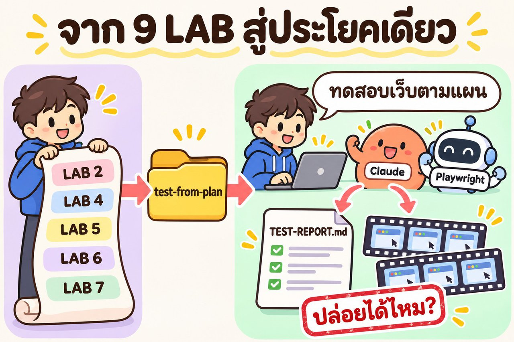

> อ่าน [ส่วน 01 ทฤษฎี](../01_skill-theory/) ให้เข้าใจก่อน ทุก LAB ในส่วนนี้มีลิงก์กลับไปหัวข้อทฤษฎีที่เกี่ยวข้อง

## 🏁 ผลสุดท้ายที่จะได้ (รันจริงทุก LAB)


## 🧭 7 LAB ตาม 6 ขั้น

| LAB | ขั้น (ส่วน 01) | ทำอะไร | แชต |
|---|---|---|---|
| 1 | 1–2 เลือกงานซ้ำ · ทำ 1 รอบ | ให้ Claude อ่าน README บท 02 แล้วทำงานทดสอบจริงจนจบ | 🆕 ใหม่ |
| 2 | 3 เก็บเป็น skill | "เก็บวิธีทำงานนี้เป็น skill" | ต่อจาก LAB 1 |
| 3 | 4–5 ตรวจหัวไฟล์ · อ่านแล้วสั่งแก้ ⭐ | **คน** อ่าน `SKILL.md` แล้วสั่งแก้ 3 เรื่อง | ต่อจาก LAB 2 |
| 4 | 6 แชตใหม่ สั่งสั้น ๆ | "ทดสอบเว็บตามแผนให้หน่อย" | 🆕 ใหม่ |
| 5 | 🔁 จดบทเรียน | เจ้าของแผนตอบคำถาม → จดลง skill | ต่อจาก LAB 4 |
| 6 | 6 ซ้ำ (ข้อสอบจริง) | แชตใหม่ + โหมดฝังบั๊ก: จับได้ไหม ถามซ้ำไหม | 🆕 ใหม่ |
| 7 | 🔁 จดบทเรียน | พลาดตรงไหน → จดลง skill | ต่อจาก LAB 6 |

> 🔑 **"แชตใหม่" สำคัญมาก** LAB ที่มี 🆕 ต้องปิดแชตเดิมแล้วเปิดใหม่จริง ๆ เพราะเราอยากพิสูจน์ว่า AI **จำวิธีทำงานได้จาก skill** ไม่ใช่จากแชตเก่า

---

## 🧰 ก่อนเริ่ม

| ✅ | ต้องมี |
|---|---|
| ☐ | ทำ **บท 02** มาแล้ว (มี Node.js, Playwright, Chromium, ffmpeg จากบท 01) |
| ☐ | **Docker Desktop** เปิดอยู่ |
| ☐ | เปิด **Claude Code** ที่โฟลเดอร์ `00_week01/02_test-from-plan/01_petshop` (โฟลเดอร์เดียวกับบท 02) |
| ☐ | ถ้ามีโฟลเดอร์ `e2e` จากบท 02 อยู่แล้ว ให้ลบหรือเปลี่ยนชื่อก่อน เพื่อให้ LAB 1 เริ่มจากศูนย์ |

> 📍 skill ในส่วนนี้ถูกเก็บแบบ **skill ของโปรเจกต์** (`01_petshop/.claude/skills/test-from-plan/`) จึงใช้ได้เมื่อเปิด Claude Code ในโฟลเดอร์นี้ ถ้าจะใช้กับบท 03/04 ด้วยค่อยย้ายไป skill ส่วนตัว `~/.claude/skills/` ([ส่วน 01 หัวข้อ 8](../01_skill-theory/README.md#8-skill-เก็บอยู่ที่ไหนในเครื่อง-windows--mac))

> 🧪 **หมายเหตุผู้สอน:** ผลจริงทุก LAB ด้านล่างรันในสำเนาของบท 02 ที่ **พอร์ต 3100** (container `petshop-skill05`) เพราะเครื่องผู้สอนมีอีกงานใช้พอร์ต 3000 อยู่ ของผู้เรียนจะเป็น `localhost:3000` และ container `petshop` ตามปกติ พรอมต์ทุกข้อเหมือนกัน · รันด้วย Claude Code (Opus 5.5) แบบไม่เชื่อม Chrome

---

## LAB 1 · ให้ AI ลงมือทำจริง 1 รอบ (ขั้น 1–2) 🤖

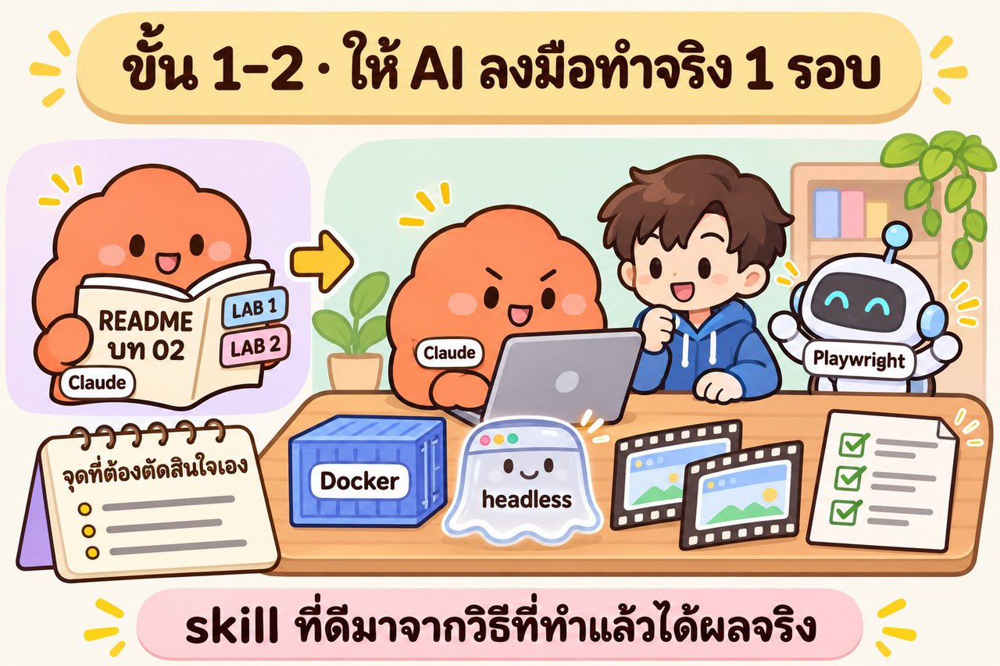

🧑 **คิดก่อน** งานไหนในบท 02 ที่เราต้อง copy-paste ซ้ำทุกครั้ง? (คำตอบ: LAB 2, 4, 5, 6, 7 = "ทดสอบเว็บตามแผน" ทั้งก้อน → นี่คือ **ขั้น 1 เลือกงานที่สั่งซ้ำ**)

ขั้น 2 คือ **ให้ AI ทำงานนั้นจริง 1 รอบก่อน** อย่าเพิ่งให้มันเขียน skill จากการเดา เพราะ skill ที่ดีต้องมาจาก "วิธีที่ทำแล้วได้ผลจริง" (ส่วน 01 หัวข้อ 15: skill ที่ AI เขียนเองล้วน ๆ แย่กว่าไม่มี)

💬 **พรอมต์**

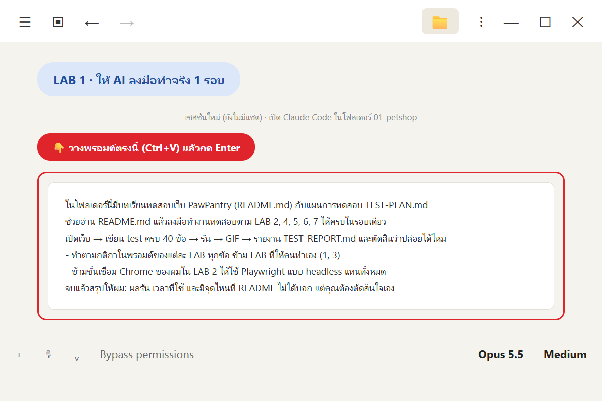

```text
ในโฟลเดอร์นี้มีบทเรียนทดสอบเว็บ PawPantry (README.md) กับแผนการทดสอบ TEST-PLAN.md
ช่วยอ่าน README.md แล้วลงมือทำงานทดสอบตาม LAB 2, 4, 5, 6, 7 ให้ครบในรอบเดียว
เปิดเว็บ → เขียน test ครบ 40 ข้อ → รัน → GIF → รายงาน TEST-REPORT.md และตัดสินว่าปล่อยได้ไหม
- ทำตามกติกาในพรอมต์ของแต่ละ LAB ทุกข้อ ข้าม LAB ที่ให้คนทำเอง (1, 3)
- ข้ามขั้นเชื่อม Chrome ของผมใน LAB 2 ให้ใช้ Playwright แบบ headless แทนทั้งหมด
จบแล้วสรุปให้ผม: ผลรัน เวลาที่ใช้ และมีจุดไหนที่ README ไม่ได้บอก แต่คุณต้องตัดสินใจเอง
```

| บรรทัดในพรอมต์ | มีไว้ทำไม |
|---|---|
| อ่าน README แล้วทำ LAB 2, 4–7 | ให้ AI "ทำตามคู่มือ" 1 รอบ แทนที่เราจะ copy-paste ทีละ LAB |
| ใช้ headless แทน Chrome | skill ต้องทำซ้ำได้เหมือนเดิมทุกครั้ง และ agent หลายตัวใช้ Chrome หน้าต่างเดียวกันไม่ได้ |
| **"จุดที่ README ไม่ได้บอก แต่ต้องตัดสินใจเอง"** ⭐ | นี่คือ **ความรู้ของนักภาษี** (ส่วน 01 หัวข้อ 4) ที่ README ไม่มี — วัตถุดิบหลักของ skill |

✅ **ผลจริง: ผ่าน 39 · ล้ม 1 · ใช้ ~12 นาที** (ตรงกับบท 02)

| ช่วง | ผล |
|---|---|
| เปิดเว็บ | healthy ใน 7.6 วินาที |
| test 5 ข้อแรก | ผ่าน 5/5 |
| ครบ 40 ข้อ | agent 10 ตัว ตัวละโมดูล รันรวม 41.8 วินาที **ผ่าน 39 ล้ม 1** (TC-AUTH-02 บั๊กจริง) |
| GIF | 40 ไฟล์ ยาว 7.1–11.8 วินาที + หน้า index.html |
| คำตัดสิน | P1 15/15 · 97.5% → **ปล่อยได้** |

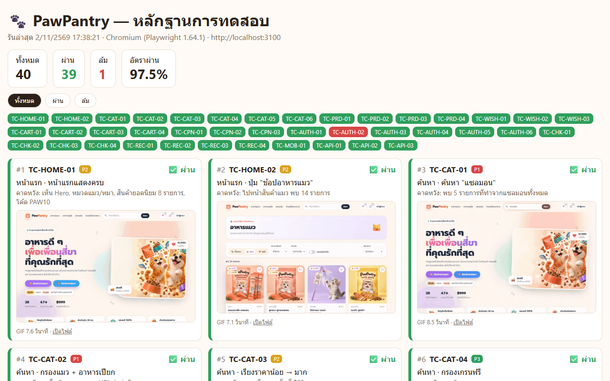

| 🐞 TC-AUTH-02 ช่องยืนยันรหัสผ่านไม่มี error | 🛒 TC-CHK-03 ซื้อของจนจบ |
|---|---|
| 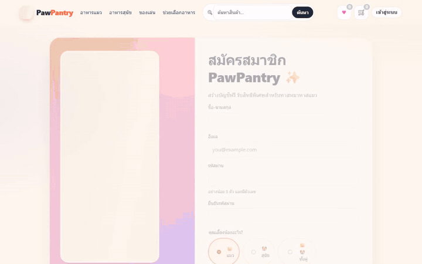 |  |

👀 **สังเกต: "จุดที่ต้องตัดสินใจเอง" ที่ Claude ตอบกลับมา 8 เรื่อง** (ตัวอย่าง)

| จุดที่ README ไม่ได้บอก | Claude ตัดสินใจว่า |
|---|---|
| agent หลายตัวสั่งล้างข้อมูล (`/api/test/reset`) พร้อมกัน จะลบข้อมูลของกัน | ล้างครั้งเดียวก่อนรันรวม ระหว่าง agent รันให้ข้ามการล้าง |
| test สั่งซื้อหลายข้อแย่งสต็อกสินค้าตัวเดียวกัน | ให้แต่ละข้อใช้สินค้าคนละตัว |
| GIF ต้องยาว ≥ 5 วินาที | เดินช้าลง 350 ms ต่อขั้น และค้างหน้าผลไว้ |
| "error ทุกช่อง" | ทุกช่องต้องมี error ของตัวเอง → จับบั๊ก TC-AUTH-02 ได้ |
| **"อาหารแมว" รวมขนมไหม** (TC-REC-01) | **นับขนมเป็นอาหาร** ← จำข้อนี้ไว้ จะกลับมาใน LAB 3 |

และสารภาพเองว่า **"ตอนต้นงานผมเผลอสั่ง `ls petshop` ไป 1 ครั้ง"** = ละเมิดกติกา black-box (ส่วน 01 หัวข้อ 4.4)

> ทั้งหมดนี้คือ **procedural knowledge** ที่ได้จากการลงมือทำ (ส่วน 01 หัวข้อ 5) ถ้าเปิดแชตใหม่ AI จะลืมทุกข้อ → LAB 2 จะเก็บไว้

---

## LAB 2 · เก็บวิธีทำงานเป็น skill (ขั้น 3) 🤖

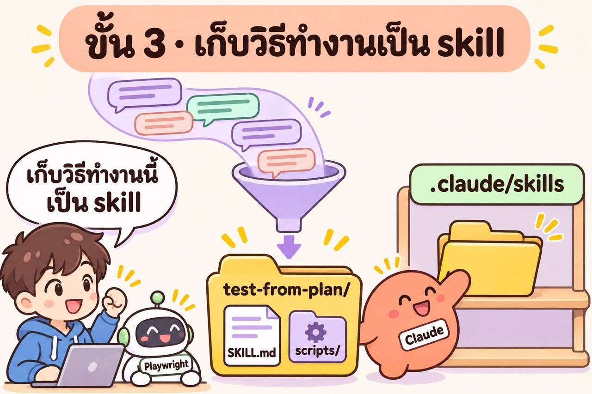

🧑 **คิดก่อน** ถ้าเราเป็นคนเขียน skill เอง อยากให้มีอะไรบ้าง? อะไรควรเป็น "ข้อความ" อะไรควรเป็น "สคริปต์" (ส่วน 01 หัวข้อ 9)

💬 **พรอมต์** (แชตเดิม ต่อจาก LAB 1)

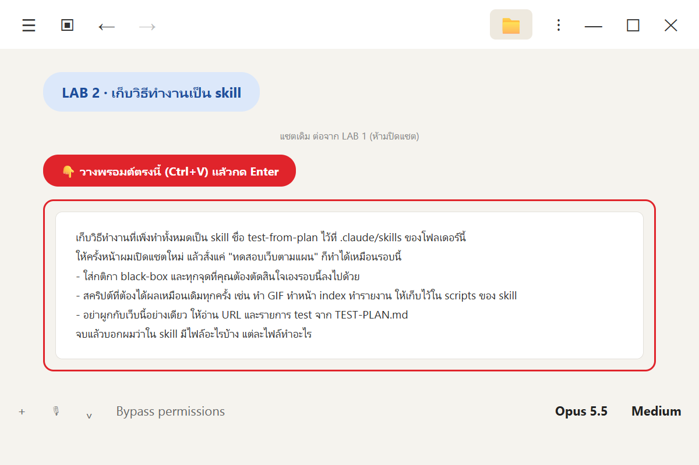

```text
เก็บวิธีทำงานที่เพิ่งทำทั้งหมดเป็น skill ชื่อ test-from-plan ไว้ที่ .claude/skills ของโฟลเดอร์นี้
ให้ครั้งหน้าผมเปิดแชตใหม่ แล้วสั่งแค่ "ทดสอบเว็บตามแผน" ก็ทำได้เหมือนรอบนี้
- ใส่กติกา black-box และทุกจุดที่คุณต้องตัดสินใจเองรอบนี้ลงไปด้วย
- สคริปต์ที่ต้องได้ผลเหมือนเดิมทุกครั้ง เช่น ทำ GIF ทำหน้า index ทำรายงาน ให้เก็บไว้ใน scripts ของ skill
- อย่าผูกกับเว็บนี้อย่างเดียว ให้อ่าน URL และรายการ test จาก TEST-PLAN.md
จบแล้วบอกผมว่าใน skill มีไฟล์อะไรบ้าง แต่ละไฟล์ทำอะไร
```

| บรรทัดในพรอมต์ | เชื่อมกับทฤษฎี |
|---|---|
| สั่งแค่ "ทดสอบเว็บตามแผน" | บอกว่า `description` ควรมีคำนี้ (หัวข้อ 7) |
| งานที่ต้องเหมือนเดิม → scripts | งานซ้ำให้โค้ด งานคิดให้ AI (หัวข้อ 9) |
| อ่าน URL จาก TEST-PLAN.md | ให้ใช้ซ้ำกับเว็บอื่นได้ (ส่วน 03 จะใช้) |

✅ **ผลจริง (~9 นาที)** ได้โฟลเดอร์ skill 13 ไฟล์

```text
.claude/skills/test-from-plan/
├─ SKILL.md                    ← กติกา black-box 6 ข้อ + ขั้นตอน 9 ขั้น (103 บรรทัด)
├─ references/
│  ├─ agent-brief.md           ← แม่แบบคำสั่งให้ agent แต่ละตัว (ฝังกติกาไว้แล้ว)
│  └─ decisions.md             ← 37 จุดตัดสินใจ/กับดักที่เจอในรอบแรก
└─ scripts/                    ← 10 สคริปต์ที่ต้องได้ผลเหมือนเดิมทุกครั้ง
   ├─ parse-plan.mjs           ← อ่านแผน → plan.json (ข้ามหัวข้อเฉลยเอง)
   ├─ scaffold-e2e.mjs         ← สร้างห้องทดลอง e2e
   ├─ check-browser.mjs        ← เช็กว่ามี Chromium/ffmpeg (ไม่มี = หยุดถาม ห้ามโหลดเอง)
   ├─ make-gifs.mjs · build-index.mjs · build-report.mjs
   └─ explore.mjs · agents-dashboard.mjs · watch-agents.mjs · _lib.mjs
```

👀 **สังเกต**
- นี่คือ **เปิดทีละชั้น** ของจริง (หัวข้อ 10): `SKILL.md` สั้น 103 บรรทัด ส่วน 37 จุดตัดสินใจอยู่ใน `references/decisions.md` เปิดเมื่อต้องใช้
- Claude **ลองทดสอบ skill เอง** กับแผนปลอมของเว็บอื่น (คนละ URL หัวตารางภาษาอังกฤษ) แล้วอ่านได้ถูก
- แต่มันบอกตรง ๆ ว่า **"ยังไม่ได้ลองเปิดแชตใหม่จริง"** → เป็นหน้าที่ของ LAB 4

---

## LAB 3 · คนอ่าน skill แล้วสั่งแก้ (ขั้น 4–5) 🧑 ⭐ สำคัญที่สุด

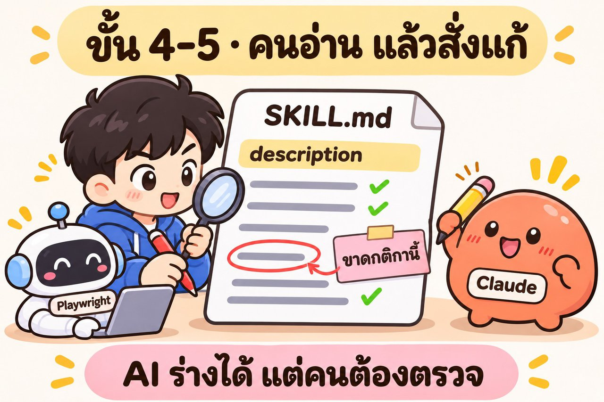

ส่วน 01 หัวข้อ 15: **skill ที่ AI เขียนเองล้วน ๆ ทำให้ผลแย่กว่าไม่มี skill 8.1–11.5 จุด** LAB นี้จึงห้ามข้าม

🧑 **ทำเอง (ไม่ต้องใช้ AI)** เปิด `.claude/skills/test-from-plan/SKILL.md` กับ `references/decisions.md` แล้วตรวจด้วยเช็กลิสต์นี้

| ✅ | ตรวจอะไร | เทียบกับ |
|---|---|---|
| ☐ | `description` สั้น ชัด บอกทำอะไร · ได้อะไร · ใช้เมื่อพูดว่าอะไร | ส่วน 01 หัวข้อ 7 |
| ☐ | กติกา black-box ครบไหม (ห้ามเปิด petshop · ห้ามอ่านหัวข้อ 8 · ห้ามแก้ test ให้ผ่าน) | ตาราง "ความรู้ของนักภาษี" หัวข้อ 4.4 |
| ☐ | มีอะไรเกินจำเป็นไหม (ทำให้ช้า/เปลือง) | หัวข้อ 10 งบความสนใจ |
| ☐ | **มีจุดไหนที่ AI ตัดสินใจแทนเราแล้วทำให้ test ผ่านง่ายขึ้นไหม** ⭐ | บท 03 "อย่าอบบั๊กลงในผลที่คาดหวัง" |

ผู้สอนตรวจแล้วเจอ 3 เรื่อง

| ที่เจอ | ทำไมต้องแก้ |
|---|---|
| จอ `agents.html` + ถ่ายภาพทุก 5 วินาที ทำทุกรอบ | เป็นของ **สอน** ใน LAB 5 บท 02 งานจริงไม่ต้องใช้ ทำให้ช้า |
| decisions ข้อ 18: "อาหารแมว" = **นับขนมด้วย** | AI เลือกแบบที่ทำให้ TC-REC-01 **ผ่าน** แล้วเงียบ — ควรเป็นคนตัดสิน |
| `description` ยาว ~600 ตัวอักษร | ส่วนที่ AI เห็นตลอด ควรสั้นและชัด |

💬 **พรอมต์** (แชตเดิม ต่อจาก LAB 2)

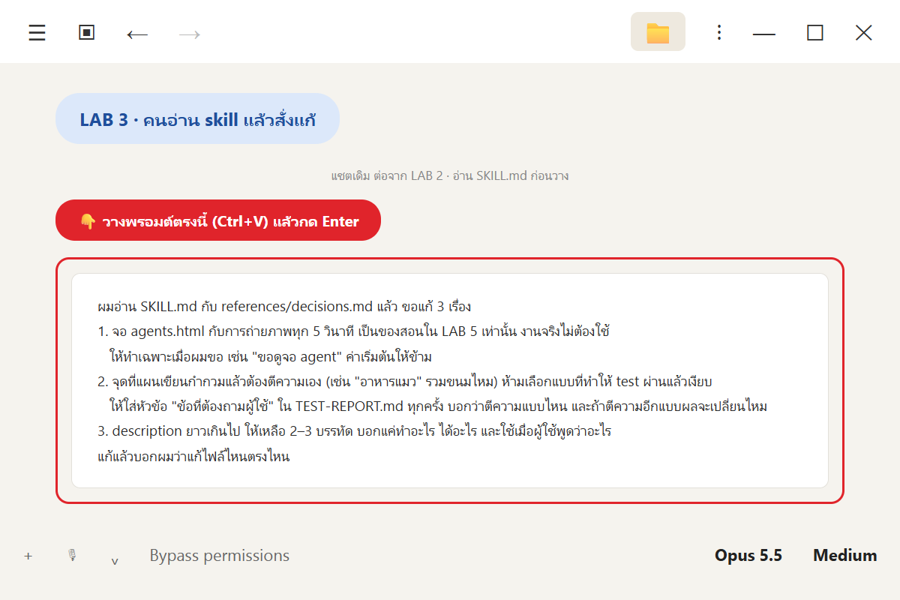

```text
ผมอ่าน SKILL.md กับ references/decisions.md แล้ว ขอแก้ 3 เรื่อง
1. จอ agents.html กับการถ่ายภาพทุก 5 วินาที เป็นของสอนใน LAB 5 เท่านั้น งานจริงไม่ต้องใช้
   ให้ทำเฉพาะเมื่อผมขอ เช่น "ขอดูจอ agent" ค่าเริ่มต้นให้ข้าม
2. จุดที่แผนเขียนกำกวมแล้วต้องตีความเอง (เช่น "อาหารแมว" รวมขนมไหม) ห้ามเลือกแบบที่ทำให้ test ผ่านแล้วเงียบ
   ให้ใส่หัวข้อ "ข้อที่ต้องถามผู้ใช้" ใน TEST-REPORT.md ทุกครั้ง บอกว่าตีความแบบไหน และถ้าตีความอีกแบบผลจะเปลี่ยนไหม
3. description ยาวเกินไป ให้เหลือ 2–3 บรรทัด บอกแค่ทำอะไร ได้อะไร และใช้เมื่อผู้ใช้พูดว่าอะไร
แก้แล้วบอกผมว่าแก้ไฟล์ไหนตรงไหน
```

✅ **ผลจริง (~3 นาที)** แก้ 5 ไฟล์ (+97 / −34 บรรทัด) → **skill v2**

```markdown
---
name: test-from-plan
description: |
  ทดสอบเว็บแบบ black-box ตามแผนใน TEST-PLAN.md (อ่าน URL, test cases, เกณฑ์จากแผนเอง) ด้วย Playwright headless และ agent ขนาน
  ได้ test ครบทุกข้อใน e2e/, GIF หลักฐานทุกข้อ, index.html, TEST-REPORT.md และคำตัดสินว่าปล่อยได้ไหม
  ใช้เมื่อผู้ใช้พูดว่า "ทดสอบเว็บตามแผน", "รัน test ตาม TEST-PLAN", "ทำรายงานผลทดสอบ" หรือ /test-from-plan
---
```

| สั่งแก้ | สิ่งที่ Claude ทำ |
|---|---|
| 1 จอ agent | ย้ายไปหัวข้อ "จอดู agent (ค่าเริ่มต้น: ข้าม)" สคริปต์ไม่สร้างไฟล์ log ถ้าไม่ขอ |
| 2 ตีความกำกวม | กติกาใหม่: ใช้ความหมายตรงตัวที่สุด **ลองอีกแบบกับเว็บจริง** แล้วเขียน `interpretations.json` · สคริปต์รายงานคำนวณว่า **ถ้าตีความอีกแบบ คำตัดสินพลิกไหม** |
| 3 description | เหลือ 3 บรรทัด (ด้านบน) |

🐞 **สิ่งที่การตรวจของคนเจอ:** Claude ยอมรับเองว่า TC-REC-01 เป็น **P1** ถ้า "อาหารแมว" ไม่รวมขนม ข้อนี้จะล้ม และ **คำตัดสินพลิกจาก "ปล่อยได้" เป็น "ยังไม่ปล่อย"** — skill รุ่นแรกที่ AI เขียนเองตัดสินเรื่องนี้เงียบ ๆ ไปแล้ว

> นี่คือเหตุผลของตัวเลข SkillsBench (หัวข้อ 15) แบบเห็นกับตา: **AI ร่างได้เร็ว แต่คนเท่านั้นที่รู้ว่า "วิธีทำงานที่ถูก" คืออะไร**

---

## LAB 4 · แชตใหม่ สั่งประโยคเดียว (ขั้น 6) 🤖

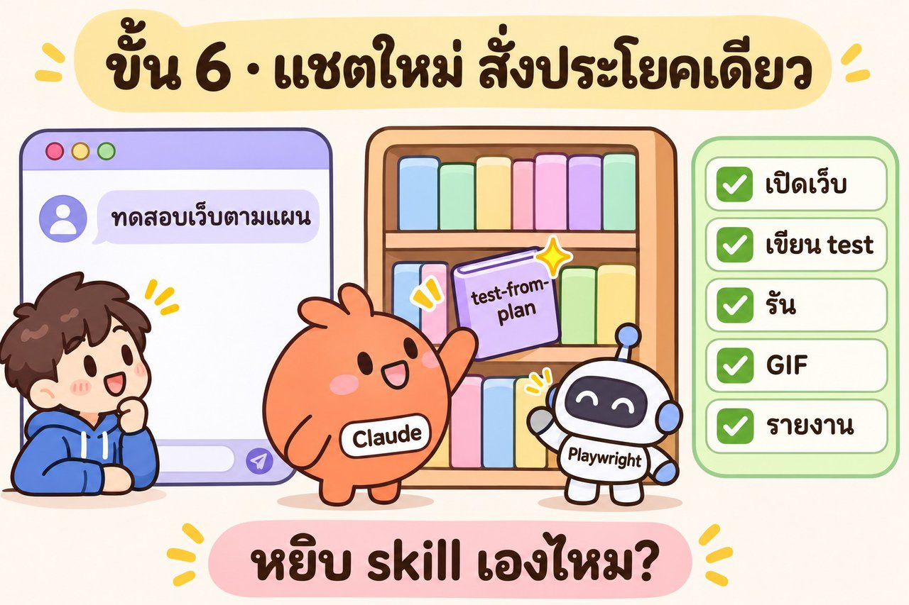

🧑 **ทำก่อน**
1. **ปิดแชตเดิม** เปิดแชตใหม่ในโฟลเดอร์ `01_petshop`
2. **ลบโฟลเดอร์ `e2e`** (เพื่อพิสูจน์ว่าทำใหม่ได้จาก skill ล้วน ๆ ไม่ได้ลอกของเก่า)

🧑 **คิดก่อน** แชตใหม่ไม่รู้อะไรเลย มันจะรู้ได้ยังไงว่าต้องใช้ skill? (ส่วน 01 หัวข้อ 10 ชั้น 1)

💬 **พรอมต์**

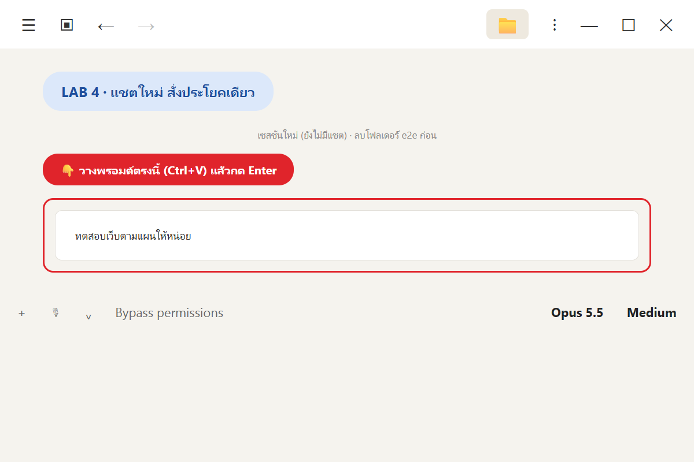

```text
ทดสอบเว็บตามแผนให้หน่อย
```

✅ **ผลจริง (~10 นาที)**

| ตรวจอะไร | ผล |
|---|---|
| หยิบ skill เองไหม | ✅ **คำสั่งแรกสุดของ Claude คือ `Skill: test-from-plan`** — จากประโยคเดียว |
| ทำตามขั้นตอนใน skill | ✅ รัน `parse-plan.mjs` → เปิดเว็บ → scaffold → ลองโมดูลตะกร้าเอง → agent 10 ตัว → รันรวม 43 วินาที |
| กติกา black-box | ✅ **ไม่ละเมิดเลย** (LAB 1 เผลอ `ls petshop` แต่ skill จดไว้แล้วว่า "อย่าทำซ้ำ") |
| ผล | 37/40 → ⛔ **"ยังไม่ปล่อย แต่ยังไม่เด็ดขาด รอคุณตอบคำถามข้อ 1"** |
| ข้อที่ต้องถามผู้ใช้ | **8 ข้อ** (ไม่ตัดสินเงียบแล้ว) |

ข้อที่ต้องถาม (ย่อ)

| # | คำถาม | ทำไมสำคัญ |
|---|---|---|
| 1 | **"อาหารแมว" รวมขนมไหม** (TC-REC-01 P1, TC-REC-03) | ถ้ารวม → คำตัดสินพลิกเป็น **ปล่อยได้** |
| 2 | ช่องยืนยันรหัสผ่านที่ว่างต้องขึ้น error เองไหม (TC-AUTH-02) | ไม่พลิกคำตัดสิน |
| 4 | **ใส่ PAW10 แล้วกรอกโค้ดผิดทับ คูปองเดิมหลุด ยอดเด้ง ฿761 → ฿840** ถูกไหม | 💰 อาจเป็นบั๊กเรื่องเงินที่แผนไม่ได้เขียนไว้ |
| 7 | ฿770 ใน TC-CPN-01 รวมค่าส่ง ฿50 แล้วใช่ไหม (799 − 79 = 720) | ยืนยันความหมายของตัวเลขในแผน |

| 🐞 TC-REC-01 ผลแนะนำอันดับ 2 เป็น "ขนมแมวเลีย" |
|---|
|  |

👀 **สังเกต**
- นี่คือ **ชั้น 1 → 2 → 3** ของจริง: AI เห็นแค่ `description` → ตัดสินใจเปิด `SKILL.md` → อ่าน `decisions.md` ตามที่ SKILL.md สั่ง
- skill v2 ทำตัวเหมือน **tester ตัวจริง** มากกว่าเดิม: เจอจุดน่าสงสัยเรื่องเงิน (ข้อ 4) ที่แผนไม่ได้เขียน แต่ **ไม่ตัดสินเอง** ส่งให้คนตัดสิน

---

## LAB 5 · ตอบคำถาม แล้วจดลง skill (🔁 วงจรเรียนรู้) 🧑 + 🤖


🧑 **ตัดสินเอง** เราคือ **เจ้าของแผน** ตอบคำถาม 8 ข้อ (ผู้สอนตอบตามผลที่บท 02 ยอมรับไว้แล้ว: TC-REC-01 ผ่าน = ขนมนับเป็นอาหาร · TC-AUTH-02 = บั๊กจริง)

💬 **พรอมต์** (แชตเดิม ต่อจาก LAB 4)

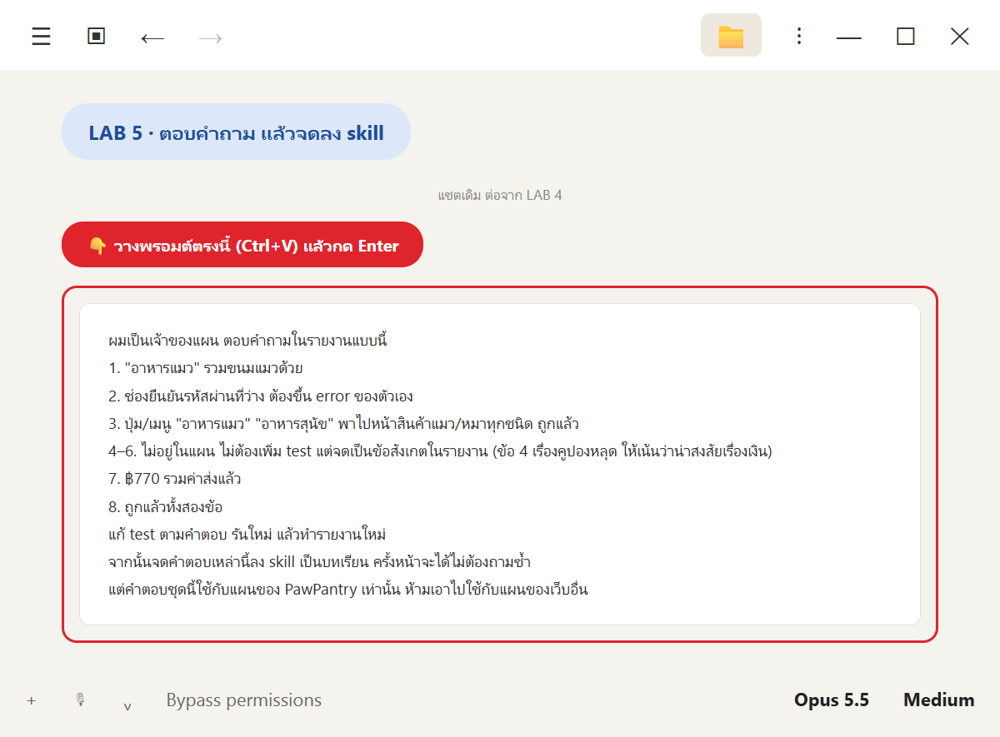

```text
ผมเป็นเจ้าของแผน ตอบคำถามในรายงานแบบนี้
1. "อาหารแมว" รวมขนมแมวด้วย
2. ช่องยืนยันรหัสผ่านที่ว่าง ต้องขึ้น error ของตัวเอง
3. ปุ่ม/เมนู "อาหารแมว" "อาหารสุนัข" พาไปหน้าสินค้าแมว/หมาทุกชนิด ถูกแล้ว
4–6. ไม่อยู่ในแผน ไม่ต้องเพิ่ม test แต่จดเป็นข้อสังเกตในรายงาน (ข้อ 4 เรื่องคูปองหลุด ให้เน้นว่าน่าสงสัยเรื่องเงิน)
7. ฿770 รวมค่าส่งแล้ว
8. ถูกแล้วทั้งสองข้อ
แก้ test ตามคำตอบ รันใหม่ แล้วทำรายงานใหม่
จากนั้นจดคำตอบเหล่านี้ลง skill เป็นบทเรียน ครั้งหน้าจะได้ไม่ต้องถามซ้ำ
แต่คำตอบชุดนี้ใช้กับแผนของ PawPantry เท่านั้น ห้ามเอาไปใช้กับแผนของเว็บอื่น
```

| บรรทัดในพรอมต์ | ทำไม |
|---|---|
| "ผมเป็นเจ้าของแผน" | คำตอบต้องมาจาก **คนที่มีสิทธิ์ตัดสิน** ไม่ใช่ AI |
| "จดลง skill … ไม่ต้องถามซ้ำ" | นี่คือ **in-context learning** (หัวข้อ 14): สมองเดิม คู่มือดีขึ้น |
| "ห้ามเอาไปใช้กับแผนของเว็บอื่น" | "อาหารแมว" ของร้านนี้อาจไม่เหมือนร้านอื่น — บทเรียนต้องมีขอบเขต |

✅ **ผลจริง (~6 นาที)** → **✅ ปล่อยได้ · ผ่าน 39/40** (P1 15/15 · 97.5%) → **skill v3**

| | รอบแรก (LAB 4) | หลังตอบ (LAB 5) |
|---|---|---|
| TC-REC-01 | ❌ | ✅ |
| TC-REC-03 | ❌ | ✅ |
| TC-AUTH-02 | ❌ | ❌ เว็บผิด (เจ้าของแผนยืนยัน) |

สิ่งที่จดลง skill

| ไฟล์ | ทำอะไร |
|---|---|
| `references/plan-answers/pawpantry.json` (ใหม่) | คำตอบ 11 ข้อ (ตีความ 8 + ข้อสังเกตนอกแผน 3) แต่ละข้อผูกกับ **ถ้อยคำในแผน** |
| `scripts/plan-answers.mjs` (ใหม่) | ใช้คำตอบเดิม **เฉพาะเมื่อ** ชื่อแผน + URL + จำนวน test ตรงครบ · ถ้าถ้อยคำในแผนเปลี่ยน → คำตอบข้อนั้น **หมดอายุ** ต้องถามใหม่ (Claude ลองแก้คำในสำเนาแผนแล้ว สคริปต์จับได้จริง) |
| รายงาน | ข้อสังเกตนอกแผน **OBS-01 💰** ใส่ PAW10 (฿761) แล้วกรอกโค้ดผิดทับ ส่วนลดหาย ยอดเป็น ฿840 |

👀 **สังเกต** การ "เรียนรู้" ที่ปลอดภัยต้องมี **ขอบเขต** และ **วันหมดอายุ** ไม่งั้นบทเรียนของร้านหนึ่งจะไปทำให้อีกร้านผิด

---

## LAB 6 · แชตใหม่ โหมดฝังบั๊ก: ข้อสอบจริงของ skill 🤖 🐞

🧑 **ทำก่อน** ปิดแชต เปิดแชตใหม่ ลบโฟลเดอร์ `e2e`

🧑 **คิดก่อน** skill v3 ควรทำอะไรได้ดีกว่า LAB 4?
1. จับบั๊กฝังได้ครบ 3 ตัว (เหมือน LAB 8 บท 02)
2. **ไม่ถามคำถามที่เจ้าของแผนตอบแล้ว**

💬 **พรอมต์**

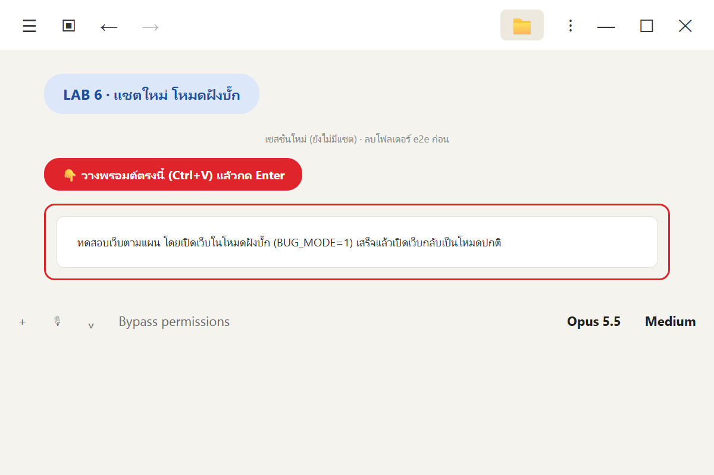

```text
ทดสอบเว็บตามแผน โดยเปิดเว็บในโหมดฝังบั๊ก (BUG_MODE=1) เสร็จแล้วเปิดเว็บกลับเป็นโหมดปกติ
```

✅ **ผลจริง (~13 นาที): ผ่าน 35 · ล้ม 5 (87.5%) · P1 13/15 → ⛔ ยังไม่ปล่อย** (ตรงกับ LAB 8 บท 02)

| ตรวจอะไร | ผล |
|---|---|
| หยิบ skill เอง | ✅ คำสั่งแรก `Skill: test-from-plan` |
| จับบั๊กฝัง | ✅ **ครบ 3/3** (+ บั๊กจริง TC-AUTH-02) · test ผิด 0 ข้อ |
| ใช้คำตอบเดิม | ✅ **11 ข้อจาก `pawpantry.json` ไม่มีข้อไหนหมดอายุ** ไม่ถามเรื่อง "อาหารแมว" ซ้ำ |
| ข้อสังเกตนอกแผน | ✅ ตรวจกับเว็บรอบนี้ใหม่ทั้ง 3 ข้อ (ไม่ลอกผลรอบก่อน) |
| เปิดเว็บกลับโหมดปกติ | ✅ BUG_MODE=0 · PAW10 ลด ฿79 ถูก |
| กติกา black-box | ✅ ไม่ละเมิด |

| test ที่ล้ม | ระดับ | อาการ | หลักฐานว่าเว็บผิด (ไม่ใช่ test ผิด) |
|---|---|---|---|
| TC-CPN-01 | 🔴 P1 | PAW10 ลด ฿7 แทน ฿79 ยอด ฿842 แทน ฿770 | NEWCAT50 ใช้ช่องเดียวกันแล้วลด ฿50 ถูก |
| TC-CHK-02 | 🔴 P1 | เบอร์ 9 หลักผ่านโดยไม่มี error | เบอร์ 5, 7, 8, 11 หลักขึ้น error ปกติ |
| TC-WISH-02 | 🟡 P2 | ลบรายการโปรดแล้วตัวเลข ♥ ไม่ลด | ตอนเพิ่ม ตัวเลขขึ้นทันที (TC-WISH-01 ผ่าน) |
| TC-WISH-03 | 🟡 P2 | บั๊กเดียวกัน (ย้ายไปตะกร้า) | สาเหตุเดียวกับข้อบน |
| TC-AUTH-02 | 🟡 P2 | ช่องยืนยันรหัสผ่านไม่มี error | เจ้าของแผนยืนยันไว้แล้ว (LAB 5) |

| 🐞 คูปองลดผิด | 🐞 ตัวเลข ♥ ไม่ลด | 🐞 เบอร์ 9 หลักผ่าน |
|---|---|---|
| 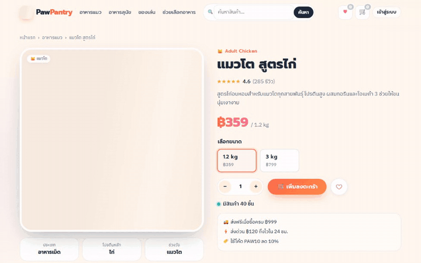 | 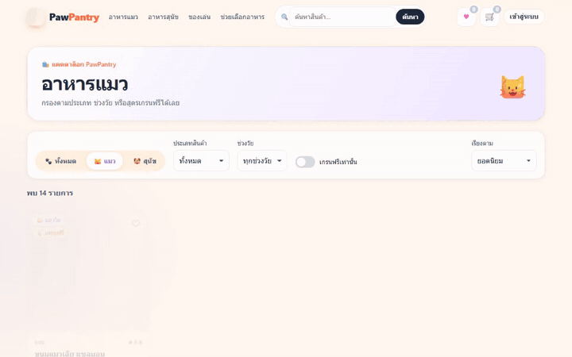 |  |

⚠️ **แต่ยังพลาด 2 เรื่อง** (เหมือนที่ Kreycin เจอ "พี่" 13 บรรทัด — skill วันนี้ก็ยังพลาดได้)
1. **ถามคำถามใหม่ 13 ข้อ** หลายข้อจุกจิก เช่น "ลิงก์ที่หน้าตาเหมือนปุ่ม นับเป็นปุ่มไหม" ทั้งที่ไม่มีข้อไหนเปลี่ยนคำตัดสิน → คนอ่านไม่ไหว
2. **สคริปต์รายงานเขียนว่า "ยังไม่เด็ดขาด"** ทั้งที่ TC-CPN-01 ล้มไม่ว่าจะตีความแบบไหน → Claude ต้องแก้รายงานด้วยมือ (มันบอกเราตรง ๆ ในสรุป)

---

## LAB 7 · พลาดแล้วจดบทเรียนลง skill (🔁) 🧑 + 🤖

🧑 **คิดก่อน** 2 เรื่องที่พลาดใน LAB 6 ควรแก้ที่ "ข้อความใน SKILL.md" หรือ "สคริปต์"? (ส่วน 01 หัวข้อ 9: คำถามไหนควรถาม = งานคิด · คำตัดสินเด็ดขาดไหม = คิดเลข ต้องเหมือนเดิมทุกครั้ง)

💬 **พรอมต์** (แชตเดิม ต่อจาก LAB 6)

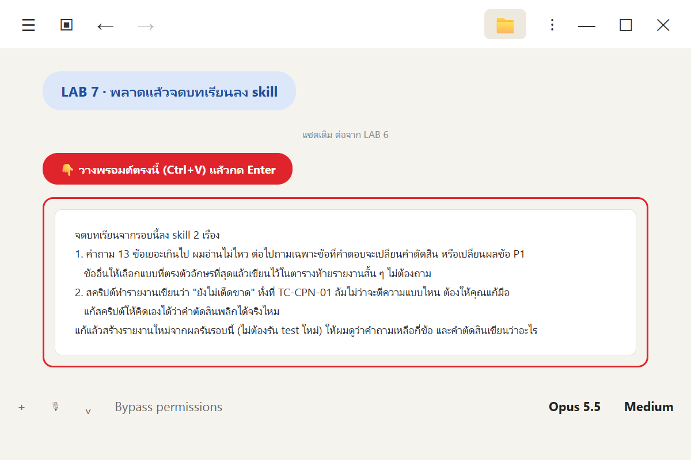

```text
จดบทเรียนจากรอบนี้ลง skill 2 เรื่อง
1. คำถาม 13 ข้อเยอะเกินไป ผมอ่านไม่ไหว ต่อไปถามเฉพาะข้อที่คำตอบจะเปลี่ยนคำตัดสิน หรือเปลี่ยนผลข้อ P1
   ข้ออื่นให้เลือกแบบที่ตรงตัวอักษรที่สุดแล้วเขียนไว้ในตารางท้ายรายงานสั้น ๆ ไม่ต้องถาม
2. สคริปต์ทำรายงานเขียนว่า "ยังไม่เด็ดขาด" ทั้งที่ TC-CPN-01 ล้มไม่ว่าจะตีความแบบไหน ต้องให้คุณแก้มือ
   แก้สคริปต์ให้คิดเองได้ว่าคำตัดสินพลิกได้จริงไหม
แก้แล้วสร้างรายงานใหม่จากผลรันรอบนี้ (ไม่ต้องรัน test ใหม่) ให้ผมดูว่าคำถามเหลือกี่ข้อ และคำตัดสินเขียนว่าอะไร
```

✅ **ผลจริง (~3 นาที)** → **skill v4**

| | ก่อน (v3) | หลัง (v4) |
|---|---|---|
| คำถามถึงคน | 13 ข้อ | **2 ข้อ** (TC-CHK-02 และ TC-AUTH-06 — ทั้งคู่เป็น P1) อีก 11 ข้อย้ายไป "ภาคผนวก: จุดกำกวมที่ตีความเอง" บรรทัดเดียวต่อข้อ |
| คำตัดสิน | "ยังไม่เด็ดขาด" (Claude ต้องแก้มือ) | **"⛔ ยังไม่ปล่อย (เด็ดขาด — ไม่ว่าจะตอบคำถามในหัวข้อ 6 แบบไหน)"** สคริปต์เขียนเอง + บอกว่า "ข้อที่ล้มและไม่มีการตีความใดช่วยให้ผ่านได้: TC-CPN-01" |
| วิธีคิดในสคริปต์ | ใช้การตีความอีกแบบทุกข้อพร้อมกัน | ลองเฉพาะกรณีที่พลิกคำตัดสินได้มากที่สุด · ถ้าคำตัดสินดูผิด **ให้แก้สคริปต์ ไม่ใช่แก้รายงาน** |

Claude ยังลองกรณีกลับกันในข้อมูลสำเนา (สมมุติ TC-CPN-01 ผ่าน) สคริปต์เขียน "ยังไม่เด็ดขาด" และถาม 5 ข้อถูกต้อง

> ⚠️ ยังไม่ได้รัน skill v4 เต็มรอบในแชตใหม่ — รอบหน้าที่ใช้จะเป็นการทดสอบ v4 ต่อ (วงจรนี้ไม่มีวันจบ และนั่นคือประเด็น)

---

## ✅ สรุปส่วน 02

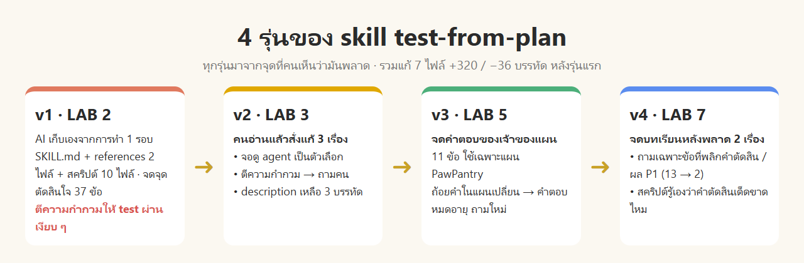

| ทฤษฎีในส่วน 01 | เห็นจริงใน LAB |
|---|---|
| อัจฉริยะ vs คนรู้งาน (หัวข้อ 4) | Claude รู้ Playwright อยู่แล้ว (LAB 1 ผ่าน 39/40) แต่ไม่รู้ "กติกาห้องเรา" จนกว่าจะมี skill (LAB 4 ไม่ละเมิดกติกาเลย) |
| procedural knowledge (หัวข้อ 5) | "จุดที่ต้องตัดสินใจเอง" 8 เรื่องใน LAB 1 → 37 ข้อใน decisions.md |
| งานซ้ำให้โค้ด (หัวข้อ 9) | 10 สคริปต์ (GIF, index, รายงาน) · บั๊กคำตัดสินแก้ที่สคริปต์ ไม่ใช่ที่รายงาน (LAB 7) |
| เปิดทีละชั้น (หัวข้อ 10) | ประโยคเดียว → `description` → `SKILL.md` → `decisions.md` (LAB 4) |
| AI เขียนเองล้วนแย่กว่า (หัวข้อ 15) | v1 ตีความให้ test P1 ผ่านเงียบ ๆ จนคนจับได้ (LAB 3) |
| Day 1 → Day 30 (หัวข้อ 14) | โมเดลเดิมทุกรอบ: v3 ไม่ถามซ้ำ 11 ข้อ · v4 ถามจาก 13 เหลือ 2 → **ไม่ได้ฉลาดขึ้น แต่รู้งานเรามากขึ้น** |

**สิ่งที่คนทำในส่วนนี้** (AI ทำแทนไม่ได้): เลือกงาน (LAB 1) · ตรวจ skill และจับจุดที่ AI ตัดสินแทน (LAB 3) · ตอบคำถามในฐานะเจ้าของแผน (LAB 5) · เห็นว่าคำถามเยอะเกินและคำตัดสินผิด (LAB 7)

## 📝 แบบฝึกหัด

1. ถ้าข้าม LAB 3 skill v1 จะทำให้รายงานของ LAB 4 ต่างไปยังไง และทำไมอันตราย
2. ทำไม LAB 5 ต้องบอกว่า "ห้ามเอาคำตอบไปใช้กับแผนของเว็บอื่น" ยกตัวอย่างเว็บที่ "อาหารแมว" ไม่ควรรวมขนม
3. ใน LAB 7 เรื่องที่ 2 ทำไมต้องแก้ที่ **สคริปต์** ไม่ใช่เพิ่มบรรทัดใน SKILL.md ว่า "ระวังเขียนคำตัดสินผิด"
4. ลองเปิดแชตใหม่ สั่ง "ทดสอบเว็บตามแผน" ด้วย skill v4 ของตัวเอง แล้วนับว่าถามกี่ข้อ ถ้ายังเยอะ จดบทเรียนเพิ่มเอง

<details>
<summary>✅ แนวคำตอบ</summary>

1. v1 จะตีความ "อาหารแมว" รวมขนมเงียบ ๆ → TC-REC-01 (P1) ผ่าน → รายงานบอก "ปล่อยได้" โดยไม่มีใครรู้ว่าถ้าเจ้าของร้านหมายถึงอาหารหลัก ระบบแนะนำกำลังแนะนำขนมให้ลูกแมว = บั๊ก P1 หลุดไปถึงลูกค้า
2. คำตอบเป็นความต้องการของเจ้าของร้านคนนี้ ไม่ใช่ความจริงทั่วไป เช่น ร้านอาหารสัตว์เพื่อสุขภาพที่แยกหมวด "อาหาร" กับ "ขนม" ชัดเจน
3. การตัดสินว่าพลิกได้ไหมเป็นการคำนวณ ต้องได้ผลเหมือนเดิมทุกครั้ง (หัวข้อ 9) ข้อความเตือนใน SKILL.md AI อาจลืมหรืออ่านข้ามได้ (งบความสนใจ หัวข้อ 10)
4. ไม่มีคำตอบตายตัว — เป็นวงจร Day 1 → Day 30 ของตัวเอง

</details>

## ถ้าเจอปัญหา

| อาการ | 💬 พรอมต์ |
|---|---|
| แชตใหม่ไม่หยิบ skill | `ตอนนี้คุณเห็น skill ชื่อ test-from-plan ไหม ถ้าไม่เห็น ช่วยเช็กว่าไฟล์ .claude/skills/test-from-plan/SKILL.md อยู่ถูกที่และหัวไฟล์ถูกรูปแบบไหม` |
| อยากสั่งตรง ๆ | พิมพ์ `/test-from-plan` |
| skill ถามคำถามเยอะ / ทำอะไรที่เราไม่ชอบ | `จดบทเรียนนี้ลง skill: <บอกว่าไม่ชอบอะไร และอยากให้ทำแบบไหน>` |
| อยากดูว่า skill เปลี่ยนอะไรไปบ้าง | `สรุปให้ผมว่า skill test-from-plan ต่างจากรุ่นแรกยังไง` (หรือเก็บ skill ใน Git แล้วดู diff) |
| เลิกใช้เว็บแล้ว | `ปิดเว็บด้วย docker compose down ในโฟลเดอร์ petshop` |

## 📖 คำศัพท์

| คำ | ความหมายง่าย ๆ |
|---|---|
| **skill ของโปรเจกต์** | skill ใน `<โปรเจกต์>/.claude/skills/` ใช้ได้เมื่อเปิด Claude Code ในโปรเจกต์นั้น |
| **ข้อที่ต้องถามผู้ใช้** | จุดที่แผนเขียนกำกวม AI ตีความเองไม่ได้ ต้องให้คนตัดสิน |
| **คำตอบหมดอายุ** | ถ้อยคำในแผนเปลี่ยน คำตอบเดิมใช้ไม่ได้ ต้องถามใหม่ |
| **คำตัดสินเด็ดขาด** | ไม่ว่าจะตอบคำถามแบบไหน ผลก็เหมือนเดิม |
| **ข้อสังเกตนอกแผน** | เรื่องน่าสงสัยที่แผนไม่ได้เขียนไว้ จดไว้แต่ไม่นับในคำตัดสิน |

### ไฟล์ในส่วนนี้

```text
05_agent-skills/02_skill-test-from-plan/
├─ README.md
├─ img/                         # ภาพประกอบ · ภาพพรอมต์ · GIF จากการรันจริง
└─ _solution/
   ├─ skill/                    # skill v4 (ใช้กับ localhost:3000 ของผู้เรียน)
   │  ├─ SKILL.md
   │  ├─ references/            # agent-brief.md · decisions.md · plan-answers/pawpantry.json
   │  └─ scripts/               # 11 สคริปต์
   └─ lab1/ … lab7/             # พรอมต์ · สรุปของ Claude · TEST-REPORT.md · diff ของ skill แต่ละรุ่น
                                # (ผลรันจริงที่พอร์ต 3100 ของเครื่องผู้สอน)
```
