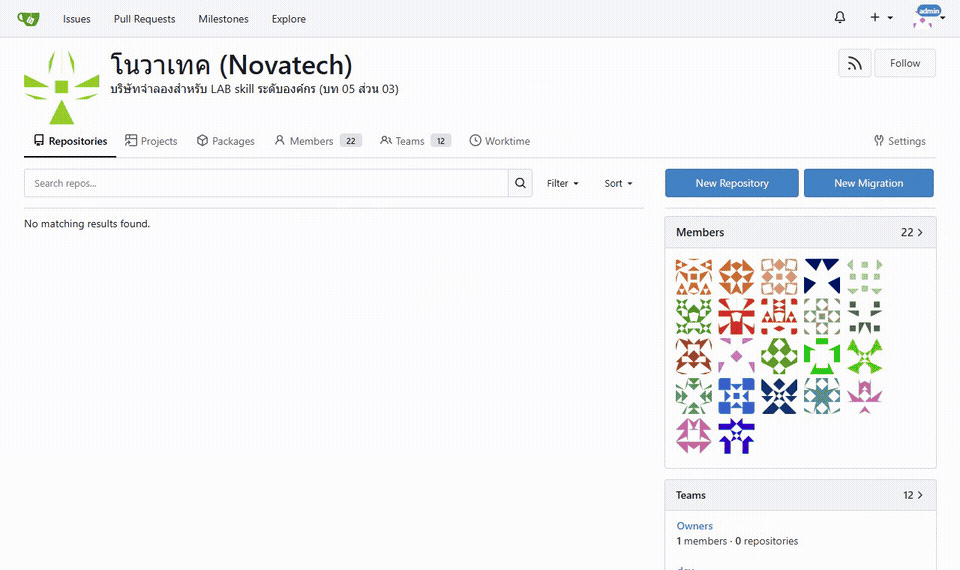
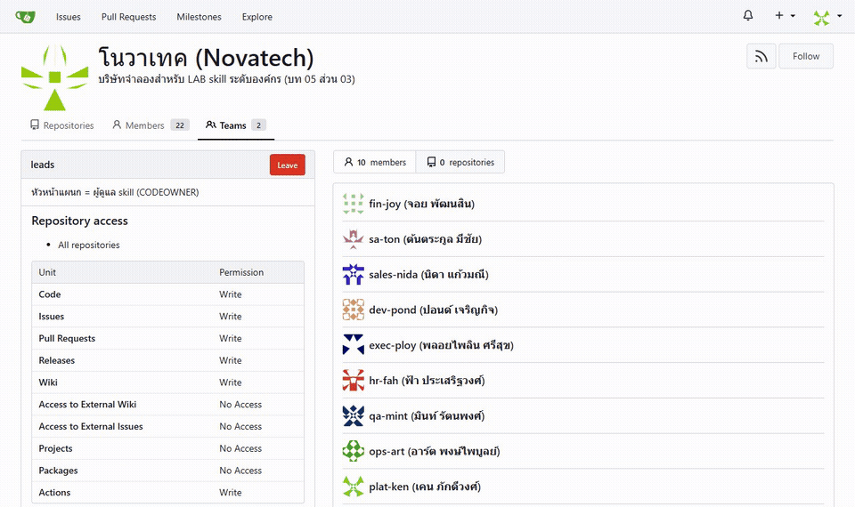
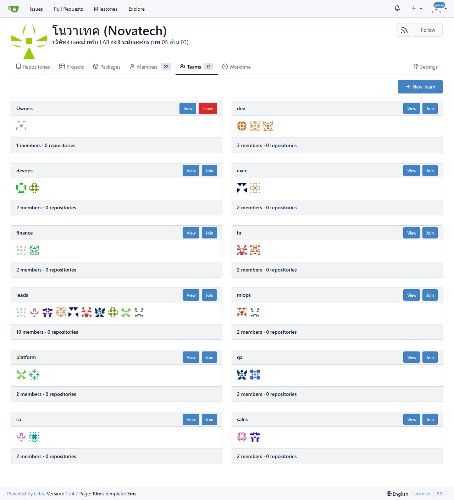
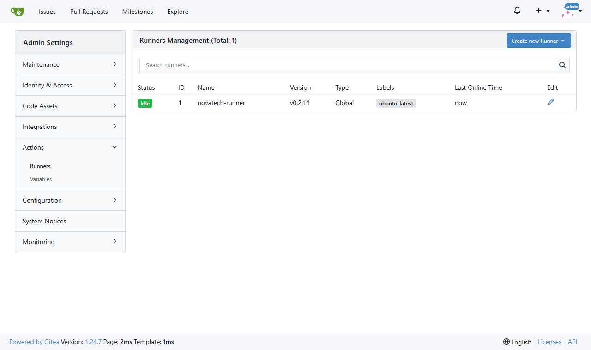
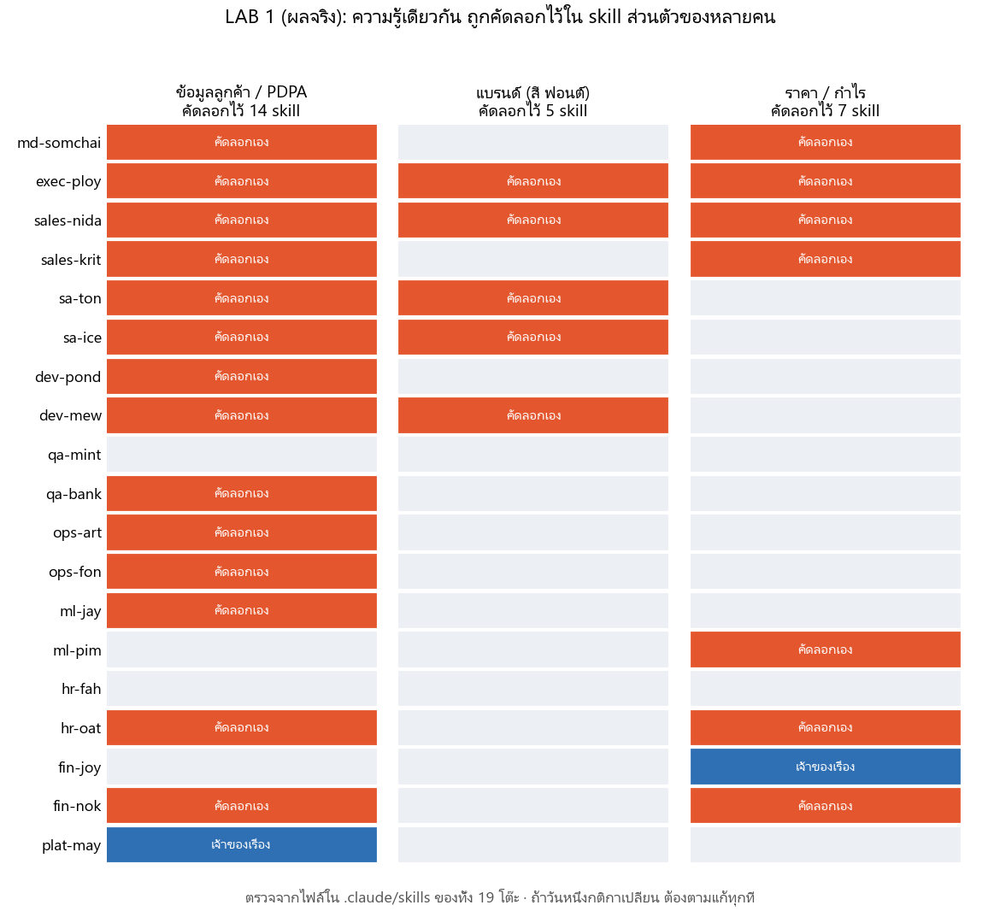

# บท 05 · ส่วน 03 — skill ระดับองค์กร: พนักงาน 21 คน เก่งคนละเรื่อง แชร์กันจนทั้งบริษัทเก่ง (Copy & Paste)

ส่วน 02 ทำให้ **คนเดียว** เก่งขึ้น (skill `test-from-plan` v1 → v4)
ส่วนนี้จำลอง **บริษัทเทค "โนวาเทค" 9 แผนก พนักงาน 21 คน** แต่ละคนเก่งคนละเรื่อง แล้วลงมือจริงตาม [ส่วน 01 ภาค 4](../01_skill-theory/README.md#-ภาค-4--skill-ระดับองค์กร-จากคนเดียวเก่ง-สู่ทั้งบริษัทเก่ง) ว่าความเก่งของคนหนึ่งคนจะกลายเป็นของทั้งบริษัทได้ยังไง: คลังกลาง, PR, CI ด่านตรวจ และการค้นหา skill


> อ่าน [ส่วน 01 ภาค 4 (หัวข้อ 18–26)](../01_skill-theory/README.md#-ภาค-4--skill-ระดับองค์กร-จากคนเดียวเก่ง-สู่ทั้งบริษัทเก่ง) ก่อน ทุก LAB มีลิงก์กลับไปหัวข้อทฤษฎีที่เกี่ยวข้อง · แบบร่างทั้งส่วนอยู่ใน [DESIGN.md](DESIGN.md)

## 🧭 8 LAB

| LAB | ทำอะไร | ทฤษฎี | สถานะ |
|---|---|---|---|
| 0 | ตั้งบริษัท: Gitea (คลังกลาง) + CI runner + พนักงาน 21 คน | 20, 22.2 | ✅ รันจริงแล้ว |
| 1 | 18 คนเก็บความเก่งของตัวเองเป็น skill ส่วนตัว | 16, 18, 21.1 | ⏳ |
| 2 | ทีมกลางตั้งคลัง `org-skills` (plugin marketplace) | 21, 22 | ⏳ |
| 3 | ทุกโต๊ะติดตั้งแพ็กแผนก + คนใหม่วันแรก | 19, 22.3, 24.4 | ⏳ |
| 4 | ดีลเดียววิ่งผ่าน 9 แผนก | 20.1, 25 | ⏳ |
| 5 | ⭐ PR: คนหนึ่งเก่งขึ้น ทุกคนเก่งขึ้น | 19, 22.2 | ⏳ |
| 6 | ⭐ SkillOps CI: ด่านตรวจ skill | 15, 17, 23 | ⏳ |
| 7 | หา skill ให้เจอ: การ์ด + กราฟ + `skill-finder` | 24, 25 | ⏳ |

## 🧰 ก่อนเริ่ม

| ✅ | ต้องมี |
|---|---|
| ☐ | **Docker Desktop** เปิดอยู่ และพอร์ต **3300** ว่าง |
| ☐ | ต่ออินเทอร์เน็ตได้ (ครั้งแรกต้องดึง image `gitea/gitea`, `gitea/act_runner`, `node` ราว 1 GB) |
| ☐ | เปิด **Claude Code** ที่โฟลเดอร์ [`novatech/`](novatech/) (ทุก LAB เริ่มที่นี่) |

> 🧪 **หมายเหตุผู้สอน:** ผลจริงด้านล่างรันในสำเนาแยกที่ `C:/t/org05/novatech` ด้วย Claude Code (Opus 5.5) แบบไม่เชื่อม Chrome · พรอมต์เหมือนของผู้เรียนทุกตัวอักษร

---

## LAB 0 · ตั้งบริษัทโนวาเทค 🤖


🧑 **คิดก่อน** บริษัทที่จะแชร์ skill กันได้ ต้องมีอะไรบ้าง? (ทฤษฎีหัวข้อ 22.2 หลัก 3 ข้อ: **ของจริงมีที่เดียว** · ทุกคน **ดึงไปใช้** · อยากแก้ต้อง **ยื่น PR**)

ในแล็บนี้ทั้ง 3 อย่างอยู่ในเครื่องเดียว

| ของจริงในบริษัท | ในแล็บ |
|---|---|
| 🌐 GitHub / GitLab ของบริษัท (remote) | **Gitea** ใน Docker ที่ `http://localhost:3300` มี PR, รีวิว, CODEOWNERS, CI ครบเหมือนกัน |
| 👥 พนักงานแต่ละคน | บัญชีใน Gitea 21 บัญชี + การ์ดพนักงานใน [`people/`](novatech/people/) |
| 💻 เครื่องของพนักงาน (local) | โฟลเดอร์ [`desks/<ชื่อ>/`](novatech/desks/) — เปิด Claude Code ที่โต๊ะไหน = ทำงานในนามคนนั้น |
| ⚙️ ระบบ CI ของบริษัท | `gitea-runner` (ใช้ใน LAB 6) |

💬 **พรอมต์**


```text
เปิดบริษัทจำลองโนวาเทคจาก compose.yml แล้วบอกว่ามีแผนกและพนักงานใครบ้าง
```

✅ **ผลจริง: ~46 วินาที · Claude รัน 5 คำสั่ง** ([ดูทุกคำสั่ง](_solution/lab0/tool-calls.md))

| ช่วง | ผล |
|---|---|
| ตรวจไฟล์ก่อนเปิด | อ่าน `compose.yml`, `.env.example` และเช็กว่า Docker ทำงานอยู่ |
| ไม่มี `.env` | คัดลอกจาก `.env.example` เอง และบอกว่าเป็นค่าทดสอบเท่านั้น |
| `docker compose up -d` | `gitea` + `runner` ทำงาน · `init` + `seed` จบด้วย exit 0 |
| ตรวจผลผ่าน API | ดึงรายชื่อพนักงานและทีมจาก Gitea มาตอบ (ไม่ได้อ่านจากไฟล์อย่างเดียว) |

คำตอบของ Claude (ย่อ · [ฉบับเต็ม](_solution/lab0/claude-summary.md))

| แผนก | พนักงาน (👑 = หัวหน้า / ผู้ดูแล skill) |
|---|---|
| MD / ผู้บริหาร | `md-somchai` (MD) · `exec-ploy` 👑 (ผู้ช่วยผู้บริหาร) |
| Sales | `sales-nida` 👑 · `sales-krit` |
| Presales / SA | `sa-ton` 👑 · `sa-ice` |
| Dev | `dev-pond` 👑 · `dev-mew` · `dev-new` (คนใหม่วันแรก) |
| QA | `qa-mint` 👑 · `qa-bank` |
| DevOps | `ops-art` 👑 · `ops-fon` |
| ML / MLOps | `ml-jay` 👑 · `ml-pim` |
| HR | `hr-fah` 👑 · `hr-oat` |
| บัญชี / ธุรการ | `fin-joy` 👑 · `fin-nok` |
| ทีมกลาง (platform) | `plat-ken` 👑 · `plat-may` |

และอธิบายเองว่าทำไมเห็น **11 ทีม**: 10 แผนกข้างบน + ทีม `leads` (หัวหน้าทุกแผนก ไว้เป็นผู้รีวิว skill ใน LAB 5–6) ส่วนทีม `Owners` Gitea สร้างให้อัตโนมัติ

🔍 **ดูของจริงใน Gitea** (ล็อกอินด้วยค่าใน `.env`)

| หน้าองค์กร: ทีมทั้งหมด | ทีม `leads` = ผู้ดูแล skill 10 คน |
|---|---|
|  |  |





👀 **สังเกต**
- ตอนนี้ **ยังไม่มี repo เลย** (0 repositories) บริษัทมีคน แต่ความเก่งของทุกคนยังอยู่ในหัว (ทฤษฎีหัวข้อ 18.2) — LAB 1 จะเริ่มเก็บออกมาเป็น skill
- พนักงานในแล็บเห็นแค่ทีมของตัวเอง (เช่น `plat-ken` เห็น 2 ทีม: platform กับ leads) ส่วนภาพด้านบนถ่ายจากบัญชีผู้ดูแลระบบจึงเห็นครบ
- ปิดและลบทั้งบริษัทได้ด้วย `docker compose down -v` (ข้อมูลใน Gitea หายหมด)

---

## LAB 1 · 19 คนเก็บความเก่งของตัวเองเป็น skill ส่วนตัว 🤖 ×19


🧑 **คิดก่อน** เปิดการ์ดพนักงาน 2–3 ใบใน [`people/`](novatech/people/) แล้วถามตัวเองว่า ถ้าคนนี้ลาออกพรุ่งนี้ ความเก่งของเขาจะไปอยู่ที่ไหน (ทฤษฎีหัวข้อ 18.2)

LAB นี้ใช้ 6 ขั้นจาก [ทฤษฎีหัวข้อ 16](../01_skill-theory/README.md#16-สร้าง-skill-แรกใน-6-ขั้น-สิ่งที่จะทำใน-ส่วน-02) แบบย่อ: **ทำงานจริง 1 ชิ้นก่อน แล้วค่อยเก็บเป็น skill** (ไม่ให้ AI เขียน skill จากการเดา หัวข้อ 15)

💬 **พรอมต์** (พรอมต์เดียวกันทุกคน เปิด Claude Code ที่โต๊ะของคนนั้น เช่น `novatech/desks/sales-nida/`)


```text
ผมเป็นเจ้าของโต๊ะนี้ (ชื่อโฟลเดอร์ = user ของผม) อ่านการ์ดของผมใน ../../people/ ก่อน
1. ลงมือทำงานที่ผมทำซ้ำ 1 ชิ้นจริง ๆ ด้วยข้อมูลใน ../../company-kit/ และโน้ตของผมใน notes/ (ถ้ามี) แล้วเก็บผลงานไว้ใน work/
2. เก็บวิธีทำงานนี้เป็น skill ส่วนตัวที่ .claude/skills/<ชื่อ skill ในการ์ด>/
   - หัวไฟล์มี name, description (ใช้คำที่ผมชอบพิมพ์) และ metadata: owner, layer: personal, version, uses, next, follows (ชื่อ skill ของคนอื่นดูได้ใน ../../people/README.md)
   - skill เล็ก โฟกัสเรื่องเดียว และต้องใช้ได้ที่เครื่องคนอื่น: ความรู้ที่จำเป็นจาก company-kit ให้สรุปไว้ใน references/ ของ skill
จบแล้วสรุปสั้น ๆ: ทำงานอะไร ได้ไฟล์อะไร skill มีไฟล์อะไรบ้าง และมีจุดไหนที่ต้องตัดสินใจเอง
```

> `qa-mint` ใช้พรอมต์สั้นกว่า เพราะ skill `test-from-plan` ของเขาทำเสร็จแล้วตั้งแต่ส่วน 02 แค่คัดลอกมาแล้วเติมหัวไฟล์ ([prompt-qa-mint.txt](_solution/lab1/prompt-qa-mint.txt))
> 🔒 `md-somchai` มีโน้ตส่วนตัว `notes/deal-rules.md` ที่คนอื่นไม่เห็น (กฎภาคผนวก PDPA ของลูกค้าธนาคาร) — ความรู้ที่อยู่ในหัว MD คนเดียว จำไว้ จะกลับมาใน LAB 4

✅ **ผลจริง: 19/19 โต๊ะได้ skill · รันพร้อมกันครั้งละ 10 แชต ใช้เวลารวม 23 นาที 27 วินาที** ([คำตอบของ Claude ครบ 19 โต๊ะ](_solution/lab1/claude-summaries.md) · [skill ทั้งหมดที่ได้](_solution/desks-after-lab1/))

| วัด | ผล |
|---|---|
| เวลาต่อโต๊ะ | ค่ากลาง 3 นาที 23 วินาที · เร็วสุด `qa-mint` 50 วินาที (คัดลอกของเดิม) · ช้าสุด `dev-mew` 23 นาที (ขึ้นโปรเจกต์จริง รัน test 24/24 และ E2E 4/4 ก่อนเก็บเป็น skill) |
| ผลงานจริงใน `work/` | ทุกคนมีงาน 1 ชิ้นก่อนเขียน skill เช่น proposal ธนาคารนครหลวงพัฒนา, postmortem เหตุ TLS หมดอายุ, ใบแจ้งหนี้ที่จับ VAT ผิดได้ |
| ขนาด skill | ส่วนใหญ่ 4–8 ไฟล์ (`SKILL.md` + `references/` + บางคนมี `scripts/`) · `dev-mew` 75 ไฟล์ เพราะเก็บโครงโปรเจกต์ทั้งชุดเป็นแม่แบบ |

ตัวอย่างหัวไฟล์ที่ได้ (`sales-nida` → `sales-proposal`)

```markdown
---
name: sales-proposal
description: ร่าง proposal (ข้อเสนอโครงการ) ลูกค้าองค์กร โดยเฉพาะธนาคาร จาก TOR — โครง 9 หัวข้อแบบที่ชนะมาแล้ว ...
  ใช้เมื่อผู้ใช้พิมพ์ "ทำ proposal ให้ลูกค้าธนาคาร", "ร่างข้อเสนอโครงการตาม TOR", "ทำโปรให้ลูกค้าหน่อย" ...
metadata:
  owner: sales-nida
  layer: personal
  version: 1.0.0
  uses: [pricing-calc]
  follows: [customer-data-policy]
  next: [deal-approval, follow-up-email, req-to-spec]
---
```

👀 **สังเกต 1: ความรู้เดียวกันถูกคัดลอกไว้หลายที่** (นับจากไฟล์จริงทั้ง 19 โต๊ะ)



ทุกคนทำถูกตามพรอมต์ ("ความรู้ที่จำเป็นให้สรุปไว้ใน references/") แต่ผลคือ **กติกาข้อมูลลูกค้าถูกคัดลอกไว้ใน 14 skill** ถ้าวันหนึ่งกติกาเปลี่ยน ต้องตามแก้ 14 ที่ · `sales-nida` ยังเขียนสคริปต์คิดราคาของตัวเอง (`price.py`) ซ้ำกับ `pricing-calc` ของบัญชี → นี่คือเหตุผลของชั้น **core** ใน LAB 2 (ทฤษฎีหัวข้อ 21)

👀 **สังเกต 2: 19 คน เข้าใจหัวไฟล์ไม่ตรงกัน**

| ช่อง | ความหมายตามทฤษฎี (หัวข้อ 21.1) | ที่เกิดจริง |
|---|---|---|
| `follows` | นโยบายที่ต้องทำตาม | มีแค่ 2 คน (`sales-nida`, `exec-ploy`) ที่ใส่นโยบาย อีก 15 คนใส่ "งานที่มาก่อน" เช่น `qa-bank` ใส่ `test-from-plan`, `hr-oat` ใส่ `jd-writer` |
| `uses` | skill ที่เรียกใช้ | 15 คนใส่ `customer-data-policy` ไว้ที่นี่แทน `follows` · `exec-ploy` ใส่ชื่อไฟล์ (`monthly-kpi.csv`) แทนชื่อ skill |
| `version` | — | 14 คน `0.1.0` · 5 คน `1.0.0` |
| รูปแบบ | — | ส่วนใหญ่ `[a, b]` แต่ `ops-art`, `qa-mint` เขียนเป็นรายการ `- a` |

ต่างคนต่างทำ จึงต่างคนต่างตีความ → กราฟของ skill (หัวข้อ 25) จะเพี้ยน LAB 2 จึงต้องให้ทีมกลาง **ทำหัวไฟล์ให้เป็นแบบเดียวกันทั้งคลัง** และ LAB 6 ให้ CI ตรวจทุก PR

👀 **สังเกต 3: ความรู้ที่อยู่ในหัวคนเดียว ไม่ไปถึงคนที่ต้องใช้**
proposal ที่ `sales-nida` ทำใน LAB นี้ **ไม่มี "ภาคผนวก PDPA"** เพราะกฎนี้อยู่ในโน้ตของ MD คนเดียว ส่วน skill `deal-approval` ของ MD รู้กฎนี้ (อ้างถึงใน 3 ไฟล์) — สองคนนี้ยังไม่เคยแชร์ความรู้กัน

---

## LAB 2 · ทีมกลางรวม skill เป็นคลังกลาง `org-skills` 🤖


🧑 **คิดก่อน** จากตาราง "คัดลอกเอง" ใน LAB 1 ของที่ซ้ำกันควรไปอยู่ชั้นไหน (ทฤษฎีหัวข้อ 21 ตาราง 5 ชั้น) และใครควรเป็นคนรีวิว skill ของแต่ละแผนก

💬 **พรอมต์** (เปิด Claude Code ที่โต๊ะ `novatech/desks/plat-ken/`)


```text
ผมเป็นทีมกลาง (plat-ken) ช่วยรวม skill ส่วนตัวของทุกคนใน ../*/.claude/skills/ เป็นคลังกลาง org-skills แบบ Claude Code plugin marketplace ชื่อ novatech-skills
- 1 แผนก = 1 plugin (ดูแผนกใน ../../people/README.md) และมี plugin core สำหรับของที่ทุกคนต้องใช้ ถ้าหลายคนเขียนกติกาเดียวกันซ้ำ (เช่น ข้อมูลลูกค้า แบรนด์) ให้รวมเป็น skill เดียวใน core แล้วให้ skill เดิมอ้าง core แทนการคัดลอก
- เพิ่ม plugin shared สำหรับงานข้ามแผนก เช่น meeting-minutes
- ปรับหัวไฟล์ให้เป็นแบบเดียวกันทั้งคลัง (layer ตามชั้นใหม่, uses = skill ที่เรียกใช้, next = งานถัดไป, follows = นโยบายที่ต้องทำตาม) และให้หัวหน้าแผนกเป็น CODEOWNER ของ plugin แผนกตัวเอง
- ตรวจด้วย claude plugin validate จนผ่าน แล้วสร้าง repo สาธารณะ novatech/org-skills บน Gitea (http://localhost:3300 token ของผมอยู่ใน .gitea-token) แล้ว push
- ตั้ง branch main ให้ห้าม push ตรง ต้องผ่าน PR และ approve อย่างน้อย 1 คน
จบแล้วสรุป: มี plugin อะไรบ้าง skill แต่ละตัวอยู่ชั้นไหน รวมอะไรเป็น core เพราะอะไร
```

✅ **ผลจริง: ~13 นาที · 57 คำสั่ง · 11 plugin · 23 skill** ([คำตอบเต็มของ Claude](_solution/lab2/claude-summary.md) · [คลังที่ได้](_solution/org-skills-after-lab2/))

| plugin | ชั้น | CODEOWNER | skill |
|---|---|---|---|
| `core` | 1 องค์กร (ทุกคน) | `plat-ken` (+ `plat-may`, `fin-joy` เฉพาะเรื่องของตัวเอง) | `customer-data-policy` · `brand-guide` 🆕 · `pricing-rules` 🆕 · `skill-finder` 🆕 |
| `shared` | 2 ข้ามแผนก | `plat-ken` | `meeting-minutes` 🆕 |
| `exec` · `sales` · `sa` · `dev` · `qa` · `devops` · `mlops` · `hr` · `finance` | 3 แผนก | หัวหน้าแผนก 👑 | แผนกละ 2 skill (18 ตัวจาก LAB 1) |

Claude รวมอะไรเป็น `core` และเพราะอะไร

| skill ใน core | เดิมกระจายอยู่ที่ | ผล |
|---|---|---|
| `customer-data-policy` | สรุป PDPA คนละแบบ 8 skill | เหลือที่เดียว กติกาเฉพาะงานที่มีแค่ในบางสำเนาย้ายเป็นตาราง `doc-type-rules.md` ไม่มีข้อไหนหาย |
| `brand-guide` | กติกาแบรนด์ 7 skill | ใช้คู่มือฉบับเต็มกับโลโก้ชุดเดียว |
| `pricing-rules` | `price-list.csv` 3 สำเนาที่ **เหมือนกันทุกไบต์** + กฎกำไร 3 ชุด (sales, finance, exec) | สคริปต์คิดราคา 3 ตัวแก้ให้อ่านราคาจาก core ที่เดียว ทดสอบแล้วตัวเลขตรง (755,000 บาท · margin 36.8%) |

และ **ลบไฟล์สำเนาทิ้ง 12 ไฟล์** skill ในแผนกเปลี่ยนไปอ้าง core ผ่าน `follows` แทน · หัวไฟล์ทุกตัวเป็นแบบเดียวกัน (เทียบกับ LAB 1 สังเกต 2)

```markdown
metadata:
  owner: sales-nida
  plugin: sales
  layer: department          # เดิม personal
  version: 1.1.0             # เดิม 1.0.0
  uses: []                   # เดิม [pricing-calc] (ข้ามแผนก ติดตั้งไม่ครบทุกคน)
  next: [deal-approval, follow-up-email, req-to-spec]
  follows: [pricing-rules, brand-guide, customer-data-policy]   # นโยบายใน core
```

🔍 **ดูของจริงใน Gitea**

| repo `novatech/org-skills` | `.gitea/CODEOWNERS`: โฟลเดอร์ไหน ใครรีวิว |
|---|---|
|  |  |


Claude ทดสอบกติกาเอง: ลอง push ตรงเข้า `main` แล้ว Gitea ตอบ `Not allowed to push to protected branch main` (แล้วลบ commit ทดสอบทิ้ง)

👀 **สังเกต**
- Claude **เขียนสคริปต์ `scripts/build.py --check` เพิ่มเอง** ให้สร้าง `marketplace.json`, `plugin.json`, `CODEOWNERS` และแค็ตตาล็อกจากหัวไฟล์ และไม่ยอมให้มีสำเนากติกากลางอยู่นอก core — นี่คือเมล็ดของ CI ใน LAB 6
- Claude บอกเองว่า skill ที่เขียนใหม่ใน core (`brand-guide`, `pricing-rules`) **ควรให้เจ้าของเรื่องรีวิว** (`plat-may`, `fin-joy`) — AI ร่างได้ แต่คนต้องตรวจ (ทฤษฎีหัวข้อ 15)
- คำอธิบาย repo ในหน้า Gitea เป็นตัวอ่านไม่ออก เพราะส่งภาษาไทยผ่าน `curl` บน Windows โดยไม่ได้ตั้ง UTF-8 (ตัว repo และไฟล์ไม่เป็นอะไร)

> 🧪 **หมายเหตุผู้สอน:** รอบแรก LAB 2 สร้าง repo ไม่ได้ เพราะ `seed` ออก token ให้ทีมกลางแค่สิทธิ์เขียน repo ไม่มีสิทธิ์สร้าง repo ในองค์กร Claude **หยุดและถาม** แทนที่จะเอารหัสผ่านใน `.env` ไปออก token สิทธิ์สูงกว่าเอง ([บันทึกรอบแรก](_solution/lab2/attempt1-blocked-token.md)) · แก้ `seed` ให้ทีมกลางได้ `write:organization` แล้วรัน LAB 2 ใหม่ทั้งหมด ผลด้านบนคือรอบที่ 2

---

## LAB 3 · ทุกโต๊ะติดตั้งแพ็กแผนก + Dev คนใหม่วันแรก 🤖 ×21


🧑 **คิดก่อน** ถ้าทุกคนติดตั้ง skill ทั้ง 23 ตัว จะเกิดอะไรขึ้น (ทฤษฎีหัวข้อ 24.1 งบรายชื่อมีจำกัด คำอธิบายชนกัน) แล้วใครควรเห็นอะไร (หัวข้อ 21 ตาราง 5 ชั้น)

ในบริษัทจริง admin ใส่ค่าใน managed settings ให้ทุกเครื่องครั้งเดียว (หัวข้อ 22.3) ในแล็บจำลองด้วยไฟล์แม่แบบ [`desks/_template/.claude/settings.json`](novatech/desks/_template/.claude/settings.json) ที่ให้ทุกโต๊ะรู้จักคลัง `novatech-skills` และเปิด `core`

**ขั้น 1 · ผู้ดูแลระบบ** (เปิด Claude Code ที่ `novatech/`)


```text
ผมเป็นผู้ดูแลระบบ ให้ทุกโต๊ะใน desks/ รู้จักคลัง skill ของบริษัทและได้ plugin core ทุกคน ตามแม่แบบ desks/_template/.claude/settings.json
(ห้ามลบ skill ส่วนตัวที่มีอยู่แล้วในโต๊ะ) จบแล้วบอกว่าใส่ให้กี่โต๊ะ
```

**ขั้น 2 · พนักงานแต่ละคน** (วางที่โต๊ะของตัวเอง)


```text
ติดตั้ง skill ของบริษัทสำหรับแผนกของผม (ดูแผนกในการ์ด ../../people/ คลังอยู่ที่ http://localhost:3300/novatech/org-skills) ให้ใช้ได้เฉพาะโต๊ะนี้
แล้วบอกว่าตอนนี้ผมมี skill ของบริษัทอะไรใช้บ้าง
```

✅ **ผลจริง ขั้น 1–2: ผู้ดูแล 35 วินาที · 21 โต๊ะติดตั้งแพ็กแผนกครบใน 4 นาที 50 วินาที** (พร้อมกันครั้งละ 4 โต๊ะ แต่ละโต๊ะ 38–69 วินาที) · [คำตอบของ Claude](_solution/lab3/claude-summaries.md)

⚠️ **แต่พอเปิด Claude ใหม่ที่ทุกโต๊ะแล้วนับ skill ที่เห็นจริง: 13 จาก 21 โต๊ะไม่มี `core`**
แม่แบบแค่ **เขียนชื่อ** `core` ไว้ใน settings แต่ไม่ได้ **ติดตั้ง** ให้ โต๊ะที่มี core คือโต๊ะที่ Claude ของคนนั้นสั่ง `install core` เองระหว่างขั้น 2 และทุกโต๊ะยังมี skill ส่วนตัวจาก LAB 1 ซ้อนอยู่ (เช่น `sales-proposal` คู่กับ `sales:sales-proposal`)

**ขั้น 3 · ผู้ดูแลตรวจซ้ำ** (ที่ `novatech/` เหมือนขั้น 1)

```text
ตรวจทุกโต๊ะใน desks/ ว่ามี plugin core ติดตั้งใช้งานได้จริงไหม (ไม่ใช่แค่มีชื่อใน settings) ตัวไหนยังไม่มีให้ติดตั้งให้ครบ
และ skill ส่วนตัวใน desks/*/.claude/skills/ ที่ย้ายเข้าคลังกลางแล้ว ให้ย้ายไปเก็บที่ desks/<คน>/.claude/skills-archived/ (ไม่ต้องลบ) จะได้ไม่มีสองฉบับ
จบแล้วสรุปเป็นตาราง: โต๊ะไหนเคยไม่มี core และย้าย skill ส่วนตัวของใครไปบ้าง
```

✅ **ผลจริง ขั้น 3: 2 นาที 9 วินาที** Claude หาสาเหตุเจอเอง (ดูทะเบียนติดตั้ง `installed_plugins.json` ว่ามีโต๊ะไหนบ้าง แทนการเชื่อแค่ settings) ติดตั้ง core ให้ 13 โต๊ะที่ขาด และย้าย skill ส่วนตัว 19 ตัวไป `skills-archived/` หลังตรวจว่าทุกตัวมีฉบับเดียวกันในคลังกลางแล้ว

นับใหม่ที่ทุกโต๊ะ (จากรายชื่อ skill ที่ Claude เห็นตอนเปิดแชต):


| ตรวจ | ผล |
|---|---|
| แต่ละโต๊ะเห็นกี่ skill | **6 จาก 23** (core 4 + แผนกตัวเอง 2) — เห็นเฉพาะชั้นที่เกี่ยวกับตัวเอง (หัวข้อ 24.4 แพ็กตามบทบาท) |
| ชื่อไม่ชนกัน | skill จาก plugin มีชื่อแผนกนำหน้าเสมอ เช่น `sales:sales-proposal`, `dev:coding-standard` |
| ฉบับซ้อน | ไม่เหลือ skill ส่วนตัวที่ซ้ำกับคลังกลาง |

### 🧪 Dev คนใหม่วันแรก: มีแพ็ก vs ไม่มีแพ็ก

ทฤษฎีหัวข้อ 19 ขั้น 3 บอกว่า "คนใหม่วันแรก เปิด Claude แล้วมันรู้เลยว่าทีมให้ความสำคัญกับอะไร" ลองพิสูจน์ด้วยพรอมต์เดียวกัน 2 ครั้ง ในโฟลเดอร์ว่าง 2 โฟลเดอร์ที่ต่างกันแค่ติดตั้ง `core + dev` หรือไม่

```text
ผมเป็น dev คนใหม่ เข้าวันแรก ช่วยวางแผนขึ้นโปรเจกต์ระบบสมาชิก + ชำระเงินให้หน่อย
เขียนแผนลง work/plan.md (โครงโฟลเดอร์ โมดูล วิธีจัดการ token และ error การทดสอบ) ยังไม่ต้องเขียนโค้ด
```

แล้วให้ Claude อีกตัวเป็นผู้ตรวจ **โดยไม่บอกว่าฉบับไหนเป็นฉบับไหน** เทียบกับ `coding-rules.md` 10 ข้อของบริษัท + โน้ตโปรเจกต์ของ `dev-mew` 2 ข้อ ([พรอมต์ผู้ตรวจ](_solution/lab3/judge-prompt.txt) · [คะแนนรายข้อ](_solution/lab3/judge-score.json))


| | ไม่มีแพ็ก | มีแพ็ก `core + dev` |
|---|---|---|
| skill ที่ Claude หยิบเอง | — | `dev:project-scaffold` (คำสั่งแรก) |
| เวลา | 1 นาที 32 วินาที | 1 นาที 41 วินาที |
| ผ่านมาตรฐานบริษัท | **1/12** | **12/12** |
| ตัวอย่างที่ต่าง | ใช้ Fastify + `src/shared`, cookie `SameSite=Strict`, ไม่รู้จักบั๊ก token เดิม | access token 15 นาที + หมุนทุกครั้ง + refresh ก่อนไปหน้าจ่ายเงิน (บั๊กที่ `dev-mew` เคยแก้), webhook ใส่ `payment_events` แบบ UNIQUE ก่อน |

👀 **สังเกต**
- แผนที่ไม่มีแพ็กไม่ได้ "ผิด" ในโลกทั่วไป แต่ **ไม่ใช่วิธีของทีมนี้** — ความเก่งของ `dev-mew` (บั๊ก token) ไปถึงคนใหม่ได้ ทั้งที่สองคนยังไม่เคยคุยกัน
- 🧪 ครั้งแรกผู้สอนลองที่โต๊ะ `dev-new` ใน `novatech/` แต่ Claude **เดินไปเปิด `company-kit/coding-rules.md` เอง** (อ้างถึง 12 ครั้ง) เพราะไดรฟ์บริษัทอยู่ในโฟลเดอร์เดียวกัน จึงย้ายมาทดลองในโฟลเดอร์ว่างนอก `novatech/` เพื่อให้ต่างกันแค่แพ็ก — ในบริษัทจริงคนใหม่ไม่มีไดรฟ์ของทุกแผนกอยู่ในเครื่อง
- บทเรียนของผู้ดูแล: **"เขียนไว้ใน settings" ≠ "ติดตั้งแล้ว"** ต้องตรวจจากสิ่งที่ Claude เห็นจริง

---

## LAB 4 · ดีลเดียววิ่งข้ามแผนก (ตอนที่ 1: Sales → บัญชี → MD) 🤖


🧑 **คิดก่อน** ดีลหนึ่งดีลผ่านกี่แผนก แต่ละแผนกใช้ skill อะไร (ทฤษฎีหัวข้อ 20.1) และถ้าความรู้ของแผนกหนึ่งไม่ไปถึงอีกแผนก จะไปสะดุดที่ไหน

โจทย์: ธนาคารนครหลวงพัฒนาขอ **ระบบจองคิวสาขา 120 สาขา + โมเดลพยากรณ์คิว** ([TOR](novatech/company-kit/deal-001/tor-bank-queue.md)) ทุกขั้นเป็น **แชตใหม่ที่โต๊ะของคนนั้น** ส่งงานต่อกันผ่านโฟลเดอร์กลาง `novatech/deals/deal-001/` (เหมือนไดรฟ์กลางของทีม) **ไม่มีใครบอกชื่อ skill ในพรอมต์เลย**

💬 **พรอมต์**


| ขั้น | โต๊ะ | พรอมต์ |
|---|---|---|
| 1 | `sales-nida` | `เปิดดีลใหม่: TOR อยู่ที่ ../../company-kit/deal-001/tor-bank-queue.md ช่วยทำ proposal แล้ววางไว้ในโฟลเดอร์กลางของดีล ../../deals/deal-001/` |
| 2 | `fin-joy` | `ตรวจราคาและกำไรของดีล ../../deals/deal-001/ แล้ววางผลไว้ในโฟลเดอร์เดียวกัน` |
| 3 | `md-somchai` | `ดีล ../../deals/deal-001/ อนุมัติได้ไหม เขียนผลไว้ในโฟลเดอร์ดีล` |

✅ **ผลจริง**

| ขั้น | โต๊ะ | skill ที่ Claude หยิบเอง | เวลา | ได้ |
|---|---|---|---|---|
| 1 | `sales-nida` | `sales:sales-proposal` | 2 นาที 46 วินาที | proposal 4,780,000 บาท + ใบคิดราคา + โน้ตภายใน |
| 2 | `fin-joy` | `finance:pricing-calc` | 1 นาที 39 วินาที | ตรวจราคาซ้ำ margin 31.6% และทักว่าโน้ตของ Sales เขียนผิดว่า "ไม่ต้องเข้า MD" |
| 3 | `md-somchai` | `exec:deal-approval` | 43 วินาที | ❌ **ตีกลับ** |

**3/3 ขั้นหยิบ skill ถูกตัว** (ดูจากคำสั่ง `Skill` ใน log ของแต่ละแชต) และส่งงานต่อกันได้โดยไม่มีใครบอกว่าไฟล์ไหนคืออะไร

ส่วนหนึ่งของ [`approval.md`](_solution/lab4/deal-001/approval.md) ที่ MD (Claude ที่โต๊ะ `md-somchai`) เขียน:

> ลูกค้าเป็นธนาคาร แต่ proposal ไม่มีหัวข้อ "ภาคผนวก PDPA" ซึ่งบังคับใช้ตั้งแต่ 1 ก.ค. 2026 จึงตีกลับทันที … หัวข้อ 4.2 พูดถึงเรื่องนี้แค่บางส่วน: มี DPA และ hosting "ภูมิภาคประเทศไทย" แต่ไม่ได้ระบุว่าครอบคลุม backup และ log ด้วย ส่วนการแจ้งเหตุภายใน 72 ชั่วโมงไม่มีเลย

👀 **สังเกต**
- นี่คือสิ่งที่ทฤษฎีหัวข้อ 18.2 เรียกว่า **"แต่ละแผนกเก่งคนละเรื่อง แต่ไม่แชร์"** — MD รู้กฎ (อยู่ใน skill `exec:deal-approval`) แต่ Sales ไม่รู้ เพราะ Sales ติดตั้งแค่แพ็ก `sales` (LAB 3)
- คลังกลางมีคำใบ้อยู่แล้วใน `core:customer-data-policy` ว่า "ภาคผนวก PDPA ลูกค้าธนาคารเป็นกติกาของ MD (ดู `deal-approval`)" แต่ Sales เปิด `deal-approval` ไม่ได้ ความรู้จึงไปไม่ถึง
- ทางแก้ที่ถูกไม่ใช่ "ให้ Sales ติดตั้งทุกแพ็ก" แต่คือ **เอาความรู้ไปใส่ใน skill ของคนที่ต้องใช้** → LAB 5

---

## LAB 5–7

⏳ กำลังรันจริงทีละ LAB ตามแบบใน [DESIGN.md](DESIGN.md)
