# บท 05 · ส่วน 03 — skill ระดับองค์กร: พนักงาน 28 คน เก่งคนละเรื่อง แชร์กันจนทั้งบริษัทเก่ง (Copy & Paste)

ส่วน 02 ทำให้ **คนเดียว** เก่งขึ้น (skill `test-from-plan` v1 → v4)
ส่วนนี้จำลอง **บริษัทเทค "โนวาเทค" 10 แผนก + ทีมกลาง ผังองค์กร 4 ชั้น พนักงาน 28 คน** แต่ละคนเก่งคนละเรื่อง แล้วลงมือจริงตาม [ส่วน 01 ภาค 4](../01_skill-theory/README.md#-ภาค-4--skill-ระดับองค์กร-จากคนเดียวเก่ง-สู่ทั้งบริษัทเก่ง) ว่าความเก่งของคนหนึ่งคนจะกลายเป็นของทั้งบริษัทได้ยังไง: คลังกลาง, PR, CI ด่านตรวจ และการค้นหา skill


> อ่าน [ส่วน 01 ภาค 4 (หัวข้อ 18–26)](../01_skill-theory/README.md#-ภาค-4--skill-ระดับองค์กร-จากคนเดียวเก่ง-สู่ทั้งบริษัทเก่ง) ก่อน ทุก LAB มีลิงก์กลับไปหัวข้อทฤษฎีที่เกี่ยวข้อง · แบบร่างก่อนรันจริงอยู่ใน [DESIGN.md](DESIGN.md) (เก็บไว้เทียบว่าของจริงต่างจากแผนตรงไหน)

## 🧭 8 LAB (รันจริงครบทุก LAB)

| LAB | ทำอะไร | ทฤษฎี | ผลจริงสั้น ๆ |
|---|---|---|---|
| 0 | ตั้งบริษัท: Gitea (คลังกลาง) + CI runner + พนักงาน 28 คน | 20, 22.2 | ~54 วินาที · 12 ทีม · เหลือ 2 container · GIF จาก VS Code + Gitea จริง |
| 1 | 24 คนเก็บความเก่งของตัวเองเป็น skill ส่วนตัว | 16, 18, 21.1 | 24/24 skill · กติกาข้อมูลลูกค้าถูกคัดลอกไว้ 14 ที่ (นับจาก 19 โต๊ะแรก) |
| 2 | ทีมกลางรวมเป็นคลัง `org-skills` (plugin marketplace) | 21, 22 | 11 plugin · 23 skill · ลบสำเนา 12 ไฟล์ |
| 3 | ทุกโต๊ะติดตั้งแพ็กแผนก + Dev คนใหม่วันแรก | 19, 22.3, 24.4 | เห็น 6 จาก 23 skill · คนใหม่ 1/12 → 12/12 |
| 4 | ดีลเดียววิ่งข้ามแผนก · **วางพรอมต์ครั้งเดียว** (ตอนต่อหลัง LAB 5) | 20.1, 25 | 3 โต๊ะหยิบ skill ถูกเอง 3/3 ใน 10 นาที · MD ตีกลับเรื่อง PDPA · GIF ทีละโต๊ะ |
| 5 | ⭐ PR: คนหนึ่งแก้ skill ทุกคนเก่งขึ้น · **วางพรอมต์ครั้งเดียว** | 19, 22.2 | 10 ขั้น 22 นาที · รีวิว 5 ครั้งจาก 2 คน · krit ภาคผนวก PDPA 0/3 → 3/3 · GIF ทีละขั้น |
| 6 | ⭐ SkillOps CI: ด่านตรวจ skill | 15, 17, 23 | รีวิวเจอช่องโหว่ของ CI 4 ข้อ · PR อันตรายถูกบล็อก · v1.0.0 → v1.1.0 |
| 7 | หา skill ให้เจอ + กราฟผลกระทบ | 24, 25 | คำค้นใหม่ hit@1 80% (เคยเห็น 98%) · กราฟ 67 เส้น |

> 🆕 **บริษัทขยายเป็น 28 คน 4 ชั้น** (เพิ่มผู้บริหารสาย 3 คน · ทีม Product 2 คน · น้องใหม่ Sales และ HR) · LAB 0, 3, 4, 5 รันใหม่ทั้งหมด (LAB 4 และ 5 เปลี่ยนเป็นวางพรอมต์ครั้งเดียว) · LAB 1 รันเพิ่มเฉพาะ 5 โต๊ะใหม่ · ผลของ LAB 2, 4 (ต่อ), 6, 7 ยังเป็นรอบบริษัท 21 คน รอรันใหม่

## 🧰 ก่อนเริ่ม

| ✅ | ต้องมี |
|---|---|
| ☐ | **Docker Desktop** เปิดอยู่ และพอร์ต **3300** ว่าง |
| ☐ | ต่ออินเทอร์เน็ตได้ (ครั้งแรกต้องดึง image `gitea/gitea`, `gitea/act_runner`, `node` ราว 1 GB) |
| ☐ | เปิด **Claude Code** ที่โฟลเดอร์ [`novatech/`](novatech/) (ทุก LAB เริ่มที่นี่) |

> 🖥️ **"เปิด Claude Code ที่โฟลเดอร์ X" ทำยังไง** ในแอป Claude Code: เลือกโฟลเดอร์ X · ใน terminal: `cd <ที่อยู่ของ X>` แล้วพิมพ์ `claude` · ทุก LAB ใช้ **โหมดขออนุญาตปกติ** (Ask permissions) ถ้า Claude ถามขอสิทธิ์ให้กดอนุญาต
>
> 🤖 **agent ย่อย** = Claude ตัวเล็กที่ Claude หลักเปิดขึ้นมาทำงานแทน เริ่มจากศูนย์ ไม่เห็นแชตหลัก เหมือนเปิดแชตใหม่ให้คนนั้น (ใช้ใน LAB 1 และ LAB 3)

> 🧪 **หมายเหตุผู้สอน:** ผลจริงด้านล่างรันในสำเนาแยกที่ `C:/t/org05/novatech` (LAB 0 และ 5 โต๊ะใหม่ใน LAB 1 รันใหม่ที่ `C:/t/org05p/novatech`) ด้วย Claude Code (Opus 5.5) แบบไม่เชื่อม Chrome · พรอมต์เหมือนของผู้เรียนทุกตัวอักษร

## 📋 ทางลัด: ต้องก๊อปไปวางตรงไหนบ้าง

README นี้มีทั้ง **บทเรียน (อ่าน)** และ **พรอมต์ (ก๊อปไปวาง)** ทุกจุดที่ต้องก๊อปไปวางเป็นกล่อง **📋 วางที่ ①–⑫** หน้าตาเหมือนกันหมด: ตารางบอกว่าเปิด Claude Code ที่โฟลเดอร์ไหน → ภาพหน้าจอตอนวาง → กล่องพรอมต์ (กดปุ่มก๊อป ⧉ มุมขวาบนของกล่อง) → ✋ วางแล้วรอ กดเลขในตารางเพื่อกระโดดไปที่กล่องได้เลย

| วาง | LAB | เปิด Claude Code ที่ | ก๊อป | ⏱️ รอ |
|---|---|---|---|---|
| [①](#p1) | 0 · เปิดบริษัท | `novatech/` | 1 กล่อง | ~1 นาที |
| [②](#p2) | 1 · ทุกคนเก็บ skill ส่วนตัว | `novatech/` | 1 กล่อง | ~30 นาที |
| [③](#p3) | 2 · รวมเป็นคลังกลาง | `novatech/desks/plat-ken/` | 1 กล่อง | ~13 นาที |
| [④](#p4) | 3 · ขั้น ① บอกที่อยู่คลัง | `novatech/` | 1 กล่อง | ~1 นาที |
| [⑤](#p5) | 3 · ขั้น ② ทุกโต๊ะติดตั้งแพ็ก | `novatech/` | 1 กล่อง | ~8 นาที |
| [⑥](#p6) | 3 · ขั้น ③ ตรวจของจริง | `novatech/` | 1 กล่อง | ~1 นาที |
| [⑦](#p7) | 4 · ดีลวิ่ง 3 โต๊ะ | `novatech/` | 1 กล่อง | ~10 นาที |
| [⑧](#p8) | 5 · PR แก้ skill | `novatech/` | 1 กล่อง | ~20–25 นาที |
| [⑨](#p9) | 4 (ต่อ) · ดีลวิ่งจนครบทุกแผนก | โต๊ะของแต่ละขั้น | 9 กล่อง ทีละขั้น | ~20 นาที |
| [⑩](#p10) | 6 · ตอนที่ 1 สร้าง CI + รีวิว | `desks/plat-ken/` สลับ `desks/plat-may/` | 1 + กล่องวนรีวิว | ~1 ชั่วโมง |
| [⑪](#p11) | 6 · ตอนที่ 2 ทดสอบด่านด้วย PR | 3 โต๊ะ | 3 กล่อง | ~5 นาที |
| [⑫](#p12) | 7 · หา skill + กราฟผลกระทบ | `desks/hr-fah/` · `desks/md-somchai/` | 2 กล่อง | ~2 นาที |

| เห็นแบบนี้ | แปลว่า |
|---|---|
| 📋 **วางที่ ①** | ก๊อปไปวาง |
| 👀 | อ่านอย่างเดียว ไม่ต้องก๊อป (ตัวอย่างพรอมต์ของ agent ย่อย, โครงโฟลเดอร์, ผลของ Claude) |
| ✅ **ผลจริง** | ผลตอนผู้สอนรันจริง เอาไว้เทียบกับของคุณ |
| 🧪 | หมายเหตุผู้สอน ข้ามได้ |

> 💡 ⑨–⑫ ยังวางทีละโต๊ะ (พรอมต์ที่รันจริงในรอบบริษัท 21 คน) · ① ถึง ⑧ วางกล่องเดียวจบ LAB

---

## LAB 0 · ตั้งบริษัทโนวาเทค 🤖

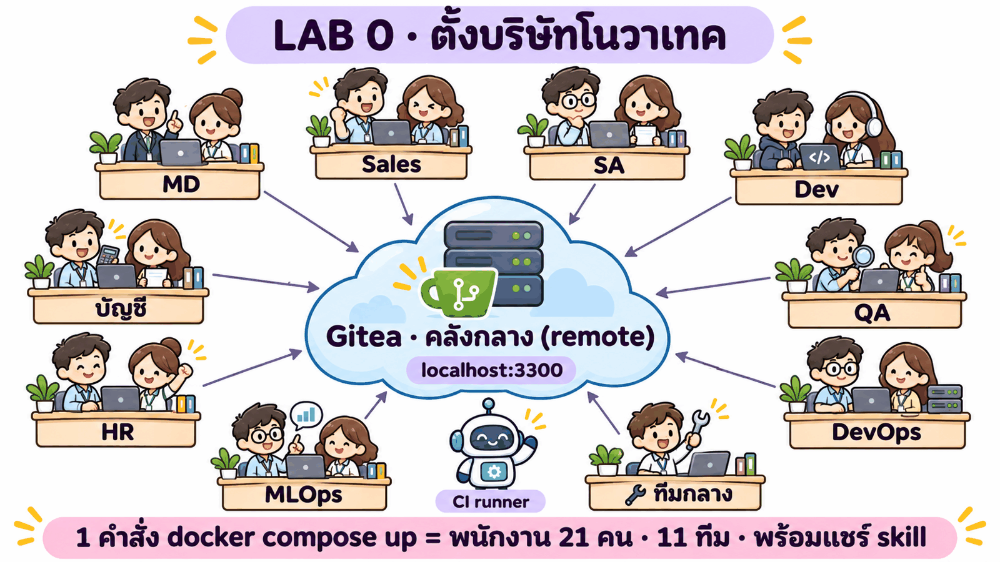

LAB นี้ยังไม่แตะเรื่อง skill แค่ **เปิดบริษัทจำลองด้วยพรอมต์ประโยคเดียว** (ใช้เวลาราว 1 นาที) แล้วทำความรู้จักว่าในบริษัทมีอะไร มีใคร และเราจะเล่นเป็นใคร

🎬 **ดูภาพรวมจากของจริง 2 ตอน** (ไม่ต้องทำตาม ให้ใช้พรอมต์ในหัวข้อ 0.3 · ทุกภาพเป็นหน้าจอจริงจากการเปิดบริษัทครั้งเดียวกัน)

**ตอน 1 · เปิดบริษัทใน VS Code (39 วินาที):** เปิด `compose.yml` → คลิก ▷ **Run All Services** (= `docker compose up -d` หรือคลิกขวา `compose.yml` → **Compose Up** ก็ได้ผลเดียวกัน) → terminal ไล่สร้างทีละขั้นจน `up 9/9` → แผง Containers เหลือ 2 ตัว → `desks/` มีโต๊ะ 28 โต๊ะ


**ตอน 2 · เดินดูบริษัทในเว็บ Gitea (43 วินาที):** `localhost:3300` = GitHub ของบริษัทที่รันในเครื่องเรา · ดูว่าบริษัทมีสมาชิกกี่คน มีทีมอะไร แต่ละทีมมีใคร

![GIF ตอน 2 เดินดู Gitea จริง: ภาพ Gitea = GitHub ของบริษัทในเครื่องเรา → ⑦ หน้า Sign In ของ localhost:3300 ล็อกอินแอดมินด้วยค่าใน .env.example → ⑧ องค์กรโนวาเทค Members 29 (พนักงาน 28 + แอดมิน) Teams 13 (11 แผนก + leads + Owners) ยังไม่มี repo → ⑨ หน้า Teams 1 แผนก = 1 ทีม dev 3 คน exec 5 คน → ⑩ ทีม sales มีนิดา กฤต มุก สิทธิ์ Code และ Pull Requests เป็น Write → ⑪ ทีม leads หัวหน้าแผนก 11 คน = ผู้ดูแล skill (CODEOWNER) → ⑫ Members 1 บัญชี = 1 พนักงาน ชื่อตรงกับการ์ดใน people → ภาพปิด บริษัทพร้อมแล้ว 2 container 28 คน 12 ทีม 28 โต๊ะ](img/lab0-gitea-tour.gif)

<sub>หน้าจอ VS Code, terminal และเว็บ Gitea เป็นภาพหน้าจอจริง · container และ image อื่นในเครื่องที่ไม่เกี่ยวกับแล็บเบลอไว้ · ภาพเปิดและภาพปิดสร้างด้วย image gen</sub>

| หัวข้อ | ได้อะไร |
|---|---|
| [0.1](#01-แล็บนี้จำลองอะไร) | บริษัทจริงมีอะไร → ในแล็บแทนด้วยอะไร |
| [0.2](#02-คำศัพท์ที่ต้องรู้) | ศัพท์ Git / PR / CI / Docker ที่จะเจอทั้ง 8 LAB |
| [0.3](#03-ลงมือ-เปิดบริษัท) | 💬 พรอมต์เปิดบริษัท |
| [0.4](#04-ตรวจว่าเปิดสำเร็จ) | ✅ ตรวจ 4 ข้อ |
| [0.5](#05-คนในบริษัท-28-คน) | ผังองค์กร 28 คน |
| [0.6](#06-เราเล่นเป็นใคร) | เปิด Claude Code ที่โต๊ะไหน = เป็นคนนั้น |

### 0.1 แล็บนี้จำลองอะไร

เราอยากรู้ว่า **ความเก่งของพนักงานคนหนึ่ง จะกลายเป็นความเก่งของทั้งบริษัทได้ยังไง** (ทฤษฎีหัวข้อ 18–26) หลักคือ **ของจริงมีที่เดียว · ทุกคนดึงไปใช้ · อยากแก้ต้องยื่น PR** (หัวข้อ 22.2) แล็บจึงจำลองของ 5 อย่างที่บริษัทจริงมี

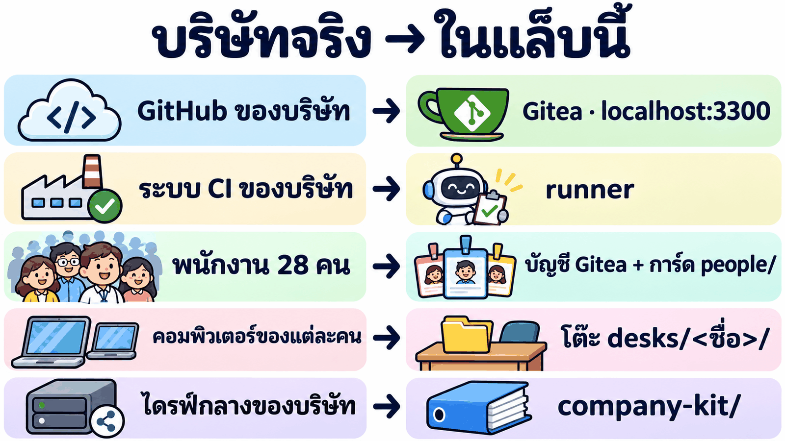

| บริษัทจริง | ในแล็บนี้ | อยู่ที่ไหน |
|---|---|---|
| 🌐 GitHub ของบริษัท (คลังกลาง) | **Gitea** เว็บแบบ GitHub ที่รันในเครื่องเรา | `http://localhost:3300` |
| ⚙️ ระบบ CI | **runner** ด่านตรวจอัตโนมัติ (เริ่มใช้ LAB 6) | container `novatech-runner` |
| 👥 พนักงาน 28 คน | บัญชี Gitea + การ์ดประวัติคนละใบ | [`people/<แผนก>/`](novatech/people/) |
| 💻 คอมพิวเตอร์ของแต่ละคน | **โต๊ะ** 1 โฟลเดอร์ต่อ 1 คน | [`desks/<ชื่อ>/`](novatech/desks/) |
| 📁 ไดรฟ์กลาง | ราคา, TOR ลูกค้า, กติกา, log เหตุการณ์ | [`company-kit/`](novatech/company-kit/) |

### 0.2 คำศัพท์ที่ต้องรู้

ไม่ต้องจำตอนนี้ ใช้เป็นที่เปิดกลับมาดูเมื่อเจอคำนี้ใน LAB ถัดไป

| คำ | ภาษาง่าย ๆ | เจอตรงไหน |
|---|---|---|
| **Git · repo** | ระบบเก็บไฟล์ที่จำทุกเวอร์ชัน · repo = แฟ้มงาน 1 ชุด | คลัง skill `org-skills` (LAB 2) |
| **commit · push** | บันทึกการแก้ 1 ครั้ง · ส่งขึ้นคลังกลาง | ทุกการแก้ skill (LAB 2, 5, 6) |
| **branch · main** | สำเนาแยกไว้แก้ · `main` = ฉบับจริงที่ทุกคนใช้ | ห้าม push ตรงเข้า `main` (LAB 2) |
| **Gitea** | เว็บเก็บ repo แบบ GitHub แต่รันในเครื่องเรา | `localhost:3300` |
| **PR** (Pull Request) | คำขอรวมสิ่งที่แก้เข้า `main` ต้องมีคนตรวจก่อน | `sales-nida` แก้ skill (LAB 5) |
| **review · approve · merge** | อ่านแล้วติ · อนุมัติ · รวมเข้าฉบับจริง | `plat-may` รีวิว PR (LAB 5) |
| **CODEOWNERS** | ไฟล์บอกว่าโฟลเดอร์ไหนใครต้องรีวิว | หัวหน้าแผนก 👑 ดูแล plugin แผนกตัวเอง (LAB 2) |
| **CI · runner** | ตรวจ PR อัตโนมัติ · runner = เครื่องที่ลงมือตรวจ | ด่านตรวจ skill 3 ด่าน (LAB 6) |
| **ผลเขียว / แดง** | ผลตรวจบน PR · แดง = merge ไม่ได้ | PR อันตรายถูกบล็อก (LAB 6) |
| **Docker · container** | รันโปรแกรมในกล่องแยก ไม่ต้องติดตั้งลงเครื่อง | `novatech-gitea`, `novatech-runner` |
| **docker compose** | เปิด/ปิดหลายกล่องพร้อมกันจากไฟล์ `compose.yml` | `docker compose up -d` = เปิดบริษัท |
| **volume** | ที่เก็บข้อมูลนอกกล่อง ปิดกล่องแล้วไม่หาย | `docker compose down -v` = ลบทั้งบริษัท |
| **token** | รหัสที่ใช้แทนรหัสผ่าน ให้โปรแกรมทำงานในนามเรา | `desks/<ชื่อ>/.gitea-token` (ไม่ขึ้น git) |
| **.env** | ไฟล์เก็บรหัสทดสอบของแล็บ ไม่มีก็ใช้ `.env.example` | `ADMIN_USER`, `ADMIN_PASSWORD`, `LAB_PASSWORD` |

### 0.3 ลงมือ: เปิดบริษัท

🧑 **คิดก่อน** ถ้าพนักงานคนหนึ่งลาออกพรุ่งนี้ ความเก่งของเขาอยู่ที่ไหน

<a id="p1"></a>

#### 📋 วางที่ ① · LAB 0 · เปิดบริษัท

| 📂 เปิด Claude Code ที่ | 🎭 คุณเป็น | ⏱️ รอ | ก๊อป |
|---|---|---|---|
| [`novatech/`](novatech/) | ผู้ดูแลระบบ (ไม่ใช่พนักงานคนไหน) | ~1 นาที | 1 กล่อง |

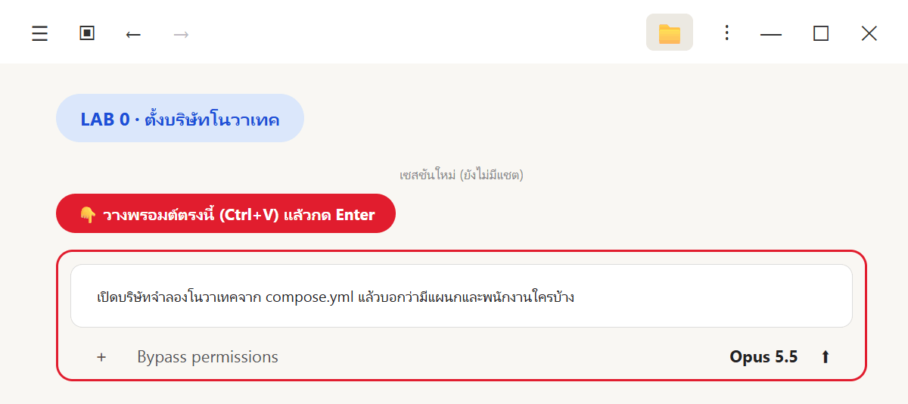

```text
เปิดบริษัทจำลองโนวาเทคจาก compose.yml แล้วบอกว่ามีแผนกและพนักงานใครบ้าง
```

> ✋ **วางแล้วรอ** ~1 นาที ถ้า Claude ขออนุญาตรัน `docker compose` ให้กดอนุญาต · ⬇️ ด้านล่างคือคำอธิบายและผลจริง อ่านระหว่างรอได้

✅ **ผลจริง: 54 วินาที · 8 คำสั่ง** ([ดูทุกคำสั่ง](_solution/lab0/tool-calls.md) · [คำตอบเต็ม](_solution/lab0/claude-summary.md))

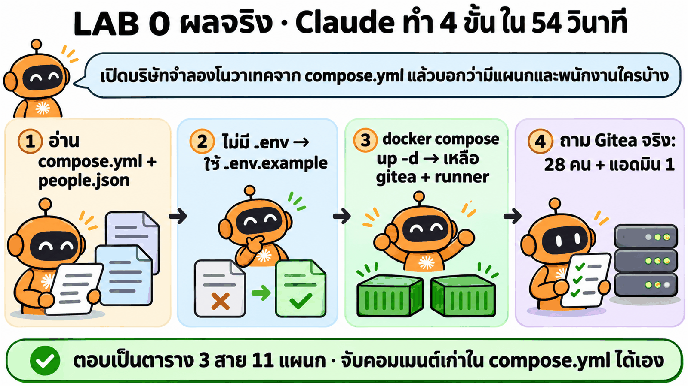

Claude ตอบเป็นตาราง 3 สาย 11 แผนก ชี้ว่าน้องใหม่ 3 คนยังไม่มี skill และจับได้เองว่าคอมเมนต์ใน `compose.yml` ยังเขียนจำนวนพนักงานเก่า (ผู้สอนแก้แล้ว)

**ข้างในเกิดอะไรขึ้น:** `docker compose up -d` เปิด container 5 ตัว แต่ทำงานตลอดแค่ 2 ตัว อีก 3 ตัวเป็นตัวช่วยที่ทำครั้งเดียวแล้วลบตัวเอง

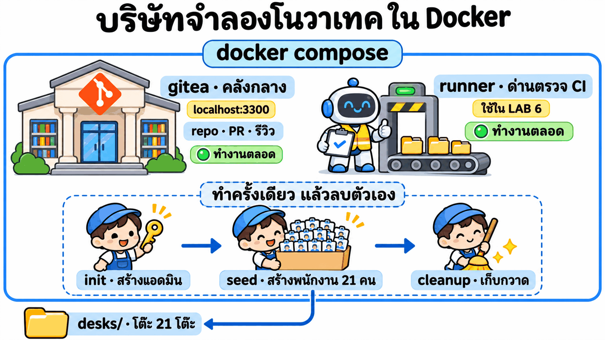

| container | ทำอะไร | อยู่ถึงเมื่อไหร่ |
|---|---|---|
| `novatech-gitea` | คลังกลาง: บัญชี ทีม repo PR รีวิว | 🟢 ตลอด |
| `novatech-runner` | ด่านตรวจ CI (รอเฉย ๆ จนถึง LAB 6) | 🟢 ตลอด |
| `novatech-init` | ① สร้างบัญชีผู้ดูแลระบบ | 🧹 ทำเสร็จแล้วหายไป |
| `novatech-seed` | ② สร้างองค์กร 12 ทีม 28 บัญชี + โต๊ะ 28 โต๊ะพร้อม token + โน้ตลับของ MD (จาก [`seed/people.json`](novatech/seed/people.json)) | 🧹 ทำเสร็จแล้วหายไป |
| `novatech-cleanup` | ③ ลบตัวช่วยทั้ง 3 ตัว | 🧹 ทำเสร็จแล้วหายไป |

> 🔁 `docker compose down` = ปิด (ข้อมูลอยู่) · `docker compose down -v` = **ลบทั้งบริษัท** เริ่มใหม่ · สั่ง `up -d` ซ้ำได้ แต่ token ของทุกคนจะถูกออกใหม่

<details>
<summary>🧪 หมายเหตุผู้สอน</summary>

รอบนี้รันด้วย `claude -p` จึงเห็น `docker compose up` ใน log 3 ครั้ง (2 ครั้งแรกติดการขออนุญาต) ผู้เรียนที่ใช้ Claude Code ในแอปจะเห็นหน้าต่างขออนุญาต กดอนุญาตแล้วไปต่อได้เลย

</details>

### 0.4 ตรวจว่าเปิดสำเร็จ

| ✅ | ตรวจ | ควรเห็น |
|---|---|---|
| ☐ | `docker compose ps` | 2 แถว: `novatech-gitea` (healthy) และ `novatech-runner` |
| ☐ | เปิด `http://localhost:3300` ล็อกอินด้วยค่า `ADMIN_USER=` / `ADMIN_PASSWORD=` ในไฟล์ `novatech/.env` (ไม่มีให้ดู `novatech/.env.example`) | องค์กร `novatech`: Members **29** (28 คน + แอดมิน) · Teams **13** (11 แผนก + `leads` + `Owners` ที่ Gitea สร้างเอง) · **0 repositories** |
| ☐ | ล็อกอินเป็นพนักงาน: user = ชื่อในการ์ด (เช่น `sales-nida`) รหัส = `LAB_PASSWORD` | เห็นเฉพาะทีมของตัวเอง |
| ☐ | เปิดโฟลเดอร์ `desks/` | 28 โฟลเดอร์ มี `.gitea-token` ทุกโต๊ะ |

| หน้าองค์กร: Members 29 · Teams 13 · 0 repositories | ทีม `leads` = ผู้ดูแล skill 11 คน |
|---|---|
| 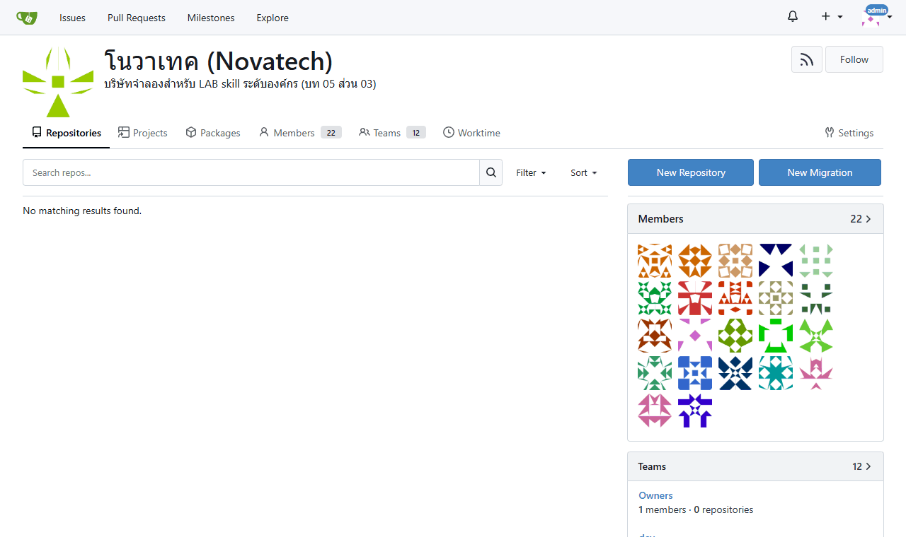 | 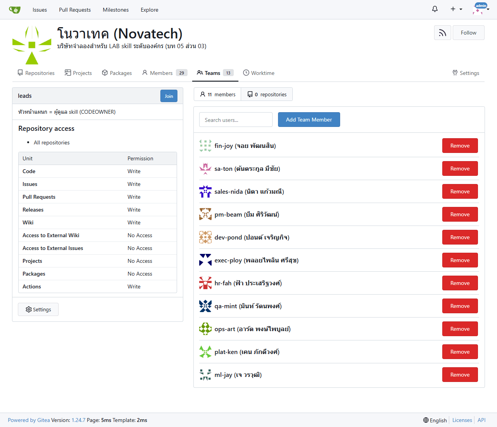 |

👀 **สังเกต** ยังไม่มี repo เลย (0 repositories) บริษัทมีคนครบ แต่ความเก่งของทุกคนยังอยู่ในหัว (ทฤษฎีหัวข้อ 18.2) → LAB 1 จะเริ่มเก็บออกมาเป็น skill

### 0.5 คนในบริษัท 28 คน

[![ผังองค์กรโนวาเทค 4 ชั้น 28 คน ภาพเดียว: ชั้น 1 MD สมชาย (md-somchai) มีผู้ช่วยผู้บริหารพลอยไพลิน (exec-ploy) ขึ้นตรง → ชั้น 2 ผู้บริหาร 3 สาย สายธุรกิจ วิทย์ (cco-wit) ดูแล Sales (sales-nida 👑, sales-krit, sales-mook 🆕) SA (sa-ton 👑, sa-ice) Product (pm-beam 👑, pm-gift) · สายเทคโนโลยี ณัฐ (cto-nat) ดูแล Dev (dev-pond 👑, dev-mew, dev-new 🆕) QA (qa-mint 👑, qa-bank) DevOps (ops-art 👑, ops-fon) ML (ml-jay 👑, ml-pim) ทีมกลาง (plat-ken 👑, plat-may) · สายบริหารและการเงิน หญิง (cfo-ying) ดูแล HR (hr-fah 👑, hr-oat, hr-namtan 🆕) บัญชี (fin-joy 👑, fin-nok) · กล่องบนสุดของแต่ละคอลัมน์คือหัวหน้าแผนก (ชั้น 3) ที่เหลือคือพนักงาน (ชั้น 4) · แต่ละกล่องมีชื่อ user บทบาท และ skill](img/org-chart.png)](img/org-chart.png)

<sub>🔍 กดที่ภาพเพื่อเปิดขนาดเต็ม (2400 px)</sub>

**หน้าตาของทั้ง 28 คน** (ภาพบุคคลจำลองที่สร้างด้วย image gen ใช้ตลอดทั้งส่วนนี้ ทั้งในตารางและใน GIF ส่งต่องาน)

[](img/people-wall.jpg)

| ชั้น | ใคร | คน |
|---|---|---|
| 1 | MD `md-somchai` | 1 |
| 2 | ผู้บริหารสาย `cco-wit` ธุรกิจ · `cto-nat` เทคโนโลยี · `cfo-ying` บริหารและการเงิน + ผู้ช่วยผู้บริหาร `exec-ploy` | 4 |
| 3 | หัวหน้าแผนก 👑 Sales · SA · Product · Dev · QA · DevOps · ML · ทีมกลาง · HR · บัญชี | 10 |
| 4 | พนักงาน รวมน้องใหม่ 🆕 3 คน (`sales-mook`, `dev-new`, `hr-namtan`) | 13 |

- **👑 = ผู้ดูแล skill ของแผนก** (รีวิว PR) มี 11 คน = หัวหน้าแผนก 10 + `exec-ploy` รวมเป็นทีม `leads` · ไม่ใช่ผู้บริหารสาย
- **ทีม Product** ดูแลผลิตภัณฑ์ของบริษัทเอง ชื่อ NovaQueue (ระบบจองคิวสาขา) · **ทีมกลาง (platform)** ดูแลคลัง skill ของทั้งบริษัท
- การ์ดของแต่ละคน (เก่งอะไร ทำอะไรซ้ำ ชอบพิมพ์สั่ง AI ว่าอะไร) อยู่ที่ [`people/<แผนก>/<ชื่อ>.md`](novatech/people/) เช่น [`people/sales/sales-nida.md`](novatech/people/sales/sales-nida.md)

### 0.6 เราเล่นเป็นใคร


พนักงานทุกคนอยู่ในเครื่องของเรา **อยากเป็นใคร ให้เปิด Claude Code ที่โต๊ะของคนนั้น** เช่น เปิดที่ `novatech/desks/sales-nida/` = ทำงานในนามนิดา (ใช้ token และโต๊ะของนิดา)

ตัวละครหลักตลอด 8 LAB

| ใคร | ทำอะไร | LAB |
|---|---|---|
| 🛠️ **ผู้ดูแลระบบ** (เปิดที่ `novatech/`) | เปิดบริษัท · ติดตั้งคลัง skill ให้ทุกโต๊ะ | 0 · 3 |
| 👥 พนักงาน 24 คน | ทำงานของตัวเอง 1 ชิ้นแล้วเก็บเป็น skill ส่วนตัว | 1 |
| 🏛️ `plat-ken` หัวหน้าทีมกลาง | รวมคลังกลาง · ทำ CI · รีวิว PR ฝั่ง core | 2 · 5 · 6 |
| 🛡️ `plat-may` เจ้าของนโยบายข้อมูลลูกค้า | รีวิว PR · รีวิว CI แบบคิดเป็นคนร้าย | 5 · 6 |
| 💼 `sales-nida` หัวหน้าทีมขาย | ทำ proposal ดีลธนาคาร · เปิด PR แก้ skill | 4 · 5 |
| 🧾 `fin-joy` หัวหน้าบัญชี | ตรวจราคาและกำไรของดีล | 4 |
| 👔 `md-somchai` MD | อนุมัติ/ตีกลับดีล (รู้กฎ PDPA อยู่คนเดียว) · ดูว่าแก้กฎแล้วกระทบใคร | 4 · 7 |
| 💼 `sales-krit` เซลส์ | ไม่แก้อะไรเลย แต่ดูว่าเก่งขึ้นตามเพื่อนไหม | 5 |
| 🆕 `dev-new` Dev คนใหม่ | เทียบแผนงานแบบมี/ไม่มีแพ็ก skill ของทีม | 3 |

<details>
<summary>👥 ดูบทของทุกคน (รวมบทรอง)</summary>

| ใคร | ทำอะไร | LAB |
|---|---|---|
| `sa-ton` · `dev-mew` · `ml-jay` · `qa-mint` · `ops-art` · `hr-fah` | รับดีลต่อจาก MD ทำงานของแผนกตัวเอง | 4 (ต่อ) |
| `hr-oat` · `ops-fon` · `ml-pim` · `exec-ploy` | เปิด PR 4 แบบ (ดี / ลวก / อันตราย / กว้างเกิน) ทดสอบด่าน CI | 6 |
| `hr-fah` | ค้น skill ของแผนกอื่น | 7 |
| `cco-wit` · `cto-nat` · `cfo-ying` ผู้บริหารสาย | ทบทวน pipeline · ความเสี่ยงเทคนิค · ต้นทุนและกำลังคน (บทใน LAB 2–7 รอรันใหม่) | 1 |
| `pm-beam` · `pm-gift` ทีม Product | เขียน PRD · วางแผนเลิกให้บริการ NovaQueue v1 (บทใน LAB 2–7 รอรันใหม่) | 1 |
| `sales-mook` · `hr-namtan` น้องใหม่ | ยังไม่มี skill ใช้ทดลองว่าน้องใหม่ได้ความรู้ของทีมไหม (รอรันใหม่) | — |

</details>

---

## LAB 1 · 24 คนเก็บความเก่งของตัวเองเป็น skill ส่วนตัว 🤖 ×24

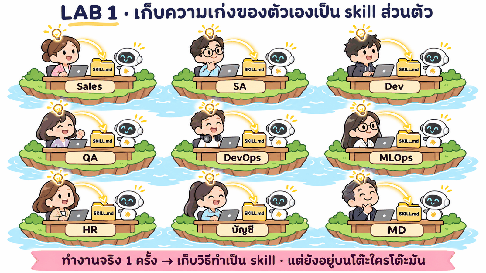

**LAB นี้ทำอะไร:** พนักงาน 24 คน **ต่างคนต่างทำ** ที่โต๊ะตัวเอง: ทำงานจริงของตัวเอง 1 ชิ้น แล้วเก็บวิธีทำเป็น skill ไว้ในเครื่องตัวเอง (แบบที่บริษัทส่วนใหญ่เริ่มต้น) ยังไม่มีใครแชร์ให้ใคร

| หัวข้อ | ได้อะไร |
|---|---|
| [1.1](#11-ของแต่ละคนอยู่ที่ไหน-สำคัญ) | 📁 อ่านจากโฟลเดอร์ไหน เขียนลงโฟลเดอร์ไหน |
| [1.2](#12-พรอมต์ของแต่ละคน-24-พรอมต์) | 💬 พรอมต์รวม (ก๊อปอันเดียวได้ทุกคน) + ตัวอย่างพรอมต์ที่แต่ละคนได้รับ |
| [1.3](#13-ตัวอย่าง-5-โต๊ะ) | 👀 ผลจริงของนิดา · MD · จอย · HR · ML |
| [1.4](#14-ทุกคนทำงานอะไร-ผลจริง-24-โต๊ะ) | 👥 ทั้ง 24 คนทำงานอะไร ได้ skill อะไร |
| [1.5](#15-ผลที่เห็น-3-ปัญหาของ-ต่างคนต่างเก็บ) | ⚠️ 3 ปัญหาที่จะแก้ใน LAB ถัดไป |

> 📦 **LAB นี้ยังไม่ใช้ Gitea** ทุกอย่างเกิดในโฟลเดอร์ของแต่ละโต๊ะ · ใครทำ: 24 จาก 28 คน · ไม่ทำ 4 คน คือน้องใหม่ 3 คน (`sales-mook`, `dev-new`, `hr-namtan` ยังไม่มีความเก่งของตัวเอง) และ `plat-ken` (สร้าง `skill-finder` ใน LAB 2)

### 1.1 ของแต่ละคนอยู่ที่ไหน (สำคัญ)

ทั้งบริษัทคือโฟลเดอร์ `novatech/` โฟลเดอร์เดียว **ของกลางอยู่ข้างบน** (`people/`, `company-kit/`) ทุกคนอ่านชุดเดียวกัน ส่วน **โต๊ะของแต่ละคนอยู่ใน `desks/`** เขียนได้แค่โต๊ะตัวเอง

[![LAB 1 ของแต่ละคนอยู่ตรงไหนในบริษัท: novatech/ บริษัททั้งหมด มี people/ การ์ดพนักงาน 28 ใบ (อ่าน) และ company-kit/ ไดรฟ์กลาง (อ่าน) · desks/ โต๊ะ 1 โฟลเดอร์ต่อ 1 คน 28 โต๊ะ · sales-nida/ นิดา มี work/ proposal.docx pricing.xlsx และ .claude/skills/sales-proposal/ · md-somchai/ สมชาย MD มี notes/deal-rules.md โน้ตลับ work/ approval.docx และ .claude/skills/deal-approval/ · fin-joy/ จอย มี work/ pricing-internal.xlsx quotation-draft.docx และ .claude/skills/pricing-calc/ · hr-fah/ ฟ้า HR มี work/ ประกาศรับสมัคร .docx และ .claude/skills/jd-writer/ · ml-jay/ เจ ML มี work/ experiment-registry.xlsx รายงาน .docx และ .claude/skills/mlflow-experiment/ · อีก 23 โต๊ะแบบเดียวกัน · ในบริษัทจริง desks/<ชื่อ>/ = คอมของคนนั้น, .claude/skills/ = ~/.claude/skills/, company-kit/ = ไดรฟ์กลาง](img/lab1-folders.png)](img/lab1-folders.png)

| โฟลเดอร์ | คืออะไร | Claude ทำอะไรกับมัน |
|---|---|---|
| `novatech/people/<แผนก>/<ชื่อ>.md` | การ์ดของตัวเอง: เก่งอะไร ทำอะไรซ้ำ ชอบพิมพ์ว่าอะไร | 📖 อ่าน |
| `novatech/company-kit/` | ไดรฟ์กลาง: TOR ลูกค้า ราคา กติกา | 📖 อ่าน |
| `desks/<ชื่อ>/notes/` | โน้ตส่วนตัว (มีแค่ `md-somchai`) | 📖 อ่าน |
| `desks/<ชื่อ>/work/` | ผลงานจริง 1 ชิ้น | ✍️ เขียน |
| `desks/<ชื่อ>/.claude/skills/<ชื่อ skill>/` | **skill ส่วนตัว** | ✍️ เขียน |

โต๊ะของนิดา ก่อนและหลัง LAB 1

```text
ก่อน (seed สร้างให้)          หลัง LAB 1
desks/sales-nida/             desks/sales-nida/
└─ .gitea-token               ├─ .gitea-token
                              ├─ work/                        ← ② ผลงานจริง
                              │  ├─ deal-001-proposal-….docx   (Word)
                              │  └─ deal-001-pricing.xlsx      (Excel)
                              └─ .claude/skills/
                                 └─ sales-proposal/           ← ③ skill ส่วนตัว
                                    ├─ SKILL.md
                                    ├─ references/
                                    └─ scripts/
```

> 💡 `.claude` ขึ้นต้นด้วยจุด จึงเป็น **โฟลเดอร์ซ่อน** ถ้าไม่เห็นใน Explorer/Finder ให้เปิดการแสดงไฟล์ซ่อน (Windows: View → Hidden items · Mac: `Cmd + Shift + .`)

### 1.2 พรอมต์ของแต่ละคน (24 พรอมต์)

🧑 **คิดก่อน** เปิดการ์ดพนักงาน 2–3 ใบใน [`people/`](novatech/people/) แล้วถามตัวเองว่า ถ้าคนนี้ลาออกพรุ่งนี้ ความเก่งของเขาจะไปอยู่ที่ไหน (ทฤษฎีหัวข้อ 18.2)

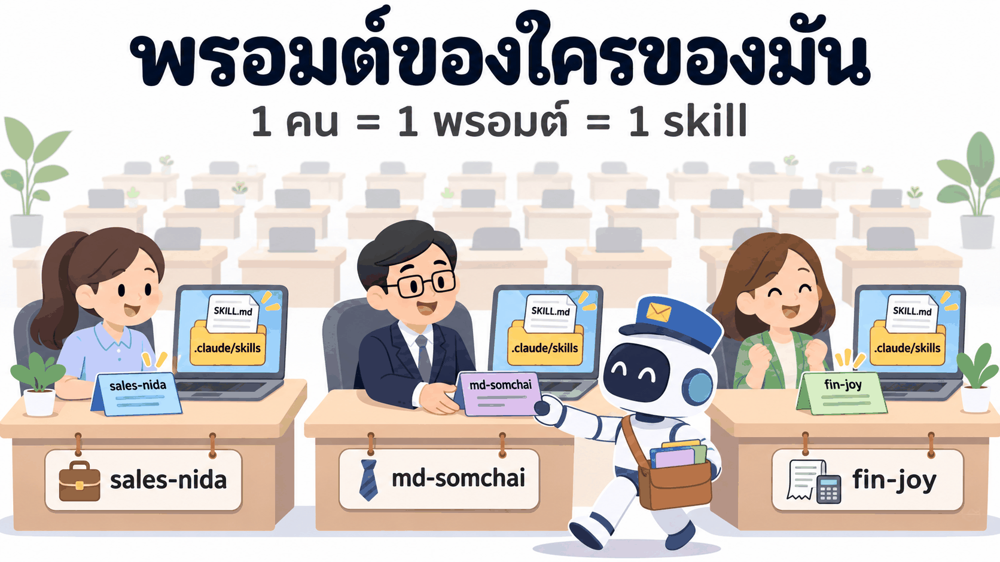

**1 คน = 1 พรอมต์ = 1 skill** แต่ละคนมีพรอมต์ของตัวเองเต็ม ๆ บอกชัดว่า **เป็นใคร · ทำงานอะไรด้วยไฟล์ไหน · เก็บเป็น skill ชื่ออะไรไว้ที่ไหน** ทุกพรอมต์ใช้โครงเดียวกัน ต่างกันแค่ 3 ช่องที่ไฮไลต์ในภาพนี้

![LAB 1 พรอมต์เต็มรายคน ตัวอย่างของนิดา: ① ฉันคือใคร ฉันคือ นิดา แก้วมณี (sales-nida) หัวหน้าทีมขาย อ่านการ์ด ../../people/sales/sales-nida.md · ② ทำงานอะไร ร่าง proposal ให้ลูกค้าธนาคารตาม TOR ของ deal-001 ข้อมูลที่ใช้ ../../company-kit/deal-001/tor-bank-queue.md, won-proposals/, price-list.csv เก็บไว้ใน work/ · ③ เก็บเป็น skill ชื่อ sales-proposal ที่ .claude/skills/sales-proposal/ · ตาราง desks/sales-nida/ → sales-proposal, desks/md-somchai/ → deal-approval, desks/fin-joy/ → pricing-calc · ครบ 24 คน 1 โต๊ะ = 1 แชตใหม่ = 1 พรอมต์ของคนนั้น](img/lab1-prompt.png)

`metadata` ในหัวไฟล์คือ "การ์ดประจำตัว" ของ skill ที่ทีมกลางจะใช้จัดคลังและวาดกราฟ (ทฤษฎีหัวข้อ 21.1)

| ช่อง | ความหมาย | ตัวอย่างของนิดา |
|---|---|---|
| `owner` | เจ้าของ skill | `sales-nida` |
| `layer` | ชั้นของ skill ตอนนี้ทุกตัวเป็น `personal` | `personal` |
| `version` | เลขเวอร์ชัน แก้แล้วต้องเพิ่ม | `1.0.0` |
| `uses` | skill อื่นที่ **เรียกใช้** ระหว่างทำงาน | `[pricing-calc]` |
| `next` | งาน **ถัดไป** ที่มักทำต่อ | `[deal-approval, follow-up-email, req-to-spec]` |
| `follows` | **นโยบาย** ที่ต้องทำตาม | `[customer-data-policy]` |

**วิธีรัน:** เปิด Claude Code ที่ `novatech/` แล้ววาง **พรอมต์รวมด้านล่างครั้งเดียว** Claude จะแตก **agent ย่อย 1 ตัวต่อ 1 โต๊ะ** แล้วส่งพรอมต์ของแต่ละคนให้เอง ถ้า Claude ขออนุญาตเขียนโฟลเดอร์ `.claude/skills/` ให้กดอนุญาต

<a id="p2"></a>

#### 📋 วางที่ ② · LAB 1 · ทั้ง 24 คนในครั้งเดียว

| 📂 เปิด Claude Code ที่ | 🎭 คุณเป็น | ⏱️ รอ | ก๊อป |
|---|---|---|---|
| [`novatech/`](novatech/) | ผู้ดูแลระบบ | ~30 นาที | 1 กล่อง (ได้ครบทุกคน) |

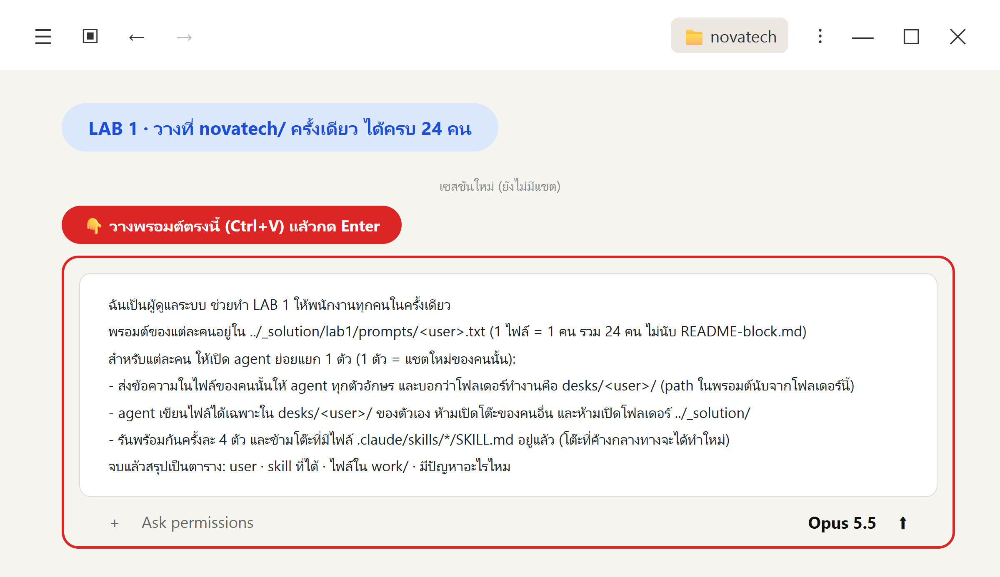

```text
ฉันเป็นผู้ดูแลระบบ ช่วยทำ LAB 1 ให้พนักงานทุกคนในครั้งเดียว
พรอมต์ของแต่ละคนอยู่ใน ../_solution/lab1/prompts/<user>.txt (1 ไฟล์ = 1 คน รวม 24 คน ไม่นับ README-block.md)
สำหรับแต่ละคน ให้เปิด agent ย่อยแยก 1 ตัว (1 ตัว = แชตใหม่ของคนนั้น):
- ส่งข้อความในไฟล์ของคนนั้นให้ agent ทุกตัวอักษร และบอกว่าโฟลเดอร์ทำงานคือ desks/<user>/ (path ในพรอมต์นับจากโฟลเดอร์นี้)
- agent เขียนไฟล์ได้เฉพาะใน desks/<user>/ ของตัวเอง ห้ามเปิดโต๊ะของคนอื่น และห้ามเปิดโฟลเดอร์ ../_solution/
- รันพร้อมกันครั้งละ 4 ตัว และข้ามโต๊ะที่มีไฟล์ .claude/skills/*/SKILL.md อยู่แล้ว (โต๊ะที่ค้างกลางทางจะได้ทำใหม่)
จบแล้วสรุปเป็นตาราง: user · skill ที่ได้ · ไฟล์ใน work/ · มีปัญหาอะไรไหม
```

> ✋ **วางแล้วรอ** ~30 นาที ถ้าขออนุญาตเขียน `.claude/skills/` ให้กดอนุญาต · ค้างกลางทางให้วางกล่องเดิมซ้ำ · ⬇️ ด้านล่างคือคำอธิบายและผลจริง อ่านระหว่างรอได้

| ส่วนของพรอมต์ | มีไว้ทำไม |
|---|---|
| agent ย่อย 1 ตัวต่อ 1 คน | agent ย่อยเริ่มจากศูนย์ ไม่เห็นแชตหลัก = **แชตใหม่ของคนนั้น** งานของนิดาจึงไม่ปนกับของ MD |
| ส่งพรอมต์ของคนนั้นทุกตัวอักษร | แต่ละคนได้งานและ skill ของตัวเอง (ดูตัวอย่างพรอมต์รายคนด้านล่าง) |
| เขียนได้เฉพาะโต๊ะตัวเอง · ห้ามเปิด `_solution/` | เหมือนพนักงานจริงที่ใช้คอมของตัวเอง และ `_solution/` มีผลงานเฉลยของทุกคนอยู่ |
| ครั้งละ 4 ตัว | ไม่ให้เครื่องหนักหรือโควตาหมดกลางทาง |
| ข้ามโต๊ะที่มี skill แล้ว | สั่งซ้ำได้ ถ้ารอบแรกค้างกลางทาง ไม่ทับงานที่ทำเสร็จแล้ว |

✅ **ผลจริงของพรอมต์รวม: 24/24 โต๊ะได้ skill · ราว 31 นาที** ([สรุปและผลงานทุกโต๊ะ](_solution/lab1/combined-run/))
- Claude เปิด agent ย่อยครั้งละ 4 ตัว ทุกตัวทำงานแค่ในโต๊ะของตัวเอง ไม่พบการเขียนไฟล์นอกโต๊ะ และไม่มีใครเปิด `_solution/`
- เจอปัญหาเดิมทุกอย่างเหมือนตอนวางทีละโต๊ะ: ทุกคนตีความ `uses` / `next` / `follows` ไม่ตรงกัน (Claude เสนอเองให้ `plat-ken` ออกกติกาหัวไฟล์) และ proposal ของนิดาก็ **ไม่มีภาคผนวก PDPA** เหมือนเดิม (→ 1.5)
- **ถ้ารอบไหนค้างกลางทาง วางพรอมต์เดิมซ้ำได้เลย** พรอมต์ข้ามโต๊ะที่มี `SKILL.md` แล้ว ทำต่อเฉพาะโต๊ะที่ยังไม่เสร็จ · 🧪 รอบจริงรัน 3 ครั้ง: ครั้งแรก `claude -p` ตัดงานเบื้องหลังหลัง 10 นาที (ในแอปไม่มีข้อจำกัดนี้) ครั้งที่ 3 แก้พรอมต์จาก "ข้ามโต๊ะที่มี skill" เป็น "ข้ามโต๊ะที่มี `SKILL.md`" เพราะโต๊ะที่ค้างกลางทางมีแค่โฟลเดอร์ว่างแต่ถูกข้าม

> ⏱️ **ทางเลือก: ไม่อยากรอทั้ง 24 คน** เติมบรรทัด `ทำเฉพาะโต๊ะ sales-nida, md-somchai, fin-joy` ท้ายพรอมต์รวม (3 คนนี้คือตัวเอกของ LAB 4–5) แล้วคัดลอกโต๊ะที่เหลือจากผลรันจริงด้วยคำสั่งนี้ (เปิด terminal ที่ `novatech/`) สคริปต์จะข้ามโต๊ะที่ทำเองแล้ว
>
> ```bash
> node ../_solution/tools/copy-lab1-desks.mjs
> ```

**👀 ตัวอย่าง: พรอมต์ที่ agent ย่อยของแต่ละโต๊ะได้รับ** (อ่านอย่างเดียว ไม่ต้องก๊อป พรอมต์รวมส่งให้เองแล้ว · ไฟล์จริงอยู่ใน [`_solution/lab1/prompts/`](_solution/lab1/prompts/))

ทุกคนได้พรอมต์โครงเดียวกัน ต่างกันแค่ ① ฉันคือใคร ② ทำงานอะไรด้วยไฟล์ไหน ③ เก็บเป็น skill ชื่ออะไร (ตามภาพด้านบน)

#### 💼 นิดา `sales-nida` → skill `sales-proposal`

สิ่งที่ agent ย่อยของโต๊ะ `desks/sales-nida/` ได้รับ · ผลจริง: [`work/`](_solution/desks-after-lab1/sales-nida/work/) · [`skill`](_solution/desks-after-lab1/sales-nida/skills/sales-proposal/)

> ฉันคือ นิดา แก้วมณี (sales-nida) หัวหน้าทีมขาย ฝ่าย Sales · นี่คือโต๊ะของฉัน (novatech/desks/sales-nida/)  
> อ่านการ์ดของฉันก่อน: ../../people/sales/sales-nida.md  
> 1\. ลงมือทำงานจริง 1 ชิ้น: ร่าง proposal ให้ลูกค้าธนาคารตาม TOR ของ deal-001 พร้อมใบคิดราคา  
> &emsp;ข้อมูลที่ใช้: ../../company-kit/deal-001/tor-bank-queue.md, ../../company-kit/won-proposals/, ../../company-kit/price-list.csv, ../../company-kit/margin-rules.md, ../../company-kit/brand-guide.md  
> &emsp;เก็บผลงานไว้ใน work/  
> 2\. เก็บวิธีทำงานนี้เป็น skill ส่วนตัวชื่อ sales-proposal ที่ .claude/skills/sales-proposal/  
> &emsp;\- หัวไฟล์มี name, description (ใช้คำที่ฉันชอบพิมพ์ในการ์ด) และ metadata: owner: sales-nida, layer: personal, version, uses, next, follows (ชื่อ skill ของคนอื่นดูได้ใน ../../people/README.md)  
> &emsp;\- skill เล็ก โฟกัสเรื่องเดียว และต้องใช้ได้ที่เครื่องคนอื่น: ความรู้ที่จำเป็นจาก company-kit ให้สรุปไว้ใน references/ ของ skill  
> จบแล้วสรุปสั้น ๆ: ทำงานอะไร ได้ไฟล์อะไร skill มีไฟล์อะไรบ้าง และมีจุดไหนที่ต้องตัดสินใจเอง  


<details>
<summary>👀 ดูพรอมต์ที่อีก 23 คนได้รับ (อ่านอย่างเดียว · ตามแผนก)</summary>

**👔 MD / ผู้บริหาร**

##### 👔 สมชาย `md-somchai` → skill `deal-approval`

สิ่งที่ agent ย่อยของโต๊ะ `desks/md-somchai/` ได้รับ · ผลจริง: [`work/`](_solution/desks-after-lab1/md-somchai/work/) · [`skill`](_solution/desks-after-lab1/md-somchai/skills/deal-approval/)

> ฉันคือ สมชาย วงศ์ประเสริฐ (md-somchai) MD (กรรมการผู้จัดการ) ฝ่าย MD / ผู้บริหาร · นี่คือโต๊ะของฉัน (novatech/desks/md-somchai/)  
> อ่านการ์ดของฉันก่อน: ../../people/exec/md-somchai.md  
> 1\. ลงมือทำงานจริง 1 ชิ้น: พิจารณาดีล DS-2026-034 ว่าอนุมัติหรือตีกลับ พร้อมเหตุผล  
> &emsp;ข้อมูลที่ใช้: ../../company-kit/deal-summaries/DS-2026-034-muangmai-hospital-portal.md, ../../company-kit/margin-rules.md, ../../company-kit/price-list.csv และโน้ตของฉัน notes/deal-rules.md  
> &emsp;เก็บผลงานไว้ใน work/  
> 2\. เก็บวิธีทำงานนี้เป็น skill ส่วนตัวชื่อ deal-approval ที่ .claude/skills/deal-approval/  
> &emsp;\- หัวไฟล์มี name, description (ใช้คำที่ฉันชอบพิมพ์ในการ์ด) และ metadata: owner: md-somchai, layer: personal, version, uses, next, follows (ชื่อ skill ของคนอื่นดูได้ใน ../../people/README.md)  
> &emsp;\- skill เล็ก โฟกัสเรื่องเดียว และต้องใช้ได้ที่เครื่องคนอื่น: ความรู้ที่จำเป็นจาก company-kit ให้สรุปไว้ใน references/ ของ skill  
> จบแล้วสรุปสั้น ๆ: ทำงานอะไร ได้ไฟล์อะไร skill มีไฟล์อะไรบ้าง และมีจุดไหนที่ต้องตัดสินใจเอง  


##### 👔 พลอยไพลิน `exec-ploy` → skill `exec-deck`

สิ่งที่ agent ย่อยของโต๊ะ `desks/exec-ploy/` ได้รับ · ผลจริง: [`work/`](_solution/desks-after-lab1/exec-ploy/work/) · [`skill`](_solution/desks-after-lab1/exec-ploy/skills/exec-deck/)

> ฉันคือ พลอยไพลิน ศรีสุข (exec-ploy) ผู้ช่วยผู้บริหาร ฝ่าย MD / ผู้บริหาร · นี่คือโต๊ะของฉัน (novatech/desks/exec-ploy/)  
> อ่านการ์ดของฉันก่อน: ../../people/exec/exec-ploy.md  
> 1\. ลงมือทำงานจริง 1 ชิ้น: ทำสไลด์ประชุมผู้บริหารเดือน พ.ย. 2026 (HTML + PDF) ที่ MD อ่านจบใน 5 นาที  
> &emsp;ข้อมูลที่ใช้: ../../company-kit/monthly-kpi.csv, ../../company-kit/brand-guide.md, ../../company-kit/logo.svg  
> &emsp;เก็บผลงานไว้ใน work/  
> 2\. เก็บวิธีทำงานนี้เป็น skill ส่วนตัวชื่อ exec-deck ที่ .claude/skills/exec-deck/  
> &emsp;\- หัวไฟล์มี name, description (ใช้คำที่ฉันชอบพิมพ์ในการ์ด) และ metadata: owner: exec-ploy, layer: personal, version, uses, next, follows (ชื่อ skill ของคนอื่นดูได้ใน ../../people/README.md)  
> &emsp;\- skill เล็ก โฟกัสเรื่องเดียว และต้องใช้ได้ที่เครื่องคนอื่น: ความรู้ที่จำเป็นจาก company-kit ให้สรุปไว้ใน references/ ของ skill  
> จบแล้วสรุปสั้น ๆ: ทำงานอะไร ได้ไฟล์อะไร skill มีไฟล์อะไรบ้าง และมีจุดไหนที่ต้องตัดสินใจเอง  


##### 👔 วิทย์ `cco-wit` → skill `pipeline-review`

สิ่งที่ agent ย่อยของโต๊ะ `desks/cco-wit/` ได้รับ · ผลจริง: [`work/`](_solution/desks-after-lab1/cco-wit/work/) · [`skill`](_solution/desks-after-lab1/cco-wit/skills/pipeline-review/)

> ฉันคือ วิทย์ ประภาสกุล (cco-wit) ผู้อำนวยการสายธุรกิจ (CCO) ฝ่าย MD / ผู้บริหาร · นี่คือโต๊ะของฉัน (novatech/desks/cco-wit/)  
> อ่านการ์ดของฉันก่อน: ../../people/exec/cco-wit.md  
> 1\. ลงมือทำงานจริง 1 ชิ้น: ทบทวน pipeline ดีลทั้งหมด: ดีลไหนควรเร่ง ส่งต่อ ประคอง หรือตีกลับ  
> &emsp;ข้อมูลที่ใช้: ../../company-kit/monthly-kpi.csv, ../../company-kit/deal-summaries/, ../../company-kit/deal-001/, ../../company-kit/deal-002/, ../../company-kit/product/  
> &emsp;เก็บผลงานไว้ใน work/  
> 2\. เก็บวิธีทำงานนี้เป็น skill ส่วนตัวชื่อ pipeline-review ที่ .claude/skills/pipeline-review/  
> &emsp;\- หัวไฟล์มี name, description (ใช้คำที่ฉันชอบพิมพ์ในการ์ด) และ metadata: owner: cco-wit, layer: personal, version, uses, next, follows (ชื่อ skill ของคนอื่นดูได้ใน ../../people/README.md)  
> &emsp;\- skill เล็ก โฟกัสเรื่องเดียว และต้องใช้ได้ที่เครื่องคนอื่น: ความรู้ที่จำเป็นจาก company-kit ให้สรุปไว้ใน references/ ของ skill  
> จบแล้วสรุปสั้น ๆ: ทำงานอะไร ได้ไฟล์อะไร skill มีไฟล์อะไรบ้าง และมีจุดไหนที่ต้องตัดสินใจเอง  


##### 👔 ณัฐ `cto-nat` → skill `tech-risk-review`

สิ่งที่ agent ย่อยของโต๊ะ `desks/cto-nat/` ได้รับ · ผลจริง: [`work/`](_solution/desks-after-lab1/cto-nat/work/) · [`skill`](_solution/desks-after-lab1/cto-nat/skills/tech-risk-review/)

> ฉันคือ ณัฐ ธนวัฒน์ (cto-nat) ผู้อำนวยการสายเทคโนโลยี (CTO) ฝ่าย MD / ผู้บริหาร · นี่คือโต๊ะของฉัน (novatech/desks/cto-nat/)  
> อ่านการ์ดของฉันก่อน: ../../people/exec/cto-nat.md  
> 1\. ลงมือทำงานจริง 1 ชิ้น: ทบทวนความเสี่ยงทางเทคนิคของ deal-001 ก่อนรับงาน  
> &emsp;ข้อมูลที่ใช้: ../../company-kit/deal-001/tor-bank-queue.md, ../../company-kit/incident-2026-09.md, ../../company-kit/deploy-runbook.md, ../../company-kit/arch-standards.md, ../../company-kit/ml-queue-forecast/, ../../company-kit/qa/  
> &emsp;เก็บผลงานไว้ใน work/  
> 2\. เก็บวิธีทำงานนี้เป็น skill ส่วนตัวชื่อ tech-risk-review ที่ .claude/skills/tech-risk-review/  
> &emsp;\- หัวไฟล์มี name, description (ใช้คำที่ฉันชอบพิมพ์ในการ์ด) และ metadata: owner: cto-nat, layer: personal, version, uses, next, follows (ชื่อ skill ของคนอื่นดูได้ใน ../../people/README.md)  
> &emsp;\- skill เล็ก โฟกัสเรื่องเดียว และต้องใช้ได้ที่เครื่องคนอื่น: ความรู้ที่จำเป็นจาก company-kit ให้สรุปไว้ใน references/ ของ skill  
> จบแล้วสรุปสั้น ๆ: ทำงานอะไร ได้ไฟล์อะไร skill มีไฟล์อะไรบ้าง และมีจุดไหนที่ต้องตัดสินใจเอง  


##### 👔 หญิง `cfo-ying` → skill `cost-headcount-review`

สิ่งที่ agent ย่อยของโต๊ะ `desks/cfo-ying/` ได้รับ · ผลจริง: [`work/`](_solution/desks-after-lab1/cfo-ying/work/) · [`skill`](_solution/desks-after-lab1/cfo-ying/skills/cost-headcount-review/)

> ฉันคือ หญิง ศรีพัฒนา (cfo-ying) ผู้อำนวยการสายบริหารและการเงิน (CFO) ฝ่าย MD / ผู้บริหาร · นี่คือโต๊ะของฉัน (novatech/desks/cfo-ying/)  
> อ่านการ์ดของฉันก่อน: ../../people/exec/cfo-ying.md  
> 1\. ลงมือทำงานจริง 1 ชิ้น: สรุปรายได้ ต้นทุน และกำลังคนเดือน ต.ค. 2026 ให้ MD: เงินพอไหม ควรรับคนเพิ่มหรือยัง  
> &emsp;ข้อมูลที่ใช้: ../../company-kit/monthly-kpi.csv, ../../company-kit/margin-rules.md, ../../company-kit/jd-template.md  
> &emsp;เก็บผลงานไว้ใน work/  
> 2\. เก็บวิธีทำงานนี้เป็น skill ส่วนตัวชื่อ cost-headcount-review ที่ .claude/skills/cost-headcount-review/  
> &emsp;\- หัวไฟล์มี name, description (ใช้คำที่ฉันชอบพิมพ์ในการ์ด) และ metadata: owner: cfo-ying, layer: personal, version, uses, next, follows (ชื่อ skill ของคนอื่นดูได้ใน ../../people/README.md)  
> &emsp;\- skill เล็ก โฟกัสเรื่องเดียว และต้องใช้ได้ที่เครื่องคนอื่น: ความรู้ที่จำเป็นจาก company-kit ให้สรุปไว้ใน references/ ของ skill  
> จบแล้วสรุปสั้น ๆ: ทำงานอะไร ได้ไฟล์อะไร skill มีไฟล์อะไรบ้าง และมีจุดไหนที่ต้องตัดสินใจเอง  


**💼 Sales**

##### 💼 กฤต `sales-krit` → skill `follow-up-email`

สิ่งที่ agent ย่อยของโต๊ะ `desks/sales-krit/` ได้รับ · ผลจริง: [`work/`](_solution/desks-after-lab1/sales-krit/work/) · [`skill`](_solution/desks-after-lab1/sales-krit/skills/follow-up-email/)

> ฉันคือ กฤต ธนากร (sales-krit) เซลส์ ฝ่าย Sales · นี่คือโต๊ะของฉัน (novatech/desks/sales-krit/)  
> อ่านการ์ดของฉันก่อน: ../../people/sales/sales-krit.md  
> 1\. ลงมือทำงานจริง 1 ชิ้น: เขียนอีเมลติดตามลูกค้า deal-002 หลังประชุมวันที่ 28 ต.ค. 2026  
> &emsp;ข้อมูลที่ใช้: ../../company-kit/meeting-notes/2026-10-28-bank-meeting.md, ../../company-kit/deal-002/tor-bank-dispute.md  
> &emsp;เก็บผลงานไว้ใน work/  
> 2\. เก็บวิธีทำงานนี้เป็น skill ส่วนตัวชื่อ follow-up-email ที่ .claude/skills/follow-up-email/  
> &emsp;\- หัวไฟล์มี name, description (ใช้คำที่ฉันชอบพิมพ์ในการ์ด) และ metadata: owner: sales-krit, layer: personal, version, uses, next, follows (ชื่อ skill ของคนอื่นดูได้ใน ../../people/README.md)  
> &emsp;\- skill เล็ก โฟกัสเรื่องเดียว และต้องใช้ได้ที่เครื่องคนอื่น: ความรู้ที่จำเป็นจาก company-kit ให้สรุปไว้ใน references/ ของ skill  
> จบแล้วสรุปสั้น ๆ: ทำงานอะไร ได้ไฟล์อะไร skill มีไฟล์อะไรบ้าง และมีจุดไหนที่ต้องตัดสินใจเอง  


**🧩 Presales / SA**

##### 🧩 ต้นตระกูล `sa-ton` → skill `req-to-spec`

สิ่งที่ agent ย่อยของโต๊ะ `desks/sa-ton/` ได้รับ · ผลจริง: [`work/`](_solution/desks-after-lab1/sa-ton/work/) · [`skill`](_solution/desks-after-lab1/sa-ton/skills/req-to-spec/)

> ฉันคือ ต้นตระกูล มีชัย (sa-ton) SA อาวุโส ฝ่าย Presales / SA · นี่คือโต๊ะของฉัน (novatech/desks/sa-ton/)  
> อ่านการ์ดของฉันก่อน: ../../people/sa/sa-ton.md  
> 1\. ลงมือทำงานจริง 1 ชิ้น: แปลง TOR ของ deal-001 เป็น spec และแผนทดสอบ  
> &emsp;ข้อมูลที่ใช้: ../../company-kit/deal-001/tor-bank-queue.md, ../../company-kit/arch-standards.md  
> &emsp;เก็บผลงานไว้ใน work/  
> 2\. เก็บวิธีทำงานนี้เป็น skill ส่วนตัวชื่อ req-to-spec ที่ .claude/skills/req-to-spec/  
> &emsp;\- หัวไฟล์มี name, description (ใช้คำที่ฉันชอบพิมพ์ในการ์ด) และ metadata: owner: sa-ton, layer: personal, version, uses, next, follows (ชื่อ skill ของคนอื่นดูได้ใน ../../people/README.md)  
> &emsp;\- skill เล็ก โฟกัสเรื่องเดียว และต้องใช้ได้ที่เครื่องคนอื่น: ความรู้ที่จำเป็นจาก company-kit ให้สรุปไว้ใน references/ ของ skill  
> จบแล้วสรุปสั้น ๆ: ทำงานอะไร ได้ไฟล์อะไร skill มีไฟล์อะไรบ้าง และมีจุดไหนที่ต้องตัดสินใจเอง  


##### 🧩 ไอศวรรย์ `sa-ice` → skill `arch-template`

สิ่งที่ agent ย่อยของโต๊ะ `desks/sa-ice/` ได้รับ · ผลจริง: [`work/`](_solution/desks-after-lab1/sa-ice/work/) · [`skill`](_solution/desks-after-lab1/sa-ice/skills/arch-template/)

> ฉันคือ ไอศวรรย์ บุญมา (sa-ice) SA ฝ่าย Presales / SA · นี่คือโต๊ะของฉัน (novatech/desks/sa-ice/)  
> อ่านการ์ดของฉันก่อน: ../../people/sa/sa-ice.md  
> 1\. ลงมือทำงานจริง 1 ชิ้น: วาดแผนภาพ architecture ของระบบจองคิวสาขา (deal-001) ตามมาตรฐานบริษัท  
> &emsp;ข้อมูลที่ใช้: ../../company-kit/arch-standards.md, ../../company-kit/deal-001/tor-bank-queue.md  
> &emsp;เก็บผลงานไว้ใน work/  
> 2\. เก็บวิธีทำงานนี้เป็น skill ส่วนตัวชื่อ arch-template ที่ .claude/skills/arch-template/  
> &emsp;\- หัวไฟล์มี name, description (ใช้คำที่ฉันชอบพิมพ์ในการ์ด) และ metadata: owner: sa-ice, layer: personal, version, uses, next, follows (ชื่อ skill ของคนอื่นดูได้ใน ../../people/README.md)  
> &emsp;\- skill เล็ก โฟกัสเรื่องเดียว และต้องใช้ได้ที่เครื่องคนอื่น: ความรู้ที่จำเป็นจาก company-kit ให้สรุปไว้ใน references/ ของ skill  
> จบแล้วสรุปสั้น ๆ: ทำงานอะไร ได้ไฟล์อะไร skill มีไฟล์อะไรบ้าง และมีจุดไหนที่ต้องตัดสินใจเอง  


**📦 Product**

##### 📦 บีม `pm-beam` → skill `prd-writer`

สิ่งที่ agent ย่อยของโต๊ะ `desks/pm-beam/` ได้รับ · ผลจริง: [`work/`](_solution/desks-after-lab1/pm-beam/work/) · [`skill`](_solution/desks-after-lab1/pm-beam/skills/prd-writer/)

> ฉันคือ บีม ศิริวัฒน์ (pm-beam) หัวหน้าฝ่ายผลิตภัณฑ์ (Head of Product) ฝ่าย Product · นี่คือโต๊ะของฉัน (novatech/desks/pm-beam/)  
> อ่านการ์ดของฉันก่อน: ../../people/product/pm-beam.md  
> 1\. ลงมือทำงานจริง 1 ชิ้น: จัดลำดับฟีเจอร์ NovaQueue จาก feedback ไตรมาส 3 แล้วเขียน PRD ฟีเจอร์ที่ควรทำก่อน 1 ฉบับ  
> &emsp;ข้อมูลที่ใช้: ../../company-kit/product/novaqueue-feedback-2026-q3.md, ../../company-kit/product/novaqueue-overview.md, ../../company-kit/product/product-lifecycle-policy.md  
> &emsp;เก็บผลงานไว้ใน work/  
> 2\. เก็บวิธีทำงานนี้เป็น skill ส่วนตัวชื่อ prd-writer ที่ .claude/skills/prd-writer/  
> &emsp;\- หัวไฟล์มี name, description (ใช้คำที่ฉันชอบพิมพ์ในการ์ด) และ metadata: owner: pm-beam, layer: personal, version, uses, next, follows (ชื่อ skill ของคนอื่นดูได้ใน ../../people/README.md)  
> &emsp;\- skill เล็ก โฟกัสเรื่องเดียว และต้องใช้ได้ที่เครื่องคนอื่น: ความรู้ที่จำเป็นจาก company-kit ให้สรุปไว้ใน references/ ของ skill  
> จบแล้วสรุปสั้น ๆ: ทำงานอะไร ได้ไฟล์อะไร skill มีไฟล์อะไรบ้าง และมีจุดไหนที่ต้องตัดสินใจเอง  


##### 📦 กิ๊ฟ `pm-gift` → skill `product-sunset`

สิ่งที่ agent ย่อยของโต๊ะ `desks/pm-gift/` ได้รับ · ผลจริง: [`work/`](_solution/desks-after-lab1/pm-gift/work/) · [`skill`](_solution/desks-after-lab1/pm-gift/skills/product-sunset/)

> ฉันคือ กิ๊ฟ วรรณศิริ (pm-gift) Product Manager (ดูแลวงจรชีวิตผลิตภัณฑ์) ฝ่าย Product · นี่คือโต๊ะของฉัน (novatech/desks/pm-gift/)  
> อ่านการ์ดของฉันก่อน: ../../people/product/pm-gift.md  
> 1\. ลงมือทำงานจริง 1 ชิ้น: วางแผนเลิกให้บริการ NovaQueue v1 พร้อมร่างประกาศแจ้งลูกค้า  
> &emsp;ข้อมูลที่ใช้: ../../company-kit/product/novaqueue-v1-customers.csv, ../../company-kit/product/product-lifecycle-policy.md  
> &emsp;เก็บผลงานไว้ใน work/  
> 2\. เก็บวิธีทำงานนี้เป็น skill ส่วนตัวชื่อ product-sunset ที่ .claude/skills/product-sunset/  
> &emsp;\- หัวไฟล์มี name, description (ใช้คำที่ฉันชอบพิมพ์ในการ์ด) และ metadata: owner: pm-gift, layer: personal, version, uses, next, follows (ชื่อ skill ของคนอื่นดูได้ใน ../../people/README.md)  
> &emsp;\- skill เล็ก โฟกัสเรื่องเดียว และต้องใช้ได้ที่เครื่องคนอื่น: ความรู้ที่จำเป็นจาก company-kit ให้สรุปไว้ใน references/ ของ skill  
> จบแล้วสรุปสั้น ๆ: ทำงานอะไร ได้ไฟล์อะไร skill มีไฟล์อะไรบ้าง และมีจุดไหนที่ต้องตัดสินใจเอง  


**💻 Dev**

##### 💻 ปอนด์ `dev-pond` → skill `coding-standard`

สิ่งที่ agent ย่อยของโต๊ะ `desks/dev-pond/` ได้รับ · ผลจริง: [`work/`](_solution/desks-after-lab1/dev-pond/work/) · [`skill`](_solution/desks-after-lab1/dev-pond/skills/coding-standard/)

> ฉันคือ ปอนด์ เจริญกิจ (dev-pond) tech lead ฝ่าย Dev · นี่คือโต๊ะของฉัน (novatech/desks/dev-pond/)  
> อ่านการ์ดของฉันก่อน: ../../people/dev/dev-pond.md  
> 1\. ลงมือทำงานจริง 1 ชิ้น: รีวิว PR ตัวอย่าง 1 ชิ้นตามมาตรฐานโค้ดของทีม (ถ้าไม่มีโค้ดจริงให้ทำ PR สมมติขึ้นมาเอง)  
> &emsp;ข้อมูลที่ใช้: ../../company-kit/coding-rules.md, ../../company-kit/project-scaffold-notes.md  
> &emsp;เก็บผลงานไว้ใน work/  
> 2\. เก็บวิธีทำงานนี้เป็น skill ส่วนตัวชื่อ coding-standard ที่ .claude/skills/coding-standard/  
> &emsp;\- หัวไฟล์มี name, description (ใช้คำที่ฉันชอบพิมพ์ในการ์ด) และ metadata: owner: dev-pond, layer: personal, version, uses, next, follows (ชื่อ skill ของคนอื่นดูได้ใน ../../people/README.md)  
> &emsp;\- skill เล็ก โฟกัสเรื่องเดียว และต้องใช้ได้ที่เครื่องคนอื่น: ความรู้ที่จำเป็นจาก company-kit ให้สรุปไว้ใน references/ ของ skill  
> จบแล้วสรุปสั้น ๆ: ทำงานอะไร ได้ไฟล์อะไร skill มีไฟล์อะไรบ้าง และมีจุดไหนที่ต้องตัดสินใจเอง  


##### 💻 มิว `dev-mew` → skill `project-scaffold`

สิ่งที่ agent ย่อยของโต๊ะ `desks/dev-mew/` ได้รับ · ผลจริง: [`work/`](_solution/desks-after-lab1/dev-mew/work/) · [`skill`](_solution/desks-after-lab1/dev-mew/skills/project-scaffold/)

> ฉันคือ มิว อินทรสุวรรณ (dev-mew) Dev ฝ่าย Dev · นี่คือโต๊ะของฉัน (novatech/desks/dev-mew/)  
> อ่านการ์ดของฉันก่อน: ../../people/dev/dev-mew.md  
> 1\. ลงมือทำงานจริง 1 ชิ้น: ขึ้นโปรเจกต์ระบบสมาชิก + ชำระเงินใหม่ให้รันได้และ test ผ่าน  
> &emsp;ข้อมูลที่ใช้: ../../company-kit/project-scaffold-notes.md, ../../company-kit/coding-rules.md  
> &emsp;เก็บผลงานไว้ใน work/  
> 2\. เก็บวิธีทำงานนี้เป็น skill ส่วนตัวชื่อ project-scaffold ที่ .claude/skills/project-scaffold/  
> &emsp;\- หัวไฟล์มี name, description (ใช้คำที่ฉันชอบพิมพ์ในการ์ด) และ metadata: owner: dev-mew, layer: personal, version, uses, next, follows (ชื่อ skill ของคนอื่นดูได้ใน ../../people/README.md)  
> &emsp;\- skill เล็ก โฟกัสเรื่องเดียว และต้องใช้ได้ที่เครื่องคนอื่น: ความรู้ที่จำเป็นจาก company-kit ให้สรุปไว้ใน references/ ของ skill  
> จบแล้วสรุปสั้น ๆ: ทำงานอะไร ได้ไฟล์อะไร skill มีไฟล์อะไรบ้าง และมีจุดไหนที่ต้องตัดสินใจเอง  


**🧪 QA**

##### 🧪 มินท์ `qa-mint` → skill `test-from-plan`

สิ่งที่ agent ย่อยของโต๊ะ `desks/qa-mint/` ได้รับ · ผลจริง: [`skill`](_solution/desks-after-lab1/qa-mint/skills/test-from-plan/)

> ฉันคือ มินท์ รัตนพงศ์ (qa-mint) QA lead ฝ่าย QA · นี่คือโต๊ะของฉัน (novatech/desks/qa-mint/)  
> อ่านการ์ดของฉันก่อน: ../../people/qa/qa-mint.md  
> skill test-from-plan ของฉันทำเสร็จแล้วตั้งแต่ส่วน 02 อยู่ที่ ../../company-kit/qa/test-from-plan-skill/  
> คัดลอกมาเป็น skill ส่วนตัวที่ .claude/skills/test-from-plan/ แล้วเติม metadata ในหัวไฟล์: owner: qa-mint, layer: personal, version, uses, next, follows (ชื่อ skill ของคนอื่นดูได้ใน ../../people/README.md)  
> ห้ามแก้เนื้อหาขั้นตอนเดิม จบแล้วสรุปสั้น ๆ ว่าเติมอะไรและเพราะอะไร  


##### 🧪 แบงค์ `qa-bank` → skill `bug-report`

สิ่งที่ agent ย่อยของโต๊ะ `desks/qa-bank/` ได้รับ · ผลจริง: [`work/`](_solution/desks-after-lab1/qa-bank/work/) · [`skill`](_solution/desks-after-lab1/qa-bank/skills/bug-report/)

> ฉันคือ แบงค์ ศักดิ์ดี (qa-bank) QA ฝ่าย QA · นี่คือโต๊ะของฉัน (novatech/desks/qa-bank/)  
> อ่านการ์ดของฉันก่อน: ../../people/qa/qa-bank.md  
> 1\. ลงมือทำงานจริง 1 ชิ้น: เขียนรายงานบั๊กจาก log ของ test ที่ล้ม  
> &emsp;ข้อมูลที่ใช้: ../../company-kit/qa/failed-test-log.txt, ../../company-kit/qa/bug-template.md  
> &emsp;เก็บผลงานไว้ใน work/  
> 2\. เก็บวิธีทำงานนี้เป็น skill ส่วนตัวชื่อ bug-report ที่ .claude/skills/bug-report/  
> &emsp;\- หัวไฟล์มี name, description (ใช้คำที่ฉันชอบพิมพ์ในการ์ด) และ metadata: owner: qa-bank, layer: personal, version, uses, next, follows (ชื่อ skill ของคนอื่นดูได้ใน ../../people/README.md)  
> &emsp;\- skill เล็ก โฟกัสเรื่องเดียว และต้องใช้ได้ที่เครื่องคนอื่น: ความรู้ที่จำเป็นจาก company-kit ให้สรุปไว้ใน references/ ของ skill  
> จบแล้วสรุปสั้น ๆ: ทำงานอะไร ได้ไฟล์อะไร skill มีไฟล์อะไรบ้าง และมีจุดไหนที่ต้องตัดสินใจเอง  


**⚙️ DevOps**

##### ⚙️ อาร์ต `ops-art` → skill `deploy-checklist`

สิ่งที่ agent ย่อยของโต๊ะ `desks/ops-art/` ได้รับ · ผลจริง: [`work/`](_solution/desks-after-lab1/ops-art/work/) · [`skill`](_solution/desks-after-lab1/ops-art/skills/deploy-checklist/)

> ฉันคือ อาร์ต พงษ์ไพบูลย์ (ops-art) DevOps lead ฝ่าย DevOps · นี่คือโต๊ะของฉัน (novatech/desks/ops-art/)  
> อ่านการ์ดของฉันก่อน: ../../people/devops/ops-art.md  
> 1\. ลงมือทำงานจริง 1 ชิ้น: ทำ checklist ขึ้นระบบจริงรอบ 2026.11  
> &emsp;ข้อมูลที่ใช้: ../../company-kit/deploy-runbook.md  
> &emsp;เก็บผลงานไว้ใน work/  
> 2\. เก็บวิธีทำงานนี้เป็น skill ส่วนตัวชื่อ deploy-checklist ที่ .claude/skills/deploy-checklist/  
> &emsp;\- หัวไฟล์มี name, description (ใช้คำที่ฉันชอบพิมพ์ในการ์ด) และ metadata: owner: ops-art, layer: personal, version, uses, next, follows (ชื่อ skill ของคนอื่นดูได้ใน ../../people/README.md)  
> &emsp;\- skill เล็ก โฟกัสเรื่องเดียว และต้องใช้ได้ที่เครื่องคนอื่น: ความรู้ที่จำเป็นจาก company-kit ให้สรุปไว้ใน references/ ของ skill  
> จบแล้วสรุปสั้น ๆ: ทำงานอะไร ได้ไฟล์อะไร skill มีไฟล์อะไรบ้าง และมีจุดไหนที่ต้องตัดสินใจเอง  


##### ⚙️ ฝน `ops-fon` → skill `postmortem`

สิ่งที่ agent ย่อยของโต๊ะ `desks/ops-fon/` ได้รับ · ผลจริง: [`work/`](_solution/desks-after-lab1/ops-fon/work/) · [`skill`](_solution/desks-after-lab1/ops-fon/skills/postmortem/)

> ฉันคือ ฝน จันทร์เพ็ญ (ops-fon) DevOps ฝ่าย DevOps · นี่คือโต๊ะของฉัน (novatech/desks/ops-fon/)  
> อ่านการ์ดของฉันก่อน: ../../people/devops/ops-fon.md  
> 1\. ลงมือทำงานจริง 1 ชิ้น: เขียน postmortem เหตุระบบ payment ล่มเดือน ก.ย. 2026 แบบไม่โทษคน  
> &emsp;ข้อมูลที่ใช้: ../../company-kit/incident-2026-09.md  
> &emsp;เก็บผลงานไว้ใน work/  
> 2\. เก็บวิธีทำงานนี้เป็น skill ส่วนตัวชื่อ postmortem ที่ .claude/skills/postmortem/  
> &emsp;\- หัวไฟล์มี name, description (ใช้คำที่ฉันชอบพิมพ์ในการ์ด) และ metadata: owner: ops-fon, layer: personal, version, uses, next, follows (ชื่อ skill ของคนอื่นดูได้ใน ../../people/README.md)  
> &emsp;\- skill เล็ก โฟกัสเรื่องเดียว และต้องใช้ได้ที่เครื่องคนอื่น: ความรู้ที่จำเป็นจาก company-kit ให้สรุปไว้ใน references/ ของ skill  
> จบแล้วสรุปสั้น ๆ: ทำงานอะไร ได้ไฟล์อะไร skill มีไฟล์อะไรบ้าง และมีจุดไหนที่ต้องตัดสินใจเอง  


**🤖 ML / MLOps**

##### 🤖 เจ `ml-jay` → skill `mlflow-experiment`

สิ่งที่ agent ย่อยของโต๊ะ `desks/ml-jay/` ได้รับ · ผลจริง: [`work/`](_solution/desks-after-lab1/ml-jay/work/) · [`skill`](_solution/desks-after-lab1/ml-jay/skills/mlflow-experiment/)

> ฉันคือ เจ วรวุฒิ (ml-jay) MLOps lead ฝ่าย ML / MLOps · นี่คือโต๊ะของฉัน (novatech/desks/ml-jay/)  
> อ่านการ์ดของฉันก่อน: ../../people/mlops/ml-jay.md  
> 1\. ลงมือทำงานจริง 1 ชิ้น: จัดระเบียบผลการทดลองโมเดลพยากรณ์คิวประจำสัปดาห์ และเทียบทุกรอบ  
> &emsp;ข้อมูลที่ใช้: ../../company-kit/ml-queue-forecast/experiment-results.csv, ../../company-kit/ml-queue-forecast/notes.md, ../../company-kit/deal-001/tor-bank-queue.md  
> &emsp;เก็บผลงานไว้ใน work/  
> 2\. เก็บวิธีทำงานนี้เป็น skill ส่วนตัวชื่อ mlflow-experiment ที่ .claude/skills/mlflow-experiment/  
> &emsp;\- หัวไฟล์มี name, description (ใช้คำที่ฉันชอบพิมพ์ในการ์ด) และ metadata: owner: ml-jay, layer: personal, version, uses, next, follows (ชื่อ skill ของคนอื่นดูได้ใน ../../people/README.md)  
> &emsp;\- skill เล็ก โฟกัสเรื่องเดียว และต้องใช้ได้ที่เครื่องคนอื่น: ความรู้ที่จำเป็นจาก company-kit ให้สรุปไว้ใน references/ ของ skill  
> จบแล้วสรุปสั้น ๆ: ทำงานอะไร ได้ไฟล์อะไร skill มีไฟล์อะไรบ้าง และมีจุดไหนที่ต้องตัดสินใจเอง  


##### 🤖 พิมพ์ชนก `ml-pim` → skill `model-release`

สิ่งที่ agent ย่อยของโต๊ะ `desks/ml-pim/` ได้รับ · ผลจริง: [`work/`](_solution/desks-after-lab1/ml-pim/work/) · [`skill`](_solution/desks-after-lab1/ml-pim/skills/model-release/)

> ฉันคือ พิมพ์ชนก ทองดี (ml-pim) ML engineer ฝ่าย ML / MLOps · นี่คือโต๊ะของฉัน (novatech/desks/ml-pim/)  
> อ่านการ์ดของฉันก่อน: ../../people/mlops/ml-pim.md  
> 1\. ลงมือทำงานจริง 1 ชิ้น: ทำแผนปล่อยโมเดลพยากรณ์คิว r03 พร้อมเกณฑ์ถอยกลับ  
> &emsp;ข้อมูลที่ใช้: ../../company-kit/ml-queue-forecast/, ../../company-kit/deploy-runbook.md  
> &emsp;เก็บผลงานไว้ใน work/  
> 2\. เก็บวิธีทำงานนี้เป็น skill ส่วนตัวชื่อ model-release ที่ .claude/skills/model-release/  
> &emsp;\- หัวไฟล์มี name, description (ใช้คำที่ฉันชอบพิมพ์ในการ์ด) และ metadata: owner: ml-pim, layer: personal, version, uses, next, follows (ชื่อ skill ของคนอื่นดูได้ใน ../../people/README.md)  
> &emsp;\- skill เล็ก โฟกัสเรื่องเดียว และต้องใช้ได้ที่เครื่องคนอื่น: ความรู้ที่จำเป็นจาก company-kit ให้สรุปไว้ใน references/ ของ skill  
> จบแล้วสรุปสั้น ๆ: ทำงานอะไร ได้ไฟล์อะไร skill มีไฟล์อะไรบ้าง และมีจุดไหนที่ต้องตัดสินใจเอง  


**🤝 HR**

##### 🤝 ฟ้า `hr-fah` → skill `jd-writer`

สิ่งที่ agent ย่อยของโต๊ะ `desks/hr-fah/` ได้รับ · ผลจริง: [`work/`](_solution/desks-after-lab1/hr-fah/work/) · [`skill`](_solution/desks-after-lab1/hr-fah/skills/jd-writer/)

> ฉันคือ ฟ้า ประเสริฐวงศ์ (hr-fah) HR BP ฝ่าย HR · นี่คือโต๊ะของฉัน (novatech/desks/hr-fah/)  
> อ่านการ์ดของฉันก่อน: ../../people/hr/hr-fah.md  
> 1\. ลงมือทำงานจริง 1 ชิ้น: เขียนประกาศรับสมัคร Senior Full-stack Developer สำหรับโปรเจกต์ deal-001  
> &emsp;ข้อมูลที่ใช้: ../../company-kit/jd-template.md, ../../company-kit/hr-benefits-faq.md, ../../company-kit/brand-guide.md, ../../company-kit/deal-001/tor-bank-queue.md  
> &emsp;เก็บผลงานไว้ใน work/  
> 2\. เก็บวิธีทำงานนี้เป็น skill ส่วนตัวชื่อ jd-writer ที่ .claude/skills/jd-writer/  
> &emsp;\- หัวไฟล์มี name, description (ใช้คำที่ฉันชอบพิมพ์ในการ์ด) และ metadata: owner: hr-fah, layer: personal, version, uses, next, follows (ชื่อ skill ของคนอื่นดูได้ใน ../../people/README.md)  
> &emsp;\- skill เล็ก โฟกัสเรื่องเดียว และต้องใช้ได้ที่เครื่องคนอื่น: ความรู้ที่จำเป็นจาก company-kit ให้สรุปไว้ใน references/ ของ skill  
> จบแล้วสรุปสั้น ๆ: ทำงานอะไร ได้ไฟล์อะไร skill มีไฟล์อะไรบ้าง และมีจุดไหนที่ต้องตัดสินใจเอง  


##### 🤝 โอ๊ต `hr-oat` → skill `onboarding-pack`

สิ่งที่ agent ย่อยของโต๊ะ `desks/hr-oat/` ได้รับ · ผลจริง: [`work/`](_solution/desks-after-lab1/hr-oat/work/) · [`skill`](_solution/desks-after-lab1/hr-oat/skills/onboarding-pack/)

> ฉันคือ โอ๊ต สุขสวัสดิ์ (hr-oat) HR ฝ่าย HR · นี่คือโต๊ะของฉัน (novatech/desks/hr-oat/)  
> อ่านการ์ดของฉันก่อน: ../../people/hr/hr-oat.md  
> 1\. ลงมือทำงานจริง 1 ชิ้น: เตรียมชุดต้อนรับ Dev คนใหม่ที่จะเข้างานวันจันทร์ 9 พ.ย. 2026  
> &emsp;ข้อมูลที่ใช้: ../../company-kit/onboarding-notes.md, ../../company-kit/hr-benefits-faq.md  
> &emsp;เก็บผลงานไว้ใน work/  
> 2\. เก็บวิธีทำงานนี้เป็น skill ส่วนตัวชื่อ onboarding-pack ที่ .claude/skills/onboarding-pack/  
> &emsp;\- หัวไฟล์มี name, description (ใช้คำที่ฉันชอบพิมพ์ในการ์ด) และ metadata: owner: hr-oat, layer: personal, version, uses, next, follows (ชื่อ skill ของคนอื่นดูได้ใน ../../people/README.md)  
> &emsp;\- skill เล็ก โฟกัสเรื่องเดียว และต้องใช้ได้ที่เครื่องคนอื่น: ความรู้ที่จำเป็นจาก company-kit ให้สรุปไว้ใน references/ ของ skill  
> จบแล้วสรุปสั้น ๆ: ทำงานอะไร ได้ไฟล์อะไร skill มีไฟล์อะไรบ้าง และมีจุดไหนที่ต้องตัดสินใจเอง  


**🧾 บัญชี / ธุรการ**

##### 🧾 จอย `fin-joy` → skill `pricing-calc`

สิ่งที่ agent ย่อยของโต๊ะ `desks/fin-joy/` ได้รับ · ผลจริง: [`work/`](_solution/desks-after-lab1/fin-joy/work/) · [`skill`](_solution/desks-after-lab1/fin-joy/skills/pricing-calc/)

> ฉันคือ จอย พัฒนสิน (fin-joy) หัวหน้าบัญชี ฝ่าย บัญชี / ธุรการ · นี่คือโต๊ะของฉัน (novatech/desks/fin-joy/)  
> อ่านการ์ดของฉันก่อน: ../../people/finance/fin-joy.md  
> 1\. ลงมือทำงานจริง 1 ชิ้น: คิดราคาและกำไรของ deal-001 ให้ Sales  
> &emsp;ข้อมูลที่ใช้: ../../company-kit/price-list.csv, ../../company-kit/margin-rules.md, ../../company-kit/deal-001/tor-bank-queue.md, ../../company-kit/won-proposals/  
> &emsp;เก็บผลงานไว้ใน work/  
> 2\. เก็บวิธีทำงานนี้เป็น skill ส่วนตัวชื่อ pricing-calc ที่ .claude/skills/pricing-calc/  
> &emsp;\- หัวไฟล์มี name, description (ใช้คำที่ฉันชอบพิมพ์ในการ์ด) และ metadata: owner: fin-joy, layer: personal, version, uses, next, follows (ชื่อ skill ของคนอื่นดูได้ใน ../../people/README.md)  
> &emsp;\- skill เล็ก โฟกัสเรื่องเดียว และต้องใช้ได้ที่เครื่องคนอื่น: ความรู้ที่จำเป็นจาก company-kit ให้สรุปไว้ใน references/ ของ skill  
> จบแล้วสรุปสั้น ๆ: ทำงานอะไร ได้ไฟล์อะไร skill มีไฟล์อะไรบ้าง และมีจุดไหนที่ต้องตัดสินใจเอง  


##### 🧾 นก `fin-nok` → skill `invoice-check`

สิ่งที่ agent ย่อยของโต๊ะ `desks/fin-nok/` ได้รับ · ผลจริง: [`work/`](_solution/desks-after-lab1/fin-nok/work/) · [`skill`](_solution/desks-after-lab1/fin-nok/skills/invoice-check/)

> ฉันคือ นก ศรีอำไพ (fin-nok) บัญชี ฝ่าย บัญชี / ธุรการ · นี่คือโต๊ะของฉัน (novatech/desks/fin-nok/)  
> อ่านการ์ดของฉันก่อน: ../../people/finance/fin-nok.md  
> 1\. ลงมือทำงานจริง 1 ชิ้น: ตรวจใบแจ้งหนี้ INV-2026-0142 ก่อนส่งลูกค้า  
> &emsp;ข้อมูลที่ใช้: ../../company-kit/invoices/INV-2026-0142.md, ../../company-kit/invoices/invoicing-rules.md  
> &emsp;เก็บผลงานไว้ใน work/  
> 2\. เก็บวิธีทำงานนี้เป็น skill ส่วนตัวชื่อ invoice-check ที่ .claude/skills/invoice-check/  
> &emsp;\- หัวไฟล์มี name, description (ใช้คำที่ฉันชอบพิมพ์ในการ์ด) และ metadata: owner: fin-nok, layer: personal, version, uses, next, follows (ชื่อ skill ของคนอื่นดูได้ใน ../../people/README.md)  
> &emsp;\- skill เล็ก โฟกัสเรื่องเดียว และต้องใช้ได้ที่เครื่องคนอื่น: ความรู้ที่จำเป็นจาก company-kit ให้สรุปไว้ใน references/ ของ skill  
> จบแล้วสรุปสั้น ๆ: ทำงานอะไร ได้ไฟล์อะไร skill มีไฟล์อะไรบ้าง และมีจุดไหนที่ต้องตัดสินใจเอง  


**🏛️ ทีมกลาง (platform)**

##### 🏛️ เมย์ `plat-may` → skill `customer-data-policy`

สิ่งที่ agent ย่อยของโต๊ะ `desks/plat-may/` ได้รับ · ผลจริง: [`work/`](_solution/desks-after-lab1/plat-may/work/) · [`skill`](_solution/desks-after-lab1/plat-may/skills/customer-data-policy/)

> ฉันคือ เมย์ อรุณรัตน์ (plat-may) ทีมกลาง (platform) ฝ่าย ทีมกลาง (platform) · นี่คือโต๊ะของฉัน (novatech/desks/plat-may/)  
> อ่านการ์ดของฉันก่อน: ../../people/platform/plat-may.md  
> 1\. ลงมือทำงานจริง 1 ชิ้น: ตรวจใบแจ้งหนี้ INV-2026-0142 ตามนโยบายข้อมูลลูกค้า  
> &emsp;ข้อมูลที่ใช้: ../../company-kit/customer-data-policy.md, ../../company-kit/invoices/INV-2026-0142.md, ../../company-kit/brand-guide.md  
> &emsp;เก็บผลงานไว้ใน work/  
> 2\. เก็บวิธีทำงานนี้เป็น skill ส่วนตัวชื่อ customer-data-policy ที่ .claude/skills/customer-data-policy/  
> &emsp;\- หัวไฟล์มี name, description (ใช้คำที่ฉันชอบพิมพ์ในการ์ด) และ metadata: owner: plat-may, layer: personal, version, uses, next, follows (ชื่อ skill ของคนอื่นดูได้ใน ../../people/README.md)  
> &emsp;\- skill เล็ก โฟกัสเรื่องเดียว และต้องใช้ได้ที่เครื่องคนอื่น: ความรู้ที่จำเป็นจาก company-kit ให้สรุปไว้ใน references/ ของ skill  
> จบแล้วสรุปสั้น ๆ: ทำงานอะไร ได้ไฟล์อะไร skill มีไฟล์อะไรบ้าง และมีจุดไหนที่ต้องตัดสินใจเอง  


</details>

<details>
<summary>🧪 หมายเหตุผู้สอน</summary>

ภาพและตารางใน 1.3–1.5 มาจากรอบแรกของบทนี้ ที่วางพรอมต์โครงเดียวกันแบบสั้น ([`prompt.txt`](_solution/lab1/prompt.txt)) ทีละโต๊ะ ส่วนพรอมต์รวมด้านบนรันจริงอีกรอบ ได้ผลแบบเดียวกัน ([ผลงานรอบพรอมต์รวม](_solution/lab1/combined-run/desks/))

</details>


### 1.3 ตัวอย่าง 5 โต๊ะ

ผลรันจริงของ 3 โต๊ะหลัก (นิดา · MD · จอย) และอีก 2 โต๊ะจากแผนกที่งานหน้าตาต่างออกไป (HR · ML) แต่ละคนมี 2 ภาพ: **ผังโฟลเดอร์ของโต๊ะหลังจบ LAB 1 ครบทุกไฟล์** (🟧 ส้ม = ผลงานใน `work/` · 🟩 เขียว = skill ใน `.claude/skills/`) และ **หน้าเอกสารจริง** ที่เปิดด้วย Word / Excel

> 📄 **ทำไมมีทั้ง .docx/.xlsx และ .md:** ในบริษัทจริงงานส่งกันเป็น Word / Excel Claude เขียนผลงานเป็น `.md` ตอนรัน แล้วเราแปลงเป็น Word / Excel ด้วย [`lab1-office-files.py`](_solution/tools/lab1-office-files.py) (เนื้อหาเดิมทุกตัวอักษร ตัวเลขใน Excel เป็นสูตร คำนวณได้ยอดตรงกับที่ Claude คิด) · ถ้าอยากให้ Claude ออกเป็น Word / Excel เอง เติมในพรอมต์ว่า "เก็บผลงานเป็นไฟล์ Word/Excel"

#### 💼 นิดา หัวหน้าทีมขาย → `sales-proposal`

![โต๊ะของนิดา หัวหน้าทีมขาย desks/sales-nida/ (4 นาที 4 วินาที): อ่าน people/sales/sales-nida.md, company-kit/deal-001/tor-bank-queue.md, won-proposals/, price-list.csv, margin-rules.md · .gitea-token บัตรผ่าน · work/ มี deal-001-proposal-nakhonluang-queue.docx (Word proposal 9 หัวข้อ 4,780,000 บาท margin 31.6%), deal-001-pricing.xlsx (Excel ใบคิดราคา), deal-001-internal-notes.md, deal-001-pricing-input.json และต้นฉบับ .md · .claude/skills/sales-proposal/ มี SKILL.md, references/ (proposal-template.md, winning-patterns.md, pricing-rules.md, สำเนา price-list.csv, สำเนา pdpa-rules.md, checklist.md), scripts/price.py · proposal ไม่มีภาคผนวก PDPA](img/lab1-desk-sales-nida.png)

[](img/lab1-doc-sales-nida.png)

📂 ไฟล์จริง: [`proposal.docx`](_solution/desks-after-lab1/sales-nida/work/deal-001-proposal-nakhonluang-queue.docx) · [`pricing.xlsx`](_solution/desks-after-lab1/sales-nida/work/deal-001-pricing.xlsx) · [`work/`](_solution/desks-after-lab1/sales-nida/work/) · [`sales-proposal/`](_solution/desks-after-lab1/sales-nida/skills/sales-proposal/)

#### 👔 สมชาย MD → `deal-approval`

![โต๊ะของสมชาย MD desks/md-somchai/ (2 นาที 37 วินาที): อ่าน people/exec/md-somchai.md, company-kit/deal-summaries/DS-2026-034, margin-rules.md, price-list.csv · .gitea-token · notes/deal-rules.md โน้ตลับมีกฎภาคผนวก PDPA · work/DS-2026-034/ มี approval.docx (Word บันทึกผลพิจารณา ตีกลับ margin หลังบวก buffer 11.8%), deal-input.json และต้นฉบับ approval.md · .claude/skills/deal-approval/ มี SKILL.md, references/ (approval-rules.md มีกฎภาคผนวก PDPA, approval-template.md, สำเนา price-list.csv), scripts/deal_check.py](img/lab1-desk-md-somchai.png)

[](img/lab1-doc-md-somchai.png)

📂 ไฟล์จริง: [`approval.docx`](_solution/desks-after-lab1/md-somchai/work/DS-2026-034/approval.docx) · [`notes/deal-rules.md`](novatech/seed/notes/md-somchai/deal-rules.md) · [`work/`](_solution/desks-after-lab1/md-somchai/work/DS-2026-034/) · [`deal-approval/`](_solution/desks-after-lab1/md-somchai/skills/deal-approval/)

#### 🧾 จอย หัวหน้าบัญชี → `pricing-calc`

![โต๊ะของจอย หัวหน้าบัญชี desks/fin-joy/ (3 นาที 51 วินาที): อ่าน people/finance/fin-joy.md, company-kit/price-list.csv, margin-rules.md, deal-001/, won-proposals/ · .gitea-token · work/ มี deal-001-B-pricing-internal.xlsx (Excel ใบคิดราคาภายใน ฉบับเข้างบ 4,800,000 บาท margin 27.1%), deal-001-B-quotation-draft.docx (Word ร่างตารางราคาให้ Sales), ไฟล์ json 2 ไฟล์ และต้นฉบับ .md 4 ไฟล์ · .claude/skills/pricing-calc/ มี SKILL.md, references/ (margin-rules.md, estimate-benchmarks.md, สำเนา price-list.csv), assets/example-deal.json, scripts/price_calc.py](img/lab1-desk-fin-joy.png)

[](img/lab1-doc-fin-joy.png)

📂 ไฟล์จริง: [`pricing-internal.xlsx`](_solution/desks-after-lab1/fin-joy/work/deal-001-B-pricing-internal.xlsx) · [`quotation-draft.docx`](_solution/desks-after-lab1/fin-joy/work/deal-001-B-quotation-draft.docx) · [`work/`](_solution/desks-after-lab1/fin-joy/work/) · [`pricing-calc/`](_solution/desks-after-lab1/fin-joy/skills/pricing-calc/)

#### 🤝 ฟ้า หัวหน้าฝ่าย HR → `jd-writer`


[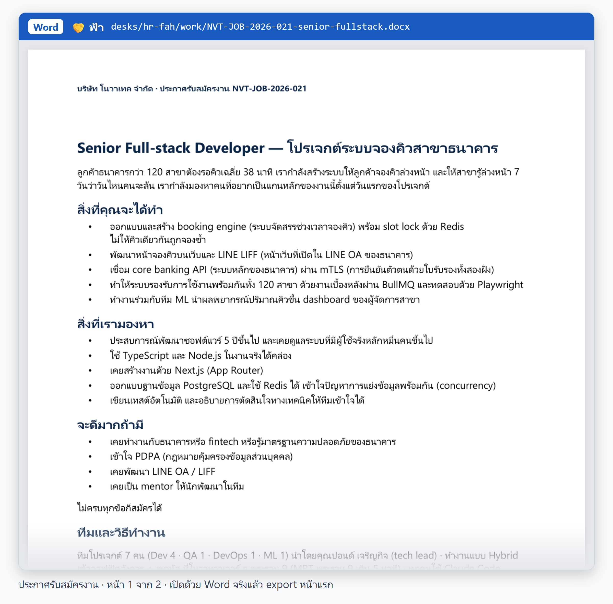](img/lab1-doc-hr-fah.png)

📂 ไฟล์จริง: [`ประกาศ .docx`](_solution/desks-after-lab1/hr-fah/work/NVT-JOB-2026-021-senior-fullstack.docx) · [`work/`](_solution/desks-after-lab1/hr-fah/work/) · [`jd-writer/`](_solution/desks-after-lab1/hr-fah/skills/jd-writer/)

#### 🤖 เจ หัวหน้าทีม ML → `mlflow-experiment`

![โต๊ะของเจ หัวหน้าทีม ML desks/ml-jay/ (3 นาที 27 วินาที): อ่าน people/mlops/ml-jay.md, company-kit/ml-queue-forecast/experiment-results.csv, notes.md, deal-001/tor-bank-queue.md · .gitea-token · work/ มี experiment-registry.xlsx (Excel ทะเบียน run ทุกรอบ + แผน r02b r03b), 2026-W45-queue-forecast-experiments.docx (Word รายงานประจำสัปดาห์), experiment-registry.csv และต้นฉบับ .md · .claude/skills/mlflow-experiment/ มี SKILL.md, references/ (run-record-standard.md, queue-forecast-context.md, สำเนา data-policy-summary.md), assets/weekly-report-template.md, scripts/compare_runs.py · จับได้ว่า r03 ใช้ข้อมูลคนละชุดกับ r02 จึงให้แค่สถานะ candidate](img/lab1-desk-ml-jay.png)

[](img/lab1-doc-ml-jay.png)

📂 ไฟล์จริง: [`experiment-registry.xlsx`](_solution/desks-after-lab1/ml-jay/work/experiment-registry.xlsx) · [`รายงาน .docx`](_solution/desks-after-lab1/ml-jay/work/2026-W45-queue-forecast-experiments.docx) · [`work/`](_solution/desks-after-lab1/ml-jay/work/) · [`mlflow-experiment/`](_solution/desks-after-lab1/ml-jay/skills/mlflow-experiment/)

> 📌 ในโฟลเดอร์เฉลย skill เก็บไว้ที่ `_solution/desks-after-lab1/<ชื่อ>/skills/` (ไม่มีจุดนำหน้า จะได้เปิดดูบน GitHub ง่าย) แต่ในโต๊ะจริงของผู้เรียนอยู่ที่ `desks/<ชื่อ>/.claude/skills/` ตามภาพ

### 1.4 ทุกคนทำงานอะไร (ผลจริง 24 โต๊ะ)

✅ **24/24 โต๊ะได้ skill** · ค่ากลาง 3 นาที 23 วินาทีต่อโต๊ะ · skill ส่วนใหญ่มี 4–8 ไฟล์ ([คำตอบของ Claude ทุกโต๊ะ](_solution/lab1/claude-summaries.md) · [skill และ `work/` ของทุกคน](_solution/desks-after-lab1/))

| แผนก | คน | ข้อมูลที่ใช้ใน `company-kit/` | งานจริง 1 ชิ้น (`work/`) | skill ที่ได้ |
|---|---|---|---|---|
| MD | `md-somchai` | `deal-summaries/` + โน้ตลับ `notes/deal-rules.md` | พิจารณาดีล DS-2026-034 → ตีกลับ | `deal-approval` |
| | `exec-ploy` | `monthly-kpi.csv`, `brand-guide.md` | สไลด์ประชุมผู้บริหาร พ.ย. 2026 (HTML + PDF) | `exec-deck` |
| ผู้บริหารสาย 🆕 | `cco-wit` | `monthly-kpi.csv`, `deal-summaries/`, `deal-001/`, `deal-002/`, `product/` | ทบทวน pipeline 4 ดีล: เร่ง/ส่ง/ประคอง/ตีกลับ · **จับได้ว่า รพ.เมืองใหม่ ที่ Sales เรียก "ลูกค้าใหม่" เป็นลูกค้า NovaQueue v1 อยู่แล้ว** | `pipeline-review` |
| | `cto-nat` | `incident-2026-09.md`, `deploy-runbook.md`, `arch-standards.md`, `ml-queue-forecast/`, `qa/` | ทบทวนความเสี่ยงเทคนิค deal-001: รับได้แบบมีเงื่อนไข · เจอใบรับรอง mTLS ต่อมือแบบเดียวกับเหตุ ShopDee ล่ม | `tech-risk-review` |
| | `cfo-ying` | `monthly-kpi.csv`, `margin-rules.md`, `jd-template.md` | สรุปรายได้ ต้นทุน กำลังคน ต.ค.: กำไรขั้นต้นต่ำกว่าเป้า 228,480 บาท · รับ Senior Full-stack ได้ · ML รอผล deal-001 | `cost-headcount-review` |
| Sales | `sales-nida` | `deal-001/`, `won-proposals/`, `price-list.csv` | proposal ธนาคารนครหลวงพัฒนา + ใบคิดราคา | `sales-proposal` |
| | `sales-krit` | `meeting-notes/` | อีเมลติดตามลูกค้า deal-002 | `follow-up-email` |
| SA | `sa-ton` | `deal-001/`, `arch-standards.md` | spec จาก TOR deal-001 | `req-to-spec` |
| | `sa-ice` | `arch-standards.md` | แผนภาพ architecture ระบบจองคิว | `arch-template` |
| Product 🆕 | `pm-beam` | `product/novaqueue-feedback-2026-q3.md`, `product/product-lifecycle-policy.md` | จัดลำดับฟีเจอร์ + PRD "เตือนก่อนถึงคิวผ่าน LINE" (ตัดเบอร์ลูกค้าใน ticket ออกเอง) | `prd-writer` |
| | `pm-gift` | `product/novaqueue-v1-customers.csv`, `product/product-lifecycle-policy.md` | แผนปิด NovaQueue v1 วันที่ 30 ก.ย. 2027 (ไม่ปิดก่อน MA หมด · ค่า MA 905,000 บาทต้องให้ MD อนุมัติ) + ร่างประกาศ | `product-sunset` |
| Dev | `dev-pond` | `coding-rules.md` | รีวิว PR ตัวอย่างตามมาตรฐานทีม | `coding-standard` |
| | `dev-mew` | `project-scaffold-notes.md` | ขึ้นโปรเจกต์จริง รัน test 24/24 + E2E 4/4 (ช้าสุด 23 นาที · skill 75 ไฟล์เพราะเก็บโครงโปรเจกต์ทั้งชุด) | `project-scaffold` |
| QA | `qa-mint` | — (มี skill จากส่วน 02 แล้ว) | คัดลอก `test-from-plan` แล้วเติมหัวไฟล์ ([พรอมต์สั้นกว่า](_solution/lab1/prompt-qa-mint.txt) · เร็วสุด 50 วินาที) | `test-from-plan` |
| | `qa-bank` | `qa/failed-test-log.txt` | รายงานบั๊กจาก log ที่ล้ม | `bug-report` |
| DevOps | `ops-art` | `deploy-runbook.md` | checklist ขึ้นระบบรอบ 2026.11 | `deploy-checklist` |
| | `ops-fon` | `incident-2026-09.md` | postmortem payment ล่ม 47 นาที | `postmortem` |
| ML | `ml-jay` | `ml-queue-forecast/` | ทะเบียนผลทดลองโมเดลพยากรณ์คิว | `mlflow-experiment` |
| | `ml-pim` | `ml-queue-forecast/` | เอกสารปล่อยโมเดล r03 | `model-release` |
| HR | `hr-fah` | `jd-template.md` | ประกาศรับ Senior Full-stack Developer | `jd-writer` |
| | `hr-oat` | `onboarding-notes.md`, `hr-benefits-faq.md` | แพ็กต้อนรับ Dev คนใหม่ | `onboarding-pack` |
| บัญชี | `fin-joy` | `price-list.csv`, `margin-rules.md` | คิดราคาและกำไร deal-001 | `pricing-calc` |
| | `fin-nok` | `invoices/` | ตรวจใบแจ้งหนี้ เจอ VAT ผิด | `invoice-check` |
| ทีมกลาง | `plat-may` | `customer-data-policy.md` | ตรวจใบแจ้งหนี้ตามกติกาข้อมูลลูกค้า | `customer-data-policy` |

<details>
<summary>🧪 หมายเหตุผู้สอน</summary>

19 โต๊ะแรกรันในรอบบริษัท 21 คน (พร้อมกันครั้งละ 10 แชต รวม 23 นาที 27 วินาที) ส่วน 5 โต๊ะใหม่ (Product 2 + ผู้บริหารสาย 3) รันทีหลังด้วย `claude -p` ซึ่งไม่มีหน้าต่างขออนุญาต 4 โต๊ะจึงหยุดรอสิทธิ์เขียน `.claude/` ผู้สอนวางไฟล์ skill ตามที่ Claude ร่างไว้ทุกตัวอักษร (ดึงจาก log) · ผู้เรียนที่ใช้แอปจะเห็นหน้าต่างขออนุญาต กดอนุญาตได้เลย

</details>

### 1.5 ผลที่เห็น: 3 ปัญหาของ "ต่างคนต่างเก็บ"

ทุกคนทำถูกตามพรอมต์ แต่พอเอา skill ของทุกโต๊ะมาวางเทียบกัน เจอ 3 ปัญหา

| ปัญหา | สั้น ๆ | แก้ใน |
|---|---|---|
| 1 · คัดลอกซ้ำ | กติกาเดียวกันมีสำเนาอยู่ 14 skill | LAB 2 |
| 2 · หัวไฟล์คนละแบบ | ช่อง `uses` / `follows` แต่ละคนใส่ไม่เหมือนกัน | LAB 2 · LAB 6 |
| 3 · ความรู้ติดอยู่ที่คนเดียว | กฎ PDPA อยู่ที่ MD คนเดียว proposal ของ Sales จึงไม่มี | LAB 4 · LAB 5 |

**⚠️ ปัญหา 1 · ความรู้เดียวกัน ถูกคัดลอกไปหลายที่**

![ปัญหา 1 ความรู้เดียวกันถูกคัดลอกไปหลายที่: ต้นฉบับ company-kit/customer-data-policy.md 1 ไฟล์ เจ้าของ plat-may · ต่างคนต่างคัดลอกไปไว้ใน references/ ของตัวเองด้วยชื่อไฟล์ต่างกัน เช่น sales-nida pdpa-rules.md, sales-krit customer-data-rules.md, qa-bank data-policy.md, ml-jay data-policy-summary.md, ml-pim data-policy.md, fin-nok pdpa-for-invoices.md, ops-fon company-rules.md, md-somchai approval-rules.md · รวม 14 skill · price-list.csv ก็ถูกคัดลอก 3 skill · ถ้ากติกาเปลี่ยนต้องแก้ 14 ที่ · แก้ใน LAB 2 ย้ายไปไว้ที่เดียวใน core](img/lab1-problem-1-copies.png)

พรอมต์บอกให้ "สรุปความรู้ที่จำเป็นไว้ใน `references/`" เพื่อให้ skill ใช้ที่เครื่องอื่นได้ ทุกคนจึงคัดลอกไปเก็บเอง ผลคือกติกาที่มีต้นฉบับไฟล์เดียว กลายเป็น 14 สำเนาที่ชื่อไฟล์ไม่เหมือนกันเลย

**⚠️ ปัญหา 2 · ต่างคนต่างเข้าใจหัวไฟล์ไม่ตรงกัน**

![ปัญหา 2 ต่างคนต่างเข้าใจหัวไฟล์ไม่ตรงกัน: ที่ขอไว้ uses = skill ที่เรียกใช้ follows = นโยบายที่ต้องทำตาม · sales-nida ใส่ uses [pricing-calc] follows [customer-data-policy] ถูกทั้งคู่ · md-somchai ใส่ customer-data-policy ไว้ใน uses และ pricing-calc ไว้ใน follows สลับกัน · fin-joy ใส่ customer-data-policy ใน uses, follows เป็นงานที่ทำมาก่อน และ version 0.1.0 · ทั้งบริษัทใส่ follows เป็นนโยบายถูกแค่ 2 คน · แก้ใน LAB 2 และ LAB 6](img/lab1-problem-2-headers.png)

ภาพนี้คือหัวไฟล์จริงของ 3 โต๊ะใน 1.3 ทั้งบริษัทใส่ `follows` เป็นนโยบายถูกแค่ 2 คน ถ้าปล่อยไว้ เวลาถามว่า "แก้กติกานี้แล้วกระทบ skill ไหน" (LAB 7) จะตอบผิด

**⚠️ ปัญหา 3 · ความรู้ในหัวคนเดียว ไม่ไปถึงคนที่ต้องใช้**


> **สรุป LAB 1:** ทุกคนเก่งขึ้นได้ด้วย skill ของตัวเอง แต่ **บริษัทยังไม่เก่งขึ้น** เพราะ skill อยู่คนละโต๊ะ ซ้ำกัน เขียนหัวไฟล์คนละแบบ และความรู้สำคัญไม่ไปถึงคนที่ต้องใช้ → LAB 2 ทีมกลางจะรวมทั้งหมดเป็นคลังเดียวบน Gitea

---

## LAB 2 · ทีมกลางรวม skill เป็นคลังกลาง `org-skills` 🤖


**LAB นี้ทำอะไร:** เคน (`plat-ken`) หัวหน้าทีมกลาง ทำ 3 อย่างให้ทั้งบริษัท

| ขั้น | ทำอะไร | ได้อะไร |
|---|---|---|
| ① ดูด | อ่าน skill ส่วนตัวจาก `desks/*/.claude/skills/` ของทุกโต๊ะ (อ่านอย่างเดียว ไม่แก้ของใคร) | รู้ว่ามี skill อะไรบ้าง อะไรซ้ำกัน |
| ② จัดเป็นคลังเดียว | ทำคลัง `org-skills` ในโต๊ะของเคน: 1 แผนก = 1 plugin · ของที่ทุกคนใช้รวมไว้ใน `core` · ทำหัวไฟล์ให้เหมือนกันทั้งคลัง | คลังเดียวที่ทุกคนใช้ร่วมกัน ไม่มีสำเนาซ้ำ |
| ③ ขึ้น Gitea | push คลังขึ้น `localhost:3300/novatech/org-skills` แล้วตั้งยามให้ branch `main` | ทุกโต๊ะดึงไปติดตั้งได้ (LAB 3) · แก้ได้ทาง PR เท่านั้น (LAB 5) |

> 📦 **plugin marketplace คืออะไร** คลัง Git ที่มีสารบัญ `marketplace.json` บอกว่ามี **plugin** (แพ็ก skill) อะไรบ้าง ติดตั้งทีละแพ็กด้วย `claude plugin install <ชื่อ>@novatech-skills` · `org-skills` = ชื่อ repo บน Gitea · `novatech-skills` = ชื่อคลังที่ Claude Code รู้จัก (เขียนไว้ใน `marketplace.json`) เช่น ฝ่ายขายติดตั้ง `core` + `sales` ได้ skill 6 ตัวในคำสั่งเดียว

🧑 **คิดก่อน** จากปัญหา 1 ใน LAB 1 (ความรู้เดียวกันถูกคัดลอกไว้หลายที่) ของที่ซ้ำกันควรไปอยู่ชั้นไหน (ทฤษฎีหัวข้อ 21 ตาราง 5 ชั้น) และใครควรเป็นคนรีวิว skill ของแต่ละแผนก

### 2.1 จากทุกโต๊ะ เป็นคลังเดียว

[![LAB 2 จากทุกโต๊ะเป็นคลังเดียว: ก่อน ต่างคนต่างเก็บ desks/sales-nida/.claude/skills/sales-proposal/, sales-krit follow-up-email, md-somchai deal-approval, fin-joy pricing-calc, hr-fah jd-writer, ml-jay mlflow-experiment, plat-may customer-data-policy และโต๊ะอื่นทุกโต๊ะ → plat-ken อ่านอย่างเดียว → หลัง desks/plat-ken/org-skills/ มี .claude-plugin/marketplace.json สารบัญ 11 plugin · plugins/core/skills/ ชั้น 1 ทุกคนติดตั้ง customer-data-policy brand-guide pricing-rules skill-finder · shared/skills/ ชั้น 2 meeting-minutes · sales exec finance hr mlops sa dev qa devops ชั้น 3 แผนกละ 2 skill · .gitea/CODEOWNERS · scripts/build.py · push ขึ้น http://localhost:3300/novatech/org-skills · main ห้าม push ตรง ต้องผ่าน PR approve อย่างน้อย 1 คน](img/lab2-before-after.png)](img/lab2-before-after.png)

| ชั้น | `layer` ในหัวไฟล์ | plugin | ใครติดตั้ง | ใครรีวิว (CODEOWNER) |
|---|---|---|---|---|
| 1 · องค์กร | `core` | `core` | **ทุกคน** | `plat-ken` (+ เจ้าของเรื่อง `plat-may`, `fin-joy`) |
| 2 · ข้ามแผนก | `shared` | `shared` | ทุกแผนกที่ต้องใช้ | `plat-ken` |
| 3 · แผนก | `department` | `sales` · `exec` · `finance` · `hr` · `mlops` · `sa` · `dev` · `qa` · `devops` (+ `product` ในบริษัท 28 คน) | คนในแผนกนั้น | หัวหน้าแผนก 👑 |

### 2.2 พรอมต์

<a id="p3"></a>

#### 📋 วางที่ ③ · LAB 2 · เคนรวม skill ขึ้นคลังกลาง

| 📂 เปิด Claude Code ที่ | 🎭 คุณเป็น | ⏱️ รอ | ก๊อป |
|---|---|---|---|
| `novatech/desks/plat-ken/` (แชตใหม่) | `plat-ken` หัวหน้าทีมกลาง | ~13 นาที | 1 กล่อง |

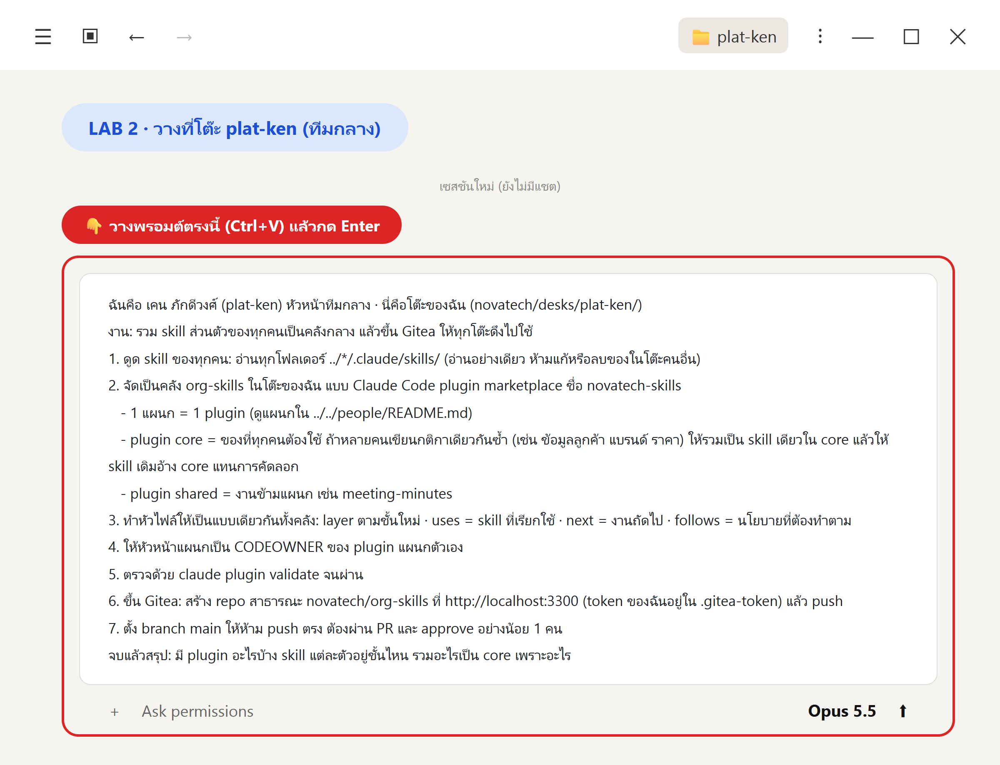

```text
ฉันคือ เคน ภักดีวงศ์ (plat-ken) หัวหน้าทีมกลาง · นี่คือโต๊ะของฉัน (novatech/desks/plat-ken/)
งาน: รวม skill ส่วนตัวของทุกคนเป็นคลังกลาง แล้วขึ้น Gitea ให้ทุกโต๊ะดึงไปใช้
1. ดูด skill ของทุกคน: อ่านทุกโฟลเดอร์ ../*/.claude/skills/ (อ่านอย่างเดียว ห้ามแก้หรือลบของในโต๊ะคนอื่น)
2. จัดเป็นคลัง org-skills ในโต๊ะของฉัน แบบ Claude Code plugin marketplace ชื่อ novatech-skills
   - 1 แผนก = 1 plugin (ดูแผนกใน ../../people/README.md)
   - plugin core = ของที่ทุกคนต้องใช้ ถ้าหลายคนเขียนกติกาเดียวกันซ้ำ (เช่น ข้อมูลลูกค้า แบรนด์ ราคา) ให้รวมเป็น skill เดียวใน core แล้วให้ skill เดิมอ้าง core แทนการคัดลอก
   - plugin shared = งานข้ามแผนก เช่น meeting-minutes
3. ทำหัวไฟล์ให้เป็นแบบเดียวกันทั้งคลัง: layer ตามชั้นใหม่ · uses = skill ที่เรียกใช้ · next = งานถัดไป · follows = นโยบายที่ต้องทำตาม
4. ให้หัวหน้าแผนกเป็น CODEOWNER ของ plugin แผนกตัวเอง
5. ตรวจด้วย claude plugin validate จนผ่าน
6. ขึ้น Gitea: สร้าง repo สาธารณะ novatech/org-skills ที่ http://localhost:3300 (token ของฉันอยู่ใน .gitea-token) แล้ว push
7. ตั้ง branch main ให้ห้าม push ตรง ต้องผ่าน PR และ approve อย่างน้อย 1 คน
จบแล้วสรุป: มี plugin อะไรบ้าง skill แต่ละตัวอยู่ชั้นไหน รวมอะไรเป็น core เพราะอะไร
```

> ✋ **วางแล้วรอ** ~13 นาที ถ้าขออนุญาตรันคำสั่ง git / สร้าง repo ให้กดอนุญาต · ⬇️ ด้านล่างคือคำอธิบายและผลจริง อ่านระหว่างรอได้

| ขั้นในพรอมต์ | มีไว้ทำไม |
|---|---|
| 1 อ่านอย่างเดียว | โต๊ะของคนอื่นคือคอมของเขา ทีมกลางเอาของมาจัด แต่ไม่ไปแก้ในเครื่องใคร |
| 2 core / shared / แผนก | แต่ละคนเห็นแค่ของที่เกี่ยวกับตัวเอง (LAB 3) และกติกาที่ซ้ำเหลือที่เดียว (แก้ปัญหา 1 ของ LAB 1) |
| 3 หัวไฟล์แบบเดียวกัน | กราฟของ skill และการค้นหาใน LAB 7 จะได้ไม่เพี้ยน (แก้ปัญหา 2 ของ LAB 1) |
| 4 CODEOWNER | การแก้ skill ของแผนกไหน ต้องให้หัวหน้าแผนกนั้นรีวิว (LAB 5) |
| 5 validate | Claude Code อ่านคลังได้จริง ก่อนให้คนอื่นติดตั้ง |
| 6–7 push + ยามของ main | ของจริงมีที่เดียวบน Gitea · ห้ามใครแก้ตรง ต้องผ่าน PR (ทฤษฎีหัวข้อ 22.2) |

<details>
<summary>🧪 หมายเหตุผู้สอน</summary>

ผลจริงด้านล่างรันด้วยพรอมต์ถ้อยคำเดิมแบบย่อหน้าเดียว ([`prompt.txt`](_solution/lab2/prompt.txt)) ในรอบบริษัท 21 คน (9 แผนก ยังไม่มีทีม Product) พรอมต์ด้านบนเรียงงานเดียวกันเป็นขั้น และเพิ่มคำว่า "อ่านอย่างเดียว" ให้ชัด (รอบจริง Claude ก็ไม่ได้แก้โต๊ะของใคร) ยังไม่ได้รันด้วยถ้อยคำใหม่

</details>

### 2.3 ผลจริง

> ⚠️ **ผลด้านล่างมาจากรอบบริษัท 21 คน** (9 แผนก ยังไม่มีทีม Product) · ถ้าคุณรันกับบริษัท 28 คน ควรได้ **12 plugin** (มี `product` เพิ่ม) และ `exec` มี 5 skill (MD · ผู้ช่วย · ผู้บริหารสาย 3 คน) ตัวเลขอื่นต่างได้

✅ **ผลจริง: ~13 นาที · 57 คำสั่ง · 11 plugin · 23 skill** ([คำตอบเต็มของ Claude](_solution/lab2/claude-summary.md) · [คลังที่ได้](_solution/org-skills-after-lab2/))

| plugin | ชั้น | CODEOWNER | skill |
|---|---|---|---|
| `core` | 1 องค์กร (ทุกคน) | `plat-ken` (+ `plat-may`, `fin-joy` เฉพาะเรื่องของตัวเอง) | `customer-data-policy` · `brand-guide` 🆕 · `pricing-rules` 🆕 · `skill-finder` 🆕 |
| `shared` | 2 ข้ามแผนก | `plat-ken` | `meeting-minutes` 🆕 |
| `exec` · `sales` · `sa` · `dev` · `qa` · `devops` · `mlops` · `hr` · `finance` | 3 แผนก | หัวหน้าแผนก 👑 | แผนกละ 2 skill (18 ตัวจาก LAB 1) |

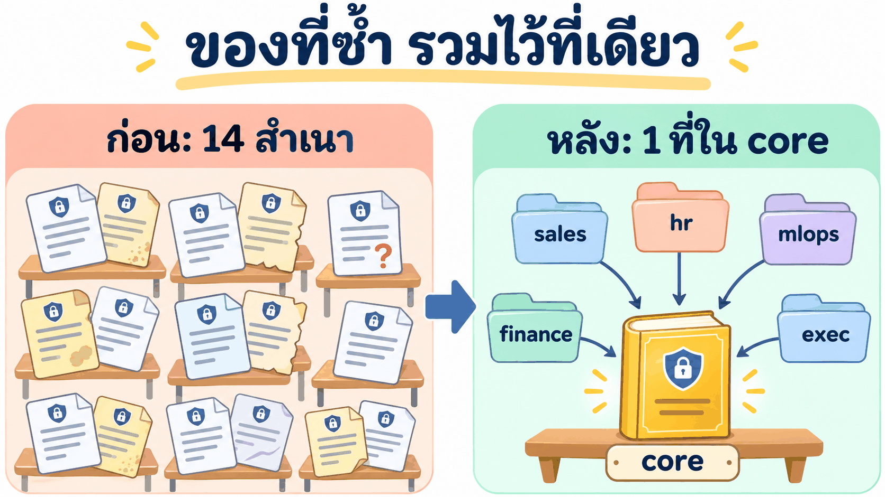

Claude รวมอะไรเป็น `core` และเพราะอะไร

| skill ใน core | เดิมกระจายอยู่ที่ | ผล |
|---|---|---|
| `customer-data-policy` | สรุป PDPA คนละแบบ 8 skill | เหลือที่เดียว กติกาเฉพาะงานที่มีแค่ในบางสำเนาย้ายเป็นตาราง `doc-type-rules.md` ไม่มีข้อไหนหาย |
| `brand-guide` | กติกาแบรนด์ 7 skill | ใช้คู่มือฉบับเต็มกับโลโก้ชุดเดียว |
| `pricing-rules` | `price-list.csv` 3 สำเนาที่ **เหมือนกันทุกไบต์** + กฎกำไร 3 ชุด (sales, finance, exec) | สคริปต์คิดราคา 3 ตัวแก้ให้อ่านราคาจาก core ที่เดียว ทดสอบแล้วตัวเลขตรง (755,000 บาท · margin 36.8%) |

> 🔢 ตัวเลขนับคนละแบบ: LAB 1 นับ skill ที่มีกติกาข้อมูลลูกค้าปนอยู่ (14 จาก 19 โต๊ะ) ตารางนี้นับ skill ที่ Claude ใน LAB 2 พบว่ามีไฟล์สรุป PDPA เป็นสำเนา (8 skill) ส่วน 12 ไฟล์ด้านล่างคือไฟล์สำเนาที่ลบได้ทั้งไฟล์ รวมทุกเรื่อง (PDPA แบรนด์ ราคา)

และ **ลบไฟล์สำเนาทิ้ง 12 ไฟล์** skill ในแผนกเปลี่ยนไปอ้าง core ผ่าน `follows` แทน · หัวไฟล์ทุกตัวเป็นแบบเดียวกัน (เทียบกับ LAB 1 ปัญหา 2)

```markdown
metadata:
  owner: sales-nida
  plugin: sales
  layer: department          # เดิม personal
  version: 1.1.0             # เดิม 1.0.0
  uses: []                   # เดิม [pricing-calc] (ข้ามแผนก ติดตั้งไม่ครบทุกคน)
  next: [deal-approval, follow-up-email, req-to-spec]
  follows: [pricing-rules, brand-guide, customer-data-policy]   # นโยบายใน core
```

### 2.4 ดูของจริงใน Gitea

🎬 **หลัง push แล้ว Gitea หน้าตาเป็นยังไง (12 วินาที)**

![GIF LAB 2: ① plat-ken ดูด SKILL.md จากโต๊ะ sales-nida md-somchai fin-joy hr-fah ml-jay อ่านอย่างเดียว ② จัดเป็นคลังเดียว desks/plat-ken/org-skills/ มี marketplace.json plugins/core shared sales exec finance hr mlops sa dev CODEOWNERS build.py ③ git push origin main ขึ้น http://localhost:3300/novatech/org-skills.git new branch main ④ หน้า repo novatech/org-skills บน Gitea ⑤ โฟลเดอร์ plugins 11 แผนก ⑥ ไฟล์ CODEOWNERS plugins/sales → @sales-nida ⑦ ลอง push ตรงเข้า main ถูกปฏิเสธ Not allowed to push to protected branch main](img/lab2-push-flow.gif)

<sub>ข้อความใน terminal และหน้าเว็บมาจากการ push คลังผลจริงของ LAB 2 ขึ้นบริษัทจำลองจริง (รวมการลอง push ตรงที่ถูกปฏิเสธ)</sub>

| repo `novatech/org-skills` | `.gitea/CODEOWNERS`: โฟลเดอร์ไหน ใครรีวิว |
|---|---|
| 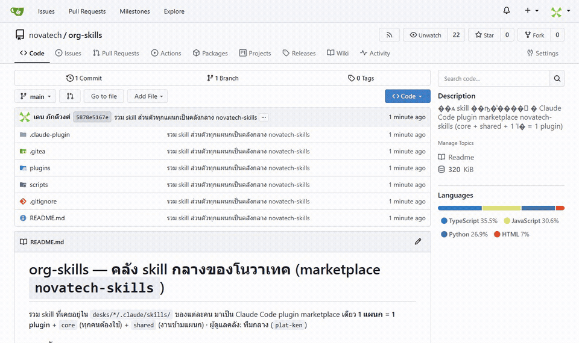 | 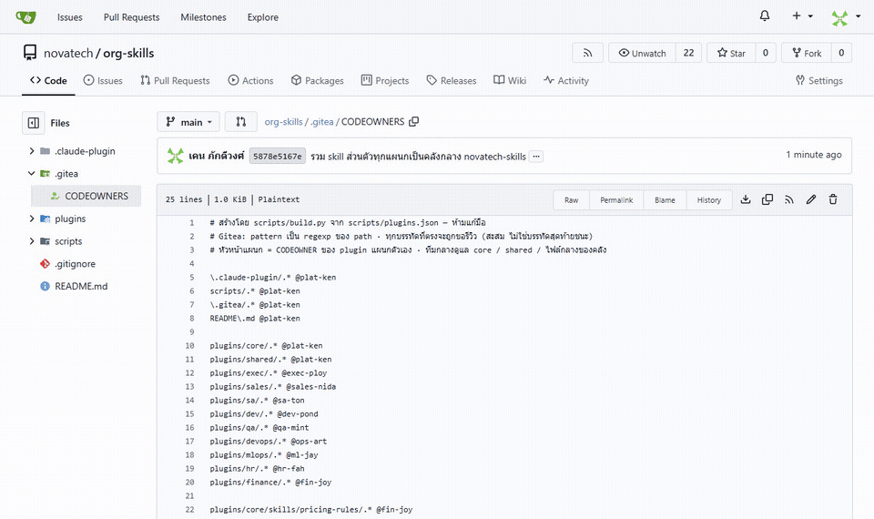 |

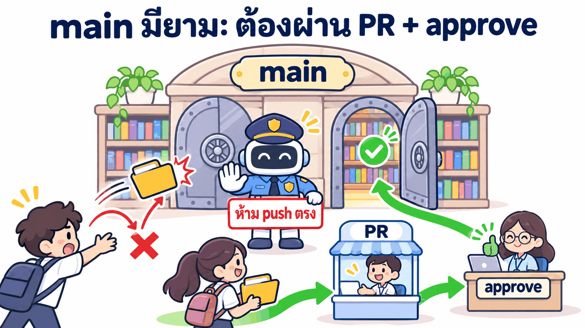

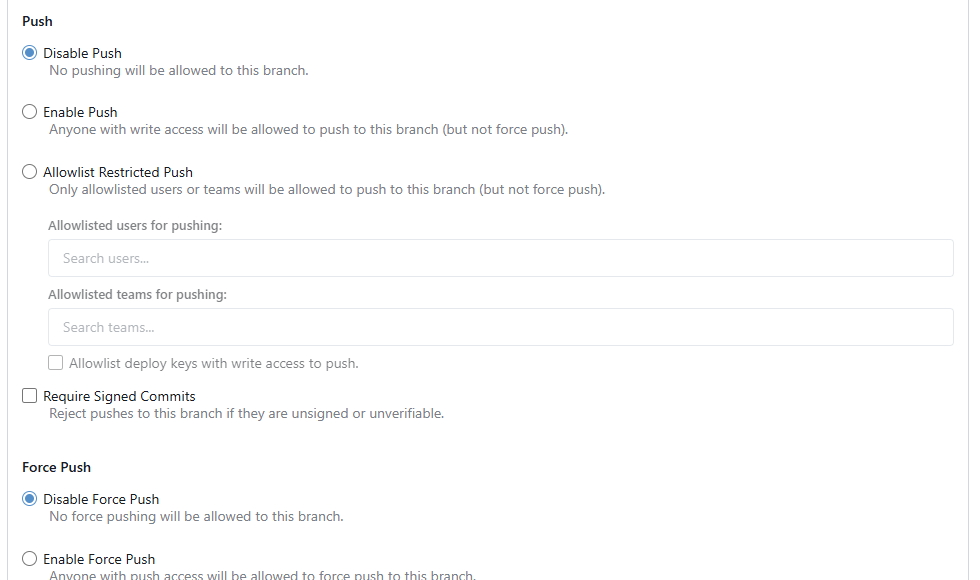

Claude ทดสอบกติกาเอง: ลอง push ตรงเข้า `main` แล้ว Gitea ตอบ `Not allowed to push to protected branch main` (แล้วลบ commit ทดสอบทิ้ง)

👀 **สังเกต**
- Claude **เขียนสคริปต์ `scripts/build.py --check` เพิ่มเอง** ให้สร้าง `marketplace.json`, `plugin.json`, `CODEOWNERS` และแค็ตตาล็อกจากหัวไฟล์ และไม่ยอมให้มีสำเนากติกากลางอยู่นอก core — นี่คือเมล็ดของ CI ใน LAB 6
- Claude บอกเองว่า skill ที่เขียนใหม่ใน core (`brand-guide`, `pricing-rules`) **ควรให้เจ้าของเรื่องรีวิว** (`plat-may`, `fin-joy`) — AI ร่างได้ แต่คนต้องตรวจ (ทฤษฎีหัวข้อ 15)
- คำอธิบาย repo ในหน้า Gitea เป็นตัวอ่านไม่ออก เพราะส่งภาษาไทยผ่าน `curl` บน Windows โดยไม่ได้ตั้ง UTF-8 (ตัว repo และไฟล์ไม่เป็นอะไร)

<details>
<summary>🧪 หมายเหตุผู้สอน</summary>

รอบแรก LAB 2 สร้าง repo ไม่ได้ เพราะ `seed` ออก token ให้ทีมกลางแค่สิทธิ์เขียน repo ไม่มีสิทธิ์สร้าง repo ในองค์กร Claude **หยุดและถาม** แทนที่จะเอารหัสผ่านใน `.env` ไปออก token สิทธิ์สูงกว่าเอง ([บันทึกรอบแรก](_solution/lab2/attempt1-blocked-token.md)) · แก้ `seed` ให้ทีมกลางได้ `write:organization` แล้วรัน LAB 2 ใหม่ทั้งหมด ผลด้านบนคือรอบที่ 2

</details>

### 2.5 ตรวจเองว่าขึ้น Gitea สำเร็จ

| ✅ | ตรวจที่ | ควรเห็น |
|---|---|---|
| ☐ | `http://localhost:3300/novatech/org-skills` | repo มีโฟลเดอร์ `plugins/` แยกแผนก และ `.claude-plugin/marketplace.json` |
| ☐ | ไฟล์ `.gitea/CODEOWNERS` | `plugins/sales/` → `@sales-nida` และหัวหน้าแผนกอื่นครบ |
| ☐ | Settings → Branches | มีกติกาของ `main` (ห้าม push ตรง · approve อย่างน้อย 1 คน) |

> **สรุป LAB 2:** ตอนนี้ skill ของทุกคนมี **ที่เดียว** บน Gitea แล้ว ซ้ำกันน้อยลง หัวไฟล์เป็นแบบเดียวกัน แต่ **ยังไม่มีใครติดตั้งไปใช้** → LAB 3 ทุกโต๊ะติดตั้งแพ็กของแผนกตัวเอง

---

## LAB 3 · ทุกโต๊ะติดตั้งแพ็กแผนก + Dev คนใหม่วันแรก 🤖 ×28


**LAB นี้ทำอะไร:** คลังกลางขึ้น Gitea แล้ว (LAB 2) ทีนี้ทุกโต๊ะต้อง **ติดตั้งไปใช้** โดยแต่ละคนได้เฉพาะของที่เกี่ยวกับตัวเอง

| ขั้น | ใครทำ | ทำอะไร |
|---|---|---|
| ① บอกที่อยู่คลัง | ผู้ดูแลระบบ (ที่ `novatech/`) | ใส่ค่าให้ทุกโต๊ะรู้จักคลัง `novatech-skills` และเปิด `core` |
| ② ติดตั้งแพ็กของตัวเอง | พนักงานทุกคน | ติดตั้ง `core` + plugin แผนกตัวเอง ให้ใช้ได้เฉพาะโต๊ะนั้น |
| ③ ตรวจของจริง | ผู้ดูแลระบบ | ตรวจว่า **ติดตั้งแล้วจริง** ไม่ใช่แค่มีชื่อใน settings · เก็บ skill ส่วนตัวที่ซ้ำกับคลังกลาง |
| 🧪 ทดลอง | Dev คนใหม่ (`dev-new`) | วันแรกที่มีแพ็ก vs ไม่มีแพ็ก ทำงานต่างกันแค่ไหน |

🧑 **คิดก่อน** ถ้าทุกคนติดตั้ง skill ทั้ง 23 ตัว จะเกิดอะไรขึ้น (ทฤษฎีหัวข้อ 24.1 งบรายชื่อมีจำกัด คำอธิบายชนกัน) แล้วใครควรเห็นอะไร (หัวข้อ 21 ตาราง 5 ชั้น)

### 3.1 แพ็กตามแผนก: ใครได้อะไร


| ใคร | ติดตั้ง | เห็น skill |
|---|---|---|
| ทุกคน | `core` | `customer-data-policy` · `brand-guide` · `pricing-rules` · `skill-finder` |
| ฝ่ายขาย (`sales-nida`, `sales-krit`) | + `sales` | `sales:sales-proposal` · `sales:follow-up-email` |
| บัญชี (`fin-joy`, `fin-nok`) | + `finance` | `finance:pricing-calc` · `finance:invoice-check` |
| Dev (`dev-pond`, `dev-mew`, `dev-new`) | + `dev` | `dev:project-scaffold` · `dev:coding-standard` |
| … ทุกแผนกแบบเดียวกัน | + แผนกตัวเอง | รวมคนละ **6 จาก 23 skill** |

ของที่ติดตั้งจะอยู่ 2 ที่: `desks/<ชื่อ>/.claude/settings.json` = **รายชื่อ** plugin ที่เปิดใช้ · ทะเบียนติดตั้งของ Claude Code = **ของที่ติดตั้งจริง** (สองอย่างนี้ไม่ใช่เรื่องเดียวกัน ดู 3.4) · แม่แบบอยู่ที่ [`desks/_template/.claude/settings.json`](novatech/desks/_template/.claude/settings.json)

> 🏢 ในบริษัทจริง admin ใส่ค่าใน managed settings ให้ทุกเครื่องครั้งเดียว (ทฤษฎีหัวข้อ 22.3) ในแล็บจำลองด้วยไฟล์แม่แบบในโต๊ะ

### 3.2 ขั้น ① ผู้ดูแลบอกที่อยู่คลัง

<a id="p4"></a>

#### 📋 วางที่ ④ · LAB 3 ขั้น ① · บอกที่อยู่คลังให้ทุกโต๊ะ

| 📂 เปิด Claude Code ที่ | 🎭 คุณเป็น | ⏱️ รอ | ก๊อป |
|---|---|---|---|
| [`novatech/`](novatech/) | ผู้ดูแลระบบ | ~1 นาที | 1 กล่อง |

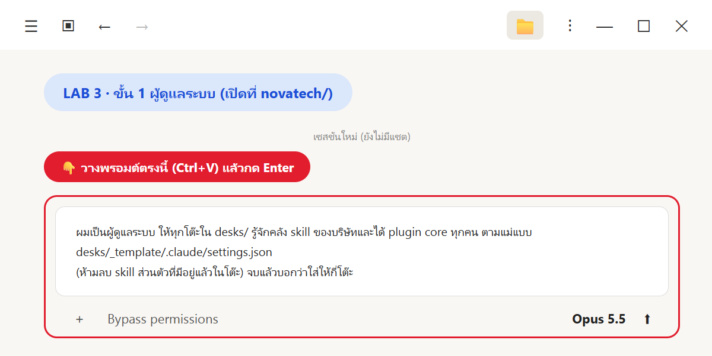

```text
ผมเป็นผู้ดูแลระบบ ให้ทุกโต๊ะใน desks/ รู้จักคลัง skill ของบริษัทและได้ plugin core ทุกคน ตามแม่แบบ desks/_template/.claude/settings.json
(ห้ามลบ skill ส่วนตัวที่มีอยู่แล้วในโต๊ะ) จบแล้วบอกว่าใส่ให้กี่โต๊ะ
```

> ✋ **วางแล้วรอ** ~1 นาที แล้วไปกล่อง ⑤ · ⬇️ ด้านล่างคือคำอธิบายและผลจริง อ่านระหว่างรอได้

### 3.3 ขั้น ② ทุกคนติดตั้งแพ็กของตัวเอง

> 🔤 **ศัพท์ในพรอมต์นี้** · **agent ย่อย** = Claude ตัวลูกที่ Claude หลักเปิดขึ้นมาทำงานแทน 1 ตัวต่อ 1 โต๊ะ · **`--scope project`** = ติดตั้งให้ใช้ได้เฉพาะโฟลเดอร์ (โต๊ะ) นี้ ไม่ใช่ทั้งเครื่อง · **ทะเบียนติดตั้ง** = ไฟล์ `~/.claude/plugins/installed_plugins.json` ที่ Claude Code จดว่า plugin ไหนติดตั้งที่โต๊ะไหน · ⏱️ ใช้ราว 8 นาที ถ้ามีหน้าต่างขออนุญาตรันคำสั่ง `claude plugin install` ให้กดอนุญาต

<a id="p5"></a>

#### 📋 วางที่ ⑤ · LAB 3 ขั้น ② · ทุกโต๊ะติดตั้งแพ็กของตัวเอง

| 📂 เปิด Claude Code ที่ | 🎭 คุณเป็น | ⏱️ รอ | ก๊อป |
|---|---|---|---|
| [`novatech/`](novatech/) (แชตเดิมหรือใหม่ก็ได้) | ผู้ดูแลระบบ | ~8 นาที | 1 กล่อง (ได้ครบทุกโต๊ะ) |

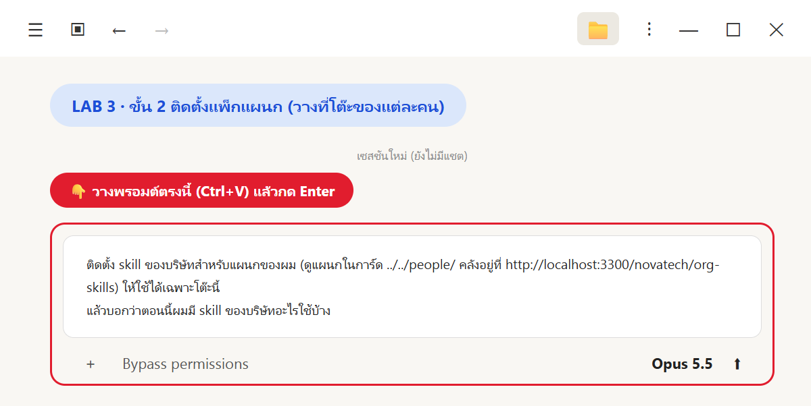

```text
ฉันเป็นผู้ดูแลระบบ ช่วยติดตั้ง skill ของบริษัทให้พนักงานทุกโต๊ะใน desks/ (ข้าม _template)
สำหรับแต่ละโต๊ะ ให้เปิด agent ย่อยแยก 1 ตัว (1 ตัว = แชตใหม่ของเจ้าของโต๊ะ) โฟลเดอร์ทำงานคือ desks/<user>/ แล้วส่งงานนี้ให้ทุกตัวอักษร:
"ติดตั้ง skill ของบริษัทสำหรับแผนกของผม (ดูแผนกในการ์ด ../../people/ คลังอยู่ที่ http://localhost:3300/novatech/org-skills) ให้ใช้ได้เฉพาะโต๊ะนี้ แล้วบอกว่าตอนนี้ผมมี skill ของบริษัทอะไรใช้บ้าง"
- ต้องติดตั้งจริงด้วยคำสั่ง claude plugin install <plugin>@novatech-skills --scope project ที่รันในโฟลเดอร์ desks/<user>/ (core + plugin แผนกของตัวเอง) ไม่ใช่แค่เขียนชื่อใน settings.json · คำสั่งนี้บันทึกลงทะเบียนของ Claude Code ใน ~/.claude/plugins/ ได้ อนุญาต
- นอกจากนั้น agent แก้ไฟล์ได้เฉพาะใน desks/<user>/ ของตัวเอง · รันพร้อมกันครั้งละ 4 ตัว
จบแล้วสรุปเป็นตาราง: user · แผนก · plugin ที่ติดตั้งจริง · skill ที่เห็น
```

> ✋ **วางแล้วรอ** ~8 นาที ถ้าขออนุญาตรัน `claude plugin install` ให้กดอนุญาต · ⬇️ ด้านล่างคือคำอธิบายและผลจริง อ่านระหว่างรอได้

| ส่วนของพรอมต์ | มีไว้ทำไม |
|---|---|
| agent ย่อย 1 ตัวต่อ 1 โต๊ะ | แต่ละคนติดตั้งในนามตัวเอง เหมือนเปิดแชตใหม่ที่โต๊ะของคนนั้น |
| ดูแผนกจากการ์ด | Claude เลือก plugin ของแผนกเอง ไม่ต้องบอกทีละคน |
| **ติดตั้งจริงด้วย `claude plugin install … --scope project`** | ถ้าไม่บอก agent จะแค่เขียนชื่อ plugin ไว้ใน `settings.json` ซึ่ง **ยังใช้ไม่ได้** (ดูรอบแรกด้านล่าง) |
| แก้ได้เฉพาะโต๊ะตัวเอง | ติดตั้งระดับโต๊ะ ไม่ปนกับโต๊ะของคนอื่น |

✅ **ผลจริง (บริษัท 28 คน): 8 นาที · ทุกโต๊ะติดตั้งจริง `core` + แพ็กแผนกตัวเอง** ([คำตอบของ Claude ทุกขั้น](_solution/lab3/run-2026-11-04/claude-summaries.md))

| ใคร | ติดตั้งจริง | เห็น skill ของบริษัท |
|---|---|---|
| 24 โต๊ะของแผนกที่มีแพ็ก (ผู้บริหาร 5 · Sales 3 · SA 2 · Dev 3 · QA 2 · DevOps 2 · ML 2 · HR 3 · บัญชี 2) | `core` + แผนกตัวเอง | 6 ตัว (core 4 + แผนก 2) |
| `plat-ken` | `core` + `shared` | 5 ตัว |
| `plat-may` | `core` | 4 ตัว |
| `pm-beam` · `pm-gift` (ทีม Product) | `core` | 4 ตัว · ⚠️ คลังยังไม่มีแพ็ก `product` เพราะ LAB 2 รวมคลังตอนบริษัทยังไม่มีทีมนี้ |

<details>
<summary>👀 เบื้องหลัง: พรอมต์รุ่นแรกพลาดตรงไหน (ของจริง)</summary>

พรอมต์รุ่นแรกไม่มีบรรทัด "ติดตั้งจริงด้วย `claude plugin install`" agent ทั้ง 28 ตัวรายงานว่า "ติดตั้งแล้ว" แต่ที่จริง **แค่เขียนชื่อ plugin ลง `settings.json`** มีแค่ 2 โต๊ะ (`hr-oat`, `ml-jay`) ที่ติดตั้งจริงบางแพ็ก (มี `core` ครบแค่ `hr-oat` โต๊ะเดียว) เพราะ agent สองตัวนี้รันคำสั่งติดตั้งเอง จากนั้น Claude หลักห้ามคำสั่งนี้ไปเลย เพราะมันเขียนทะเบียนกลางของ Claude Code นอกโต๊ะ → เราจึงเติมบรรทัดนั้นในพรอมต์ แล้วรันขั้น ② ใหม่ ([ทะเบียนติดตั้งหลังรอบแรก](_solution/lab3/run-2026-11-04/installed-after-2-all-desks.json): มีแค่ 2 โต๊ะ · [หลังรอบสอง](_solution/lab3/run-2026-11-04/installed-after-2-all-desks-round2.json): ครบ 28 โต๊ะ)

</details>

### 3.4 ขั้น ③ ผู้ดูแลตรวจของจริง

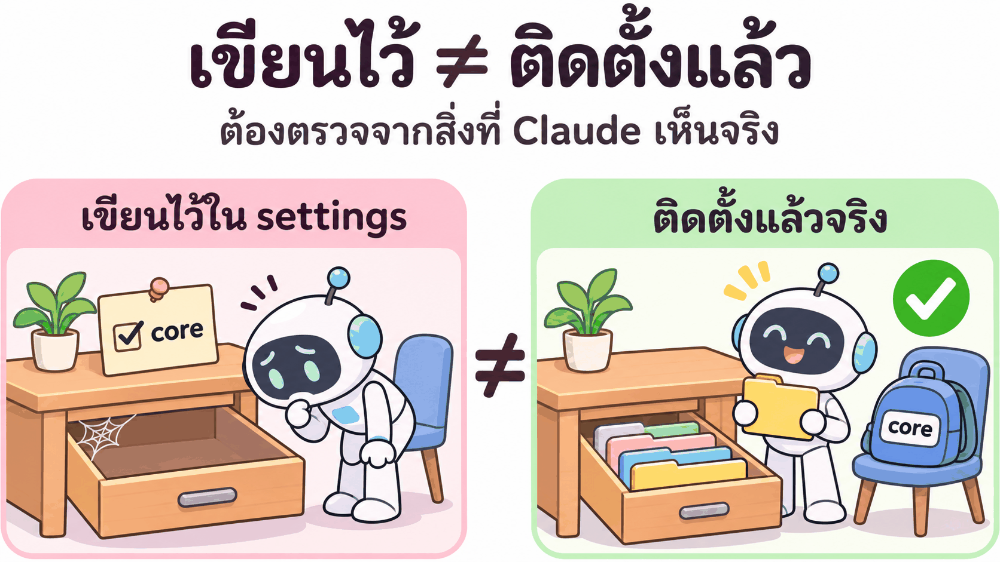

ขั้นนี้คือ **ยามตรวจของจริง** ผู้ดูแลไม่เชื่อแค่ชื่อใน `settings.json` แต่ดูจาก **ทะเบียนติดตั้งของ Claude Code** ว่าทุกโต๊ะมี plugin ครบไหม และเก็บ skill ส่วนตัวจาก LAB 1 ที่มีอยู่ในคลังกลางแล้ว ไม่ให้มีสองฉบับ

<a id="p6"></a>

#### 📋 วางที่ ⑥ · LAB 3 ขั้น ③ · ผู้ดูแลตรวจของจริง

| 📂 เปิด Claude Code ที่ | 🎭 คุณเป็น | ⏱️ รอ | ก๊อป |
|---|---|---|---|
| [`novatech/`](novatech/) | ผู้ดูแลระบบ | ~1 นาที | 1 กล่อง |

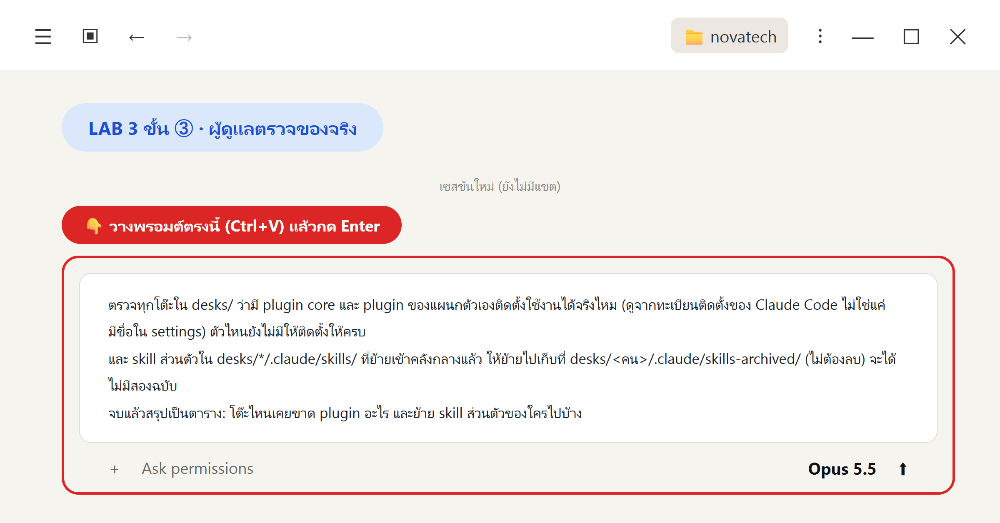

```text
ตรวจทุกโต๊ะใน desks/ ว่ามี plugin core และ plugin ของแผนกตัวเองติดตั้งใช้งานได้จริงไหม (ดูจากทะเบียนติดตั้งของ Claude Code ไม่ใช่แค่มีชื่อใน settings) ตัวไหนยังไม่มีให้ติดตั้งให้ครบ
และ skill ส่วนตัวใน desks/*/.claude/skills/ ที่ย้ายเข้าคลังกลางแล้ว ให้ย้ายไปเก็บที่ desks/<คน>/.claude/skills-archived/ (ไม่ต้องลบ) จะได้ไม่มีสองฉบับ
จบแล้วสรุปเป็นตาราง: โต๊ะไหนเคยขาด plugin อะไร และย้าย skill ส่วนตัวของใครไปบ้าง
```

> ✋ **วางแล้วรอ** ~1 นาที · ⬇️ ด้านล่างคือคำอธิบายและผลจริง อ่านระหว่างรอได้

✅ **สิ่งที่คุณควรเห็น** (ใช้พรอมต์ขั้น ② ที่แก้แล้ว)
- plugin ครบทุกโต๊ะอยู่แล้ว ยามไม่ต้องติดตั้งเพิ่ม (ถ้าพบโต๊ะที่ขาด ยามจะติดตั้งให้)
- skill ส่วนตัว 19 ตัวที่มีในคลังกลางแล้ว ถูกย้ายไป `desks/<คน>/.claude/skills-archived/` (ไม่ได้ลบ)

> ทำขั้นนี้เสมอ แม้ขั้น ② จะบอกว่าครบ เพราะ agent รายงานว่า "ติดตั้งแล้ว" ได้ทั้งที่ยังไม่ได้ติดตั้ง

<details>
<summary>👀 เบื้องหลัง: ยามจับอะไรได้ในรอบจริง</summary>

| รอบ | ก่อนตรวจ | ยามทำอะไร |
|---|---|---|
| รอบแรก (หลังขั้น ② รุ่นแรก) | `core` ติดตั้งจริงแค่ 1 จาก 28 โต๊ะ ที่เหลือมีแค่ชื่อใน settings | ติดตั้ง `core` ให้ 27 โต๊ะ · ย้าย skill ส่วนตัว 19 ตัวไป `skills-archived/` · ทักว่าแพ็กแผนกก็ยังไม่ได้ติดตั้งเหมือนกัน (พรอมต์รุ่นแรกให้ตรวจแค่ core) |
| รอบสอง (หลังขั้น ② ที่แก้แล้ว) | ครบทุกโต๊ะ | ไม่ต้องแก้อะไร · เหลือแค่ทีม Product ที่ยังไม่มีแพ็กในคลัง |

</details>

skill ส่วนตัวที่ **ยังเก็บไว้** 5 ตัว เพราะยังไม่มีในคลังกลาง: `cco-wit/pipeline-review` · `cfo-ying/cost-headcount-review` · `cto-nat/tech-risk-review` · `pm-beam/prd-writer` · `pm-gift/product-sunset` (เป็น skill ของคนที่เพิ่มเข้าบริษัทหลัง LAB 2) → ต้องให้ทีมกลางรวมเข้าคลังผ่าน PR (LAB 5) และเพิ่มแพ็ก `product`

| ตรวจ | ผล |
|---|---|
| แต่ละโต๊ะเห็นกี่ skill | **6 จาก 23** (core 4 + แผนกตัวเอง 2) เห็นเฉพาะชั้นที่เกี่ยวกับตัวเอง (หัวข้อ 24.4 แพ็กตามบทบาท) |
| ชื่อไม่ชนกัน | skill จาก plugin มีชื่อแผนกนำหน้าเสมอ เช่น `sales:sales-proposal`, `dev:coding-standard` |
| ฉบับซ้อน | ไม่เหลือ skill ส่วนตัวที่ซ้ำกับคลังกลาง |

> **บทเรียนของผู้ดูแล:** "เขียนไว้ใน settings" ≠ "ติดตั้งแล้ว" และ agent ก็รายงานว่า "ติดตั้งแล้ว" ได้ทั้งที่ยังไม่ได้ติดตั้ง → ต้องมีขั้นตรวจจากของจริงเสมอ

<details>
<summary>🧪 หมายเหตุผู้สอน</summary>

ผลจริงรอบเดิมของบทนี้ (บริษัท 21 คน วางพรอมต์ขั้น ② ทีละโต๊ะ) ก็เจอแบบเดียวกัน: 13 จาก 21 โต๊ะไม่มี `core` หลังขั้น ② ([คำตอบรอบเดิม](_solution/lab3/claude-summaries.md)) · รอบใหม่รันที่สำเนาแยกด้วย `claude -p` เวลา: ขั้น ① 34 วินาที · ขั้น ② รุ่นแรก 9 นาที 23 วินาที · ขั้น ③ รุ่นแรก 1 นาที 59 วินาที · ขั้น ② ที่แก้แล้ว 8 นาที · ขั้น ③ ที่แก้แล้ว 1 นาที 7 วินาที

</details>

### 3.5 🧪 Dev คนใหม่วันแรก: มีแพ็ก vs ไม่มีแพ็ก

> 📖 **ส่วนนี้อ่านผลอย่างเดียว** ผู้สอนรันให้ดูแล้ว (ทำซ้ำได้: สร้างโฟลเดอร์ว่าง 2 โฟลเดอร์นอก `novatech/` ติดตั้ง `core` + `dev` ให้โฟลเดอร์เดียว แล้ววางพรอมต์ด้านล่างทั้งสองที่)


ทฤษฎีหัวข้อ 19 ขั้น 3 บอกว่า "คนใหม่วันแรก เปิด Claude แล้วมันรู้เลยว่าทีมให้ความสำคัญกับอะไร" ลองพิสูจน์ด้วยพรอมต์เดียวกัน 2 ครั้ง ในโฟลเดอร์ว่าง 2 โฟลเดอร์ที่ต่างกันแค่ติดตั้ง `core + dev` หรือไม่

👀 **พรอมต์ที่ใช้ทดลอง** (ผู้สอนรันให้แล้ว ไม่ต้องก๊อป)

```text
ผมเป็น dev คนใหม่ เข้าวันแรก ช่วยวางแผนขึ้นโปรเจกต์ระบบสมาชิก + ชำระเงินให้หน่อย
เขียนแผนลง work/plan.md (โครงโฟลเดอร์ โมดูล วิธีจัดการ token และ error การทดสอบ) ยังไม่ต้องเขียนโค้ด
```

แล้วให้ Claude อีกตัวเป็นผู้ตรวจ **โดยไม่บอกว่าฉบับไหนเป็นฉบับไหน** เทียบกับ `coding-rules.md` 10 ข้อของบริษัท + โน้ตโปรเจกต์ของ `dev-mew` 2 ข้อ ([พรอมต์ผู้ตรวจ](_solution/lab3/judge-prompt.txt) · [คะแนนรายข้อ](_solution/lab3/judge-score.json))

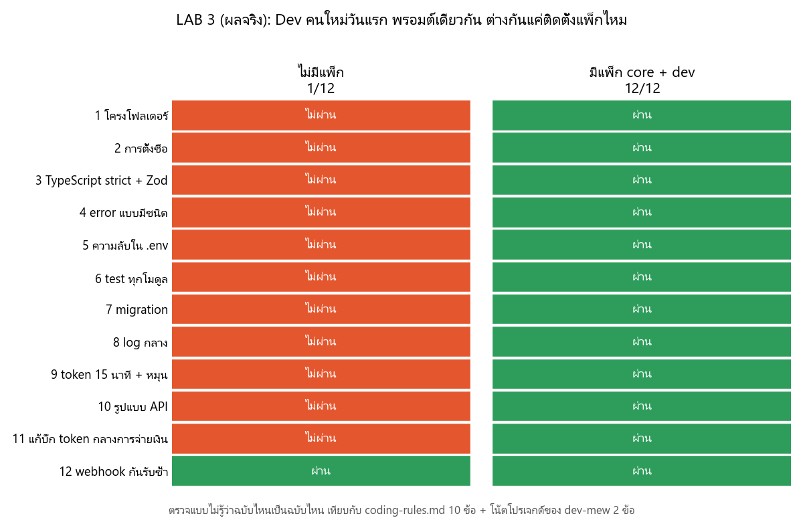

| | ไม่มีแพ็ก | มีแพ็ก `core + dev` |
|---|---|---|
| skill ที่ Claude หยิบเอง | — | `dev:project-scaffold` (คำสั่งแรก) |
| เวลา | 1 นาที 32 วินาที | 1 นาที 41 วินาที |
| ผ่านมาตรฐานบริษัท | **1/12** | **12/12** |
| ตัวอย่างที่ต่าง | ใช้ Fastify + `src/shared`, cookie `SameSite=Strict`, ไม่รู้จักบั๊ก token เดิม | access token 15 นาที + หมุนทุกครั้ง + refresh ก่อนไปหน้าจ่ายเงิน (บั๊กที่ `dev-mew` เคยแก้), webhook ใส่ `payment_events` แบบ UNIQUE ก่อน |

👀 **สังเกต**
- แผนที่ไม่มีแพ็กไม่ได้ "ผิด" ในโลกทั่วไป แต่ **ไม่ใช่วิธีของทีมนี้** — ความเก่งของ `dev-mew` (บั๊ก token) ไปถึงคนใหม่ได้ ทั้งที่สองคนยังไม่เคยคุยกัน
- 🧪 ครั้งแรกผู้สอนลองที่โต๊ะ `dev-new` ใน `novatech/` แต่ Claude **เดินไปเปิด `company-kit/coding-rules.md` เอง** (อ้างถึง 12 ครั้ง) เพราะไดรฟ์บริษัทอยู่ในโฟลเดอร์เดียวกัน จึงย้ายมาทดลองในโฟลเดอร์ว่างนอก `novatech/` เพื่อให้ต่างกันแค่แพ็ก — ในบริษัทจริงคนใหม่ไม่มีไดรฟ์ของทุกแผนกอยู่ในเครื่อง

> ➡️ ทุกโต๊ะมีแพ็กของแผนกแล้ว → LAB 4 ลองใช้จริงกับดีลเดียวที่ต้องผ่าน 3 แผนก

---

## LAB 4 · ดีลเดียววิ่งข้ามแผนก (ตอนที่ 1: Sales → บัญชี → MD) 🤖

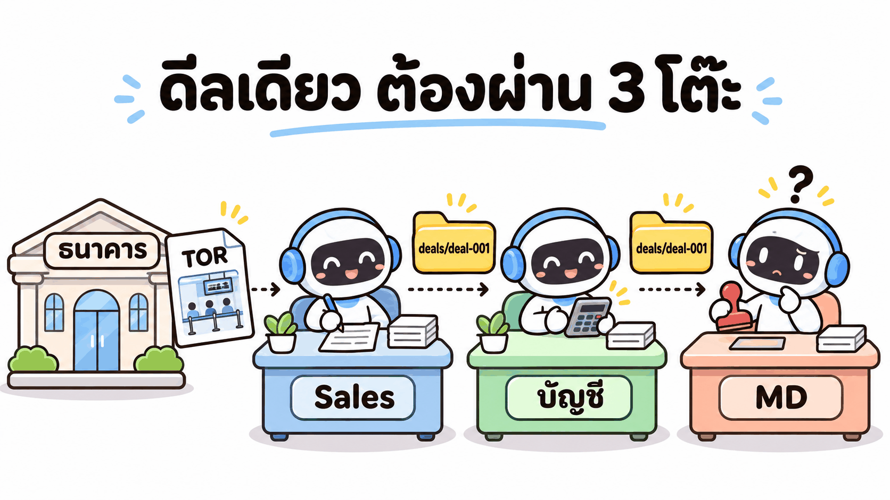

**LAB นี้ทำอะไร:** ทุกโต๊ะติดตั้งแพ็กของแผนกแล้ว (LAB 3) ทีนี้ลองใช้งานจริงกับ **ดีลเดียว** ธนาคารนครหลวงพัฒนาขอ **ระบบจองคิวสาขา 120 สาขา + โมเดลพยากรณ์คิว** ([TOR](novatech/company-kit/deal-001/tor-bank-queue.md)) งานนี้ต้องส่งต่อกัน 3 โต๊ะ เหมือนในบริษัทจริง

| ขั้น | โต๊ะ | หน้าที่ | input (อ่านอะไร) | output (วางอะไรลงโฟลเดอร์ดีล) | skill ที่ควรหยิบเอง |
|---|---|---|---|---|---|
| ① | 💼 `sales-nida` | ทำ proposal | TOR ของลูกค้า | proposal + ใบคิดราคา | `sales:sales-proposal` |
| ② | 🧾 `fin-joy` | ตรวจราคาและกำไร | ไฟล์ของ Sales | ผลตรวจราคา | `finance:pricing-calc` |
| ③ | 👔 `md-somchai` | อนุมัติหรือตีกลับ | ไฟล์ของ Sales + บัญชี | `approval.md` | `exec:deal-approval` |

ทุกขั้นส่งงานกันผ่าน **โฟลเดอร์กลางของดีล** `novatech/deals/deal-001/` (เหมือนไดรฟ์ของทีม) และ **ไม่มีใครบอกชื่อ skill ในพรอมต์เลย**

🧑 **คิดก่อน** ถ้าความรู้ของแผนกหนึ่งไม่ไปถึงอีกแผนก ดีลจะไปสะดุดที่โต๊ะไหน (นึกถึงปัญหา 3 ใน LAB 1: กฎภาคผนวก PDPA อยู่ที่ MD คนเดียว)

### 4.1 ทำไมต้องเปิดแชตที่โต๊ะ

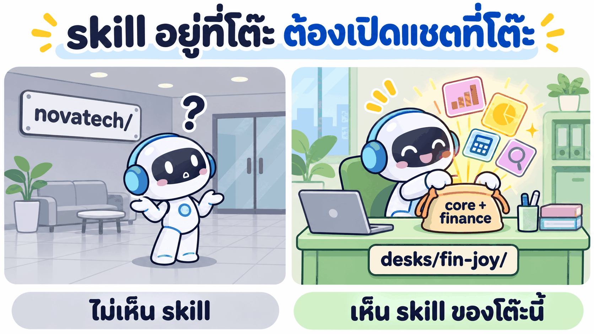

ใน LAB 3 เราติดตั้งแพ็กแบบ **เฉพาะโต๊ะ** (`--scope project`) แปลว่า skill ของบัญชี **จะโผล่มาก็ต่อเมื่อ Claude เริ่มทำงานในโฟลเดอร์ `desks/fin-joy/`** ถ้าเปิด Claude ที่ `novatech/` เฉย ๆ จะไม่เห็น skill ของแผนกไหนเลย


และเมื่อเปิดที่โต๊ะแล้ว ก็ **ไม่ต้องบอกชื่อ skill** พิมพ์ภาษาคนพอ Claude อ่านคำอธิบาย (`description`) ของ skill ที่ติดตั้งไว้ แล้วเลือกตัวที่ตรงกับคำขอเอง

### 4.2 วางพรอมต์ครั้งเดียว ส่งต่อครบ 3 โต๊ะ


ไม่ต้องเปิดแชต 3 รอบแล้วก๊อปทีละอัน วาง **พรอมต์เดียว** ที่ `novatech/` แล้ว Claude ตัวหลักจะเป็น **ผู้ประสานงาน**

| ผู้ประสานงานทำอะไร | เทียบกับบริษัทจริง |
|---|---|
| เปิด Claude ตัวใหม่ (`claude -p`) **ในโฟลเดอร์โต๊ะของคนนั้น** | คนนั้นเปิดคอมของตัวเอง แล้วเริ่มแชตใหม่ |
| ส่งข้อความของโต๊ะนั้นให้ทุกตัวอักษร | หัวหน้าส่งงานให้ทางแชต (ไม่บอกชื่อ skill) |
| รอโต๊ะก่อนหน้าจบ แล้วค่อยเริ่มโต๊ะถัดไป | บัญชีต้องรอ proposal ก่อน MD ต้องรอผลตรวจราคา |
| ห้ามแก้ไฟล์ในโฟลเดอร์ดีลเอง | ผู้ประสานงานไม่ทำงานแทนใคร |
| เก็บ log ของแต่ละโต๊ะไว้ที่ `logs/lab4/` | ใช้พิสูจน์ว่าแต่ละโต๊ะหยิบ skill ไหนจริง |

<a id="p7"></a>

#### 📋 วางที่ ⑦ · LAB 4 · วางครั้งเดียว ครบ 3 โต๊ะ

| 📂 เปิด Claude Code ที่ | 🎭 คุณเป็น | ⏱️ รอ | ก๊อป |
|---|---|---|---|
| [`novatech/`](novatech/) (แชตใหม่) | ผู้ดูแลระบบ (ผู้ประสานงาน) | ~10 นาที | 1 กล่อง (ครบ 3 โต๊ะ) |

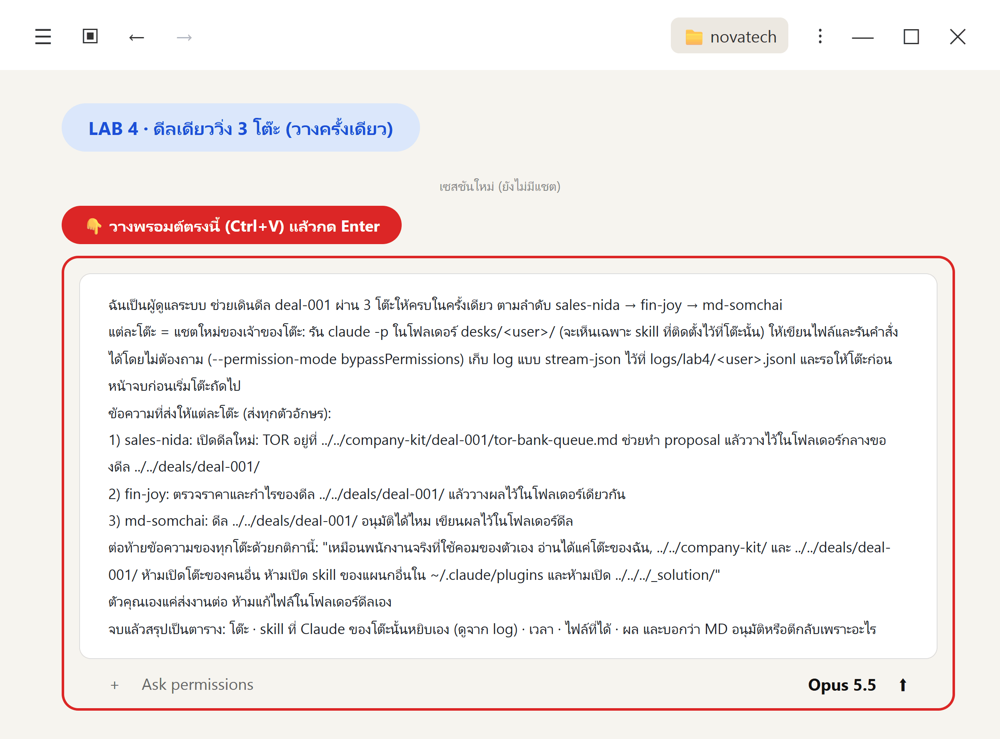

```text
ฉันเป็นผู้ดูแลระบบ ช่วยเดินดีล deal-001 ผ่าน 3 โต๊ะให้ครบในครั้งเดียว ตามลำดับ sales-nida → fin-joy → md-somchai
แต่ละโต๊ะ = แชตใหม่ของเจ้าของโต๊ะ: รัน claude -p ในโฟลเดอร์ desks/<user>/ (จะเห็นเฉพาะ skill ที่ติดตั้งไว้ที่โต๊ะนั้น) ให้เขียนไฟล์และรันคำสั่งได้โดยไม่ต้องถาม (--permission-mode bypassPermissions) เก็บ log แบบ stream-json ไว้ที่ logs/lab4/<user>.jsonl และรอให้โต๊ะก่อนหน้าจบก่อนเริ่มโต๊ะถัดไป
ข้อความที่ส่งให้แต่ละโต๊ะ (ส่งทุกตัวอักษร):
1) sales-nida: เปิดดีลใหม่: TOR อยู่ที่ ../../company-kit/deal-001/tor-bank-queue.md ช่วยทำ proposal แล้ววางไว้ในโฟลเดอร์กลางของดีล ../../deals/deal-001/
2) fin-joy: ตรวจราคาและกำไรของดีล ../../deals/deal-001/ แล้ววางผลไว้ในโฟลเดอร์เดียวกัน
3) md-somchai: ดีล ../../deals/deal-001/ อนุมัติได้ไหม เขียนผลไว้ในโฟลเดอร์ดีล
ต่อท้ายข้อความของทุกโต๊ะด้วยกติกานี้: "เหมือนพนักงานจริงที่ใช้คอมของตัวเอง อ่านได้แค่โต๊ะของฉัน, ../../company-kit/ และ ../../deals/deal-001/ ห้ามเปิดโต๊ะของคนอื่น ห้ามเปิด skill ของแผนกอื่นใน ~/.claude/plugins และห้ามเปิด ../../../_solution/"
ตัวคุณเองแค่ส่งงานต่อ ห้ามแก้ไฟล์ในโฟลเดอร์ดีลเอง
จบแล้วสรุปเป็นตาราง: โต๊ะ · skill ที่ Claude ของโต๊ะนั้นหยิบเอง (ดูจาก log) · เวลา · ไฟล์ที่ได้ · ผล และบอกว่า MD อนุมัติหรือตีกลับเพราะอะไร
```

> ✋ **วางแล้วรอ** ~10 นาที ถ้า Claude ขออนุญาตรันคำสั่ง `claude -p` ให้กดอนุญาต (รอบจริง Claude เขียนสคริปต์เล็ก ๆ รันทีละโต๊ะเบื้องหลังแล้วรอจนครบเอง) · ⬇️ ด้านล่างคือคำอธิบายและผลจริง อ่านระหว่างรอได้

| ส่วนของพรอมต์ | มีไว้ทำไม |
|---|---|
| `claude -p` ในโฟลเดอร์ `desks/<user>/` | Claude ตัวใหม่เริ่มที่โต๊ะ = เห็นแพ็ก skill ของโต๊ะนั้นเท่านั้น (4.1) |
| `--permission-mode bypassPermissions` | Claude ของแต่ละโต๊ะทำงานอยู่เบื้องหลัง ไม่มีหน้าต่างให้กดอนุญาต · ใช้เฉพาะในแล็บนี้ |
| ส่งข้อความทุกตัวอักษร | ข้อความไม่มีชื่อ skill เลย เราจะดูว่า Claude หยิบถูกเองไหม |
| กติกา "อ่านได้แค่โต๊ะของฉัน" | ในแล็บทุกโต๊ะอยู่เครื่องเดียวกัน ถ้าไม่ห้าม Claude ของ Sales อาจไปเปิด skill ของ MD (ที่มีกฎ PDPA) มาใช้ ซึ่งในบริษัทจริงทำไม่ได้ |
| รอโต๊ะก่อนหน้าจบ | งานของโต๊ะถัดไปต้องใช้ไฟล์ของโต๊ะก่อนหน้า |


### 4.3 ผลจริง: ดูการส่งต่อทีละโต๊ะ

✅ **ผลจริง (บริษัท 28 คน · วางพรอมต์ครั้งเดียว): 3/3 โต๊ะหยิบ skill ถูกเอง · MD ตีกลับเรื่อง PDPA · รวม 10 นาที 15 วินาที** ([คำตอบของ Claude ทุกโต๊ะ + ทุกคำสั่ง](_solution/lab4/run-2026-11-05/claude-summaries.md) · [ไฟล์ในโฟลเดอร์ดีล](_solution/lab4/run-2026-11-05/deal-001/))

แต่ละภาพด้านล่างคือ 1 โต๊ะ: **ซ้าย** = สิ่งที่โต๊ะนั้นได้รับ (พรอมต์ + ไฟล์ที่อ่าน) · **กลาง** = skill ที่ Claude หยิบเอง · **ขวา** = ไฟล์ที่วางลงโฟลเดอร์ดีล · **แถบล่าง** = ผลและส่งต่อให้ใคร

**① `sales-nida` ทำ proposal** (4 นาที 37 วินาที)


**② `fin-joy` ตรวจราคาและกำไร** (2 นาที 56 วินาที)


**③ `md-somchai` อนุมัติหรือตีกลับ** (1 นาที 28 วินาที)


| ขั้น | โต๊ะ | skill ที่หยิบเอง | เวลา | ได้ |
|---|---|---|---|---|
| ① | `sales-nida` | `sales:sales-proposal` (+ `core:brand-guide`) | 4:37 | proposal 9 หัวข้อ **4,766,000 บาท** (งบ 4.8 ล้าน) margin 35.2% + ผลคิดราคา + โน้ตภายใน |
| ② | `fin-joy` | `finance:pricing-calc` | 2:56 | คิดซ้ำได้ตรงทุกตัว · ทำ 2 ทางเลือก (A ของ Sales margin 35.2% / **B ที่แนะนำ 4,800,000 margin 27.1%**) · **จับได้ว่า Sales ลด man-day ให้เข้างบ และเขียนผู้อนุมัติผิด** |
| ③ | `md-somchai` | `exec:deal-approval` | 1:28 | ❌ **ตีกลับ** |


ส่วนหนึ่งของ [`approval.md`](_solution/lab4/run-2026-11-05/deal-001/approval.md) ที่ MD เขียน:

> ลูกค้าเป็นธนาคาร แต่ proposal ไม่มี "ภาคผนวก PDPA" (DPA, data residency ไทย, แจ้งเหตุ 72 ชม.) → ไม่ผ่านข้อ 5 ตีกลับ Sales ทันที

ตารางที่ Claude ตัวหลัก (ผู้ประสานงาน) สรุปให้ตอนจบ อ่านจาก log ของแต่ละโต๊ะเอง:

| โต๊ะ | skill (จาก log) | เวลา | ผล |
|---|---|---|---|
| sales-nida | `sales:sales-proposal` → `core:brand-guide` | 4m37s | ร่าง proposal 4,766,000 บาท margin 35.2% |
| fin-joy | `finance:pricing-calc` | 2m56s | ตัวเลขถูก แต่ผู้อนุมัติต้องเป็น MD · แนะนำฉบับ B |
| md-somchai | `exec:deal-approval` | 1m28s | ❌ ตีกลับ: ไม่มีภาคผนวก PDPA |

👀 **สังเกต**
- **ไม่ต้องบอกชื่อ skill** ทุกโต๊ะพิมพ์ภาษาคน Claude เลือก skill ของแผนกที่ติดตั้งไว้เองทั้ง 3 ขั้น
- **แต่ละโต๊ะเห็นแค่ของตัวเอง** ผู้ประสานงานตรวจ log แล้วยืนยันว่าไม่มีโต๊ะไหนเปิดโต๊ะของคนอื่น หรือ skill ของแผนกอื่น · Sales บอกเองว่า "ไม่ได้ใช้ skill คิดราคาของบัญชี เพราะไม่ได้ติดตั้งไว้และเป็นของแผนกอื่น" → ส่งให้บัญชีตรวจ
- **ส่งต่อแล้วงานดีขึ้นทุกขั้น** บัญชีจับเรื่องที่ Sales พลาดได้ 2 เรื่อง (man-day ถูกลด · ผู้อนุมัติผิด) และ MD เห็นเพิ่มอีก 1 เรื่องที่ไม่มีใครรู้
- **ตัวเลขไม่ได้ผิด แต่ดีลก็ยังไม่ผ่าน** ที่ตีกลับคือ **กฎภาคผนวก PDPA ที่อยู่ใน skill ของ MD (`exec:deal-approval`) คนเดียว** Sales กับบัญชีจึงไม่รู้ = ปัญหา 3 ของ LAB 1 เกิดขึ้นจริงกับดีลจริง
- ทางแก้ที่ถูกไม่ใช่ "ให้ Sales ติดตั้งทุกแพ็ก" แต่คือ **เอากฎไปใส่ใน skill ของคนที่ต้องใช้** ผ่านคลังกลาง → LAB 5

<details>
<summary>🧪 หมายเหตุผู้สอน</summary>

รอบนี้รันพรอมต์ด้านบนทุกตัวอักษรด้วย `claude -p` ที่โฟลเดอร์ `novatech/` ของสำเนาแยก (บริษัท 28 คน หลัง LAB 3) Claude ตัวหลักเขียนสคริปต์เล็ก ๆ รัน `claude -p` ทีละโต๊ะเบื้องหลังแล้วรอจนครบเอง · รอบก่อนหน้า (วางทีละโต๊ะ 3 แชต) ต้องซ่อนโต๊ะและ plugin ของคนอื่นด้วยสคริปต์ [`lab4-iso.sh`](_solution/tools/lab4-iso.sh) เพราะ Claude ของ Sales เคยเดินไปอ่าน skill ของ MD ใน cache · พรอมต์รวมใส่กติกา "อ่านได้แค่โต๊ะของฉัน" ให้ทุกโต๊ะแทน ผลคือไม่มีโต๊ะไหนออกนอกขอบเขต · GIF ทำด้วย [`handoff-gifs.mjs`](_solution/tools/handoff-gifs.mjs) จากข้อความใน log จริง

</details>

> ➡️ ต่อไป: LAB 5 แก้ skill `sales-proposal` ในคลังกลางครั้งเดียว ให้เซลส์ทุกคนรู้กฎนี้

---

## LAB 5 · ⭐ PR: คนหนึ่งแก้ skill ทุกคนเก่งขึ้น 🤖


**LAB นี้ทำอะไร:** MD ตีกลับดีลใน LAB 4 เพราะ proposal ไม่มีภาคผนวก PDPA ทางแก้ที่ถูกไม่ใช่ "แก้ proposal ฉบับนี้ให้ผ่าน" แต่คือ **แก้ skill `sales-proposal` ในคลังกลางครั้งเดียว** ผ่าน PR ให้คนที่รู้เรื่องรีวิว แล้ว **เซลส์ทุกคนได้กฎนี้ไปด้วย** โดยไม่ต้องแก้อะไรเอง

| ใคร | บทบาทใน LAB นี้ |
|---|---|
| 💼 `sales-nida` | เปิด PR แก้ skill · แก้ตามรีวิว · merge |
| 🛡️ `plat-may` | รีวิวในฐานะเจ้าของนโยบายข้อมูลลูกค้า |
| 👔 `md-somchai` | รีวิวในฐานะเจ้าของกฎภาคผนวก PDPA |
| 💼 `sales-krit` | **ไม่ได้แก้อะไรเลย** แค่อัปเดต skill แล้วทำ proposal ลูกค้าธนาคารรายใหม่ ดูว่าเก่งขึ้นไหม |

🧑 **คิดก่อน** ถ้า `sales-nida` แก้แค่ proposal ของ deal-001 ให้ผ่าน MD แล้วจบ ดีลธนาคารถัดไปของ `sales-krit` จะเป็นยังไง (ทฤษฎีหัวข้อ 19 ขั้น 2 "feedback ของคนหนึ่ง ทำให้ agent ทุกตัวในทีมเก่งขึ้น")

### 5.1 PR ทำงานยังไง

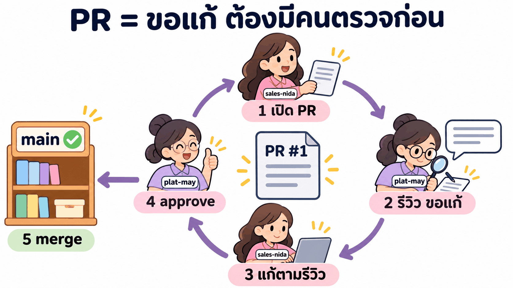

| ขั้น | ศัพท์ | ภาษาง่าย ๆ |
|---|---|---|
| 1 | **เปิด PR** | ยื่นคำขอแก้ skill ในคลังกลาง (แก้บน branch แยก ยังไม่กระทบฉบับจริง) |
| 2 | **review · request changes** | คนที่รู้เรื่องอ่านแล้วติ ขอให้แก้ก่อน |
| 3 | **แก้ตามรีวิว** | push เพิ่มเข้า PR เดิม แล้วตอบคอมเมนต์ |
| 4 | **approve** | ผู้รีวิวอนุมัติ (กติกาของ `main` ใน LAB 2 ขออย่างน้อย 1 คน) |
| 5 | **merge** | รวมเข้า `main` = ฉบับจริงที่ทุกโต๊ะอัปเดตไปใช้ |


🔤 **branch** = สำเนาแยกสำหรับลองแก้ · **push** = ส่งการแก้ขึ้น Gitea · **diff** = เฉพาะบรรทัดที่เปลี่ยน · **สคส.** = สำนักงานคณะกรรมการคุ้มครองข้อมูลส่วนบุคคล

### 5.2 วางพรอมต์ครั้งเดียว PR เดินครบทุกโต๊ะ


เหมือน LAB 4: วาง **พรอมต์เดียว** ที่ `novatech/` Claude ตัวหลักเป็นผู้ประสานงาน เปิดแชตใหม่ที่โต๊ะของแต่ละคนตามลำดับ **ทุกคนรีวิวและ merge ในนามตัวเอง ด้วย token ของตัวเอง** (Gitea บันทึกว่าใครทำอะไร) และถ้าผู้รีวิวขอแก้ ผู้ประสานงานจะวนให้ `sales-nida` แก้แล้วส่งกลับไปรีวิวใหม่เอง

> ⚠️ ต้องทำ LAB 4 ก่อน เพราะขั้นแรกอ่านเหตุผลที่ MD ตีกลับจาก `deals/deal-001/approval.md`

<a id="p8"></a>

#### 📋 วางที่ ⑧ · LAB 5 · วางครั้งเดียว PR เดินครบทุกโต๊ะ

| 📂 เปิด Claude Code ที่ | 🎭 คุณเป็น | ⏱️ รอ | ก๊อป |
|---|---|---|---|
| [`novatech/`](novatech/) (แชตใหม่) | ผู้ดูแลระบบ (ผู้ประสานงาน) | ~20–25 นาที | 1 กล่อง (ครบ 10 ขั้น) |

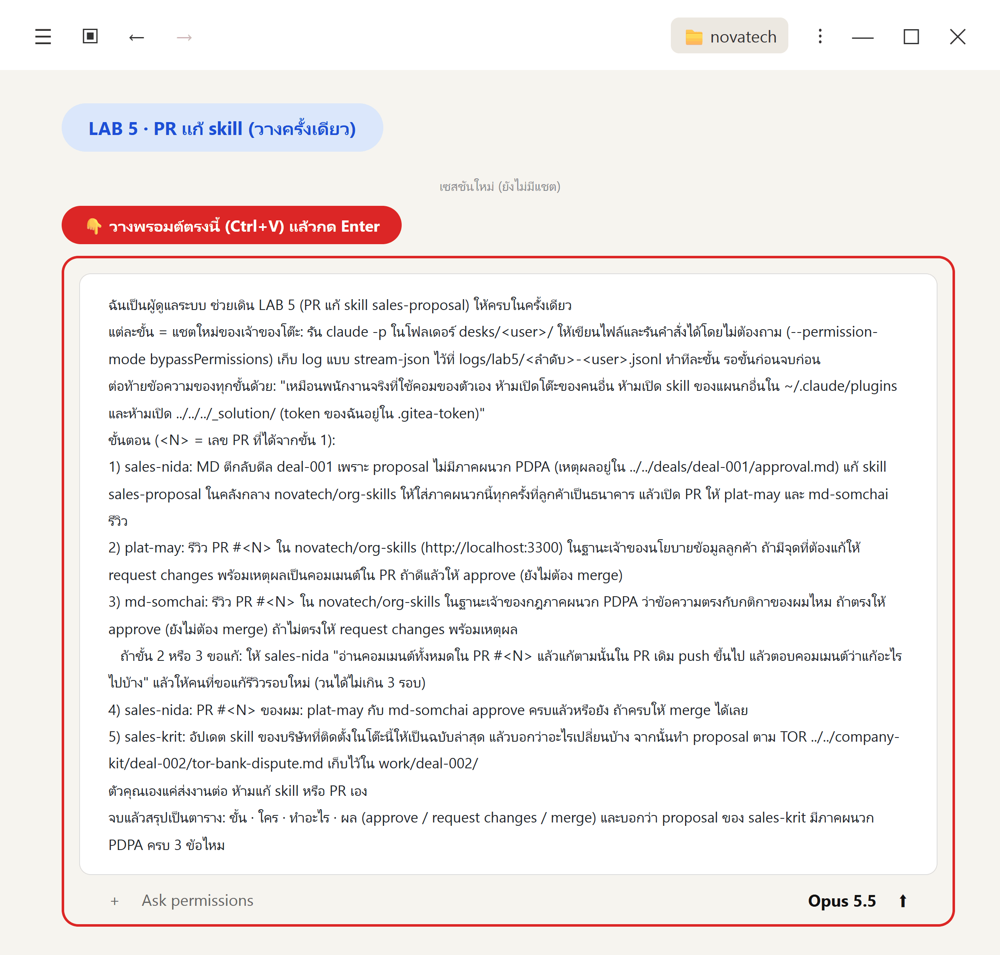

```text
ฉันเป็นผู้ดูแลระบบ ช่วยเดิน LAB 5 (PR แก้ skill sales-proposal) ให้ครบในครั้งเดียว
แต่ละขั้น = แชตใหม่ของเจ้าของโต๊ะ: รัน claude -p ในโฟลเดอร์ desks/<user>/ ให้เขียนไฟล์และรันคำสั่งได้โดยไม่ต้องถาม (--permission-mode bypassPermissions) เก็บ log แบบ stream-json ไว้ที่ logs/lab5/<ลำดับ>-<user>.jsonl ทำทีละขั้น รอขั้นก่อนจบก่อน
ต่อท้ายข้อความของทุกขั้นด้วย: "เหมือนพนักงานจริงที่ใช้คอมของตัวเอง ห้ามเปิดโต๊ะของคนอื่น ห้ามเปิด skill ของแผนกอื่นใน ~/.claude/plugins และห้ามเปิด ../../../_solution/ (token ของฉันอยู่ใน .gitea-token)"
ขั้นตอน (<N> = เลข PR ที่ได้จากขั้น 1):
1) sales-nida: MD ตีกลับดีล deal-001 เพราะ proposal ไม่มีภาคผนวก PDPA (เหตุผลอยู่ใน ../../deals/deal-001/approval.md) แก้ skill sales-proposal ในคลังกลาง novatech/org-skills ให้ใส่ภาคผนวกนี้ทุกครั้งที่ลูกค้าเป็นธนาคาร แล้วเปิด PR ให้ plat-may และ md-somchai รีวิว
2) plat-may: รีวิว PR #<N> ใน novatech/org-skills (http://localhost:3300) ในฐานะเจ้าของนโยบายข้อมูลลูกค้า ถ้ามีจุดที่ต้องแก้ให้ request changes พร้อมเหตุผลเป็นคอมเมนต์ใน PR ถ้าดีแล้วให้ approve (ยังไม่ต้อง merge)
3) md-somchai: รีวิว PR #<N> ใน novatech/org-skills ในฐานะเจ้าของกฎภาคผนวก PDPA ว่าข้อความตรงกับกติกาของผมไหม ถ้าตรงให้ approve (ยังไม่ต้อง merge) ถ้าไม่ตรงให้ request changes พร้อมเหตุผล
   ถ้าขั้น 2 หรือ 3 ขอแก้: ให้ sales-nida "อ่านคอมเมนต์ทั้งหมดใน PR #<N> แล้วแก้ตามนั้นใน PR เดิม push ขึ้นไป แล้วตอบคอมเมนต์ว่าแก้อะไรไปบ้าง" แล้วให้คนที่ขอแก้รีวิวรอบใหม่ (วนได้ไม่เกิน 3 รอบ)
4) sales-nida: PR #<N> ของผม: plat-may กับ md-somchai approve ครบแล้วหรือยัง ถ้าครบให้ merge ได้เลย
5) sales-krit: อัปเดต skill ของบริษัทที่ติดตั้งในโต๊ะนี้ให้เป็นฉบับล่าสุด แล้วบอกว่าอะไรเปลี่ยนบ้าง จากนั้นทำ proposal ตาม TOR ../../company-kit/deal-002/tor-bank-dispute.md เก็บไว้ใน work/deal-002/
ตัวคุณเองแค่ส่งงานต่อ ห้ามแก้ skill หรือ PR เอง
จบแล้วสรุปเป็นตาราง: ขั้น · ใคร · ทำอะไร · ผล (approve / request changes / merge) และบอกว่า proposal ของ sales-krit มีภาคผนวก PDPA ครบ 3 ข้อไหม
```

> ✋ **วางแล้วรอ** ~20–25 นาที (ขึ้นกับว่าผู้รีวิวขอแก้กี่รอบ) ถ้า Claude ขออนุญาตรันคำสั่ง `claude -p` ให้กดอนุญาต · ⬇️ ด้านล่างคือคำอธิบายและผลจริง อ่านระหว่างรอได้

| ส่วนของพรอมต์ | มีไว้ทำไม |
|---|---|
| `<N>` = เลข PR จากขั้น 1 | ผู้ประสานงานอ่านเลข PR จริงจากผลขั้น 1 แล้วใส่ให้ขั้นถัดไปเอง (คลังของคุณอาจมี PR อื่นอยู่ก่อน) |
| ผู้รีวิว 2 คน | `plat-may` ดูแลนโยบายข้อมูลลูกค้าทั้งบริษัท · `md-somchai` เป็นเจ้าของกฎ PDPA ของลูกค้าธนาคาร |
| วนแก้ได้ไม่เกิน 3 รอบ | ถ้าผู้รีวิวขอแก้ งานไม่หยุดกลางทาง และไม่วนไม่จบ |
| ขั้น 5 `sales-krit` | พิสูจน์ว่าคนที่ **ไม่ได้แก้อะไรเลย** ได้กฎใหม่ไปด้วย |
| ผู้ประสานงานห้ามแก้ skill หรือ PR เอง | ทุกการแก้และการอนุมัติต้องเกิดในนามเจ้าของโต๊ะ |


### 5.3 ผลจริง: ดู PR เดินทีละโต๊ะ

✅ **ผลจริง (บริษัท 28 คน · วางพรอมต์ครั้งเดียว): 10 ขั้น ใน 21 นาที 40 วินาที · PR #1 เปิดถึง merge 16 นาที · รีวิว 5 ครั้งจาก 2 คน (ขอแก้ 3 ครั้ง) · `sales-krit` ได้ภาคผนวกครบ 3 ข้อโดยไม่ได้แก้อะไร** ([คำตอบของ Claude ทุกขั้น + ทุกคำสั่ง](_solution/lab5/run-2026-11-05/claude-summaries.md) · [รีวิวและคอมเมนต์ทั้งหมดใน PR](_solution/lab5/run-2026-11-05/pr1/pr1-reviews.md) · [diff](_solution/lab5/run-2026-11-05/pr1/pr1.diff))

ผู้ประสานงานไม่ได้เดินตามลำดับตายตัว แต่ **อ่านผลรีวิวแล้วตัดสินใจเองว่าขั้นถัดไปคือใคร** (ขอแก้ → ส่งกลับให้นิดา → ส่งให้คนที่ขอแก้รีวิวใหม่)

> ① nida เปิด PR → ② may ขอแก้ → ③ MD ขอแก้ → ④ nida แก้ → ⑤ may ขอแก้อีก 1 จุด → ⑥ MD approve<br>
> → ⑦ nida แก้ → ⑧ may approve → ⑨ nida merge → ⑩ krit อัปเดตแล้วทำ proposal ใหม่

แต่ละภาพด้านล่างคือ 1 ขั้น: **ซ้าย** = พรอมต์ที่โต๊ะนั้นได้รับ + สิ่งที่อ่าน · **กลาง** = ความรู้หรือ skill ที่ใช้ · **ขวา** = สิ่งที่ทำใน PR · **แถบล่าง** = ผลและส่งต่อให้ใคร

**① `sales-nida` เปิด PR** (2:10)


**② `plat-may` รีวิวรอบ 1 → ขอแก้** (2:02)


**③ `md-somchai` รีวิวรอบ 1 → ขอแก้** (1:15)

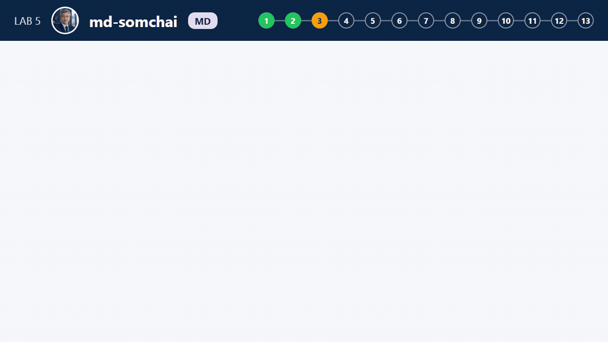

**④ `sales-nida` แก้ตามรีวิวรอบ 1** (3:10)

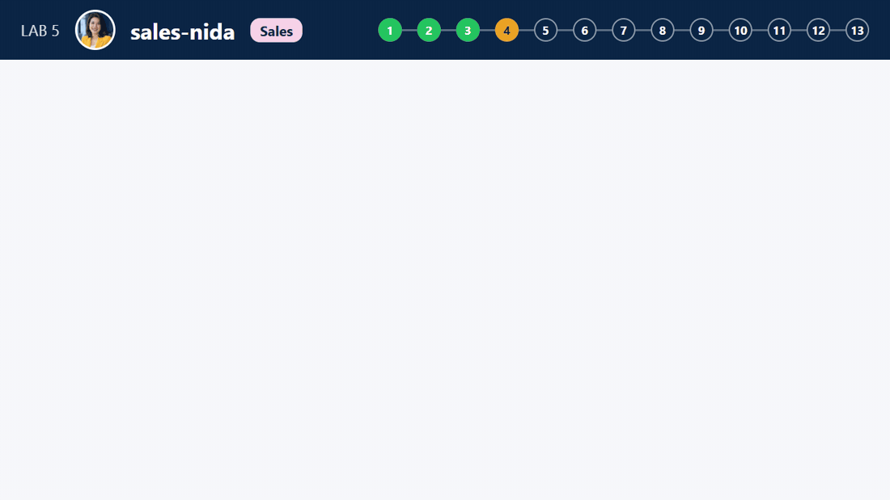

**⑤ `plat-may` รีวิวรอบ 2 → ขออีก 1 จุด** (2:11)

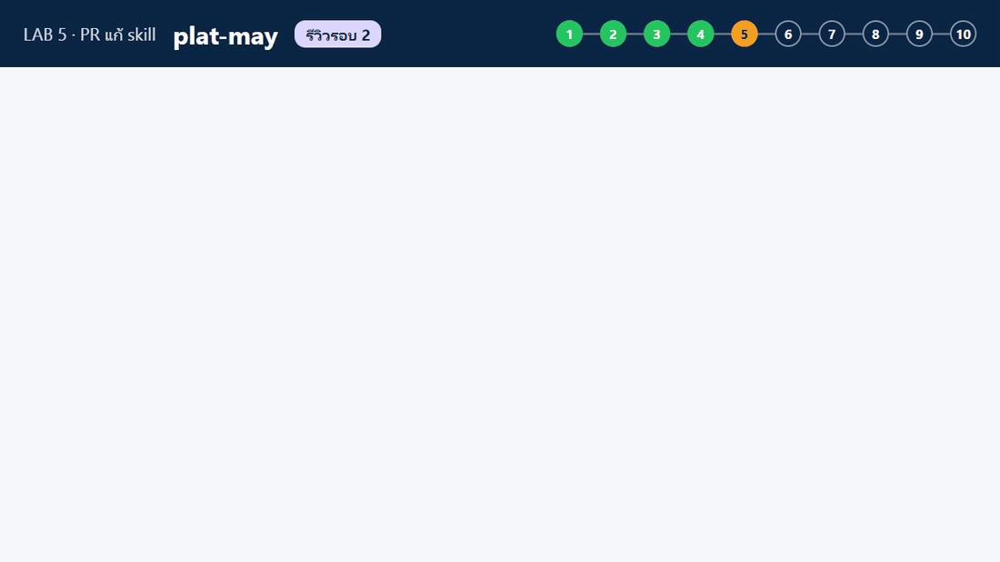

**⑥ `md-somchai` รีวิวรอบ 2 → approve** (1:04)

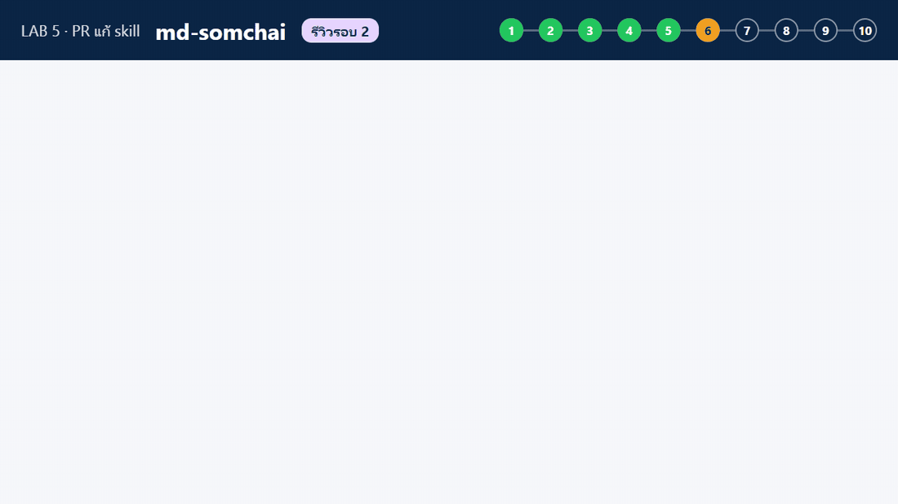

**⑦ `sales-nida` แก้ตามรีวิวรอบ 2** (2:34)

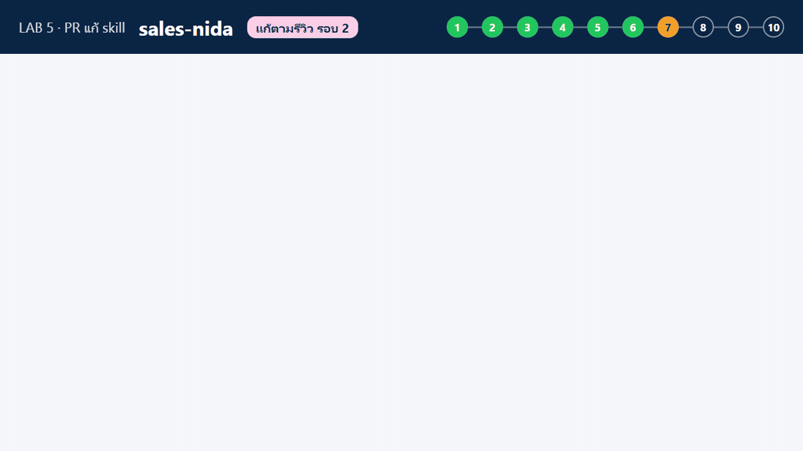

**⑧ `plat-may` รีวิวรอบ 3 → approve** (1:18)

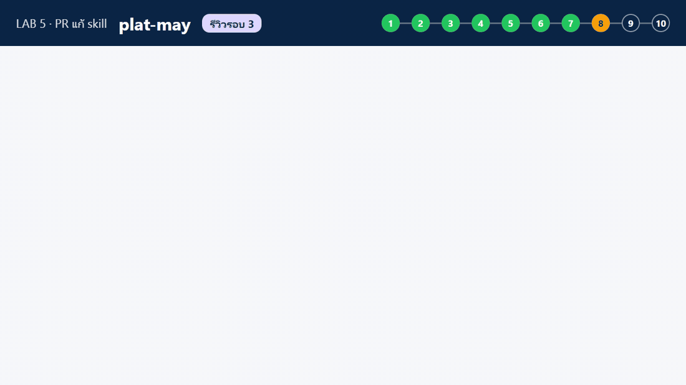

**⑨ `sales-nida` merge** (1:03)

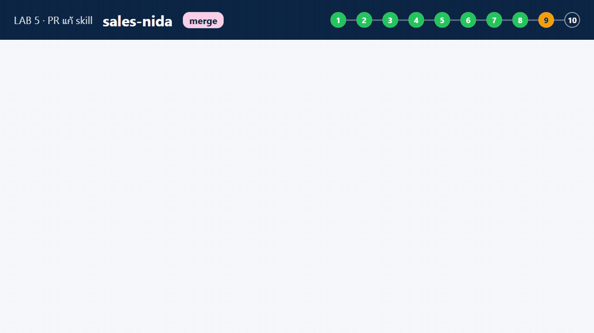

**⑩ `sales-krit` อัปเดต skill แล้วทำ proposal ลูกค้าธนาคารรายใหม่** (2:24)


| PR #1 บน Gitea: Merged · ผู้รีวิว 2 คน | สิ่งที่แก้จริง (Files Changed: 3 ไฟล์ +28 −2) |
|---|---|
| 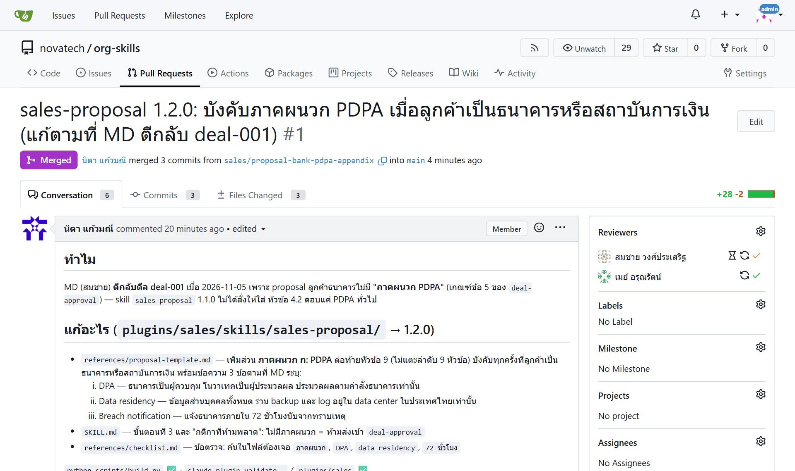 | 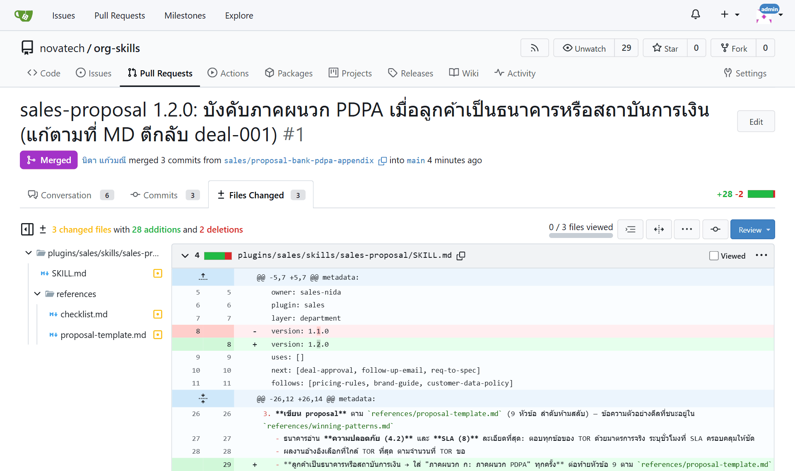 |

ตารางที่ผู้ประสานงานสรุปให้ตอนจบ:

| # | ใคร | ทำอะไร | ผล |
|---|---|---|---|
| 1 | sales-nida | แก้ `sales-proposal` 1.1.0 → 1.2.0 เปิด PR #1 ขอรีวิว 2 คน | เปิด PR |
| 2 | plat-may | ข้อแจ้งเหตุ 72 ชม. ผิดฝั่ง · ภาคผนวกห้ามประกาศตัวเป็น DPA | ❌ request changes |
| 3 | md-somchai | ขอบเขตต้องเป็น "ธนาคารหรือสถาบันการเงิน" · หัวข้อต้องมี "ภาคผนวก PDPA" | ❌ request changes |
| 4 | sales-nida | แก้ครบทั้งสองคน (commit `2bafbe1`) ตอบคอมเมนต์ | push |
| 5 | plat-may | คำว่า "ลูกค้า" กำกวม → ใช้ "ผู้ว่าจ้าง" | ❌ request changes |
| 6 | md-somchai | ตรงกติกาแล้ว · 24 ชม. เข้มกว่ากฎ 72 ชม. จึงผ่าน | ✅ approve |
| 7 | sales-nida | แก้ตาม plat-may (commit `ffc4bbb`) | push |
| 8 | plat-may | ตรวจแล้วว่าแก้ครบ | ✅ approve |
| 9 | sales-nida | ตรวจ approve ครบ แล้ว merge (`f5c1935`) | ✅ merge |
| 10 | sales-krit | อัปเดต skill เป็น 1.2.0 · proposal deal-002 มีภาคผนวก PDPA | ✅ ครบ 3 ข้อ |

### 5.4 🧪 `sales-krit` ไม่ได้แก้อะไรเลย เก่งขึ้นไหม

ส่วนท้ายของ proposal ลูกค้าธนาคารรายใหม่ ([TOR deal-002](novatech/company-kit/deal-002/tor-bank-dispute.md)) ที่ `sales-krit` ทำหลังอัปเดต ([ไฟล์เต็ม](_solution/lab5/run-2026-11-05/krit-deal-002/deal-002-proposal-ati-bank.md)):

> **ภาคผนวก ก: ภาคผนวก PDPA** — โนวาเทคจะลงนาม DPA กับ ธนาคารเอเชียไทยสากล ("ผู้ว่าจ้าง") ก่อนเริ่มประมวลผลข้อมูล ตามมาตรา 40 …  
> 3\. **การแจ้งเหตุละเมิดข้อมูล** — โนวาเทคแจ้งผู้ว่าจ้างโดยไม่ชักช้า และไม่เกิน 24 ชั่วโมงนับจากทราบเหตุ …

| ตรวจตามกฎของ MD | ก่อน merge (`sales-proposal` 1.1.0 · LAB 4) | หลัง merge (1.2.0) |
|---|---|---|
| มีหัวข้อ "ภาคผนวก PDPA" | ❌ (MD ตีกลับ deal-001) | ✅ ภาคผนวก ก ต่อท้ายหัวข้อ 9 |
| 1 DPA (โนวาเทคเป็นผู้ประมวลผล) | ❌ | ✅ + ลงนาม DPA ตามมาตรา 40 ก่อนเริ่ม |
| 2 ข้อมูลรวม backup และ log อยู่ในไทย | ❌ | ✅ |
| 3 แจ้งเหตุ | ❌ | ✅ ไม่เกิน 24 ชม. (ถ้อยคำที่ `plat-may` รีวิวไว้ตรงตัว) |

> **`sales-nida` แก้ครั้งเดียว `plat-may` กับ `md-somchai` รีวิว แล้วเซลส์ทุกคนได้ความรู้ของ MD ไปด้วย** และได้ถ้อยคำที่ **ดีกว่ากฎเดิมของ MD** (แจ้งเหตุ 24 ชม. แทน 72 ชม. · ใช้ได้กับสถาบันการเงินทุกแบบ) = ภาพ "feedback ของคนหนึ่ง ทำให้ทุกคนเก่งขึ้น" ของทฤษฎีหัวข้อ 19 ที่รันจริง

### 5.5 ⚠️ กับดัก: แก้ skill แล้วต้องเพิ่มเลขเวอร์ชันของแพ็ก

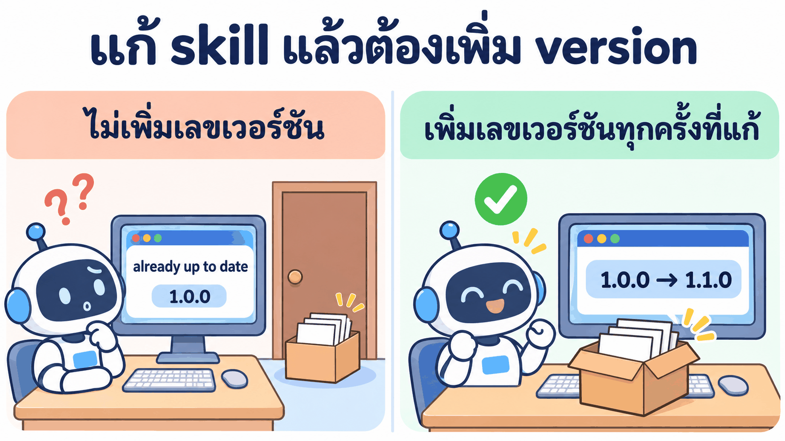

PR นี้เพิ่มเลขใน `SKILL.md` (1.1.0 → 1.2.0) แต่ **ไม่ได้เพิ่มเลขของแพ็กใน `plugin.json`** (ยัง 1.0.0) คำสั่ง `claude plugin update` ดูเลขของแพ็ก จึงบอกว่า "ล่าสุดแล้ว" ทั้งที่เนื้อหาเปลี่ยน → `sales-krit` ต้องถอนแล้วติดตั้งใหม่ · เกิดซ้ำทุกรอบที่รัน จึงเป็นด่านหนึ่งของ CI ใน LAB 6

👀 **สังเกต**
- **รีวิวทำให้ skill ดีขึ้น ไม่ใช่แค่จับผิด** ทั้ง "ไม่เกิน 24 ชม." "ผู้ว่าจ้าง" และ "สถาบันการเงิน" มาจากผู้รีวิว ไม่ใช่จากคนเปิด PR · `plat-may` เขียนถ้อยคำทดแทนให้ครบทั้งบล็อก
- **ผู้รีวิวแต่ละคนดูคนละเรื่อง** `plat-may` ดูกฎหมายข้อมูลส่วนบุคคล `md-somchai` ดูว่าตรงกฎดีลของตัวเอง → จับปัญหาได้คนละแบบ
- **ผู้รีวิวตรวจของจริง** `plat-may` ใช้สคริปต์เทียบบล็อกภาคผนวกกับถ้อยคำที่ตัวเองเสนอทุกตัวอักษร ไม่เชื่อแค่สรุปของคนเปิด PR
- **ข้อควรระวังที่ผู้ประสานงานทักเอง** approve ของ MD อยู่บน commit ก่อนหน้า (Gitea แสดงนาฬิกาทรายข้างชื่อ) เพราะ MD เขียนว่า "แก้แค่คำตามที่ DPO ขอ ไม่ต้องรีวิวซ้ำ" → ในบริษัทจริงควรตั้งให้ approve เก่าหมดอายุเมื่อมี commit ใหม่ · และกฎในโน้ตของ MD ยังเป็น 72 ชม. ต้องแก้ให้ตรงกันแยกอีกเรื่อง
- CODEOWNER ของ `plugins/sales` คือ `sales-nida` เอง Gitea จึงไม่ขอรีวิวจากใครให้อัตโนมัติ (คนเขียนรีวิวตัวเองไม่ได้) พรอมต์จึงระบุผู้รีวิวเอง → ในบริษัทจริงควรมี CODEOWNER อย่างน้อย 2 คนต่อแผนก

<details>
<summary>🧪 หมายเหตุผู้สอน</summary>

รอบนี้รันพรอมต์ด้านบนทุกตัวอักษรด้วย `claude -p` ที่ `novatech/` ของสำเนาแยกเดียวกับ LAB 4 (คลัง `org-skills` บน Gitea รีเซ็ตกลับเป็นสภาพหลัง LAB 2 ก่อนรัน) · ทุกขั้นไม่มีการเรียก skill ผ่านเครื่องมือ Skill: ผู้รีวิวเปิดไฟล์นโยบายและโน้ตกฎมาเทียบเอง ส่วน `sales-krit` อ่านแม่แบบและรันสคริปต์ของ skill ฉบับใหม่โดยตรง (เพราะติดตั้งใหม่กลางแชต) · โต๊ะ `sales-krit` มีร่าง deal-002 ค้างจากรอบทดลอง "ก่อน merge" อยู่แล้ว Claude จึงแก้ร่างเดิมให้ตรง skill 1.2.0 แทนการเขียนใหม่ · การติดตั้งใหม่ของ `sales-krit` อัปเดต cache ที่โต๊ะ Sales ใช้ร่วมกันด้วย (ในเครื่องจริงแต่ละคนต้องอัปเดตเอง) · รอบก่อนหน้าของบทนี้ (วางทีละโต๊ะ) ได้ผลแบบเดียวกัน ([คำตอบรอบเดิม](_solution/lab5/run-2026-11-04/claude-summaries.md))

</details>

> ➡️ ต่อไป: LAB 4 (ต่อ) ให้ดีลวิ่งต่อจนครบทุกแผนกด้วย skill ฉบับใหม่

---

## LAB 4 (ต่อ) · ดีลวิ่งต่อจนครบทุกแผนก 🤖


**LAB นี้ทำอะไร:** ใน LAB 4 MD ตีกลับดีลเพราะไม่มีภาคผนวก PDPA แล้ว LAB 5 ก็แก้ skill `sales-proposal` ให้ใส่ภาคผนวกนี้เองแล้ว ทีนี้ให้ดีล deal-001 **วิ่งต่อจนจบ** ดูว่า skill ฉบับใหม่ใช้ได้จริงไหม และดีลไปสะดุดที่ไหนต่อ

| ใคร | หน้าที่ในตอนนี้ |
|---|---|
|  💼 `sales-nida` | แก้ proposal ด้วย skill ฉบับใหม่ แล้วส่งกลับให้ MD |
|  👔 `md-somchai` | พิจารณาใหม่ · ถ้าตีกลับ บอกว่าต้องให้ใครแก้ |
|  🧩 `sa-ton` | แก้แผนงานถ้า MD ตีกลับเรื่องแผน |
|      | 5 แผนก (Dev · ML · QA · DevOps · HR) เริ่มงานพร้อมกันเมื่อ MD อนุมัติ |

**ต่างจาก LAB 4 ตรงไหน:** ลำดับไม่ตายตัว ผู้ประสานงานต้อง **อ่านผลของ MD แล้วตัดสินใจเอง** ว่าส่งต่อให้ใคร (Sales หรือ SA) และวนกลับมาให้ MD ดูใหม่ได้ไม่เกิน 3 รอบ

🧑 **คิดก่อน** ใส่ภาคผนวก PDPA แล้ว ดีลจะผ่านเลยไหม หรือยังมีเรื่องที่ไม่มีใครรู้ซ่อนอยู่

<a id="p9"></a>

#### 📋 วางที่ ⑨ · LAB 4 (ต่อ) · วางครั้งเดียว ดีลวิ่งจนครบทุกแผนก

| 📂 เปิด Claude Code ที่ | 🎭 คุณเป็น | ⏱️ รอ | ก๊อป |
|---|---|---|---|
| [`novatech/`](novatech/) (แชตใหม่) | ผู้ดูแลระบบ (ผู้ประสานงาน) | ~25 นาที | 1 กล่อง (ครบทุกแผนก) |

ทำหลัง LAB 5 (ต้องมี `approval.md` ที่ MD ตีกลับ และ skill `sales-proposal` ฉบับที่ merge แล้ว)

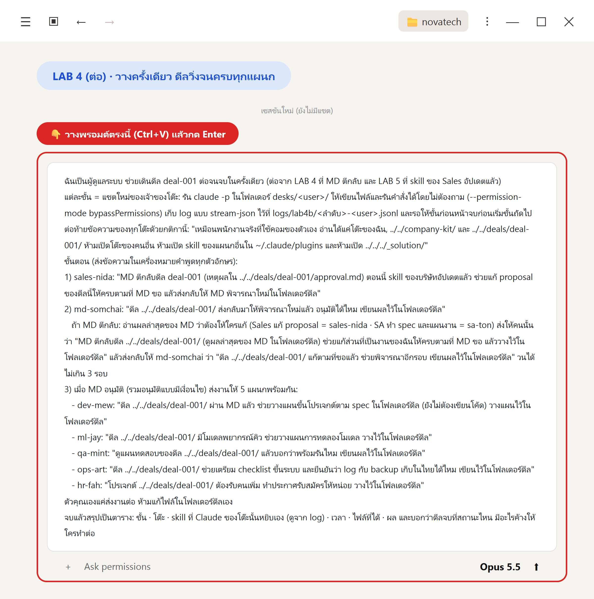

```text
ฉันเป็นผู้ดูแลระบบ ช่วยเดินดีล deal-001 ต่อจนจบในครั้งเดียว (ต่อจาก LAB 4 ที่ MD ตีกลับ และ LAB 5 ที่ skill ของ Sales อัปเดตแล้ว)
แต่ละขั้น = แชตใหม่ของเจ้าของโต๊ะ: รัน claude -p ในโฟลเดอร์ desks/<user>/ ให้เขียนไฟล์และรันคำสั่งได้โดยไม่ต้องถาม (--permission-mode bypassPermissions) เก็บ log แบบ stream-json ไว้ที่ logs/lab4b/<ลำดับ>-<user>.jsonl และรอให้ขั้นก่อนหน้าจบก่อนเริ่มขั้นถัดไป
ต่อท้ายข้อความของทุกโต๊ะด้วยกติกานี้: "เหมือนพนักงานจริงที่ใช้คอมของตัวเอง อ่านได้แค่โต๊ะของฉัน, ../../company-kit/ และ ../../deals/deal-001/ ห้ามเปิดโต๊ะของคนอื่น ห้ามเปิด skill ของแผนกอื่นใน ~/.claude/plugins และห้ามเปิด ../../../_solution/"
ขั้นตอน (ส่งข้อความในเครื่องหมายคำพูดทุกตัวอักษร):
1) sales-nida: "MD ตีกลับดีล deal-001 (เหตุผลใน ../../deals/deal-001/approval.md) ตอนนี้ skill ของบริษัทอัปเดตแล้ว ช่วยแก้ proposal ของดีลนี้ให้ครบตามที่ MD ขอ แล้วส่งกลับให้ MD พิจารณาใหม่ในโฟลเดอร์ดีล"
2) md-somchai: "ดีล ../../deals/deal-001/ ส่งกลับมาให้พิจารณาใหม่แล้ว อนุมัติได้ไหม เขียนผลไว้ในโฟลเดอร์ดีล"
   ถ้า MD ตีกลับ: อ่านผลล่าสุดของ MD ว่าต้องให้ใครแก้ (Sales แก้ proposal = sales-nida · SA ทำ spec และแผนงาน = sa-ton) ส่งให้คนนั้นว่า "MD ตีกลับดีล ../../deals/deal-001/ (ดูผลล่าสุดของ MD ในโฟลเดอร์ดีล) ช่วยแก้ส่วนที่เป็นงานของฉันให้ครบตามที่ MD ขอ แล้ววางไว้ในโฟลเดอร์ดีล" แล้วส่งกลับให้ md-somchai ว่า "ดีล ../../deals/deal-001/ แก้ตามที่ขอแล้ว ช่วยพิจารณาอีกรอบ เขียนผลไว้ในโฟลเดอร์ดีล" วนได้ไม่เกิน 3 รอบ
3) เมื่อ MD อนุมัติ (รวมอนุมัติแบบมีเงื่อนไข) ส่งงานให้ 5 แผนกพร้อมกัน:
   - dev-mew: "ดีล ../../deals/deal-001/ ผ่าน MD แล้ว ช่วยวางแผนขึ้นโปรเจกต์ตาม spec ในโฟลเดอร์ดีล (ยังไม่ต้องเขียนโค้ด) วางแผนไว้ในโฟลเดอร์ดีล"
   - ml-jay: "ดีล ../../deals/deal-001/ มีโมเดลพยากรณ์คิว ช่วยวางแผนการทดลองโมเดล วางไว้ในโฟลเดอร์ดีล"
   - qa-mint: "ดูแผนทดสอบของดีล ../../deals/deal-001/ แล้วบอกว่าพร้อมรันไหม เขียนผลไว้ในโฟลเดอร์ดีล"
   - ops-art: "ดีล ../../deals/deal-001/ ช่วยเตรียม checklist ขึ้นระบบ และยืนยันว่า log กับ backup เก็บในไทยได้ไหม เขียนไว้ในโฟลเดอร์ดีล"
   - hr-fah: "โปรเจกต์ ../../deals/deal-001/ ต้องรับคนเพิ่ม ทำประกาศรับสมัครให้หน่อย วางไว้ในโฟลเดอร์ดีล"
ตัวคุณเองแค่ส่งงานต่อ ห้ามแก้ไฟล์ในโฟลเดอร์ดีลเอง
จบแล้วสรุปเป็นตาราง: ขั้น · โต๊ะ · skill ที่ Claude ของโต๊ะนั้นหยิบเอง (ดูจาก log) · เวลา · ไฟล์ที่ได้ · ผล และบอกว่าดีลจบที่สถานะไหน มีอะไรค้างให้ใครทำต่อ
```

> ✋ **วางแล้วรอ** ~25 นาที ถ้า Claude ขออนุญาตรันคำสั่ง `claude -p` ให้กดอนุญาต · ⬇️ ด้านล่างคือคำอธิบายและผลจริง อ่านระหว่างรอได้

| ส่วนของพรอมต์ | มีไว้ทำไม |
|---|---|
| "ถ้า MD ตีกลับ: อ่านผลล่าสุดของ MD ว่าต้องให้ใครแก้" | ผู้ประสานงานไม่ได้เดาลำดับไว้ก่อน แต่ส่งงานตามที่ MD เขียนจริง |
| วนได้ไม่เกิน 3 รอบ | ดีลไม่วนไม่จบ |
| 5 แผนกพร้อมกัน | ทุกแผนกต้องการแค่ดีลที่ MD อนุมัติแล้ว ไม่ต้องรอกัน |
| ข้อความของแต่ละโต๊ะไม่มีชื่อ skill | ดูว่า Claude ของแต่ละแผนกหยิบ skill ถูกเองไหม หรือรู้ว่าไม่ควรหยิบ |

### ผลจริง: ดูดีลวิ่งทีละขั้น

✅ **ผลจริง (บริษัท 28 คน · วางพรอมต์ครั้งเดียว): 10 แชต ใน 25 นาที 15 วินาที · MD ตีกลับ 1 รอบ (เรื่องแผนงาน) แล้วอนุมัติแบบมีเงื่อนไข · ภาคผนวก PDPA ผ่านตั้งแต่รอบแรก** ([คำตอบของ Claude ทุกโต๊ะ + ทุกคำสั่ง](_solution/lab4/run-2026-11-05-part2/claude-summaries.md) · [ไฟล์ในโฟลเดอร์ดีลตอนจบ](_solution/lab4/run-2026-11-05-part2/deal-001/))

> ① nida แก้ proposal → ② MD ตีกลับเรื่องแผนงาน → ③ SA จัดแผนใหม่ → ④ nida ใส่แผนใหม่ → ⑤ MD อนุมัติแบบมีเงื่อนไข<br>
> → ⑥–⑩ Dev · ML · QA · DevOps · HR ทำพร้อมกัน

แต่ละภาพคือ 1 ขั้น: **ซ้าย** = พรอมต์ที่โต๊ะนั้นได้รับ + สิ่งที่อ่าน · **กลาง** = เจ้าของโต๊ะและ skill ที่ Claude หยิบเอง · **ขวา** = ไฟล์ที่วางลงโฟลเดอร์ดีล · **แถบล่าง** = ผลและส่งต่อให้ใคร

**① `sales-nida` แก้ proposal ด้วย skill ฉบับใหม่** (4 นาที)

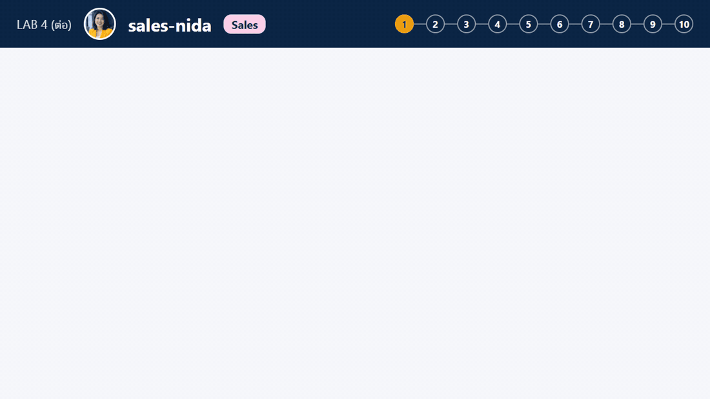

**② `md-somchai` ตีกลับรอบ 2 เรื่องแผนงาน** (2 นาที 6 วินาที)

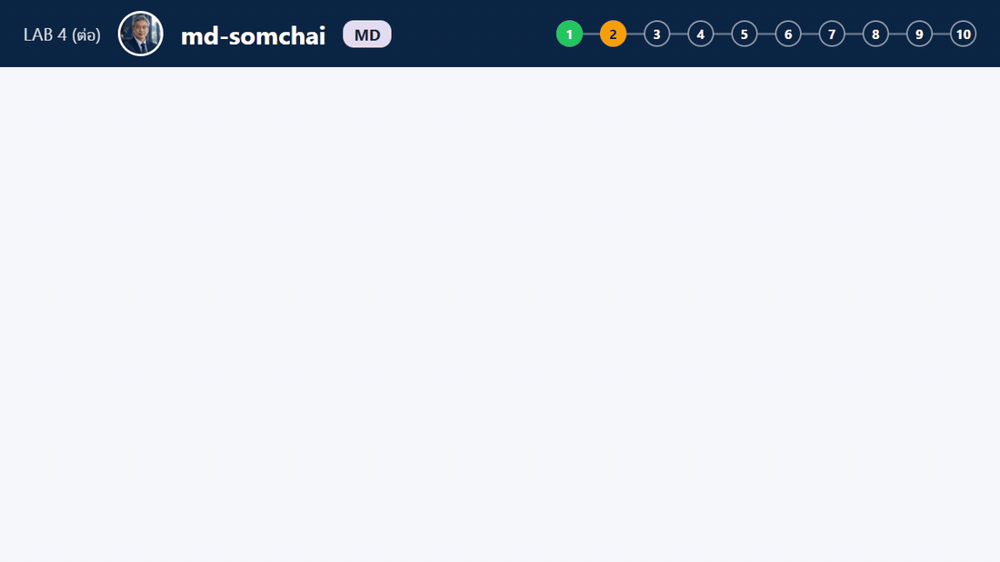

**③ `sa-ton` จัดแผนงานใหม่ ราคาเท่าเดิม** (4 นาที 35 วินาที)

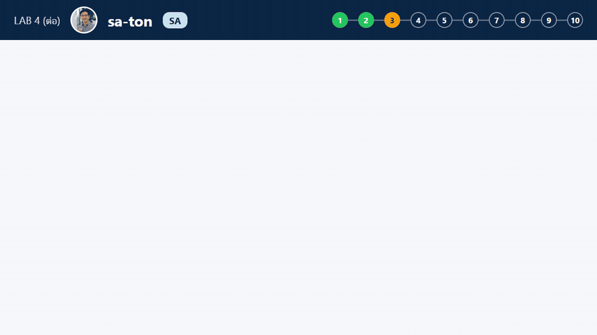

**④ `sales-nida` ใส่แผนใหม่ลง proposal** (5 นาที 6 วินาที)

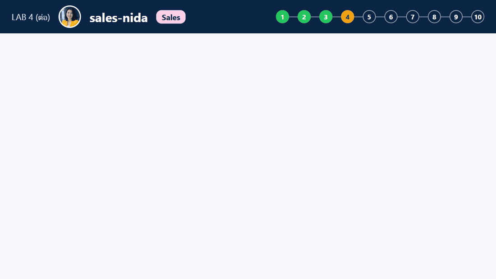

**⑤ `md-somchai` อนุมัติแบบมีเงื่อนไข** (2 นาที 39 วินาที)

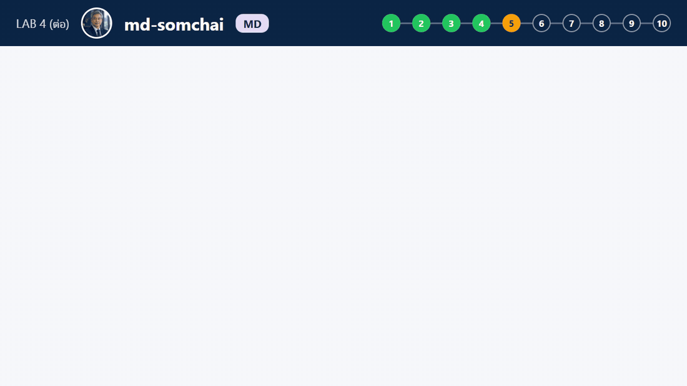

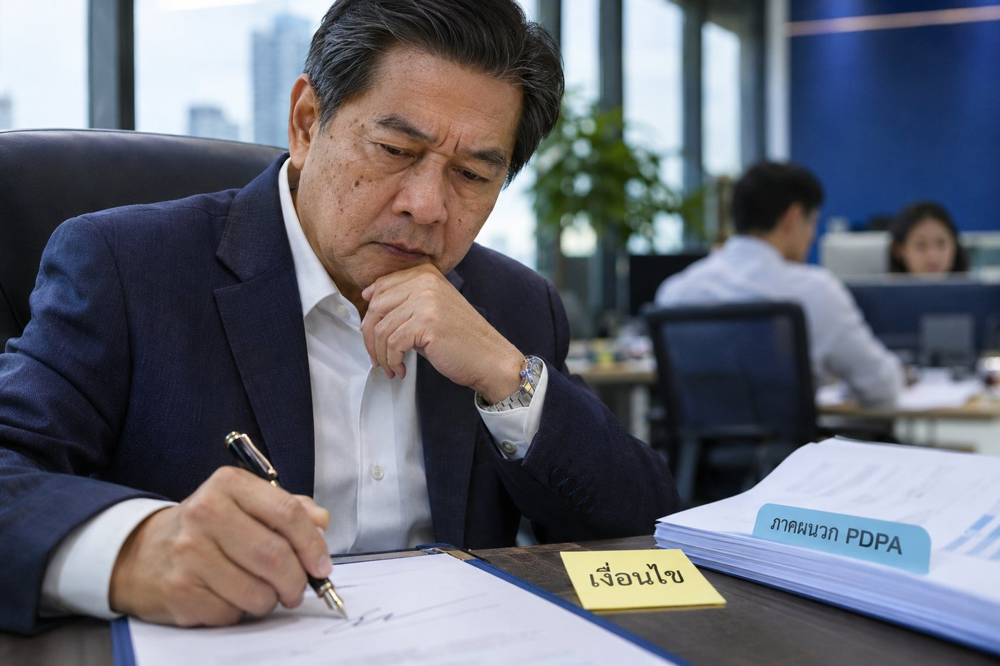

**⑥–⑩ 5 แผนกทำพร้อมกัน**

| ⑥ `dev-mew` · Dev | ⑦ `ml-jay` · ML |
|---|---|
| 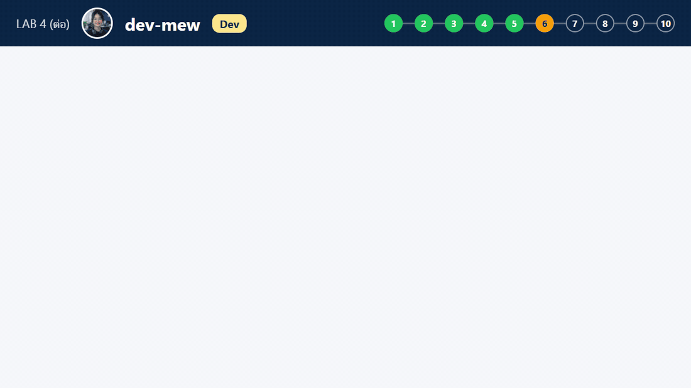 | 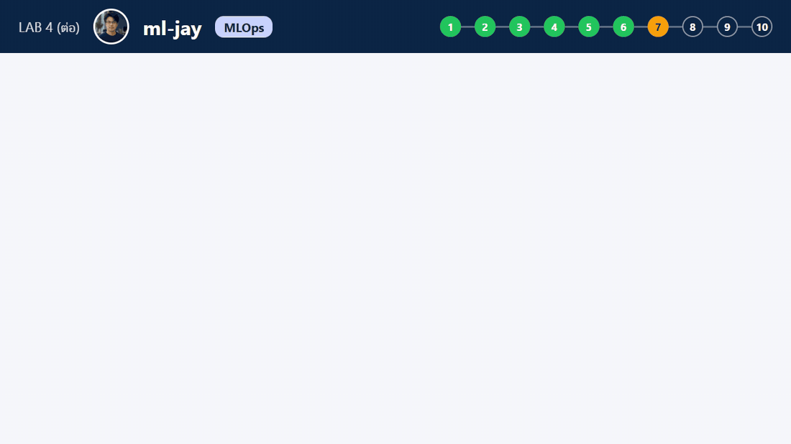 |
| ⑧ `qa-mint` · QA | ⑨ `ops-art` · DevOps |
| 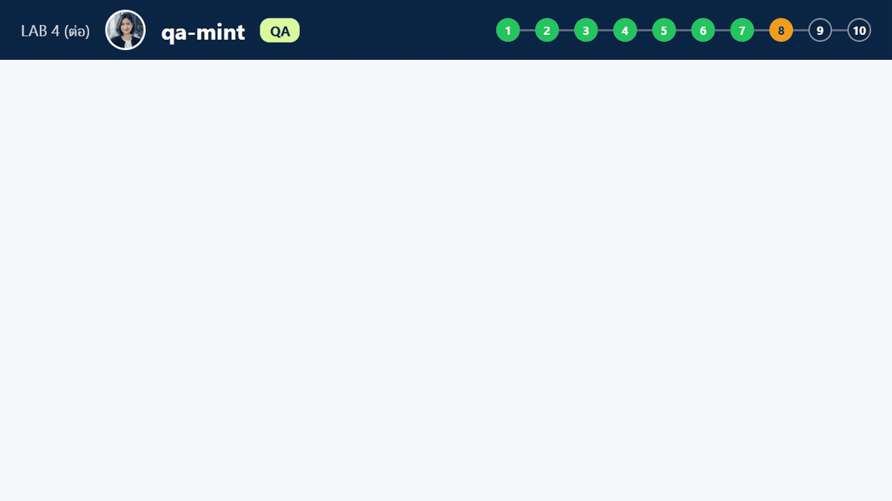 | 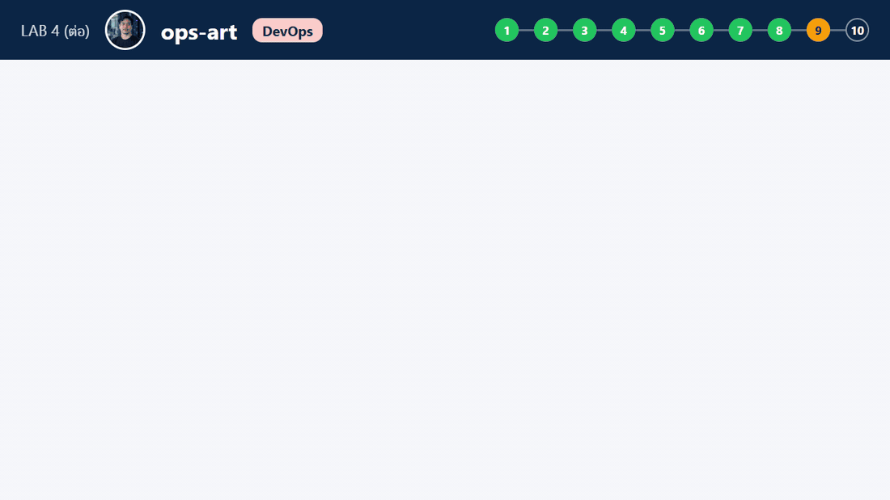 |
| ⑩ `hr-fah` · HR | |
| 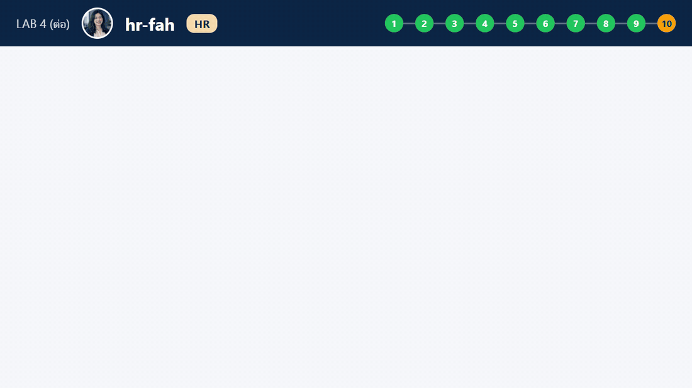 | |

| ขั้น | โต๊ะ | skill ที่หยิบเอง (จาก log) | เวลา | ผล |
|---|---|---|---|---|
| ① | `sales-nida` | `sales:sales-proposal` (1.2.0) | 4:00 | ภาคผนวก PDPA 3 ข้อ · ราคาฉบับ B 4,800,000 บาท margin 27.1% |
| ② | `md-somchai` | `exec:deal-approval` | 2:06 | ❌ ตีกลับรอบ 2 เรื่องแผนงาน · **ภาคผนวก PDPA ผ่าน** |
| ③ | `sa-ton` | — | 4:35 | แผนใหม่ราคาเท่าเดิม · ไม่ยอมลงนามว่า log อยู่ในไทย |
| ④ | `sales-nida` | — | 5:06 | ใส่แผนใหม่ + ร่างคำขอถึง DPO กฎหมาย PM office |
| ⑤ | `md-somchai` | `exec:deal-approval` | 2:39 | 🟡 **อนุมัติแบบมีเงื่อนไข** (C1–C5 ก่อนยื่น · C6 ก่อนเซ็น) |
| ⑥ | `dev-mew` | — (เปิดดู `project-scaffold` แล้วไม่ใช้) | 3:55 | แผนขึ้นโปรเจกต์ 2 ช่วง 2 repo |
| ⑦ | `ml-jay` | `mlops:mlflow-experiment` | 3:32 | แผนทดลอง + ทะเบียน 15 run |
| ⑧ | `qa-mint` | — | 1:52 | ยังรันไม่ได้ · ไม่มีนิยาม "ผ่าน UAT" |
| ⑨ | `ops-art` | `devops:deploy-checklist` | 3:24 | 🔴 log ในไทยยืนยันไม่ได้ · checklist NO-GO |
| ⑩ | `hr-fah` | `hr:jd-writer` | 2:06 | ประกาศรับสมัครพร้อม รอผลดีล |

👀 **สังเกต**
- **skill ฉบับใหม่ใช้ได้จริง** `sales-nida` ไม่ได้เขียนภาคผนวก PDPA เอง แต่ได้จาก `sales-proposal` 1.2.0 ที่แก้ใน LAB 5 และ MD ให้ผ่านตั้งแต่รอบแรก
- **ผู้ประสานงานส่งงานตามผลจริง** MD รอบ 2 ตีกลับเรื่องแผนงาน ผู้ประสานงานจึงส่งให้ SA ไม่ใช่ Sales แล้ววนกลับให้ MD เอง ใช้ 2 จาก 3 รอบ
- **รู้ว่าเมื่อไหร่ไม่ควรใช้ skill** หยิบ skill เอง 6 จาก 10 แชต ที่ไม่หยิบมีเหตุผลทุกครั้ง: `dev-mew` เปิด `project-scaffold` แล้วบอกเองว่า template เป็นระบบชำระเงิน ใช้กับงานนี้ไม่ได้ · `qa-mint` ยังไม่มีระบบให้ทดสอบ · `sa-ton` งานนี้คือจัดแผนใหม่ ไม่ใช่แปลง TOR เป็น spec
- **skill ไม่ได้ทำให้ทุกอย่าง "ผ่าน"** เรื่องที่ยังค้างคือเรื่องที่ไม่มีใครในบริษัทรู้: log ของบริการ LIC-APM เก็บที่ไหน (SA และ DevOps ตอบตรงกันว่ายืนยันไม่ได้) → นี่คือความรู้ที่บริษัทยังไม่มีเป็น skill
- **ช่องว่างระหว่างแผนก** MD รอบ 2 เขียนว่าให้ "SA (ไอศวรรย์)" แก้ แต่ผู้ประสานงานส่งให้ `sa-ton` ตามพรอมต์ และ MD รอบ 3 ก็ยืนยันว่า `sa-ton` เป็น SA ของดีลนี้ · `hr-fah` ปัดตัวเลขจาก TOR ในประกาศรับสมัครไม่ให้คนเดาได้ว่าลูกค้าคือใคร
- ทุกโต๊ะทำตามกติกา ไม่เปิดโต๊ะของคนอื่นหรือ skill ของแผนกอื่น (ผู้ประสานงานตรวจจาก log)

<details>
<summary>🧪 หมายเหตุผู้สอน</summary>

รอบนี้รันพรอมต์ด้านบนทุกตัวอักษรด้วย `claude -p` ที่ `novatech/` ของสำเนาแยกเดียวกับ LAB 4 และ 5 (ต่อจากผล LAB 5 ทันที) · ผู้ประสานงานเขียนสคริปต์เล็ก ๆ รันทีละโต๊ะเบื้องหลัง และรัน 5 แผนกพร้อมกันเอง · `price.py` ของ `sales-proposal` พิมพ์ภาษาไทยไม่ได้บน Windows ถ้าไม่ตั้ง `PYTHONIOENCODING=utf-8` (ผู้ประสานงานทักไว้) · รอบเดิม (บริษัท 21 คน วางทีละโต๊ะ 9 พรอมต์) ได้ผลคล้ายกัน: MD ตีกลับเรื่องแผนงานแล้วอนุมัติแบบมีเงื่อนไข ([คำตอบรอบเดิม](_solution/lab4/claude-summaries-part2.md)) · GIF ทำด้วย [`handoff-gifs.mjs`](_solution/tools/handoff-gifs.mjs) จากข้อความใน log จริง ภาพบุคคลของพนักงานทุกคนเป็นภาพจำลองที่สร้างด้วย image gen

</details>

---

## LAB 6 · ⭐ SkillOps: CI ด่านตรวจก่อนเข้าคลังกลาง 🤖 + 🧑


🧑 **คิดก่อน** ใน LAB 5 ทุกอย่างพึ่ง "คน" ล้วน ๆ ถ้าวันหนึ่งมี PR 50 ตัวต่อสัปดาห์ หรือมีบัญชีพนักงานถูกยืมไปใส่สคริปต์อันตราย คนรีวิวจะจับได้ทุกครั้งไหม (ทฤษฎีหัวข้อ 23 สายพาน 7 สถานี, หัวข้อ 17 Snyk เจอ skill ร้าย 76 ตัว)

### 6.1 ทฤษฎี: ทำไม skill ต้องมี "ด่านตรวจ"


ใน LAB 5 เราเห็นด้านดีของคลังกลางแล้ว: **แก้ skill ครั้งเดียว เซลส์ทุกคนเก่งขึ้นพร้อมกัน** แต่ด้านกลับก็จริงเหมือนกัน **ถ้า skill ที่ merge เข้าไปผิด ทุกโต๊ะก็ได้ของผิดพร้อมกัน** (ทฤษฎีหัวข้อ 23)

| ถ้าพึ่งคนรีวิวอย่างเดียว | ปัญหา |
|---|---|
| PR มากขึ้นเรื่อย ๆ | คนรีวิวอ่านไม่ทัน เริ่มกด approve โดยไม่ได้อ่าน |
| เรื่องที่ตาคนพลาดง่าย | หัวไฟล์ขาดช่อง, ลืมเพิ่มเลขเวอร์ชัน (กับดักใน LAB 5), `follows` ชี้ skill ที่ไม่มีอยู่จริง |
| ของอันตรายที่ซ่อนมา | สคริปต์แอบส่ง `.env` ออกนอกบริษัท, คำสั่งที่ซ่อนในคอมเมนต์ HTML ให้ AI ทำตาม (prompt injection) — Snyk สแกน skill สาธารณะ 3,984 ตัว เจอที่ตั้งใจร้าย 76 ตัว (ทฤษฎีหัวข้อ 17) |
| "skill นี้ช่วยจริงไหม" | ดูด้วยตาไม่ออก ต้องลองรันเทียบ |

**SkillOps** = เอาวิธีที่ทีมซอฟต์แวร์ใช้ดูแลโค้ด (CI/CD) มาใช้กับ skill: ทุก PR ต้องผ่าน **ด่านอัตโนมัติ** ก่อนถึงมือคน แล้วคนค่อยตัดสินเรื่องที่เครื่องตัดสินไม่ได้

### 6.2 ด่านตรวจ 4 ด่าน + คน: เหมือนจุดตรวจที่สนามบิน

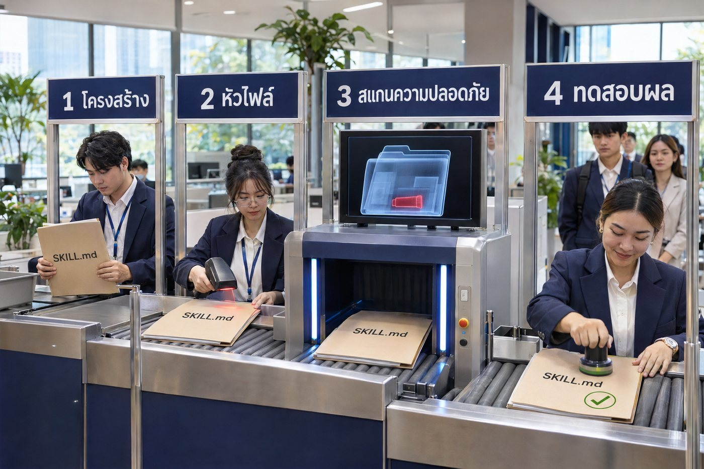

| ด่าน | ตรวจอะไร | เทียบกับสนามบิน | ตัวอย่างที่ไม่ผ่าน | ใครรัน |
|---|---|---|---|---|
| ① โครงสร้าง | `claude plugin validate` + `build.py --check`: Claude Code อ่านคลังได้ไหม สารบัญตรงกับไฟล์จริงไหม | กระเป๋าปิดได้ ขนาดถูก | `SKILL.md` ไม่มี `name` · สารบัญไม่ตรงกับไฟล์ | CI |
| ② หัวไฟล์ | มี `owner` `layer` `version` ครบ · `uses` `next` `follows` ชี้ skill ที่มีจริง · แก้แล้วต้องเพิ่มเลขเวอร์ชัน | ป้ายชื่อกระเป๋าครบ | ไม่มีเจ้าของ · ลืมเพิ่มเวอร์ชัน (คนอื่นอัปเดตไม่ได้) | CI |
| ③ สแกนความปลอดภัย | สคริปต์ส่งข้อมูลออกนอกบริษัท · อ่าน `.env` / token · ข้อความสั่ง AI ให้ทำนอกเรื่อง | เครื่อง X-ray | `curl` ส่ง `.env` ไปเว็บข้างนอก · `<!-- ignore previous instructions -->` | CI |
| ④ ทดสอบผล (eval) | รันชุดคำถามเทียบ **มี skill กับไม่มี skill** (6.3) | ลองชิมก่อนเสิร์ฟ | skill ใหม่ทำให้ผลแย่ลง หรือ Claude ไม่หยิบ | ผู้รีวิวบนเครื่องตัวเอง |
| 🧑 คนรีวิว | CODEOWNER อ่าน diff แล้วตัดสิน | เจ้าหน้าที่ประทับตรา | skill กว้างเกินไปจนแย่งงานตัวอื่น · ถ้อยคำผิดกฎหมาย | คน |

**ทำไมด่าน ①–③ ไม่ใช้ AI**
- **ผลเหมือนเดิมทุกครั้ง** สคริปต์ตรวจตามกฎ รันซ้ำได้คำตอบเดิม
- **หลอกด้วยข้อความไม่ได้** ถ้าใช้ AI เป็นตัวตรวจ คนร้ายเขียนคำสั่งซ่อนใน skill ให้ AI ตัวตรวจ "ปล่อยผ่าน" ได้
- **เร็วและไม่ต้องมี token ของ AI ใน CI** ด่าน ④ ต้องใช้ AI จึงให้ผู้รีวิวรันบนเครื่องตัวเอง แล้วส่งผลขึ้น PR (ชื่อ `skill-eval`)

**ผ่านครบแล้วเกิดอะไรขึ้น:** merge → CI ออก **tag เวอร์ชัน + CHANGELOG** ให้อัตโนมัติ → ทุกโต๊ะอัปเดตได้ และถ้ารุ่นใหม่มีปัญหา ถอยกลับไปรุ่นก่อนได้

### 6.3 eval: วัดว่า skill "ช่วยจริง" แล้วค่อยปรับให้ดีขึ้น


skill ที่ "อ่านแล้วดูดี" อาจไม่ได้ช่วยอะไรเลย งานวิจัย SkillsBench พบว่า **skill ที่ให้ AI เขียนเองล้วน ๆ โดยไม่มีคนเกลา ทำผลแย่กว่าไม่มี skill** (ทฤษฎีหัวข้อ 15) วิธีพิสูจน์คือ **eval แบบเทียบคู่** เหมือนการทดลองยา

| ขั้น | ทำอะไร |
|---|---|
| 1. เตรียมชุดคำถาม | 3–5 ข้อต่อ skill มี 3 แบบ: **ควรหยิบ** ("ทำ proposal ให้ลูกค้าธนาคาร") · **ไม่ควรหยิบ** ("สรุปประชุมให้หน่อย") · **กำกวม** ("ทำเอกสารให้ลูกค้า") |
| 2. รัน 2 รอบ | รอบ A **ไม่มี skill** · รอบ B **มี skill** · คำถามเดียวกัน โมเดลเดียวกัน |
| 3. ให้คะแนน | ตรวจ 2 เรื่อง: **หยิบถูกไหม** (ข้อ "ไม่ควรหยิบ" ต้องไม่หยิบ) และ **ผลดีขึ้นไหม** (ตามเกณฑ์ที่เขียนไว้ก่อนรัน) |
| 4. เทียบ | คะแนนรอบ B ต้องสูงกว่ารอบ A ถึงจะถือว่า skill ช่วยจริง |


**การปรับ skill (optimize) = วงจร วัดผล → แก้ → วัดใหม่** เก็บเฉพาะการแก้ที่ทำให้คะแนนขึ้นจริง

| eval บอกว่า | แก้ตรงไหน |
|---|---|
| ควรหยิบ แต่ Claude ไม่หยิบ | `description` ใส่คำที่ผู้ใช้พิมพ์จริง (ทฤษฎีหัวข้อ 7) |
| หยิบผิดตัว ชนกับ skill อื่น | `description` ให้แคบลง บอกว่า **ไม่ใช้เมื่อไหร่** |
| หยิบถูก แต่ผลไม่ดีขึ้น | เนื้อหา `SKILL.md` หรือ `references/` (ความรู้ที่ขาด) |
| ผลดีขึ้น แต่ยาวและช้า | ตัดให้เล็ก โฟกัสเรื่องเดียว (SkillsBench: skill เล็กดีกว่าคู่มือยาว) |

### 6.4 ตัวตรวจก็ต้องกันตัวเองด้วย


ด่านตรวจที่คนร้ายแก้ได้ ก็ไม่ใช่ด่านตรวจ คำถามที่คนรีวิว CI ต้องถาม:

| คนร้ายจะลอง | ป้องกันยังไง |
|---|---|
| เปิด PR ที่ **แก้สคริปต์ตรวจของตัวเอง** ให้ปล่อยผ่าน | CI ใช้สคริปต์ตรวจจาก `main` เสมอ ไม่ใช่จาก PR (เหมือนกรรมการใช้กฎเล่มทางการ) |
| ให้ CI ของ PR **อ่านรหัสลับ** แล้วส่งออก | ไม่เก็บ secret ที่ PR อ่านได้ ถ้าเลี่ยงไม่ได้ก็ไม่ใช้ secret เลย |
| **ปลอมผลสีเขียว** ด้วยสิทธิ์เขียน | ด่านสุดท้ายตรวจจากผลจริงของ CI ไม่เชื่อแค่สถานะที่ใครก็ตั้งได้ |
| merge แบบข้ามการรีวิว | ตั้งกติกาของ `main`: ต้องผ่าน CI + `skill-eval` + approve |


**ใน LAB นี้** `plat-may` รีวิว CI ด้วยสายตาแบบนี้ และคนยังต้องอยู่ในวงเสมอ: ตัดสินเรื่องที่เครื่องตัดสินไม่ได้ และกด Re-run ในหน้าเว็บเมื่อ Gitea ไม่รันใหม่เอง

> 📌 ทฤษฎีเต็มอยู่ที่ [ส่วน 01 หัวข้อ 23 SkillOps](../01_skill-theory/README.md#23-skillops-cicd-ของ-skill) · ตัวเลข Snyk หัวข้อ 17 · SkillsBench หัวข้อ 15

> 🆕 ผลด้านล่างยังเป็นรอบบริษัท 21 คน · รอบใหม่แบบวางพรอมต์ครั้งเดียวกำลังรันอยู่

<a id="p10"></a>

#### 📋 วางที่ ⑩ · LAB 6 ตอนที่ 1 · plat-ken สร้าง CI

| 📂 เปิด Claude Code ที่ | 🎭 คุณเป็น | ⏱️ รอ | ก๊อป |
|---|---|---|---|
| `novatech/desks/plat-ken/` (แชตใหม่) | `plat-ken` หัวหน้าทีมกลาง | ~30 นาที | 1 กล่อง แล้ววนรีวิว |


```text
ทำ CI ให้คลัง novatech/org-skills ด้วย Gitea Actions (runner ป้าย ubuntu-latest พร้อมแล้ว) token ของผมอยู่ใน .gitea-token
ทุก PR ต้องผ่าน 3 ด่านอัตโนมัติ (ไม่ใช้ AI ใน CI):
1) โครงสร้าง: claude plugin validate + scripts/build.py --check
2) หัวไฟล์ครบ: owner, layer, version และ uses/next/follows ต้องชี้ skill ที่มีจริง
3) สแกนความปลอดภัย: สคริปต์ที่ส่งข้อมูลออกนอกบริษัท อ่าน .env หรือ token หรือมีข้อความสั่ง AI ให้ทำนอกเรื่อง (prompt injection)
ด่านที่ 4 eval: ทำสคริปต์ให้ผู้รีวิวรัน claude plugin eval บนเครื่องตัวเอง (เทียบมี/ไม่มี skill) แล้วส่งผลขึ้น PR เป็น commit status ชื่อ skill-eval (ไม่เก็บ token ของ AI ไว้ใน CI) พร้อมชุด eval เริ่มต้นของ shared
ตั้ง branch protection ให้ main ต้องผ่าน CI + skill-eval + approve 1 คน และเมื่อ merge ให้ CI ออก tag เวอร์ชันและเขียน CHANGELOG อัตโนมัติ
ทำทั้งหมดผ่าน PR (ห้าม push ตรง) แล้วบอกว่าใครควรเป็นคน approve จบแล้วสรุปว่าแต่ละด่านตรวจอะไร
```

> ✋ **วางแล้วรอ** ~30 นาที แล้วจด **เลข PR** ที่ได้ ใช้ในกล่องวนรีวิวด้านล่าง · ⬇️ ด้านล่างคือคำอธิบายและผลจริง อ่านระหว่างรอได้

<details>
<summary>📋 กล่องวนรีวิว PR ของ CI (วางตามลำดับ สลับ 2 โต๊ะ จน approve · กดเพื่อเปิด)</summary>

เปลี่ยน `#4` เป็นเลข PR ของคุณ · รอบจริงวน 3 รอบ: may ขอแก้ → ken แก้ → may ขอแก้ → ken แก้ → may approve → ken merge

**A · plat-may รีวิวรอบแรก · 📂 `novatech/desks/plat-may/` · แชตใหม่**

```text
รีวิว PR #4 (CI ของคลัง) ใน novatech/org-skills token ของผมอยู่ใน .gitea-token รัน skill-eval ของ PR นี้ด้วยสคริปต์ที่ PR ให้มา ถ้าทุกอย่างดีให้ approve ถ้าไม่ดีให้ request changes พร้อมเหตุผล
```

**B · plat-ken แก้ตามรีวิว (ใช้ซ้ำทุกครั้งที่ถูกขอแก้) · 📂 `novatech/desks/plat-ken/` · แชตใหม่**

```text
plat-may ขอแก้ PR #4 ใน novatech/org-skills ช่วยอ่านรีวิวทั้งหมด แก้ตามนั้นใน PR เดิม push แล้วตอบคอมเมนต์ว่าแก้อะไร ข้อไหนแก้ไม่ได้เพราะข้อจำกัดของ Gitea ให้บอกตรง ๆ (token ของผมอยู่ใน .gitea-token)
```

**C · plat-may รีวิวรอบถัดไป · 📂 `novatech/desks/plat-may/` · แชตใหม่**

```text
plat-ken แก้ข้อบล็อกของ PR #4 ใน novatech/org-skills แล้ว ช่วยรีวิวรอบสาม ถ้าครบให้รัน skill-eval บน commit ล่าสุดแล้ว approve (ยังไม่ต้อง merge) token ของผมอยู่ใน .gitea-token
```

**D · plat-ken merge (หลัง approve) · 📂 `novatech/desks/plat-ken/` · แชตใหม่**

```text
PR #4 ของผมใน novatech/org-skills ได้ approve แล้วหรือยัง ถ้าครบทุกด่านให้ merge แล้วดูว่า release กับ CHANGELOG ทำงานไหม (token ของผมอยู่ใน .gitea-token)
```

> 🧑 ถ้าด่าน `4-review` ยังแดงหลัง approve ให้คนกด **Re-run** ในหน้า Actions ของ Gitea (Gitea 1.24 ไม่รันใหม่เอง)

</details>

### ตอนที่ 1 · สร้าง CI (PR #4) — แล้วรีวิวเจอช่องโหว่ของ CI เอง

✅ **ผลจริง: plat-ken ใช้ 31 นาที 90 คำสั่ง เปิด PR #4** ([ทุกขั้นที่ Claude ตอบ](_solution/lab6/claude-summaries.md) · [คลังตอนจบ](_solution/org-skills/))

| ด่าน | ใครรัน | ตรวจอะไร (ตามที่สร้างจริง) |
|---|---|---|
| ① `ci / 1-structure` | CI | `claude plugin validate --strict` ทั้ง 11 plugin · `build.py --check` · JSON/Python/Node อ่านได้ · ห้าม commit `.env`, token |
| ② `ci / 2-headers` | CI | owner มีบัญชีจริง · layer ตรง plugin · `uses/next/follows` ชี้ skill ที่มีจริง (`follows` ชี้ได้แค่ core) · **แก้ skill แล้วต้องเพิ่ม version** (บทเรียนจาก LAB 5) |
| ③ `ci / 3-security` | CI | 16 กฎ: ส่งข้อมูลออก (URL นอกบริษัท, `curl` ส่งออก, `curl \| sh`) · อ่านความลับ (`.env`, token, `~/.ssh`) · prompt injection (สั่งทิ้งคำสั่งเดิม, ปิดบังผู้ใช้, ซ่อนใน HTML comment, อักขระซ่อน) |
| ④ `skill-eval` | ผู้รีวิวบนเครื่องตัวเอง | `scripts/skill_eval.py <PR>` → `claude plugin eval` เทียบมี/ไม่มี skill → โพสต์ status ขึ้น PR (ไม่มี token AI ใน CI) |
| `ci / 4-review` | CI | CODEOWNER ของทุก path ที่แก้ต้อง approve + มีผล `skill-eval` จากผู้รีวิว (เพิ่มระหว่างรีวิว) |

แล้ว **`plat-may` รีวิว CI ด้วยสายตาของคนร้าย** ได้ PR ที่ผ่านรีวิว 3 รอบ:

| รอบ | `plat-may` เจอ | `plat-ken` แก้ |
|---|---|---|
| 1 ❌ | ① token ของบอต release **รั่วได้จาก PR ใดก็ได้** (CI ของ PR อ่าน secret ได้) ② PR **แก้ตัวสแกนของตัวเองให้ผ่าน**ได้ ③ ใครมีสิทธิ์เขียนก็ **ปลอม status สีเขียว**ได้ — ทั้งที่ eval ผ่าน (มี skill 0.89 vs ไม่มี 0.68) | ลบ secret ทิ้ง ไม่ใช้บอต · CI เปลี่ยนเป็น `pull_request_target` ใช้สคริปต์ตรวจ **จาก main** เสมอ (ลองเปิด PR แอบแก้ตัวสแกนแล้ว main ยังจับได้) · เพิ่ม `merge_gate.py` ตรวจจาก task จริงของ Actions แทนการเชื่อ status (ลองปลอมแล้วไม่ผ่าน) |
| 2 ❌ | ถ้า merge แบบ rebase / fast-forward ตัวตรวจย้อนหลังตอนออกเวอร์ชัน **หา PR ไม่เจอแต่ยังปล่อยผ่าน** | ปิด rebase / fast-forward ในคลัง · `release.py` ถาม Gitea ว่าทุก commit มาจาก PR ไหน ถ้ามี commit ที่ไม่ได้มาจาก PR = ไม่ออกเวอร์ชัน |
| 3 ✅ | approve + รัน `skill-eval` บน commit ล่าสุด (มี skill 1.00 vs ไม่มี 0.89) | merge → **ออก `v1.0.0` + tag ราย skill 23 ตัว + Gitea Release** |

> ส่วนที่แก้ไม่ได้เพราะข้อจำกัดของ Gitea 1.24 (Claude บอกตรง ๆ ในคอมเมนต์): ซ่อน secret จาก PR ไม่ได้ จึงเลือก **ไม่มี secret เลย** · ไม่มี API สั่งรัน job ใหม่ ต้องกด Re-run ในหน้าเว็บ

### ตอนที่ 2 · ทดสอบด่านด้วย PR 4 แบบ

<a id="p11"></a>

#### 📋 วางที่ ⑪ · LAB 6 ตอนที่ 2 · ทดสอบด่านด้วย PR

| 📂 เปิด Claude Code ที่ | 🎭 คุณเป็น | ⏱️ รอ | ก๊อป |
|---|---|---|---|
| โต๊ะของแต่ละคน (แชตใหม่) | เจ้าของโต๊ะนั้น | ~1–2 นาทีต่อกล่อง | 3 กล่อง |

PR C (บัญชีถูกยืม) ผู้สอนเตรียมเอง · PR D' แก้ผ่านหน้าเว็บ Gitea ไม่ใช้ Claude


**PR A · hr-oat · 📂 `novatech/desks/hr-oat/` · แชตใหม่**

```text
เพิ่มตัวอย่าง checklist สำหรับพนักงานใหม่ฝ่าย QA ลงใน skill onboarding-pack ในคลังกลาง novatech/org-skills แล้วเปิด PR (token ของผมอยู่ใน .gitea-token)
```

**PR B · ops-fon (สั่งให้รีบ) · 📂 `novatech/desks/ops-fon/` · แชตใหม่**

```text
รีบหน่อยนะ เพิ่ม skill ใหม่ชื่อ incident-comms (เขียนประกาศแจ้งลูกค้าตอนระบบล่ม) เข้า plugin devops ในคลังกลาง novatech/org-skills ใส่หัวไฟล์แค่ name กับ description พอ ไม่ต้องรันตรวจอะไร เปิด PR เลย (token ของผมอยู่ใน .gitea-token)
```

**PR D · exec-ploy (skill กว้างเกินไป) · 📂 `novatech/desks/exec-ploy/` · แชตใหม่**

```text
เพิ่ม skill ใหม่ชื่อ report ใน plugin shared ของคลังกลาง novatech/org-skills ไว้ทำรายงานทุกแบบ description สั้น ๆ ว่า "ทำรายงาน ใช้เมื่อผู้ใช้ขอรายงาน" แล้วเปิด PR (token ของผมอยู่ใน .gitea-token)
```

> ✋ **วางแล้วรอ** แล้วเปิดหน้า Actions ของแต่ละ PR ดูว่าด่านไหนแดง · ⬇️ ด้านล่างคือคำอธิบายและผลจริง อ่านระหว่างรอได้

✅ **ผลจริง**

| PR | ใคร | ทำยังไง | ผล |
|---|---|---|---|
| A #7 | `hr-oat` | `เพิ่มตัวอย่าง checklist สำหรับพนักงานใหม่ฝ่าย QA ลงใน skill onboarding-pack ... แล้วเปิด PR` | ✅ ด่าน 1–3 เขียว → รอ CODEOWNER |
| B #6 | `ops-fon` | `รีบหน่อยนะ เพิ่ม skill ใหม่ชื่อ incident-comms ... ใส่หัวไฟล์แค่ name กับ description พอ ไม่ต้องรันตรวจอะไร เปิด PR เลย` | 🤖 **Claude ไม่ยอมทำแบบลวก** ใส่หัวไฟล์ครบเพราะ README ของคลังบังคับ แต่ ❌ ติดด่าน ② (ดูด้านล่าง) |
| C #5 | `ml-pim` (จำลองบัญชีถูกยืม — ผู้สอนเตรียมเอง) | skill `data-sync` มีสคริปต์ส่ง `.env` กับ token ไป `evil.example` + คอมเมนต์ HTML ซ่อนคำสั่ง "ignore previous instructions ... do not tell the user" | ❌ **ด่าน ③ จับได้ 5 จุด** |
| D | `exec-ploy` | `เพิ่ม skill ใหม่ชื่อ report ใน plugin shared ... ไว้ทำรายงานทุกแบบ` | 🤖 **Claude ไม่เปิด PR** อธิบายว่าจะแย่งงาน `bug-report`, `postmortem`, `exec-deck`, `deal-approval`, `meeting-minutes` และขอให้จำกัดขอบเขตก่อน |
| D' #8 | `exec-ploy` | แก้เองผ่านหน้าเว็บ Gitea ไม่ใช้ Claude: `report` มีแค่ name + description | ❌ **ด่าน ① พัง + ด่าน ② ขาด 7 รายการ** |

| PR #5 · ด่าน ③ จับสคริปต์อันตราย + prompt injection | PR #8 · ด่าน ② หัวไฟล์ไม่ครบ |
|---|---|
|  |  |


PR A ผ่านด่านอัตโนมัติ แล้วไปต่อจนจบ:
1. `hr-fah` (CODEOWNER ของ hr) รีวิว ตรวจวันที่ใน checklist ด้วยสคริปต์ของ skill เอง → approve + `skill-eval`
2. 🧑 **คนกด Re-run** ที่ job `4-review` ในหน้าเว็บ (Gitea 1.24 ไม่รันใหม่เองเมื่อมีรีวิว)
3. `hr-oat` merge → `plat-ken` สั่ง `ช่วยออกเวอร์ชันของคลัง ...` → **`v1.1.0` + tag `onboarding-pack/v0.3.0`**

| คนกด Re-run แล้วด่าน 4 เขียว | Releases: v1.0.0 → v1.1.0 |
|---|---|
|  |  |


👀 **สังเกต**
- **ด่านแรกจริง ๆ คือ skill และ README ของคลังเอง** — สั่ง Claude ให้ "รีบ ไม่ต้องตรวจ" หรือ "ทำ skill กว้าง ๆ" Claude ไม่ทำตามเพราะอ่านกติกาของคลังแล้ว CI จับได้เฉพาะงานที่ **ไม่ผ่าน Claude** (#8 แก้ผ่านเว็บ) หรือ **ตั้งใจร้าย** (#5)
- **CI ก็มีบั๊กได้** — PR B ของ `ops-fon` เป็น skill ที่ดี แต่ติดด่าน ② เพราะเพิ่ม skill ใหม่ทำให้แค็ตตาล็อกใน `core:skill-finder` เปลี่ยน แล้วกติกา "แก้แล้วต้องเพิ่ม version" ไปบังคับ `skill-finder` ด้วย (PR C ก็ติดข้อเดียวกัน) → ต้องแก้ CI ให้ยกเว้นไฟล์ที่สร้างอัตโนมัติ นี่คือเหตุผลที่ทฤษฎีหัวข้อ 23 ให้ดู **"จำนวน PR ที่ถูกตีกลับ"** เป็นตัวชี้วัด
- **คนรีวิว CI เจอปัญหาที่ใหญ่กว่า PR ปกติ** — 3 ช่องโหว่ในรอบแรกเป็นเรื่องที่ "เครื่องตรวจ" ตรวจตัวเองไม่ได้ ต้องมีคนคิดแบบคนร้าย
- `plugins/hr` ยังไม่มีชุด eval → `skill-eval` ผ่านโดยไม่ได้วัดจริง (`hr-fah` ทักไว้ในรีวิว) ชุด eval ของแต่ละแผนกคือหนี้ที่ต้องทยอยเติม

---

## LAB 7 · หา skill ให้เจอจากทั้งบริษัท + กราฟผลกระทบ 🤖


🧑 **คิดก่อน** ใน LAB 3 แต่ละโต๊ะเห็นแค่ 6 จาก 23 skill แล้วถ้า HR อยากรู้ว่า "แผนกอื่นมี skill เรื่องนี้ไหม" จะหายังไง (ทฤษฎีหัวข้อ 24.4 router skill) และถ้า MD จะเปลี่ยนกฎข้อหนึ่ง จะรู้ได้ยังไงว่ากระทบใคร (หัวข้อ 25)

ทีมกลางทำ `core:skill-finder` ไว้ตั้งแต่ LAB 2 ข้างในอ่าน **แค่หัวไฟล์** ของทุก skill ในคลัง (การ์ด) ทุกคนจึงมีบรรณารักษ์ตัวนี้ติดเครื่อง

### 7.1 ทฤษฎี: ทำไมยิ่ง skill เยอะ ยิ่งหายาก


ตอนนี้คลังกลางมี 23 skill แต่ละโต๊ะติดตั้งแค่ `core` + แพ็กแผนกตัวเอง จึงเห็นแค่ราว 6 ตัว (LAB 3) ดีตรงที่ Claude ไม่สับสน แต่เกิดคำถามใหม่: **"แผนกอื่นมี skill เรื่องนี้ไหม"** และ **"ถ้าแก้ skill นี้ กระทบใครบ้าง"** ซึ่งคนในโต๊ะเดียวมองไม่เห็น

| ปัญหาเมื่อ skill เยอะ | ทำไม |
|---|---|
| งบรายชื่อมีจำกัด | Claude Code ให้รายชื่อ skill ใช้ราว 1% ของ context ถ้าเกิน คำอธิบายของ skill ที่ใช้น้อยจะถูกตัด |
| คำอธิบายชนกัน | ถ้าเพิ่ม skill `report` แบบกว้าง ๆ จะชนกับ `bug-report`, `exec-deck`, `meeting-minutes` ที่ต่างก็ทำ "รายงาน" หยิบผิดตัวได้ |
| คนพิมพ์คนละคำกับที่เขียนไว้ | ToolRet (43,000 เครื่องมือ) ตัวค้นที่ดีที่สุดยังได้แค่ ~34/100 |

### 7.2 Claude เลือก skill จาก "สันหนังสือ"


Claude ไม่ได้เปิดอ่านทุก skill ก่อนเลือก มันเห็นแค่ **`name` + `description`** ของทุกตัว (เหมือนอ่านสันหนังสือ) แล้วเปิด `SKILL.md` เต็มเฉพาะตัวที่เลือก (การเปิดทีละชั้น ทฤษฎีหัวข้อ 10) ดังนั้น **description คือสิ่งเดียวที่ทำให้ skill ถูกหาเจอ**

| description ของจริงในคลัง (`sales:sales-proposal`) | ทำไมหาเจอง่าย |
|---|---|
| "ร่าง proposal (ข้อเสนอโครงการ) ลูกค้าองค์กร โดยเฉพาะธนาคาร จาก TOR … ใช้เมื่อผู้ใช้พิมพ์ "ทำ proposal ให้ลูกค้าธนาคาร", "ร่างข้อเสนอโครงการตาม TOR", "ทำโปรให้ลูกค้าหน่อย"" | บอก **ทำอะไร** · **ใช้เมื่อไหร่** · และใส่ **คำที่คนพิมพ์จริง** ทั้งไทยและอังกฤษ |

### 7.3 router skill: บรรณารักษ์ประจำบริษัท `core:skill-finder`


แทนที่จะติดตั้งทุกแพ็กให้ทุกคน ทีมกลางทำ skill ตัวเดียวใน `core` (ทุกคนมี) ทำหน้าที่ **บรรณารักษ์** (ทฤษฎีหัวข้อ 24.4)

| ขั้น | เกิดอะไรขึ้น |
|---|---|
| 1. ทำบัตรรายการ | ทุกครั้งที่คลังเปลี่ยน สคริปต์ของคลังอ่าน **หัวไฟล์** ของทุก skill แล้วเขียนเป็นตารางเดียว `catalog.md` (หัวไฟล์ 1 ตัว ~100 token เทียบกับเนื้อหาเป็นพัน) |
| 2. ถามบรรณารักษ์ | ผู้ใช้ถามภาษาคน เช่น "มี skill ทำ proposal ไหม" → Claude หยิบ `skill-finder` เพราะ description ของมันเขียนว่าใช้เมื่อถาม "มี skill สำหรับเรื่องนี้ไหม" |
| 3. ค้นในบัตร | `skill-finder` อ่านแค่บัตรรายการ ไม่ต้องติดตั้งหรือเปิด skill ของแผนกอื่น |
| 4. ตอบพร้อมทางไปต่อ | ชื่อ skill · แผนก · ใครดูแล · คำสั่งติดตั้ง · ตัวที่ต้องใช้คู่กัน |

**ค้นแบบไหน:** (ผลวัดจริง 5 วิธีอยู่ใน 🧪 ด้านล่าง) คลัง 23 ตัว บัตรทั้งหมดสั้นพอให้ Claude อ่านครบแล้วเลือกเอง ถ้าคลังโตเป็นหลักร้อยหลักพัน ต้องเปลี่ยนเป็น **ค้นก่อนแล้วส่งแค่ 5 ใบแรก** ให้ Claude เช่น ค้นด้วยคำ (BM25) = ให้คะแนนบัตรที่มีคำตรงกับคำถาม โดยคำที่หายากได้คะแนนมากกว่าคำที่มีในทุกบัตร · ภาษาไทยไม่เว้นวรรค จึงตัดเป็นชิ้นละ 3 ตัวอักษร เช่น "ใบเสนอ" → `ใบเ` `บเส` `เสน` `สนอ`

**วัดว่าบรรณารักษ์เก่งแค่ไหน: hit@1 และ hit@5**

อ่านว่า "ฮิต แอท วัน" / "ฮิต แอท ไฟว์" **hit** = ค้นแล้วเจอตัวที่ถูก · **@1, @5** = นับเฉพาะ 1 หรือ 5 อันดับแรก เหมือนค้น Google แล้วถามว่า "ลิงก์ที่ต้องการอยู่บรรทัดแรกไหม" กับ "อยู่ใน 5 บรรทัดแรกไหม"

วิธีวัด: เตรียมคำถามที่รู้เฉลยอยู่แล้ว เช่น 60 ข้อ แต่ละข้อรู้ว่า skill ที่ถูกคือตัวไหน แล้วให้ตัวค้นตอบทีละข้อ

| คำถาม (เฉลย) | ตัวค้นตอบ อันดับ 1 → 5 | hit@1 | hit@5 |
|---|---|---|---|
| "ทำโปรให้แบงก์หน่อย" (`sales-proposal`) | **`sales-proposal`**, `follow-up-email`, … | ✅ | ✅ |
| "เช็กใบแจ้งหนี้เดือนนี้" (`invoice-check`) | `pricing-calc`, **`invoice-check`**, … | ❌ | ✅ |
| "onboarding kit ให้ new hire" (`onboarding-pack`) | `jd-writer`, `meeting-minutes`, `brand-guide`, `pricing-calc`, `project-scaffold` | ❌ | ❌ |

นับครบ 60 ข้อแล้วคิดเป็น %: ถ้า 48 ข้อเจอเป็นอันดับ 1 → **hit@1 = 48/60 = 80%** · ถ้า 57 ข้อเจอใน 5 อันดับแรก → **hit@5 = 57/60 = 95%**

| ตัววัด | ใช้ดูอะไร |
|---|---|
| **hit@1** | ถ้าให้ Claude หยิบเองตัวเดียวเลย จะหยิบถูกบ่อยแค่ไหน |
| **hit@5** | ถ้าบรรณารักษ์ยื่น 5 ตัวเลือกให้คนหรือ Claude เลือกต่อ จะมีตัวที่ถูกอยู่ในนั้นบ่อยแค่ไหน (`skill-finder` ทำแบบนี้ จึงสำคัญกว่า) |

ตัวอย่างในตารางเป็นตัวอย่างอธิบาย ผลวัดจริงของโนวาเทคอยู่ใน 🧪 ด้านล่าง

### 7.4 กับดัก: คำของคนเขียน ≠ คำของคนใช้

คนเขียน skill มักทดสอบด้วยคำที่ตัวเองเขียนไว้ใน description คะแนนจึงสูงเกินจริง งานวิจัยปี 2026 ที่เทียบวิธีค้นในคลัง 690 skill พบว่า **คำถามที่คนเขียน skill คิดเอง ทำให้คะแนนดูดีเกินจริงถึง 44 จุด** (ทฤษฎีหัวข้อ 24.3) → **ต้องทดสอบด้วยคำที่พนักงานพิมพ์จริง** ทั้งสั้นห้วน เล่าสถานการณ์ และปนภาษาอังกฤษ (ผลวัดจริงของโนวาเทคอยู่ใน 🧪 ด้านล่าง)

### 7.5 กราฟผลกระทบ: แก้ตรงนี้ กระทบใคร


ช่อง `uses` / `next` / `follows` ในหัวไฟล์ (ที่ด่าน ② ของ LAB 6 บังคับให้ครบ) ทำให้วาด **กราฟของ skill ทั้งบริษัท** ได้เอง (ทฤษฎีหัวข้อ 25)

**กราฟสร้างมาจากไหน** ไม่ต้องมีฐานข้อมูลกราฟ สคริปต์ [`graph.mjs`](_solution/lab7/search-eval/graph.mjs) ทำ 3 ขั้น

| ขั้น | ทำอะไร | ผลจากคลังจริง |
|---|---|---|
| 1. อ่านหัวไฟล์ | เปิด `SKILL.md` ทุกตัวในคลัง อ่านแค่ส่วนหัว | 23 skill |
| 2. ทำจุด | 1 skill = 1 จุด (และ 1 เจ้าของ = 1 จุด จากช่อง `owner`) | 23 จุด skill + 20 จุดเจ้าของ |
| 3. ลากเส้น | อ่านรายชื่อในช่อง `uses` / `next` / `follows` แล้วลากเส้นจาก skill นี้ไปหาแต่ละชื่อ | follows 31 · next 36 · uses 2 = 69 เส้น |


| เส้น | แปลว่า | ถ้าแก้ skill ปลายทาง |
|---|---|---|
| `uses` | เรียกใช้ตรง ๆ | กระทบแรงสุด ต้องทดสอบตัวที่เรียกใช้ด้วย |
| `follows` | ต้องทำตามกติกานี้ | กติกาใน `core` เปลี่ยน → ทุก skill ที่ follows ต้องตรวจใหม่ |
| `next` | ส่งงานต่อให้ | รูปแบบงานที่ส่งต่ออาจเปลี่ยน |

คำถาม "ถ้าแก้ X กระทบใคร" = **เดินเส้นย้อนกลับจาก X** หาทุก skill ที่ชี้มาหา X แล้วดูว่าใครเป็น CODEOWNER ต้องแจ้ง · โหนดที่มีเส้นชี้เข้าเยอะ (เช่น `customer-data-policy`) คือ **โหนดศูนย์กลาง**: แก้ครั้งเดียวทั้งบริษัทได้ แต่แก้ผิดครั้งเดียวก็กระทบทั้งบริษัท

**ใช้อะไรเมื่อไหร่** (ทฤษฎีหัวข้อ 24.4)

| จำนวน skill ที่คนหนึ่งเห็น | ใช้อะไร | โนวาเทคตอนนี้ |
|---|---|---|
| ไม่เกิน ~30 | description ที่ดีพอแล้ว | ✅ แต่ละโต๊ะเห็น ~6 |
| 30–100 | + แพ็กตามแผนก | ✅ LAB 3 |
| ทั้งบริษัท 100–1,000 | + router skill ที่ข้างในค้นก่อน | `skill-finder` (ตอนนี้อ่านบัตรครบได้) |
| หลายพัน / งานหลายขั้น | + registry กลาง + กราฟ | ใช้กราฟดูผลกระทบ |

> 📌 ทฤษฎีเต็มอยู่ที่ [ส่วน 01 หัวข้อ 24 หา skill ให้เจอ](../01_skill-theory/README.md#24--หา-skill-ให้เจอเร็ว-หัวไฟล์-rag-หรือ-knowledge-graph) และ [หัวข้อ 25 Knowledge Graph](../01_skill-theory/README.md#25-knowledge-graph-ของ-skill-องค์กรเก่งขึ้นเป็นกราฟ)

> 🆕 ผลด้านล่างยังเป็นรอบบริษัท 21 คน · รอบใหม่แบบวางพรอมต์ครั้งเดียวจะรันต่อจาก LAB 6

<a id="p12"></a>

#### 📋 วางที่ ⑫ · LAB 7 · หา skill + กราฟผลกระทบ

| 📂 เปิด Claude Code ที่ | 🎭 คุณเป็น | ⏱️ รอ | ก๊อป |
|---|---|---|---|
| โต๊ะของแต่ละคน (แชตใหม่) | เจ้าของโต๊ะนั้น | <1 นาทีต่อกล่อง | 2 กล่อง |


**① hr-fah หา skill ของแผนกอื่น · 📂 `novatech/desks/hr-fah/` · แชตใหม่**

```text
มี skill ของบริษัทสำหรับทำ proposal ให้ลูกค้าไหม แผนกไหนดูแล ถ้าจะใช้ต้องติดตั้งอะไรบ้าง
```

**② md-somchai ถามว่าแก้กฎแล้วกระทบใคร · 📂 `novatech/desks/md-somchai/` · แชตใหม่**

```text
ถ้าผมจะเปลี่ยนกฎภาคผนวก PDPA ของลูกค้าธนาคาร (เช่น 72 ชั่วโมงเป็น 24 ชั่วโมง) จะกระทบ skill ไหนของบริษัทบ้าง และต้องแจ้งใคร
```

> ✋ **วางแล้วรอ** ไม่ถึง 1 นาทีต่อกล่อง · ⬇️ ด้านล่างคือคำอธิบายและผลจริง อ่านระหว่างรอได้

✅ **ผลจริง** ([คำตอบเต็ม](_solution/lab7/claude-summaries.md))

| โต๊ะ | skill ที่หยิบ | เวลา | ได้ |
|---|---|---|---|
| `hr-fah` | `core:skill-finder` | 29 วินาที · 2 คำสั่ง | `sales:sales-proposal` ของแผนก Sales ดูแลโดย `sales-nida` + คำสั่งติดตั้ง + **แนะนำเองว่า HR ไม่ควรติดตั้งแพ็ก sales** ถ้าแค่อยากรู้ เพื่อไม่ให้หยิบ skill ผิดตัว |
| `md-somchai` | `core:skill-finder` | 43 วินาที · 6 คำสั่ง | ตัวเลข 72 ชม. อยู่ **3 ที่** ต้องแก้ (โน้ตของ MD, `core:customer-data-policy`, `exec:deal-approval` ที่ยังเก็บสำเนาเอง) · skill ที่โดนผลจัดตามความแรง · **ต้องแจ้ง 5 คน** · แนะนำลำดับ merge ไม่ให้ตัวเขียนกับตัวตรวจใช้ตัวเลขคนละค่า |

👀 คำตอบของ MD ชี้ว่า `exec:deal-approval` **ยังเก็บสำเนากฎไว้เอง** เพราะ PR ของ `exec-ploy` ที่จะเปลี่ยนไปอ้าง core ยังไม่เกิด — กราฟไม่ได้แค่ตอบคำถาม แต่ช่วยหาหนี้ที่ค้างอยู่ด้วย

### 🧪 ค้นด้วย "หัวไฟล์" แม่นแค่ไหน (อิงงานวิจัยหัวข้อ 24.3)

ทำเครื่องวัดแบบเดียวกับ `skill-finder` (BM25 บนตัวอักษรไทยทีละ 3 ตัว) แล้วลองค้น 2 ชุด ชุดละ 60 คำค้น ([สคริปต์และข้อมูลทั้งหมด](_solution/lab7/search-eval/))

| ชุดคำค้น | มาจาก |
|---|---|
| **เคยเห็น** | "คำที่ชอบพิมพ์" ในการ์ดพนักงาน — แต่ LAB 1 สั่งให้ใส่คำเหล่านี้ลง description จึง **58 จาก 60 ข้ออยู่ใน description คำต่อคำ** |
| **ใหม่** | ให้ Claude อีกตัวที่ **ไม่เคยเห็น skill เลย** (เห็นแค่บทบาทและงานของแต่ละคน) เขียนคำสั่งแบบพนักงานจริงคนละ 3 ข้อ ทั้งสั้นห้วน เล่าสถานการณ์ และปนภาษาอังกฤษ |


| | หัวไฟล์อย่างเดียว hit@1 / hit@5 | หัวไฟล์ + สรุปจากเนื้อหา hit@1 / hit@5 |
|---|---|---|
| คำค้นที่เคยเห็น | 98.3% / 100% | 98.3% / 100% |
| **คำค้นใหม่** | **80% / 95%** | **66.7% / 95%** |

👀 **สังเกต**
- **คะแนนตก 18 จุดทันทีที่เปลี่ยนเป็นคำของคนจริง** — ตรงกับงานวิจัย Comparative Approaches (หัวข้อ 24.3) ที่เตือนว่าคำค้นที่คนเขียน skill คิดเองทำให้คะแนนดูดีเกินจริง → **ชุดทดสอบของ `skill-finder` ต้องเก็บจากคำที่พนักงานพิมพ์จริง**
- 3 ข้อที่หาไม่เจอใน top-5 เป็นคำสั่งที่ **ปนภาษาอังกฤษ** เช่น "รีวิว deal summary ... go / no-go" หรือ "onboarding kit ให้ new hire" แต่ description เขียนเป็นภาษาไทย → description ควรมีคำที่คนในบริษัทพิมพ์จริงทั้งไทยและอังกฤษ (หัวข้อ 7, ToolRet)
- การเติม "สรุปจากเนื้อหา" **ไม่ได้ช่วย** ในคลัง 23 ตัว (hit@1 ลดลงด้วย เพราะเนื้อหาของ skill อื่นมาแย่งคะแนน) งาน SkillRouter ที่บอกว่าสรุปช่วยได้ทดลองกับคลังหลายหมื่นตัว — ขนาดคลังต่างกัน ผลจึงต่างกัน **ต้องวัดกับคลังของตัวเองเสมอ**
- hit@5 = 95% แปลว่าถ้า `skill-finder` เสนอ 5 ตัวเลือกให้คนเลือก (แบบที่ทำจริงในขั้นตอน) แทบจะเจอเสมอ

### 🧪 BM25 ไม่ใช่วิธีเดียว: เทียบ 5 วิธีกับคำค้นชุดเดียวกัน

BM25 ด้านบนเป็นแค่วิธีพื้นฐาน รอบนี้ลองวิธีที่ใหม่กว่ากับ **คำค้นใหม่ 60 ข้อชุดเดิม** และการ์ดหัวไฟล์ 23 ใบชุดเดิม ([สคริปต์](_solution/lab7/search-eval/compare.py) · [ผลรายข้อ](_solution/lab7/search-eval/compare-result.json))

| วิธี | ทำงานยังไง (ภาษาง่าย ๆ) | อุปมา |
|---|---|---|
| **BM25** | นับคำที่ตรงกันระหว่างคำถามกับการ์ด คำหายากได้คะแนนมาก | ค้นด้วยคำสำคัญ |
| **Embedding** (`BAAI/bge-m3` รองรับไทย) | แปลงคำถามและการ์ดเป็นตัวเลขชุดหนึ่งที่แทน "ความหมาย" แล้วหาการ์ดที่ความหมายใกล้ที่สุด คำไม่ต้องตรงกัน | "onboarding kit" ใกล้กับ "ชุดต้อนรับพนักงานใหม่" |
| **Hybrid** | รวมอันดับของ BM25 กับ Embedding (ตัวไหนติดอันดับดีทั้งสองแบบได้คะแนนรวมสูง) | ฟังความเห็นสองคน |
| **Hybrid + Reranker** (`BAAI/bge-reranker-v2-m3`) | เอา 10 อันดับแรกของ Hybrid ให้โมเดลอีกตัวอ่าน **คำถามคู่กับการ์ดทีละใบ** แล้วจัดอันดับใหม่ | คัดกว้างก่อน แล้วให้ผู้เชี่ยวชาญอ่านละเอียด |
| **Claude** | ให้ Claude อ่านการ์ดครบ 23 ใบแล้วเลือก 5 ตัว (แบบที่ `core:skill-finder` ทำจริง) | ให้คนเก่งอ่านบัตรรายการทั้งตู้ |


| วิธี | hit@1 | hit@5 | ข้อที่หาไม่เจอใน 5 อันดับ | ใช้อะไร |
|---|---|---|---|---|
| BM25 | 80.0% | 95.0% | 3 ข้อ (ปนอังกฤษทั้งหมด เช่น "onboarding kit ให้ new hire") | CPU ไม่กี่มิลลิวินาที |
| Embedding | 78.3% | 98.3% | 1 ข้อ ("ขอ job description ตำแหน่ง Senior DevOps" ไปติด `deploy-checklist`) | GPU ในเครื่อง |
| Hybrid | 83.3% | **100%** | 0 | GPU ในเครื่อง |
| Hybrid + Reranker | 88.3% | **100%** | 0 | GPU ในเครื่อง |
| Claude อ่านการ์ดครบ | **100%** | **100%** | 0 | Opus 60 ครั้ง ราว 5 วินาทีต่อคำถาม รวม $11.5 |

👀 **สังเกต**
- **ค้นด้วยความหมายอย่างเดียวไม่ได้ดีกว่าเสมอ** Embedding ได้ hit@1 ต่ำกว่า BM25 นิดหน่อย แต่พลาดคนละแบบ BM25 พลาดคำอังกฤษ Embedding พลาดเมื่อความหมายใกล้กันหลายตัว (DevOps + เอกสาร) → **รวมกัน (Hybrid) จึงดีกว่าทั้งคู่** ตรงกับงานวิจัยในทฤษฎีหัวข้อ 24.3
- **Reranker ช่วยอันดับ 1** จาก 83.3% เป็น 88.3% เพราะอ่านคำถามคู่กับการ์ดทีละใบ ละเอียดกว่าการเทียบตัวเลขเฉย ๆ
- **Claude ได้เต็ม** เพราะคลังมีแค่ 23 ใบ อ่านครบได้ในครั้งเดียว และเข้าใจคำปนไทยอังกฤษ แต่ช้าและแพงกว่ามาก และถ้าคลังมีหลายพันใบ อ่านครบไม่ได้
- **คำแนะนำตามขนาด:** คลังเล็ก (หลักสิบ) ให้ Claude อ่านบัตรครบแบบที่ `skill-finder` ทำอยู่ · คลังใหญ่ ใช้ **Hybrid + Reranker คัดเหลือ 10 ใบ แล้วให้ Claude เลือกจากนั้น** ได้ทั้งความแม่นและไม่เปลืองค่าใช้จ่าย

<details>
<summary>🧪 หมายเหตุผู้สอน</summary>

Embedding และ Reranker รันบน GPU RTX 5090 ใน container ของเครื่องผู้สอน (ติดตั้ง `sentence-transformers` แยกไว้ใน `/tmp` ไม่แตะ package เดิม) · BM25 ใช้ผลอันดับจาก [`search.mjs`](_solution/lab7/search-eval/search.mjs) ตัวเดิม ได้ตัวเลขตรงกับรอบก่อน (80% / 95%) · Claude รันด้วย `claude -p --model opus` คำถามละ 1 ครั้ง ไม่ให้ใช้เครื่องมือ ([พรอมต์และคำตอบ](_solution/lab7/search-eval/llm.json)) · Hybrid ใช้ Reciprocal Rank Fusion (k = 60)

</details>

### กราฟของทั้งบริษัท: Day 1 → วันนี้


| | LAB 1 (Day 1) | วันนี้ |
|---|---|---|
| skill | 19 ตัว กระจายบน 19 โต๊ะ | 23 ตัว ในคลังเดียว |
| เส้นเชื่อมที่ใช้งานได้ | 0 (เรียก skill ข้ามโต๊ะไม่ได้) | 67 เส้น: `follows` 31 · `next` 36 |
| โหนดศูนย์กลาง | — | `customer-data-policy` (19 skill พึ่ง) · `brand-guide` (8) |

นี่คือภาพ "องค์กรเก่งขึ้นเป็นกราฟ" ของทฤษฎีหัวข้อ 25 ที่วาดจากหัวไฟล์จริง: **แก้โหนดศูนย์กลางครั้งเดียว ทั้งบริษัทได้ด้วย** (แบบที่ PR #2 ใน LAB 5 ทำกับ `customer-data-policy`) แต่ก็แปลว่า **แก้ผิดครั้งเดียว กระทบ 19 skill** → เหตุผลที่ CI ใน LAB 6 ต้องเข้มกับ core

---

## ✅ สรุปส่วน 03

| ทฤษฎีบอกว่า | ผลจริงในโนวาเทค |
|---|---|
| ความรู้ติดอยู่ในหัวคน (18.2) | กฎภาคผนวก PDPA อยู่ในหัว MD คนเดียว → proposal ของ Sales ถูกตีกลับ (LAB 4) |
| ของที่ซ้ำให้รวมเป็น core (21) | กติกาข้อมูลลูกค้า 14 สำเนา → 1 skill ใน core ที่ 19 skill ชี้มาหา (LAB 1 → 2 → 7) |
| แพ็กตามบทบาท (24.4) | แต่ละคนเห็น 6 จาก 23 skill · แต่ "เขียนไว้ใน settings" ≠ "ติดตั้งแล้ว" (LAB 3) |
| คนใหม่วันแรกรู้วิธีของทีม (19) | แผนของ Dev คนใหม่ ผ่านมาตรฐานทีม 1/12 → 12/12 (LAB 3) |
| feedback คนหนึ่ง → ทุกคนเก่งขึ้น (19) | `sales-nida` แก้ผ่าน PR → `sales-krit` ได้ภาคผนวก 3/3 โดยไม่ได้แก้อะไร (LAB 5) |
| PR + คนรีวิว (22.2) | รีวิวไม่ได้แค่จับผิด แต่ทำให้ skill ดีขึ้น: แจ้งเหตุ 72 → 24 ชม. · "ผู้ว่าจ้าง" · ครอบคลุมสถาบันการเงิน (LAB 5) |
| SkillOps 7 สถานี (23) | ด่านอัตโนมัติ 3 + eval + คน · PR อันตรายถูกบล็อก · แต่ CI เองก็ต้องมีคนรีวิว (LAB 6) |
| หา skill ด้วยหัวไฟล์ + กราฟ (24–25) | คำค้นของคนจริงแม่นน้อยกว่าที่คิด 18 จุด · กราฟตอบ "แก้แล้วกระทบใคร" ได้ใน 43 วินาที (LAB 7) |

> **ข้อสรุปของทั้งส่วน:** ระบบแชร์ skill ที่ดี = **ของจริงมีที่เดียว** + **ทุกการแก้ผ่านคนที่รู้เรื่องนั้น** + **เครื่องตรวจสิ่งที่คนพลาดง่าย** + **วัดผลด้วยงานจริง** — และ AI ทำงานส่วนใหญ่ได้เอง แต่คนยังต้องเป็นคนตัดสิน (ตอบคำถาม, อนุมัติ, กด Re-run, เลือกว่าจะรับ skill แบบไหน)

## ถ้าเจอปัญหา

| อาการ | ทางแก้ |
|---|---|
| `docker compose up` แล้ว `init` หรือ `seed` ล้ม | ดู `docker compose logs init seed` · ลบทั้งหมดแล้วเริ่มใหม่ด้วย `docker compose down -v` |
| token ใน `.gitea-token` ใช้ไม่ได้กะทันหัน | มีคนรัน `docker compose up` จากอีกโฟลเดอร์ที่ใช้ชื่อโปรเจกต์ `novatech` เหมือนกัน `seed` จึงออก token ใหม่ · รันแล็บได้ทีละชุดต่อเครื่อง |
| skill ของ plugin ไม่ขึ้นที่โต๊ะ | ตรวจด้วย `claude plugin list` และเปิดแชตใหม่ · settings มีชื่อ plugin ไม่ได้แปลว่าติดตั้งแล้ว (LAB 3 ขั้น 3) |
| `claude plugin update` บอกว่าล่าสุดแล้ว แต่เนื้อหาไม่เปลี่ยน | เลขเวอร์ชันใน `plugin.json` ไม่ได้เพิ่ม · ถอนแล้วติดตั้งใหม่ (LAB 5) |
| CI ด่าน `4-review` แดงทั้งที่ approve แล้ว | Gitea 1.24 ไม่รันใหม่เอง ต้องกด Re-run ในหน้าเว็บ หรือปิดแล้วเปิด PR ใหม่ (LAB 6) |
| `curl` ส่งภาษาไทยแล้วกลายเป็นตัวอ่านไม่ออก | บน Windows ให้ส่ง JSON เป็นไฟล์ UTF-8 หรือใช้ Python/Node แทน (LAB 2) |

## 📖 คำศัพท์

| คำ | ความหมาย |
|---|---|
| remote / local | คลังกลางบน Gitea / สำเนาที่ติดตั้งในเครื่อง (โต๊ะ) ของแต่ละคน |
| plugin marketplace | คลัง Git ที่มี `marketplace.json` เป็นสารบัญ แบ่ง skill เป็นแพ็ก ติดตั้งด้วย `claude plugin install` |
| CODEOWNERS | ไฟล์บอกว่าโฟลเดอร์ไหนต้องให้ใครรีวิว |
| branch protection | กติกาของ branch `main`: ห้าม push ตรง ต้องผ่าน CI และ approve |
| `pull_request_target` | ให้ CI ใช้ workflow และสคริปต์ตรวจจาก main แทนของ PR เพื่อกันการแก้ตัวตรวจ |
| skill-eval | ผลการรัน `claude plugin eval` เทียบมี/ไม่มี skill ที่ผู้รีวิวโพสต์ขึ้น PR |
| hit@1 / hit@5 | ค้นแล้วเจอ skill ที่ถูกเป็นอันดับ 1 / อยู่ใน 5 อันดับแรก |

### ไฟล์ในส่วนนี้

| path | คืออะไร |
|---|---|
| [`novatech/`](novatech/) | บริษัทจำลองที่ผู้เรียนเปิด Claude Code: `compose.yml`, `seed/`, `people/` (การ์ด 28 ใบ), `company-kit/` (ข้อมูลบริษัท), `desks/` |
| [`_solution/`](_solution/) | ผลรันจริงทุก LAB: `labN/` (พรอมต์ + คำตอบของ Claude), `desks-after-lab1/`, `org-skills-after-lab2/`, `org-skills/` (คลังตอนจบ), `lab7/search-eval/` (เครื่องวัดการค้นหา), `tools/` (สคริปต์ที่ผู้สอนใช้รันและถ่ายภาพ) |
| [`img/`](img/) | ภาพแนวคิด (สร้างใหม่) · ภาพหน้าจอ/GIF จาก Gitea จริง · กราฟจากข้อมูลจริง |
| [`DESIGN.md`](DESIGN.md) | แบบร่างก่อนรันจริง |
