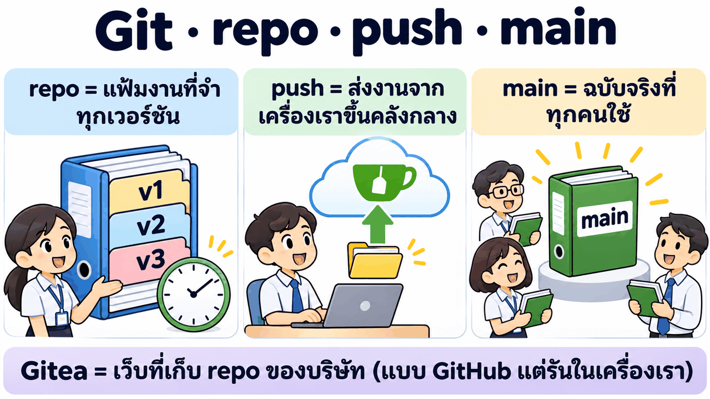
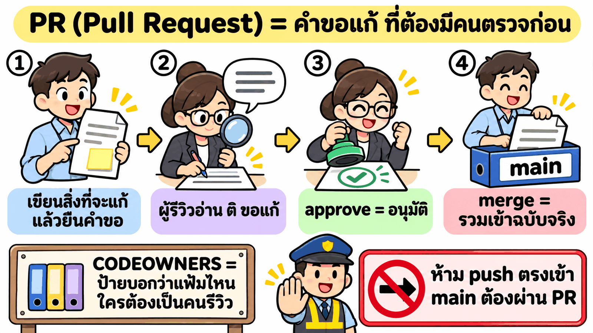
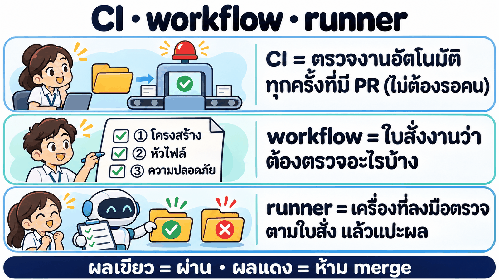
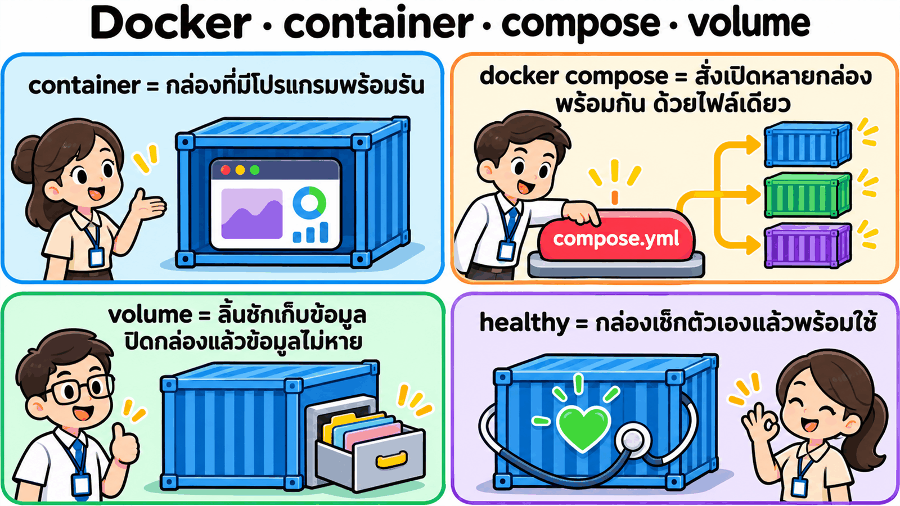
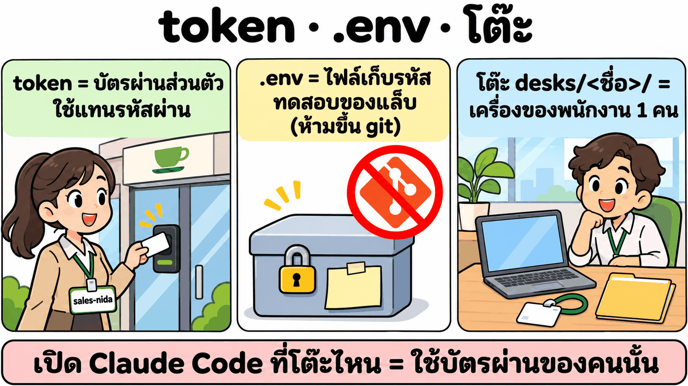
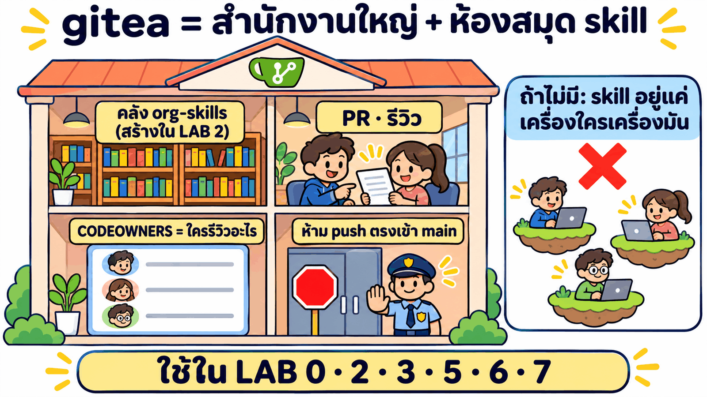
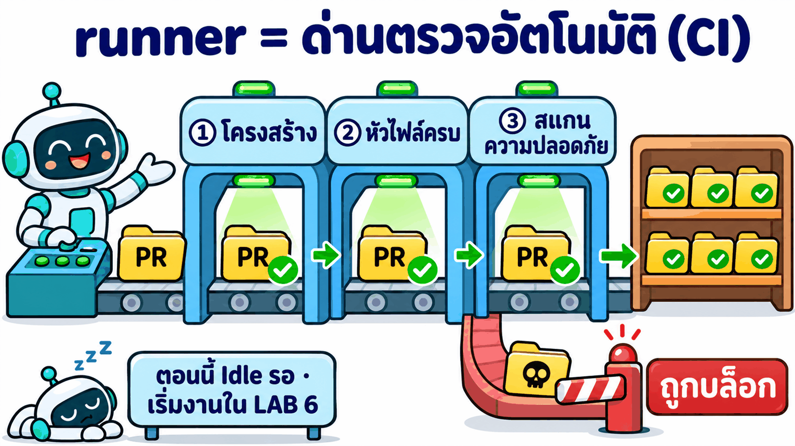
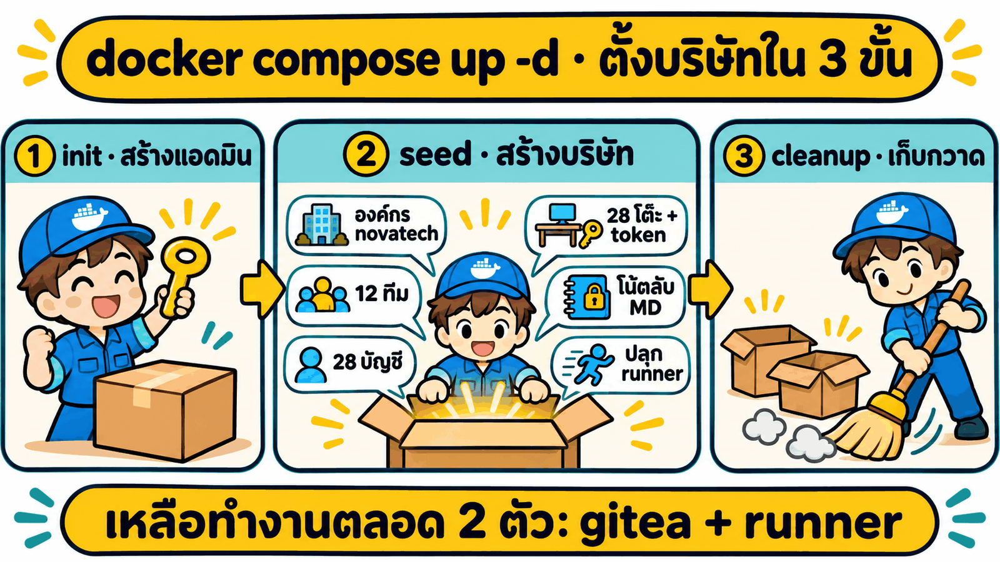
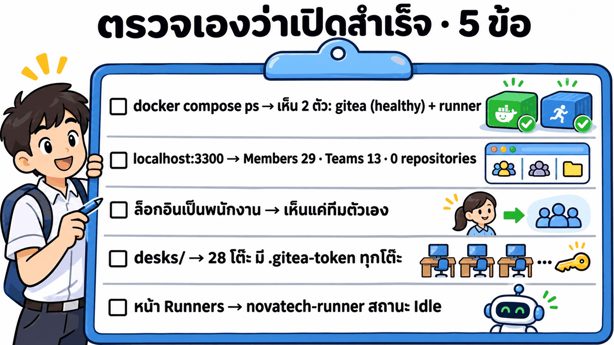
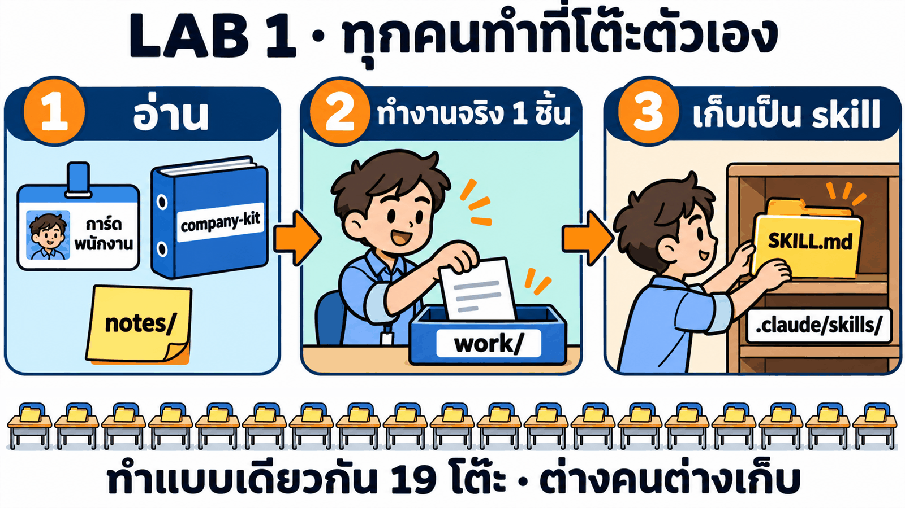

# บท 05 · ส่วน 03 — skill ระดับองค์กร: พนักงาน 28 คน เก่งคนละเรื่อง แชร์กันจนทั้งบริษัทเก่ง (Copy & Paste)

ส่วน 02 ทำให้ **คนเดียว** เก่งขึ้น (skill `test-from-plan` v1 → v4)
ส่วนนี้จำลอง **บริษัทเทค "โนวาเทค" 10 แผนก + ทีมกลาง ผังองค์กร 4 ชั้น พนักงาน 28 คน** แต่ละคนเก่งคนละเรื่อง แล้วลงมือจริงตาม [ส่วน 01 ภาค 4](../01_skill-theory/README.md#-ภาค-4--skill-ระดับองค์กร-จากคนเดียวเก่ง-สู่ทั้งบริษัทเก่ง) ว่าความเก่งของคนหนึ่งคนจะกลายเป็นของทั้งบริษัทได้ยังไง: คลังกลาง, PR, CI ด่านตรวจ และการค้นหา skill


> อ่าน [ส่วน 01 ภาค 4 (หัวข้อ 18–26)](../01_skill-theory/README.md#-ภาค-4--skill-ระดับองค์กร-จากคนเดียวเก่ง-สู่ทั้งบริษัทเก่ง) ก่อน ทุก LAB มีลิงก์กลับไปหัวข้อทฤษฎีที่เกี่ยวข้อง · แบบร่างก่อนรันจริงอยู่ใน [DESIGN.md](DESIGN.md) (เก็บไว้เทียบว่าของจริงต่างจากแผนตรงไหน)

## 🧭 8 LAB (รันจริงครบทุก LAB)

| LAB | ทำอะไร | ทฤษฎี | ผลจริงสั้น ๆ |
|---|---|---|---|
| 0 | ตั้งบริษัท: Gitea (คลังกลาง) + CI runner + พนักงาน 28 คน | 20, 22.2 | ~54 วินาที · 12 ทีม · เหลือ 2 container |
| 1 | 24 คนเก็บความเก่งของตัวเองเป็น skill ส่วนตัว | 16, 18, 21.1 | 24/24 skill · กติกาข้อมูลลูกค้าถูกคัดลอกไว้ 14 ที่ (นับจาก 19 โต๊ะแรก) |
| 2 | ทีมกลางรวมเป็นคลัง `org-skills` (plugin marketplace) | 21, 22 | 11 plugin · 23 skill · ลบสำเนา 12 ไฟล์ |
| 3 | ทุกโต๊ะติดตั้งแพ็กแผนก + Dev คนใหม่วันแรก | 19, 22.3, 24.4 | เห็น 6 จาก 23 skill · คนใหม่ 1/12 → 12/12 |
| 4 | ดีลเดียววิ่งข้าม 9 แผนก (ตอนต่อหลัง LAB 5) | 20.1, 25 | หยิบ skill ถูกเอง 11/12 · MD ตีกลับเรื่อง PDPA |
| 5 | ⭐ PR: คนหนึ่งแก้ skill ทุกคนเก่งขึ้น | 19, 22.2 | รีวิว 3 รอบ · krit ภาคผนวก PDPA 0/3 → 3/3 |
| 6 | ⭐ SkillOps CI: ด่านตรวจ skill | 15, 17, 23 | รีวิวเจอช่องโหว่ของ CI 4 ข้อ · PR อันตรายถูกบล็อก · v1.0.0 → v1.1.0 |
| 7 | หา skill ให้เจอ + กราฟผลกระทบ | 24, 25 | คำค้นใหม่ hit@1 80% (เคยเห็น 98%) · กราฟ 67 เส้น |

> 🆕 **บริษัทขยายเป็น 28 คน 4 ชั้น** (เพิ่มผู้บริหารสาย 3 คน · ทีม Product 2 คน · น้องใหม่ Sales และ HR) · LAB 0 รันใหม่ทั้งหมด · LAB 1 รันเพิ่มเฉพาะ 5 โต๊ะใหม่ · ผลของ LAB 2–7 ด้านล่างยังเป็นรอบบริษัท 21 คน รอรันใหม่

## 🧰 ก่อนเริ่ม

| ✅ | ต้องมี |
|---|---|
| ☐ | **Docker Desktop** เปิดอยู่ และพอร์ต **3300** ว่าง |
| ☐ | ต่ออินเทอร์เน็ตได้ (ครั้งแรกต้องดึง image `gitea/gitea`, `gitea/act_runner`, `node` ราว 1 GB) |
| ☐ | เปิด **Claude Code** ที่โฟลเดอร์ [`novatech/`](novatech/) (ทุก LAB เริ่มที่นี่) |

> 🧪 **หมายเหตุผู้สอน:** ผลจริงด้านล่างรันในสำเนาแยกที่ `C:/t/org05/novatech` (LAB 0 และ 5 โต๊ะใหม่ใน LAB 1 รันใหม่ที่ `C:/t/org05p/novatech`) ด้วย Claude Code (Opus 5.5) แบบไม่เชื่อม Chrome · พรอมต์เหมือนของผู้เรียนทุกตัวอักษร

---

## LAB 0 · ตั้งบริษัทโนวาเทค 🤖


LAB นี้ยังไม่ได้ทดลองเรื่อง skill แค่ **เปิดบริษัทจำลองขึ้นมาให้พร้อม** แล้วทำความรู้จักกันก่อนว่าในบริษัทมีอะไรบ้าง มีใครบ้าง และตลอด 8 LAB ใครจะทำอะไร

### 📖 คำศัพท์ที่ต้องรู้ก่อนเริ่ม

แล็บนี้ใช้เครื่องมือเดียวกับที่ทีมซอฟต์แวร์จริงใช้แชร์งานกัน ถ้าไม่เคยใช้ Git หรือ Docker มาก่อน อ่านภาพ 5 ภาพนี้ก่อน (กดเปิดตารางใต้ภาพเพื่อดูคำอธิบายเต็ม)

**1 · Git · repo · push · main: ที่เก็บงานกลาง**



<details>
<summary>📋 คำอธิบายเต็ม: Git · repo · commit · push · branch · main · Gitea</summary>

| คำ | ภาษาง่าย ๆ | เปรียบเหมือน | เจอในแล็บนี้ตรงไหน |
|---|---|---|---|
| **Git** | โปรแกรมเก็บประวัติไฟล์ ทุกครั้งที่บันทึกจะจำว่าใครแก้อะไร เมื่อไหร่ | สมุดบันทึกที่ย้อนดูหน้าเก่าได้ทุกหน้า | คลัง skill `org-skills` เป็น Git repo (LAB 2) |
| **repo** (repository) | โฟลเดอร์งานหนึ่งชุดที่ Git จำประวัติให้ | แฟ้มงานหนึ่งแฟ้ม | `novatech/org-skills` = แฟ้มรวม skill ของทั้งบริษัท |
| **commit** | การบันทึกการแก้ 1 ครั้ง พร้อมข้อความว่าแก้อะไร | กดเซฟพร้อมเขียนโน้ต | ทุกการแก้ skill ใน LAB 2, 5, 6 |
| **push** | ส่ง commit จากเครื่องเราขึ้นคลังกลาง | ส่งการบ้านขึ้นระบบ | ทีมกลาง push คลังขึ้น Gitea (LAB 2) |
| **branch** | สำเนาแยกไว้แก้ โดยไม่กระทบฉบับจริง | ร่างงานในกระดาษทด | แต่ละ PR แก้บน branch ของตัวเอง (LAB 5–6) |
| **main** | branch หลัก = ฉบับจริงที่ทุกคนติดตั้งไปใช้ | ต้นฉบับในตู้เอกสารกลาง | ห้าม push ตรงเข้า `main` ต้องผ่าน PR (LAB 2) |
| **Gitea** | เว็บเก็บ repo แบบเดียวกับ GitHub แต่รันในเครื่องเราเอง มี PR, รีวิว, CI ครบ | GitHub ส่วนตัวของบริษัท | container `novatech-gitea` → `localhost:3300` |

</details>

**2 · PR: ขอแก้ต้องมีคนตรวจก่อน**



<details>
<summary>📋 คำอธิบายเต็ม: PR · review · request changes · approve · merge · CODEOWNERS · branch protection</summary>

| คำ | ภาษาง่าย ๆ | เปรียบเหมือน | เจอในแล็บนี้ตรงไหน |
|---|---|---|---|
| **PR** (Pull Request) | คำขอให้รวมสิ่งที่เราแก้เข้า `main` มีหน้าเว็บให้ทุกคนเห็นว่าแก้อะไร คุยกันในนั้นได้ | ใบขออนุมัติแก้เอกสารบริษัท | `sales-nida` เปิด PR แก้ skill proposal (LAB 5) |
| **review** | ผู้รีวิวอ่านสิ่งที่แก้ทีละบรรทัด และคอมเมนต์ได้ | หัวหน้าอ่านร่างก่อนเซ็น | `plat-may` รีวิว PR ของ Sales (LAB 5) |
| **request changes** | ผู้รีวิวขอให้แก้ก่อน ยังรวมไม่ได้ | ตีกลับให้แก้ | PR #1 ถูกขอแก้ 2 รอบ (LAB 5) |
| **approve** | ผู้รีวิวอนุมัติว่าใช้ได้ | เซ็นอนุมัติ | ต้อง approve อย่างน้อย 1 คน (LAB 2, 6) |
| **merge** | รวมสิ่งที่แก้เข้า `main` จริง ทุกคนจะได้ฉบับใหม่ | เอาเอกสารที่อนุมัติแล้วเข้าแฟ้มจริง | หลัง merge `sales-krit` ได้ skill ใหม่ทันที (LAB 5) |
| **CODEOWNERS** | ไฟล์ที่บอกว่าโฟลเดอร์ไหน ใครต้องเป็นคนรีวิว | ป้ายหน้าตู้ว่าใครดูแล | หัวหน้าแผนก 👑 เป็นเจ้าของ plugin แผนกตัวเอง (LAB 2) |
| **branch protection** | กติกาของ `main`: ห้าม push ตรง ต้องผ่าน PR + approve + CI | ยามหน้าห้องเอกสาร | ตั้งใน LAB 2 · เพิ่มเงื่อนไข CI ใน LAB 6 |

</details>

**3 · CI · workflow · runner: ด่านตรวจอัตโนมัติ**



<details>
<summary>📋 คำอธิบายเต็ม: CI · workflow · runner · ผลเขียว/แดง · Idle</summary>

| คำ | ภาษาง่าย ๆ | เปรียบเหมือน | เจอในแล็บนี้ตรงไหน |
|---|---|---|---|
| **CI** (Continuous Integration) | ระบบตรวจงานอัตโนมัติทุกครั้งที่มีคนเปิดหรือแก้ PR ก่อนให้คนรีวิว | เครื่องสแกนกระเป๋าที่สนามบิน | ด่านตรวจ skill 3 ด่าน (LAB 6) |
| **workflow** | ไฟล์ที่เขียนว่า CI ต้องตรวจอะไร ตามลำดับไหน (`.gitea/workflows/*.yml`) | ใบสั่งงานของเจ้าหน้าที่ตรวจ | `ci.yml` ใน `org-skills` (LAB 6) |
| **runner** | เครื่องที่รับใบสั่งงานแล้วลงมือรันจริง จากนั้นส่งผลกลับไปที่ PR | เจ้าหน้าที่ประจำเครื่องสแกน | container `novatech-runner` · ป้าย `ubuntu-latest` |
| **ผลเขียว / แดง** (status) | ผลการตรวจที่ติดอยู่บน PR · แดง = merge ไม่ได้ | ไฟเขียวไฟแดงที่ด่าน | PR สคริปต์อันตรายถูกบล็อกด้วยผลแดง (LAB 6) |
| **Idle** | runner พร้อมแต่ยังไม่มีงาน | เจ้าหน้าที่นั่งรอผู้โดยสาร | หน้า Runners ใน Gitea ตั้งแต่ LAB 0 ถึงก่อน LAB 6 |

</details>

**4 · Docker · container · compose · volume: บริษัทในกล่อง**



<details>
<summary>📋 คำอธิบายเต็ม: Docker · image · container · docker compose · volume · healthy</summary>

| คำ | ภาษาง่าย ๆ | เปรียบเหมือน | เจอในแล็บนี้ตรงไหน |
|---|---|---|---|
| **Docker** | โปรแกรมที่รันซอฟต์แวร์ในกล่องแยก ไม่ต้องติดตั้งลงเครื่องจริง | ตู้คอนเทนเนอร์ขนของ | ต้องเปิด Docker Desktop ก่อนทุก LAB |
| **image** | แม่แบบของกล่อง ดาวน์โหลดครั้งแรกแล้วเก็บไว้ | แบบพิมพ์เขียว | `gitea/gitea:1.24`, `gitea/act_runner:0.2.11`, `node:22-alpine` |
| **container** | กล่องที่สร้างจาก image แล้วกำลังรันอยู่ | ตู้ที่เปิดใช้งานแล้ว | `novatech-gitea`, `novatech-runner` (+ ตัวช่วย 3 ตัวที่หายไปเอง) |
| **docker compose** | สั่งเปิด/ปิดหลาย container พร้อมกัน ตามที่เขียนไว้ใน `compose.yml` | รีโมตเปิดไฟทั้งตึก | `docker compose up -d` = เปิดบริษัท · `docker compose down -v` = ลบทั้งบริษัท |
| **volume** | ที่เก็บข้อมูลนอกกล่อง ปิด/ลบกล่องแล้วข้อมูลยังอยู่ | ลิ้นชักที่ถอดออกจากโต๊ะได้ | `gitea-data` เก็บทุกอย่างใน Gitea · `-v` ตอน `down` คือลบลิ้นชักนี้ด้วย |
| **healthy** | container ตรวจตัวเองแล้วพร้อมรับงาน | ไฟสถานะเขียว | `novatech-gitea (healthy)` ใน `docker compose ps` |

</details>

**5 · token · .env · โต๊ะ: เราเป็นใครในแล็บ**



<details>
<summary>📋 คำอธิบายเต็ม: token · .env · .env.example · โต๊ะ · API</summary>

| คำ | ภาษาง่าย ๆ | เปรียบเหมือน | เจอในแล็บนี้ตรงไหน |
|---|---|---|---|
| **token** | รหัสยาว ๆ ที่ใช้แทนรหัสผ่าน ให้โปรแกรมทำงานในนามเรา กำหนดสิทธิ์ได้ | บัตรผ่านพนักงาน | `desks/<ชื่อ>/.gitea-token` ของแต่ละคน (ไม่ขึ้น git) |
| **.env** | ไฟล์เก็บค่าลับ เช่น รหัสผู้ดูแลระบบ อยู่ในเครื่องเท่านั้น | ซองรหัสที่ไม่ส่งต่อ | `novatech/.env` (ถ้าไม่มี compose ใช้ `.env.example`) |
| **.env.example** | ตัวอย่างค่าทดสอบของแล็บ ขึ้น git ได้เพราะไม่ใช่รหัสจริง | แบบฟอร์มตัวอย่าง | `ADMIN_USER`, `ADMIN_PASSWORD`, `LAB_PASSWORD` |
| **โต๊ะ** | โฟลเดอร์ของพนักงาน 1 คน = เครื่องของคนนั้น | โต๊ะทำงานในออฟฟิศ | `desks/sales-nida/` · เปิด Claude Code ที่นี่ = ทำงานในนามนิดา |
| **API** | ช่องทางให้โปรแกรมคุยกับ Gitea โดยไม่ต้องเปิดหน้าเว็บ | เคาน์เตอร์บริการทางโทรศัพท์ | Claude ถามรายชื่อพนักงานจาก Gitea ผ่าน API (LAB 0) |

</details>

### 0.1 แล็บนี้จำลองอะไร

เราอยากทดลองว่า **ความเก่งของพนักงานคนหนึ่ง จะกลายเป็นความเก่งของทั้งบริษัทได้ยังไง** (ทฤษฎีหัวข้อ 18–26) ซึ่งต้องมีของ 3 อย่างที่บริษัทจริงมี
หลักของทฤษฎีหัวข้อ 22.2 คือ **ของจริงมีที่เดียว** · ทุกคน **ดึงไปใช้** · อยากแก้ต้อง **ยื่น PR**


<details>
<summary>📋 ดูรายละเอียดเป็นตาราง (อยู่ที่ไหนในเครื่อง)</summary>

| ในบริษัทจริง | ในแล็บนี้ | อยู่ที่ไหน |
|---|---|---|
| 🌐 GitHub / GitLab ของบริษัท (ส่วนกลาง = remote) | **Gitea** เว็บหน้าตาแบบ GitHub ที่รันในเครื่องเรา มี repo, PR, รีวิว, CODEOWNERS, CI ครบ | container `novatech-gitea` → `http://localhost:3300` |
| ⚙️ ระบบ CI ของบริษัท | **Gitea Actions runner** เครื่องที่รันด่านตรวจอัตโนมัติเมื่อมี PR | container `novatech-runner` |
| 👥 พนักงาน 28 คน | บัญชีใน Gitea 28 บัญชี + การ์ดประวัติ 28 ใบ แยกโฟลเดอร์ตามแผนก | ใน Gitea + [`people/<แผนก>/`](novatech/people/) |
| 💻 คอมพิวเตอร์ของพนักงานแต่ละคน (local) | **โต๊ะ** = 1 โฟลเดอร์ต่อ 1 คน | [`desks/<ชื่อ>/`](novatech/desks/) |
| 📁 ไดรฟ์กลางของบริษัท | ข้อมูลจริงของบริษัท: ราคา, TOR ลูกค้า, กติกา, log เหตุการณ์ | [`company-kit/`](novatech/company-kit/) |

</details>


### 0.2 `docker compose up` แล้วได้ container อะไรบ้าง แต่ละตัวมีไว้ทำอะไร


ตอนเปิดจะมี container ขึ้นมา **5 ตัว** แต่พอเปิดเสร็จจะ **เหลือแค่ 2 ตัว** เพราะอีก 3 ตัวเป็นตัวช่วยตั้งบริษัท ทำงานครั้งเดียวแล้วลบตัวเองทิ้ง

**🟢 ตัวที่ทำงานตลอด (2 ตัว)**





<details>
<summary>📋 ดูรายละเอียดเป็นตาราง (ทำอะไร · ทำไมต้องมี · ใช้ใน LAB ไหน)</summary>

| container | เปรียบเหมือน | ทำอะไร | ทำไมต้องมี | ใช้ใน LAB |
|---|---|---|---|---|
| `novatech-gitea` | **ตึกสำนักงานใหญ่ + ห้องสมุด** ของบริษัท | เว็บ Gitea ที่ `localhost:3300` เก็บบัญชีพนักงาน ทีม และ repo `org-skills` (คลัง skill กลาง) ที่จะสร้างใน LAB 2 · เปิด PR, รีวิว, กำหนดว่าใครต้องรีวิวอะไร (CODEOWNERS), ห้าม push ตรงเข้า `main` | ถ้าไม่มี skill ของแต่ละคนจะอยู่แค่ในเครื่องตัวเอง ไม่มีที่แชร์กลาง ไม่มี PR ให้รีวิว | 0 · 2 · 3 · 5 · 6 · 7 |
| `novatech-runner` | **ด่านตรวจหน้าห้องสมุด** | เมื่อมี PR ใน Gitea ตัวนี้จะสร้าง container ชั่วคราวขึ้นมารันสคริปต์ตรวจ (โครงสร้าง, หัวไฟล์, สแกนความปลอดภัย) แล้วส่งผลเขียว/แดงกลับไปที่ PR | ถ้าไม่มี PR ที่มีสคริปต์อันตรายหรือหัวไฟล์ไม่ครบจะหลุดเข้าคลังได้ ถ้าคนรีวิวมองไม่เห็น | 6 (ก่อนหน้านั้นสถานะ **Idle** รอเฉย ๆ) |

</details>


**🧹 ตัวช่วยตั้งบริษัท ทำครั้งเดียวแล้วหายไปเอง (3 ตัว · ทำตามลำดับ)**



<details>
<summary>📋 ดูรายละเอียดเป็นตาราง (แต่ละตัวช่วยทำอะไร)</summary>

| ลำดับ | container | ทำอะไร | ทำไมแยกเป็นตัวของตัวเอง |
|---|---|---|---|
| 1 | `novatech-init` | สร้าง **บัญชีผู้ดูแลระบบ** (admin) คนแรกของ Gitea | บัญชี admin คนแรกต้องสร้างด้วยคำสั่ง `gitea admin` ที่อยู่ใน image ของ Gitea เท่านั้น |
| 2 | `novatech-seed` | ใช้บัญชี admin สร้าง **องค์กร `novatech`, ทีม 12 ทีม, พนักงาน 28 คน** แล้วสร้าง **โต๊ะ 28 โต๊ะ** ใน `desks/` พร้อม token ของแต่ละคน (`desks/<ชื่อ>/.gitea-token`) ใส่โน้ตลับของ MD (`desks/md-somchai/notes/`) และออกรหัสลงทะเบียนให้ runner | เป็นสคริปต์ Node.js ([seed/seed.mjs](novatech/seed/seed.mjs)) อ่านรายชื่อจาก [seed/people.json](novatech/seed/people.json) |
| 3 | `novatech-cleanup` | ลบ `init`, `seed` และตัวเองทิ้ง | ให้ `docker compose ps` เหลือแค่ตัวที่ทำงานจริง ไม่มี container สถานะ Exited ค้างให้งง |

</details>


> 🔁 สั่ง `docker compose up -d` ซ้ำได้ ตัวช่วยจะข้ามของที่มีอยู่แล้ว แต่ **ออก token ของทุกคนใหม่** (ไฟล์ `.gitea-token` ในโต๊ะเปลี่ยน) · ถ้าตัวช่วยล้ม มันจะค้างไว้ให้ดูสาเหตุด้วย `docker compose logs init seed` และ runner จะยังไม่เริ่ม

ข้อมูลของ Gitea เก็บใน Docker volume `gitea-data` จึงไม่หายตอนปิดเครื่อง · `docker compose down` = ปิด (ข้อมูลอยู่) · `docker compose down -v` = ปิดและ **ลบทั้งบริษัท** เริ่มใหม่หมด

### 0.3 พนักงาน 28 คน: ผังองค์กร 4 ชั้น ใครเป็นหัวหน้าใคร


**อ่านผังยังไง:** สั่งงานไล่จากบนลงล่างทีละชั้น MD สั่งผู้บริหารสาย → ผู้บริหารสายสั่งหัวหน้าแผนกในสายตัวเอง → หัวหน้าแผนกสั่งลูกทีม · ในแล็บนี้ "สั่งงาน" คือเปิด Claude Code ที่โต๊ะของคนนั้นแล้วสั่ง ส่วน "ส่งงานต่อ" คือวางไฟล์ไว้ในโฟลเดอร์กลาง (LAB 4)

<details>
<summary>📋 ดูรายละเอียดเป็นตาราง (แต่ละชั้นสั่งงานใคร · นับยังไง)</summary>

| ชั้น | ใคร | จำนวน | สั่งงานใคร |
|---|---|---|---|
| 1 · MD | `md-somchai` | 1 | ผู้บริหารสาย 3 คน + ผู้ช่วยผู้บริหาร |
| 2 · ผู้บริหารสาย | `cco-wit` สายธุรกิจ · `cto-nat` สายเทคโนโลยี · `cfo-ying` สายบริหารและการเงิน | 3 | หัวหน้าแผนกในสายของตัวเอง |
| 2 · สำนัก MD | `exec-ploy` ผู้ช่วยผู้บริหาร 👑 | 1 | — (ช่วยงาน MD และดูแล skill ฝั่งผู้บริหาร) |
| 3 · หัวหน้าแผนก 👑 | Sales, SA, Product, Dev, QA, DevOps, ML, ทีมกลาง, HR, บัญชี | 10 | ลูกทีมในแผนกตัวเอง |
| 4 · พนักงาน | รวม **น้องใหม่ 3 คน** (`sales-mook`, `dev-new`, `hr-namtan`) | 13 | — |

| นับยังไง | จำนวน |
|---|---|
| รวมพนักงาน | **28 คน** = 28 บัญชีใน Gitea = 28 โต๊ะใน `desks/` |
| แผนก (ทีมใน Gitea) | **11 ทีม**: ผู้บริหาร (5 คน) · Sales (3) · SA (2) · Product (2) · Dev (3) · QA (2) · DevOps (2) · ML (2) · ทีมกลาง (2) · HR (3) · บัญชี (2) |
| 👑 หัวหน้า = ผู้ดูแล skill ของแผนก (ผู้รีวิว PR) | **11 คน** (หัวหน้าแผนก 10 + `exec-ploy`) · รวมเป็นทีม `leads` |
| ทีมใน Gitea | **12 ทีม** = 11 แผนก + `leads` (และ `Owners` ที่ Gitea สร้างเอง) |
| คนที่มีความเก่งของตัวเองจะเก็บเป็น skill ใน LAB 1 | **24 คน** (ไม่นับน้องใหม่ 3 คน และ `plat-ken` ที่สร้าง `skill-finder` ใน LAB 2) |

</details>

> 👔 **ผู้บริหารสายกับ 👑 ต่างกัน:** ผู้บริหารสาย (ชั้น 2) คือคนสั่งงานและตัดสินใจภาพรวมของหลายแผนก ส่วน 👑 คือคนดูแลและรีวิว skill ของแผนก จึงเป็นหัวหน้าแผนก (ชั้น 3) ไม่ใช่ผู้บริหาร · แผนกผู้บริหารใช้ `exec-ploy` เป็น 👑 ด้วยเหตุผลเดียวกัน

> 📦 **ทีม Product (ใหม่)** ดูแลผลิตภัณฑ์ของบริษัทเอง ชื่อ **NovaQueue** (ระบบจองคิวสาขาแบบ SaaS) ตั้งแต่วันเปิดตัวจนวันเลิกให้บริการ ต่างจากแผนกอื่นที่ทำโปรเจกต์ตาม TOR ลูกค้า · ข้อมูลอยู่ใน [`company-kit/product/`](novatech/company-kit/product/)

> 🏛️ **ทีมกลาง (platform)** ไม่ใช่ทีมดูแลระบบของลูกค้า แต่เป็นทีมภายในที่ดูแลเครื่องมือกลางและ **คลัง skill ของทั้งบริษัท** (repo, CI, กติกาหัวไฟล์) อยู่ในสายเทคโนโลยี

การ์ดของแต่ละคน (แผนก สายงาน ระดับ หัวหน้าคือใคร ลูกทีมคือใคร เก่งเรื่องอะไร คำที่ชอบพิมพ์สั่ง AI) **แยกโฟลเดอร์ตามแผนก** ชื่อโฟลเดอร์ = ชื่อทีมใน Gitea: [`people/<แผนก>/<ชื่อ>.md`](novatech/people/) เช่น [`people/sales/sales-nida.md`](novatech/people/sales/sales-nida.md) · รายชื่อทั้งหมดอยู่ใน [`people/README.md`](novatech/people/README.md)

```text
people/
├─ README.md        ← ผังองค์กร + รายชื่อตามแผนก
├─ exec/            ← md-somchai, exec-ploy, cco-wit, cto-nat, cfo-ying   (ชั้น 1–2)
├─ sales/           ← sales-nida 👑, sales-krit, sales-mook 🆕
├─ sa/              ← sa-ton 👑, sa-ice
├─ product/         ← pm-beam 👑, pm-gift
├─ dev/             ← dev-pond 👑, dev-mew, dev-new 🆕
├─ qa/ · devops/ · mlops/ · platform/
├─ hr/              ← hr-fah 👑, hr-oat, hr-namtan 🆕
└─ finance/         ← fin-joy 👑, fin-nok
```

### 0.4 เราจะเล่นเป็นใคร และใครทำอะไรตลอด 8 LAB


พนักงาน 28 คนอยู่ในเครื่องเดียวกัน (เครื่องของเรา) **เราสวมบทเป็นใคร ให้เปิด Claude Code ที่โต๊ะของคนนั้น** เช่น เปิดที่ `novatech/desks/sales-nida/` = ทำงานในนามนิดา (Claude อ่าน token ของนิดา ทำงานในโต๊ะของนิดา)


<details>
<summary>📋 ดูรายละเอียดเป็นตาราง (บท · เปิด Claude Code ที่ไหน · LAB)</summary>

| บท | เปิด Claude Code ที่ | ทำอะไร | LAB |
|---|---|---|---|
| 🛠️ ผู้ดูแลระบบ | `novatech/` | เปิดบริษัท · ติดตั้งคลัง skill ให้ทุกโต๊ะ | 0 · 3 |
| 👥 พนักงาน 24 คน | `desks/<ชื่อ>/` | ทำงานของตัวเอง 1 ชิ้นแล้วเก็บเป็น skill ส่วนตัว | 1 |
| 🏛️ `plat-ken` หัวหน้าทีมกลาง | `desks/plat-ken/` | รวม skill ทุกคนเป็นคลังกลาง · ทำ CI · รีวิว PR ฝั่ง core | 2 · 5 · 6 |
| 🛡️ `plat-may` เจ้าของนโยบายข้อมูลลูกค้า | `desks/plat-may/` | รีวิว PR ของ Sales · รีวิว CI แบบคนร้าย | 5 · 6 |
| 💼 `sales-nida` หัวหน้าทีมขาย | `desks/sales-nida/` | ทำ proposal ดีลธนาคาร · เปิด PR แก้ skill | 4 · 5 |
| 🧾 `fin-joy` หัวหน้าบัญชี | `desks/fin-joy/` | ตรวจราคาและกำไรของดีล | 4 |
| 👔 `md-somchai` MD | `desks/md-somchai/` | อนุมัติหรือตีกลับดีล (มีโน้ตลับเรื่อง PDPA คนเดียว) · ถามว่าแก้กฎแล้วกระทบใคร | 4 · 7 |
| 💼 `sales-krit` เซลส์ | `desks/sales-krit/` | ไม่แก้อะไรเลย แต่ทดสอบว่าเก่งขึ้นตามเพื่อนไหม | 5 |
| 🧭 `cco-wit` · `cto-nat` · `cfo-ying` ผู้บริหารสาย | โต๊ะของตัวเอง | ทบทวน pipeline · ความเสี่ยงเทคนิค · ต้นทุนและกำลังคน ของทั้งสาย (บทใน LAB 2–7 รอรันใหม่) | 1 |
| 🆕 `sales-mook` · `hr-namtan` น้องใหม่ | โต๊ะของตัวเอง | ยังไม่มี skill ใช้ทดลองแบบ `dev-new` ว่าน้องใหม่ได้ความรู้ของทีมไปใช้ตั้งแต่เดือนแรกไหม (รอรันใหม่) | — |
| 📦 `pm-beam` · `pm-gift` ทีม Product | `desks/pm-beam/` · `desks/pm-gift/` | เขียน PRD ฟีเจอร์ใหม่ · วางแผนเลิกให้บริการ NovaQueue v1 (บทใน LAB 2–7 รอรันใหม่) | 1 |
| 🆕 `dev-new` Dev คนใหม่วันแรก | โฟลเดอร์ว่าง | เทียบแผนงานมี/ไม่มีแพ็ก skill ของทีม | 3 |
| 🧩 `sa-ton` · `dev-mew` · `ml-jay` · `qa-mint` · `ops-art` · `hr-fah` | โต๊ะของตัวเอง | รับดีลต่อจาก MD ทำงานของแผนกตัวเอง | 4 (ต่อ) |
| 🧪 `hr-oat` · `ops-fon` · `ml-pim` · `exec-ploy` | โต๊ะของตัวเอง | เปิด PR 4 แบบ (ดี / ลวก / อันตราย / กว้างเกิน) ทดสอบด่าน CI | 6 |
| 🔍 `hr-fah` · `md-somchai` | โต๊ะของตัวเอง | ค้น skill ของแผนกอื่น · ดูกราฟผลกระทบ | 7 |

</details>


### 0.5 ลงมือ: เปิดบริษัท

🧑 **คิดก่อน** บริษัทที่จะแชร์ skill กันได้ต้องมีอะไรบ้าง (ดูภาพ 0.1) และถ้าพนักงานคนหนึ่งลาออกพรุ่งนี้ ความเก่งของเขาอยู่ที่ไหน

💬 **พรอมต์** (เปิด Claude Code ที่โฟลเดอร์ `novatech/` ในบทผู้ดูแลระบบ)


```text
เปิดบริษัทจำลองโนวาเทคจาก compose.yml แล้วบอกว่ามีแผนกและพนักงานใครบ้าง
```


✅ **ผลจริง: 54 วินาที · Claude ใช้ 8 คำสั่ง** ([ดูทุกคำสั่ง](_solution/lab0/tool-calls.md))

<details>
<summary>📋 ดูรายละเอียดเป็นตาราง (แต่ละขั้น)</summary>

| ช่วง | ผล |
|---|---|
| ตรวจไฟล์ก่อนเปิด | อ่าน `compose.yml` กับ `seed/people.json` และหาไฟล์ `.env` (ไม่มี) |
| ไม่มี `.env` | ไม่ต้องสร้าง compose ใช้ค่าทดสอบจาก `.env.example` ให้เอง |
| `docker compose up -d` | `gitea` (healthy) + `runner` ทำงาน · init → seed → cleanup ทำงานจบแล้วลบตัวเอง |
| ตรวจผลผ่าน API | ดึงรายชื่อจาก Gitea จริงมาเทียบกับ `people.json`: ครบ 28 คน + บัญชีผู้ดูแลระบบ 1 บัญชี |

</details>

คำตอบของ Claude (ย่อ · [ฉบับเต็ม](_solution/lab0/claude-summary.md)) จัดพนักงานตาม **3 สาย** ให้เองจาก `divisions` ใน `people.json` ตรงกับผังในหัวข้อ 0.3 · ชี้ว่าน้องใหม่ 3 คนยังไม่มี skill · และ **จับได้ว่าคอมเมนต์ใน `compose.yml` ยังเขียนจำนวนพนักงานเก่า** (ผู้สอนแก้แล้ว)

> 🧪 **หมายเหตุผู้สอน:** ผลรอบนี้รันด้วย `claude -p` ที่จำกัดเครื่องมือไว้ (ไม่ข้ามการขออนุญาต) คำสั่ง `docker compose up` 2 ครั้งแรกติดการขออนุญาตของสภาพแวดล้อมทดสอบ จึงเห็นใน log 3 ครั้ง · ผู้เรียนที่ใช้ Claude Code ในแอปจะเห็นหน้าต่างขออนุญาตแทน กดอนุญาตแล้วไปต่อได้เลย

### 0.6 ตรวจเองว่าเปิดสำเร็จ



<details>
<summary>📋 ดูรายละเอียดเป็นตาราง (ตรวจที่ไหน · ล็อกอินด้วยอะไร)</summary>

| ✅ | ตรวจ | ควรเห็น |
|---|---|---|
| ☐ | `docker compose ps` | 2 แถว: `novatech-gitea` (Up, healthy) และ `novatech-runner` (Up) |
| ☐ | เปิด `http://localhost:3300` ล็อกอินด้วย `ADMIN_USER` / `ADMIN_PASSWORD` ใน `.env` (หรือ `.env.example`) | องค์กร `novatech`: Members **29** (28 คน + ผู้ดูแลระบบ) · Teams **13** (12 + Owners) · **0 repositories** |
| ☐ | ล็อกอินเป็นพนักงาน: user = ชื่อในการ์ด (เช่น `sales-nida`) รหัส = `LAB_PASSWORD` | เห็นเฉพาะทีมของตัวเอง |
| ☐ | เปิดโฟลเดอร์ `desks/` | 28 โฟลเดอร์ ทุกโฟลเดอร์มี `.gitea-token` · `md-somchai` มี `notes/deal-rules.md` เพิ่ม |
| ☐ | Gitea → Site Administration → Actions → Runners | `novatech-runner` สถานะ **Idle** ป้าย `ubuntu-latest` |

</details>

🔍 **ภาพจริงใน Gitea** (ถ่ายหลังรัน LAB 0 รอบล่าสุด จากบัญชีผู้ดูแลระบบ)

| หน้าองค์กร: Members 29 · Teams 13 · 0 repositories | ทีม `leads` = ผู้ดูแล skill 11 คน |
|---|---|
|  |  |


👀 **สังเกต**
- ตอนนี้ **ยังไม่มี repo เลย** (0 repositories) บริษัทมีคน แต่ความเก่งของทุกคนยังอยู่ในหัว (ทฤษฎีหัวข้อ 18.2) → LAB 1 จะเริ่มเก็บออกมาเป็น skill
- พนักงานแต่ละคนเห็นแค่ทีมของตัวเอง (เช่น `plat-ken` เห็น 2 ทีม: platform กับ leads) ส่วนภาพด้านบนถ่ายจากบัญชีผู้ดูแลระบบจึงเห็นครบ

---

## LAB 1 · 24 คนเก็บความเก่งของตัวเองเป็น skill ส่วนตัว 🤖 ×24


### 1.1 LAB นี้ทดลองอะไร

**คำถาม:** ถ้าปล่อยให้ทุกคนเก็บความเก่งของตัวเองเป็น skill **ต่างคนต่างทำ** (แบบที่บริษัทส่วนใหญ่เริ่มต้น) จะได้อะไร และจะเกิดปัญหาอะไร

| สิ่งที่อยากรู้ | ดูจากอะไร |
|---|---|
| ทุกคนสร้าง skill ของตัวเองได้จริงไหม | นับว่าได้ skill กี่โต๊ะจาก 24 |
| ความรู้เดียวกันถูกคัดลอกไว้กี่ที่ | นับกติกาเดียวกันที่อยู่ในหลาย skill (→ สังเกต 1) |
| ต่างคนต่างเขียนหัวไฟล์เหมือนกันไหม | เทียบช่อง `uses` / `next` / `follows` ทุกตัว (→ สังเกต 2) |
| ความรู้ที่อยู่ในหัวคนเดียวไปถึงคนที่ต้องใช้ไหม | proposal ของ Sales มีกฎ PDPA ที่อยู่ในโน้ตของ MD ไหม (→ สังเกต 3) |

> 📦 **LAB นี้ยังไม่ใช้ Gitea** ทุกอย่างเกิดในโฟลเดอร์โต๊ะของแต่ละคน (เหมือนแต่ละคนทำในเครื่องตัวเอง ยังไม่มีใครแชร์) container ทั้ง 2 ตัวเปิดทิ้งไว้เฉย ๆ

### 1.2 ใครทำ และทำยังไง



**ใครทำ:** 24 จาก 28 คน (ทุกชั้น ตั้งแต่ MD ผู้บริหารสาย หัวหน้าแผนก ถึงพนักงาน) · ไม่ทำ 4 คน: น้องใหม่ 3 คน `sales-mook`, `dev-new`, `hr-namtan` (ยังไม่มีความเก่งของตัวเอง ใช้ทดลองว่าได้ความรู้ของทีมตั้งแต่วันแรกไหม) และ `plat-ken` (ทีมกลาง จะสร้าง `skill-finder` ตอนรวมคลังใน LAB 2)

**ทุกโต๊ะทำ 3 ขั้นเหมือนกัน** (6 ขั้นของ [ทฤษฎีหัวข้อ 16](../01_skill-theory/README.md#16-สร้าง-skill-แรกใน-6-ขั้น-สิ่งที่จะทำใน-ส่วน-02) แบบย่อ: **ทำงานจริงก่อน แล้วค่อยเก็บ** ไม่ให้ AI เขียน skill จากการเดา หัวข้อ 15)

| ขั้น | อ่าน / เขียนที่ไหน |
|---|---|
| ① อ่าน | การ์ดของตัวเอง `../../people/<แผนก>/<ชื่อ>.md` (เก่งอะไร ทำอะไรซ้ำ ชอบพิมพ์ว่าอะไร) + ข้อมูลในไดรฟ์กลาง `../../company-kit/` + โน้ตส่วนตัว `notes/` (มีแค่ MD) |
| ② ทำงานจริง 1 ชิ้น | เขียนผลงานลง `work/` ของโต๊ะตัวเอง |
| ③ เก็บเป็น skill | `.claude/skills/<ชื่อ skill>/` ของโต๊ะตัวเอง |

โต๊ะ 1 โต๊ะ ก่อนและหลัง LAB 1 (ตัวอย่าง `sales-nida`)

```text
ก่อน (seed สร้างให้)                หลัง LAB 1
desks/sales-nida/                   desks/sales-nida/
└─ .gitea-token                     ├─ .gitea-token
                                    ├─ work/                     ← ผลงานจริง 1 ชิ้น
                                    │  ├─ deal-001-proposal-nakhonluang-queue.md
                                    │  └─ deal-001-pricing-output.md …
                                    └─ .claude/skills/sales-proposal/   ← skill ส่วนตัว
                                       ├─ SKILL.md
                                       ├─ references/            ← สรุปความรู้จาก company-kit
                                       └─ scripts/               ← สคริปต์คิดราคา
```

**แต่ละคนทำงานอะไร** (จากผลรันจริง · โฟลเดอร์ `work/` ของทุกคนอยู่ใน [_solution/desks-after-lab1/](_solution/desks-after-lab1/))

| แผนก | คน | ข้อมูลที่ใช้ใน `company-kit/` | งานจริง 1 ชิ้น (`work/`) | skill ที่ได้ |
|---|---|---|---|---|
| MD | `md-somchai` | `deal-summaries/` + โน้ตลับ `notes/deal-rules.md` | พิจารณาดีล DS-2026-034 → ตีกลับ | `deal-approval` |
| | `exec-ploy` | `monthly-kpi.csv`, `brand-guide.md` | สไลด์ประชุมผู้บริหาร พ.ย. 2026 (HTML + PDF) | `exec-deck` |
| ผู้บริหารสาย 🆕 | `cco-wit` | `monthly-kpi.csv`, `deal-summaries/`, `deal-001/`, `deal-002/`, `product/` | ทบทวน pipeline 4 ดีล: เร่ง/ส่ง/ประคอง/ตีกลับ · **จับได้ว่า รพ.เมืองใหม่ ที่ Sales เรียก "ลูกค้าใหม่" เป็นลูกค้า NovaQueue v1 อยู่แล้ว** | `pipeline-review` |
| | `cto-nat` | `incident-2026-09.md`, `deploy-runbook.md`, `arch-standards.md`, `ml-queue-forecast/`, `qa/` | ทบทวนความเสี่ยงเทคนิค deal-001: รับได้แบบมีเงื่อนไข · เจอใบรับรอง mTLS ต่อมือแบบเดียวกับเหตุ ShopDee ล่ม | `tech-risk-review` |
| | `cfo-ying` | `monthly-kpi.csv`, `margin-rules.md`, `jd-template.md` | สรุปรายได้ ต้นทุน กำลังคน ต.ค.: กำไรขั้นต้นต่ำกว่าเป้า 228,480 บาท · รับ Senior Full-stack ได้ · ML รอผล deal-001 | `cost-headcount-review` |
| Sales | `sales-nida` | `deal-001/`, `won-proposals/`, `price-list.csv` | proposal ธนาคารนครหลวงพัฒนา + ใบคิดราคา | `sales-proposal` |
| | `sales-krit` | `meeting-notes/` | อีเมลติดตามลูกค้า deal-002 | `follow-up-email` |
| SA | `sa-ton` | `deal-001/`, `arch-standards.md` | spec จาก TOR deal-001 | `req-to-spec` |
| | `sa-ice` | `arch-standards.md` | แผนภาพ architecture ระบบจองคิว | `arch-template` |
| Product 🆕 | `pm-beam` | `product/novaqueue-feedback-2026-q3.md`, `product/product-lifecycle-policy.md` | จัดลำดับฟีเจอร์ + PRD "เตือนก่อนถึงคิวผ่าน LINE" (ตัดเบอร์ลูกค้าใน ticket ออกเอง) | `prd-writer` |
| | `pm-gift` | `product/novaqueue-v1-customers.csv`, `product/product-lifecycle-policy.md` | แผนปิด NovaQueue v1 วันที่ 30 ก.ย. 2027 (ไม่ปิดก่อน MA หมด · ค่า MA 905,000 บาทต้องให้ MD อนุมัติ) + ร่างประกาศ | `product-sunset` |
| Dev | `dev-pond` | `coding-rules.md` | รีวิว PR ตัวอย่างตามมาตรฐานทีม | `coding-standard` |
| | `dev-mew` | `project-scaffold-notes.md` | ขึ้นโปรเจกต์จริง รัน test 24/24 + E2E 4/4 | `project-scaffold` |
| QA | `qa-mint` | — (มี skill จากส่วน 02 แล้ว) | คัดลอก `test-from-plan` แล้วเติมหัวไฟล์ | `test-from-plan` |
| | `qa-bank` | `qa/failed-test-log.txt` | รายงานบั๊กจาก log ที่ล้ม | `bug-report` |
| DevOps | `ops-art` | `deploy-runbook.md` | checklist ขึ้นระบบรอบ 2026.11 | `deploy-checklist` |
| | `ops-fon` | `incident-2026-09.md` | postmortem payment ล่ม 47 นาที | `postmortem` |
| ML | `ml-jay` | `ml-queue-forecast/` | ทะเบียนผลทดลองโมเดลพยากรณ์คิว | `mlflow-experiment` |
| | `ml-pim` | `ml-queue-forecast/` | เอกสารปล่อยโมเดล r03 | `model-release` |
| HR | `hr-fah` | `jd-template.md` | ประกาศรับ Senior Full-stack Developer | `jd-writer` |
| | `hr-oat` | `onboarding-notes.md`, `hr-benefits-faq.md` | แพ็กต้อนรับ Dev คนใหม่ | `onboarding-pack` |
| บัญชี | `fin-joy` | `price-list.csv`, `margin-rules.md` | คิดราคาและกำไร deal-001 | `pricing-calc` |
| | `fin-nok` | `invoices/` | ตรวจใบแจ้งหนี้ เจอ VAT ผิด | `invoice-check` |
| ทีมกลาง | `plat-may` | `customer-data-policy.md` | ตรวจใบแจ้งหนี้ตามกติกาข้อมูลลูกค้า | `customer-data-policy` |

### 1.3 ลงมือ

🧑 **คิดก่อน** เปิดการ์ดพนักงาน 2–3 ใบใน [`people/`](novatech/people/) แล้วถามตัวเองว่า ถ้าคนนี้ลาออกพรุ่งนี้ ความเก่งของเขาจะไปอยู่ที่ไหน (ทฤษฎีหัวข้อ 18.2)

**วิธีรัน:** เปิด Claude Code ที่โต๊ะของคนนั้น เช่น `novatech/desks/sales-nida/` แล้ววางพรอมต์ด้านล่าง · **1 โต๊ะ = 1 แชตใหม่** (แชตของนิดาต้องไม่รู้เรื่องของคนอื่น) · พรอมต์ทุกโต๊ะเหมือนกันทุกตัวอักษร Claude รู้เองว่าเป็นใครจากชื่อโฟลเดอร์

> ⏱️ **ไม่ต้องทำครบ 24 โต๊ะเองก็ได้** ทำเองอย่างน้อย 3 โต๊ะที่เป็นตัวเอกของ LAB ถัดไป: `sales-nida`, `md-somchai`, `fin-joy` ส่วนที่เหลือคัดลอกจากผลรันจริงด้วยสคริปต์ (เปิด terminal ที่ `novatech/`) สคริปต์ข้ามโต๊ะที่ทำเองแล้ว ไม่ทับของเรา
>
> ```bash
> node ../_solution/tools/copy-lab1-desks.mjs
> ```

💬 **พรอมต์** (พรอมต์เดียวกันทุกโต๊ะ)


```text
ผมเป็นเจ้าของโต๊ะนี้ (ชื่อโฟลเดอร์ = user ของผม) อ่านการ์ดของผมใน ../../people/ ก่อน
1. ลงมือทำงานที่ผมทำซ้ำ 1 ชิ้นจริง ๆ ด้วยข้อมูลใน ../../company-kit/ และโน้ตของผมใน notes/ (ถ้ามี) แล้วเก็บผลงานไว้ใน work/
2. เก็บวิธีทำงานนี้เป็น skill ส่วนตัวที่ .claude/skills/<ชื่อ skill ในการ์ด>/
   - หัวไฟล์มี name, description (ใช้คำที่ผมชอบพิมพ์) และ metadata: owner, layer: personal, version, uses, next, follows (ชื่อ skill ของคนอื่นดูได้ใน ../../people/README.md)
   - skill เล็ก โฟกัสเรื่องเดียว และต้องใช้ได้ที่เครื่องคนอื่น: ความรู้ที่จำเป็นจาก company-kit ให้สรุปไว้ใน references/ ของ skill
จบแล้วสรุปสั้น ๆ: ทำงานอะไร ได้ไฟล์อะไร skill มีไฟล์อะไรบ้าง และมีจุดไหนที่ต้องตัดสินใจเอง
```

| ส่วนของพรอมต์ | มีไว้ทำไม |
|---|---|
| "ชื่อโฟลเดอร์ = user ของผม" | ใช้พรอมต์เดียวได้ทุกโต๊ะ Claude รู้ว่าเป็นใครจากโฟลเดอร์ |
| ทำงานจริง 1 ชิ้นก่อน | skill ที่ดีมาจากวิธีที่ทำแล้วได้ผล ไม่ใช่การเดา (หัวข้อ 15) |
| `description` ใช้คำที่ชอบพิมพ์ | ให้ Claude หยิบ skill ถูกเมื่อเจ้าของพิมพ์แบบที่ชอบ (หัวข้อ 7) |
| `metadata` | "การ์ดประจำตัว" ของ skill ที่ทีมกลางจะใช้จัดคลังและวาดกราฟ (หัวข้อ 21.1) ดูความหมายแต่ละช่องในตารางถัดไป |
| ความรู้จาก company-kit สรุปไว้ใน `references/` | skill ต้องใช้ที่เครื่องคนอื่นได้ ซึ่งอาจไม่มีไดรฟ์กลาง ← บรรทัดนี้คือที่มาของ "สังเกต 1" |

ช่องใน `metadata` ที่ขอให้ใส่

| ช่อง | ความหมาย | ตัวอย่าง (`sales-proposal`) |
|---|---|---|
| `owner` | เจ้าของ skill | `sales-nida` |
| `layer` | ชั้นของ skill (หัวข้อ 21) ตอนนี้ทุกตัวเป็น `personal` | `personal` |
| `version` | เลขเวอร์ชัน แก้แล้วต้องเพิ่ม | `1.0.0` |
| `uses` | skill อื่นที่ **เรียกใช้** ระหว่างทำงาน | `[pricing-calc]` |
| `next` | งาน **ถัดไป** ที่มักทำต่อ | `[deal-approval, follow-up-email, req-to-spec]` |
| `follows` | **นโยบาย** ที่ต้องทำตาม | `[customer-data-policy]` |

✅ **ผลจริง: 24/24 โต๊ะได้ skill** ([คำตอบของ Claude ทุกโต๊ะ](_solution/lab1/claude-summaries.md) · [skill ทั้งหมดที่ได้](_solution/desks-after-lab1/))
- **19 โต๊ะแรก** (รอบบริษัท 21 คน) รันพร้อมกันครั้งละ 10 แชต ใช้เวลารวม 23 นาที 27 วินาที
- **5 โต๊ะใหม่** (ทีม Product 2 + ผู้บริหารสาย 3) รันพร้อมกัน แต่ละโต๊ะ 3 นาที 27 วินาที – 5 นาที 22 วินาที

> 🧪 **หมายเหตุผู้สอน (5 โต๊ะใหม่):** รันด้วย `claude -p` แบบไม่ข้ามการขออนุญาต ซึ่ง Claude Code ไม่ยอมให้เขียนในโฟลเดอร์ `.claude/` โดยไม่มีคนกดอนุญาต · 4 โต๊ะหยุดและบอกตรง ๆ ว่ารอสิทธิ์ ผู้สอนจึงวางไฟล์ skill **ตามที่ Claude ร่างไว้ทุกตัวอักษร** (ดึงจาก log) · ส่วน `cfo-ying` เขียนไว้ที่อื่นก่อนแล้วคัดลอกเข้า `.claude/` เองด้วยคำสั่ง shell · ผู้เรียนที่ใช้แอป Claude Code จะเห็นหน้าต่างขออนุญาตเขียน `.claude/skills/` ให้กดอนุญาต

| วัด | ผล |
|---|---|
| เวลาต่อโต๊ะ | ค่ากลาง 3 นาที 23 วินาที · เร็วสุด `qa-mint` 50 วินาที (คัดลอกของเดิม [พรอมต์สั้นกว่า](_solution/lab1/prompt-qa-mint.txt)) · ช้าสุด `dev-mew` 23 นาที (ขึ้นโปรเจกต์จริงและรัน test ก่อนเก็บเป็น skill) |
| ผลงานจริงใน `work/` | ทุกคนมีงาน 1 ชิ้นก่อนเขียน skill (ตารางใน 1.2) |
| ขนาด skill | ส่วนใหญ่ 4–8 ไฟล์ (`SKILL.md` + `references/` + บางคนมี `scripts/`) · `dev-mew` 75 ไฟล์ เพราะเก็บโครงโปรเจกต์ทั้งชุดเป็นแม่แบบ |

ตัวอย่างหัวไฟล์ที่ได้ (`sales-nida` → `sales-proposal`)

```markdown
---
name: sales-proposal
description: ร่าง proposal (ข้อเสนอโครงการ) ลูกค้าองค์กร โดยเฉพาะธนาคาร จาก TOR — โครง 9 หัวข้อแบบที่ชนะมาแล้ว ...
  ใช้เมื่อผู้ใช้พิมพ์ "ทำ proposal ให้ลูกค้าธนาคาร", "ร่างข้อเสนอโครงการตาม TOR", "ทำโปรให้ลูกค้าหน่อย" ...
metadata:
  owner: sales-nida
  layer: personal
  version: 1.0.0
  uses: [pricing-calc]
  follows: [customer-data-policy]
  next: [deal-approval, follow-up-email, req-to-spec]
---
```

### 1.4 ผลที่เห็น: 3 ปัญหาของ "ต่างคนต่างเก็บ"

👀 **สังเกต 1: ความรู้เดียวกันถูกคัดลอกไว้หลายที่** (นับจากไฟล์จริงทั้ง 19 โต๊ะ)


ทุกคนทำถูกตามพรอมต์ ("ความรู้ที่จำเป็นให้สรุปไว้ใน references/") แต่ผลคือ **กติกาข้อมูลลูกค้าถูกคัดลอกไว้ใน 14 skill** ถ้าวันหนึ่งกติกาเปลี่ยน ต้องตามแก้ 14 ที่ · `sales-nida` ยังเขียนสคริปต์คิดราคาของตัวเอง (`price.py`) ซ้ำกับ `pricing-calc` ของบัญชี → นี่คือเหตุผลของชั้น **core** ใน LAB 2 (ทฤษฎีหัวข้อ 21)

👀 **สังเกต 2: ต่างคนต่างเข้าใจหัวไฟล์ไม่ตรงกัน** (นับจาก 19 โต๊ะแรก แล้วเทียบกับ 5 โต๊ะใหม่)

| ช่อง | ความหมายที่ขอ | ที่เกิดจริง |
|---|---|---|
| `follows` | นโยบายที่ต้องทำตาม | มีแค่ 2 คน (`sales-nida`, `exec-ploy`) ที่ใส่นโยบาย อีก 15 คนใส่ "งานที่มาก่อน" เช่น `qa-bank` ใส่ `test-from-plan`, `hr-oat` ใส่ `jd-writer` |
| `uses` | skill ที่เรียกใช้ | 15 คนใส่ `customer-data-policy` ไว้ที่นี่แทน `follows` · `exec-ploy` ใส่ชื่อไฟล์ (`monthly-kpi.csv`) แทนชื่อ skill |
| `version` | — | 14 คน `0.1.0` · 5 คน `1.0.0` |
| รูปแบบ | — | ส่วนใหญ่ `[a, b]` แต่ `ops-art`, `qa-mint` เขียนเป็นรายการ `- a` |

**5 โต๊ะใหม่ก็เป็นแบบเดียวกัน:** ทุกคนใส่ `follows` เป็นงานที่มาก่อน เช่น `cco-wit` → `[pricing-calc, prd-writer, follow-up-email]`, `cfo-ying` → `[invoice-check, pricing-calc]` ไม่มีใครใส่นโยบายเลย (`pm-beam` ปล่อยว่าง)

ต่างคนต่างทำ จึงต่างคนต่างตีความ → กราฟของ skill (หัวข้อ 25) จะเพี้ยน LAB 2 จึงต้องให้ทีมกลาง **ทำหัวไฟล์ให้เป็นแบบเดียวกันทั้งคลัง** และ LAB 6 ให้ CI ตรวจทุก PR

👀 **สังเกต 3: ความรู้ที่อยู่ในหัวคนเดียว ไม่ไปถึงคนที่ต้องใช้**
proposal ที่ `sales-nida` ทำใน LAB นี้ **ไม่มี "ภาคผนวก PDPA"** เพราะกฎนี้อยู่ในโน้ตลับของ MD (`desks/md-somchai/notes/deal-rules.md`) คนเดียว ส่วน skill `deal-approval` ของ MD รู้กฎนี้ (อ้างถึงใน 3 ไฟล์) — สองคนนี้ยังไม่เคยแชร์ความรู้กัน → จะกลับมาเจอกันใน LAB 4

> **สรุป LAB 1:** ทุกคนเก่งขึ้นได้ด้วย skill ของตัวเอง แต่ **บริษัทยังไม่เก่งขึ้น** เพราะ skill อยู่คนละโต๊ะ ซ้ำกัน เขียนหัวไฟล์คนละแบบ และความรู้สำคัญไม่ไปถึงคนที่ต้องใช้ → LAB 2 ทีมกลางจะรวมทั้งหมดเป็นคลังเดียวบน Gitea

---

## LAB 2 · ทีมกลางรวม skill เป็นคลังกลาง `org-skills` 🤖


🧑 **คิดก่อน** จากตาราง "คัดลอกเอง" ใน LAB 1 ของที่ซ้ำกันควรไปอยู่ชั้นไหน (ทฤษฎีหัวข้อ 21 ตาราง 5 ชั้น) และใครควรเป็นคนรีวิว skill ของแต่ละแผนก

💬 **พรอมต์** (เปิด Claude Code ที่โต๊ะ `novatech/desks/plat-ken/`)


```text
ผมเป็นทีมกลาง (plat-ken) ช่วยรวม skill ส่วนตัวของทุกคนใน ../*/.claude/skills/ เป็นคลังกลาง org-skills แบบ Claude Code plugin marketplace ชื่อ novatech-skills
- 1 แผนก = 1 plugin (ดูแผนกใน ../../people/README.md) และมี plugin core สำหรับของที่ทุกคนต้องใช้ ถ้าหลายคนเขียนกติกาเดียวกันซ้ำ (เช่น ข้อมูลลูกค้า แบรนด์) ให้รวมเป็น skill เดียวใน core แล้วให้ skill เดิมอ้าง core แทนการคัดลอก
- เพิ่ม plugin shared สำหรับงานข้ามแผนก เช่น meeting-minutes
- ปรับหัวไฟล์ให้เป็นแบบเดียวกันทั้งคลัง (layer ตามชั้นใหม่, uses = skill ที่เรียกใช้, next = งานถัดไป, follows = นโยบายที่ต้องทำตาม) และให้หัวหน้าแผนกเป็น CODEOWNER ของ plugin แผนกตัวเอง
- ตรวจด้วย claude plugin validate จนผ่าน แล้วสร้าง repo สาธารณะ novatech/org-skills บน Gitea (http://localhost:3300 token ของผมอยู่ใน .gitea-token) แล้ว push
- ตั้ง branch main ให้ห้าม push ตรง ต้องผ่าน PR และ approve อย่างน้อย 1 คน
จบแล้วสรุป: มี plugin อะไรบ้าง skill แต่ละตัวอยู่ชั้นไหน รวมอะไรเป็น core เพราะอะไร
```

✅ **ผลจริง: ~13 นาที · 57 คำสั่ง · 11 plugin · 23 skill** ([คำตอบเต็มของ Claude](_solution/lab2/claude-summary.md) · [คลังที่ได้](_solution/org-skills-after-lab2/))

| plugin | ชั้น | CODEOWNER | skill |
|---|---|---|---|
| `core` | 1 องค์กร (ทุกคน) | `plat-ken` (+ `plat-may`, `fin-joy` เฉพาะเรื่องของตัวเอง) | `customer-data-policy` · `brand-guide` 🆕 · `pricing-rules` 🆕 · `skill-finder` 🆕 |
| `shared` | 2 ข้ามแผนก | `plat-ken` | `meeting-minutes` 🆕 |
| `exec` · `sales` · `sa` · `dev` · `qa` · `devops` · `mlops` · `hr` · `finance` | 3 แผนก | หัวหน้าแผนก 👑 | แผนกละ 2 skill (18 ตัวจาก LAB 1) |

Claude รวมอะไรเป็น `core` และเพราะอะไร

| skill ใน core | เดิมกระจายอยู่ที่ | ผล |
|---|---|---|
| `customer-data-policy` | สรุป PDPA คนละแบบ 8 skill | เหลือที่เดียว กติกาเฉพาะงานที่มีแค่ในบางสำเนาย้ายเป็นตาราง `doc-type-rules.md` ไม่มีข้อไหนหาย |
| `brand-guide` | กติกาแบรนด์ 7 skill | ใช้คู่มือฉบับเต็มกับโลโก้ชุดเดียว |
| `pricing-rules` | `price-list.csv` 3 สำเนาที่ **เหมือนกันทุกไบต์** + กฎกำไร 3 ชุด (sales, finance, exec) | สคริปต์คิดราคา 3 ตัวแก้ให้อ่านราคาจาก core ที่เดียว ทดสอบแล้วตัวเลขตรง (755,000 บาท · margin 36.8%) |

และ **ลบไฟล์สำเนาทิ้ง 12 ไฟล์** skill ในแผนกเปลี่ยนไปอ้าง core ผ่าน `follows` แทน · หัวไฟล์ทุกตัวเป็นแบบเดียวกัน (เทียบกับ LAB 1 สังเกต 2)

```markdown
metadata:
  owner: sales-nida
  plugin: sales
  layer: department          # เดิม personal
  version: 1.1.0             # เดิม 1.0.0
  uses: []                   # เดิม [pricing-calc] (ข้ามแผนก ติดตั้งไม่ครบทุกคน)
  next: [deal-approval, follow-up-email, req-to-spec]
  follows: [pricing-rules, brand-guide, customer-data-policy]   # นโยบายใน core
```

🔍 **ดูของจริงใน Gitea**

| repo `novatech/org-skills` | `.gitea/CODEOWNERS`: โฟลเดอร์ไหน ใครรีวิว |
|---|---|
|  |  |


Claude ทดสอบกติกาเอง: ลอง push ตรงเข้า `main` แล้ว Gitea ตอบ `Not allowed to push to protected branch main` (แล้วลบ commit ทดสอบทิ้ง)

👀 **สังเกต**
- Claude **เขียนสคริปต์ `scripts/build.py --check` เพิ่มเอง** ให้สร้าง `marketplace.json`, `plugin.json`, `CODEOWNERS` และแค็ตตาล็อกจากหัวไฟล์ และไม่ยอมให้มีสำเนากติกากลางอยู่นอก core — นี่คือเมล็ดของ CI ใน LAB 6
- Claude บอกเองว่า skill ที่เขียนใหม่ใน core (`brand-guide`, `pricing-rules`) **ควรให้เจ้าของเรื่องรีวิว** (`plat-may`, `fin-joy`) — AI ร่างได้ แต่คนต้องตรวจ (ทฤษฎีหัวข้อ 15)
- คำอธิบาย repo ในหน้า Gitea เป็นตัวอ่านไม่ออก เพราะส่งภาษาไทยผ่าน `curl` บน Windows โดยไม่ได้ตั้ง UTF-8 (ตัว repo และไฟล์ไม่เป็นอะไร)

> 🧪 **หมายเหตุผู้สอน:** รอบแรก LAB 2 สร้าง repo ไม่ได้ เพราะ `seed` ออก token ให้ทีมกลางแค่สิทธิ์เขียน repo ไม่มีสิทธิ์สร้าง repo ในองค์กร Claude **หยุดและถาม** แทนที่จะเอารหัสผ่านใน `.env` ไปออก token สิทธิ์สูงกว่าเอง ([บันทึกรอบแรก](_solution/lab2/attempt1-blocked-token.md)) · แก้ `seed` ให้ทีมกลางได้ `write:organization` แล้วรัน LAB 2 ใหม่ทั้งหมด ผลด้านบนคือรอบที่ 2

---

## LAB 3 · ทุกโต๊ะติดตั้งแพ็กแผนก + Dev คนใหม่วันแรก 🤖 ×21


🧑 **คิดก่อน** ถ้าทุกคนติดตั้ง skill ทั้ง 23 ตัว จะเกิดอะไรขึ้น (ทฤษฎีหัวข้อ 24.1 งบรายชื่อมีจำกัด คำอธิบายชนกัน) แล้วใครควรเห็นอะไร (หัวข้อ 21 ตาราง 5 ชั้น)

ในบริษัทจริง admin ใส่ค่าใน managed settings ให้ทุกเครื่องครั้งเดียว (หัวข้อ 22.3) ในแล็บจำลองด้วยไฟล์แม่แบบ [`desks/_template/.claude/settings.json`](novatech/desks/_template/.claude/settings.json) ที่ให้ทุกโต๊ะรู้จักคลัง `novatech-skills` และเปิด `core`

**ขั้น 1 · ผู้ดูแลระบบ** (เปิด Claude Code ที่ `novatech/`)


```text
ผมเป็นผู้ดูแลระบบ ให้ทุกโต๊ะใน desks/ รู้จักคลัง skill ของบริษัทและได้ plugin core ทุกคน ตามแม่แบบ desks/_template/.claude/settings.json
(ห้ามลบ skill ส่วนตัวที่มีอยู่แล้วในโต๊ะ) จบแล้วบอกว่าใส่ให้กี่โต๊ะ
```

**ขั้น 2 · พนักงานแต่ละคน** (วางที่โต๊ะของตัวเอง)


```text
ติดตั้ง skill ของบริษัทสำหรับแผนกของผม (ดูแผนกในการ์ด ../../people/ คลังอยู่ที่ http://localhost:3300/novatech/org-skills) ให้ใช้ได้เฉพาะโต๊ะนี้
แล้วบอกว่าตอนนี้ผมมี skill ของบริษัทอะไรใช้บ้าง
```

✅ **ผลจริง ขั้น 1–2: ผู้ดูแล 35 วินาที · 21 โต๊ะติดตั้งแพ็กแผนกครบใน 4 นาที 50 วินาที** (พร้อมกันครั้งละ 4 โต๊ะ แต่ละโต๊ะ 38–69 วินาที) · [คำตอบของ Claude](_solution/lab3/claude-summaries.md)

⚠️ **แต่พอเปิด Claude ใหม่ที่ทุกโต๊ะแล้วนับ skill ที่เห็นจริง: 13 จาก 21 โต๊ะไม่มี `core`**
แม่แบบแค่ **เขียนชื่อ** `core` ไว้ใน settings แต่ไม่ได้ **ติดตั้ง** ให้ โต๊ะที่มี core คือโต๊ะที่ Claude ของคนนั้นสั่ง `install core` เองระหว่างขั้น 2 และทุกโต๊ะยังมี skill ส่วนตัวจาก LAB 1 ซ้อนอยู่ (เช่น `sales-proposal` คู่กับ `sales:sales-proposal`)

**ขั้น 3 · ผู้ดูแลตรวจซ้ำ** (ที่ `novatech/` เหมือนขั้น 1)

```text
ตรวจทุกโต๊ะใน desks/ ว่ามี plugin core ติดตั้งใช้งานได้จริงไหม (ไม่ใช่แค่มีชื่อใน settings) ตัวไหนยังไม่มีให้ติดตั้งให้ครบ
และ skill ส่วนตัวใน desks/*/.claude/skills/ ที่ย้ายเข้าคลังกลางแล้ว ให้ย้ายไปเก็บที่ desks/<คน>/.claude/skills-archived/ (ไม่ต้องลบ) จะได้ไม่มีสองฉบับ
จบแล้วสรุปเป็นตาราง: โต๊ะไหนเคยไม่มี core และย้าย skill ส่วนตัวของใครไปบ้าง
```

✅ **ผลจริง ขั้น 3: 2 นาที 9 วินาที** Claude หาสาเหตุเจอเอง (ดูทะเบียนติดตั้ง `installed_plugins.json` ว่ามีโต๊ะไหนบ้าง แทนการเชื่อแค่ settings) ติดตั้ง core ให้ 13 โต๊ะที่ขาด และย้าย skill ส่วนตัว 19 ตัวไป `skills-archived/` หลังตรวจว่าทุกตัวมีฉบับเดียวกันในคลังกลางแล้ว

นับใหม่ที่ทุกโต๊ะ (จากรายชื่อ skill ที่ Claude เห็นตอนเปิดแชต):


| ตรวจ | ผล |
|---|---|
| แต่ละโต๊ะเห็นกี่ skill | **6 จาก 23** (core 4 + แผนกตัวเอง 2) — เห็นเฉพาะชั้นที่เกี่ยวกับตัวเอง (หัวข้อ 24.4 แพ็กตามบทบาท) |
| ชื่อไม่ชนกัน | skill จาก plugin มีชื่อแผนกนำหน้าเสมอ เช่น `sales:sales-proposal`, `dev:coding-standard` |
| ฉบับซ้อน | ไม่เหลือ skill ส่วนตัวที่ซ้ำกับคลังกลาง |

### 🧪 Dev คนใหม่วันแรก: มีแพ็ก vs ไม่มีแพ็ก

ทฤษฎีหัวข้อ 19 ขั้น 3 บอกว่า "คนใหม่วันแรก เปิด Claude แล้วมันรู้เลยว่าทีมให้ความสำคัญกับอะไร" ลองพิสูจน์ด้วยพรอมต์เดียวกัน 2 ครั้ง ในโฟลเดอร์ว่าง 2 โฟลเดอร์ที่ต่างกันแค่ติดตั้ง `core + dev` หรือไม่

```text
ผมเป็น dev คนใหม่ เข้าวันแรก ช่วยวางแผนขึ้นโปรเจกต์ระบบสมาชิก + ชำระเงินให้หน่อย
เขียนแผนลง work/plan.md (โครงโฟลเดอร์ โมดูล วิธีจัดการ token และ error การทดสอบ) ยังไม่ต้องเขียนโค้ด
```

แล้วให้ Claude อีกตัวเป็นผู้ตรวจ **โดยไม่บอกว่าฉบับไหนเป็นฉบับไหน** เทียบกับ `coding-rules.md` 10 ข้อของบริษัท + โน้ตโปรเจกต์ของ `dev-mew` 2 ข้อ ([พรอมต์ผู้ตรวจ](_solution/lab3/judge-prompt.txt) · [คะแนนรายข้อ](_solution/lab3/judge-score.json))


| | ไม่มีแพ็ก | มีแพ็ก `core + dev` |
|---|---|---|
| skill ที่ Claude หยิบเอง | — | `dev:project-scaffold` (คำสั่งแรก) |
| เวลา | 1 นาที 32 วินาที | 1 นาที 41 วินาที |
| ผ่านมาตรฐานบริษัท | **1/12** | **12/12** |
| ตัวอย่างที่ต่าง | ใช้ Fastify + `src/shared`, cookie `SameSite=Strict`, ไม่รู้จักบั๊ก token เดิม | access token 15 นาที + หมุนทุกครั้ง + refresh ก่อนไปหน้าจ่ายเงิน (บั๊กที่ `dev-mew` เคยแก้), webhook ใส่ `payment_events` แบบ UNIQUE ก่อน |

👀 **สังเกต**
- แผนที่ไม่มีแพ็กไม่ได้ "ผิด" ในโลกทั่วไป แต่ **ไม่ใช่วิธีของทีมนี้** — ความเก่งของ `dev-mew` (บั๊ก token) ไปถึงคนใหม่ได้ ทั้งที่สองคนยังไม่เคยคุยกัน
- 🧪 ครั้งแรกผู้สอนลองที่โต๊ะ `dev-new` ใน `novatech/` แต่ Claude **เดินไปเปิด `company-kit/coding-rules.md` เอง** (อ้างถึง 12 ครั้ง) เพราะไดรฟ์บริษัทอยู่ในโฟลเดอร์เดียวกัน จึงย้ายมาทดลองในโฟลเดอร์ว่างนอก `novatech/` เพื่อให้ต่างกันแค่แพ็ก — ในบริษัทจริงคนใหม่ไม่มีไดรฟ์ของทุกแผนกอยู่ในเครื่อง
- บทเรียนของผู้ดูแล: **"เขียนไว้ใน settings" ≠ "ติดตั้งแล้ว"** ต้องตรวจจากสิ่งที่ Claude เห็นจริง

---

## LAB 4 · ดีลเดียววิ่งข้ามแผนก (ตอนที่ 1: Sales → บัญชี → MD) 🤖


🧑 **คิดก่อน** ดีลหนึ่งดีลผ่านกี่แผนก แต่ละแผนกใช้ skill อะไร (ทฤษฎีหัวข้อ 20.1) และถ้าความรู้ของแผนกหนึ่งไม่ไปถึงอีกแผนก จะไปสะดุดที่ไหน

โจทย์: ธนาคารนครหลวงพัฒนาขอ **ระบบจองคิวสาขา 120 สาขา + โมเดลพยากรณ์คิว** ([TOR](novatech/company-kit/deal-001/tor-bank-queue.md)) ทุกขั้นเป็น **แชตใหม่ที่โต๊ะของคนนั้น** ส่งงานต่อกันผ่านโฟลเดอร์กลาง `novatech/deals/deal-001/` (เหมือนไดรฟ์กลางของทีม) **ไม่มีใครบอกชื่อ skill ในพรอมต์เลย**

💬 **พรอมต์**


| ขั้น | โต๊ะ | พรอมต์ |
|---|---|---|
| 1 | `sales-nida` | `เปิดดีลใหม่: TOR อยู่ที่ ../../company-kit/deal-001/tor-bank-queue.md ช่วยทำ proposal แล้ววางไว้ในโฟลเดอร์กลางของดีล ../../deals/deal-001/` |
| 2 | `fin-joy` | `ตรวจราคาและกำไรของดีล ../../deals/deal-001/ แล้ววางผลไว้ในโฟลเดอร์เดียวกัน` |
| 3 | `md-somchai` | `ดีล ../../deals/deal-001/ อนุมัติได้ไหม เขียนผลไว้ในโฟลเดอร์ดีล` |

✅ **ผลจริง**

| ขั้น | โต๊ะ | skill ที่ Claude หยิบเอง | เวลา | ได้ |
|---|---|---|---|---|
| 1 | `sales-nida` | `sales:sales-proposal` | 2 นาที 46 วินาที | proposal 4,780,000 บาท + ใบคิดราคา + โน้ตภายใน |
| 2 | `fin-joy` | `finance:pricing-calc` | 1 นาที 39 วินาที | ตรวจราคาซ้ำ margin 31.6% และทักว่าโน้ตของ Sales เขียนผิดว่า "ไม่ต้องเข้า MD" |
| 3 | `md-somchai` | `exec:deal-approval` | 43 วินาที | ❌ **ตีกลับ** |

**3/3 ขั้นหยิบ skill ถูกตัว** (ดูจากคำสั่ง `Skill` ใน log ของแต่ละแชต) และส่งงานต่อกันได้โดยไม่มีใครบอกว่าไฟล์ไหนคืออะไร

ส่วนหนึ่งของ [`approval.md`](_solution/lab4/deal-001/approval.md) ที่ MD (Claude ที่โต๊ะ `md-somchai`) เขียน:

> ลูกค้าเป็นธนาคาร แต่ proposal ไม่มีหัวข้อ "ภาคผนวก PDPA" ซึ่งบังคับใช้ตั้งแต่ 1 ก.ค. 2026 จึงตีกลับทันที … หัวข้อ 4.2 พูดถึงเรื่องนี้แค่บางส่วน: มี DPA และ hosting "ภูมิภาคประเทศไทย" แต่ไม่ได้ระบุว่าครอบคลุม backup และ log ด้วย ส่วนการแจ้งเหตุภายใน 72 ชั่วโมงไม่มีเลย

👀 **สังเกต**
- นี่คือสิ่งที่ทฤษฎีหัวข้อ 18.2 เรียกว่า **"แต่ละแผนกเก่งคนละเรื่อง แต่ไม่แชร์"** — MD รู้กฎ (อยู่ใน skill `exec:deal-approval`) แต่ Sales ไม่รู้ เพราะ Sales ติดตั้งแค่แพ็ก `sales` (LAB 3)
- คลังกลางมีคำใบ้อยู่แล้วใน `core:customer-data-policy` ว่า "ภาคผนวก PDPA ลูกค้าธนาคารเป็นกติกาของ MD (ดู `deal-approval`)" แต่ Sales เปิด `deal-approval` ไม่ได้ ความรู้จึงไปไม่ถึง
- ทางแก้ที่ถูกไม่ใช่ "ให้ Sales ติดตั้งทุกแพ็ก" แต่คือ **เอาความรู้ไปใส่ใน skill ของคนที่ต้องใช้** → LAB 5

---

## LAB 5 · ⭐ PR: คนหนึ่งแก้ skill ทุกคนเก่งขึ้น 🧑 + 🤖


🧑 **คิดก่อน** ถ้า `sales-nida` แก้แค่ proposal ของ deal-001 ให้ผ่าน MD แล้วจบ ดีลธนาคารถัดไปของ `sales-krit` จะเป็นยังไง (ทฤษฎีหัวข้อ 19 ขั้น 2 "feedback ของคนหนึ่ง ทำให้ agent ทุกตัวในทีมเก่งขึ้น")

💬 **พรอมต์** (ที่โต๊ะ `sales-nida` · ตรงกับกล่อง 💡 ในทฤษฎีหัวข้อ 22.2)

```text
MD ตีกลับดีล deal-001 เพราะ proposal ไม่มีภาคผนวก PDPA (เหตุผลอยู่ใน ../../deals/deal-001/approval.md)
แก้ skill sales-proposal ในคลังกลาง novatech/org-skills ให้ใส่ภาคผนวกนี้ทุกครั้งที่ลูกค้าเป็นธนาคาร แล้วเปิด PR ให้ทีมรีวิว (token ของผมอยู่ใน .gitea-token)
```

จากนั้นแต่ละคนทำหน้าที่ของตัวเองที่โต๊ะตัวเอง ด้วยพรอมต์สั้น ๆ เช่น `รีวิว PR #1 ... ในฐานะเจ้าของนโยบายข้อมูลลูกค้า ถ้ามีจุดที่ต้องแก้ให้ request changes พร้อมเหตุผล` ([พรอมต์ทุกขั้น](_solution/lab5/))

✅ **ผลจริง: PR #1 ใช้ 38 นาที รีวิว 3 รอบ · เกิด PR #2 ฝั่ง core ระหว่างทาง (11 นาที รีวิว 2 รอบ)** ([ทุกขั้นที่ Claude ตอบ](_solution/lab5/claude-summaries.md))

| เวลา | ใคร | ทำอะไร |
|---|---|---|
| 15:28 | `sales-nida` | เปิด **PR #1** `sales-proposal` 1.1.0 → 1.2.0 ใส่ "ภาคผนวก PDPA" 3 ข้อ (คัดลอกข้อความจาก skill ของ MD) และบอกเองว่า "กติกาเดียวกันอยู่ 2 ที่ ระยะยาวควรย้ายไป core" |
| 15:30 | `plat-may` (เจ้าของนโยบาย) | ❌ **Request changes** 2 ข้อ: (1) ประโยคเรื่องข้อมูลอ่อนไหวขัดกับนโยบาย (2) อย่าคัดลอกกติกา ให้ย้ายไป core |
| 15:33 | `sales-nida` | แก้ตามรีวิว ลบสำเนาออก ให้ skill อ้างไฟล์ใน core แทน |
| 15:50 | `plat-may` | เปิด **PR #2** `core:customer-data-policy` 1.0.0 → 1.1.0 เพิ่ม `bank-pdpa-annex.md` เป็น **ที่เดียว** ของกติกานี้ |
| 15:55 | `plat-ken` (CODEOWNER ของ core) | ❌ **Request changes** 3 ข้อ: ขอบเขตกว้างเกินกฎ MD, ใส่ข้อบังคับในนาม MD ที่ MD ไม่ได้เขียน, จุดเริ่มนับ 72 ชั่วโมง |
| 15:57 | `plat-may` | ✅ approve PR #1 |
| 15:58 | `sales-nida` | **ไม่ยอม merge เอง**: "ไฟล์ที่ PR #1 อ้างถึงยังไม่มีบน main ต้องรอ PR #2" |
| 15:58–16:02 | `plat-may` → `plat-ken` | แก้ PR #2 ครบ 3 ข้อ → ✅ approve + **merge PR #2** |
| 16:03 | `sales-nida` | ยังไม่ merge: เจอ 1 บรรทัดที่ขัดกับ core ฉบับที่เพิ่ง merge → ถามก่อนแก้ (ตอบว่า "เอาตามที่แนะนำ") |
| 16:04–16:07 | `sales-nida` → `plat-may` → `sales-nida` | แก้ 1 บรรทัด → approve รอบ 3 (approve เดิมหมดอายุเพราะมี commit ใหม่) → **merge PR #1** |

| PR #1 ใน Gitea: คำขอแก้ + รีวิว + คอมเมนต์ในบรรทัด | สิ่งที่แก้จริง (Files changed) |
|---|---|
|  |  |


| PR #2 ฝั่ง core: `plat-ken` request changes 3 ข้อ → แก้ → merge |
|---|
|  |


### 🧪 `sales-krit` ไม่ได้แก้อะไรเลย เก่งขึ้นไหม

`sales-krit` ไม่ได้อยู่ใน PR ไหนเลย แค่สั่งที่โต๊ะตัวเองว่า `อัปเดต skill ของบริษัทที่ติดตั้งในโต๊ะนี้ให้เป็นฉบับล่าสุด แล้วบอกว่าอะไรเปลี่ยนบ้าง`

✅ **ผลจริง (83 วินาที):** Claude อัปเดต `core` + `sales` จาก commit `5878e51` → `f1218bf` และสรุปการเปลี่ยนแปลงของ PR #1 และ #2 ได้ถูกต้อง แต่เจอปัญหาจริงอย่างหนึ่ง:

> ⚠️ `claude plugin update` ตอบว่า "ล่าสุดแล้ว" เพราะ **เลขเวอร์ชันของ plugin (`plugin.json`) ยังเป็น 1.0.0** แม้เนื้อหาข้างในจะเปลี่ยน (PR เพิ่มเลขเวอร์ชันแค่ใน `SKILL.md`) Claude ต้องถอนแล้วติดตั้งใหม่ และแนะนำว่า "ควรเพิ่มเลขเวอร์ชันแพ็กทุกครั้งที่แก้" → นี่คือด่านหนึ่งของ CI ใน LAB 6

แล้วทดลองทำ proposal ลูกค้าธนาคารรายใหม่ ([TOR deal-002](novatech/company-kit/deal-002/tor-bank-dispute.md)) ก่อนและหลัง merge ในเครื่องที่มีแค่ `core + sales`:

```text
ทำ proposal ตาม TOR ในไฟล์ tor-bank-dispute.md ให้หน่อย เก็บไว้ใน work/
```

| ตรวจตามกฎของ MD (ภาคผนวก PDPA 3 ข้อ) | ก่อน merge (`sales-proposal` 1.1.0) | หลัง merge (1.2.0 + core 1.1.0) |
|---|---|---|
| มีหัวข้อ "ภาคผนวก PDPA" | ❌ | ✅ ต่อท้ายหัวข้อ 9 |
| 1 DPA (โนวาเทคเป็นผู้ประมวลผล) | ❌ (มีคำว่า DPA แค่ในตารางมาตรการ) | ✅ |
| 2 ข้อมูลรวม backup และ log อยู่ในไทย | ❌ | ✅ |
| 3 แจ้งเหตุภายใน 72 ชั่วโมง | ❌ | ✅ |
| MD จะตีกลับไหม | ตีกลับ (แบบเดียวกับ deal-001) | ผ่านข้อ 5 |

[proposal ก่อน](_solution/lab5/krit-test/before-proposal.md) · [proposal หลัง](_solution/lab5/krit-test/after-proposal.md) — ข้อความภาคผนวกในฉบับหลังมาจาก `core:customer-data-policy` → `bank-pdpa-annex.md` ตรงตัว เปลี่ยนแค่ชื่อลูกค้า

> **`sales-nida` แก้ครั้งเดียว `plat-may` กับ `plat-ken` รีวิว แล้ว Sales ทุกคน (และทุกแผนกที่ follows `customer-data-policy`) ได้ความรู้ของ MD ไปด้วย** — นี่คือภาพ "feedback ของคนหนึ่ง ทำให้ทุกคนเก่งขึ้น" ของทฤษฎีหัวข้อ 19 ที่รันจริง

👀 **สังเกต**
- **Claude ไม่ยอม merge เองแม้ได้ approve แล้ว** 2 ครั้ง เพราะดูว่า PR พึ่งไฟล์ที่ยังไม่มีบน main และมีบรรทัดที่ขัดกับ core — ด่านตรวจที่ดีไม่ได้มีแค่ "approve ครบไหม"
- รีวิวทำให้ **การออกแบบดีขึ้น** ไม่ใช่แค่จับผิด: เริ่มจาก "คัดลอกกติกาไปไว้ใน sales" จบที่ "กติกามีที่เดียวใน core ทุก skill อ้างถึง"
- CODEOWNER ของ `plugins/sales` คือ `sales-nida` เอง Gitea จึงไม่ขอรีวิวจากใครให้อัตโนมัติ (คนเขียนรีวิวตัวเองไม่ได้) Claude แก้ปัญหาโดยขอรีวิวจากคนอื่นเอง → ในบริษัทจริงควรมี CODEOWNER อย่างน้อย 2 คนต่อแผนก

> 🧪 **หมายเหตุผู้สอน: ทำไมต้องทดลองนอกโต๊ะ** ครั้งแรกให้ `sales-krit` ทำที่โต๊ะตัวเอง แต่ Claude **เปิดโฟลเดอร์ดีลกลาง เห็นใบตีกลับของ deal-001 แล้วใส่ภาคผนวกเอง** ([ผลที่โต๊ะ](_solution/lab5/krit-test/desk-run-leaked-from-deal-folder.md)) — ความรู้ไหลผ่านไดรฟ์กลางได้ แต่ขึ้นกับดวง · ครั้งที่ 2 ในโฟลเดอร์ว่าง Claude ก็ยัง **ไปเปิด skill ของแผนกอื่นใน plugin cache** เพราะในแล็บนี้ 21 คนใช้เครื่องเดียวกัน cache จึงมี plugin ของทุกแผนก — บทเรียน: **แพ็กตามแผนกช่วยเรื่อง "ความเกี่ยวข้อง" ไม่ใช่ "ความลับ"** ถ้า skill ไหนห้ามคนอื่นเห็น ต้องแยก repo/สิทธิ์จริง · ผลในตารางด้านบนจึงรันโดยซ่อน plugin แผนกอื่นออกจาก cache ชั่วคราวทั้งก่อนและหลัง ให้เหมือนเครื่องของ `sales-krit` จริงที่มีแค่ `core + sales`

---

## LAB 4 (ต่อ) · ดีลวิ่งต่อจนครบทุกแผนก 🤖

หลัง LAB 5 ดีล deal-001 กลับมาวิ่งต่อ ทุกขั้นเป็นแชตใหม่ที่โต๊ะของคนนั้น ([พรอมต์](_solution/lab4/) · [คำตอบของ Claude](_solution/lab4/claude-summaries-part2.md) · [ไฟล์ในโฟลเดอร์ดีลตอนจบ 24 ไฟล์](_solution/lab4/deal-001-final/))

| ขั้น | โต๊ะ | skill ที่หยิบเอง | เวลา | ผล |
|---|---|---|---|---|
| 4 | `sales-nida` | `sales:sales-proposal` (1.2.0) | 1:38 | เพิ่มภาคผนวก PDPA 3 ข้อจาก core ตรงตัว + แก้โน้ต "ไม่ต้องเข้า MD" |
| 5 | `md-somchai` | `exec:deal-approval` | 2:14 | ❌ ตีกลับรอบ 2 — **ภาคผนวก PDPA ผ่านแล้ว** แต่แผนงานเดือน 4–5 อัดแน่นเกิน และยังไม่มีแผนทีม |
| 6 | `sa-ton` | `sa:req-to-spec` | 7:45 | `SPEC.md` + แผนงานรายสัปดาห์ W1–W26 + `TEST-PLAN.md` 57 ข้อ |
| 7 | `md-somchai` | `exec:deal-approval` | 1:55 | 🟡 **อนุมัติแบบมีเงื่อนไข** (ต้องยืนยันทีม 4 ข้อก่อนยื่นลูกค้า) |
| 8 | `dev-mew` | `dev:project-scaffold` | 3:09 | แผนขึ้นโปรเจกต์ตาม spec |
| 8 | `ml-jay` | `mlops:mlflow-experiment` | 2:33 | แผนทดลองโมเดลพยากรณ์คิว + ทะเบียนผลทดลอง (จับได้ว่า r03 ใช้ข้อมูลคนละชุด) |
| 8 | `qa-mint` | — | 1:31 | ตรวจแผนทดสอบ 57 ข้อ: ใช้ได้ แต่ **ยังรันไม่ได้เพราะยังไม่มีระบบให้ทดสอบ** |
| 8 | `ops-art` | `devops:deploy-checklist` | 4:19 | checklist ขึ้นระบบ + **ยืนยันได้แค่บางส่วน** ว่า log/backup อยู่ในไทย (ภาคผนวก PDPA ข้อ 2) |
| 8 | `hr-fah` | `hr:jd-writer` | 1:42 | ประกาศรับ Senior Full-stack Developer ที่ขาดในทีม |

ขั้น 8 ทั้ง 5 แผนกรันพร้อมกัน เพราะทุกคนต้องการแค่ spec ที่อนุมัติแล้ว

👀 **สังเกต**
- รวมทั้งดีล (LAB 4 + ตอนนี้) **12 แชต ใน 9 แผนก หยิบ skill ถูกตัวเอง 11 ครั้ง** ครั้งเดียวที่ไม่หยิบคือ `qa-mint` ซึ่งถูกต้อง เพราะ `test-from-plan` ต้องมีเว็บให้ทดสอบ
- skill ไม่ได้ทำให้ทุกอย่าง "ผ่าน" — MD ยังตีกลับเรื่องแผนงาน, DevOps ยังยืนยัน log ไม่ได้ แต่ทุกคนเห็นปัญหาเดียวกันในโฟลเดอร์ดีล แล้วส่งต่อให้คนที่ต้องแก้
- เส้น `next` ในหัวไฟล์ (`sales-proposal` → `deal-approval` → `req-to-spec` → …) ตรงกับลำดับที่เกิดจริง (ทฤษฎีหัวข้อ 20.1, 25)

---

## LAB 6 · ⭐ SkillOps: CI ด่านตรวจก่อนเข้าคลังกลาง 🤖 + 🧑


🧑 **คิดก่อน** ใน LAB 5 ทุกอย่างพึ่ง "คน" ล้วน ๆ ถ้าวันหนึ่งมี PR 50 ตัวต่อสัปดาห์ หรือมีบัญชีพนักงานถูกยืมไปใส่สคริปต์อันตราย คนรีวิวจะจับได้ทุกครั้งไหม (ทฤษฎีหัวข้อ 23 สายพาน 7 สถานี, หัวข้อ 17 Snyk เจอ skill ร้าย 76 ตัว)

💬 **พรอมต์** (ที่โต๊ะ `plat-ken`)


```text
ทำ CI ให้คลัง novatech/org-skills ด้วย Gitea Actions (runner ป้าย ubuntu-latest พร้อมแล้ว) token ของผมอยู่ใน .gitea-token
ทุก PR ต้องผ่าน 3 ด่านอัตโนมัติ (ไม่ใช้ AI ใน CI):
1) โครงสร้าง: claude plugin validate + scripts/build.py --check
2) หัวไฟล์ครบ: owner, layer, version และ uses/next/follows ต้องชี้ skill ที่มีจริง
3) สแกนความปลอดภัย: สคริปต์ที่ส่งข้อมูลออกนอกบริษัท อ่าน .env หรือ token หรือมีข้อความสั่ง AI ให้ทำนอกเรื่อง (prompt injection)
ด่านที่ 4 eval: ทำสคริปต์ให้ผู้รีวิวรัน claude plugin eval บนเครื่องตัวเอง (เทียบมี/ไม่มี skill) แล้วส่งผลขึ้น PR เป็น commit status ชื่อ skill-eval (ไม่เก็บ token ของ AI ไว้ใน CI) พร้อมชุด eval เริ่มต้นของ shared
ตั้ง branch protection ให้ main ต้องผ่าน CI + skill-eval + approve 1 คน และเมื่อ merge ให้ CI ออก tag เวอร์ชันและเขียน CHANGELOG อัตโนมัติ
ทำทั้งหมดผ่าน PR (ห้าม push ตรง) แล้วบอกว่าใครควรเป็นคน approve จบแล้วสรุปว่าแต่ละด่านตรวจอะไร
```

### ตอนที่ 1 · สร้าง CI (PR #4) — แล้วรีวิวเจอช่องโหว่ของ CI เอง

✅ **ผลจริง: plat-ken ใช้ 31 นาที 90 คำสั่ง เปิด PR #4** ([ทุกขั้นที่ Claude ตอบ](_solution/lab6/claude-summaries.md) · [คลังตอนจบ](_solution/org-skills/))

| ด่าน | ใครรัน | ตรวจอะไร (ตามที่สร้างจริง) |
|---|---|---|
| ① `ci / 1-structure` | CI | `claude plugin validate --strict` ทั้ง 11 plugin · `build.py --check` · JSON/Python/Node อ่านได้ · ห้าม commit `.env`, token |
| ② `ci / 2-headers` | CI | owner มีบัญชีจริง · layer ตรง plugin · `uses/next/follows` ชี้ skill ที่มีจริง (`follows` ชี้ได้แค่ core) · **แก้ skill แล้วต้องเพิ่ม version** (บทเรียนจาก LAB 5) |
| ③ `ci / 3-security` | CI | 16 กฎ: ส่งข้อมูลออก (URL นอกบริษัท, `curl` ส่งออก, `curl \| sh`) · อ่านความลับ (`.env`, token, `~/.ssh`) · prompt injection (สั่งทิ้งคำสั่งเดิม, ปิดบังผู้ใช้, ซ่อนใน HTML comment, อักขระซ่อน) |
| ④ `skill-eval` | ผู้รีวิวบนเครื่องตัวเอง | `scripts/skill_eval.py <PR>` → `claude plugin eval` เทียบมี/ไม่มี skill → โพสต์ status ขึ้น PR (ไม่มี token AI ใน CI) |
| `ci / 4-review` | CI | CODEOWNER ของทุก path ที่แก้ต้อง approve + มีผล `skill-eval` จากผู้รีวิว (เพิ่มระหว่างรีวิว) |

แล้ว **`plat-may` รีวิว CI ด้วยสายตาของคนร้าย** ได้ PR ที่ผ่านรีวิว 3 รอบ:

| รอบ | `plat-may` เจอ | `plat-ken` แก้ |
|---|---|---|
| 1 ❌ | ① token ของบอต release **รั่วได้จาก PR ใดก็ได้** (CI ของ PR อ่าน secret ได้) ② PR **แก้ตัวสแกนของตัวเองให้ผ่าน**ได้ ③ ใครมีสิทธิ์เขียนก็ **ปลอม status สีเขียว**ได้ — ทั้งที่ eval ผ่าน (มี skill 0.89 vs ไม่มี 0.68) | ลบ secret ทิ้ง ไม่ใช้บอต · CI เปลี่ยนเป็น `pull_request_target` ใช้สคริปต์ตรวจ **จาก main** เสมอ (ลองเปิด PR แอบแก้ตัวสแกนแล้ว main ยังจับได้) · เพิ่ม `merge_gate.py` ตรวจจาก task จริงของ Actions แทนการเชื่อ status (ลองปลอมแล้วไม่ผ่าน) |
| 2 ❌ | ถ้า merge แบบ rebase / fast-forward ตัวตรวจย้อนหลังตอนออกเวอร์ชัน **หา PR ไม่เจอแต่ยังปล่อยผ่าน** | ปิด rebase / fast-forward ในคลัง · `release.py` ถาม Gitea ว่าทุก commit มาจาก PR ไหน ถ้ามี commit ที่ไม่ได้มาจาก PR = ไม่ออกเวอร์ชัน |
| 3 ✅ | approve + รัน `skill-eval` บน commit ล่าสุด (มี skill 1.00 vs ไม่มี 0.89) | merge → **ออก `v1.0.0` + tag ราย skill 23 ตัว + Gitea Release** |

> ส่วนที่แก้ไม่ได้เพราะข้อจำกัดของ Gitea 1.24 (Claude บอกตรง ๆ ในคอมเมนต์): ซ่อน secret จาก PR ไม่ได้ จึงเลือก **ไม่มี secret เลย** · ไม่มี API สั่งรัน job ใหม่ ต้องกด Re-run ในหน้าเว็บ

### ตอนที่ 2 · ทดสอบด่านด้วย PR 4 แบบ

| PR | ใคร | ทำยังไง | ผล |
|---|---|---|---|
| A #7 | `hr-oat` | `เพิ่มตัวอย่าง checklist สำหรับพนักงานใหม่ฝ่าย QA ลงใน skill onboarding-pack ... แล้วเปิด PR` | ✅ ด่าน 1–3 เขียว → รอ CODEOWNER |
| B #6 | `ops-fon` | `รีบหน่อยนะ เพิ่ม skill ใหม่ชื่อ incident-comms ... ใส่หัวไฟล์แค่ name กับ description พอ ไม่ต้องรันตรวจอะไร เปิด PR เลย` | 🤖 **Claude ไม่ยอมทำแบบลวก** ใส่หัวไฟล์ครบเพราะ README ของคลังบังคับ แต่ ❌ ติดด่าน ② (ดูด้านล่าง) |
| C #5 | `ml-pim` (จำลองบัญชีถูกยืม — ผู้สอนเตรียมเอง) | skill `data-sync` มีสคริปต์ส่ง `.env` กับ token ไป `evil.example` + คอมเมนต์ HTML ซ่อนคำสั่ง "ignore previous instructions ... do not tell the user" | ❌ **ด่าน ③ จับได้ 5 จุด** |
| D | `exec-ploy` | `เพิ่ม skill ใหม่ชื่อ report ใน plugin shared ... ไว้ทำรายงานทุกแบบ` | 🤖 **Claude ไม่เปิด PR** อธิบายว่าจะแย่งงาน `bug-report`, `postmortem`, `exec-deck`, `deal-approval`, `meeting-minutes` และขอให้จำกัดขอบเขตก่อน |
| D' #8 | `exec-ploy` | แก้เองผ่านหน้าเว็บ Gitea ไม่ใช้ Claude: `report` มีแค่ name + description | ❌ **ด่าน ① พัง + ด่าน ② ขาด 7 รายการ** |

| PR #5 · ด่าน ③ จับสคริปต์อันตราย + prompt injection | PR #8 · ด่าน ② หัวไฟล์ไม่ครบ |
|---|---|
|  |  |


PR A ผ่านด่านอัตโนมัติ แล้วไปต่อจนจบ:
1. `hr-fah` (CODEOWNER ของ hr) รีวิว ตรวจวันที่ใน checklist ด้วยสคริปต์ของ skill เอง → approve + `skill-eval`
2. 🧑 **คนกด Re-run** ที่ job `4-review` ในหน้าเว็บ (Gitea 1.24 ไม่รันใหม่เองเมื่อมีรีวิว)
3. `hr-oat` merge → `plat-ken` สั่ง `ช่วยออกเวอร์ชันของคลัง ...` → **`v1.1.0` + tag `onboarding-pack/v0.3.0`**

| คนกด Re-run แล้วด่าน 4 เขียว | Releases: v1.0.0 → v1.1.0 |
|---|---|
|  |  |


👀 **สังเกต**
- **ด่านแรกจริง ๆ คือ skill และ README ของคลังเอง** — สั่ง Claude ให้ "รีบ ไม่ต้องตรวจ" หรือ "ทำ skill กว้าง ๆ" Claude ไม่ทำตามเพราะอ่านกติกาของคลังแล้ว CI จับได้เฉพาะงานที่ **ไม่ผ่าน Claude** (#8 แก้ผ่านเว็บ) หรือ **ตั้งใจร้าย** (#5)
- **CI ก็มีบั๊กได้** — PR B ของ `ops-fon` เป็น skill ที่ดี แต่ติดด่าน ② เพราะเพิ่ม skill ใหม่ทำให้แค็ตตาล็อกใน `core:skill-finder` เปลี่ยน แล้วกติกา "แก้แล้วต้องเพิ่ม version" ไปบังคับ `skill-finder` ด้วย (PR C ก็ติดข้อเดียวกัน) → ต้องแก้ CI ให้ยกเว้นไฟล์ที่สร้างอัตโนมัติ นี่คือเหตุผลที่ทฤษฎีหัวข้อ 23 ให้ดู **"จำนวน PR ที่ถูกตีกลับ"** เป็นตัวชี้วัด
- **คนรีวิว CI เจอปัญหาที่ใหญ่กว่า PR ปกติ** — 3 ช่องโหว่ในรอบแรกเป็นเรื่องที่ "เครื่องตรวจ" ตรวจตัวเองไม่ได้ ต้องมีคนคิดแบบคนร้าย
- `plugins/hr` ยังไม่มีชุด eval → `skill-eval` ผ่านโดยไม่ได้วัดจริง (`hr-fah` ทักไว้ในรีวิว) ชุด eval ของแต่ละแผนกคือหนี้ที่ต้องทยอยเติม

---

## LAB 7 · หา skill ให้เจอจากทั้งบริษัท + กราฟผลกระทบ 🤖


🧑 **คิดก่อน** ใน LAB 3 แต่ละโต๊ะเห็นแค่ 6 จาก 23 skill แล้วถ้า HR อยากรู้ว่า "แผนกอื่นมี skill เรื่องนี้ไหม" จะหายังไง (ทฤษฎีหัวข้อ 24.4 router skill) และถ้า MD จะเปลี่ยนกฎข้อหนึ่ง จะรู้ได้ยังไงว่ากระทบใคร (หัวข้อ 25)

ทีมกลางทำ `core:skill-finder` ไว้ตั้งแต่ LAB 2 ข้างในอ่าน **แค่หัวไฟล์** ของทุก skill ในคลัง (การ์ด) ทุกคนจึงมีบรรณารักษ์ตัวนี้ติดเครื่อง

💬 **พรอมต์**


| โต๊ะ | พรอมต์ |
|---|---|
| `hr-fah` | `มี skill ของบริษัทสำหรับทำ proposal ให้ลูกค้าไหม แผนกไหนดูแล ถ้าจะใช้ต้องติดตั้งอะไรบ้าง` |
| `md-somchai` | `ถ้าผมจะเปลี่ยนกฎภาคผนวก PDPA ของลูกค้าธนาคาร (เช่น 72 ชั่วโมงเป็น 24 ชั่วโมง) จะกระทบ skill ไหนของบริษัทบ้าง และต้องแจ้งใคร` |

✅ **ผลจริง** ([คำตอบเต็ม](_solution/lab7/claude-summaries.md))

| โต๊ะ | skill ที่หยิบ | เวลา | ได้ |
|---|---|---|---|
| `hr-fah` | `core:skill-finder` | 29 วินาที · 2 คำสั่ง | `sales:sales-proposal` ของแผนก Sales ดูแลโดย `sales-nida` + คำสั่งติดตั้ง + **แนะนำเองว่า HR ไม่ควรติดตั้งแพ็ก sales** ถ้าแค่อยากรู้ เพื่อไม่ให้หยิบ skill ผิดตัว |
| `md-somchai` | `core:skill-finder` | 43 วินาที · 6 คำสั่ง | ตัวเลข 72 ชม. อยู่ **3 ที่** ต้องแก้ (โน้ตของ MD, `core:customer-data-policy`, `exec:deal-approval` ที่ยังเก็บสำเนาเอง) · skill ที่โดนผลจัดตามความแรง · **ต้องแจ้ง 5 คน** · แนะนำลำดับ merge ไม่ให้ตัวเขียนกับตัวตรวจใช้ตัวเลขคนละค่า |

👀 คำตอบของ MD ชี้ว่า `exec:deal-approval` **ยังเก็บสำเนากฎไว้เอง** เพราะ PR ของ `exec-ploy` ที่จะเปลี่ยนไปอ้าง core ยังไม่เกิด — กราฟไม่ได้แค่ตอบคำถาม แต่ช่วยหาหนี้ที่ค้างอยู่ด้วย

### 🧪 ค้นด้วย "หัวไฟล์" แม่นแค่ไหน (อิงงานวิจัยหัวข้อ 24.3)

ทำเครื่องวัดแบบเดียวกับ `skill-finder` (BM25 บนตัวอักษรไทยทีละ 3 ตัว) แล้วลองค้น 2 ชุด ชุดละ 60 คำค้น ([สคริปต์และข้อมูลทั้งหมด](_solution/lab7/search-eval/))

| ชุดคำค้น | มาจาก |
|---|---|
| **เคยเห็น** | "คำที่ชอบพิมพ์" ในการ์ดพนักงาน — แต่ LAB 1 สั่งให้ใส่คำเหล่านี้ลง description จึง **58 จาก 60 ข้ออยู่ใน description คำต่อคำ** |
| **ใหม่** | ให้ Claude อีกตัวที่ **ไม่เคยเห็น skill เลย** (เห็นแค่บทบาทและงานของแต่ละคน) เขียนคำสั่งแบบพนักงานจริงคนละ 3 ข้อ ทั้งสั้นห้วน เล่าสถานการณ์ และปนภาษาอังกฤษ |


| | หัวไฟล์อย่างเดียว hit@1 / hit@5 | หัวไฟล์ + สรุปจากเนื้อหา hit@1 / hit@5 |
|---|---|---|
| คำค้นที่เคยเห็น | 98.3% / 100% | 98.3% / 100% |
| **คำค้นใหม่** | **80% / 95%** | **66.7% / 95%** |

👀 **สังเกต**
- **คะแนนตก 18 จุดทันทีที่เปลี่ยนเป็นคำของคนจริง** — ตรงกับงานวิจัย Comparative Approaches (หัวข้อ 24.3) ที่เตือนว่าคำค้นที่คนเขียน skill คิดเองทำให้คะแนนดูดีเกินจริง → **ชุดทดสอบของ `skill-finder` ต้องเก็บจากคำที่พนักงานพิมพ์จริง**
- 3 ข้อที่หาไม่เจอใน top-5 เป็นคำสั่งที่ **ปนภาษาอังกฤษ** เช่น "รีวิว deal summary ... go / no-go" หรือ "onboarding kit ให้ new hire" แต่ description เขียนเป็นภาษาไทย → description ควรมีคำที่คนในบริษัทพิมพ์จริงทั้งไทยและอังกฤษ (หัวข้อ 7, ToolRet)
- การเติม "สรุปจากเนื้อหา" **ไม่ได้ช่วย** ในคลัง 23 ตัว (hit@1 ลดลงด้วย เพราะเนื้อหาของ skill อื่นมาแย่งคะแนน) งาน SkillRouter ที่บอกว่าสรุปช่วยได้ทดลองกับคลังหลายหมื่นตัว — ขนาดคลังต่างกัน ผลจึงต่างกัน **ต้องวัดกับคลังของตัวเองเสมอ**
- hit@5 = 95% แปลว่าถ้า `skill-finder` เสนอ 5 ตัวเลือกให้คนเลือก (แบบที่ทำจริงในขั้นตอน) แทบจะเจอเสมอ

### กราฟของทั้งบริษัท: Day 1 → วันนี้


| | LAB 1 (Day 1) | วันนี้ |
|---|---|---|
| skill | 19 ตัว กระจายบน 19 โต๊ะ | 23 ตัว ในคลังเดียว |
| เส้นเชื่อมที่ใช้งานได้ | 0 (เรียก skill ข้ามโต๊ะไม่ได้) | 67 เส้น: `follows` 31 · `next` 36 |
| โหนดศูนย์กลาง | — | `customer-data-policy` (19 skill พึ่ง) · `brand-guide` (8) |

นี่คือภาพ "องค์กรเก่งขึ้นเป็นกราฟ" ของทฤษฎีหัวข้อ 25 ที่วาดจากหัวไฟล์จริง: **แก้โหนดศูนย์กลางครั้งเดียว ทั้งบริษัทได้ด้วย** (แบบที่ PR #2 ใน LAB 5 ทำกับ `customer-data-policy`) แต่ก็แปลว่า **แก้ผิดครั้งเดียว กระทบ 19 skill** → เหตุผลที่ CI ใน LAB 6 ต้องเข้มกับ core

---

## ✅ สรุปส่วน 03

| ทฤษฎีบอกว่า | ผลจริงในโนวาเทค |
|---|---|
| ความรู้ติดอยู่ในหัวคน (18.2) | กฎภาคผนวก PDPA อยู่ในหัว MD คนเดียว → proposal ของ Sales ถูกตีกลับ (LAB 4) |
| ของที่ซ้ำให้รวมเป็น core (21) | กติกาข้อมูลลูกค้า 14 สำเนา → 1 skill ใน core ที่ 19 skill ชี้มาหา (LAB 1 → 2 → 7) |
| แพ็กตามบทบาท (24.4) | แต่ละคนเห็น 6 จาก 23 skill · แต่ "เขียนไว้ใน settings" ≠ "ติดตั้งแล้ว" (LAB 3) |
| คนใหม่วันแรกรู้วิธีของทีม (19) | แผนของ Dev คนใหม่ ผ่านมาตรฐานทีม 1/12 → 12/12 (LAB 3) |
| feedback คนหนึ่ง → ทุกคนเก่งขึ้น (19) | `sales-nida` แก้ผ่าน PR → `sales-krit` ได้ภาคผนวก 3/3 โดยไม่ได้แก้อะไร (LAB 5) |
| PR + คนรีวิว (22.2) | รีวิวไม่ได้แค่จับผิด แต่ทำให้การออกแบบดีขึ้น: "คัดลอก" → "อ้างที่เดียวใน core" (LAB 5) |
| SkillOps 7 สถานี (23) | ด่านอัตโนมัติ 3 + eval + คน · PR อันตรายถูกบล็อก · แต่ CI เองก็ต้องมีคนรีวิว (LAB 6) |
| หา skill ด้วยหัวไฟล์ + กราฟ (24–25) | คำค้นของคนจริงแม่นน้อยกว่าที่คิด 18 จุด · กราฟตอบ "แก้แล้วกระทบใคร" ได้ใน 43 วินาที (LAB 7) |

> **ข้อสรุปของทั้งส่วน:** ระบบแชร์ skill ที่ดี = **ของจริงมีที่เดียว** + **ทุกการแก้ผ่านคนที่รู้เรื่องนั้น** + **เครื่องตรวจสิ่งที่คนพลาดง่าย** + **วัดผลด้วยงานจริง** — และ AI ทำงานส่วนใหญ่ได้เอง แต่คนยังต้องเป็นคนตัดสิน (ตอบคำถาม, อนุมัติ, กด Re-run, เลือกว่าจะรับ skill แบบไหน)

## ถ้าเจอปัญหา

| อาการ | ทางแก้ |
|---|---|
| `docker compose up` แล้ว `init` หรือ `seed` ล้ม | ดู `docker compose logs init seed` · ลบทั้งหมดแล้วเริ่มใหม่ด้วย `docker compose down -v` |
| token ใน `.gitea-token` ใช้ไม่ได้กะทันหัน | มีคนรัน `docker compose up` จากอีกโฟลเดอร์ที่ใช้ชื่อโปรเจกต์ `novatech` เหมือนกัน `seed` จึงออก token ใหม่ · รันแล็บได้ทีละชุดต่อเครื่อง |
| skill ของ plugin ไม่ขึ้นที่โต๊ะ | ตรวจด้วย `claude plugin list` และเปิดแชตใหม่ · settings มีชื่อ plugin ไม่ได้แปลว่าติดตั้งแล้ว (LAB 3 ขั้น 3) |
| `claude plugin update` บอกว่าล่าสุดแล้ว แต่เนื้อหาไม่เปลี่ยน | เลขเวอร์ชันใน `plugin.json` ไม่ได้เพิ่ม · ถอนแล้วติดตั้งใหม่ (LAB 5) |
| CI ด่าน `4-review` แดงทั้งที่ approve แล้ว | Gitea 1.24 ไม่รันใหม่เอง ต้องกด Re-run ในหน้าเว็บ หรือปิดแล้วเปิด PR ใหม่ (LAB 6) |
| `curl` ส่งภาษาไทยแล้วกลายเป็นตัวอ่านไม่ออก | บน Windows ให้ส่ง JSON เป็นไฟล์ UTF-8 หรือใช้ Python/Node แทน (LAB 2) |

## 📖 คำศัพท์

| คำ | ความหมาย |
|---|---|
| remote / local | คลังกลางบน Gitea / สำเนาที่ติดตั้งในเครื่อง (โต๊ะ) ของแต่ละคน |
| plugin marketplace | คลัง Git ที่มี `marketplace.json` เป็นสารบัญ แบ่ง skill เป็นแพ็ก ติดตั้งด้วย `claude plugin install` |
| CODEOWNERS | ไฟล์บอกว่าโฟลเดอร์ไหนต้องให้ใครรีวิว |
| branch protection | กติกาของ branch `main`: ห้าม push ตรง ต้องผ่าน CI และ approve |
| `pull_request_target` | ให้ CI ใช้ workflow และสคริปต์ตรวจจาก main แทนของ PR เพื่อกันการแก้ตัวตรวจ |
| skill-eval | ผลการรัน `claude plugin eval` เทียบมี/ไม่มี skill ที่ผู้รีวิวโพสต์ขึ้น PR |
| hit@1 / hit@5 | ค้นแล้วเจอ skill ที่ถูกเป็นอันดับ 1 / อยู่ใน 5 อันดับแรก |

### ไฟล์ในส่วนนี้

| path | คืออะไร |
|---|---|
| [`novatech/`](novatech/) | บริษัทจำลองที่ผู้เรียนเปิด Claude Code: `compose.yml`, `seed/`, `people/` (การ์ด 28 ใบ), `company-kit/` (ข้อมูลบริษัท), `desks/` |
| [`_solution/`](_solution/) | ผลรันจริงทุก LAB: `labN/` (พรอมต์ + คำตอบของ Claude), `desks-after-lab1/`, `org-skills-after-lab2/`, `org-skills/` (คลังตอนจบ), `lab7/search-eval/` (เครื่องวัดการค้นหา), `tools/` (สคริปต์ที่ผู้สอนใช้รันและถ่ายภาพ) |
| [`img/`](img/) | ภาพแนวคิด (สร้างใหม่) · ภาพหน้าจอ/GIF จาก Gitea จริง · กราฟจากข้อมูลจริง |
| [`DESIGN.md`](DESIGN.md) | แบบร่างก่อนรันจริง |
