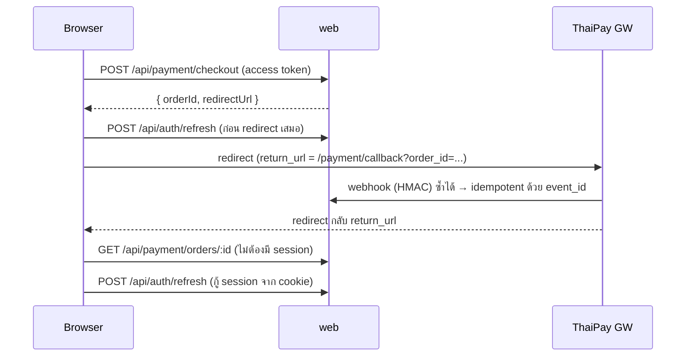

# Architecture — __PROJECT_TITLE__

> โครงตั้งต้นจาก `project-scaffold` · ปรับรายละเอียดด้วย skill `arch-template` (sa-ice) · สัญลักษณ์ตาม arch-standards ข้อ 6

## C4 ระดับ 2 (Container)

```mermaid
flowchart LR
  user([สมาชิก / เว็บเบราว์เซอร์])
  subgraph nvt[เครือข่ายโนวาเทค]
    web["__PROJECT__-web<br/>Next.js modular monolith<br/>auth · member · payment · notification · audit"]
    worker["__PROJECT__-worker<br/>BullMQ worker"]
    db[("PostgreSQL 16<br/>nvt___DB_PROJECT___{env}")]
    redis[("Redis<br/>cache + BullMQ")]
  end
  gw["ThaiPay GW"]
  line["LINE / SMS / Email provider"]

  user -->|HTTPS (sync)| web
  web -->|Prisma/TCP (sync)| db
  web -->|BullMQ (async)| redis
  redis -->|BullMQ (async)| worker
  worker -->|Prisma/TCP (sync)| db
  web -->|HTTPS redirect (sync)| gw
  gw -->|Webhook HTTPS + HMAC (async)| web
  worker -->|HTTPS (async)| line

  classDef ours fill:#0B2545,color:#fff,stroke:#0B2545
  classDef ext fill:#CBD2D9,color:#0B2545,stroke:#CBD2D9
  classDef data fill:#13A89E,color:#fff,stroke:#13A89E
  class web,worker ours
  class gw,line,user ext
  class db,redis data
  style nvt stroke-dasharray: 5 5
```

## ลำดับการจ่ายเงิน (กันบั๊ก token หมดอายุ)


