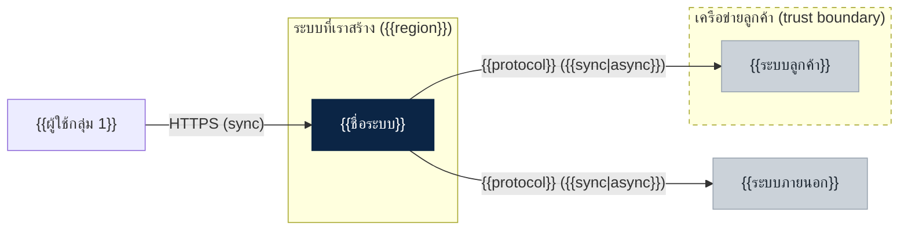
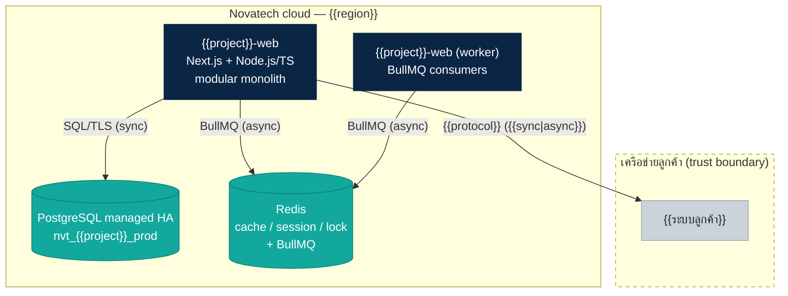
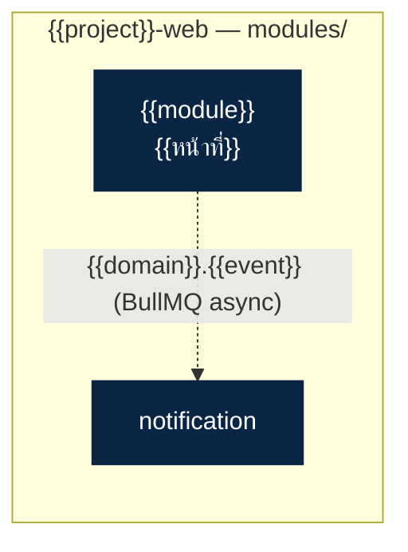

# สถาปัตยกรรม{{ชื่อระบบ}} ({{deal-id}})

> ลูกค้า: {{ชื่อลูกค้า}} · อ้างอิง {{เลข TOR / spec}} · ร่างโดย {{ผู้ร่าง}} · {{วันที่}}
> มาตรฐานที่ใช้: arch-standards v4 · project code: `{{project}}`

## 1. สรุป

ระบบหลักเป็น **modular monolith 1 ตัว** (`{{project}}-web`) {{+ แยก service N ตัว: ชื่อ (เกณฑ์ข้อ 2.x) | ไม่มี service แยก}} งาน async ใช้ **{{BullMQ บน Redis | RabbitMQ}}** · hosting {{cloud region ไทย}}

| แบบแผน | ใช้กับ | เหตุผล |
|---|---|---|
| Modular monolith | {{โมดูล}} | ค่าเริ่มต้น ทีม 4–8 คน |
| Service แยก | `{{project}}-{{part}}` | เกณฑ์ 2.{{n}}: {{เหตุผล}} |
| คิวงาน | {{งาน async}} | ไม่ต้องตอบทันที, retry ได้ |

## 2. C4 ระดับ 1 — Context

## 3. C4 ระดับ 2 — Container

| container | เทคโนโลยี | หน้าที่ | ทำไมแยก/ไม่แยก |
|---|---|---|---|
| `{{project}}-web` | Next.js + Node.js/TS | {{หน้าที่}} | ค่าเริ่มต้น |

## 4. C4 ระดับ 3 — โมดูล (ลบหัวข้อนี้ถ้าไม่ซับซ้อน)

## 5. Flow สำคัญ
{{sequenceDiagram ของ flow ที่เสี่ยงที่สุด 1–2 อัน: ยืนยันตัวตน/เรียกระบบลูกค้า, จองซ้อน, batch}}

## 6. คิวและ event

| ชื่อ | ผู้ส่ง | ผู้รับ | หมายเหตุ |
|---|---|---|---|
| `{{domain}}.{{event}}` | | | idempotency key = {{...}} |

ทุก job idempotent · retry exponential backoff สูงสุด 5 ครั้ง · ล้มครบ → dead-letter + แจ้งเตือน

## 7. ข้อมูลและความปลอดภัย

| เรื่อง | การออกแบบ | อ้างอิง |
|---|---|---|
| ฐานข้อมูล | `nvt_{{project}}_{dev,uat,prod}`, schema ต่อโมดูล | มาตรฐาน 4, 7 |
| {{ข้อมูลอ่อนไหว}} | {{เข้ารหัสคอลัมน์ / HMAC}} | |
| ขณะส่ง | TLS 1.2+ {{+ mTLS}} | |
| Audit log | {{ระยะเก็บตาม TOR}} | |
| Hosting | {{region}} | |

## 8. Observability
- Log JSON → log กลาง (mask PII) · Metric: rate, error, p95, queue depth, DB connections {{+ metric เฉพาะระบบ}}
- Tracing OpenTelemetry ข้าม service
- Alert: error > 2% 5 นาที · p95 > 2 วินาที · queue > 1,000 job · TLS cert หมดอายุใน 21 วัน {{รวม client cert mTLS}} {{+ alert เฉพาะระบบ}}
- `/healthz` `/readyz` ทุก service · SLA {{ตาม TOR}}

## 9. ADR

| # | เรื่อง | ตัดสิน |
|---|---|---|
| 0001 | {{...}} | {{...}} |

## 10. ประเด็นที่ต้องยืนยันกับลูกค้า / ทีม
1. {{คำถาม}} — สมมติฐานที่ใช้วาดตอนนี้: {{...}}
