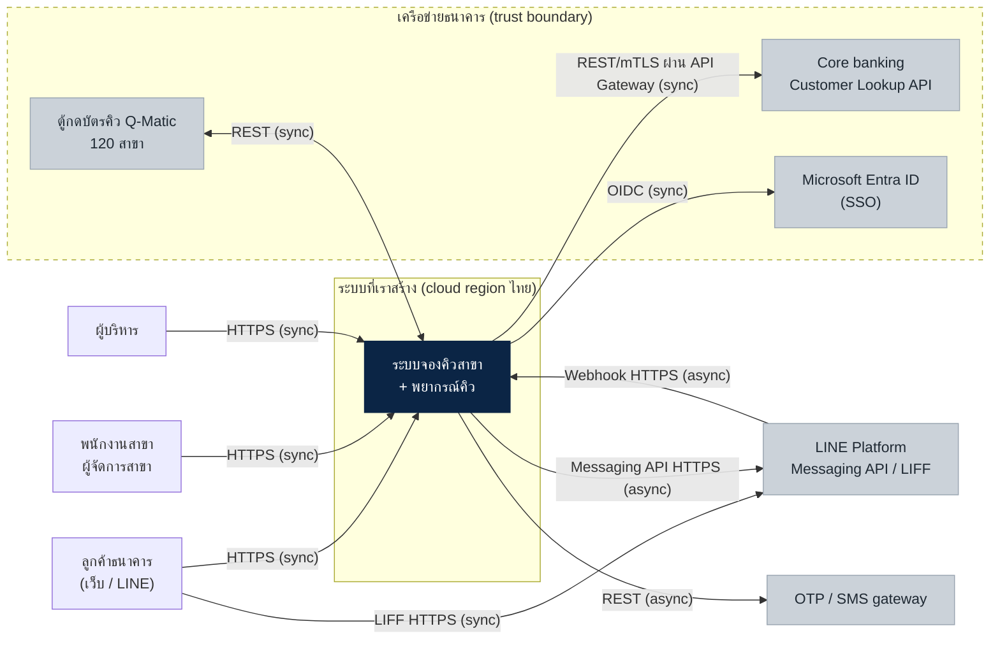
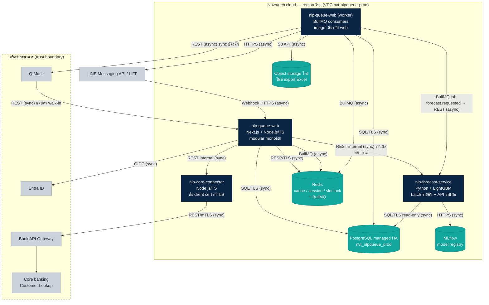
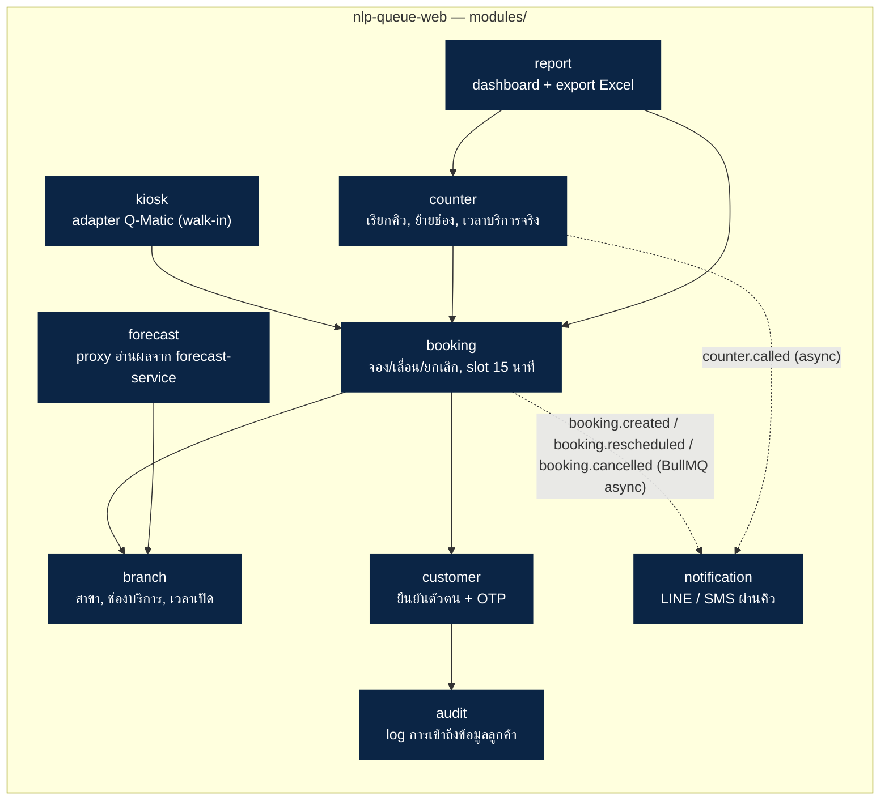
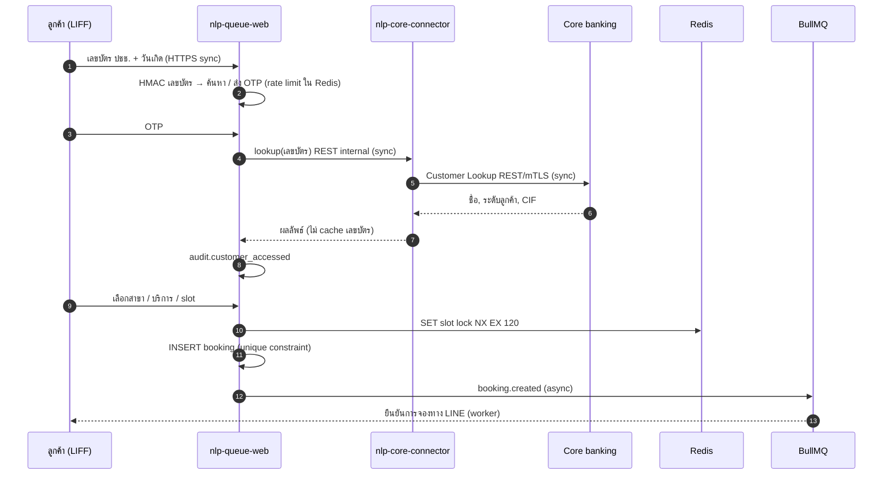

# สถาปัตยกรรมระบบจองคิวสาขาและพยากรณ์ปริมาณคิว (deal-001)

> ลูกค้า: ธนาคารนครหลวงพัฒนา · อ้างอิง TOR `NLP-PROC-2026-114` · ร่างโดย ไอศวรรย์ บุญมา (`sa-ice`) · 3 พ.ย. 2026
> มาตรฐานที่ใช้: `arch-standards.md` v4 · ใช้เป็นหัวข้อ "สถาปัตยกรรม" ใน proposal และเป็น `docs/architecture.md` ของ repo
> project code: `nlpqueue` · repo prefix: `nlp-queue-*`, `nlp-*`

## 1. สรุป (อ่านบรรทัดนี้พอ)

ระบบหลักเป็น **modular monolith 1 ตัว** (`nlp-queue-web`) + แยก service เพียง **2 ตัว** ตามเกณฑ์มาตรฐาน: `nlp-forecast-service` (Python/ML — เกณฑ์ข้อ 2.1) และ `nlp-core-connector` (mTLS ไป core banking — เกณฑ์ข้อ 2.4) งานที่ไม่ต้องตอบทันที (แจ้งเตือน LINE, sync ตู้คิว, export Excel) ใช้ **BullMQ บน Redis** ทุกอย่างอยู่บน cloud region ประเทศไทย

| แบบแผน | ใช้กับ | เหตุผล |
|---|---|---|
| Modular monolith | จองคิว, สาขา, ลูกค้า, แจ้งเตือน, รายงาน, ตู้คิว | ทีม 4–8 คน ภาระใกล้กัน deploy พร้อมกัน |
| Service แยก | `nlp-forecast-service` | runtime ต่าง (Python, LightGBM) รอบปล่อยโมเดลต่างจากแอป |
| Service แยก | `nlp-core-connector` | ต้องแยกเครือข่าย + ถือ client cert mTLS ของธนาคาร |
| คิวงาน (BullMQ) | แจ้งเตือน, sync ตู้ Q-Matic, export รายงาน, สั่งรันพยากรณ์รายคืน | ไม่ต้องตอบผู้ใช้ทันที, ต้อง retry ได้ |

## 2. C4 ระดับ 1 — Context

## 3. C4 ระดับ 2 — Container

### 3.1 รายการ container

| container | เทคโนโลยี | หน้าที่ | ทำไมแยก/ไม่แยก |
|---|---|---|---|
| `nlp-queue-web` | Next.js + Node.js/TS | เว็บจอง, LIFF, branch console, admin, dashboard, API | ค่าเริ่มต้นตามมาตรฐานข้อ 1 |
| `nlp-queue-web` (worker) | image เดียวกัน รันโหมด worker | consume BullMQ | process แยกเพื่อไม่ให้งาน async กิน latency ของ web แต่ยังเป็น codebase/deploy เดียว |
| `nlp-forecast-service` | Python 3.11, LightGBM, FastAPI | เทรน/พยากรณ์รายคืน, API คืนผล 7 วัน | เกณฑ์ข้อ 2.1 (runtime ต่าง) + 2.3 (รอบปล่อยโมเดลต่าง) → ADR-0001 |
| `nlp-core-connector` | Node.js/TS | ห่อ Customer Lookup API, ถือ cert mTLS, rate limit ไปธนาคาร | เกณฑ์ข้อ 2.4 (แยกเครือข่าย) → ADR-0002 |
| PostgreSQL | managed, HA | ข้อมูลหลัก | มาตรฐานข้อ 4 |
| Redis | managed | slot lock, session, cache (TTL ทุก key), rate limit OTP, BullMQ | มาตรฐานข้อ 3–4 |

## 4. C4 ระดับ 3 — โมดูลใน `nlp-queue-web` (เฉพาะส่วนซับซ้อน)

- โมดูลคุยกันผ่าน `modules/<name>/index.ts` เท่านั้น · schema ฐานข้อมูลแยกต่อโมดูล: `booking.*`, `branch.*`, `customer.*`, `counter.*`, `kiosk.*`, `notification.*`, `report.*`, `audit.*`
- **กันจองซ้อน:** slot lock ใน Redis (`slot:{branch}:{date}:{slot}` TTL 120 วินาที) + unique constraint `(branch_id, slot_start, service_counter_seq)` ใน PostgreSQL เป็นด่านสุดท้าย
- **walk-in:** Q-Matic เรียก `POST /api/kiosk/tickets` → `kiosk` แปลงเป็นคิวในตารางเดียวกับ `booking` (ช่องทาง = `walk_in`) ลำดับคิวรวมเป็นชุดเดียว

## 5. Flow สำคัญ

### 5.1 จองคิวผ่าน LINE (ลูกค้าเดิม)

### 5.2 พยากรณ์รายคืน

1. 01:00 BullMQ repeatable job `forecast.requested` → worker เรียก `nlp-forecast-service` `POST /runs`
2. forecast-service อ่านข้อมูลคิวรายชั่วโมง (ไม่ระบุตัวตน) จาก view `report.hourly_queue` แบบ read-only
3. ใช้โมเดลรุ่น `Production` จาก MLflow registry → เขียนผล 7 วัน × 120 สาขา × ชั่วโมง ลง schema `forecast.*`
4. บันทึก MAPE ย้อนหลังของเมื่อวานเทียบของจริง (ติดตามความแม่นยำหลังใช้งาน ตาม TOR 3.3) · ถ้า MAPE 7 วัน > 20% → alert
5. ถอยกลับรุ่นเดิม = เปลี่ยน stage ใน MLflow แล้วรันใหม่ ไม่ต้อง deploy (TOR 3.3)
6. งานล้ม → retry exponential backoff 5 ครั้ง → `forecast.failed` เข้า dead-letter + แจ้งเตือน, dashboard แสดงผลรอบล่าสุดที่สำเร็จพร้อมวันที่

## 6. คิวและ event

| ชื่อ (`<domain>.<event>`) | ผู้ส่ง | ผู้รับ | หมายเหตุ |
|---|---|---|---|
| `booking.created` / `booking.rescheduled` / `booking.cancelled` | booking | notification, report | idempotency key = `booking_id + version` |
| `booking.reminder_due` | repeatable job | notification | แจ้งเตือน 1 วัน, 30 นาที |
| `counter.called` | counter | notification | แจ้งเมื่อเหลือ 3 คิว |
| `kiosk.ticket_synced` | kiosk | report | sync สถานะกลับ Q-Matic |
| `report.export_requested` | report | report worker | สร้าง Excel → object storage, ลิงก์หมดอายุ 24 ชม. |
| `forecast.requested` / `forecast.completed` / `forecast.failed` | scheduler / forecast | report, alert | |
| `notification.failed` | notification | dead-letter + alert | ครบ 5 ครั้ง |

ทุก job idempotent · retry exponential backoff สูงสุด 5 ครั้ง · ล้มครบ → dead-letter queue + แจ้งเตือน

## 7. ข้อมูลและความปลอดภัย

| เรื่อง | การออกแบบ | อ้างอิง |
|---|---|---|
| ฐานข้อมูล | `nvt_nlpqueue_dev` / `_uat` / `_prod`, PostgreSQL managed HA | มาตรฐาน 4, 7 |
| เลขบัตรประชาชน | ค้นหาด้วย HMAC-SHA256 (key ใน KMS) · ถ้าต้องเก็บจริง → เข้ารหัสระดับคอลัมน์ AES-256 · ห้ามลง log | TOR 4, มาตรฐาน 4 |
| เบอร์โทร / LINE userId | เข้ารหัสระดับคอลัมน์ | มาตรฐาน 4 |
| ขณะส่ง | TLS 1.2+ ทุกเส้น, mTLS ไป core banking | TOR 4 |
| Audit log | ทุกการเข้าถึงข้อมูลลูกค้า (ใคร/อะไร/เมื่อไร/เหตุผล) เก็บ ≥ 2 ปี แบบ append-only | TOR 4 |
| ข้อมูล ML | ใช้เฉพาะข้อมูลคิวไม่ระบุตัวตน, forecast-service อ่านได้แค่ view ที่ไม่มี PII | TOR 3.3, PDPA |
| Hosting | cloud region ประเทศไทยเท่านั้น | มาตรฐาน 4 |
| พนักงาน | SSO Entra ID (OIDC), role: teller / branch_manager / executive / admin | TOR 3.2 |

## 8. Observability

- Log JSON ตาม `coding-rules.md` ข้อ 8 → log management กลาง (mask เลขบัตร/เบอร์โทรก่อนเขียน)
- Metric: request rate, error rate, latency p95, queue depth, DB connections + **MAPE รายวัน** ของ forecast
- Tracing OpenTelemetry ข้าม web → core-connector → forecast-service
- Alert: error rate > 2% 5 นาที · p95 > 2 วินาที · queue ค้าง > 1,000 job · **TLS cert หมดอายุใน 21 วัน — รวม client cert mTLS ของ core-connector** · forecast run ล้ม · MAPE 7 วัน > 20%
- `/healthz` และ `/readyz` (DB + Redis + คิว) ทุก service · SLA uptime ≥ 99.5% (TOR 5)

## 9. ADR ที่ต้องเขียน (`docs/adr/`)

| # | เรื่อง | ตัดสิน |
|---|---|---|
| 0001 | แยก `nlp-forecast-service` | แยก — Python runtime + รอบปล่อยโมเดลต่าง |
| 0002 | แยก `nlp-core-connector` | แยก — mTLS / แยกเครือข่ายไปธนาคาร |
| 0003 | ไม่แยก Q-Matic adapter และ LINE webhook เป็น service | ไม่แยก — โหลด 120 สาขา ไม่ถึง 10 เท่าของ web |
| 0004 | BullMQ แทน RabbitMQ | BullMQ — subscriber ของ event อยู่ใน monolith เป็นหลัก, forecast-service ถูกเรียกผ่าน REST |

## 10. ประเด็นที่ต้องยืนยันกับลูกค้า / ทีม (ยังไม่ตัดสิน)

1. **Q-Matic เรียกเข้าได้ไหม** — TOR บอกแค่ "ใช้ REST API" ไม่ชัดว่าตู้ push มาหาเรา หรือเราต้อง poll · ตอนนี้วาดเป็นสองทาง
2. **OTP ส่งทางไหน** — SMS gateway ของธนาคาร หรือของเรา (มีผลต่อราคาและ trust boundary)
3. **API Gateway ของธนาคารเปิดให้เรียกจาก cloud ภายนอกไหม** — ถ้าไม่ ต้องมี site-to-site VPN และ core-connector อาจต้องไปอยู่ฝั่งธนาคาร
4. **เก็บ CIF ไหม** — ถ้าไม่จำเป็นให้ lookup ทุกครั้งแล้วเก็บแค่ HMAC (ลด PII ในระบบ)
5. ขนาดโหลดช่วงวันที่ 25–5 (peak) เพื่อยืนยันว่า monolith + worker 2 ตัวพอ — ส่งให้ `pricing-calc` คิด hosting
