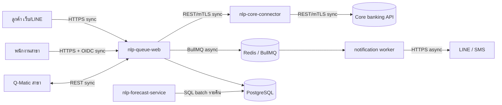

# SPEC — ระบบจองคิวสาขาและพยากรณ์ปริมาณคิว (nlp-queue)

> ลูกค้า: ธนาคารนครหลวงพัฒนา จำกัด (มหาชน) — ฝ่ายพัฒนาช่องทางสาขา
> ต้นทาง: TOR เลขที่ NLP-PROC-2026-114 (ออก 20 ต.ค. 2026) · กำหนดยื่นข้อเสนอ **13 พ.ย. 2026 16:00 น.**
> จัดทำ: ต้นตระกูล มีชัย (`sa-ton`) · ร่าง v0.1 · 3 พ.ย. 2026 · สถานะ: **ร่างภายใน รอคำตอบลูกค้า (หัวข้อ 9)**
> มาตรฐานที่ใช้: arch-standards v4, coding-rules v2026.2, customer-data-policy v1.4
> ผู้ประสานงานลูกค้า: คุณวราภรณ์ ศรีวัฒนา (waraporn.s@nlpbank.example) — เบอร์มือถือเก็บใน CRM เท่านั้น ไม่คัดลอกลงเอกสารนี้

---

## 0. สรุปสั้น

| หัวข้อ | ค่า |
|---|---|
| ผู้ใช้ | ลูกค้าธนาคาร (เว็บ + LINE OA/LIFF), พนักงานสาขา, ผู้จัดการสาขา, ผู้บริหาร (ภาค/สำนักงานใหญ่), ผู้ดูแลระบบ |
| ขนาด | 120 สาขา · นำร่อง 10 สาขาเดือนที่ 5 · ครบ 120 สาขาเดือนที่ 6 |
| ระยะเวลา | 6 เดือน (คาดเซ็น 4 ม.ค. 2027 → go-live ครบ ~ต้น ก.ค. 2027) + MA 1 ปี |
| งบ | ≤ 4,800,000 บาท ไม่รวม VAT (รวมพัฒนา + hosting ปีแรก + MA ปีแรก) |
| KPI ธุรกิจ | เวลารอเฉลี่ยลด 30% ภายใน 6 เดือนหลังเปิดใช้ (ฐาน 38 นาที → เป้า ≤ 26.6 นาที) |
| KPI ML | MAPE ≤ 20% ภาพรวม ทดสอบกับข้อมูล 3 เดือนล่าสุด |
| SLA | uptime ≥ 99.5%, Sev 1 ตอบรับ ≤ 30 นาที |

## 1. ขอบเขต (In / Out)

**In scope** — ตาม TOR 3.1–3.5, 4, 5
**Out of scope (เสนอให้เขียนในสัญญาชัด ๆ)**
- เปลี่ยน/อัปเกรดตู้กดบัตรคิว Q-Matic และจอเรียกคิวที่สาขา (เราเชื่อมผ่าน REST API เดิมเท่านั้น)
- ค่าใช้จ่าย SMS OTP / LINE Messaging (ข้อความ push) — ใช้บัญชีของธนาคาร *(รอยืนยัน Q-05)*
- ค่าจ้างผู้ทดสอบเจาะระบบอิสระ (ธนาคารเป็นผู้กำหนด) *(รอยืนยัน Q-14)*
- การจองสำหรับผู้ที่ยังไม่เป็นลูกค้า (ไม่มี CIF) — ใช้ walk-in *(รอยืนยัน Q-01)*
- แอปมือถือ native (iOS/Android)

## 2. ผู้ใช้และสิทธิ์ (Roles)

| Role | เข้าระบบ | ทำได้ |
|---|---|---|
| `customer` | เลขบัตรประชาชน + วันเกิด + OTP (ผ่าน Customer Lookup API) | จอง/เลื่อน/ยกเลิกคิวของตัวเอง, ดูสถานะคิว |
| `teller` | SSO Entra ID | เรียกคิว, ย้ายคิวระหว่างช่อง, บันทึกเริ่ม/จบบริการ, ทำเครื่องหมายไม่มา |
| `branch_manager` | SSO Entra ID | ทุกอย่างของ teller + ปรับจำนวนช่องต่อช่วงเวลา, ดูพยากรณ์ 7 วัน, รายงานสาขาตัวเอง |
| `region_manager` | SSO Entra ID | dashboard + Excel ของสาขาในภาค *(ต้องได้รายชื่อภาค Q-11)* |
| `executive` | SSO Entra ID | dashboard ทั้งประเทศ + Excel |
| `admin` | SSO Entra ID | ตั้งค่าสาขา, วันหยุด, ประเภทบริการ, เวลาให้บริการ, ผู้ใช้, ดู audit log |

- Role มาจาก **Entra ID group** ของธนาคาร (map group → role ในระบบ) · สาขาของพนักงานมาจาก attribute *(Q-10)*

## 3. Functional Requirements

รหัส: `FR-<โมดูล>-NN` · ระดับ: **M** = TOR เขียนไว้ / **S** = TOR ไม่ได้เขียนแต่จำเป็นต่อการใช้งานจริง (เสนอใน proposal) / **C** = ทางเลือก
คอลัมน์ "ที่มา" = ข้อใน TOR หรือ `GAP` (ลูกค้าไม่ได้เขียน — ดูหัวข้อ 9)

### 3.1 ยืนยันตัวตนลูกค้า (`identity`)

| ID | Requirement | ระดับ | ที่มา |
|---|---|---|---|
| FR-IDN-01 | ลูกค้ากรอกเลขบัตรประชาชน 13 หลัก (ตรวจ checksum) + วันเดือนปีเกิด → ระบบเรียก Customer Lookup API ผ่าน `core-connector` | M | 3.1, 3.4 |
| FR-IDN-02 | ถ้าพบลูกค้า ส่ง OTP 6 หลักไปเบอร์ที่ลงทะเบียนกับธนาคาร (แสดงเบอร์แบบ `08X-XXX-1234`) อายุ 5 นาที ขอใหม่ได้หลัง 60 วินาที | M | 3.1 |
| FR-IDN-03 | กรอก OTP ผิด 5 ครั้ง → ล็อก 15 นาที · ค้นเลขบัตร+วันเกิดไม่ตรง 5 ครั้ง/ชม./อุปกรณ์ → rate limit | S | GAP-SEC |
| FR-IDN-04 | ข้อความ error ไม่บอกว่า "เลขบัตรถูกแต่วันเกิดผิด" (กัน enumeration) | S | GAP-SEC |
| FR-IDN-05 | ผูกบัญชี LINE (LINE userId) กับลูกค้าหลังยืนยันครั้งแรก ครั้งต่อไปใน LIFF ไม่ต้องกรอกเลขบัตรซ้ำ (ยังต้อง OTP เมื่อ session หมด) | S | GAP |
| FR-IDN-06 | session ลูกค้า: access token 15 นาที, refresh token หมุนทุกครั้ง + reuse detection (coding-rules ข้อ 9) | M | มาตรฐานบริษัท |
| FR-IDN-07 | เก็บเลขบัตรประชาชนเป็น HMAC hash สำหรับค้นหา + ciphertext AES-256 (ถ้าต้องเก็บ) ห้ามเก็บข้อความธรรมดา | M | 4 |
| FR-IDN-08 | Core banking ล่ม/timeout (> 3 วินาที) → แจ้ง "ระบบยืนยันตัวตนไม่พร้อม" และเสนอให้ใช้ walk-in; ไม่ cache ข้อมูลลูกค้าเกิน session | S | GAP |
| FR-IDN-09 | ขอความยินยอม/แจ้ง privacy notice (PDPA) ก่อนยืนยันตัวตนครั้งแรก เก็บเวอร์ชันข้อความที่ยินยอม | S | 4 (PDPA) |

### 3.2 จองคิว (`booking`)

| ID | Requirement | ระดับ | ที่มา |
|---|---|---|---|
| FR-BKG-01 | เลือกสาขา (120 แห่ง ค้นด้วยชื่อ/จังหวัด/ใกล้ฉัน), ประเภทบริการ 5 ประเภท (ฝาก-ถอน, เปิดบัญชี, สินเชื่อ, บัตรเครดิต, อื่น ๆ), วัน และช่วงเวลา 15 นาที | M | 3.1 |
| FR-BKG-02 | แสดงเฉพาะช่วงเวลาที่ยังว่าง ตามจำนวนช่องบริการที่ผู้จัดการตั้ง (FR-BRN-05) | M | 3.1, 3.2 |
| FR-BKG-03 | กันจองซ้อน: slot lock ใน Redis (TTL 5 นาทีระหว่างกรอก) + unique constraint ใน DB — ช่วงที่เต็มต้องตอบ 409 `BOOKING_SLOT_FULL` | M | GAP (เคยเป็นปัญหาโปรเจกต์ก่อน) |
| FR-BKG-04 | จองล่วงหน้าได้ไม่เกิน **14 วัน** และอย่างน้อย **30 นาที** ก่อนเวลา *(ค่า default รอยืนยัน Q-02)* | S | GAP |
| FR-BKG-05 | 1 ลูกค้า มีคิวที่ยังไม่ถึงเวลาได้สูงสุด **2 คิว** และ 1 คิว/สาขา/วัน *(Q-03)* | S | GAP |
| FR-BKG-06 | เลื่อนคิว = ยกเลิกเดิม + จองใหม่แบบ atomic (ถ้าช่องใหม่เต็ม คิวเดิมยังอยู่) | M | 3.1 |
| FR-BKG-07 | ยกเลิกคิวได้ถึงเวลานัด คืนช่องว่างให้คนอื่นทันที | M | 3.1 |
| FR-BKG-08 | ได้หมายเลขคิว + QR code สำหรับเช็กอินที่สาขา | S | GAP |
| FR-BKG-09 | เช็กอินที่สาขา (สแกน QR ที่ตู้/เคาน์เตอร์) ได้ตั้งแต่ 15 นาทีก่อนนัด ถึง 10 นาทีหลังนัด เกินนั้น = ไม่มาตามนัด (no-show) *(Q-04)* | S | GAP |
| FR-BKG-10 | ไม่ให้จองวันหยุดสาขา/วันหยุดนักขัตฤกษ์/สาขาปิดชั่วคราว; ถ้าสาขาประกาศปิดหลังมีคนจองแล้ว → แจ้งลูกค้าทุกคนที่ได้รับผลกระทบ | S | GAP |
| FR-BKG-11 | หน้าจอรองรับผู้สูงอายุ: ตัวอักษรใหญ่, จองเสร็จไม่เกิน 4 ขั้น, รองรับ WCAG 2.1 AA ระดับพื้นฐาน | S | GAP (บทเรียนเกษตรไทย) |
| FR-BKG-12 | ภาษาไทย (หลัก) + อังกฤษ *(Q-12)* | C | GAP |
| FR-BKG-13 | ทุกการจอง/เลื่อน/ยกเลิก ปล่อย event `booking.created` / `booking.rescheduled` / `booking.cancelled` ลงคิว | M | arch-standards 3 |

### 3.3 แจ้งเตือน (`notification`)

| ID | Requirement | ระดับ | ที่มา |
|---|---|---|---|
| FR-NTF-01 | แจ้งยืนยันทันทีหลังจอง/เลื่อน/ยกเลิก | S | GAP |
| FR-NTF-02 | แจ้งก่อนถึงนัด **1 วัน** และ **30 นาที** | M | 3.1 |
| FR-NTF-03 | แจ้งเมื่อ **เหลือ 3 คิว** ก่อนถึงคิว (คำนวณจากคิวรวม walk-in ในช่องบริการประเภทเดียวกัน) | M | 3.1 |
| FR-NTF-04 | ช่องทาง: LINE (ถ้าผูก LINE) · ลูกค้าที่จองผ่านเว็บและไม่มี LINE → SMS *(Q-05: TOR ไม่ได้บอกช่องทางของลูกค้าเว็บ)* | S | GAP |
| FR-NTF-05 | ส่งผ่านคิว BullMQ, idempotent (key = bookingId + ประเภทแจ้งเตือน), retry backoff สูงสุด 5 ครั้ง → dead-letter + alert | M | arch-standards 3 |
| FR-NTF-06 | ลูกค้าบล็อก LINE OA → fallback SMS หรือบันทึกว่าแจ้งไม่ได้ | S | GAP |

### 3.4 Walk-in และตู้ Q-Matic (`walkin`)

| ID | Requirement | ระดับ | ที่มา |
|---|---|---|---|
| FR-WLK-01 | บัตรคิวที่กดจากตู้ Q-Matic เข้าระบบเดียวกัน (ผ่าน REST API ของ Q-Matic) ภายใน 5 วินาที | M | 3.1, 3.4 |
| FR-WLK-02 | กติการวมคิว: คิวจองที่เช็กอินแล้วและถึงเวลานัด ได้ลำดับก่อน walk-in ที่ประเภทเดียวกัน แต่ walk-in ห้ามรอเกิน X นาทีเพราะคิวจอง *(Q-06 — TOR ไม่ได้เขียน ลูกค้าจะถามแน่)* | S | GAP |
| FR-WLK-03 | ตู้/Q-Matic ขาดการเชื่อมต่อ → ตู้ยังออกบัตรได้ (โหมดเดิม) และ sync ย้อนหลังเมื่อกลับมา; สาขาเห็นสถานะ "ตู้ไม่เชื่อมต่อ" | S | GAP |
| FR-WLK-04 | เก็บข้อมูลบัตรคิวรายชั่วโมงแบบไม่ระบุตัวตน (สาขา, ชั่วโมง, ประเภท, จอง/walk-in) เป็น input ของโมเดลพยากรณ์ | M | 3.3 |

### 3.5 ระบบสาขา (`branch`)

| ID | Requirement | ระดับ | ที่มา |
|---|---|---|---|
| FR-BRN-01 | พนักงานเข้าสู่ระบบด้วย SSO Microsoft Entra ID (OIDC) — ไม่มีรหัสผ่านในระบบเรา | M | 3.2 |
| FR-BRN-02 | หน้าจอเรียกคิว: เรียกคิวถัดไป, เรียกซ้ำ, ข้าม, ทำเครื่องหมายไม่มา | M | 3.2 |
| FR-BRN-03 | ย้ายคิวระหว่างช่องบริการ (เช่น ฝาก-ถอน → สินเชื่อ) โดยไม่เสียลำดับ | M | 3.2 |
| FR-BRN-04 | บันทึกเวลาเริ่ม/จบบริการจริงต่อคิว (ใช้คำนวณเวลารอ + เวลาบริการ) | M | 3.2 |
| FR-BRN-05 | ผู้จัดการสาขาปรับจำนวนช่องบริการต่อประเภทต่อช่วง 15 นาที (ตั้งเป็นแม่แบบรายวันในสัปดาห์ + แก้รายวัน) | M | 3.2 |
| FR-BRN-06 | ลดจำนวนช่องจนต่ำกว่าคิวที่จองไว้แล้ว → เตือนและแสดงรายการคิวที่ได้รับผลกระทบ (ไม่ยกเลิกอัตโนมัติ) | S | GAP |
| FR-BRN-07 | ผู้จัดการเห็นพยากรณ์ 7 วัน รายชั่วโมง เทียบกับจำนวนช่องที่ตั้ง และไฮไลต์ชั่วโมงที่คนเกินกำลัง | M | 3.2, 3.3 |
| FR-BRN-08 | หน้าจอใช้ได้บนพีซี/แท็บเล็ตของสาขา (Chrome/Edge รุ่นที่ธนาคารใช้ *Q-13*) | S | GAP |

### 3.6 พยากรณ์คิว (`forecast` → `nlp-forecast-service`)

| ID | Requirement | ระดับ | ที่มา |
|---|---|---|---|
| FR-FCT-01 | พยากรณ์จำนวนลูกค้าต่อสาขาต่อชั่วโมง ล่วงหน้า 7 วัน รัน batch ทุกคืน (เสร็จก่อน 06:00) | M | 3.3 |
| FR-FCT-02 | feature: วันในสัปดาห์, ชั่วโมง, lag/rolling, **วันหยุดนักขัตฤกษ์, วันเงินเดือนออก (25–5), วันหยุดยาว** | M | 3.3 |
| FR-FCT-03 | เกณฑ์รับมอบ: MAPE ≤ 20% ภาพรวม บนข้อมูล 3 เดือนล่าสุด (hold-out ตามเวลา) + รายงานแยก payday / สัปดาห์มีวันหยุด / ช่วง 11:00–13:00 | M | 3.3 |
| FR-FCT-04 | สาขาเปิดใหม่หรือข้อมูล < 8 สัปดาห์ → fallback ค่าเฉลี่ยสาขาขนาดเดียวกัน และติดป้าย "ความเชื่อมั่นต่ำ" | S | GAP (บทเรียนเกษตรไทย) |
| FR-FCT-05 | สาขาที่ปิดปรับปรุง/ปิดชั่วคราว ตัดออกจากข้อมูลเทรนและการวัด MAPE | S | GAP |
| FR-FCT-06 | ติดตามความแม่นยำหลังใช้งาน: MAPE รายสัปดาห์ต่อสาขา + การพยากรณ์ต่ำกว่าจริง (under-forecast) | M | 3.3 |
| FR-FCT-07 | ถอยกลับรุ่นเดิมได้ภายใน 15 นาที (model registry + เวอร์ชันที่ใช้งานอยู่ตั้งค่าได้) · เกณฑ์ถอยกลับเสนอ: MAPE รายสัปดาห์ > 22% สองสัปดาห์ติด หรือ under-forecast ช่วงเที่ยง > 30% *(Q-08)* | M | 3.3 |
| FR-FCT-08 | ทุกรุ่นโมเดลบันทึก dataset version, feature, seed, metric (MLflow) | S | GAP |
| FR-FCT-09 | ช่วงก่อนได้ข้อมูลจริงครบ ใช้ baseline (ค่าเฉลี่ยวัน+ชั่วโมงเดียวกัน 4 สัปดาห์) และ shadow mode 2 สัปดาห์ก่อนให้สาขาเห็นตัวเลข | S | GAP |

### 3.7 รายงาน (`report`)

| ID | Requirement | ระดับ | ที่มา |
|---|---|---|---|
| FR-RPT-01 | Dashboard: เวลารอเฉลี่ย, จำนวนคิว (จอง/walk-in), อัตราไม่มาตามนัด — รายสาขา / ภาค / ทั้งประเทศ, เลือกช่วงวันที่ | M | 3.5 |
| FR-RPT-02 | ส่งออก Excel (.xlsx) ตามตัวกรองที่เลือก · **ไม่มีข้อมูลระบุตัวลูกค้า** (ไม่มีชื่อ/เลขบัตร/เบอร์) | M | 3.5, 4 |
| FR-RPT-03 | นิยามเวลารอ = เวลาเรียกคิว − max(เวลาเช็กอิน, เวลานัด) สำหรับคิวจอง; = เวลาเรียก − เวลากดบัตร สำหรับ walk-in *(Q-07 ต้องตกลงก่อน เพราะเป็นตัววัด KPI 30%)* | S | GAP |
| FR-RPT-04 | ตัวเลข dashboard ล่าช้าไม่เกิน 15 นาที (สร้างผ่านคิว `report.*`) | S | GAP |
| FR-RPT-05 | dashboard แสดงความแม่นยำพยากรณ์รายสาขา (เชื่อม FR-FCT-06) | C | GAP |

### 3.8 ผู้ดูแลระบบ (`admin`)

| ID | Requirement | ระดับ | ที่มา |
|---|---|---|---|
| FR-ADM-01 | จัดการข้อมูลสาขา: ชื่อ, ภาค, เวลาทำการ, ประเภทบริการที่เปิด, พิกัด | S | GAP |
| FR-ADM-02 | ปฏิทินวันหยุดนักขัตฤกษ์ + วันปิดสาขาเฉพาะแห่ง (ใช้ทั้งการจองและโมเดล) | S | GAP |
| FR-ADM-03 | ดู/ค้น audit log ตามผู้ใช้ ช่วงเวลา การกระทำ | M | 4 |

## 4. Non-Functional Requirements

| ID | หัวข้อ | Requirement | ที่มา |
|---|---|---|---|
| NFR-SEC-01 | เข้ารหัสขณะส่ง | TLS 1.2+ ทุกช่องทาง, mTLS กับ API Gateway ธนาคาร | 4 |
| NFR-SEC-02 | เข้ารหัสขณะเก็บ | AES-256 (disk + คอลัมน์ข้อมูลอ่อนไหว), key ใน KMS | 4 |
| NFR-SEC-03 | เลขบัตรประชาชน | ไม่เก็บข้อความธรรมดา ทั้ง DB, log, Excel, error message (pino redact) | 4, coding-rules 8 |
| NFR-SEC-04 | Audit log | ทุกการเข้าถึงข้อมูลลูกค้า (ใคร/เมื่อไร/อะไร/จากไหน) เก็บ ≥ 2 ปี แก้ไขไม่ได้ (append-only) | 4 |
| NFR-SEC-05 | Pen test | ผ่าน pen test โดยผู้ทดสอบที่ธนาคารกำหนด ก่อน go-live — จองรอบในเดือนที่ 4 เผื่อรอบแก้ | 4 |
| NFR-SEC-06 | มาตรฐาน | แนวนโยบาย IT Risk ของ ธปท. + PDPA · NDA ทุกคนที่เข้าถึงข้อมูล | 4 |
| NFR-PRF-01 | ปริมาณ | รองรับช่วงพีควันที่ 25–5: ประเมิน ≥ 500 คำขอ/วินาที ที่ p95 < 2 วินาที *(Q-09 ขอจำนวนลูกค้า/วันจริง)* | GAP |
| NFR-AVL-01 | Uptime | ≥ 99.5% ต่อเดือน (≈ 3.6 ชม. downtime/เดือน) วัดเฉพาะเวลาทำการหรือ 24×7 *(Q-15)* | 5 |
| NFR-AVL-02 | DR | RPO ≤ 15 นาที, RTO ≤ 4 ชม. (เสนอ — TOR ไม่ได้ระบุ) · PostgreSQL HA + backup รายวันเก็บ 35 วัน | GAP |
| NFR-OPS-01 | Hosting | cloud region ประเทศไทย, env `dev` `uat` `prod` | arch-standards 4, 7 |
| NFR-OPS-02 | Observability | log JSON, metric มาตรฐาน, OpenTelemetry, alert ขั้นต่ำ รวม **ใบรับรอง TLS หมดอายุภายใน 21 วัน** (รวมใบ mTLS ของ API Gateway) | arch-standards 5 |
| NFR-OPS-03 | MA | Sev 1 ตอบรับ ≤ 30 นาที 24×7 · นิยาม Sev 1–4 แนบในสัญญา | 5 |
| NFR-DAT-01 | Retention | ข้อมูลการจองที่ระบุตัวลูกค้าเก็บ X เดือน แล้ว anonymize *(Q-16)*; ข้อมูลย้อนหลัง 24 เดือนที่ธนาคารส่งให้ ลบภายใน 90 วันหลังส่งมอบ (นโยบายบริษัท) | GAP, data-policy 5 |
| NFR-UX-01 | อุปกรณ์ | มือถือ (LIFF iOS/Android), เดสก์ท็อป, แท็บเล็ตสาขา | GAP |

## 5. การเชื่อมต่อ (Integration)

| ระบบ | ทิศทาง | Protocol | ใช้ทำอะไร | สิ่งที่ต้องได้จากธนาคาร |
|---|---|---|---|---|
| Core banking — Customer Lookup API | เรา → ธนาคาร | REST/mTLS (sync) ผ่าน `nlp-core-connector` | เลขบัตร → ชื่อ, ระดับลูกค้า, CIF, เบอร์สำหรับ OTP | spec API, sandbox, client cert, rate limit, **API ส่ง OTP เองหรือให้เราส่ง** (Q-05) |
| SMS gateway (OTP + แจ้งเตือน) | เรา → gateway | REST (async ผ่าน BullMQ, OTP แบบ sync) | OTP, แจ้งเตือนลูกค้าเว็บ | บัญชี/ผู้ให้บริการ, ใครจ่ายค่า SMS |
| LINE Messaging API / LIFF | สองทาง | HTTPS + webhook (ตรวจลายเซ็น, idempotent) | หน้าจองใน LINE, push แจ้งเตือน | สิทธิ์ admin LINE OA, channel secret, โควตาข้อความ |
| Q-Matic (ตู้กดบัตรคิว) | สองทาง | REST (sync + polling/webhook) | รับบัตรคิว walk-in, ส่งคิวจองเข้าตู้/จอเรียก | เอกสาร API รุ่นที่ใช้, เครือข่ายสาขา → cloud, ผู้ติดต่อผู้ผลิต |
| Microsoft Entra ID | เรา → Entra | OIDC | SSO พนักงาน + group → role | app registration, group ต่อ role, attribute สาขา |
| ข้อมูลบัตรคิวย้อนหลัง 24 เดือน | ธนาคาร → เรา | ไฟล์ (SFTP) ครั้งเดียว + ข้อมูลรายคืนจากระบบเราเอง | เทรนโมเดล | รูปแบบไฟล์, วันส่ง (หลังเซ็นสัญญา) |

## 6. สถาปัตยกรรมเบื้องต้น (ตาม arch-standards v4 — รายละเอียดให้ `arch-template` วาดต่อ)

- **`nlp-queue-web`** — modular monolith (Next.js + Node.js/TypeScript) โมดูล: `identity`, `booking`, `walkin`, `branch`, `notification`, `report`, `admin`, `audit`
- **`nlp-core-connector`** — service แยก (เกณฑ์ข้อ 2.4: ต้องแยกเครือข่ายเพราะ mTLS กับ core banking) → ADR-0001
- **`nlp-forecast-service`** — Python แยก (เกณฑ์ข้อ 2.1: runtime ต่าง) รัน batch รายคืน + model registry (MLflow) → ADR-0002
- PostgreSQL managed HA (`nvt_nlpqueue_prod`, schema ต่อโมดูล) · Redis (slot lock, rate limit OTP, session, cache มี TTL)
- คิว: **BullMQ** (ระบบขนาดกลาง ไม่มีหลาย service subscribe event เดียวกัน) — ถ้า forecast-service ต้องรับ event ด้วย ให้พิจารณา RabbitMQ ใน ADR
- event: `booking.created`, `booking.rescheduled`, `booking.cancelled`, `booking.checked_in`, `ticket.issued`, `ticket.called`, `ticket.served`, `notification.sent`, `notification.failed`, `forecast.published`

## 7. แผนงานและจุดเสี่ยงด้านเวลา

| เดือน | งาน | หมายเหตุ |
|---|---|---|
| 1 (ม.ค.) | requirement workshop, ตอบ open questions, ออกแบบหน้าจอ, ขอ sandbox ทุกระบบ | ต้องได้ sandbox core/Q-Matic ภายในเดือน 1 |
| 2–3 | identity, booking, notification, branch, walkin · ได้ข้อมูล 24 เดือน → เทรนโมเดล | ข้อมูลมาหลังเซ็นสัญญา → เผื่อ 2–3 สัปดาห์ทำความสะอาด |
| 4 | report, admin, ประเมินโมเดล MAPE, **pen test รอบ 1**, UAT | UAT ≥ 3 สัปดาห์ *(TOR ไม่ได้เขียน — เสนอ)* |
| 5 | นำร่อง 10 สาขา + forecast shadow mode, แก้ผล pen test | เลือกสาขานำร่องให้มีทั้งสาขาใหญ่/ย่านออฟฟิศ/ต่างจังหวัด |
| 6 | ขยาย 120 สาขา เป็นระลอก (เช่น 30/40/40), อบรม, hypercare | อบรมผู้จัดการสาขา 120 คน — ออนไลน์ + คู่มือ |

**ความเสี่ยงหลัก:** (1) sandbox core banking/Q-Matic ช้า (2) ข้อมูล ML มาช้าหรือคุณภาพต่ำ → MAPE ไม่ผ่าน (3) pen test เจอช่องโหว่ใกล้ go-live (4) เครือข่ายสาขา → cloud สำหรับ Q-Matic (5) งบ 4.8M รวม hosting+MA — ส่งให้ `pricing-calc` ตรวจ margin

## 8. เกณฑ์รับมอบ (Acceptance)

1. test case ระดับ P1 ใน `TEST-PLAN.md` ผ่าน 100%, P2 ≥ 95%
2. MAPE ≤ 20% บนข้อมูล 3 เดือนล่าสุด (FR-FCT-03) พร้อมรายงานแยกกลุ่ม
3. ผ่าน pen test ไม่มีช่องโหว่ระดับ High/Critical ค้าง
4. นำร่อง 10 สาขาครบ 2 สัปดาห์ไม่มี Sev 1 ค้าง
5. เอกสารส่งมอบ: architecture (C4 L1/L2), ADR, คู่มือผู้ใช้ 3 ชุด (ลูกค้า/สาขา/ผู้ดูแล), runbook, ผลทดสอบ

## 9. คำถามถึงลูกค้า (Open Questions) — ต้องถามก่อนยื่นราคา

> 🔴 = กระทบราคา/ขอบเขตมาก ต้องได้คำตอบก่อน 13 พ.ย. · 🟡 = ใส่เป็นสมมติฐานใน proposal ได้

| # | คำถาม | ทำไมสำคัญ | สมมติฐานที่ใช้ถ้าไม่ได้คำตอบ | |
|---|---|---|---|---|
| Q-01 | คนที่ยังไม่เป็นลูกค้า (มาเปิดบัญชี) จองได้ไหม — TOR ให้ยืนยันด้วยข้อมูล core banking ซึ่งคนนี้ไม่มี | บริการ "เปิดบัญชี" อยู่ใน TOR แต่คนที่มาเปิดบัญชีส่วนใหญ่ยังไม่มี CIF | ใช้ walk-in เท่านั้น (ทางเลือก: จองด้วยเบอร์ + OTP ราคาเพิ่ม) | 🔴 |
| Q-02 | จองล่วงหน้าได้สูงสุดกี่วัน / ปิดรับจองกี่นาทีก่อน | กำหนดความจุและการทดสอบ | 14 วัน / 30 นาที | 🟡 |
| Q-03 | จำกัดจำนวนคิวต่อคนไหม | กันจองกักช่อง | 2 คิวค้าง, 1 คิว/สาขา/วัน | 🟡 |
| Q-04 | มาสายได้กี่นาที / ไม่มาตามนัดกี่ครั้งถึงระงับสิทธิ์จอง | นิยาม no-show (อยู่ใน dashboard) | สาย 10 นาที = no-show, ไม่มีบทลงโทษ | 🟡 |
| Q-05 | OTP และ SMS แจ้งเตือน: ใช้ SMS gateway ของธนาคารหรือของเรา ใครจ่ายค่าข้อความ · Customer Lookup API ส่ง OTP เองได้ไหม | ค่า SMS 120 สาขาเป็นต้นทุนรายเดือนที่ไม่ได้อยู่ใน TOR | ใช้ gateway + บัญชีของธนาคาร ธนาคารจ่ายค่าข้อความ | 🔴 |
| Q-06 | กติกาลำดับคิวจอง vs walk-in และ walk-in รอสูงสุดได้เท่าไร | ลูกค้า walk-in ร้องเรียนเมื่อคนจองแซง | คิวจองที่เช็กอินแล้วถึงเวลาได้ก่อน, walk-in ไม่ถูกแซงเกิน 2 ครั้งติด | 🔴 |
| Q-07 | นิยาม "เวลารอ" และฐาน 38 นาทีวัดอย่างไร | เป็นตัววัด KPI ลด 30% — ถ้านิยามต่างกัน จะเถียงกันตอนรับมอบ | ตาม FR-RPT-03 | 🔴 |
| Q-08 | เกณฑ์ถอยกลับโมเดล และใครอนุมัติ | TOR สั่งให้ถอยได้ แต่ไม่บอกเมื่อไร | ตาม FR-FCT-07 | 🟡 |
| Q-09 | จำนวนลูกค้าต่อวันทั้งประเทศ / สัดส่วนคาดว่าจะจองออนไลน์ | ขนาด infrastructure + โหลดเทสต์ | 60,000 คน/วัน, จอง 30% | 🟡 |
| Q-10 | Entra ID: มี group ต่อบทบาท และ attribute สาขาของพนักงานไหม | ถ้าไม่มี ต้องทำหน้าจัดการสิทธิ์เอง | มี group + attribute | 🟡 |
| Q-11 | โครงสร้างภาค (สาขาไหนอยู่ภาคไหน) และใครเป็นเจ้าของข้อมูลสาขา | dashboard รายภาค | ธนาคารส่ง master สาขาเป็นไฟล์ | 🟡 |
| Q-12 | ต้องมีภาษาอังกฤษไหม | ขอบเขต UI + เนื้อหาแจ้งเตือน | ไทยอย่างเดียว | 🟡 |
| Q-13 | อุปกรณ์/เบราว์เซอร์ที่สาขาใช้ และเครือข่ายสาขาออก cloud ได้ไหม (Q-Matic อยู่ในเครือข่ายสาขา) | การเชื่อม Q-Matic อาจต้องมี agent ที่สาขา | ออก cloud ผ่าน proxy ธนาคารได้ | 🔴 |
| Q-14 | pen test: ใครจ่าย, กี่รอบ, ต้องใช้เวลาเท่าไร | ไม่ได้ระบุในงบ | ธนาคารจ่าย 1 รอบ + retest 1 รอบ | 🔴 |
| Q-15 | SLA 99.5% วัด 24×7 หรือเวลาทำการ, นิยาม Sev 1–4, ค่าปรับ | ต้นทุน on-call | 24×7, ไม่มีค่าปรับ | 🟡 |
| Q-16 | เก็บประวัติการจองที่ระบุตัวลูกค้านานเท่าไร | PDPA + ขนาดข้อมูล | 12 เดือน แล้ว anonymize | 🟡 |
| Q-17 | ข้อมูล 24 เดือนรูปแบบอะไร ระบุสาขาปิด/ย้าย/เปิดใหม่ไหม | คุณภาพข้อมูล → MAPE | CSV รายบัตรคิว มี branch_id + เวลา | 🟡 |
| Q-18 | ต้องรองรับการจองแทน (ลูก จองให้พ่อแม่) ไหม | ผู้สูงอายุเป็นกลุ่มใหญ่ที่สาขา | ไม่รองรับใน phase 1 | 🟡 |

## 10. Traceability (TOR → Requirement → Test)

| TOR | Requirement | Test (TEST-PLAN.md) |
|---|---|---|
| 3.1 จอง/เลื่อน/ยกเลิก, เลือกสาขา/บริการ/ช่วง 15 นาที | FR-BKG-01..13 | TC-BKG-01..09 |
| 3.1 ยืนยันตัวตน + OTP + core banking | FR-IDN-01..09 | TC-IDN-01..08 |
| 3.1 แจ้งเตือน 1 วัน / 30 นาที / เหลือ 3 คิว | FR-NTF-01..06 | TC-NTF-01..06 |
| 3.1 walk-in ตู้สาขา | FR-WLK-01..04 | TC-WLK-01..04 |
| 3.2 ระบบสาขา + SSO | FR-BRN-01..08 | TC-BRN-01..07 |
| 3.3 ML พยากรณ์ | FR-FCT-01..09 | TC-FCT-01..06 |
| 3.4 การเชื่อมต่อ | หัวข้อ 5 | TC-IDN-05, TC-WLK-01, TC-BRN-01, TC-NTF-04 |
| 3.5 รายงาน + Excel | FR-RPT-01..05 | TC-RPT-01..04 |
| 4 ความปลอดภัย | NFR-SEC-01..06 | TC-SEC-01..08 |
| 5 SLA / นำร่อง | NFR-AVL-01..02, NFR-OPS-03 | TC-NFR-01..04 |
| (GAP) ผู้ดูแลระบบ | FR-ADM-01..03 | TC-ADM-01, TC-SEC-04 |

Requirement ที่ไม่มี test case ตรวจด้วย review / pilot / รายงาน MA — ดูหัวข้อ "Requirement ที่ตรวจด้วยวิธีอื่น" ใน TEST-PLAN.md · ตรวจครบอัตโนมัติด้วย `check-spec.mjs`
