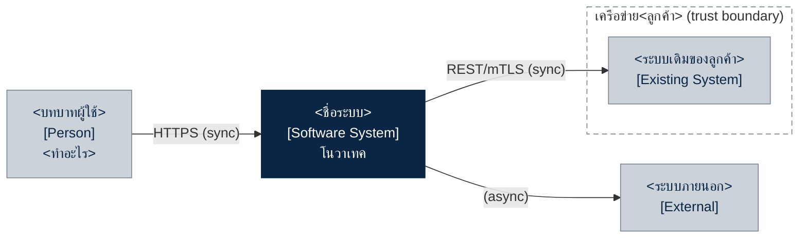
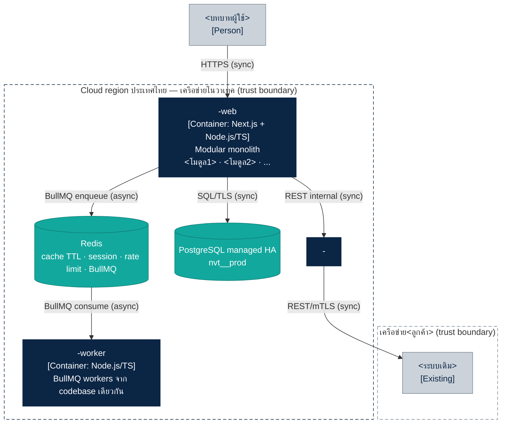

# โครงเอกสารและแม่แบบ Mermaid

คัดลอกโครงนี้ไปใช้ แล้วแทนค่า `<...>` ตัวอย่างที่ใช้งานจริงคือ deal-001 ระบบจองคิวธนาคาร (`nlp-queue`)

## โครงเอกสาร 9 หัวข้อ

1. สรุปแบบแผนที่เลือก (ตาราง: เรื่อง | เลือก | เหตุผลอ้างมาตรฐาน §)
2. C4 ระดับ 1 — System Context
3. C4 ระดับ 2 — Container
4. โมดูลใน monolith (ตาราง: โมดูล | schema | หน้าที่ + อ้างข้อ TOR)
5. คิวและ event (ตาราง: ชื่อ `<domain>.<event>` | ผู้ส่ง → ผู้รับ | หมายเหตุ) + กติกา idempotent / retry 5 / DLQ
6. ข้อมูลและความปลอดภัย
7. Observability (metric, alert ครบ 4 ข้อ รวม TLS 21 วัน, health check)
8. ADR ที่ต้องเขียน
9. คำถามเปิด / สมมติฐาน

หัวเอกสารใส่ชื่อลูกค้า (ชื่อองค์กรเท่านั้น), เลข TOR, project code, ผู้จัดทำ, เวอร์ชัน, วันที่ และ "ตามมาตรฐานสถาปัตยกรรมโนวาเทค v4"

## classDef มาตรฐาน (ใส่ท้ายทุกแผนภาพ)

```
    classDef ours fill:#0B2545,stroke:#0B2545,color:#FFFFFF
    classDef ext fill:#CBD2D9,stroke:#7B8794,color:#0B2545
    classDef data fill:#13A89E,stroke:#0E7F77,color:#FFFFFF
    style <boundaryId> fill:none,stroke:#7B8794,stroke-dasharray:6 4
```

ใช้ `flowchart` แทน `C4Context` ของ Mermaid เพราะ C4 ของ Mermaid ยังกำหนดสีและกรอบประได้ไม่ครบ ให้ระบุชนิดในป้ายแทน เช่น `[Person]`, `[Container: Next.js]`, `[Existing System]`

## แม่แบบ L1 — Context



## แม่แบบ L2 — Container



## โครงที่ใช้ซ้ำบ่อย (ระบบจองคิว / นัดหมาย)

- โมดูลที่มักต้องมี: `booking`, `branch`, `customer`, `notification`, `report`, `audit`
- ถ้ามีตู้หรือช่องทางเดิม เพิ่ม `kiosk`; ถ้ามี LINE OA เพิ่ม `line`; ถ้ามีพยากรณ์ เพิ่ม `staffing`
- slot จองใช้ Redis slot lock (มี TTL) กันจองซ้อน
- แจ้งเตือนทั้งหมดส่งผ่านคิว เช่น `booking.created` → notification
- ML พยากรณ์ (Python) แยกเป็น `<project>-forecast-service` รันรอบกลางคืนผ่าน job `forecast.requested`
- ถ้าลูกค้าเป็นธนาคาร เชื่อม core banking ผ่าน `<project>-core-connector` (mTLS) และใส่ alert ใบรับรอง TLS ด้วย
