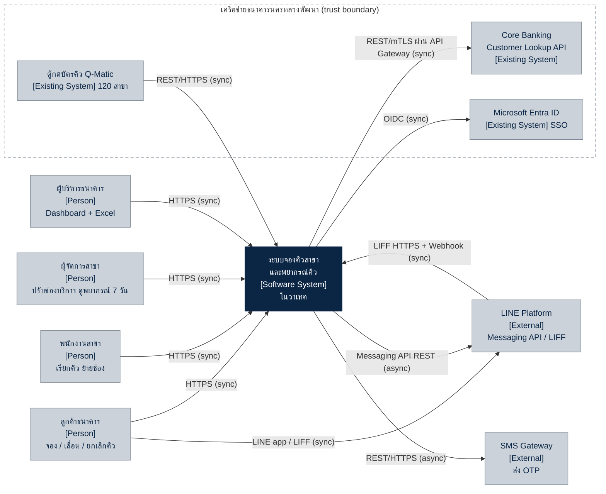
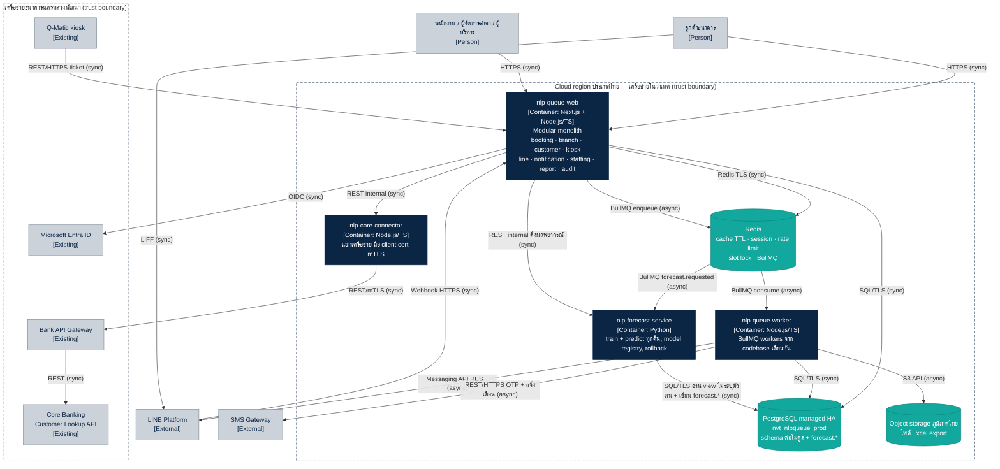

# สถาปัตยกรรมระบบจองคิวสาขาและพยากรณ์ปริมาณคิว (deal-001)

> ลูกค้า: ธนาคารนครหลวงพัฒนา · TOR NLP-PROC-2026-114 · project code `nlp-queue`
> ผู้จัดทำ: ไอศวรรย์ บุญมา (`sa-ice`) · ร่าง v0.1 · 2026-11-04 · ตามมาตรฐานสถาปัตยกรรมโนวาเทค v4 (`arch-standards.md`)
> ปลายทางเมื่อเปิดโปรเจกต์: `docs/architecture.md` ใน repo `nlp-queue-web`
> สถานะ: ร่างสำหรับข้อเสนอทางเทคนิค (TOR ข้อ 7.1) — รอ `sa-ton` รีวิว

---

## 1. สรุปแบบแผนที่เลือก

| เรื่อง | เลือก | เหตุผล (อ้างมาตรฐาน) |
|---|---|---|
| ตัวหลัก | **Modular monolith** `nlp-queue-web` (Next.js + Node.js/TypeScript) | ค่าเริ่มต้น §1 · ทีม 4–8 คน, งาน 6 เดือน |
| แยก service | `nlp-forecast-service` (Python) | §2 ข้อ 1 ภาษา/runtime ต่าง (ML) |
| แยก service | `nlp-core-connector` | §2 ข้อ 4 เชื่อม core banking ผ่าน mTLS ต้องแยกเครือข่าย |
| ไม่แยก | ตัวรับ LINE webhook, ตัวเชื่อม Q-Matic | โหลดไม่ถึง 10 เท่าของระบบหลัก (120 สาขา) → อยู่ในโมดูล `line`, `kiosk` |
| คิวงาน | **BullMQ บน Redis** | §3 ระบบขนาดกลาง, event ไม่มีหลาย service subscribe ตัวเดียวกัน |
| ข้อมูล | PostgreSQL managed (HA) `nvt_nlpqueue_prod` + Redis | §4 |
| ที่ตั้ง | Cloud region ประเทศไทยเท่านั้น | §4 ระบบลูกค้าธนาคาร |

---

## 2. C4 ระดับ 1 — System Context

---

## 3. C4 ระดับ 2 — Container

---

## 4. โมดูลใน `nlp-queue-web`

คุยกันผ่าน `modules/<name>/index.ts` เท่านั้น ห้ามอ่านตารางข้ามโมดูล

| โมดูล | schema | หน้าที่ (TOR) |
|---|---|---|
| `booking` | `booking.*` | จอง / เลื่อน / ยกเลิก, slot 15 นาที, กันจองซ้อนด้วย slot lock ใน Redis (3.1) |
| `branch` | `branch.*` | 120 สาขา, ประเภทบริการ, ช่องบริการต่อช่วงเวลา, หน้าจอเรียกคิว / ย้ายช่อง / เวลาบริการจริง (3.2) |
| `customer` | `customer.*` | ยืนยันตัวตน เลขบัตร + วันเกิด + OTP, เรียก `nlp-core-connector` (3.1, 3.4) |
| `kiosk` | `kiosk.*` | รับบัตรคิว walk-in จาก Q-Matic เข้าคิวเดียวกัน (3.1, 3.4) |
| `line` | — | LIFF + webhook ของ LINE OA (3.1, 3.4) |
| `notification` | `notification.*` | แจ้งเตือน 1 วัน / 30 นาที / เหลือ 3 คิว ผ่าน LINE หรือ SMS (3.1) |
| `staffing` | — | แสดงผลพยากรณ์ 7 วันให้ผู้จัดการสาขา (ดึงจาก `nlp-forecast-service`) (3.2, 3.3) |
| `report` | `report.*` | Dashboard รายสาขา/ภาค/ประเทศ, export Excel (3.5) |
| `audit` | `audit.*` | Audit log ทุกการเข้าถึงข้อมูลลูกค้า เก็บ ≥ 2 ปี (4) |

## 5. คิวและ event (BullMQ)

| คิว / event | ผู้ส่ง → ผู้รับ | หมายเหตุ |
|---|---|---|
| `booking.created` · `booking.rescheduled` · `booking.cancelled` | booking → notification | ตั้งเวลาแจ้งเตือน 1 วัน / 30 นาที |
| `queue.advanced` | branch → notification | แจ้งเมื่อเหลือ 3 คิว |
| `otp.requested` | customer → worker (SMS) | rate limit ต่อเบอร์ด้วย Redis |
| `ticket.issued` | kiosk → booking | walk-in เข้าคิวเดียวกัน |
| `report.requested` | report → worker | สร้าง Excel ลง object storage |
| `forecast.requested` | scheduler ทุกคืน → `nlp-forecast-service` | พยากรณ์ล่วงหน้า 7 วัน รายสาขารายชั่วโมง |
| `forecast.completed` | forecast → staffing | แจ้งผลพร้อมใช้ |
| `notification.failed` | worker → dead-letter + alert | หลัง retry ครบ |

ทุก job idempotent (ใช้ job id = id ของ event), retry exponential backoff สูงสุด 5 ครั้ง, ล้มครบไป dead-letter queue + แจ้งเตือน

## 6. ข้อมูลและความปลอดภัย

- ฐานข้อมูล `nvt_nlpqueue_dev` / `nvt_nlpqueue_uat` / `nvt_nlpqueue_prod` — env มีแค่ `dev`, `uat`, `prod`
- เลขบัตรประชาชน: เก็บเป็น hash (HMAC มี key) ไว้ค้นหา + ถ้าต้องเก็บจริงให้เข้ารหัสระดับคอลัมน์ AES-256 (TOR 4) — เบอร์โทรเข้ารหัสระดับคอลัมน์
- CIF / ชื่อลูกค้าจาก core banking: เก็บเท่าที่จำเป็นต่อการจอง, ทุกการเรียกบันทึกลง `audit.*`
- TLS 1.2+ ทุกเส้น, เส้นไป core banking เป็น mTLS ผ่าน `nlp-core-connector` เท่านั้น
- Redis ทุก key มี TTL (slot lock, session, OTP, cache)
- ข้อมูลบัตรคิวย้อนหลัง 24 เดือนจากธนาคาร (ไม่ระบุตัวตน) โหลดเข้า schema ของ forecast เท่านั้น
- ก่อนเปิดใช้งาน: penetration test โดยผู้ทดสอบที่ธนาคารกำหนด

## 7. Observability

- Log JSON ตาม `coding-rules.md` ข้อ 8 → log management กลาง, tracing OpenTelemetry ข้าม web / worker / connector / forecast
- Metric: request rate, error rate, latency p95, queue depth, DB connections + MAPE ของโมเดลหลังใช้งานจริง
- Alert: error rate > 2% 5 นาที, p95 > 2 วินาที, queue ค้าง > 1,000 job, **ใบรับรอง TLS (รวม client cert mTLS ของ connector) หมดอายุภายใน 21 วัน**
- `/healthz` และ `/readyz` (DB + Redis + คิว) ทุก container

## 8. ADR ที่ต้องเขียน (`docs/adr/`)

| เลข | เรื่อง |
|---|---|
| 0001 | แยก `nlp-forecast-service` (Python) — §2 ข้อ 1 |
| 0002 | แยก `nlp-core-connector` (mTLS, แยกเครือข่าย) — §2 ข้อ 4 |
| 0003 | ใช้ BullMQ ไม่ใช่ RabbitMQ (ยังไม่มี event ที่หลาย service subscribe) |
| 0004 | ให้ `nlp-forecast-service` มี schema `forecast.*` ในฐานเดียวกัน และอ่าน view ไม่ระบุตัวตนจาก `report.*` |

## 9. คำถามเปิด / สมมติฐาน (ต้องยืนยันกับลูกค้า)

1. ผู้ให้บริการ SMS OTP — TOR ไม่ระบุ (ธนาคารมี gateway เองหรือเราจัดหา)
2. เส้นทางเครือข่ายไป Bank API Gateway — internet + mTLS หรือ private link / VPN
3. ทิศทางการเชื่อม Q-Matic — ตู้ push เข้ามา หรือเราต้อง poll (สมมติว่าตู้เรียก REST ของเรา)
4. ลูกค้าเลือกช่องทางแจ้งเตือน LINE หรือ SMS เองได้หรือไม่
