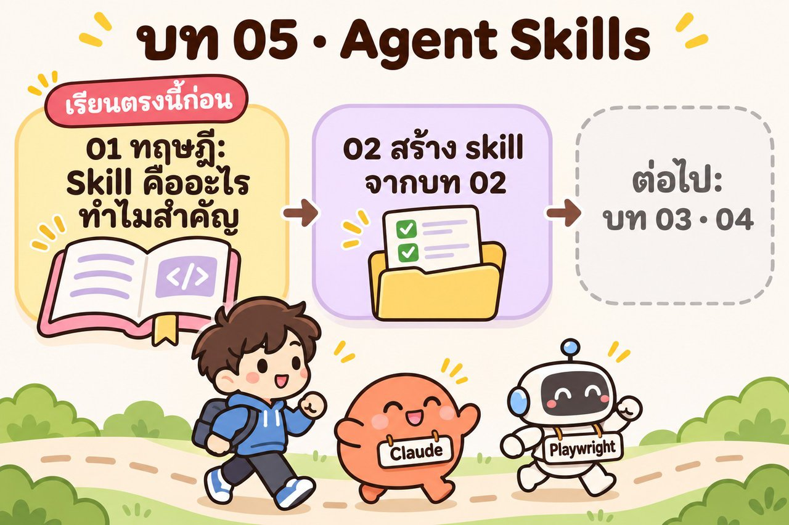

# บท 05 · Agent Skills — เลิก copy-paste พรอมต์ทุก LAB ให้ AI "รู้งาน" ด้วย skill

| ส่วน | เนื้อหา | สถานะ |
|---|---|---|
| [01_skill-theory](01_skill-theory/) | ทฤษฎี: วิธีคิดเดิม (งานละ agent) vs วิธีคิดใหม่ (agent ตัวเดียว + skill) · อัจฉริยะ vs คนรู้งาน · skill คือโฟลเดอร์ · เปิดทีละชั้น · ตัวเลขงานวิจัย | ✅ พร้อมเรียน |
| [02_skill-test-from-plan](02_skill-test-from-plan/) | ลงมือ 7 LAB: เปลี่ยนบท 02 (ทดสอบ PawPantry ตามแผน) ให้เป็น skill `test-from-plan` สั่งประโยคเดียว แล้วจดบทเรียนจน v4 | ✅ รันจริงครบ |
| 03 (ภายหลัง) | ใช้วิธีเดียวกันกับบท 03 และ 04 | ⏳ |

แนวคิดทั้งบทมาจากทอล์ค *Don't Build Agents, Build Skills Instead* ของ Barry Zhang และ Mahesh Murag (Anthropic) และคลิปทดลองของ Kreycin ดูรายละเอียดแหล่งที่มาใน [01_skill-theory](01_skill-theory/README.md#-ใครเสนอเรื่องนี้-และข้อมูลในบทนี้มาจากไหน)
