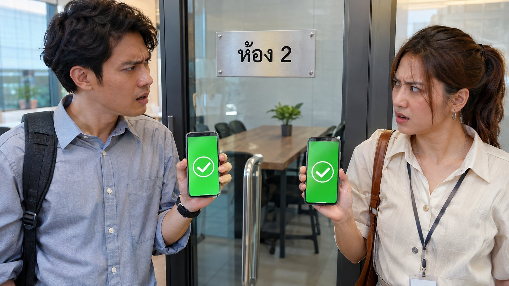
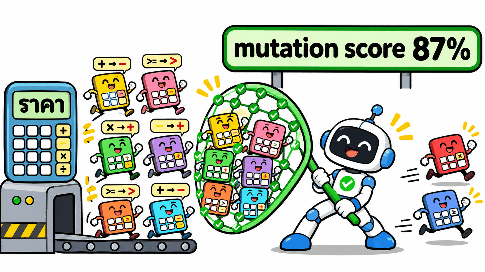
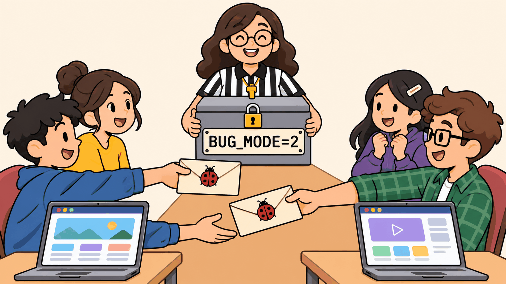

# การบ้านข้อ 1 · "นั่งสบาย โคเวิร์กกิ้ง": แผนทดสอบที่พิสูจน์ได้ว่าแข็งแรง (25%)


> **บทที่ใช้:** บท 04 (ทั้งบท) เป็นหลัก · บท 02 (Playwright ตามแผน, GIF หลักฐาน) · บท 03 (สำรวจ, oracle, อย่าอบบั๊ก)
> **ทีม:** 2–3 คน · **เวลาโดยประมาณ:** 14–18 ชั่วโมงต่อทีม · **ส่ง:** สัปดาห์ที่ 3 (ขั้น 1–4 ส่งสัปดาห์ที่ 2)

---

## 🎯 ทำไมต้องมีข้อนี้

บท 04 จบด้วยผล "แผนของเราจับบั๊กปริศนาได้ 3/3" ซึ่งฟังดูดี แต่ถ้าคิดแบบ dev มืออาชีพจะเห็นช่องโหว่ 3 ข้อ

| ช่องโหว่ของบท 04 | ทำไมเป็นปัญหา | ข้อนี้แก้ด้วย |
|---|---|---|
| บั๊กมีแค่ 3 ตัว และ **AI ตัวเดียวกับที่สร้างเว็บเป็นคนเลือก** | ตัวอย่างเล็กและลำเอียง จับได้ 3/3 ไม่ได้แปลว่าแผนแข็งแรง | **mutation testing** (ขั้น 4) วัดจากบั๊กหลายร้อยแบบที่เครื่องสร้าง + **บั๊กจากทีมอื่น** (ขั้น 5) |
| test ทุกข้อเปิดเว็บทีละคน | ระบบจองจริงพังบ่อยที่สุดตอน **มีคนกดพร้อมกัน** ซึ่ง test แบบทีละคนผ่านเสมอ | **test การจองชนกัน** (ขั้น 2) |
| กฎเงินทดสอบด้วยตัวอย่างไม่กี่ค่าที่เราเลือก | กฎซ้อนกัน 4 ชั้น (พีค × สมาชิก × คูปอง × ปัดเศษ) ตัวอย่างที่คนเลือกครอบคลุมไม่ได้ | **property-based testing** กับ oracle ที่เขียนเอง (ขั้น 3) |

**สิ่งที่ข้อนี้วัด:** ไม่ใช่ "ได้ไฟล์ครบไหม" (Claude สร้างให้ได้เสมอ) แต่ **"พิสูจน์ได้ไหมว่าแผนของคุณจับบั๊กได้จริง และวัดเป็นตัวเลขได้"**

## 📦 ไฟล์ในโฟลเดอร์นี้

| ไฟล์ | คืออะไร |
|---|---|
| [`INTERVIEW.md`](INTERVIEW.md) | บันทึกสัมภาษณ์ร้าน = **input เดียว** (ห้ามแก้) · ตั้งใจให้มีข้อขัดกันและข้อที่พูดไม่ครบ |
| [`API-CONTRACT.md`](API-CONTRACT.md) | endpoint, รูปแบบ quote, `data-testid` ที่ **ทุกทีมต้องมีเหมือนกัน** (ใช้ตอนแลกบั๊กข้ามทีม) |
| `README.md` | ไฟล์นี้: ขั้นตอน เกณฑ์ผ่านของแต่ละขั้น รูบริก |

## 🧰 ก่อนเริ่ม

| ✅ | ต้องมี | ตรวจยังไง |
|---|---|---|
| ☐ | ทำบท 04 ครบอย่างน้อย LAB 1–11 มาแล้ว (คนใดคนหนึ่งในทีม) | มี `e2e/index.html` ของสบายใจ สปา |
| ☐ | Docker Desktop · Node.js 20+ · Playwright (บท 01) · ffmpeg | `docker version` · `node -v` · `npx playwright --version` · `ffmpeg -version` |
| ☐ | พอร์ต 3000 และ 5434 ว่าง (ปิดเว็บสปาก่อน) | `docker ps` |
| ☐ | Git repo ของทีม 1 repo (ส่งงานผ่าน repo นี้) | ทุกคนในทีม push ได้ |

### โครง repo ที่ต้องส่ง

```text
hw1-<ชื่อทีม>/
├─ README.md                ← วิธีรันทุกอย่างด้วยคำสั่งเดียวต่อเรื่อง (ดู "การรันซ้ำ" ท้ายไฟล์)
├─ prompts/                 ← พรอมต์ทุกตัวที่ใช้ เรียงเลข 01-..., 02-... (ตัวต่อตัว ไม่สรุป)
├─ INTERVIEW.md             ← คัดลอกจากโฟลเดอร์นี้ (ห้ามแก้)
├─ USER-STORIES.md  REQUIREMENTS.md  DESIGN.md  TEST-DATA.md  BUILD-PROMPT.md
├─ EXPLORATION.md  TEST-PLAN.md  PLAN-REVIEW.md
├─ QUESTIONS-TO-OWNER.md    ← คำถามถึงร้าน + สมมติฐานที่ใช้ระหว่างรอคำตอบ
├─ db/  web/                ← Docker 2 โปรเจกต์ (web/BUGS.md ของ BUG_MODE=1 อยู่ในนี้)
├─ e2e/
│  ├─ tests/                ← test จากแผน (3 เบราว์เซอร์)
│  ├─ race/                 ← ขั้น 2
│  ├─ property/             ← ขั้น 3 (oracle/ + test)
│  ├─ index.html  triage.json
│  └─ test-report/          ← GIF + MP4
├─ mutation/                ← ขั้น 4 (config + ผล html/json)
├─ MUTATION-REPORT.md
├─ RACE-REPORT.md
├─ PROPERTY-REPORT.md
└─ BUG-HUNT.md              ← บั๊กของ AI (BUG_MODE=1) + บั๊กจากทีมคู่ (BUG_MODE=2)
```

> **commit ทีละขั้น** และใส่เลขขั้นในข้อความ commit เช่น `step2: race test 50 rounds` · repo ที่มี commit ก้อนเดียวตอนท้ายจะถูกหักขั้นละ 1 คะแนน

---

## 🗺️ ภาพรวม 6 ขั้น

| ขั้น | ทำอะไร | ใหม่จากบท 04? | ได้ไฟล์ | ⏱️ |
|---|---|---|---|---|
| 0 | ทำตามบท 04 กับร้านใหม่ (ฟังร้าน → เว็บ → แผน → Playwright) | ไม่ (แต่ร้านยากกว่า) | ไฟล์บท 04 ครบชุด | 6–8 ชม. |
| 1 | จับข้อขัดกันในบันทึกสัมภาษณ์ + ตัดสินใจแบบมีที่มา | 🟡 ลึกกว่า | `QUESTIONS-TO-OWNER.md` | 1 ชม. |
| 2 | test การจองชนกัน 50 รอบ + แก้ที่ต้นเหตุ | 🆕 | `e2e/race/` `RACE-REPORT.md` | 2–3 ชม. |
| 3 | oracle อิสระ + property test ≥ 1,000 แบบ | 🆕 | `e2e/property/` `PROPERTY-REPORT.md` | 2–3 ชม. |
| 4 | mutation testing วัดความแข็งแรงของแผน | 🆕 | `mutation/` `MUTATION-REPORT.md` | 2 ชม. |
| 5 | แลกบั๊กข้ามทีม | 🆕 | `BUG-HUNT.md` ส่วนที่ 2 | 2 ชม. |

---

## ขั้น 0 · ทำตามบท 04 กับร้านใหม่

🎯 ได้ชุดไฟล์ครบแบบบท 04 แต่ของร้าน "นั่งสบาย" ใช้ **พรอมต์ของบท 04 เป็นแม่แบบ** แล้วแก้ให้เข้ากับร้านนี้เอง (พรอมต์ที่แก้แล้วเก็บใน `prompts/`)

**ข้อบังคับเพิ่มจากบท 04**

| LAB บท 04 | ต้องเพิ่ม |
|---|---|
| LAB 2 REQUIREMENTS | BR ทุกข้อมีค่าขอบ 3 ค่า (ต่ำกว่า / ที่ขอบ / เกิน) **รวมขอบเวลา** เช่น ยกเลิกก่อน 2:00:00 / 1:59:59 / 2:00:01 ชั่วโมง · จองถึง 22:00 พอดี / 22:30 |
| LAB 4 TEST-DATA | ลูกค้า 6 คนตาม "ข้อมูลที่ร้านยืนยันเพิ่ม" ข้อ 5 ของบันทึก + **ตาราง quote ที่คำนวณด้วยมืออย่างน้อย 12 แถว** (ดูตัวอย่างด้านล่าง) |
| LAB 5 BUILD-PROMPT | ต้องใส่ [`API-CONTRACT.md`](API-CONTRACT.md) **ทั้งไฟล์** และบอกให้ทำ `BUG_MODE` 0/1/2 |
| LAB 11 Playwright | รัน 3 เบราว์เซอร์ (chromium, firefox, webkit) ผลนิ่ง: รัน 3 รอบติดกันต้องได้ผลเหมือนกันทุกรอบ |

**ตัวอย่างตาราง quote ใน TEST-DATA.md** (คิดก่อนเปิดเว็บ — ห้ามลอกจากหน้าจอ)

| # | ห้อง | วันเวลา | ลูกค้า | คูปอง | วิธีคิด | total (บาท) | ที่มา |
|---|---|---|---|---|---|---|---|
| Q1 | SMALL-1 | พุธ 18 พ.ย. 16:00–18:00 | ไม่ล็อกอิน | — | 250 (ปกติ) + 250×1.2 (พีค) = 550 | 550 | [D] ต้น: พีค 17–21 คิดเฉพาะส่วนที่อยู่ในพีค |
| Q2 | SMALL-1 | เหมือน Q1 | Plus | — | 550 × 0.9 = 495 | 495 | [D] ต้น: ลดหลังบวกพีค |
| Q3 | DESK-01 | เสาร์ 21 พ.ย. 17:00–19:00 | Pro | — | 60×2 = 120 (เสาร์ไม่มีพีค) × 0.8 = 96 | 96 | [D] |
| … | | | | | | | |

> ⚠️ ถ้าแถวไหนคำนวณแล้วต้องใช้เรื่องที่ร้านยังไม่ตอบ (เช่น ปัดเศษ, Pro โดนพีคไหม) ให้ติด `[สมมติฐาน A-n]` ที่โยงไป `QUESTIONS-TO-OWNER.md`

✔️ **ผ่านขั้นนี้เมื่อ**
- [ ] เว็บ 2 container healthy · `POST /api/test/reset` ได้ `{"ok":true}` · `GET /api/test/bug-mode` ตอบได้
- [ ] ทุก endpoint ใน `API-CONTRACT.md` ตอบตามรูปแบบ (ทดสอบด้วย test ชุดเล็ก `e2e/tests/contract.spec.ts`)
- [ ] TEST-PLAN ทุก TC มีป้ายที่มา และทุก BR มี TC อย่างน้อย 1 ข้อ
- [ ] Playwright 3 เบราว์เซอร์ 3 รอบติดกัน ผลเหมือนกัน

---

## ขั้น 1 · จับข้อขัดกันและข้อที่พูดไม่ครบ

🎯 บันทึกสัมภาษณ์มี **อย่างน้อย 8 จุด** ที่ต้องถามร้าน (ผู้สอนมีรายการเฉลย) งานคือหาให้ได้มากที่สุด และ **ไม่เดาเงียบ ๆ**

ต้องหาให้ครบ 3 ประเภท

| ประเภท | ความหมาย | ตัวอย่างรูปแบบ (ไม่ใช่เฉลย) |
|---|---|---|
| **ขัดกัน** | คนสองคนพูดไม่ตรงกัน | A บอกว่า X แต่ B ได้ยินมาว่า Y |
| **ไม่ครบ** | กฎมีตัวเลข แต่ไม่บอกกรณีขอบหรือลำดับ | "ลด 10%" แต่ไม่บอกว่าคิดก่อนหรือหลังอะไร |
| **ขัดกับระบบ** | สิ่งที่คนทำหน้าร้านทำไม่ได้หรือไม่ควรทำในระบบ | พนักงานทำแบบหนึ่งด้วยมือ แต่ระบบต้องเป็นอัตโนมัติ |

**รูปแบบ `QUESTIONS-TO-OWNER.md`** (1 แถวต่อ 1 จุด)

| ID | ประเภท | ประโยคในบันทึก (อ้างชื่อคน) | คำถามถึงร้าน (ปิด ตอบได้ด้วยตัวเลือก) | สมมติฐานที่ใช้ระหว่างรอ | ถ้าสมมติผิด TC ไหนเปลี่ยน |
|---|---|---|---|---|---|
| A-1 | ไม่ครบ | ต้น: "ลด 10%" … | "ส่วนลดสมาชิกคิดจากราคาก่อนหรือหลังบวกพีค ก) ก่อน ข) หลัง" | ข) เพราะต้นพูดไว้ตรง ๆ ในย่อหน้าเดียวกัน [D] | TC-PRICE-03, 04 |

**กติกา:** สมมติฐานที่เลือกต้องมีเหตุผลจาก [D] หรือ [R] ถ้าไม่มีเลยให้เลือกแบบที่ **ลูกค้าเสียเปรียบน้อยที่สุด** แล้วเขียนว่าเลือกเพราะอะไร · TC ที่ขึ้นกับสมมติฐานต้องติดป้าย `[O-ยังไม่ยืนยัน]` แบบบท 04

🔐 **ผู้สอนตอบคำถาม 1 รอบ** (สัปดาห์ที่ 2) เฉพาะคำถามที่เขียนเป็นแบบปิด ทีมต้องอัปเดตแผนตามคำตอบและบอกใน `PLAN-REVIEW.md` ว่าแก้ TC ไหนไปกี่ข้อ

✔️ **ผ่านเมื่อ** มีครบ 3 ประเภท · ทุกแถวมีคำถามปิด + สมมติฐาน + TC ที่กระทบ · ไม่มี TC ไหนใช้เรื่องในตารางนี้โดยไม่ติดป้าย

---

## ขั้น 2 · 🆕 test การจองชนกัน (race condition)



🎯 พิสูจน์ว่า "ห้องเดียวกันห้ามจองทับ" (คุณต้น) เป็นจริง **ตอนมีคนกดพร้อมกัน** ไม่ใช่แค่ตอนกดทีละคน

### ทำไม test ในบท 04 จับไม่ได้

test ปกติทำงานแบบนี้: คน A จองสำเร็จ → คน B ลองจองช่องเดิม → ได้ 409 → ผ่าน
แต่บั๊กที่คุณเบสเจอเกิดเมื่อเว็บ **เช็กว่าว่างก่อน แล้วค่อยบันทึก** (check-then-insert) ถ้าคำขอ 2 อันเช็กพร้อมกัน ทั้งคู่เห็นว่าว่าง แล้วบันทึกทั้งคู่

```text
เวลา →    A: เช็กว่าง ✅ ─────────── บันทึก ✅
          B:     เช็กว่าง ✅ ─────────── บันทึก ✅   ← ได้ 2 ใบยืนยัน ห้องเดียวกัน
```

### ต้องทำ

1. **test ระดับ API** (`e2e/race/api-race.spec.ts`): reset → ยิง `POST /api/bookings` ช่องเดียวกัน **N คำขอพร้อมกันจริง** (`Promise.all` ไม่ใช่ `await` ทีละตัว) จากผู้ใช้ต่างกัน · วน **50 รอบ** ด้วย N = 2, 5, 10
   - ผ่านเมื่อ: ทุกรอบได้ `201` **พอดี 1 คำขอ** ที่เหลือ `409 SLOT_TAKEN` และ `GET /api/admin/bookings?date=…` มีการจองช่องนั้น **1 รายการ**
2. **test ระดับหน้าเว็บ** (`e2e/race/ui-race.spec.ts`): เปิด **2 browser context** (คนละ session เหมือนสองเครื่อง) กรอกจองช่องเดียวกันจนถึงขั้นก่อนยืนยัน แล้วกด `confirm-booking` พร้อมกัน · ต้องมีคนหนึ่งเห็น `error-message` ที่บอกว่าช่องถูกจองแล้ว · เก็บ GIF ของทั้งสองหน้าต่างคู่กัน
3. **ช่องที่ทับบางส่วน**: A จอง 14:00–16:00 พร้อมกับ B จอง 15:00–17:00 ห้องเดียวกัน ต้องได้ผู้ชนะ 1 คน (ทับแค่ครึ่งชั่วโมงก็ห้าม)
4. **ถ้าเว็บพัง** (มีโอกาสสูง เพราะ AI ชอบเขียนแบบเช็กก่อนแล้วค่อยบันทึก):
   - บันทึกบั๊กลง `BUG-HUNT.md` (รอบไหน กี่ใบซ้ำ) **ก่อนแก้**
   - สั่ง Claude แก้ **ที่ชั้นข้อมูล** เช่น exclusion constraint ของ PostgreSQL (`tstzrange` + `EXCLUDE USING gist`), unique index ต่อช่องเวลา, หรือ transaction ระดับ `SERIALIZABLE` พร้อม retry · **ห้ามแก้ด้วยการเช็กใน UI หรือหน่วงเวลา**
   - รัน test ทั้งชุด (รวม 3 เบราว์เซอร์) ใหม่ ต้องไม่มีอะไรถอย
5. **โต๊ะเดี่ยว**: ร้านมี 12 โต๊ะ ต้องตัดสินจากขั้น 1 ว่า "จองโต๊ะ" คือจองโต๊ะเบอร์ไหน หรือจองที่นั่งจากกองกลาง แล้วเขียน race test ให้ตรงกับที่ตัดสิน (ถ้าเป็นกองกลาง: 13 คนกดพร้อมกันต้องสำเร็จ 12)

### `RACE-REPORT.md` ต้องมี

| หัวข้อ | เนื้อหา |
|---|---|
| ผลก่อนแก้ | ตาราง N × รอบที่เกิดใบซ้ำ / 50 · ตัวอย่างข้อมูลซ้ำจากฐานข้อมูล (query + ผล) |
| ต้นเหตุ | อธิบายด้วยแผนภาพเวลาแบบด้านบน ชี้บรรทัดโค้ดที่เป็น check-then-insert |
| วิธีแก้ | ทำที่ชั้นไหน ทำไมชั้นนี้ · migration ที่เพิ่ม |
| ผลหลังแก้ | ตารางเดิม ต้องเป็น 0 ทุกช่อง · เวลาตอบเฉลี่ยก่อน/หลัง (แก้แล้วช้าลงไหม) |
| ข้อจำกัด | test นี้ **ไม่** พิสูจน์อะไร (เช่น หลาย instance ของเว็บ, network ช้า) |

✔️ **ผ่านเมื่อ** 50 รอบ × N 3 ค่า ได้ผู้ชนะ 1 คนทุกรอบ · ถ้าเคยพัง มีหลักฐานก่อนแก้ใน commit ก่อนหน้า · แก้ที่ชั้นข้อมูล

---

## ขั้น 3 · 🆕 oracle อิสระ + property-based testing

🎯 ตรวจกฎเงินกับการจอง **หลายพันแบบที่สุ่มขึ้นมา** แทนตัวอย่างไม่กี่ค่าที่เราเลือกเอง

### 3.1 เขียน oracle (ตัวคำนวณราคาที่ถูก) เอง

`e2e/property/oracle/price.ts` คือฟังก์ชัน `quote(input) → { lines, subtotal, discount, total }` ตามรูปแบบใน `API-CONTRACT.md`

| กติกาของ oracle | เหตุผล |
|---|---|
| คำนวณจาก `INTERVIEW.md` + `REQUIREMENTS.md` + สมมติฐานในขั้น 1 **เท่านั้น** | oracle ต้องเป็น [D]/[R] ไม่ใช่ [A] |
| **ห้าม import หรือคัดลอกโค้ดจาก `web/`** และห้ามให้ Claude ที่มีโค้ดเว็บในบริบทเขียน (เปิดแชตใหม่ที่เห็นแค่เอกสาร) | ถ้า oracle มาจากโค้ดเว็บ บั๊กจะถูกคัดลอกมาด้วย test ผ่านตลอด = อบบั๊ก (บท 03 T9) |
| คำนวณเป็นสตางค์ (integer) ทุกขั้น | ทศนิยมลอยตัวทำให้ผลต่างกัน 1 สตางค์แบบสุ่ม |
| มี unit test ของ oracle เอง **ใช้ 12 แถวในตาราง quote ของ TEST-DATA** เป็นชุดตรวจ | ถ้า oracle ผิดเอง property test ไม่มีความหมาย |

### 3.2 property test ด้วย `fast-check`

`e2e/property/price.property.spec.ts` สุ่ม input แล้วยิง `POST /api/quote` เทียบกับ oracle

```ts
// โครงคร่าว ๆ (ทีมเขียนเอง ไม่ต้องเหมือน)
fc.assert(fc.asyncProperty(
  arbBooking(),            // ห้อง × วัน (ภายใน 14 วัน) × เวลาเริ่มทุกครึ่งชั่วโมง × ความยาว 1–14 ชม.
  arbMember(),             // ไม่ล็อกอิน / BASIC / PLUS / PRO / เคยใช้ WELCOME100
  arbCoupon(),             // ไม่มี / WELCOME100 / LONGDAY15 / รหัสมั่ว
  async (b, m, c) => {
    const api = await postQuote(b, m, c);
    const exp = oracle.quote(b, m, c);
    expect(api.status).toBe(exp.valid ? 200 : 400);
    if (exp.valid) expect(api.body.total).toBe(exp.total);
  }), { numRuns: 1000, seed: <บันทึก seed ทุกครั้ง> });
```

**ต้องมี property อย่างน้อย 5 ข้อ** (ไม่ใช่แค่ "ราคาเท่า oracle")

| # | property | ทำไมสำคัญ |
|---|---|---|
| P1 | `total` เท่ากับ oracle ทุกกรณีที่จองได้ | กฎเงินทั้งชุด |
| P2 | input ที่ผิดกฎ (เกิน 22:00, เกิน 14 วัน, ไม่ลงครึ่งชั่วโมง, ห้องใหญ่ > 8 ชม.) ได้ 4xx เสมอ | ขอบ |
| P3 | `subtotal = Σ lines.amount` และ `total = subtotal − discount.amount` | ความสอดคล้องภายใน (ไม่ต้องรู้กฎก็ตรวจได้) |
| P4 | จองยาวขึ้น 30 นาที (ช่วงเดิม + ต่อท้าย) ราคา **ไม่ลดลง** | metamorphic: ไม่ต้องรู้ราคาจริงก็ตรวจได้ |
| P5 | ระบบเลือกส่วนลดที่ **ถูกกว่า** เสมอ: `total ≤ min(ราคาแบบใช้คูปอง, ราคาแบบใช้ส่วนลดสมาชิก)` | กฎ "เลือกให้ลูกค้าเอง" |
| (เพิ่มเอง) | … | |

### 3.3 เมื่อเจอข้อที่ไม่ตรง

fast-check จะย่อ (shrink) input ให้เล็กที่สุดเอง เช่น จาก "ห้องใหญ่ 7.5 ชม. Pro LONGDAY15 วันศุกร์ 14:30" เหลือ "ห้องเล็ก 1 ชม. 16:30" · ให้

1. คัดลอก input ที่ย่อแล้ว + seed ลง `PROPERTY-REPORT.md`
2. คำนวณด้วยมือ 1 ครั้งว่าใครผิด: **เว็บ, oracle หรือสมมติฐาน**
3. ถ้าเว็บผิด → ลง `triage.json` เป็นบั๊ก (ห้ามแก้ oracle ให้ตรงเว็บ) และเพิ่มเป็น TC ปกติในแผน · ถ้า oracle ผิด → แก้ oracle + เพิ่มแถวใน unit test ของ oracle

✔️ **ผ่านเมื่อ** oracle ผ่าน unit test 12 แถว · property ≥ 5 ข้อ ข้อละ ≥ 1,000 รอบ · ทุกข้อที่ไม่ตรงมีการตัดสินว่าใครผิดพร้อมเหตุผล · รันซ้ำด้วย seed เดิมได้ผลเดิม

---

## ขั้น 4 · 🆕 mutation testing: วัดความแข็งแรงของแผนเป็นตัวเลข



🎯 ให้เครื่องสร้าง "เว็บที่ผิดนิดเดียว" หลายร้อยแบบ แล้วดูว่า test ของเราจับได้กี่แบบ

### แนวคิด (สำหรับคนที่ยังไม่เคยใช้)

| คำ | ความหมาย |
|---|---|
| **mutant** | สำเนาของโค้ดที่ถูกแก้ 1 จุด เช่น `>=` เป็น `>`, `0.9` เป็น `1`, ลบบรรทัด `if` ทิ้ง |
| **killed** | มี test อย่างน้อย 1 ข้อล้มเมื่อรันกับ mutant นั้น = test จับบั๊กนี้ได้ |
| **survived** | test ผ่านหมดทั้งที่โค้ดผิด = **แผนของเรามีรู** |
| **mutation score** | killed ÷ (killed + survived) |

บท 04 วัดด้วยบั๊ก 3 ตัว · ขั้นนี้วัดด้วยบั๊กหลักร้อยตัวที่ไม่มีใครเลือก

### ต้องทำ

1. ติดตั้ง [Stryker](https://stryker-mutator.io/) ใน `web/` (หรือเครื่องมือ mutation ของภาษาที่เว็บใช้) จำกัดให้ mutate **เฉพาะโมดูลกฎ**: คำนวณราคา, เลือกส่วนลด, ยกเลิก/คืนเงิน, ห้ามจองหลัง no-show, ตรวจช่วงเวลาจอง
2. ตัว "ฆ่า mutant" คือ **ชุด test ของทีม** (unit test ที่ Claude สร้างตอน LAB 6 + test ระดับ API ของขั้น 2–3 ที่รันกับเว็บจริงผ่าน `npm` script เดียว) · ถ้าเครื่องมือต้องรันเว็บใหม่ทุก mutant ช้าเกินไป ให้แยกกฎเป็นโมดูลที่ test ได้โดยไม่ต้องขึ้นเว็บ แล้วเขียนเหตุผลไว้ในรายงาน
3. รันรอบแรก บันทึก score
4. เลือก **mutant ที่รอด 5 ตัว** วิเคราะห์ตามตารางด้านล่าง
5. เพิ่ม TC (ในแผน + เป็น test) เพื่อฆ่า mutant เหล่านั้น แล้วรันรอบสอง
6. mutant ที่ฆ่าไม่ได้เพราะ **ไม่ต่างจากของเดิมในทางพฤติกรรม** (equivalent mutant) ให้ระบุและอธิบาย ไม่ต้องฆ่า

### `MUTATION-REPORT.md` ต้องมี

| หัวข้อ | เนื้อหา |
|---|---|
| ตั้งค่า | ไฟล์ที่ mutate · ตัว test runner · เวลาที่ใช้ |
| ผลรอบ 1 → รอบ 2 | ตาราง: โมดูล × killed / survived / no coverage / timeout / score |
| mutant ที่รอด 5 ตัว | ตาราง: diff ของ mutant · ถ้าขึ้นระบบจริงลูกค้าเจออะไร (เป็นเงินกี่บาท) · แผนขาดอะไร (TC, ค่าขอบ, oracle) · TC ที่เพิ่ม |
| equivalent mutant | ตัวไหน ทำไมไม่ต่าง |
| บทเรียน | เทียบกับ "จับได้ 3/3" ของ BUG_MODE=1: ตัวเลขไหนบอกความจริงได้มากกว่า ทำไม |

> 💡 ไม่มีเกณฑ์ score ขั้นต่ำ คะแนนอยู่ที่ **การวิเคราะห์และการเพิ่มขึ้นจากรอบ 1 → 2** · ทีมที่ score รอบแรก 95% แต่วิเคราะห์ไม่ได้ ได้คะแนนน้อยกว่าทีมที่ขึ้นจาก 60% เป็น 85% แล้วอธิบายได้ทุกตัว

✔️ **ผ่านเมื่อ** มีผล 2 รอบ · วิเคราะห์ครบ 5 ตัว · TC ที่เพิ่มอยู่ใน TEST-PLAN.md จริง (ไม่ใช่ test ลอย ๆ)

---

## ขั้น 5 · 🆕 แลกบั๊กข้ามทีม



🎯 วัดแผนกับบั๊กที่ **คนอื่นคิด** ไม่ใช่ AI ตัวเดียวกับที่สร้างเว็บ

### ขั้นตอน

| # | ใคร | ทำอะไร |
|---|---|---|
| 1 | ผู้สอน | จับคู่ทีม A ↔ B (ประกาศสัปดาห์ที่ 2) |
| 2 | ทีม A | fork repo `web/` ของทีม B แล้วฝังบั๊ก **5 ตัว** ที่ทำงานเฉพาะเมื่อ `BUG_MODE=2` · ส่งกลับเป็น PR หรือ patch |
| 3 | ทีม A | ส่งเฉลยให้ผู้สอนทางอีเมล เป็นไฟล์ zip มีรหัส (ผู้สอนเก็บรหัส) |
| 4 | ทีม B | merge patch **โดยไม่อ่าน diff** (ให้คนนอกทีม merge หรือใช้ `git apply` แล้วไม่เปิดดู) · รันแผน **ของตัวเอง** แบบไม่แก้ test ด้วย `BUG_MODE=2` |
| 5 | ทีม B | เขียน `BUG-HUNT.md` ส่วนที่ 2 แบบ LAB 12 ของบท 04 แล้วส่ง |
| 6 | ผู้สอน | เปิดเฉลย ให้คะแนนทั้งสองฝั่ง |

### กติกาการฝังบั๊ก (ต้องยุติธรรม)

| ✅ ได้ | ❌ ไม่ได้ |
|---|---|
| บั๊กที่ขัดกับประโยคใน `INTERVIEW.md` หรือ `API-CONTRACT.md` ตรงตัว | บั๊กที่ขัดกับสมมติฐานของทีมคู่ (เรื่องที่ร้านยังไม่ตอบ) |
| บั๊กที่ผู้ใช้เห็นได้ผ่านหน้าเว็บหรือ API | บั๊กที่ต้องอ่านฐานข้อมูลถึงจะเห็น |
| ขอบ (ผิดแค่ที่ค่าขอบ), สถานะ (ผิดหลังรีโหลด), เงิน (ผิดบาทเดียว), สิทธิ์ (ลูกค้าที่โดนห้ามจองได้) | ทำเว็บล่ม, ลบข้อมูลทั้งหมด, เปลี่ยน `data-testid`, ช้าลงจน timeout |
| แต่ละตัวต้องอยู่ในกฎคนละข้อ | 5 ตัวในฟังก์ชันเดียวกัน |

เฉลยแต่ละตัวต้องมี: ประโยคในบันทึกที่ขัด · ขั้นตอนทำซ้ำ · ผลที่ถูก vs ผลในโหมดบั๊ก · บรรทัดที่แก้

✔️ **ผ่านเมื่อ** ฝังครบ 5 ตัวตามกติกา · BUG-HUNT ส่วนที่ 2 มีตาราง "จับได้ / พลาด" และตัวที่พลาดอธิบายได้ว่าแผนขาดเทคนิคหรือ oracle อะไร **โดยอ้างผลขั้น 4** (mutant ที่รอดตัวไหนคล้ายบั๊กที่พลาด)

---

## ✅ รูบริก (25 คะแนน)

| เกณฑ์ | ดีมาก (เต็ม) | ใช้ได้ (ครึ่ง) | ต้องแก้ (0) |
|---|---|---|---|
| **A. ฟังร้าน + traceability** (5) | US → FR/BR → TC ครบทุกเส้น · หาจุดต้องถาม ≥ 8 ครบ 3 ประเภท · ไม่มี TC ที่ใช้สมมติฐานโดยไม่ติดป้าย | หาได้ 5–7 จุด หรือขาด 1 ประเภท | < 5 จุด หรือมีตัวเลขในผลที่คาดหวังที่ลอกจากหน้าจอ |
| **B. race** (5) | API + UI + ทับบางส่วน + โต๊ะเดี่ยว ครบ 50 × 3 · แก้ที่ชั้นข้อมูลพร้อมหลักฐานก่อน/หลัง · อธิบายข้อจำกัดได้ | ทำครบแต่แก้ไม่ถึงชั้นข้อมูล หรือไม่มีหลักฐานก่อนแก้ | test ยิงทีละคำขอ (ไม่พร้อมกันจริง) |
| **C. property** (5) | oracle อิสระผ่าน unit test 12 แถว · ≥ 5 property มี metamorphic อย่างน้อย 1 · ทุกข้อไม่ตรงตัดสินแล้ว | ≥ 3 property หรือมีข้อไม่ตรงที่ยังไม่ตัดสิน | oracle ใช้โค้ดเว็บ / แก้ oracle ให้ตรงเว็บ |
| **D. mutation** (5) | 2 รอบ score ดีขึ้น · วิเคราะห์ครบ 5 ตัวเป็นเงิน/ผลต่อลูกค้า · TC ใหม่อยู่ในแผนจริง | รอบเดียว หรือวิเคราะห์ < 5 ตัว | ไม่ได้รัน หรือรันทั้งเว็บแบบไม่จำกัดจนไม่มีผล |
| **E. แลกบั๊ก** (5) | จับได้ ≥ 4/5 และวิเคราะห์ตัวที่พลาดโยงกับขั้น 4 · บั๊กที่ฝังให้คู่ยุติธรรมครบ 5 | จับได้ 2–3/5 หรือบั๊กที่ฝังผิดกติกา 1 ตัว | จับได้ ≤ 1 หรือบั๊กที่ฝังผิดกติกา ≥ 2 ตัว |

**หักคะแนน:** commit ก้อนเดียว (−1 ต่อขั้น) · ไม่มี `prompts/` (−3) · ตัวเลขในรายงานรันซ้ำไม่ได้ (−2 ต่อจุด)

## 🔁 การรันซ้ำ (ต้องมีใน README ของทีม)

ผู้สอนจะ clone repo แล้วรันคำสั่งเหล่านี้บนเครื่องสะอาด **ทุกคำสั่งต้องจบเองโดยไม่ต้องตอบคำถาม**

```bash
docker compose -f db/compose.yml up -d && docker compose -f web/compose.yml up -d
```

```bash
cd e2e && npm ci && npx playwright test
```

```bash
cd e2e && npm run test:race
```

```bash
cd e2e && npm run test:property -- --seed 2026
```

```bash
cd web && npm run mutation
```

## 🎤 คำถามสอบปากเปล่า (ตัวอย่าง)

1. เปิด TC หนึ่งข้อที่มีป้าย `[O-ยังไม่ยืนยัน]` แล้วบอกว่าถ้าเว็บผิดตั้งแต่แรก test ข้อนี้จะเป็นยังไง และจะแก้ป้ายนี้ได้เมื่อไร
2. ทำไม test race ที่ใช้ `await` ทีละคำขอถึงผ่านเสมอ ทั้งที่เว็บมีบั๊ก · ถ้าเว็บรัน 3 instance หลัง load balancer วิธีแก้ของทีมยังใช้ได้ไหม
3. ผู้สอนเลือก mutant ที่รอด 1 ตัว: ถ้าขึ้นระบบจริง ลูกค้าคนไหนเจอ เสียเงินกี่บาท
4. property P4 (จองยาวขึ้นราคาไม่ลด) จับบั๊กแบบไหนได้ที่ P1 จับไม่ได้ (ถ้า oracle ผิดตรงกับเว็บพอดี)
5. บั๊กจากทีมคู่ที่พลาด ถ้าต้องเพิ่ม TC แค่ข้อเดียว จะเพิ่มอะไร
