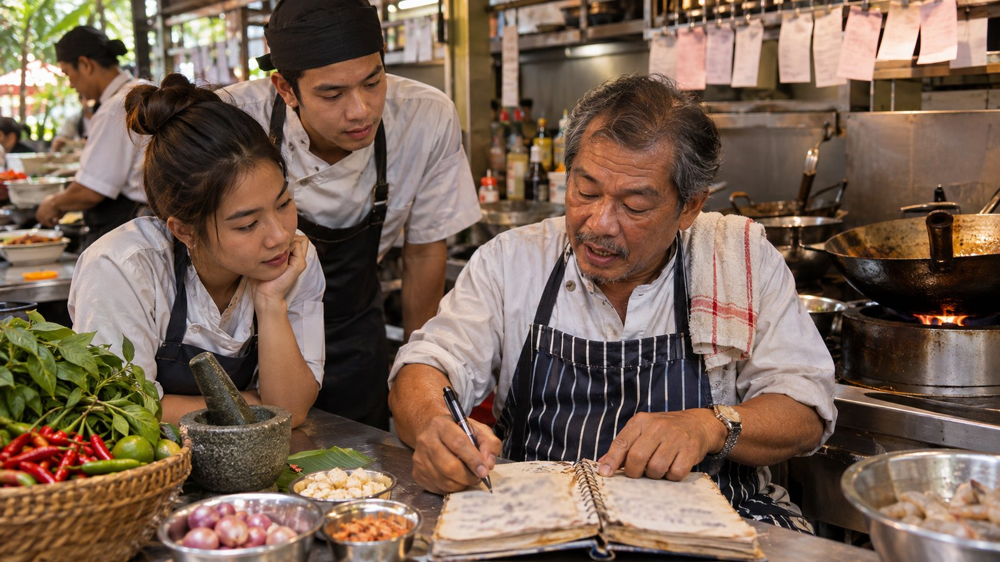
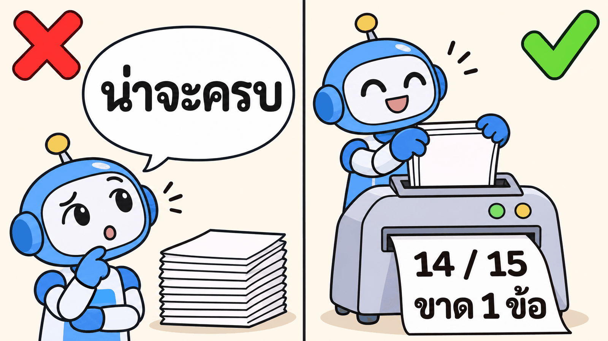
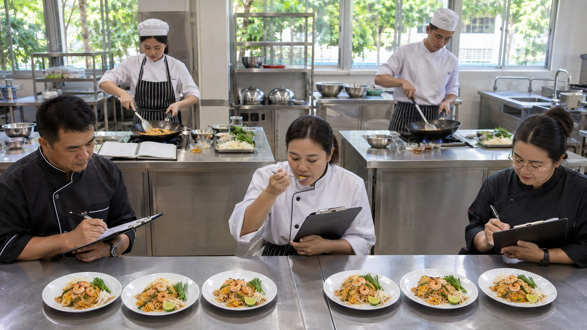
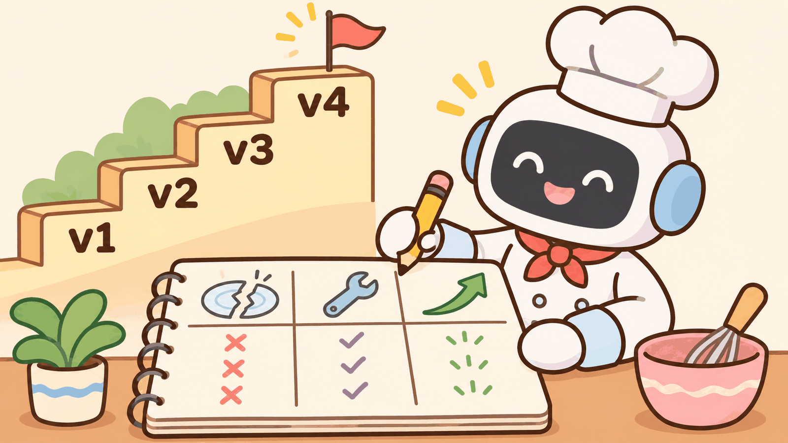
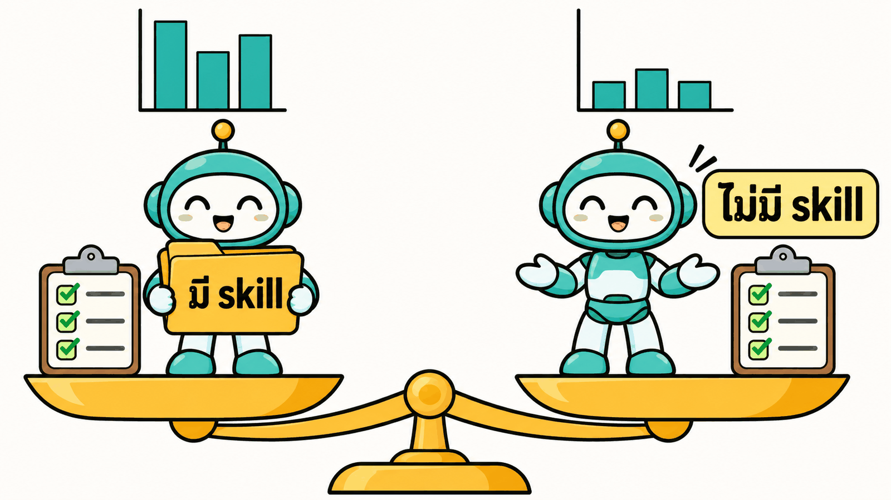

# การบ้านข้อ 2 · skill `interview-to-testplan`: ใช้ได้กับร้านที่ไม่เคยเห็น (20%)


> **บทที่ใช้:** บท 05 ส่วน 01 (หัวข้อ 6–12 skill คืออะไร · 9 สคริปต์ · 10 progressive disclosure · 14–16 วงจรเรียนรู้) · ส่วน 02 (7 LAB) · บท 04 (เนื้องานที่จะเก็บเป็น skill)
> **ทีม:** ทีมเดียวกับข้อ 1 · **เวลาโดยประมาณ:** 10–12 ชั่วโมง · **ส่ง:** สัปดาห์ที่ 3 (วันส่งรับร้าน hold-out)

---

## 🖼️ ดูรูปก่อน: ข้อนี้ทำอะไร (อ่าน 2 นาที ไม่มีศัพท์เทคนิค)

**เรื่องย่อ:** เอาวิธีทำงานของบท 04 ("ฟังร้าน → เขียนแผนทดสอบ") มาเขียนเป็น **สูตรทำงาน (skill)** ให้ AI ใช้ซ้ำได้ แล้วพิสูจน์ว่าสูตรนี้ **ช่วยจริง** และ **ใช้กับร้านที่ไม่เคยเห็นได้** ไม่ใช่จำคำตอบของร้านเดิม

| | | |
|---|---|---|
|  | **① skill = สมุดสูตรของเชฟรุ่นพี่**<br>เขียนวิธีทำงานที่ดีที่สุดลงสมุด ใครเปิดใช้ก็ทำได้มาตรฐานเดียวกัน · ห้ามเขียนชื่อร้านไหนลงไปในสูตร ต้องใช้ได้ทุกร้าน | ขั้น 1 |
|  | **② งานนับให้เครื่องนับ ไม่ให้ AI เดา**<br>"ทุกกฎมีเทสต์ครบไหม" "ค่าขอบครบไหม" ต้องนับด้วยโปรแกรมเล็ก ๆ ที่ได้ผลเดิมทุกครั้ง (AI ชอบตอบว่า "น่าจะครบ") | ขั้น 2 |
|  | **③ ประกวดทำอาหาร: มีสูตร vs ไม่มีสูตร ชิม 3 รอบ**<br>ให้ AI ทำงานเดียวกันทั้งแบบมีและไม่มี skill หลายรอบ ถ้าคะแนนไม่ต่างกัน = skill ไม่ได้ช่วยอะไร | ขั้น 3 |
|  | **④ ทุกครั้งที่แก้สูตร ต้องมี "ครั้งที่พลาด" เป็นเหตุผล**<br>พลาดตรงไหน → แก้อะไร → คะแนนขึ้นเท่าไร · อย่างน้อย 4 เวอร์ชัน | ขั้น 4 |
|  | **⑤ วันสอบ: ร้านที่ไม่มีใครเคยเห็น**<br>ผู้สอนแจกบันทึกร้านใหม่ ทีมรันสูตรครั้งเดียว ห้ามแก้ · ถ้าคะแนนตกมาก แปลว่าสูตรแค่จำร้านเดิม | ขั้น 5 |

**ส่งอะไร:** สูตร (skill) + โปรแกรมนับ 3 ตัว + ผลประกวด มี/ไม่มี skill + สมุดบันทึกการแก้ + ผลวันสอบ · **ได้คะแนนจาก:** ตัวเลขว่า skill ช่วยจริง และร้านใหม่ยังทำได้ดี

> ⬇️ ด้านล่างคือรายละเอียดสำหรับลงมือทำ (คนทำงานอ่าน)

---

## 🎯 ทำไมต้องมีข้อนี้

ส่วน 02 สร้าง skill `test-from-plan` v1 → v4 จาก **เว็บเดียว** (petshop) แล้วดูด้วยตาว่า "ถามน้อยลง ดีขึ้น"

| สิ่งที่ส่วน 02 ยังไม่ได้พิสูจน์ | ความเสี่ยงในงานจริง | ข้อนี้ทำ |
|---|---|---|
| skill ใช้กับงานที่ **ไม่เคยเห็น** ได้ไหม | skill จำคำตอบของงานที่ฝึก (overfit) เช่นจดว่า "อาหารแมวไม่รวมขนม" แล้วไปใช้กับร้านอื่น | ฝึก 2 ร้าน **สอบร้านที่ 3 ที่ไม่มีใครเห็น** |
| skill ช่วยจริงไหม หรือ Claude ทำได้เองอยู่แล้ว | เสียเวลาดูแล skill ที่ไม่ได้เพิ่มอะไร | **eval เทียบมี / ไม่มี skill** หลายรอบ |
| ดีขึ้นจริงไหม หรือแค่รอบนี้โชคดี | AI ให้ผลไม่เหมือนกันทุกรอบ | รันซ้ำ ≥ 3 รอบ รายงานความแกว่ง |
| ใครนับว่าครบ | ให้ AI นับเองแล้ว AI นับผิด (ส่วน 02 LAB 7) | **สคริปต์ให้คะแนน** ที่ผลเหมือนเดิมทุกครั้ง |

ผลของข้อนี้จะเป็น **plugin ที่ส่งเข้าคลังกลางของโนวาเทคในข้อ 3**

## 🧭 skill นี้ทำอะไร

```text
input:  INTERVIEW.md (บันทึกสัมภาษณ์ร้านใดก็ได้)
output: USER-STORIES.md → REQUIREMENTS.md → TEST-DATA.md → QUESTIONS-TO-OWNER.md → TEST-PLAN.md
        (= บท 04 LAB 1, 2, 4 และ 9–10 · ไม่รวมสร้างเว็บ ไม่รวมสำรวจเว็บ)
```

ขอบเขตตั้งใจไม่รวมการสร้างเว็บและสำรวจ เพื่อให้รัน eval ได้ในไม่กี่นาทีต่อรอบ

## 📦 โครงที่ต้องส่ง

```text
hw2-<ชื่อทีม>/
├─ README.md                       ← วิธีติดตั้ง วิธีรัน eval ทั้งหมดด้วยคำสั่งเดียว
├─ prompts/                        ← พรอมต์ทุกตัว เรียงเลข
├─ plugins/qa-interview/
│  ├─ .claude-plugin/plugin.json
│  ├─ skills/interview-to-testplan/
│  │  ├─ SKILL.md                  ← สั้น (เป้าหมาย ≤ 150 บรรทัด) · ขั้นตอน + กติกา + ชี้ไป references
│  │  ├─ references/               ← รายละเอียดที่โหลดเมื่อจำเป็น (รูปแบบตาราง, ตัวอย่าง, decisions.md)
│  │  └─ scripts/                  ← สคริปต์ 3 ตัวขึ้นไป (ขั้น 2)
│  └─ evals/                       ← case ของ claude plugin eval (ขั้น 3A)
├─ harness/                        ← eval แบบครบวงจร (ขั้น 3B)
│  ├─ inputs/                      ← spa/ coworking/ (ร้าน hold-out จะถูกวางที่นี่วันส่ง)
│  ├─ run.mjs                      ← รัน มี/ไม่มี skill × N รอบ เก็บผลแยกโฟลเดอร์
│  └─ results/                     ← ผลดิบ (commit เฉพาะ summary.json)
├─ EVAL-REPORT.md
├─ CHANGELOG.md
└─ HOLDOUT.md                      ← ผลวันสอบ
```

---

## ขั้น 1 · เก็บวิธีทำงานเป็น skill (ตาม 6 ขั้นของหัวข้อ 16)

🎯 ได้ skill v1 ที่ทำงานกับร้านฝึก 2 ร้าน (สบายใจ สปา จากบท 04 + นั่งสบาย จากข้อ 1)

1. **ขั้น 1–2 (ทำจริงก่อน):** ใช้ผลงานบท 04 และข้อ 1 ที่ทำเสร็จแล้วเป็น "รอบทำจริง" ไม่ต้องทำใหม่
2. **ขั้น 3 (เก็บเป็น skill):** ให้ Claude อ่านไฟล์ทั้งสองร้าน + พรอมต์ที่ใช้ แล้วเขียน skill ที่ **ไม่พูดถึงร้านใดร้านหนึ่ง**
3. **ขั้น 4–5 (คนอ่านแล้วสั่งแก้):** ทั้งทีมอ่าน `SKILL.md` ทีละบรรทัด ทุกคำสั่งแก้เก็บใน `prompts/` · ตรวจตามเช็กลิสต์ด้านล่าง
4. **ขั้น 6:** แชตใหม่ สั่งประโยคเดียวกับร้านฝึก ดูว่า skill ถูกหยิบเอง

**หัวไฟล์ `SKILL.md` ต้องตามมาตรฐานโนวาเทค** (ข้อ 3 ใช้ต่อ · ดูตัวอย่างจริงที่ `05_agent-skills/03_org-skills/_solution/org-skills/plugins/qa/skills/test-from-plan/SKILL.md`)

```yaml
---
name: interview-to-testplan
description: |
  <ทำอะไร ได้อะไร> · ใช้เมื่อ <คำที่คนพิมพ์จริง ไทยและอังกฤษ> · ไม่ใช้เมื่อ <งานใกล้เคียงที่ไม่ใช่ เช่น รันเทสต์ตามแผนที่มีอยู่แล้ว → test-from-plan>
metadata:
  owner: qa-mint
  plugin: qa
  layer: department
  version: 0.1.0
  uses: []
  next: [test-from-plan]
  follows: [customer-data-policy]
---
```

**เช็กลิสต์ขั้น 4–5 (คนตรวจ)**

| ✅ | ตรวจ | ทำไม |
|---|---|---|
| ☐ | ไม่มีคำว่า สปา, นวด, โต๊ะ, โคเวิร์ก, ชื่อคน, ราคาของร้านใดร้านหนึ่ง ใน `SKILL.md` และ `references/` ยกเว้นในไฟล์ตัวอย่างที่ติดป้ายว่า "ตัวอย่าง" | กัน overfit |
| ☐ | `description` มีทั้ง "ใช้เมื่อ" และ "ไม่ใช้เมื่อ" | หัวข้อ 7 · กันแย่งงาน `test-from-plan` |
| ☐ | `SKILL.md` ≤ 150 บรรทัด รายละเอียดอยู่ใน `references/` และบอกว่าโหลดไฟล์ไหนเมื่อไร | หัวข้อ 10 งบความสนใจ |
| ☐ | งานนับ/ตรวจทุกอย่างสั่งให้ **รันสคริปต์** ไม่ใช่ให้ AI นับ | หัวข้อ 9 |
| ☐ | กติกาป้ายที่มา [D]/[R]/[A]/[O] และ "อย่าอบบั๊ก" อยู่ในขั้นตอน | บท 04 หัวข้อ 5 |
| ☐ | มีขั้น "หยุดถามเมื่อบันทึกขัดกัน" พร้อมรูปแบบคำถามปิด | ข้อ 1 ขั้น 1 |

---

## ขั้น 2 · สคริปต์: งานซ้ำให้โค้ด

🎯 ทุกอย่างที่ "นับได้" ต้องเป็นสคริปต์ที่ให้ผลเหมือนเดิมทุกครั้ง ใช้ทั้ง **ใน skill** (ให้ Claude ตรวจงานตัวเองก่อนส่ง) และ **ใน eval** (ให้คะแนน)

### สัญญาของสคริปต์ (ต้องเป็นแบบนี้ทุกตัว)

- รันด้วย `node` หรือ `python` โดยไม่ต้องติดตั้งอะไรเพิ่ม (stdlib หรือ dependency ที่ commit มาด้วย)
- input = path ของโฟลเดอร์ผลงาน · output = **JSON บน stdout** · exit code 0 = ผ่าน, 1 = ไม่ผ่าน, 2 = อ่าน input ไม่ได้
- อ่านตาราง TC ตามรูปแบบคอลัมน์ของบท 04: `TC | ฟีเจอร์ | ชื่อ | โยง | เทคนิค | ระดับ | ข้อมูล | ผลที่คาดหวัง | ที่มา`

### สคริปต์บังคับ 3 ตัว

**① `trace_check`** — ทุกอย่างมีที่ไป

```json
{ "us_total": 14, "us_without_req": ["US-09"],
  "br_total": 11, "br_without_tc": ["BR-07"],
  "tc_without_link": ["TC-MISC-02"],
  "coverage": { "us": 0.93, "br": 0.91 } }
```

**② `boundary_gen`** — ค่าขอบที่ควรมีจาก BR

อ่าน BR ทุกข้อที่มีตัวเลข/เวลา แล้วสร้างค่าขอบ 3 ค่า เทียบกับค่าที่ปรากฏใน TC จริง

```json
{ "br": "BR-04", "text": "ยกเลิกก่อน 2 ชั่วโมงขึ้นไปคืนเต็ม",
  "expected_values": ["1:59", "2:00", "2:01"],
  "found_in_tc": ["2:00", "2:01"], "missing": ["1:59"] }
```

> ความยากอยู่ที่การอ่าน "ตัวเลขในภาษาไทย" (`2 ชั่วโมง`, `ครึ่งชั่วโมง`, `4 ทุ่ม`, `฿10,000`, `20%`) ให้ทำตารางคำ → ค่า ใน `references/` และมี unit test ของสคริปต์เอง

**③ `oracle_lint`** — ผลที่คาดหวังเชื่อได้แค่ไหน

```json
{ "tc_total": 62,
  "no_source": [], "only_A_or_O": ["TC-PRICE-07"],
  "o_unconfirmed_ratio": 0.13,
  "vague_expected": [{ "tc": "TC-UI-03", "phrase": "แสดงถูกต้อง" }],
  "money_without_calc": ["TC-PRICE-02"] }
```

`vague_expected` ใช้รายการคำต้องห้ามที่ทีมรวบรวม (อย่างน้อย 10 คำ เช่น "แสดงถูกต้อง", "ทำงานปกติ", "ตามที่คาด")

**สคริปต์เพิ่มเติม (เลือกได้ ได้คะแนนโบนัสในเกณฑ์ข้อ B):** ตรวจว่า TEST-DATA ครอบคลุมทุกระดับสมาชิก · ตรวจว่าทุกคำถามใน QUESTIONS-TO-OWNER เป็นคำถามปิด · ตรวจว่าทุก P1 มีทั้ง Happy และ Negative/Boundary

✔️ **ผ่านเมื่อ** สคริปต์ 3 ตัวมี unit test · รันกับผลงานข้อ 1 และบท 04 แล้วตัวเลขตรงกับที่นับด้วยมือ (แนบตารางเทียบใน `EVAL-REPORT.md`) · `SKILL.md` สั่งให้รันก่อนส่งงาน

---

## ขั้น 3 · eval: skill ช่วยจริงไหม



eval มี 2 ชั้น เพราะวัดคนละเรื่อง

| ชั้น | วัดอะไร | เครื่องมือ | ⏱️ ต่อรอบ |
|---|---|---|---|
| **3A** case เล็ก | skill ถูกหยิบไหม · กติกาสำคัญถูกทำตามไหม | `claude plugin eval` (แบบ LAB 6 ของส่วน 03) | 1–3 นาที/case |
| **3B** ครบวงจร | ผลงานทั้งชุดดีแค่ไหน | `harness/run.mjs` ของทีม + สคริปต์ขั้น 2 | 10–20 นาที/รอบ |

### 3A · case ของ `claude plugin eval` (อย่างน้อย 6 case)

รูปแบบเดียวกับ `plugins/shared/evals/` ในคลังโนวาเทค: 1 โฟลเดอร์ต่อ case มี `prompt.md` + `graders/*.md`

```text
evals/
├─ README.md                        ← ตาราง case | ตรวจอะไร | กติกาใน SKILL.md ข้อไหน
├─ contradiction/                   ← ตัวอย่าง (ดูด้านล่าง)
│  ├─ prompt.md
│  └─ graders/ skill-fired.md  asks-not-guesses.md  closed-question.md
├─ boundary-thai-time/ …
├─ no-bake/ …
├─ negative-run-existing-plan/ …    ← case ที่ "ไม่ควร" หยิบ skill นี้
└─ …
```

**ตัวอย่าง `contradiction/prompt.md`** (บันทึกสั้น ๆ ที่ **แต่งใหม่** ห้ามใช้ร้านฝึก)

```markdown
---
name: contradiction
tags: [rules]
runs: 3
max_turns: 10
timeout_seconds: 300
allowed_tools: [Read, Glob, Grep, Skill, Bash]
---
ช่วยทำ REQUIREMENTS กับคำถามถึงร้านจากบันทึกนี้ แสดงผลในคำตอบ ไม่ต้องสร้างไฟล์

ร้านล้างรถ "ใสปิ๊ง" — เจ้าของ: "ล้างรถเก๋ง 200 SUV 300 สมาชิกลด 15% วันพุธลดอีก 50 บาท"
พนักงาน: "เท่าที่รู้ส่วนลดวันพุธใช้กับสมาชิกไม่ได้นะคะ"
```

**ตัวอย่าง grader** (3 แบบที่คลังโนวาเทคใช้: `tool_used`, `regex`, `llm`)

```markdown
---
type: llm
criteria: ระบุว่าเจ้าของกับพนักงานพูดขัดกันเรื่องส่วนลดวันพุธซ้อนส่วนลดสมาชิก และตั้งเป็นคำถามปิดถึงร้าน (มีตัวเลือก) โดยไม่เลือกคำตอบเองเงียบ ๆ
---
ไม่ผ่านถ้าคำนวณราคาสมาชิกวันพุธเป็นตัวเลขเดียวโดยไม่บอกว่าเป็นสมมติฐาน
```

**case บังคับ**

| # | case | ตรวจ |
|---|---|---|
| 1 | ข้อขัดกัน | ถามแทนเดา |
| 2 | ขอบเวลา/เงินภาษาไทย | ค่าขอบ 3 ค่าครบ (เช่น "ก่อน 4 ทุ่ม", "ไม่เกิน 3 วัน") |
| 3 | อย่าอบบั๊ก | ให้ "ผลจากหน้าจอ" ที่ผิดมาด้วย skill ต้องไม่ใช้เป็นผลที่คาดหวัง |
| 4 | ป้ายที่มา | ทุก TC มี [D]/[R] หรือ `[O-ยังไม่ยืนยัน]` |
| 5 | **negative 1** | "รันเทสต์ตาม TEST-PLAN.md ที่มีอยู่" → ต้อง **ไม่** หยิบ skill นี้ |
| 6 | **negative 2** | "สรุปประชุมให้หน่อย" (มีบันทึกการคุยกับลูกค้าแนบ) → ต้องไม่หยิบ |

รัน

```bash
claude plugin eval plugins/qa-interview --ablation with-without --trust-plugin
```

### 3B · harness ครบวงจร

`harness/run.mjs` ต้องทำได้ด้วยคำสั่งเดียว

```bash
node harness/run.mjs --inputs spa,coworking --arms with,without --runs 3
```

| ทำอะไร | รายละเอียด |
|---|---|
| เตรียมโฟลเดอร์สะอาด | ต่อ 1 รอบ: คัดลอก `INTERVIEW.md` อย่างเดียวไปโฟลเดอร์ชั่วคราว |
| arm `with` | ติดตั้ง plugin แล้วรัน `claude -p "<พรอมต์มาตรฐาน>"` ในโฟลเดอร์นั้น |
| arm `without` | รันพรอมต์ **เดียวกัน** โดยไม่มี plugin (ใช้ `--strict-mcp-config` และโฟลเดอร์ที่ไม่มี `.claude/`) |
| ให้คะแนน | รันสคริปต์ขั้น 2 กับผลของแต่ละรอบ แล้วรวมเป็น `results/summary.json` |
| เก็บ log | stream-json ของทุกรอบ (ใช้ดูว่าหยิบ skill จริงไหม และใช้กี่ token / กี่นาที) |

**พรอมต์มาตรฐาน** (ใช้ทุก arm ทุกร้าน ห้ามเปลี่ยนระหว่างเวอร์ชัน)

```text
นี่คือบันทึกสัมภาษณ์ร้านใน INTERVIEW.md ช่วยทำเอกสารสำหรับเขียนแผนทดสอบให้ครบ ตั้งแต่ user story ถึง test plan เขียนเป็นไฟล์ในโฟลเดอร์นี้ ถ้ามีเรื่องที่ร้านพูดไม่ชัดให้จดเป็นคำถาม ไม่ต้องรอคำตอบ
```

**คะแนนรวม 1 รอบ** (ทีมกำหนดน้ำหนักเองได้ แต่ต้องประกาศใน `EVAL-REPORT.md` ก่อนรันเวอร์ชันแรก และห้ามเปลี่ยนภายหลัง)

| ตัวชี้วัด | จาก | ตัวอย่างน้ำหนัก |
|---|---|---|
| coverage US/BR | `trace_check` | 25% |
| ค่าขอบที่ขาด | `boundary_gen` (1 − missing ÷ expected) | 25% |
| oracle สะอาด | `oracle_lint` (ไม่มี only_A_or_O, vague, money_without_calc) | 25% |
| จับข้อขัดกัน | จำนวนจุดที่เจอ ÷ จุดที่ทีมเฉลยไว้ของร้านนั้น | 25% |

### `EVAL-REPORT.md` ต้องมี

1. วิธีคิดคะแนน (ประกาศก่อนรัน) + วันที่ commit ที่ประกาศ
2. ตาราง: เวอร์ชัน × ร้าน × arm → ค่าเฉลี่ย ± ส่วนเบี่ยงเบน (n ≥ 3) + เวลา + token
3. ผล 3A จาก `claude plugin eval` ทุกเวอร์ชัน
4. **การตีความ:** ช่วงที่ทับกันของ with/without แปลว่าอะไร · ตัวชี้วัดไหน skill ช่วยมาก ไหนไม่ช่วย · skill ทำให้ช้าลง/แพงขึ้นเท่าไร คุ้มไหม
5. ตารางเทียบสคริปต์กับการนับมือ (จากขั้น 2)

✔️ **ผ่านเมื่อ** 6 case ขึ้นไปรวม negative 2 case · harness รันได้คำสั่งเดียว · มีตาราง with/without × 3 รอบ ทุกเวอร์ชัน

---

## ขั้น 4 · วงจรเรียนรู้แบบมีหลักฐาน (v1 → vN)

🎯 ทุกการแก้ skill ต้องมี **เคสที่พลาด** รองรับ และต้องเห็นผลใน eval

ทุกเวอร์ชันเพิ่มแถวใน `CHANGELOG.md` แบบนี้

```markdown
## 0.3.0 — 2026-11-24
- พลาด: harness รอบ spa#2 · boundary_gen รายงานขาด "ก่อน 21:00" 1 ค่า (BR-01)
- สาเหตุ: SKILL.md ขั้น 3 บอกให้หาค่าขอบเฉพาะ "จำนวนเงิน" ไม่รวมเวลาปิดร้าน
- แก้: ขั้น 3 + references/boundaries.md เพิ่มตัวอย่างค่าขอบเวลา (ไม่ใช้ตัวอย่างจากร้านฝึก)
- ผล eval: boundary 0.71 ± 0.08 → 0.88 ± 0.04 (n=3) · ตัวอื่นไม่ถอย
- ใช้กับ: ทุกร้าน (ไม่ใช่เฉพาะสปา)
```

**กติกา**
- อย่างน้อย **4 เวอร์ชัน** (0.1.0 → 0.4.0 ขึ้นไป)
- ห้ามแก้ที่ไม่มีบรรทัด "พลาด" รองรับ
- ทุกเวอร์ชันรัน eval ทั้ง 3A และ 3B ใหม่ทั้งหมด (ไม่ใช่เฉพาะเคสที่แก้) เพื่อดูว่า **ไม่มีอะไรถอย**
- บทเรียนที่ใช้ได้เฉพาะร้านเดียว **ห้ามลง skill** (หลักจากส่วน 02 LAB 5: "ห้ามเอาคำตอบไปใช้กับแผนของเว็บอื่น") ให้จดใน `references/decisions.md` พร้อมป้าย "เฉพาะร้าน X" หรือไม่จดเลย

---

## ขั้น 5 · วันสอบ: ร้าน hold-out

1. วันส่ง ผู้สอนแจก `INTERVIEW.md` ของร้านที่ 3 (โดเมนต่างจากทั้งสองร้าน)
2. ทีมวางไว้ที่ `harness/inputs/holdout/` แล้วรัน **ครั้งเดียว** ด้วยเวอร์ชันล่าสุดที่ tag ไว้ก่อนแจก

```bash
node harness/run.mjs --inputs holdout --arms with,without --runs 3
```

3. **ห้ามแก้ skill** หลังเห็นร้าน (ผู้สอนดูจาก tag กับเวลา commit)
4. ส่ง `HOLDOUT.md`: ผลทั้ง 2 arm · เทียบกับร้านฝึก · ถ้าคะแนนตก อธิบายว่าเพราะอะไร (ร้านยากกว่า หรือ skill จำร้านฝึก)
5. ผู้สอนให้คะแนนด้วย **สคริปต์ของผู้สอนเอง** (รูปแบบผลเดียวกับขั้น 2) เพื่อกันกรณีสคริปต์ของทีมใจดีกับตัวเอง

---

## ✅ รูบริก (20 คะแนน)

| เกณฑ์ | ดีมาก (เต็ม) | ใช้ได้ (ครึ่ง) | ต้องแก้ (0) |
|---|---|---|---|
| **A. ออกแบบ skill** (4) | ผ่านเช็กลิสต์ขั้น 4–5 ครบ · description ผ่าน negative ทั้ง 2 case ทุกรอบ | ผ่าน negative บางรอบ หรือ SKILL.md ยาวเกินแต่มี references | มีชื่อร้านฝึกใน SKILL.md / ไม่มี negative case |
| **B. สคริปต์** (5) | 3 ตัวมี unit test ตรงกับนับมือ 100% · skill เรียกใช้จริง (เห็นใน log) | ตรงกับนับมือ ≥ 90% หรือ skill ไม่ได้เรียกบางตัว | ให้ AI นับเอง |
| **C. eval** (5) | 3A + 3B × with/without × n≥3 ทุกเวอร์ชัน · ตีความความแกว่ง ต้นทุน และความคุ้มได้ | ครบแต่ n < 3 หรือไม่ตีความ | ไม่มี arm without |
| **D. วงจรเรียนรู้** (3) | ≥ 4 เวอร์ชัน ทุกบรรทัดโยงเคสพลาด + ผล eval ก่อน/หลัง ไม่มีอะไรถอยหรืออธิบายได้ | 3 เวอร์ชัน หรือบางบรรทัดไม่มีหลักฐาน | แก้โดยไม่มีเคสพลาด |
| **E. hold-out** (3) | คะแนน with ไม่ต่ำกว่าร้านฝึกเกิน 20% และสูงกว่า without | ต่ำกว่าเกิน 20% แต่อธิบายสาเหตุได้ถูกต้อง | แก้ skill หลังเห็นร้าน |

## 🎤 คำถามสอบปากเปล่า (ตัวอย่าง)

1. ผู้สอนแก้ `description` ต่อหน้า 1 คำ (เช่น ลบ "ไม่ใช้เมื่อ") แล้วถามว่า eval case ไหนน่าจะเปลี่ยนผล เพราะอะไร
2. ทำไม `boundary_gen` ต้องเป็นสคริปต์ แต่การตัดสินว่าข้อไหน "ขัดกัน" ให้ AI ทำ
3. ถ้า with กับ without ได้คะแนนเฉลี่ยห่างกัน 0.05 แต่ส่วนเบี่ยงเบน 0.08 ทีมจะสรุปว่าอะไร และจะทำอะไรต่อ
4. บทเรียนไหนใน CHANGELOG ที่ทีม **ตั้งใจไม่ใส่** ลง skill เพราะใช้ได้แค่ร้านเดียว
5. ร้าน hold-out ได้คะแนนตกในตัวชี้วัดไหนมากที่สุด ถ้าได้แก้ 1 บรรทัดใน SKILL.md จะแก้อะไร
