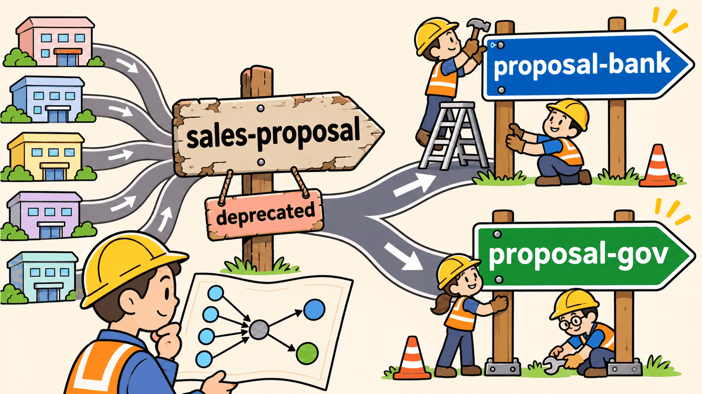

# การบ้านข้อ 4 · ⭐ คลัง skill 150+ ตัว: หาเจอ วัดได้ เปลี่ยนแปลงได้ไม่พัง (25%)


> **บทที่ใช้:** บท 05 ส่วน 01 หัวข้อ 21 (5 ชั้น) · 24 (หา skill ให้เจอ: หัวไฟล์, RAG, กราฟ) · 25 (Knowledge Graph) · ส่วน 03 LAB 2 (คลังกลาง) · LAB 7 (skill-finder + ผลวัด)
> **ทีม:** ทีมเดิม · **เวลาโดยประมาณ:** 12–16 ชั่วโมง · **ส่ง:** สัปดาห์ที่ 5
> **ต่อจาก:** CI ของข้อ 3 (skill ใหม่ทุกตัวต้องผ่าน)

---

## 🎯 ทำไมต้องมีข้อนี้

LAB 7 วัด `core:skill-finder` กับคลัง **23 skill** แล้วพบ 4 เรื่อง

| ผล LAB 7 | สิ่งที่ยังไม่รู้ |
|---|---|
| คำค้นที่ "เคยเห็น" hit@1 98% แต่คำค้นใหม่ **80%** | ถ้าคลังโตเป็น 150 ตัว ตกเหลือเท่าไร |
| คำค้นปนอังกฤษหาไม่เจอ 3 ข้อ | แก้ด้วยอะไรได้: description สองภาษา, embedding หรือ rerank |
| เติม "สรุปจากเนื้อหา" **ไม่ช่วย** ในคลังเล็ก แต่งานวิจัย (SkillRouter) บอกว่าช่วยในคลังใหญ่ | **เริ่มช่วยที่คลังขนาดเท่าไร** — บทเรียนสรุปว่า "ต้องวัดกับคลังของตัวเองเสมอ" แต่ยังไม่ได้วัด |
| คำถามของ MD "เปลี่ยนกฎแล้วกระทบใคร" ตอบได้ด้วยกราฟ | ถ้าต้อง **รื้อ** skill ที่คนอื่นพึ่งอยู่ (ไม่ใช่แค่แก้ตัวเลข) จะทำยังไงไม่ให้บริษัทพัง |

ตารางคำแนะนำในหัวข้อ 24.4 บอกว่าคลัง 100–1,000 ตัวต้องใช้ router + การค้นแบบผสม ข้อนี้ให้ **พิสูจน์ด้วยตัวเลขของตัวเอง** ว่าจริงไหม

## 🗺️ 3 ส่วน

| ส่วน | ทำอะไร | ⏱️ |
|---|---|---|
| A | ขยายคลังจาก 23 → 75 → 150 skill (มีตัวหลอกที่ตั้งใจให้ชนกัน) | 3–4 ชม. |
| B | วัดการค้น 3 วิธี × 2 แบบการ์ด × 3 ขนาดคลัง ด้วยคำค้นของ **ทีมอื่น** + ตัวตรวจ description ชนกัน | 6–8 ชม. |
| C | แยก `sales-proposal` เป็น 2 ตัว โดยวิเคราะห์ผลกระทบก่อน และไม่มีอะไรพัง | 3–4 ชม. |

---

## ส่วน A · ขยายบริษัท (5 คะแนน)

### A1 · เพิ่มแผนก

เพิ่มแผนกใหม่อย่างน้อย 5 แผนก เลือกจาก Legal, Marketing, Customer Support, Procurement, Security, Data/BI, Facilities หรือแผนกที่ทีมคิดเอง (ต้องสมจริงกับบริษัทเทคแบบโนวาเทค)

| ต่อ 1 แผนก ต้องมี | รายละเอียด |
|---|---|
| plugin ใหม่ | `plugins/<แผนก>/` + `plugin.json` + บรรทัดใน `marketplace.json` + `scripts/plugins.json` + CODEOWNERS (2 คนตามข้อ 3) |
| คนในแผนก | การ์ด `people/<user>.md` อย่างน้อย 2 ใบ (เรื่องที่เก่ง + คำที่ชอบพิมพ์) และบัญชี Gitea |
| skill | ตามสัดส่วนด้านล่าง |

### A2 · skill 3 ระดับ

| ระดับ | จำนวน | ต้องมี |
|---|---|---|
| **ทำงานได้จริง** | ≥ 30 ตัว (รวม 23 ตัวเดิม) | ขั้นตอนครบ · ใช้ข้อมูลใน `company-kit/` (เพิ่มไฟล์ได้) · ลองที่โต๊ะแล้วได้ผลงานจริง 1 ครั้ง (เก็บ log) |
| **สมจริง** | ที่เหลือจนครบ 150 | หัวไฟล์ครบตามมาตรฐาน (`owner`, `layer`, `version`, `uses/next/follows`) · `description` แบบที่คนเขียนจริง · ขั้นตอน 5–15 บรรทัด |
| **ตัวหลอกชนกัน** | ≥ 10 คู่ (อยู่ในกลุ่มสมจริง) | ชื่อหรือหน้าที่ใกล้กับ skill เดิม 23 ตัว **โดยตั้งใจ** เช่น `contract-review` (Legal) ↔ `deal-approval` (MD) · `campaign-deck` (Marketing) ↔ `exec-deck` · `incident-notice` (Support) ↔ `postmortem` |

ทุกคู่ชนกันจดใน `collisions.json`

```json
[
  { "a": "legal:contract-review", "b": "exec:deal-approval",
    "why": "ทั้งคู่ 'ตรวจดีลก่อนเซ็น' แต่ legal ดูข้อสัญญา ส่วน MD ดูกำไร/ความเสี่ยง",
    "how_to_tell": "มีคำว่า สัญญา/ข้อกฎหมาย → legal · มีคำว่า margin/อนุมัติดีล → exec" }
]
```

### A3 · 3 ขนาดคลังสำหรับวัด

ทำ 3 snapshot ของ **การ์ด** (ไม่ต้องเป็น 3 คลังใน Gitea): `cards-23.json` (คลังเดิม) · `cards-75.json` · `cards-150.json` · ทุกชุดใหญ่ต้องมีชุดเล็กอยู่ข้างใน และตัวหลอกชนกันต้องกระจายอยู่ทั้งชุด 75 และ 150

ใช้ `build-cards.mjs` ของ LAB 7 ([`_solution/lab7/search-eval/`](../../05_agent-skills/03_org-skills/_solution/lab7/search-eval/)) เป็นจุดเริ่ม · การ์ด 2 แบบเหมือน LAB 7:
- **H** หัวไฟล์อย่างเดียว (`name` + `description` + `metadata`)
- **H+S** หัวไฟล์ + สรุปจากเนื้อหา (ทีมกำหนดวิธีสรุป ต้องเหมือนกันทุกตัว)

✔️ **ผ่านเมื่อ** ทุก skill ผ่าน CI ของข้อ 3 (เปิดเป็น PR จริงอย่างน้อย 1 PR ต่อแผนก ที่เหลือ merge เป็นชุดได้) · มี 3 snapshot × 2 แบบการ์ด · `collisions.json` ≥ 10 คู่

---

## ส่วน B · วัดการค้นแบบไม่โกงตัวเอง (12 คะแนน)

### B1 · ชุดคำค้นจากคนจริง (ทั้งห้อง)

LAB 7 ได้ 98% กับคำค้นที่ "เคยเห็น" เพราะคนเขียน description ก็คือคนเขียนคำค้น · ข้อนี้กันด้วยการให้ **ทุกคนในห้องเขียนคำค้น แล้วแต่ละทีมใช้ได้เฉพาะคำค้นของทีมอื่น**

**นักศึกษาทุกคน** ส่งคำค้น 10 ข้อ (ภายในสัปดาห์ที่ 4) ทางฟอร์มที่ผู้สอนแจก

| field | ค่า | กติกา |
|---|---|---|
| `q` | คำสั่งที่พนักงานจะพิมพ์ | เขียนแบบพนักงานจริง **ห้ามเปิดดู description** ของ skill ตอนเขียน · ดูได้แค่การ์ดพนักงาน `people/` กับ README ของ LAB |
| `who` | user ของคนที่พิมพ์ เช่น `hr-fah` | |
| `expect` | `plugin:skill` จาก **23 ตัวเดิม** หรือ `none` | 8 ข้อชี้ skill เดิม · **2 ข้อเป็น `none`** (งานที่ไม่มี skill ไหนทำ เช่น "จองห้องประชุมให้หน่อย") |
| `lang` | `th` / `en` / `mix` | อย่างน้อย 3 ข้อเป็น `en` หรือ `mix` |
| `style` | `short` / `story` / `vague` | ครบทั้ง 3 แบบ |

> ทำไม `expect` ชี้แค่ 23 ตัวเดิม: ทุกทีมมีคลังเดิมชุดเดียวกัน คำค้นของทีมหนึ่งจึงใช้กับคลังของทุกทีมได้ ส่วน skill ที่แต่ละทีมเพิ่มคือ **ตัวหลอก** ที่ทำให้หายากขึ้น ซึ่งคือสิ่งที่เราอยากวัด

ผู้สอนรวมเป็น `queries-class.json` (รูปแบบเดียวกับ `queries-heldout.json` ของ LAB 7 + field `team`) · ทีมกรองคำค้นของทีมตัวเองออกก่อนใช้

### B2 · 3 วิธีค้น

| วิธี | รายละเอียด | หมายเหตุ |
|---|---|---|
| **BM25** (baseline) | `search.mjs` ของ LAB 7 (BM25 บน character trigram ภาษาไทย + คำอังกฤษ) ใช้ตามเดิม ห้ามปรับ | ใช้เทียบกับผล LAB 7 |
| **Hybrid** | BM25 + embedding (โมเดลที่รองรับภาษาไทย รันในเครื่องได้ เช่นตระกูล multilingual-e5 หรือ bge-m3) รวมคะแนนด้วย Reciprocal Rank Fusion หรือถ่วงน้ำหนัก | บอกชื่อและขนาดโมเดล |
| **Rerank** | เอา top-20 จาก Hybrid ให้ LLM เลือก top-5 (เช่น `claude -p` ด้วยโมเดลเล็ก) · พรอมต์ rerank เก็บใน `prompts/` | นับ token และค่าใช้จ่ายจริง |

ทุกวิธีต้องคืนผลแบบเดียวกัน: รายการ `plugin:skill` เรียงคะแนน 5 อันดับ **หรือ** `none` ถ้าคะแนนอันดับ 1 ต่ำกว่าเกณฑ์ (ทีมตั้งเกณฑ์จากชุด dev ที่แบ่งไว้ ไม่ใช่จากชุดทดสอบ)

### B3 · ตัวชี้วัด

| ตัวชี้วัด | สูตร | ใช้ตอบคำถาม |
|---|---|---|
| hit@1 | สัดส่วนที่อันดับ 1 = `expect` | Claude หยิบเองได้ถูกไหม |
| hit@5 | สัดส่วนที่ `expect` อยู่ใน 5 อันดับ | ถ้าเสนอ 5 ตัวให้คนเลือก จะเจอไหม |
| MRR | ค่าเฉลี่ยของ 1 ÷ อันดับที่เจอ (ไม่เจอ = 0) | ภาพรวมของลำดับ |
| none-accuracy | สัดส่วนคำค้น `none` ที่ตอบ `none` | ระบบรู้ไหมว่าไม่มี skill (กันการยัด skill ผิดตัว) |
| collision-confusion | จากคำค้นที่ `expect` อยู่ใน `collisions.json` สัดส่วนที่อันดับ 1 เป็นคู่หลอก | ตัวหลอกทำร้ายแค่ไหน |
| latency p50 / p95 | มิลลิวินาทีต่อคำค้น | ใช้จริงได้ไหม |
| ค่าใช้จ่าย | บาทต่อ 1,000 คำค้น (Rerank) | คุ้มไหม |

แยกผลตาม `lang` และ `style` ด้วย (คำค้นปนอังกฤษคือจุดที่ LAB 7 พลาด)

### B4 · ตารางผลที่ต้องได้

3 วิธี × 2 แบบการ์ด × 3 ขนาดคลัง = **18 แถว** (Rerank ใช้การ์ดชุดเดียวกับ Hybrid ที่ส่งมา)

| ขนาด | การ์ด | วิธี | hit@1 | hit@5 | MRR | none-acc | collision | p95 (ms) | ฿/1k |
|---|---|---|---|---|---|---|---|---|---|
| 23 | H | BM25 | | | | | | | 0 |
| … | | | | | | | | | |

แล้ววาดกราฟ (Python/matplotlib ห้ามใช้ image gen) **hit@1 เทียบขนาดคลัง** เส้นละ 1 วิธี × การ์ด

### B5 · ตอบด้วยตัวเลข

`SEARCH-REPORT.md` ต้องตอบ 5 คำถามนี้ โดยทุกคำตอบชี้แถวในตาราง

1. คลังโตจาก 23 → 150 hit@1 ของ BM25 ตกเท่าไร ตรงกับที่หัวข้อ 24.1 บอกไหม
2. การ์ด H+S เริ่มดีกว่า H ที่ขนาดเท่าไร (หรือไม่ดีกว่าเลย) อธิบายว่าทำไม — โยงกับผล LAB 7 และ SkillRouter
3. คำค้น `mix` / `en` ดีขึ้นด้วยวิธีไหนมากที่สุด และการแก้ที่ **description** (ใส่คำอังกฤษที่คนพิมพ์จริง) ได้ผลเท่ากันไหมโดยไม่ต้องจ่ายค่า embedding
4. ถ้าบริษัทมีงบ 0 บาทต่อเดือนสำหรับการค้น จะเลือกอะไร ถ้ามีงบ จะเลือกอะไร (ใช้ค่าใช้จ่ายจริงคูณจำนวนคำค้นต่อวันที่สมมติ)
5. ตารางในหัวข้อ 24.4 ของบทเรียน ควรแก้ไหม แก้ตรงไหน

### B6 · ตัวตรวจ description ชนกัน (ต่อยอดจาก PR D ใน LAB 6)

ใน LAB 6 Claude ไม่ยอมเปิด PR skill `report` เพราะเห็นว่าจะแย่งงาน 5 skill · แต่ถ้าคนเปิด PR ผ่านหน้าเว็บ (PR D') ไม่มีใครเตือน ข้อนี้ทำให้ CI เตือน

| ต้องทำ | รายละเอียด |
|---|---|
| `scripts/check_collision.py` (หรือ `.mjs`) | เทียบ `description` ของ skill ที่ PR เพิ่ม/แก้ กับทุกตัวในคลัง ด้วยวิธีที่ไม่ใช้ AI ใน CI (BM25 หรือ embedding ที่ commit โมเดลมาด้วย) |
| เกณฑ์ | ตั้งจาก `collisions.json` (ต้องจับคู่ที่ตั้งใจได้) และคู่ที่ไม่ชน (สุ่มมา 50 คู่) · รายงาน precision / recall ที่เกณฑ์ที่เลือก |
| ผลใน CI | ชนเกินเกณฑ์ = ขอรีวิวจาก CODEOWNER **ของทั้งสองฝั่ง** (ไม่ใช่บล็อกทันที) และคอมเมนต์ใน PR ว่าชนกับตัวไหน |
| ทดสอบ | เปิด PR D' ของ LAB 6 ซ้ำ (skill `report` แบบกว้าง) ต้องถูกเตือนชนกับอย่างน้อย 3 ตัว |

✔️ **ผ่านเมื่อ** ใช้คำค้นของทีมอื่นเท่านั้น (ผู้สอนตรวจจาก field `team`) · 18 แถวครบ · กราฟ · ตอบครบ 5 ข้อด้วยตัวเลข · ตัวตรวจชนกันจับ PR D' ได้

---

## ส่วน C · เปลี่ยนแปลงโดยไม่พัง (8 คะแนน)



### สถานการณ์

ฝ่าย Legal (แผนกที่ทีมเพิ่มในส่วน A) แจ้งว่า **ลูกค้าภาครัฐมีกฎข้อมูลต่างจากธนาคาร** (เช่น ต้องเก็บข้อมูลในศูนย์ข้อมูลภาครัฐ, เอกสารต้องมีหัวข้อตาม TOR ภาครัฐ, ห้ามใช้ cloud ต่างประเทศ) จึงต้องแยก `sales:sales-proposal` เป็น

- `sales:proposal-bank` — ลูกค้าธนาคาร/สถาบันการเงิน (ภาคผนวก PDPA แบบ LAB 5)
- `sales:proposal-gov` — ลูกค้าภาครัฐ (กฎใหม่ที่ทีมเขียนเองใน `company-kit/gov-rules.md`)

### C1 · วิเคราะห์ผลกระทบ **ก่อน** ลงมือ

ใช้กราฟ (`graph.mjs` ของ LAB 7 ต่อยอดให้รองรับคลัง 150 ตัว) ตอบใน `MIGRATION.md`

| ต้องหา | ตัวอย่างคำตอบ (รูปแบบ) |
|---|---|
| skill ที่มีเส้น `uses` / `next` / `follows` เข้าหรือออกจาก `sales-proposal` | `finance:pricing-calc —next→ sales-proposal` … |
| โต๊ะที่ติดตั้ง plugin `sales` | `sales-nida`, `sales-krit`, … |
| เอกสาร/ไฟล์ที่อ้างชื่อ `sales-proposal` (README, references, deals/) | ใช้ `grep` เป็นหลักฐาน |
| ใครต้องรีวิว / ใครต้องได้รับแจ้ง | CODEOWNER ของทุก plugin ที่กระทบ |
| **คำทำนาย:** หลังแยก มีอะไรพังถ้าไม่ทำอะไรเพิ่ม | เช่น `skill-finder` ส่งคนไปหา skill ที่ไม่มีแล้ว |

commit คำทำนายนี้ **ก่อน** เริ่มแก้ แล้วหลังทำเสร็จเทียบว่าทายถูกกี่ข้อ พลาดอะไร (ผู้สอนดูเวลา commit)

### C2 · แผนเลิกใช้ (deprecation)

| ขั้น | ทำอะไร | เวอร์ชัน (ต้องให้เหตุผลตาม semver) |
|---|---|---|
| 1 | สร้าง `proposal-bank` (ย้ายเนื้อหาเดิม) + `proposal-gov` (ใหม่) | plugin `sales` minor หรือ major? |
| 2 | `sales-proposal` กลายเป็น **skill นำทาง**: ถามว่าลูกค้าเป็นธนาคารหรือภาครัฐ แล้วส่งต่อตัวใหม่ · `description` บอกว่าเลิกใช้ วันหมดอายุ และตัวแทน · ติด `metadata.deprecated: true` + `replaced_by: [...]` | skill นำทาง major หรือ minor? |
| 3 | แก้ทุกเส้นใน C1 ให้ชี้ตัวใหม่ (PR แยกตาม plugin ให้ CODEOWNER แต่ละแผนกรีวิว) | ทุก plugin ที่แก้ |
| 4 | หลังวันหมดอายุ ลบ `sales-proposal` | plugin `sales` major? |

**ต้องอธิบาย:** ทำไมไม่ลบทันที · ผู้ใช้ที่ยังพิมพ์ "ทำ proposal ให้ลูกค้า" (ไม่บอกประเภท) จะเจออะไรในแต่ละขั้น · คนที่ยังไม่ `claude plugin update` จะเจออะไร

### C3 · CI กันเส้นขาด

เพิ่มใน `check_headers.py` (หรือสคริปต์ใหม่)

| กฎ | ผล |
|---|---|
| `uses/next/follows` ชี้ skill ที่ไม่มีอยู่ | ❌ บล็อก (มีอยู่แล้วใน LAB 6 ตรวจว่ายังทำงานกับคลัง 150) |
| skill ใหม่ชี้ไปที่ skill ที่ `deprecated: true` | ⚠️ เตือน + บอกตัวแทน |
| ลบ skill ที่ยังมีเส้นชี้เข้า | ❌ บล็อก พร้อมรายการเส้นที่ค้าง |
| `deprecated` ที่เลยวันหมดอายุแล้วแต่ยังไม่ลบ | ⚠️ เตือนใน release |

พิสูจน์ด้วย PR ที่ตั้งใจทำผิด 3 ตัว (ลบก่อนแก้เส้น · skill ใหม่ชี้ตัวที่เลิกใช้ · ชี้ชื่อที่พิมพ์ผิด)

### C4 · รันงานจริงซ้ำ

| งาน | โต๊ะ | ต้องได้ |
|---|---|---|
| deal-001 (ธนาคาร) | `sales-krit` | หยิบ `proposal-bank` · ภาคผนวก PDPA ครบ 3 ข้อแบบผล LAB 5 (แจ้งเหตุ ≤ 24 ชม.) |
| deal-002 (ธนาคาร) | `sales-nida` | เหมือนข้างบน |
| ดีลภาครัฐใหม่ (ทีมเขียน TOR เอง) | `sales-krit` | หยิบ `proposal-gov` · มีกฎภาครัฐครบ · **ไม่มี** ภาคผนวกธนาคาร |
| "ทำ proposal ให้ลูกค้าหน่อย" (ไม่บอกประเภท) | `sales-krit` | skill นำทางถามก่อน ไม่เดา |
| คำถาม MD แบบ LAB 7 | `md-somchai` | "ถ้าเปลี่ยนกฎภาครัฐ กระทบ skill ไหน" → ตอบจากกราฟใหม่ถูก |

✔️ **ผ่านเมื่อ** คำทำนายถูก commit ก่อนแก้ · ทุกขั้นของแผนมีเหตุผล semver · CI จับ PR ผิด 3 ตัว · งาน 5 ข้อได้ผลตามตาราง (เก็บ log)

---

## 📦 ส่ง

```text
hw4-<ชื่อทีม>/
├─ README.md               ← วิธีรันการวัดทั้งหมดด้วยคำสั่งเดียว
├─ prompts/
├─ org-skills/             ← คลังหลังส่วน A + C (หรือ gitea-export)
├─ collisions.json
├─ search-eval/
│  ├─ cards-{23,75,150}-{H,HS}.json
│  ├─ queries-test.json    ← คำค้นของทีมอื่น (ไม่มีของทีมตัวเอง)
│  ├─ queries-dev.json     ← ชุดที่ใช้ตั้งเกณฑ์ none (แยกจากชุดทดสอบ)
│  ├─ bm25/ hybrid/ rerank/
│  ├─ run-all.mjs          ← ได้ results.json + ตาราง 18 แถว
│  └─ results.json  chart-hit1.png
├─ SEARCH-REPORT.md
└─ MIGRATION.md            ← กราฟก่อน/หลัง · คำทำนาย vs จริง · แผนเลิกใช้ · ผล C4
```

## ✅ รูบริก (25 คะแนน)

| เกณฑ์ | ดีมาก (เต็ม) | ใช้ได้ (ครึ่ง) | ต้องแก้ (0) |
|---|---|---|---|
| **A. ขยายคลัง** (5) | ≥ 150 ผ่าน CI · ≥ 30 ทำงานจริงมี log · ≥ 10 คู่ชนกันพร้อม `how_to_tell` | 100–149 ตัว หรือทำงานจริง < 30 | ไม่ผ่าน CI / ไม่มีตัวหลอก |
| **B. การวัด** (8) | คำค้นของทีมอื่นเท่านั้น · 18 แถวครบทุกตัวชี้วัด · แยกตาม lang/style · กราฟ · ตอบ 5 ข้อด้วยตัวเลข | ขาดวิธี Rerank หรือขาดขนาดคลัง 1 ขนาด | ใช้คำค้นที่ทีมเขียนเอง |
| **B6. ตัวตรวจชนกัน** (4) | precision/recall รายงานครบ · จับ PR D' ได้ · ขอรีวิวทั้งสองฝั่ง | จับได้แต่ไม่มีการตั้งเกณฑ์จากข้อมูล | ไม่มี |
| **C. เปลี่ยนแปลง** (8) | คำทำนาย commit ก่อน และเทียบผลจริง · semver มีเหตุผลทุกขั้น · CI 4 กฎ + PR ผิด 3 ตัว · งาน 5 ข้อผ่าน | ทำครบแต่คำทำนายเขียนหลังทำ หรือ C4 ผ่าน 3–4 ข้อ | ลบ skill เดิมทันที / ดีลธนาคารไม่ได้ภาคผนวก PDPA |

## 🎤 คำถามสอบปากเปล่า (ตัวอย่าง)

1. ถ้าบริษัทโตเป็น 2,000 skill วิธีไหนในตารางของทีมพังก่อน เพราะอะไร (ชี้เส้นในกราฟ)
2. คู่ชนกันคู่ไหนทำร้ายการค้นมากที่สุด ถ้าแก้ได้แค่ description ฝั่งเดียว จะแก้ฝั่งไหน แก้ว่าอะไร
3. ทำไมต้องใช้คำค้นของทีมอื่น ถ้าใช้ของตัวเองตัวเลขจะเปลี่ยนไปทางไหน (โยงกับ LAB 7: 98% vs 80%)
4. เส้นไหนในกราฟที่ทีมทำนายพลาดใน C1 ทำไมกราฟถึงไม่เห็น
5. ผู้สอนให้ PR ที่ลบ `sales-proposal` ก่อนวันหมดอายุ: CI ของทีมทำอะไร และใครควรมีสิทธิ์ override
