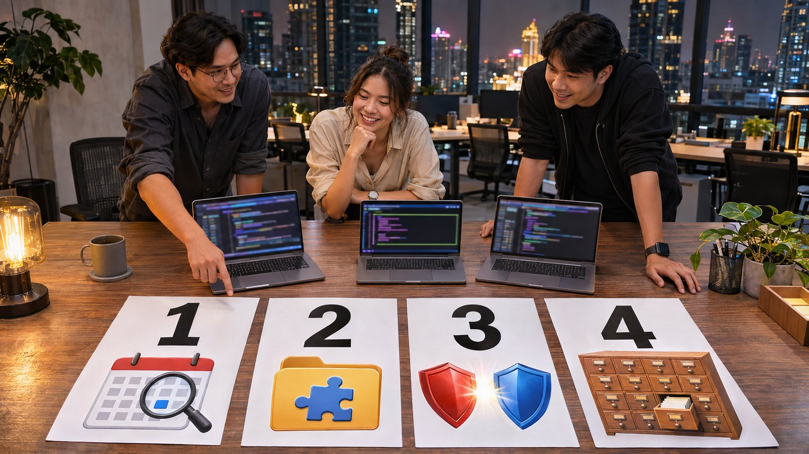
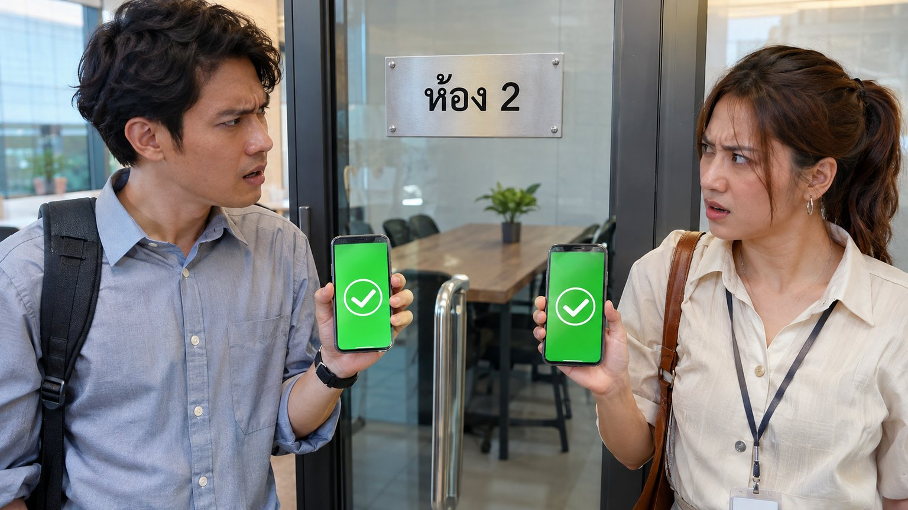
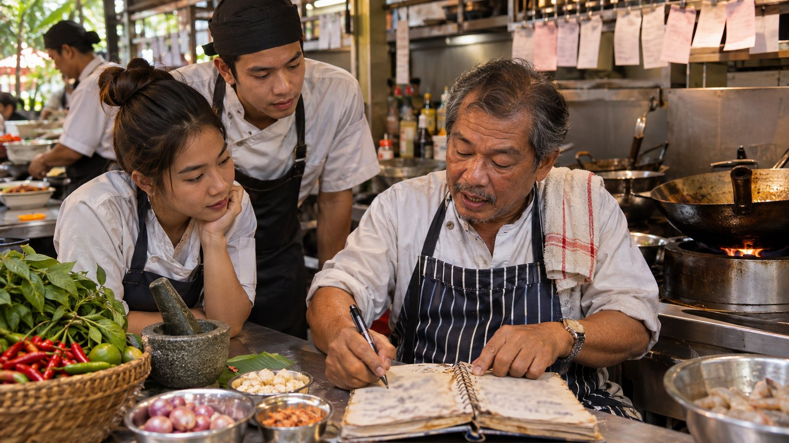
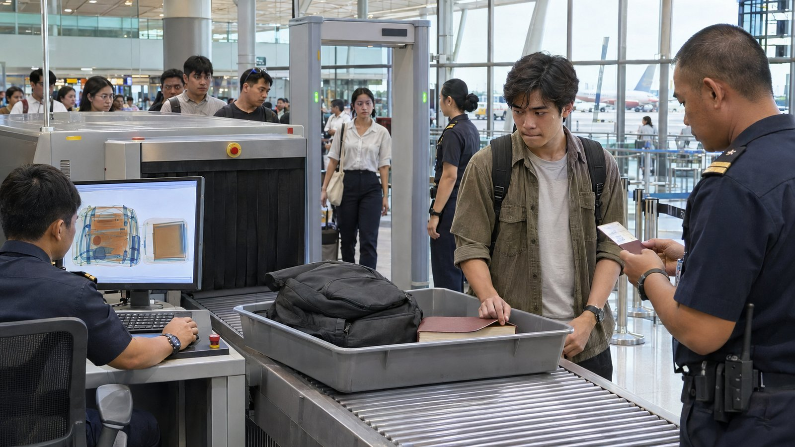

# การบ้านสัปดาห์ที่ 1 · จากผู้ทดสอบคนเดียว สู่ skill ของทั้งองค์กร



> 🎯 **สำหรับ dev มืออาชีพ** การบ้านทุกข้อ **เกินจากที่ทำใน LAB** แต่ละข้อเริ่มจากสิ่งที่ทำในชั้นเรียน แล้วให้ไปต่อในจุดที่บทเรียนเองยอมรับว่ายังไม่ได้ทำ
> การบ้านไม่ได้วัดว่า "ได้ไฟล์ออกมาไหม" เพราะ Claude สร้างไฟล์ให้ได้เสมอ แต่วัดว่า **คุณพิสูจน์ได้ไหมว่างานถูก** ด้วยตัวเลข หลักฐาน และการตอบคำถามสด

## 🖼️ ดูรูปเข้าใจทั้ง 4 ข้อใน 1 นาที

| ข้อ | ภาพ | พูดง่าย ๆ |
|---|---|---|
| **1** |  | **ทำแบบบท 04 กับร้านจองห้องใหม่ แล้วพิสูจน์ว่าแผนทดสอบจับของผิดได้จริง** เช่น สองคนกดจองห้องเดียวกันพร้อมกันต้องได้แค่คนเดียว · ให้เครื่องสุ่มลูกค้า 1,000 แบบเทียบราคา · แลกบั๊กกับทีมเพื่อน |
| **2** |  | **เขียนวิธีทำงานเป็นสูตร (skill) ให้ AI ใช้ซ้ำ** แล้วประกวด "มีสูตร vs ไม่มีสูตร" หลายรอบ · วันสอบใช้กับร้านที่ไม่มีใครเคยเห็น |
| **3** ⭐ |  | **คลังสูตรกลางของบริษัทมีด่านตรวจเหมือนสนามบิน** ทีมเล่นเป็นคนร้ายแอบพาของอันตรายผ่านด่าน แล้วเล่นเป็นยามอัปเกรดด่าน โดยของดีต้องยังผ่าน |
| **4** ⭐ |  | **คลังโตจาก 23 เป็น 150 สูตร AI ยังหยิบถูกไหม** ลองวิธีค้น 3 แบบ วัดด้วยคำถามของทีมอื่น แล้วย้ายสูตรตัวหนึ่งแบบติดป้ายบอกทาง ไม่ให้ใครเดือดร้อน |

> แต่ละข้อมีส่วน **"🖼️ ดูรูปก่อน"** อยู่บนสุด (ภาษาง่าย ไม่มีศัพท์เทคนิค) · ส่วนล่างเป็นรายละเอียดสำหรับคนลงมือทำ

## 📚 4 ข้อ (สรุปแบบละเอียด)

| ข้อ | เรื่อง | ต่อยอดจาก | ใหม่ที่ต้องเรียนเพิ่ม | น้ำหนัก |
|---|---|---|---|---|
| [1](01_coworking-testplan/) | **"นั่งสบาย โคเวิร์กกิ้ง"** · แผนทดสอบที่พิสูจน์ได้ว่าแข็งแรง | บท 02 · 03 · **04** | race condition · property-based testing (fast-check) · mutation testing (Stryker) · แลกบั๊กข้ามทีม | 25% |
| [2](02_skill-interview-to-testplan/) | **skill `interview-to-testplan`** · ใช้ได้กับร้านที่ไม่เคยเห็น | **บท 05 ส่วน 01–02** · บท 04 | ออกแบบ eval (มี/ไม่มี skill × หลายรอบ) · สคริปต์ให้คะแนน · hold-out | 20% |
| [3](03_skillops-red-blue/) | ⭐ **SkillOps Red Team / Blue Team** ของโนวาเทค | **บท 05 ส่วน 03** LAB 5–6 | supply-chain / prompt-injection ของ skill (OWASP LLM Top 10) · AST + การตรวจพฤติกรรม · threat model | 30% |
| [4](04_skill-discovery-at-scale/) | ⭐ **คลัง skill 150+ ตัว** · หาเจอ วัดได้ เปลี่ยนแปลงได้ไม่พัง | **บท 05 ส่วน 01 ภาค 4** · ส่วน 03 LAB 2, 7 | hybrid search + rerank · hit@k / MRR · deprecation + semver | 25% |

ข้อ 3 และ 4 (skill ระดับองค์กร) มีน้ำหนักรวม **55%** เพราะเป็นเรื่องที่สำคัญที่สุดของสัปดาห์

### ข้อต่อกันยังไง

```text
ข้อ 1  ทำงานบท 04 กับร้านใหม่ให้ดีจริง ─────┐
                                            ▼
ข้อ 2  เก็บวิธีทำงานนั้นเป็น skill + พิสูจน์ด้วย eval ──┐
                                                    ▼
ข้อ 3  เอา skill เข้าคลังกลางของบริษัท · เจาะ CI · อุด CI ──┐
                                                         ▼
ข้อ 4  คลังโตเป็น 150 ตัว · หาให้เจอ · รื้อ skill โดยไม่พัง (ใช้ CI ของข้อ 3)
```

ทำตามลำดับ เพราะแต่ละข้อใช้ผลของข้อก่อน · ถ้าข้อก่อนไม่สมบูรณ์ ใช้ `_solution/` ของบทเรียนแทนได้ (บอกไว้ใน README ของแต่ละข้อ) โดยไม่เสียคะแนนข้อถัดไป

## 📅 กำหนดส่ง

| สัปดาห์ | ส่ง | งานร่วมทั้งห้อง |
|---|---|---|
| 2 | ข้อ 1 ขั้น 0–1 (เว็บ + แผน + คำถามถึงร้าน) | ผู้สอนตอบคำถามถึงร้าน 1 รอบ · ประกาศคู่ทีมของข้อ 1 · ทีมฝังบั๊กให้คู่ |
| 3 | ข้อ 1 ครบ · ข้อ 2 ครบ | **วันส่งข้อ 2 ผู้สอนแจกร้าน hold-out** |
| 4 | ข้อ 3 ส่วน A–B | ประกาศคู่ทีมของข้อ 3 · ส่ง PR อันตรายให้คู่ · **ทุกคนส่งคำค้น 10 ข้อ** (ข้อ 4) |
| 5 | ข้อ 3 ส่วน C · ข้อ 4 | สอบปากเปล่าทุกข้อ |

## 👥 รูปแบบการทำงาน

| เรื่อง | กติกา |
|---|---|
| ทีม | 2–3 คน · ทีมเดิมตลอด 4 ข้อ |
| ส่งงาน | 1 Git repo ต่อข้อ ชื่อ `hw<ข้อ>-<ชื่อทีม>` · ส่งลิงก์ให้ผู้สอน |
| AI | ใช้ Claude Code ได้เต็มที่ · **ต้องเก็บพรอมต์ทุกตัว** ใน `prompts/` เรียงเลข (ตัวต่อตัว ไม่สรุป) |
| commit | ทีละขั้น ข้อความ commit ขึ้นต้นด้วยเลขขั้น เช่น `step2: ...` · commit ก้อนเดียวตอนท้าย = หักขั้นละ 1 คะแนน |
| รันซ้ำ | ทุกตัวเลขในรายงานต้องรันซ้ำได้ด้วยคำสั่งที่เขียนไว้ใน `README.md` ของทีม · ผู้สอนรันบนเครื่องสะอาด |
| เฉลยบทเรียน | ข้อ 1–2 ห้ามเปิด `_solution/` ของบท 04 · ข้อ 3–4 ใช้ `_solution/org-skills/` และ `_solution/lab7/` เป็นจุดเริ่มได้ |
| ความปลอดภัย | ข้อ 3 ทำเฉพาะ Gitea ในเครื่องตัวเอง · ปลายทาง "ส่งข้อมูลออก" ใช้ได้แค่ `collector.attacker.test` · ความลับใช้แต่ของปลอม |

## 🎤 สอบปากเปล่า (ใช้ตัดสินคะแนนจริงทุกข้อ)

- ผู้สอนสุ่มสมาชิก **1 คน** ต่อทีม ตอบ **10 นาทีต่อข้อ**
- คำถามเน้น "ทำไม" และ "ถ้าเปลี่ยนแบบนี้จะเกิดอะไร" เช่น ผู้สอนแก้ `description` ต่อหน้า หรือเปิด PR อันตรายใหม่สด ๆ (ตัวอย่างคำถามอยู่ท้าย README ของแต่ละข้อ)
- ตอบไม่ได้ = คะแนนส่วนนั้น **หักครึ่ง** แม้ไฟล์จะครบ (กันกรณีให้ AI ทำทั้งหมดแล้วไม่เข้าใจงานของตัวเอง)

## 🧮 คะแนนรวม

| ข้อ | เต็ม | ส่วนประกอบหลัก |
|---|---|---|
| 1 | 25 | ฟังร้าน 5 · race 5 · property 5 · mutation 5 · แลกบั๊ก 5 |
| 2 | 20 | ออกแบบ skill 4 · สคริปต์ 5 · eval 5 · วงจรเรียนรู้ 3 · hold-out 3 |
| 3 | 30 | เข้าคลังถูกวิธี 6 · Red 12 · Blue 8 · กระบวนการ + threat model 4 |
| 4 | 25 | ขยายคลัง 5 · การวัด 8 · ตัวตรวจชนกัน 4 · เปลี่ยนแปลง 8 |
| **รวม** | **100** | |

<sub>ภาพประกอบทั้งหมดในโฟลเดอร์นี้สร้างด้วย image gen (ภาพจำลอง ไม่ใช่บุคคลหรือสถานที่จริง)</sub>
