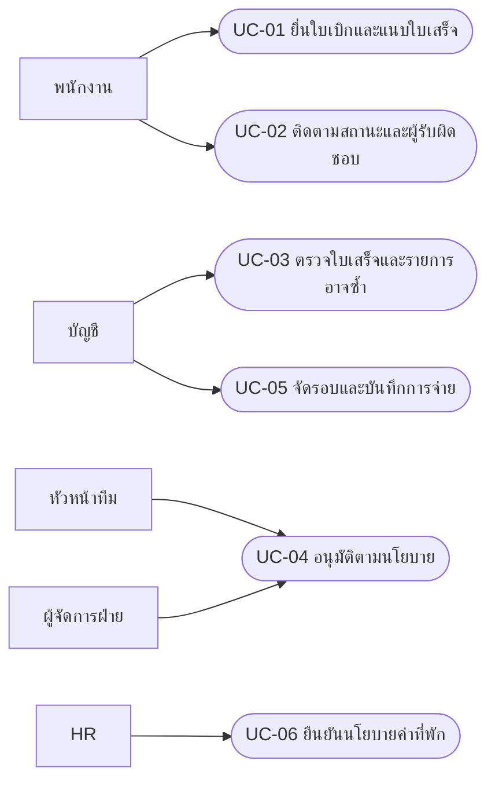
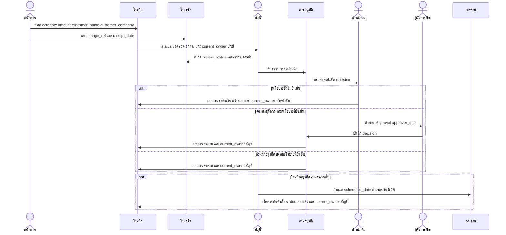
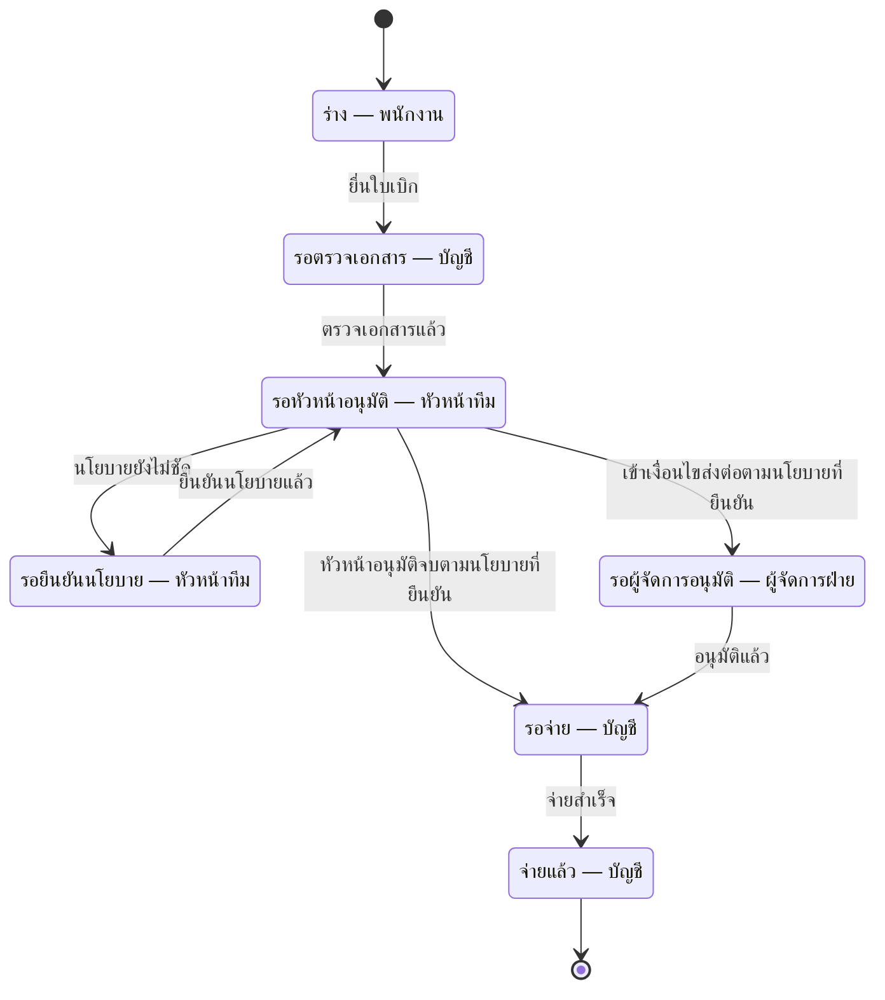

## Use Case Diagram

Use Case แสดงด้วย Mermaid flowchart เพื่อสื่อผู้ใช้กับงาน ไม่ใช่ UML renderer เฉพาะทาง

## Sequence Diagram

การตรวจบัญชีก่อนอนุมัติเป็นข้อเสนอ ไม่อนุมานว่าสัมภาษณ์ยืนยันลำดับนี้ เส้นทางจ่ายใช้เฉพาะรายการที่อนุมัติครบ ไม่ข้ามสถานะรอยืนยันนโยบาย

## State Diagram

ทุกสถานะเก็บใน Claim.status และ Claim.current_owner ตาม contract สถานะเป็นข้อเสนอสำหรับการสื่อสารแบบ ไม่ใช่นโยบายที่รับรองแล้ว
