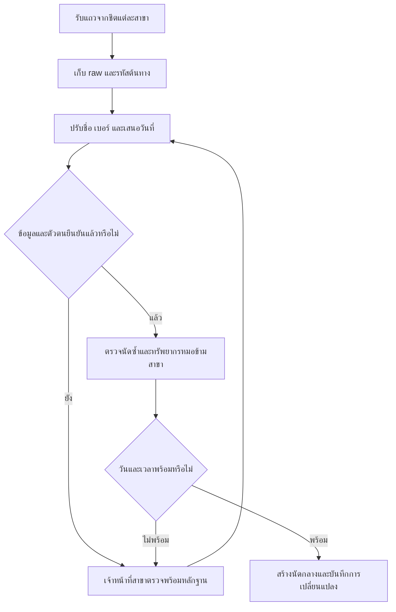
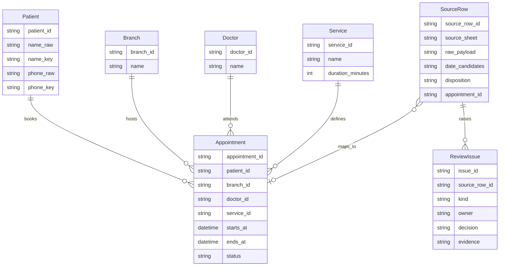

## To-Be Process (กระบวนการทำงานที่ต้องการในอนาคต)

## Data Model (แบบจำลองข้อมูล)

SourceRow.appointment_id ว่างได้ก่อนตรวจเสร็จ; duration_minutes และ timezone ต้องยืนยันก่อนคำนวณ ends_at ข้อมูลรอยืนยันอยู่ใน SourceRow ไม่ปะปนกับนัดที่ยืนยันแล้ว
