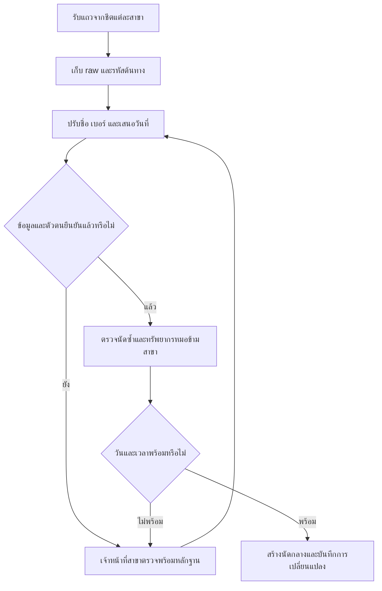
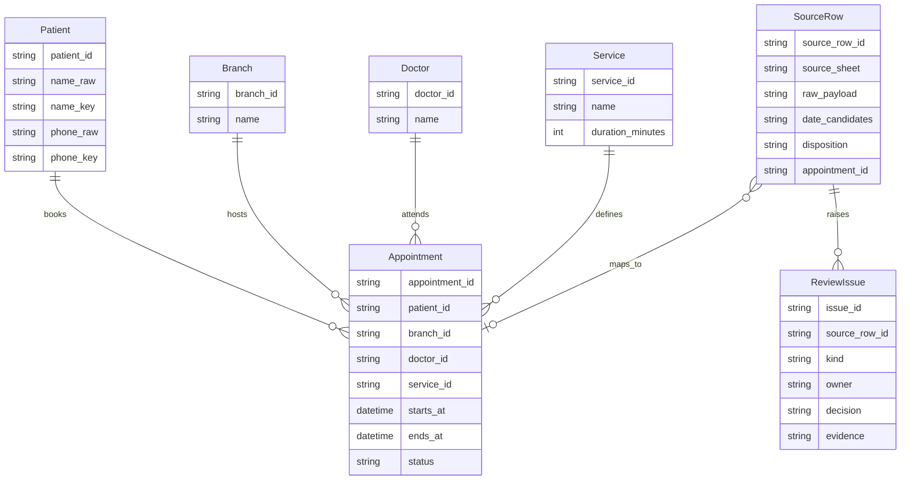
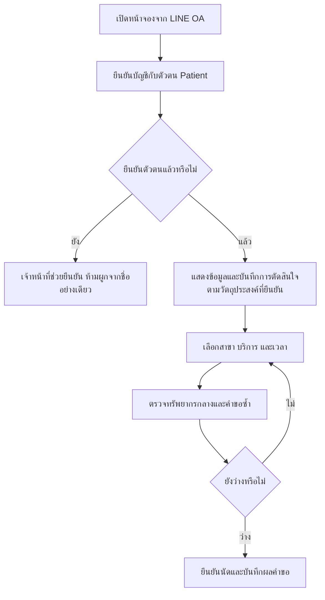
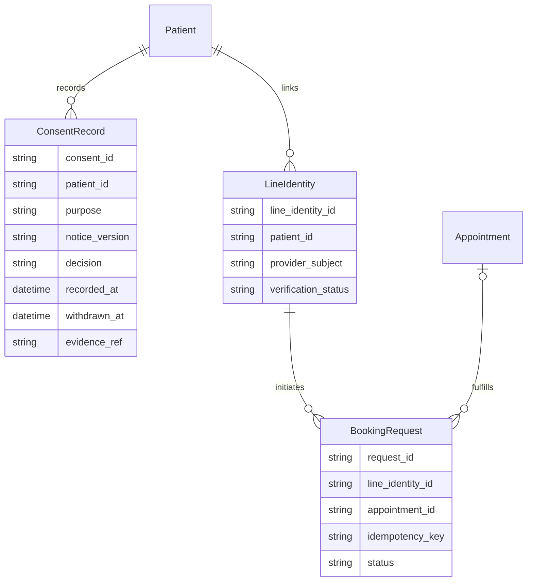

## To-Be Process (กระบวนการทำงานที่ต้องการในอนาคต)

## Data Model (แบบจำลองข้อมูล)

SourceRow.appointment_id ว่างได้ก่อนตรวจเสร็จ; duration_minutes และ timezone ต้องยืนยันก่อนคำนวณ ends_at ข้อมูลรอยืนยันอยู่ใน SourceRow ไม่ปะปนกับนัดที่ยืนยันแล้ว

## To-Be ส่วนเพิ่มหลัง Change Request (updated: change request)

ตัวเลือกความยินยอมต้องไม่ถูกเลือกไว้ล่วงหน้า ไม่ถือว่าข้อมูลเก่าคือความยินยอม ให้ผู้รับผิดชอบยืนยันวัตถุประสงค์ ฐานการประมวลผล ข้อความ การเก็บรักษา และผลของการให้/ไม่ให้/ถอนก่อนใช้จริง ไม่ตั้งเงื่อนไขปฏิเสธการรักษาเอง

## Data Model ส่วนเพิ่ม (updated: change request)

BookingRequest.appointment_id ว่างก่อนยืนยันนัดได้ คำขอซ้ำใช้ idempotency_key เดิม ไม่ใช้ชื่อแสดงผล LINE ตัดสิน Patient และไม่อนุมานบัญชีจากหมายเหตุ R3
