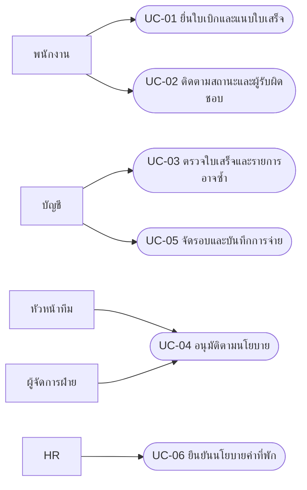
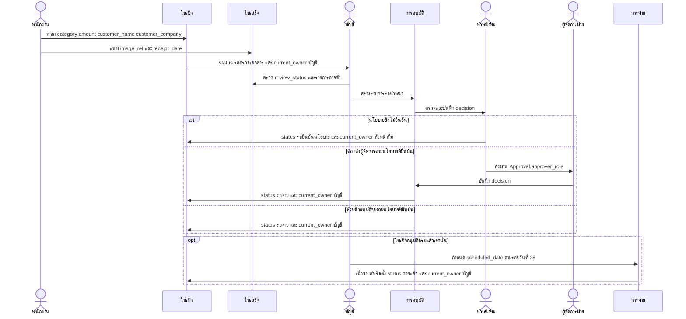
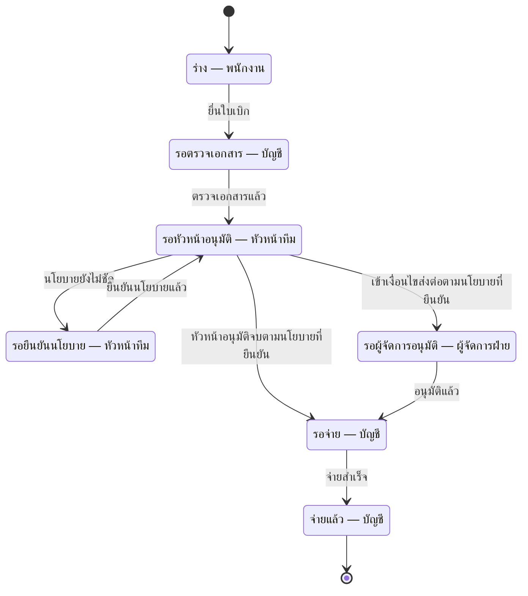
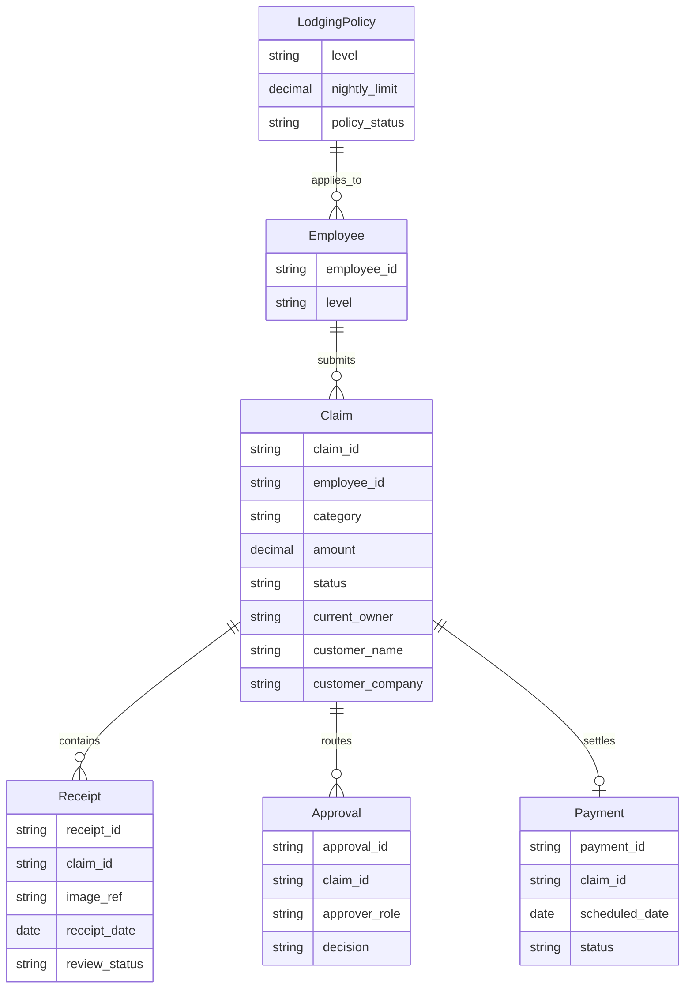

# ข้อกำหนดระบบเบิกค่าใช้จ่าย — Graph

## Actor / Stakeholder
พนักงานฝ่ายขายยื่นและติดตามใบเบิก หัวหน้าทีมอนุมัติทุกใบ ผู้จัดการฝ่ายอนุมัติตามเกณฑ์ที่ต้องยืนยัน ฝ่ายบัญชีตรวจเอกสารและจ่ายเงิน HR ให้ข้อมูลระดับพนักงานและวงเงินที่พัก

## Functional Requirements (FR)
| รหัส | ความสามารถ | ที่มา |
| --- | --- | --- |
| FR-01 | แนบรูปใบเสร็จและกรอกใบเบิกให้ง่าย โดยยังไม่สรุปว่าต้องมี OCR | S01 |
| FR-02 | รองรับค่าน้ำมัน ค่าที่พัก และค่ารับรอง ไม่สรุปว่ามีได้เฉพาะประเภทเหล่านี้ | S02 |
| FR-03 | ส่งให้หัวหน้าทีมและผู้จัดการฝ่ายตามนโยบายที่ยืนยัน เก็บกรณีวงเงินขัดกันรอตัดสิน | S03,S04 |
| FR-04 | ช่วยบัญชีตรวจรายการที่อาจใช้ใบเสร็จซ้ำ โดยให้คนยืนยันก่อนตัดสิน | S05 |
| FR-05 | แสดงรายการรอจ่ายและบันทึกผลการจ่ายตามรอบ | S07 |
| FR-06 | รับชื่อลูกค้าและบริษัทเมื่อเป็นค่ารับรอง | S08 |
| FR-07 | รองรับระดับพนักงานและนโยบายค่าที่พักที่ HR ยืนยัน | S09 |
| FR-08 | แสดงสถานะและผู้รับผิดชอบปัจจุบันของใบเบิก | S10 |

## Business Rules (BR)
| รหัส | กติกา | สถานะ |
| --- | --- | --- |
| BR-01 | หัวหน้าทีมระบุเกิน 5,000 ให้ผู้จัดการอนุมัติอีกชั้น แต่ผู้จัดการระบุเกิน 10,000 | ขัดแย้ง ยังไม่เลือกเกณฑ์ รวมถึงกรณีเท่ากับวงเงินต้องถามเพิ่ม |
| BR-02 | เบิกภายใน 30 วันนับจากวันที่ในใบเสร็จ | มีในสัมภาษณ์ วิธีนับวันต้องยืนยัน |
| BR-03 | จ่ายเงินรอบวันที่ 25 ของเดือน | มีในสัมภาษณ์ วันตัดรอบและวันหยุดยังไม่ทราบ |
| BR-04 | ค่ารับรองต้องระบุชื่อลูกค้าและชื่อบริษัท | ยืนยันจากสัมภาษณ์ |
| BR-05 | วงเงินค่าที่พักต่อคืนแตกต่างตามระดับพนักงาน | รอ HR ให้ตัวเลข ไม่สร้างวงเงินเอง |

## Non-functional Requirements (NFR)
| รหัส | คุณภาพที่ต้องพิจารณา | หลักฐาน / สถานะ |
| --- | --- | --- |
| NFR-UX | แบบฟอร์มควรใช้ง่ายและลดการกรอก | S01; วิธีวัดต้องยืนยัน ไม่ตั้งเวลาและจำนวนคลิกเอง |
| NFR-ACCESS | สิทธิ์เข้าถึงใบเสร็จและข้อมูลใบเบิกตามหน้าที่ | ข้อเสนอออกแบบ ต้องยืนยันเพิ่มเติม |
| NFR-AUDIT | ตรวจย้อนการเปลี่ยนสถานะและผู้อนุมัติได้ | ข้อเสนอเพื่อรองรับการติดตาม ต้องยืนยันวิธีเก็บ |

## Use Case Diagram

Use Case แสดงด้วย Mermaid flowchart เพื่อสื่อผู้ใช้กับงาน ไม่ใช่ UML renderer เฉพาะทาง

## Sequence Diagram

การตรวจบัญชีก่อนอนุมัติเป็นข้อเสนอ ไม่อนุมานว่าสัมภาษณ์ยืนยันลำดับนี้ เส้นทางจ่ายใช้เฉพาะรายการที่อนุมัติครบ ไม่ข้ามสถานะรอยืนยันนโยบาย

## State Diagram

ทุกสถานะเก็บใน Claim.status และ Claim.current_owner ตาม contract สถานะเป็นข้อเสนอสำหรับการสื่อสารแบบ ไม่ใช่นโยบายที่รับรองแล้ว

## ERD

LodgingPolicy.nightly_limit ยังว่างจน HR ยืนยัน ไม่ใส่ตัวเลขตัวอย่าง การจ่ายอาจยังไม่มีจนใบเบิกผ่านอนุมัติ ชื่อข้อมูลเป็นข้อเสนอจาก N1

## Traceability Matrix
| ต้นทาง | ข้อความสัมภาษณ์ | FR/BR | Use Case | Entity |
| --- | --- | --- | --- | --- |
| S01 | อยากถ่ายรูปใบเสร็จแล้วเบิกได้เลย ไม่อยากกรอกเยอะ | FR-01 | UC-01 | Receipt / Claim |
| S02 | ส่วนใหญ่เบิกค่าน้ำมัน ค่าที่พัก ค่ารับรองลูกค้า | FR-02 | UC-01 | Claim |
| S03 | ผมต้องอนุมัติทุกใบ ถ้าเกิน 5,000 บาทต้องให้ผู้จัดการฝ่ายอนุมัติอีกชั้น | FR-03 / BR-01 | UC-04 | Approval / Claim |
| S04 | อะไรเกิน 10,000 ค่อยส่งมาผม ต่ำกว่านั้นหัวหน้าทีมจบได้เลย | FR-03 / BR-01 | UC-04 | Approval / Claim |
| S05 | ต้องตรวจใบเสร็จซ้ำ เคยมีคนเบิกใบเดียวสองรอบ | FR-04 | UC-03 | Receipt |
| S06 | ต้องเบิกภายใน 30 วันนับจากวันที่ในใบเสร็จ | BR-02 | UC-01 | Receipt |
| S07 | จ่ายเงินรอบวันที่ 25 ของเดือน | FR-05 / BR-03 | UC-05 | Payment |
| S08 | ค่ารับรองลูกค้าต้องระบุชื่อลูกค้าและชื่อบริษัท | FR-06 / BR-04 | UC-01 | Claim |
| S09 | พนักงานแต่ละระดับมีวงเงินค่าที่พักต่อคืนไม่เท่ากัน | FR-07 / BR-05 | UC-06 | LodgingPolicy / Employee |
| S10 | อยากเห็นว่าใบเบิกของเราค้างอยู่ที่ใคร | FR-08 | UC-02 | Claim |

## Pain Point → FR/BR → หน้าจอ
| ปัญหา | ข้อกำหนด | หน้าจอ / เหตุผล |
| --- | --- | --- |
| ไม่อยากกรอกเยอะและอยากใช้รูป | FR-01, FR-02 | submit: ภาพใบเสร็จและข้อมูลเท่าที่สื่อโจทย์ |
| กติกาค่ารับรองและวันยื่น | FR-06, BR-02, BR-04 | submit: ลูกค้า/บริษัทและข้อความวันยื่น |
| ไม่รู้ค้างที่ใคร | FR-08 | tracking: สถานะ ผู้รับผิดชอบ และขั้นถัดไป |
| ใบเสร็จอาจซ้ำ | FR-04 | review: คำเตือนให้บัญชีตรวจ |
| วงเงินขัดกันหรือขาด | FR-03, FR-07, BR-01, BR-05 | review: เก็บทั้งสองเกณฑ์และป้ายรอ HR |
| รอบจ่าย | FR-05, BR-03 | tracking: แสดงขั้นตอนรอบจ่าย |

## Open Issues

| ประเด็น | หลักฐาน / คำถาม |
| --- | --- |
| วงเงินส่งต่อขัดกัน | S03: “ผมต้องอนุมัติทุกใบ ถ้าเกิน 5,000 บาทต้องให้ผู้จัดการฝ่ายอนุมัติอีกชั้น”; S04: “อะไรเกิน 10,000 ค่อยส่งมาผม ต่ำกว่านั้นหัวหน้าทีมจบได้เลย” ต้องให้เจ้าของนโยบายตกลง ไม่เลือกข้าง |
| วงเงินที่พัก | S09 ไม่มีตัวเลข รอ HR ยืนยันระดับและวงเงินต่อคืน |
| วันยื่นและวันจ่าย | ยืนยันวิธีนับ 30 วัน วันตัดรอบ และการจัดการวันที่ 25 ตรงวันหยุด |
| ขั้นตอนและสิทธิ์ | การให้บัญชีตรวจก่อนหัวหน้า การส่งกลับ และสถานะที่เสนอ ต้องยืนยันกับผู้ใช้ |
| ใบเสร็จซ้ำ | ยืนยันเกณฑ์ตรวจและผู้ตัดสิน ห้ามถือคำเตือนว่าเป็นการทุจริตที่ยืนยันแล้ว |

## ข้อจำกัด
Mockup ใช้ข้อมูลและสถานะจำลอง ปุ่มไม่ทำงานจริง ไม่เชื่อมระบบเบิกหรือจ่ายเงิน การ render แผนภาพไม่แทนการตรวจความหมาย
