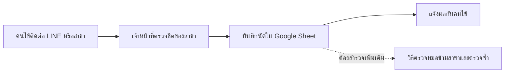
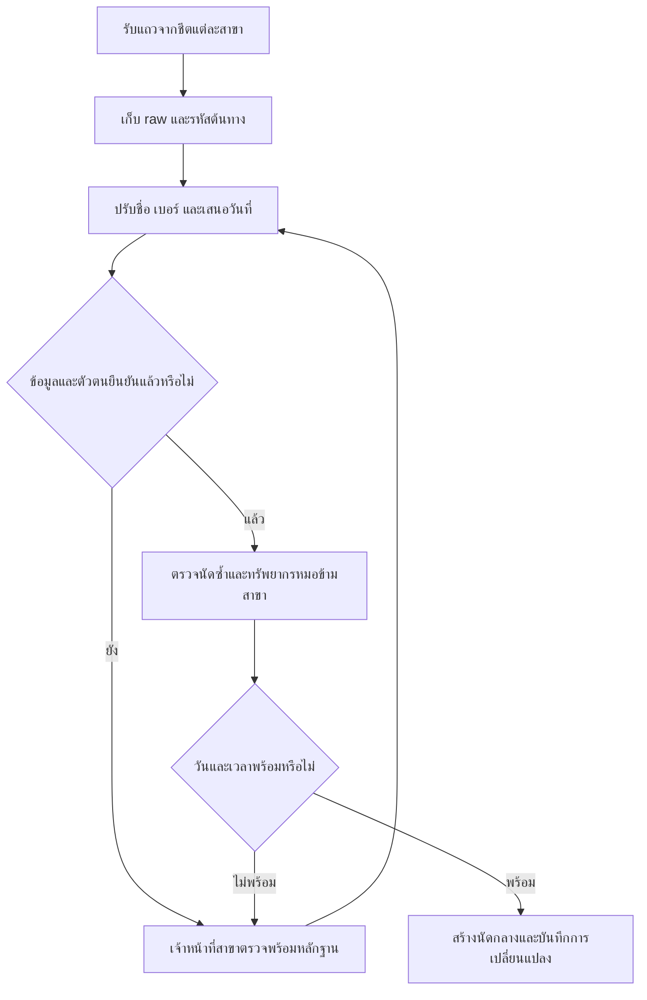
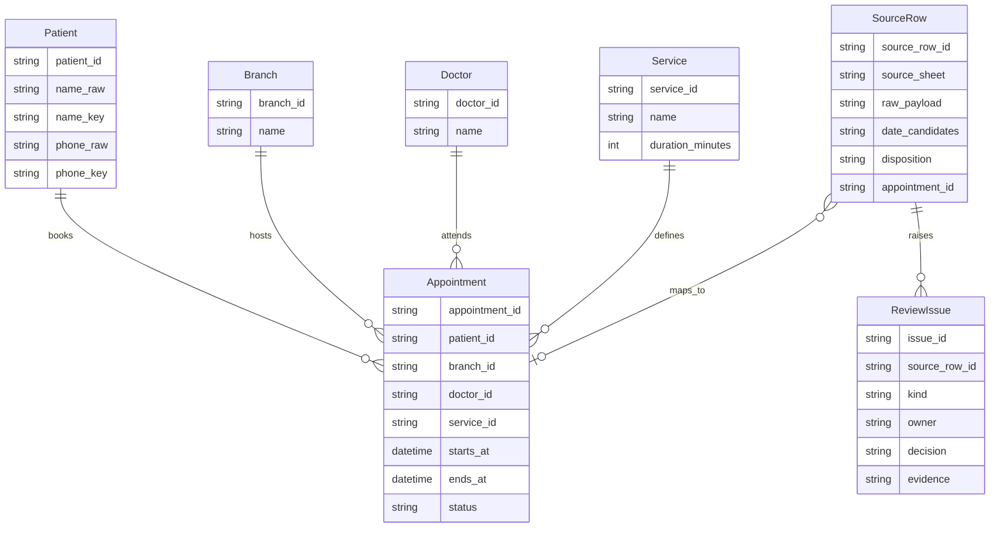
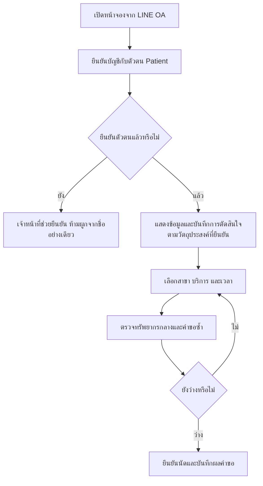
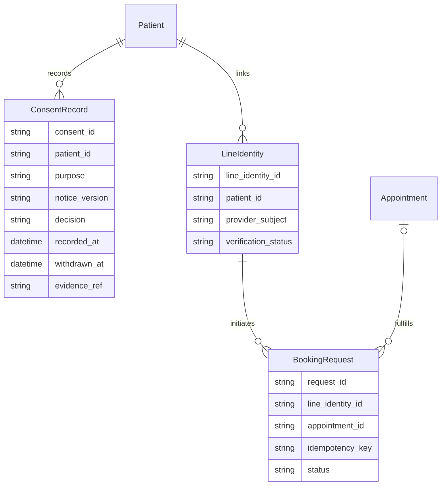

# แผนระบบนัดหมายคลินิก — Graph

ข้อมูลตัวอย่าง R1–R5 จากโจทย์ ไม่มีการนำเข้าข้อมูลคนไข้จริง สถานะและโครงสร้างข้อมูลเป็นข้อเสนอออกแบบ

## Data Quality Findings (ข้อค้นพบปัญหาคุณภาพข้อมูล)
| ประเภท | แถวและหลักฐาน | ผลกระทบ | วิธีจัดการ |
| --- | --- | --- | --- |
| วันที่หลายรูปแบบและวันเดือนกำกวม | R1,R4: 03/09/2026; R5: 09/03/2026 เทียบ R2: 2026-09-03 | เสี่ยงนัดผิดเดือน | เก็บต้นฉบับและทางเลือก DMY/MDY ขอรูปแบบชีตแต่ละสาขา |
| ปีสองหลักไม่ระบุศักราช | R3: 3 ก.ย. 69 | เสี่ยงผิดปี | เดือนกันยายนชัด แต่ปีต้องยืนยัน; พ.ศ. 2569 เป็น candidate จากบริบท R2 ไม่ใช่ข้อสรุป |
| เบอร์รูปแบบต่างกัน | R1/R2/R5 มีขีด ช่องว่าง และเลขติดกัน | จับคู่ไม่พบ | ปรับเป็น 0812345678 เพื่อค้นหาโดยยังไม่รวมตัวตน |
| ช่องทางติดต่อขาด | R3 ไม่มีเบอร์ มีเพียงหมายเหตุติดต่อ LINE | ติดต่อหรือยืนยันคนไม่ได้ | ให้สาขายืนยัน ห้ามแต่งเบอร์หรือรหัส LINE |
| นัดอาจซ้ำ | R1/R2 ชื่อ เบอร์ หมอ เวลา และบริการตรงกัน; R2 ระบุจองซ้ำทางไลน์ | จัดคิวหรือแจ้งเตือนซ้ำ | รอวัน R1 และตัวตนยืนยันก่อนรวม เก็บ raw ทั้งสอง |
| ชื่อข้ามภาษาและคำนำหน้า | R5 Somchai Jaidee เทียบ R1/R2 สมชาย ใจดี; R3 คุณมาลี | เสี่ยงรวมคนผิด | ใช้ชื่อปรับรูปเป็น candidate ให้คนยืนยัน ไม่ยึดคำทับศัพท์เป็นข้อพิสูจน์ |
| ตารางหมออาจชน | R3/R4 หมอบี 13:30 ที่บางนา | เสี่ยงนัดเกินความพร้อมหากวันเดียวกัน | ยังไม่สรุปว่าชน ขอวันและระยะเวลาบริการก่อน |
| หมายเหตุวันหมอไม่ตรงวันที่ทั้งสองแบบ | R5 ระบุทุกวันพุธ แต่ 2026-03-09 เป็นจันทร์ และ 2026-09-03 เป็นพฤหัสบดี | ใช้หมายเหตุเลือกวันไม่ได้ | ให้สาขายืนยันทั้งวันและหมายเหตุ |
| รหัสและระยะเวลาบริการไม่มี | R1–R5 ไม่มีรหัสคนไข้/นัดถาวรและระยะเวลาสิ้นสุด | จับคู่และตรวจเวลาซ้อนเต็มช่วงไม่ได้ | เก็บรหัสแถวต้นทาง ขอ master และระยะเวลาก่อนสร้างนัดจริง |

### ข้อมูลที่ยังต้องยืนยัน
R1/R4: วันที่อาจเป็น 3 กันยายนหรือ 9 มีนาคม; R2 ชี้เดือนกันยายนเฉพาะแถวนั้น ไม่พิสูจน์ทุกสาขา
R3: กันยายนแน่จากคำย่อ แต่ปี 69 ไม่กำหนดศักราช/ศตวรรษ และตัวตน/ช่องทางติดต่อยังขาด
R5: วันที่สองแบบไม่ตรงหมายเหตุวันพุธทั้งคู่ จึงไม่เลือกแทนเจ้าของข้อมูล
R1/R2/R5: เบอร์ตรงกันและชื่อคล้ายกัน ไม่เพียงพอให้รวมคนไข้โดยอัตโนมัติ

## As-Is Process (กระบวนการทำงานปัจจุบัน)

ข้อมูลยืนยันคือชีตแยกสามสาขาและช่องทาง LINE ลำดับงานเจ้าหน้าที่ในภาพเป็นข้อเสนอสำหรับสัมภาษณ์ต่อ ไม่สรุปว่าระบบเดิมไม่ตรวจซ้ำ

## To-Be Process (กระบวนการทำงานที่ต้องการในอนาคต)

## Data Model (แบบจำลองข้อมูล)

SourceRow.appointment_id ว่างได้ก่อนตรวจเสร็จ; duration_minutes และ timezone ต้องยืนยันก่อนคำนวณ ends_at ข้อมูลรอยืนยันอยู่ใน SourceRow ไม่ปะปนกับนัดที่ยืนยันแล้ว

## To-Be ส่วนเพิ่มหลัง Change Request (updated: change request)

ตัวเลือกความยินยอมต้องไม่ถูกเลือกไว้ล่วงหน้า ไม่ถือว่าข้อมูลเก่าคือความยินยอม ให้ผู้รับผิดชอบยืนยันวัตถุประสงค์ ฐานการประมวลผล ข้อความ การเก็บรักษา และผลของการให้/ไม่ให้/ถอนก่อนใช้จริง ไม่ตั้งเงื่อนไขปฏิเสธการรักษาเอง

## Data Model ส่วนเพิ่ม (updated: change request)

BookingRequest.appointment_id ว่างก่อนยืนยันนัดได้ คำขอซ้ำใช้ idempotency_key เดิม ไม่ใช้ชื่อแสดงผล LINE ตัดสิน Patient และไม่อนุมานบัญชีจากหมายเหตุ R3

## Data Mapping (การจับคู่ข้อมูลต้นทางกับปลายทาง) และ Migration (การย้ายข้อมูลและระบบ)
| ข้อมูลต้นทาง | ปลายทางตาม contract ของ N1 | วิธีแปลง / เงื่อนไข |
| --- | --- | --- |
| สาขา | Branch.name / branch_id | จับคู่ master ที่เจ้าของข้อมูลยืนยัน |
| วันที่และเวลา | SourceRow.date_candidates → Appointment.starts_at | เก็บ raw เสมอ แยก parser ตาม metadata ชีต; ค่ากำกวมเข้าคิว ไม่เลือกเอง |
| ชื่อ | Patient.name_raw / name_key | Unicode NFC, trim, ยุบช่องว่าง และ casefold อังกฤษ แยกคำนำหน้าเพื่อค้นหา ไม่ทำลาย raw |
| เบอร์ | Patient.phone_raw / phone_key | ตัดขีดและช่องว่างก่อนจับคู่ รักษาศูนย์นำหน้า ยืนยันประเทศก่อนแปลง country code; ห้ามเติมเบอร์ที่ขาด |
| หมอ | Doctor.name / doctor_id | ให้สาขายืนยัน master และตารางข้ามสาขา |
| บริการ | Service.name / service_id / duration_minutes | ยืนยันชื่อบริการและระยะเวลา ไม่กำหนดตัวเลขเอง |
| หมายเหตุ | SourceRow.raw_payload / ReviewIssue | เก็บต้นฉบับและเหตุผลที่ต้องตรวจ |
| แหล่งข้อมูลและแถว | SourceRow.source_sheet / source_row_id | ใช้กุญแจต้นทางและตรวจนำเข้าซ้ำ |

### จับคู่ตัวตนและกรณีให้มนุษย์ยืนยัน
- ปรับชื่อและเบอร์ก่อนสร้าง candidate จากหลายหลักฐาน ไม่ใช้เบอร์เดียวหรือคำทับศัพท์เป็นคำตอบสุดท้าย
- R1/R2: ชื่อ เบอร์ หมอ เวลา บริการ และหมายเหตุสนับสนุนนัดซ้ำ แต่ต้องยืนยันวัน R1 และตัวตนก่อนรวม
- R5: เบอร์ตรง R1/R2 แต่ชื่อภาษาอื่น วัน/สาขา/บริการต่าง ให้เจ้าหน้าที่และคนไข้ยืนยัน
- R3: ไม่มีเบอร์และชื่อไม่ครบ ให้สาขาหาช่องทางติดต่อที่ยืนยันแล้ว ห้ามเดารหัส LINE
- R4: ยังไม่พบหลักฐานคนซ้ำ แต่วันและเวลาหมอต้องยืนยัน
- บันทึก ReviewIssue.decision, evidence และ owner ก่อนผูก SourceRow.appointment_id; คงทุกแถวแม้ยืนยันว่าเป็นนัดเดียวกัน

### ขั้นย้ายและเงื่อนไขหยุด
สำรอง snapshot และตรวจจำนวน raw → นำเข้า staging พร้อมกุญแจต้นทาง → ปรับรูปและตรวจ candidate → เจ้าของข้อมูลยืนยัน → dry run และตรวจยอด disposition ของทุกแถว → ตรวจ foreign key และเวลาหมอ → ลงนามตรวจรับ → cutover ตามเวลาที่ตกลง

ระหว่าง cutover ควบคุมการแก้ชีต เก็บ delta หลัง snapshot และกระทบยอดใหม่ หากยอดผิด ตัวตนผิด หรือทรัพยากรยังไม่ยืนยันให้หยุด ย้อนกลับไปชีตที่รวม delta ที่ตรวจแล้ว ห้ามทิ้งนัดใหม่ที่เกิดหลัง snapshot

## Data Mapping / Migration ส่วนเพิ่ม (updated: change request)
| ต้นทาง | ปลายทาง | กติกา |
| --- | --- | --- |
| การตัดสินใจพร้อมหลักฐาน | ConsentRecord | เก็บ purpose, notice_version, decision, recorded_at, withdrawn_at และ evidence_ref ไม่มีหลักฐานเดิมห้ามสร้างว่าให้ยินยอม |
| บัญชี LINE ที่พิสูจน์แล้ว | LineIdentity | เก็บ provider_subject และ verification_status หลังยืนยันกับ Patient ไม่เดาจากชื่อหรือเบอร์ |
| คำขอจองเอง | BookingRequest | ผูกกับบัญชีที่ยืนยันแล้ว ใช้ idempotency_key ป้องกันคำขอซ้ำ และตรวจทรัพยากรก่อนสร้าง Appointment |

ก่อนเปิดใช้ให้ยืนยันนโยบายและวิธีพิสูจน์ตัวตน ทดสอบการให้/ไม่ให้/ถอน การจองซ้ำและคำขอพร้อมกันในสภาพแวดล้อมทดสอบ การแจ้งเตือนล้มเหลวต้องไม่สร้างนัดซ้ำ รอบนี้เป็นแบบจำลองไม่ได้เชื่อม API จริง

## Gap Analysis (การวิเคราะห์สิ่งที่ยังขาดเพื่อไปสู่ระบบใหม่) และ Roll-out Plan (แผนทยอยนำระบบไปใช้งาน)
| สิ่งที่ขาด | งานที่ต้องทำ | ผู้ยืนยัน |
| --- | --- | --- |
| วันที่และรหัสกลาง | เก็บ metadata และ master ของแต่ละสาขา | เจ้าของชีตและหัวหน้าสาขา |
| ตัวตนที่เชื่อถือได้ | คิวตรวจและจับคู่พร้อมหลักฐาน | เจ้าหน้าที่และคนไข้ |
| ตารางหมอและระยะเวลา | ตารางทรัพยากรกลาง | ผู้ดูแลตารางหมอ |
| ขั้นตอนทำงานร่วมกัน | ฝึกใช้หน้าจอและทดสอบการย้อนกลับ | ผู้จัดการคลินิก |

ลำดับ: ยืนยันข้อมูลหลัก → dry run → นำร่องสาขาที่คลินิกเลือก → ตรวจผลและ rollback → ขยายเมื่อเจ้าของงานรับรอง ไม่กำหนดวันจริงหรือสาขานำร่องเอง

## Plan Version Log (บันทึกการเปลี่ยนแปลงแผน)
| แผน | เหตุผล | งาน | ผลงานเดิมที่ใช้ต่อ |
| --- | --- | --- | --- |
| v1 | เริ่มจากข้อมูลโจทย์ | N1 ข้อค้นพบ/contract → N2/N3/N4 → N5 รวมและตรวจ พร้อม Mockup | ไม่มีผลรันเก่ามาใช้แทนหลักฐานรอบนี้ |

## ความสอดคล้องของ Mockup
appointments แสดง SourceRow.disposition รอยืนยัน ไม่แสดงเป็น Appointment ยืนยันแล้ว; booking ใช้ Patient/Branch/Doctor/Service และตัวเตือน R3/R4; review แสดง ReviewIssue ของ R1–R5 พร้อมผู้ยืนยัน

## ข้อจำกัด
ข้อมูลและหน้าจอเป็นตัวอย่าง ปุ่มไม่ทำธุรกรรม ไม่ย้ายข้อมูลจริง ต้องยืนยันวันที่ ปี ตัวตน ช่องทางติดต่อ ระยะเวลา timezone และนโยบายก่อนใช้จริง

## Impact Analysis (การวิเคราะห์ผลกระทบ) / Reuse (การใช้ผลงานเดิมต่อ)
| Node | ผลกระทบ | การตัดสินใจ |
| --- | --- | --- |
| N1 | มีข้อกำหนดและข้อมูลกลางเพิ่ม | ทำ N1-v2 เพิ่ม ConsentRecord/LineIdentity/BookingRequest; คง raw และ Findings |
| N2 | As-Is ไม่ได้รับผลกระทบจากช่องทางอนาคต | ใช้ผลเดิม ไม่ทำใหม่ |
| N3 | To-Be, Data Model และหน้าจอต้องรองรับสองข้อใหม่ | ทำ N3-v2 เพิ่มกระบวนการ แบบจำลอง และ Mockup สองส่วน |
| N4 | การย้ายต้องตรวจหลักฐานยินยอมและบัญชี | ทำ N4-v2 เพิ่ม Mapping และเงื่อนไขนำเข้า |
| N5 | ต้องรวมและตรวจความสอดคล้องอีกครั้ง | ทำ N5-v2 หลัง N2 เดิมและ N3-v2/N4-v2 DONE |

## Plan Version Log ส่วนเพิ่ม (updated: change request)
| แผน | เหตุผล | สิ่งที่เปลี่ยน | Reuse |
| --- | --- | --- | --- |
| v1 | เฟสแรก | N1 → N2/N3/N4 → N5 | เก็บ output-phase1.md / mockup-phase1.html |
| v2 | เพิ่มความยินยอมและ LINE OA | N1-v2 → N3-v2/N4-v2 → N5-v2; N5-v2 รอ N2 เดิมด้วย | N2, raw, Findings, normalization และสามส่วน UI เดิม |

Gap/Roll-out ส่วนเพิ่ม: ยืนยันผู้รับผิดชอบนโยบายและการเชื่อมบัญชี → ทดสอบสิทธิ์/การถอน/คำขอซ้ำ/จองพร้อมกัน → นำร่องตามที่คลินิกเลือก → ขยายเมื่อเจ้าของงานตรวจรับ หากต้องย้อนกลับให้หยุดช่องทางจองเองแต่คงนัดที่ยืนยันแล้ว ประวัติคำขอ และหลักฐานความยินยอม
