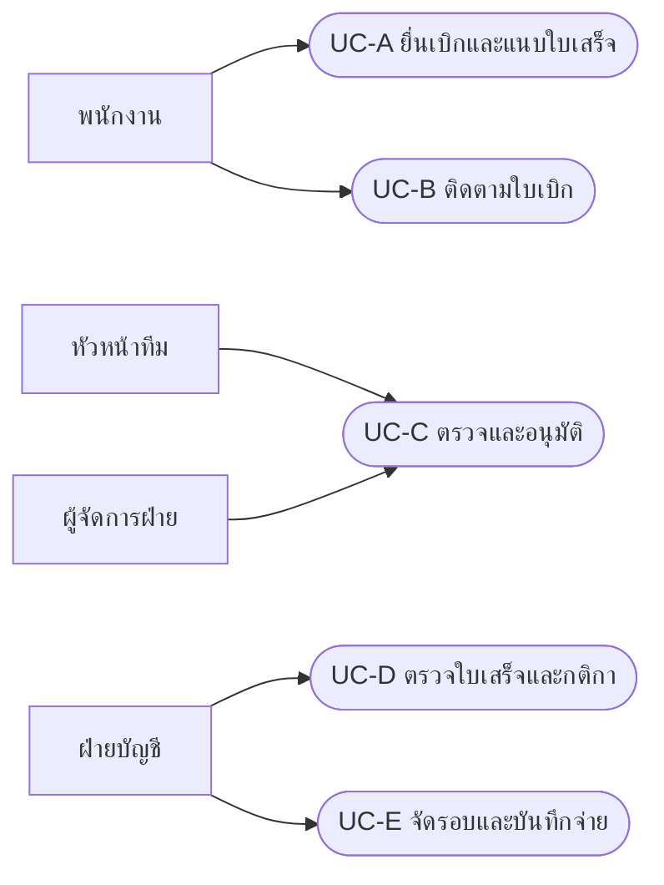
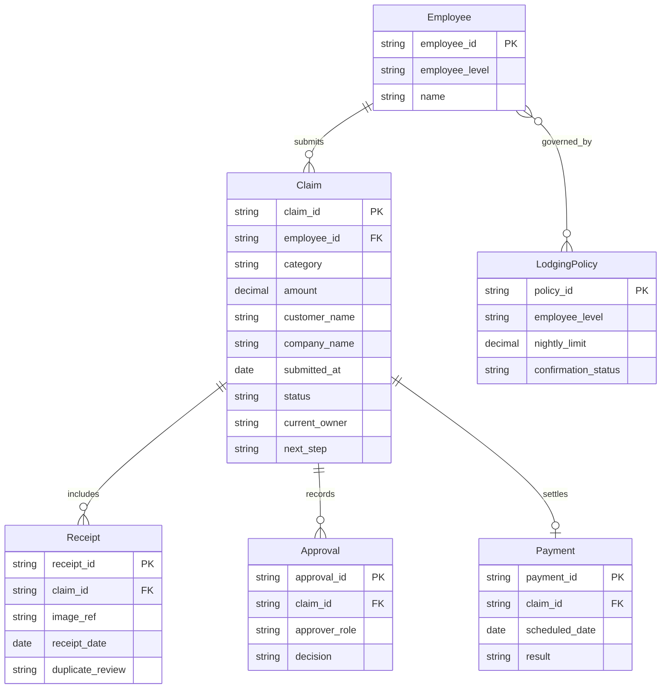
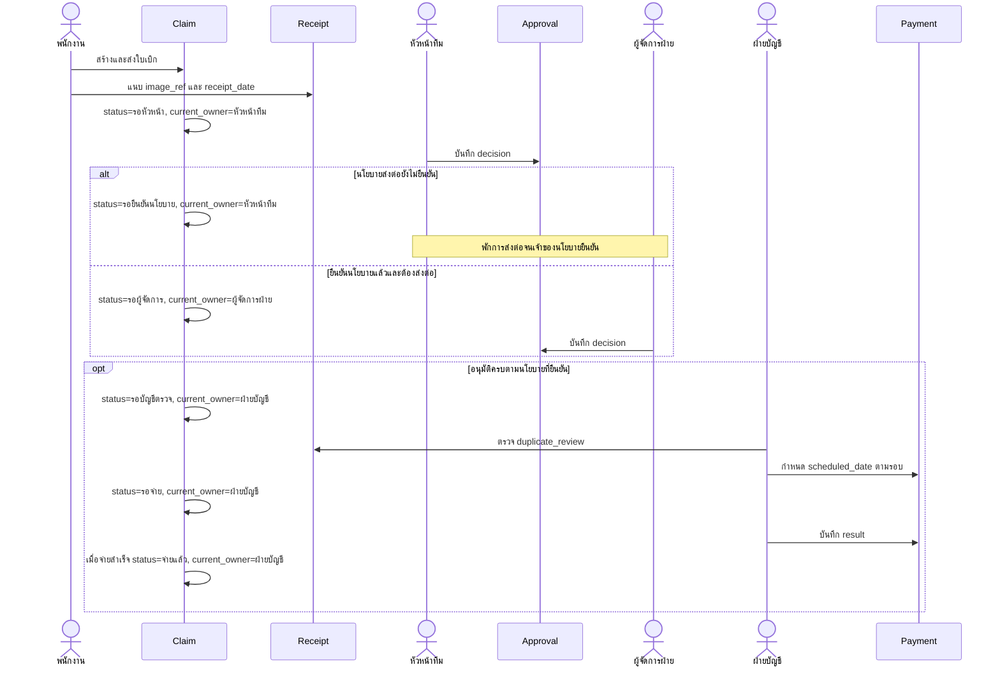
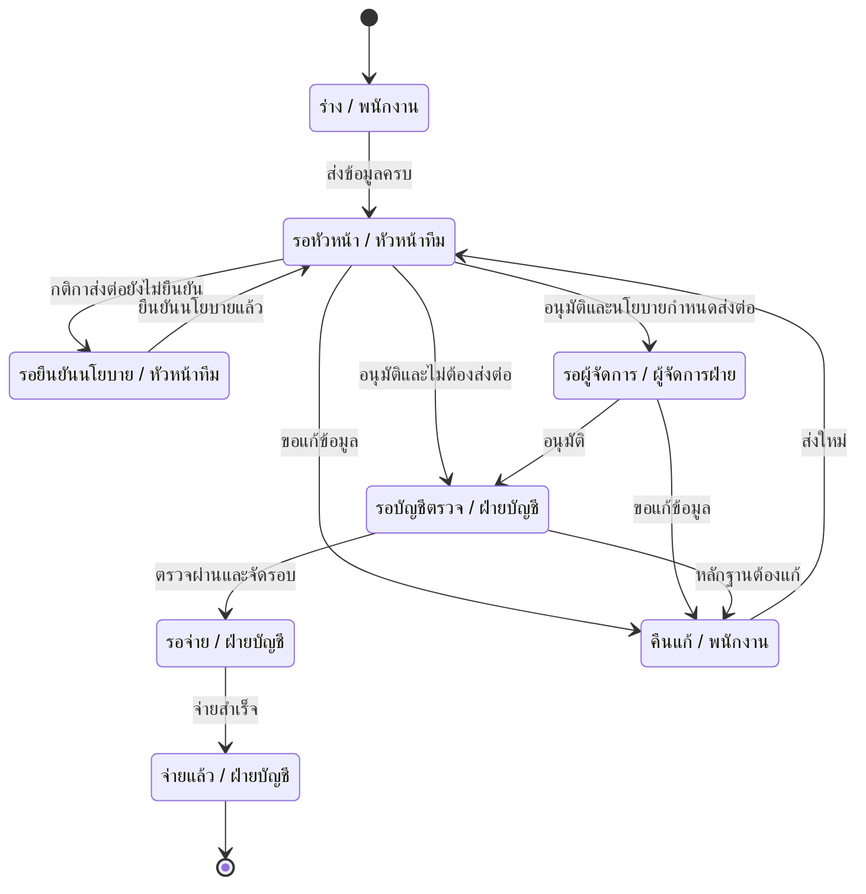

# ระบบเบิกค่าใช้จ่าย — ข้อกำหนดและแบบจำลอง

ผลงาน Loop รอบใหม่ • เป็นการออกแบบ ไม่ใช่ระบบธุรกรรมจริง • อ่านคู่กับ mockup.html

## หลักฐานต้นทาง

แยกหน่วยความหมายเพื่ออ้างอิง ไม่เพิ่มนโยบายจากความเห็นของผู้วิเคราะห์

| รหัส | ข้อความสัมภาษณ์ต้นทาง |
| --- | --- |
| S01 | ฝ่ายขาย: อยากถ่ายรูปใบเสร็จแล้วเบิกได้เลย ไม่อยากกรอกเยอะ |
| S02 | ฝ่ายขาย: ส่วนใหญ่เบิกค่าน้ำมัน ค่าที่พัก ค่ารับรองลูกค้า |
| S03 | หัวหน้าทีม: ผมต้องอนุมัติทุกใบ ถ้าเกิน 5,000 บาทต้องให้ผู้จัดการฝ่ายอนุมัติอีกชั้น |
| S04 | ผู้จัดการฝ่าย: อะไรเกิน 10,000 ค่อยส่งมาผม ต่ำกว่านั้นหัวหน้าทีมจบได้เลย |
| S05 | บัญชี: ต้องตรวจใบเสร็จซ้ำ เคยมีคนเบิกใบเดียวสองรอบ |
| S06 | บัญชี: ต้องเบิกภายใน 30 วันนับจากวันที่ในใบเสร็จ |
| S07 | บัญชี: จ่ายเงินรอบวันที่ 25 ของเดือน |
| S08 | บัญชี: ค่ารับรองลูกค้าต้องระบุชื่อลูกค้าและชื่อบริษัท |
| S09 | HR: พนักงานแต่ละระดับมีวงเงินค่าที่พักต่อคืนไม่เท่ากัน |
| S10 | ฝ่ายขาย: อยากเห็นว่าใบเบิกของเราค้างอยู่ที่ใคร |

## Actor / Stakeholder

| ผู้เกี่ยวข้อง | ความต้องการและความรับผิดชอบ |
| --- | --- |
| พนักงานผู้เบิก | ยื่นเบิกพร้อมหลักฐานและติดตามผู้รับผิดชอบ |
| หัวหน้าทีม | ตรวจและอนุมัติใบเบิกทุกใบตามคำสัมภาษณ์ |
| ผู้จัดการฝ่าย | อนุมัติกรณีที่เข้าเกณฑ์ส่งต่อ ซึ่งวงเงินยังขัดแย้ง |
| ฝ่ายบัญชี | ตรวจใบเสร็จซ้ำ กติกาวันยื่น และดำเนินการจ่าย |
| HR | ยืนยันระดับพนักงานและนโยบายค่าที่พัก; ยังไม่ยืนยันว่าใช้หน้าจอระบบโดยตรง |
| เจ้าของนโยบาย | ผู้ที่องค์กรต้องแต่งตั้งเพื่อยืนยันข้อขัดแย้ง ไม่ใช่บทบาทที่ได้จากสัมภาษณ์ |

## Functional Requirements

| ID | ข้อกำหนด | ที่มา / เกณฑ์ตรวจรับ |
| --- | --- | --- |
| FR-01 | ผู้เบิกแนบภาพใบเสร็จและข้อมูลจำเป็นได้ | S01; แบบหน้าจอมีพื้นที่ภาพและช่องข้อมูล การอ่านภาพอัตโนมัติเป็นแนวทางให้ยืนยัน ไม่สรุปว่าต้องมี OCR |
| FR-02 | เลือกประเภทค่าน้ำมัน ค่าที่พัก หรือค่ารับรองลูกค้า | S02; มีตัวเลือกครบ |
| FR-03 | ส่งใบเบิกให้หัวหน้าทีมและรองรับการส่งต่อผู้จัดการ | S03,S04; ไม่ตัดสินวงเงินจนกว่านโยบายยืนยัน |
| FR-04 | บัญชีเห็นจุดเตือนใบเสร็จที่อาจซ้ำและบันทึกผลตรวจ | S05; เกณฑ์ชี้ว่าเป็นใบเดียวกันยังเป็นประเด็นยืนยัน |
| FR-05 | ตรวจระยะยื่นจากวันที่ใบเสร็จ | S06; ใช้ BR-02 พร้อมแจ้งเหตุที่ไม่ผ่าน กติกาขอบเขตวันรอยืนยัน |
| FR-06 | บัญชีจัดรายการที่อนุมัติแล้วเข้ารอบจ่ายและบันทึกผล | S07; ใช้ BR-03 ไม่กำหนดรอบตัดยอดเพิ่ม |
| FR-07 | รับชื่อลูกค้าและบริษัทสำหรับค่ารับรอง | S08; ช่องข้อมูลสัมพันธ์กับ BR-04 |
| FR-08 | รองรับวงเงินที่พักตามระดับและต่อคืนเมื่อ HR ยืนยัน | S09; เก็บนโยบายที่พักโดยไม่มีตัวเลขสมมติ |
| FR-09 | แสดงสถานะ ผู้รับผิดชอบปัจจุบัน และขั้นตอนถัดไป | S10; ใช้สถานะจากแบบจำลองเดียวกัน |

## Business Rules

| ID | กฎ | สถานะ / ที่มา |
| --- | --- | --- |
| BR-01 | หัวหน้าทีมระบุทุกใบต้องผ่านตนและเกิน 5,000 ส่งผู้จัดการ; ผู้จัดการระบุเกิน 10,000 จึงส่งตน | ขัดแย้ง: S03,S04 ห้ามเลือกเกณฑ์เอง |
| BR-02 | ต้องเบิกภายใน 30 วันนับจากวันที่ในใบเสร็จ | S06; วิธีนับวันและข้อยกเว้นยังต้องยืนยัน |
| BR-03 | จ่ายเงินรอบวันที่ 25 ของเดือน | S07; รอบตัดยอดและวันหยุดยังไม่ระบุ |
| BR-04 | ค่ารับรองลูกค้าต้องมีชื่อลูกค้าและชื่อบริษัท | S08 |
| BR-05 | วงเงินค่าที่พักต่อคืนขึ้นกับระดับพนักงาน | S09; ยังไม่มีค่าตัวเลข |
| BR-06 | ต้องตรวจการใช้ใบเสร็จเดิมเบิกซ้ำ | S05; ไม่ถือคำเตือนเป็นคำตัดสินอัตโนมัติ |

## Non-functional Requirements

| ประเด็น | ข้อเสนอ / ที่มา | วิธีตกลงเกณฑ์ |
| --- | --- | --- |
| ใช้ง่าย | S01 อยากกรอกน้อย; จัดข้อมูลเป็นกลุ่มและแสดงสิ่งที่ต้องกรอก | ทดลองกับผู้เบิกจริงก่อนกำหนดจำนวนคลิกหรือเวลา |
| การควบคุมสิทธิ์ | ข้อเสนอของผู้ออกแบบ เพราะมีหลักฐานและข้อมูลพนักงาน | องค์กรต้องยืนยันสิทธิ์แต่ละบทบาทและทดสอบการเข้าถึง |
| ตรวจสอบย้อนหลัง | ข้อเสนอของผู้ออกแบบ เพื่ออธิบายการอนุมัติและจ่าย | ยืนยันรายการเหตุการณ์ ผู้เข้าถึง และอายุเก็บก่อนพัฒนา |

ไม่กำหนดตัวเลขประสิทธิภาพหรือความปลอดภัยที่ไม่มีในสัมภาษณ์

## Use Case

ใช้ flowchart เป็นภาพ Use Case เพื่อให้ Mermaid รองรับ แสดง actor และกรณีใช้งาน ไม่อ้างว่าเป็น UML use-case syntax โดยตรง

| Use Case | เงื่อนไข / เส้นทางหลัก / ข้อยกเว้น |
| --- | --- |
| UC-A | พนักงานกรอกและแนบหลักฐาน ส่งตรวจ; ข้อมูลขาดให้กลับแก้ก่อนยื่น |
| UC-B | พนักงานเปิดใบเบิกของตนและดูสถานะ/ผู้รับผิดชอบ |
| UC-C | หัวหน้าพิจารณา; ถ้าเกณฑ์ส่งต่อยังไม่ยืนยันให้พักที่รอยืนยันนโยบาย; ข้อเสนอคืนแก้ต้องยืนยันกับผู้ใช้ |
| UC-D | บัญชีตรวจข้อมูลและหลักฐานซ้ำ; คำเตือนส่งให้คนตรวจ ไม่ลบใบเบิกเอง |
| UC-E | หลังอนุมัติครบและบัญชีตรวจแล้ว จัดรอบและบันทึกผลจ่าย |

## ERD

แบบจำลองเสนอให้ทีมยืนยัน ไม่ใช่ schema ที่นำขึ้นใช้งานแล้ว

LodgingPolicy.nightly_limit เว้นว่างจน HR ยืนยัน ส่วน current_owner เป็นบทบาทในภาพนี้ การระบุตัวบุคคลและสิทธิ์จริงต้องออกแบบต่อ

## Sequence — ยื่นเบิก → อนุมัติ → จ่ายเงิน

ภาพเป็นเส้นทางหลักเมื่อผลอนุมัติและตรวจผ่าน ไม่แสดงว่าการพักนโยบายสามารถข้ามไปจ่ายได้ เงื่อนไข opt ต้องได้รับการยืนยันก่อน

## State Diagram

สถานะธุรกิจทุกสถานะคือค่าของ Claim.status และเจ้าของที่แสดงคือ Claim.current_owner; จุดเริ่ม/จบเป็นสัญลักษณ์ ไม่ใช่สถานะธุรกิจ การคืนแก้เป็นข้อเสนอที่ต้องยืนยัน ไม่ได้อนุมานนโยบายปฏิเสธถาวร

## Traceability Matrix

| ต้นทาง | FR / BR | Use Case | Entity |
| --- | --- | --- | --- |
| S01 | FR-01 | UC-A | Claim, Receipt |
| S02 | FR-02 | UC-A | Claim |
| S03 | FR-03, BR-01 | UC-C | Claim, Approval |
| S04 | FR-03, BR-01 | UC-C | Claim, Approval |
| S05 | FR-04, BR-06 | UC-D | Receipt |
| S06 | FR-05, BR-02 | UC-A, UC-D | Receipt, Claim |
| S07 | FR-06, BR-03 | UC-E | Payment |
| S08 | FR-07, BR-04 | UC-A | Claim |
| S09 | FR-08, BR-05 | UC-A, UC-D | Employee, LodgingPolicy |
| S10 | FR-09 | UC-B | Claim |

## Pain Point → ข้อกำหนด → Mockup

| ปัญหา | FR / BR | ส่วนหน้าจอ / วิธีช่วย |
| --- | --- | --- |
| อยากใช้รูปและกรอกน้อย | FR-01, FR-02 | ยื่นเบิก: พื้นที่ใบเสร็จและกลุ่มข้อมูลสั้น |
| ไม่รู้ข้อมูลที่ต้องกรอกและกำหนดวัน | FR-05, FR-07, BR-02, BR-04 | ยื่นเบิก: แจ้งเงื่อนไขวันและลูกค้า/บริษัท |
| ไม่รู้ค้างอยู่ที่ใคร | FR-09 | ติดตาม: สถานะ ผู้รับผิดชอบ ขั้นตอนถัดไป |
| ใบเสร็จซ้ำ | FR-04, BR-06 | ตรวจ/อนุมัติ: คำเตือนที่ต้องให้คนตรวจ |
| วงเงินส่งต่อขัดแย้ง | FR-03, BR-01 | ตรวจ/อนุมัติ: ป้ายนโยบายรอยืนยันและสถานะพัก |
| วงเงินที่พักไม่ครบ | FR-08, BR-05 | ตรวจ/อนุมัติ: ระบุรอ HR ไม่เติมตัวเลข |
| ต้องเห็นงานจ่าย | FR-06, BR-03 | ติดตาม: สถานะรอจ่าย บัญชีรับผิดชอบ และข้อความรอบจ่าย |

## Open Issues

| ประเด็น | หลักฐาน / สิ่งที่ต้องยืนยัน |
| --- | --- |
| เกณฑ์ส่งผู้จัดการ | S03: หัวหน้าบอกเกิน 5,000 บาท; S04: ผู้จัดการบอกเกิน 10,000 ต้องยืนยันทั้งข้อขัดแย้งและกรณีเท่ากับขอบเขต ห้ามเลือกข้าง |
| ที่พัก | S09 ไม่ให้ตัวเลข nightly_limit ต้องขอตารางระดับและวันที่นโยบายมีผล |
| วันยื่น | S06 ระบุ 30 วัน แต่ไม่ระบุวิธีนับและข้อยกเว้น |
| วันจ่าย | S07 ระบุวันที่ 25 ไม่ระบุรอบตัดยอด วันหยุด หรือรายการไม่ผ่าน |
| ใบเสร็จซ้ำ | S05 ไม่ระบุเกณฑ์เทียบใบเสร็จและผู้ตัดสินเมื่อเตือนผิด |
| รูปใบเสร็จ | S01 อยากถ่ายรูปและกรอกน้อย แต่ยังไม่ยืนยัน OCR หรือหลักฐานรูปที่ยอมรับ |
| เส้นทางผิดปกติ | การคืนแก้ การปฏิเสธ และการยกเลิกยังต้องสัมภาษณ์เพิ่ม |

## ข้อจำกัด

Mockup แสดงข้อมูลและสถานะจำลอง ไม่มีการจ่าย อนุมัติ หรืออัปโหลดจริง แผนภาพเป็นข้อเสนอสำหรับคุยกับผู้เกี่ยวข้อง ผล render และการตรวจชื่ออ้างอิงเก็บใน verification.json และ trace.md
