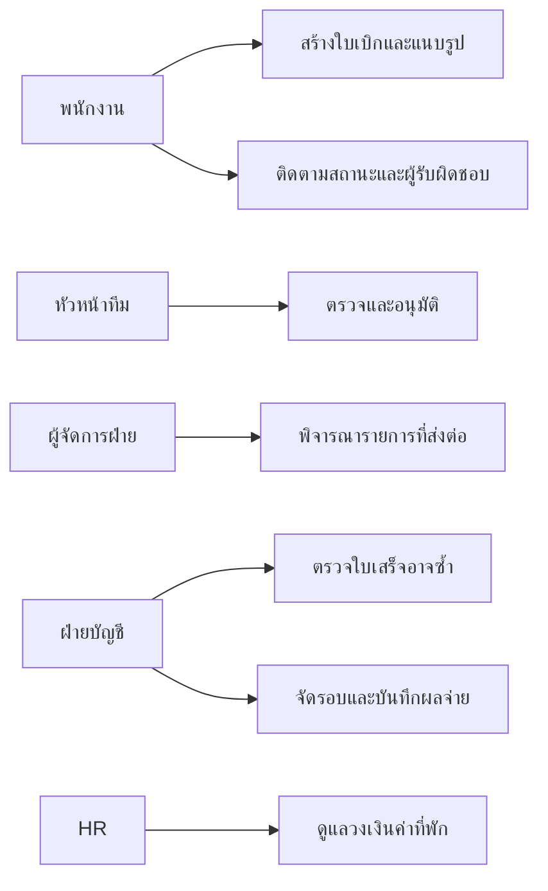
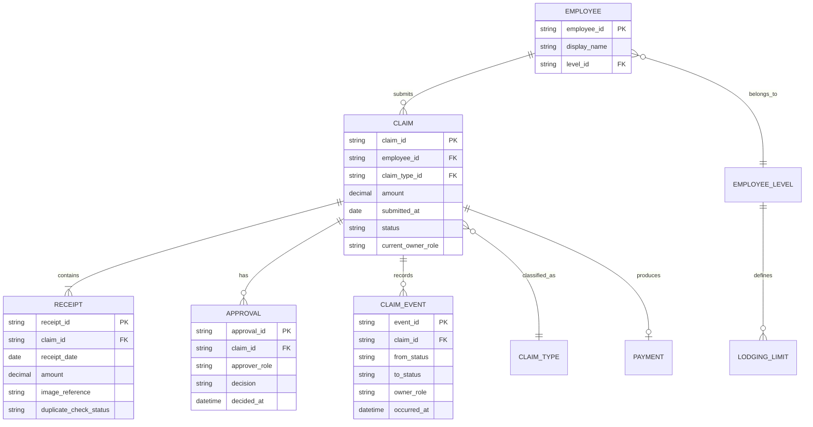
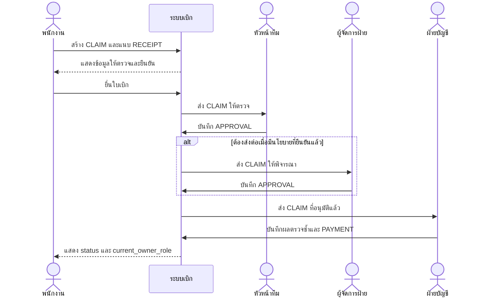
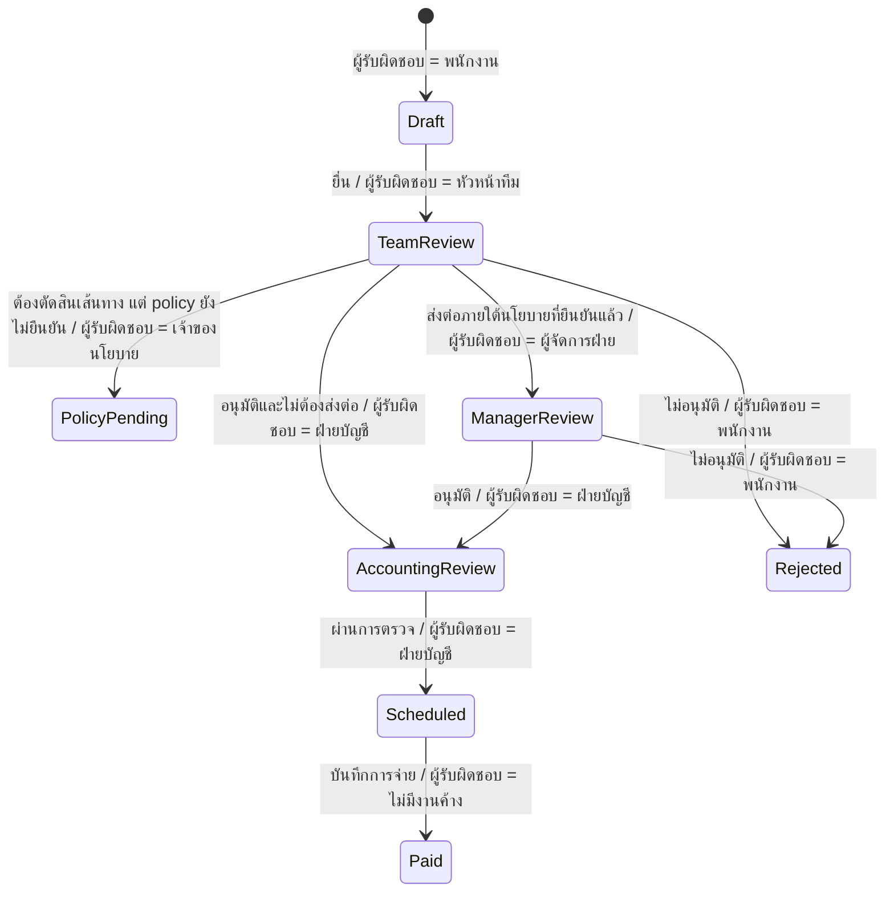

# ระบบเบิกค่าใช้จ่าย — Requirement และ Web UI Mockup

## 1. Iteration Log

| Iteration | สิ่งที่เปลี่ยน | C1 | C2 | C3 |
| --- | --- | --- | --- | --- |
| 1 | สร้างเอกสารข้อกำหนด แบบจำลอง และ Web UI Mockup สามส่วนจากบันทึกสัมภาษณ์ | PASS | PASS | PASS |

## 2. ขอบเขตและหลักฐานต้นทาง

เอกสารนี้วิเคราะห์จากบันทึกสัมภาษณ์ 9 ประโยค โดยแยกข้อมูลที่ผู้ให้สัมภาษณ์ยืนยันออกจากข้อเสนอการออกแบบและประเด็นที่ต้องถามเพิ่ม ตัวเลข 5,000 และ 10,000 บาทยังเป็นนโยบายที่ขัดกัน ส่วนวงเงินค่าที่พักตามระดับพนักงานยังไม่มีตัวเลข จึงไม่กำหนดค่าแทนองค์กร

## 3. Actor / Stakeholder

| ผู้เกี่ยวข้อง | เป้าหมายหรือหน้าที่ |
| --- | --- |
| พนักงานฝ่ายขาย | สร้างและยื่นใบเบิกด้วยรูปใบเสร็จ ลดการกรอก ติดตามสถานะและผู้รับผิดชอบ |
| หัวหน้าทีม | อนุมัติทุกใบ และส่งต่อเมื่อเข้าเงื่อนไขที่องค์กรยืนยันแล้ว |
| ผู้จัดการฝ่าย | พิจารณาใบเบิกที่ถูกส่งต่อตามนโยบายที่ยืนยันแล้ว |
| ฝ่ายบัญชี | ตรวจใบเสร็จอาจซ้ำ ตรวจเวลาเบิก จัดรอบจ่าย และบันทึกผลจ่าย |
| HR | ให้ข้อมูลระดับพนักงานและวงเงินค่าที่พักที่องค์กรอนุมัติ |

## 4. Functional Requirements

| ID | Requirement | ที่มา |
| --- | --- | --- |
| FR-01 | พนักงานสร้างใบเบิกและแนบรูปใบเสร็จได้ โดยระบบต้องไม่บังคับข้อมูลที่ไม่จำเป็น | S01–S02 |
| FR-02 | รองรับค่าน้ำมัน ค่าที่พัก และค่ารับรองลูกค้า | S02 |
| FR-03 | ใบเบิกค่ารับรองต้องระบุชื่อลูกค้าและบริษัทก่อนยื่น | S07 |
| FR-04 | ส่งทุกใบให้หัวหน้าทีมอนุมัติ และรองรับการส่งต่อผู้จัดการเมื่อมีนโยบายที่ยืนยันแล้ว | S03–S04 |
| FR-05 | ฝ่ายบัญชีดูรายการที่อาจใช้ใบเสร็จซ้ำและบันทึกผลตรวจได้ | S05 |
| FR-06 | ระบบแสดงว่าใบเบิกเกิน 30 วันจากวันที่ใบเสร็จหรือไม่ โดยวิธีนับวันและข้อยกเว้นยังต้องยืนยัน | S06 |
| FR-07 | ฝ่ายบัญชีจัดใบเบิกที่ผ่านเงื่อนไขเข้ารอบจ่ายวันที่ 25 และบันทึกผลจ่ายได้ | S06 |
| FR-08 | ระบบรองรับวงเงินค่าที่พักตามระดับพนักงาน โดยรับข้อมูลที่ HR ยืนยัน | S08 |
| FR-09 | เจ้าของใบเบิกดูสถานะ ผู้รับผิดชอบปัจจุบัน และขั้นตอนถัดไปได้ | S09 |

## 5. Non-functional Requirements

| ID | คุณภาพที่ต้องการ | สถานะ |
| --- | --- | --- |
| NFR-01 | ขั้นตอนยื่นเบิกควรลดภาระการกรอกเมื่อเทียบกับกระบวนการเดิม | ต้องออกแบบการทดสอบกับพนักงาน ไม่กำหนดจำนวนคลิกเอง |
| NFR-02 | การเปลี่ยนสถานะและการตัดสินใจต้องตรวจย้อนหลังได้ | ข้อเสนอเพื่อรองรับการตรวจบัญชี ต้องยืนยันระยะเวลาเก็บข้อมูล |
| NFR-03 | จำกัดการเข้าถึงรูปใบเสร็จและข้อมูลใบเบิกตามบทบาท | ข้อเสนอด้านความปลอดภัย ต้องยืนยันสิทธิ์จริงกับองค์กร |

## 6. Business Rules

| ID | Rule | สถานะ |
| --- | --- | --- |
| BR-01 | หัวหน้าทีมต้องอนุมัติทุกใบ | ยืนยันจาก S03 |
| BR-02 | หัวหน้าทีมเสนอให้ส่งต่อผู้จัดการเมื่อยอดเกิน 5,000 บาท | ขัดกับ BR-03; ยังใช้ตัดสินไม่ได้ |
| BR-03 | ผู้จัดการเสนอให้ส่งต่อเมื่อยอดเกิน 10,000 บาท | ขัดกับ BR-02; ยังใช้ตัดสินไม่ได้ |
| BR-04 | ต้องตรวจใบเสร็จที่อาจถูกใช้เบิกซ้ำ | ยืนยันหลักการจาก S05; วิธียืนยันรายการซ้ำยังต้องตกลง |
| BR-05 | ต้องยื่นภายใน 30 วันนับจากวันที่ใบเสร็จ | ยืนยันจาก S06; วิธีนับวันและข้อยกเว้นยังต้องตกลง |
| BR-06 | จ่ายเงินรอบวันที่ 25 ของเดือน | ยืนยันจาก S06; วันตัดรอบยังไม่ได้ระบุ |
| BR-07 | ค่ารับรองต้องมีชื่อลูกค้าและบริษัท | ยืนยันจาก S07 |
| BR-08 | วงเงินค่าที่พักต่อคืนต่างกันตามระดับพนักงาน | ยืนยันจาก S08; ยังไม่มีจำนวนเงิน |

## 7. Use Case Diagram

## 8. ERD

## 9. Sequence Diagram — ยื่นเบิก → อนุมัติ → จ่ายเงิน

## 10. State Diagram — สถานะและผู้รับผิดชอบ

## 11. Traceability Matrix

| Source | ประโยคต้นทางโดยย่อ | FR / BR | Use Case | Entity |
| --- | --- | --- | --- | --- |
| S01 | ถ่ายรูปใบเสร็จแล้วเบิกได้ ไม่อยากกรอกเยอะ | FR-01, NFR-01 | สร้างใบเบิก | CLAIM, RECEIPT |
| S02 | ค่าน้ำมัน ค่าที่พัก ค่ารับรอง | FR-02 | เลือกประเภท | CLAIM_TYPE |
| S03 | หัวหน้าอนุมัติทุกใบ; เกิน 5,000 ส่งผู้จัดการ | FR-04, BR-01, BR-02 | ตรวจและอนุมัติ | APPROVAL |
| S04 | ผู้จัดการรับเมื่อเกิน 10,000 | FR-04, BR-03 | พิจารณารายการส่งต่อ | APPROVAL |
| S05 | ตรวจใบเสร็จซ้ำ | FR-05, BR-04 | ตรวจรายการอาจซ้ำ | RECEIPT |
| S06 | ภายใน 30 วัน; จ่ายวันที่ 25 | FR-06, FR-07, BR-05, BR-06 | ตรวจเวลาและจัดรอบจ่าย | RECEIPT, PAYMENT |
| S07 | ค่ารับรองต้องมีชื่อลูกค้าและบริษัท | FR-03, BR-07 | ยื่นค่ารับรอง | CLAIM |
| S08 | วงเงินค่าที่พักต่างตามระดับ | FR-08, BR-08 | ดูแลวงเงิน | EMPLOYEE_LEVEL, LODGING_LIMIT |
| S09 | อยากเห็นว่าค้างอยู่ที่ใคร | FR-09 | ติดตามใบเบิก | CLAIM, CLAIM_EVENT |

## 12. Pain Point → Requirement → Mockup

| Pain Point | FR / BR | หน้าหรือส่วนของ Mockup |
| --- | --- | --- |
| กรอกเยอะและอยากใช้รูปใบเสร็จ | FR-01, NFR-01 | ยื่นเบิก: พื้นที่แนบรูปจำลองและช่องที่จำเป็น |
| ต้องกรอกข้อมูลค่ารับรองให้ครบ | FR-03, BR-07 | ยื่นเบิก: ช่องชื่อลูกค้าและบริษัท |
| ไม่รู้ว่าใบเบิกค้างที่ใคร | FR-09 | ติดตามใบเบิก: สถานะ ผู้รับผิดชอบ และขั้นตอนถัดไป |
| เคยใช้ใบเสร็จเดียวซ้ำ | FR-05, BR-04 | ตรวจ/อนุมัติ: ป้ายเตือนรายการอาจซ้ำ |
| เกณฑ์ส่งต่อ 5,000/10,000 ขัดกัน | BR-02, BR-03 | ตรวจ/อนุมัติ: ป้าย “รอยืนยันนโยบาย” |
| ไม่ทราบวงเงินค่าที่พัก | FR-08, BR-08 | ตรวจ/อนุมัติ: แสดงว่าไม่มีข้อมูลวงเงินที่ยืนยันแล้ว |

## 13. Open Issues

1. เกณฑ์ส่งต่อผู้จัดการใช้ “เกิน 5,000” หรือ “เกิน 10,000” บาท และผู้มีอำนาจอนุมัตินโยบายคือใคร?
2. วงเงินค่าที่พักต่อคืนของแต่ละระดับพนักงานเป็นเท่าไร และมีวันที่เริ่มใช้หรือไม่?
3. วิธีนับ 30 วันเป็นวันปฏิทินหรือวันทำการ และมีข้อยกเว้นหรือไม่?
4. รอบวันที่ 25 มีวันตัดรายการและวิธีเลื่อนไปเดือนถัดไปอย่างไร?
5. ใช้ข้อมูลใดตัดสินว่าใบเสร็จซ้ำ และใครมีอำนาจยืนยัน?
6. ต้องเก็บรูปใบเสร็จและประวัติการอนุมัตินานเท่าไร และใครดูได้บ้าง?

## 14. สมมติฐานและข้อจำกัด

- `mockup.html` เป็นภาพจำลอง ไม่เชื่อม backend, database, login, upload/OCR, approval หรือ payment จริง
- ข้อมูลชื่อพนักงาน รายการใบเบิก สถานะ และยอดใน Mockup เป็นข้อมูลจำลองและติดป้ายไว้
- ชื่อ Entity และ Attribute เป็นข้อเสนอออกแบบเพื่อให้แบบจำลองตรวจความสอดคล้องได้ ต้องทบทวนกับทีมพัฒนาก่อนใช้จริง
- Mermaid ทั้ง 4 บล็อก render ด้วย Mermaid 11 ใน Chromium ได้สำเร็จระหว่างการตรวจรอบนี้ และมีภาพหลักฐานเก็บร่วมกับผลทดลอง
