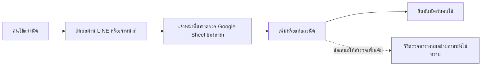
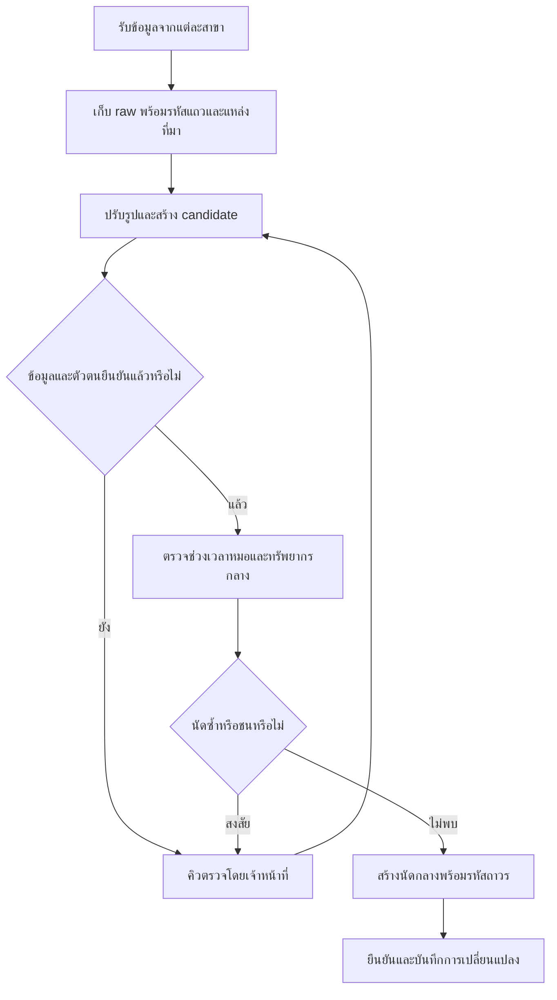
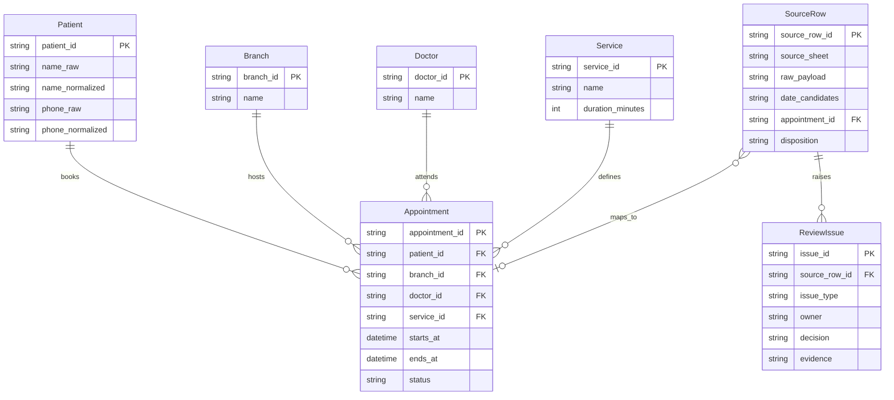
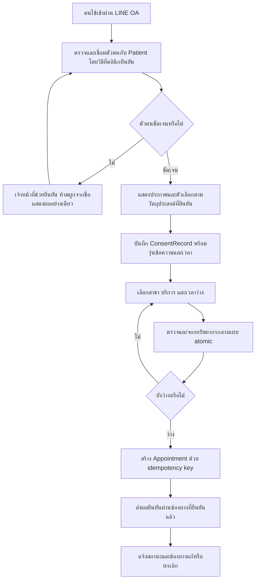
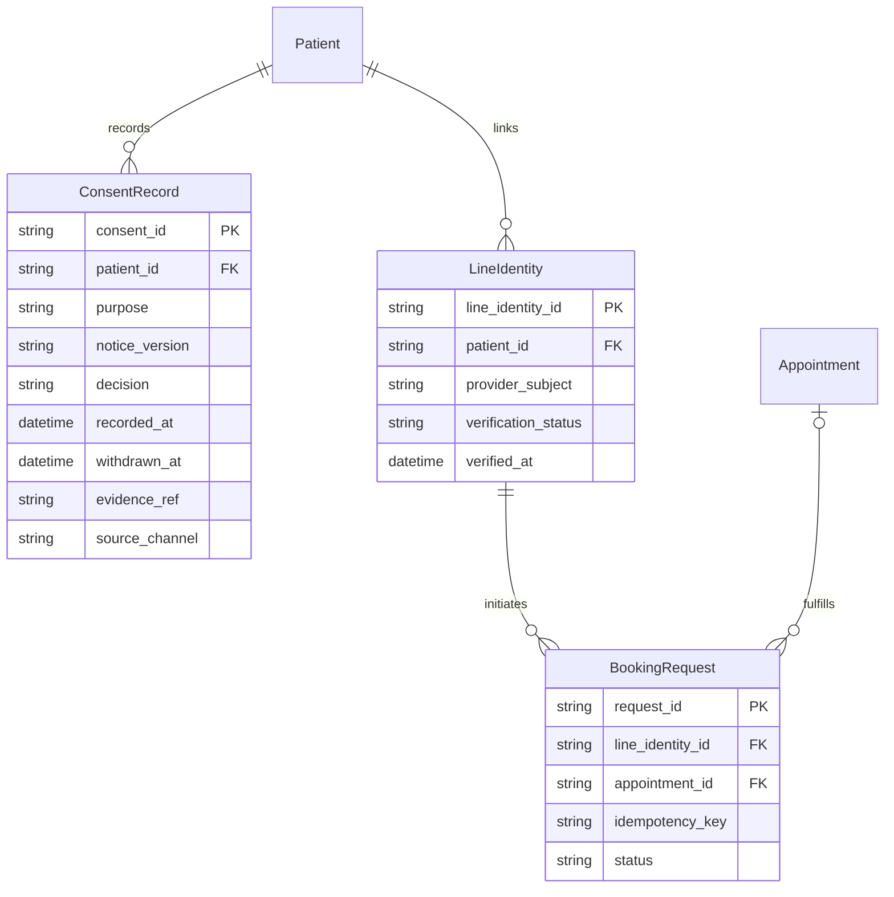

# แผนย้ายระบบนัดหมายคลินิก — ฉบับหลัง Change Request (updated: change request)

Loop รอบใหม่ • เอกสารออกแบบจากข้อมูลตัวอย่าง ไม่เชื่อม Google Sheet หรือ LINE จริง

## ขอบเขตและข้อมูลต้นทาง

คลินิกทันตกรรมสามสาขาใช้ Google Sheet แยกสาขาร่วมกับจองผ่าน LINE ต้องการระบบนัดหมายกลาง แถว R1–R5 คือข้อมูลตามลำดับที่ได้รับ ห้ามแก้ raw หรือรวมผู้ป่วยโดยไม่มีการยืนยัน

| แถว | สาขา | วันที่ raw | เวลา | ชื่อ raw | เบอร์ raw | หมอ | บริการ | หมายเหตุ |
| --- | --- | --- | --- | --- | --- | --- | --- | --- |
| R1 | ลาดกระบัง | 03/09/2026 | 10:00 | สมชาย ใจดี | 081-234-5678 | หมอเอ | ขูดหินปูน | ไม่มี |
| R2 | ลาดกระบัง | 2026-09-03 | 10:00 | สมชาย ใจดี | 0812345678 | หมอเอ | ขูดหินปูน | จองซ้ำทางไลน์ |
| R3 | บางนา | 3 ก.ย. 69 | 13:30 | คุณมาลี | ไม่มี | หมอบี | จัดฟัน | ไม่มีเบอร์ ติดต่อทางไลน์ |
| R4 | บางนา | 03/09/2026 | 13:30 | วิชัย ศรีสุข | 089-111-2222 | หมอบี | อุดฟัน | ไม่มี |
| R5 | อ่อนนุช | 09/03/2026 | 09:00 | Somchai Jaidee | 081 234 5678 | หมอเอ | ตรวจฟัน | หมอเอมาช่วยสาขานี้ทุกวันพุธ |

## As-Is Process

ขั้นตอนตรวจและยืนยันเป็นแบบจำลองเสนอจากบริบท ต้องสัมภาษณ์วิธีจริงต่อ ข้อมูลยืนยันมีเพียงการใช้ชีตแยกสาขาและ LINE ไม่สรุปว่าปัจจุบันไม่มีการตรวจซ้ำเลย

## Data Quality Findings

| ประเภท | แถว / หลักฐาน | ผลกระทบ | แนวทางจัดการ |
| --- | --- | --- | --- |
| รูปแบบวันที่และลำดับวันเดือนกำกวม | R1,R4 = 03/09/2026; R5 = 09/03/2026; R2 เป็น 2026-09-03 | นัดอาจผิดเดือน | เก็บ raw และ candidate ทั้ง DMY/MDY ขอ metadata ของแต่ละชีต ห้ามเดาจากประเทศอย่างเดียว |
| ปีสองหลักและศักราชไม่ระบุ | R3 = 3 ก.ย. 69 | แปลงปีผิดทำให้นัดผิดปี | เดือน ก.ย. ชี้เดือนกันยายน แต่ 69 ต้องยืนยัน พ.ศ./ค.ศ. และศตวรรษ; 2569→2026 เป็นเพียง candidate ตามบริบท R2 |
| รูปแบบเบอร์ไม่เป็นมาตรฐาน | R1,R2,R5 ใช้ขีด ช่องว่าง หรือเลขติดกัน | จับคู่คนเดียวกันไม่พบ | สร้าง phone_normalized แยกจาก raw; เบอร์ทั้งสามปรับรูปเป็น 0812345678 ได้ |
| ข้อมูลติดต่อและตัวระบุขาด | R3 ไม่มีเบอร์และไม่มี LINE identifier | ยืนยันคนไข้หรือติดต่อนัดไม่ได้จากข้อมูลที่ให้ | ส่งเข้าคิวให้สาขาติดต่อผู้เกี่ยวข้อง ห้ามสร้างเบอร์หรือ LINE identifier |
| นัดซ้ำที่ต้องยืนยัน | R1,R2 ชื่อ เบอร์ หมอ บริการ และเวลาเหมือนกัน; R2 ระบุจองซ้ำทางไลน์ | จองทรัพยากรซ้ำหรือแจ้งซ้ำ | เป็น candidate duplicate ที่มีหลักฐานมาก แต่วันที่ R1 ยังต้องยืนยันก่อนรวม ห้ามลบ raw |
| ชื่อไม่เป็นมาตรฐานและข้ามภาษา | R3 มีคำนำหน้า คุณ; R1,R2 ภาษาไทย แต่ R5 ภาษาอังกฤษ | รวมคนผิดหรือแยกคนเดียวกันเป็นหลายคน | สร้าง key สำหรับค้นหา ไม่ถือ transliteration หรือเบอร์ร่วมเป็นหลักฐานเด็ดขาด |
| ช่วงเวลาหมออาจชนกัน | R3,R4 หมอบี เวลา 13:30 สาขาเดียวกัน ถ้าวันที่ยืนยันตรงกัน | อาจนัดเกินความพร้อม | ยังเป็นความเสี่ยงไม่ใช่ชนที่ยืนยันแล้ว ขอวันที่และระยะเวลาบริการก่อนตัดสิน |
| หมายเหตุวันทำงานขัดกับ candidate date | R5 ระบุทุกวันพุธ แต่ 2026-03-09 เป็นจันทร์ และ 2026-09-03 เป็นพฤหัสบดี | เลือก DMY/MDY ด้วยวันพุธไม่ได้ทั้งคู่ | ต้องให้เจ้าของสาขายืนยันวันที่และตารางหมอ อาจเป็นข้อยกเว้นหรือข้อความเก่า แต่ยังสรุปไม่ได้ |
| ไม่มีรหัสถาวรและระยะเวลาบริการ | R1–R5 ไม่มี patient_id, appointment_id, duration | จับคู่ตัวตนและตรวจช่วงเวลาชนเต็มช่วงไม่ได้ | สร้างรหัส staging และ provenance; ขอ master service/duration และการยืนยันตัวตนก่อนนำเข้าระบบจริง |

### ทะเบียนความกำกวม

- R1,R4: candidate 2026-09-03 หรือ 2026-03-09; R2 สนับสนุนเดือนกันยายนเฉพาะกลุ่มที่อาจซ้ำ ไม่พิสูจน์รูปแบบของทุกสาขา
- R3: เดือนกันยายนชัดจากคำย่อไทย แต่ปี 69 ไม่กำหนดศักราช; เสนอ พ.ศ. 2569 เป็น candidate ให้ยืนยันเท่านั้น
- R5: candidate 2026-03-09 หรือ 2026-09-03; ทั้งคู่ไม่ใช่พุธ จึงยังไม่เลือกค่า normalized date
- R1,R2,R5: เบอร์ normalized เดียวกัน ไม่พิสูจน์ว่าเป็นบุคคลเดียวกัน อาจใช้เบอร์ร่วมกัน
- R3: คำว่า คุณ อาจเป็นคำนำหน้า แต่ต้องคงชื่อ raw ไว้ การขาดนามสกุลทำให้ระบุตัวตนยาก
- R3,R4: จองเวลาเดียวกันไม่พิสูจน์การชน หากคนละวันหรือมีรูปแบบบริการร่วม ต้องยืนยัน

## To-Be Process

คนรับผิดชอบคิวคือเจ้าหน้าที่สาขาต้นทาง โดยให้เจ้าของข้อมูลหรือผู้ป่วยยืนยันตามชนิดปัญหา ระบบเก็บเหตุผลและผู้อนุมัติการแก้ ไม่ให้การคาดเดาผ่านเข้าตารางนัดจริง

## Data Model

SourceRow.appointment_id อาจว่างระหว่าง quarantine; หลายแถวอาจชี้นัดเดียวกันหลังยืนยันซ้ำ ระยะเวลา Service.duration_minutes ต้องขอข้อมูลจริง ไม่ตั้งค่าเอง ฟิลด์ ends_at คำนวณได้หลังยืนยันระยะเวลาแล้ว

## Data Mapping + แผน Migration

| ต้นทาง | ปลายทาง | การแปลง / เงื่อนไข |
| --- | --- | --- |
| สาขา | Branch.name → branch_id | จับคู่ master ที่เจ้าของสาขายืนยัน |
| วันที่ + เวลา | SourceRow.date_candidates → Appointment.starts_at | parser แยกตาม source metadata; กำกวมเข้าคิว ไม่ใส่ starts_at จริงก่อนยืนยัน; timezone ให้คลินิกยืนยัน |
| ชื่อคนไข้ | Patient.name_raw / name_normalized | Unicode NFC, trim, ยุบช่องว่าง, casefold ภาษาอังกฤษ; แยกคำนำหน้าเพื่อค้นหาเท่านั้น คง raw |
| เบอร์ | Patient.phone_raw / phone_normalized | ตัดช่องว่างและขีด; หากมี country code ให้แปลงเมื่อยืนยันประเทศก่อน; ไม่เติมเบอร์ที่หาย |
| หมอ | Doctor.name → doctor_id | เจ้าหน้าที่จับคู่ master และตารางข้ามสาขา |
| บริการ | Service.name → service_id | ยืนยัน master และ duration_minutes ก่อนตรวจช่วงเวลาจริง |
| หมายเหตุ | SourceRow.raw_payload + ReviewIssue | เก็บต้นฉบับ แยกคำเตือนโดยไม่แปลงเป็นข้อเท็จจริงที่ยืนยันแล้ว |
| แหล่งและแถว | SourceRow.source_sheet / source_row_id | เพิ่ม provenance เพื่อย้อนกลับและนำเข้าซ้ำอย่างปลอดภัย |

### จับคู่ตัวตนก่อนรวมข้อมูล

1. ปรับชื่อและเบอร์ตามตารางโดยไม่เขียนทับต้นฉบับ
2. จัดกลุ่ม candidate จากเบอร์ normalized ร่วมกับชื่อ วันนัด และบริบทสาขา เบอร์เดียวอย่างเดียวห้าม auto-merge
3. R1/R2: candidate คนและนัดเดียวกันจากชื่อ เบอร์ เวลา หมอ บริการ และหมายเหตุ แต่ให้สาขายืนยันวันที่ R1 ก่อน
4. R5: เบอร์ตรงกลุ่ม R1/R2 แต่ชื่อข้ามภาษา วัน/บริการ/สาขาต่าง ต้องให้เจ้าหน้าที่และคนไข้ยืนยัน ไม่ใช้ transliteration ตัดสินอัตโนมัติ
5. R3: ไม่มีเบอร์และชื่อไม่ครบ ต้องให้สาขายืนยันช่องทาง LINE และตัวตนก่อนสร้างความเชื่อมโยง
6. R4: ยังไม่พบ candidate ตัวตนซ้ำจากข้อมูลนี้ แต่วันที่และความเสี่ยงเวลาหมอต้องยืนยัน
7. บันทึก decision/evidence ใน ReviewIssue และ mapping ต้นทางไว้ทุกครั้ง ห้ามลบแถวที่สงสัยซ้ำ

### ขั้นนำเข้าและจุดหยุด

- สำรองชีตและทำรายการไฟล์/แถวพร้อม checksum ก่อนนำเข้า เก็บชุด raw แบบอ่านอย่างเดียว
- นำเข้า staging โดยใช้ source_sheet + source_row_id เป็นกุญแจกันการนำเข้าซ้ำ
- สร้าง candidate และ ReviewIssue; ทุกปัญหาที่กระทบวัน ตัวตน หรือความพร้อมต้องผ่านคนยืนยัน
- ทดลองนำเข้าแบบ dry run แล้วตรวจยอด: จำนวน raw ต้องเท่ากับจำนวนแถวที่มี disposition รวมกัน ไม่ใช้จำนวน Appointment เทียบตรง ๆ เพราะอาจรวมแถวซ้ำ
- ตรวจ mapping, foreign keys, ตารางเวลาข้ามสาขา และสุ่มเทียบต้นฉบับกับเจ้าของสาขา บันทึกหลักฐาน sign-off
- ช่วง cutover ระงับการแก้ชีตตามเวลาที่ตกลง เก็บ delta ตั้งแต่ snapshot นำเข้าและกระทบยอดซ้ำ
- ถ้ายอดไม่ตรง ตัวตนผิด หรือเวลาชนที่ยังไม่ยืนยัน ให้หยุด cutover และย้อนกลับชีตจาก snapshot พร้อม delta ที่ตรวจแล้ว ห้ามทิ้งนัดใหม่ที่เกิดหลัง snapshot

## Gap Analysis + Roll-out Plan

| Gap | งานที่ต้องเพิ่ม | ผู้ยืนยัน / ลำดับปล่อย |
| --- | --- | --- |
| นัดกระจายหลายสาขา | ทะเบียนนัดและตารางหมอกลาง | หัวหน้าสาขา: ตรวจ master ก่อนทดลอง |
| ไม่มีรหัสผู้ป่วยที่ยืนยัน | patient registry และคิวจับคู่ | เจ้าหน้าที่ร่วมกับผู้ป่วย: ยืนยันก่อนรวม |
| วันที่/ข้อมูลติดต่อไม่ชัด | metadata ของชีตและคิว data quality | เจ้าของแต่ละชีต: ปิดรายการค้างที่กระทบนัดก่อน cutover |
| ไม่ทราบช่วงเวลาบริการ | master duration และการตรวจทรัพยากร | ผู้ดูแลตารางหมอ: ยืนยันก่อน dry run |
| วิธีทำงานใหม่ | ฝึกเจ้าหน้าที่และช่องทางรายงานผิดพลาด | ผู้จัดการคลินิก: เลือกสาขานำร่องเอง ไม่เดาสาขาจากตัวอย่าง |

Roll-out: สำรวจและลงนาม master → dry run → นำร่องสาขาที่คลินิกเลือก → ตรวจผลและการย้อนกลับ → ขยายสาขาเมื่อเจ้าของงานยอมรับ → เฝ้าตรวจและปิดระบบเดิมตามข้อตกลง ไม่กำหนดวันจริงหรือเกณฑ์ตัวเลขที่ยังไม่ตกลง

## Plan Version Log

| Version | เหตุผล | เปลี่ยนอะไร | Impact / Reuse |
| --- | --- | --- | --- |
| v1 | แผนเริ่มต้นจากโจทย์และข้อมูลตัวอย่าง | สำรวจ raw, ตรวจคุณภาพ, ออกแบบกลาง, เตรียม migration และ roll-out | สร้าง baseline ของเฟสแรก ยังไม่ได้รับ Change Request |

## ประเด็นค้างและข้อจำกัด

ต้องยืนยัน metadata วันที่/ปี, ตัวตน R1/R2/R5, ช่องทางติดต่อ R3, เวลาหมอ R3/R4/R5, duration, timezone และผู้รับผิดชอบนโยบาย โครงการนี้เป็นแผน ไม่มีการย้ายข้อมูลผู้ป่วยจริง หลักฐาน renderer อยู่ใน verification.json

## ข้อกำหนดใหม่และขอบเขต (updated: change request)

เจ้าของคลินิกเพิ่มให้เก็บความยินยอมของคนไข้ตาม PDPA และให้คนไข้จองคิวเองผ่าน LINE OA ข้อความนี้เป็นความต้องการต้นทาง เอกสารนี้เสนอการออกแบบข้อมูลและกระบวนการ ไม่รับรองว่าครบข้อกฎหมาย และไม่สรุปว่าทุกการประมวลผลต้องใช้ความยินยอม ให้ผู้รับผิดชอบความเป็นส่วนตัวยืนยันฐานการประมวลผล ข้อความ วัตถุประสงค์ การเก็บรักษา และสิทธิ์ก่อนใช้จริง

## To-Be เพิ่มเติม (updated: change request)

ต่อยอดขั้นตอนกลางของเฟสแรก โดยให้การจอง LINE ผ่านตัวตรวจทรัพยากรเดียวกับเจ้าหน้าที่

เมื่อไม่ให้หรือถอนความยินยอม ต้องแยกผลตามวัตถุประสงค์และนโยบายที่ยืนยัน ไม่ตั้งเงื่อนไขปฏิเสธการรักษาเอง ข้อผิดพลาดการส่งข้อความต้องไม่สร้างนัดซ้ำ และข้อความแจ้งเตือนไม่ควรเผยรายละเอียดการรักษาเกินที่นโยบายกำหนด

## Data Model ส่วนเพิ่ม (updated: change request)

ใช้ Patient และ Appointment เดิม เพิ่มตารางต่อไปนี้ โดยความสัมพันธ์และรหัสยังอ้างข้อมูลกลางเดิม

BookingRequest.appointment_id ว่างได้ก่อนยืนยันนัด; idempotency_key ต้องไม่ซ้ำสำหรับการส่งซ้ำของคำขอเดียวกัน LineIdentity ไม่อนุมานจากชื่อใน LINE และไม่ยืนยันตัวตนเพียงเพราะชื่อหรือเบอร์คล้ายกัน การใช้บัญชีเดียวดูแลหลายคนต้องยืนยันเรื่องผู้แทนและสิทธิ์ก่อนเพิ่มในแบบจำลอง

## Data Mapping และ Migration ส่วนเพิ่ม (updated: change request)

| ข้อมูล / ต้นทาง | ปลายทาง | กติกาและข้อจำกัด |
| --- | --- | --- |
| ความยินยอมเก่า | ConsentRecord | ตัวอย่างชีตไม่ให้หลักฐาน ห้ามสร้าง decision ว่าให้ยินยอม ต้องตรวจหลักฐานจริงหรือเก็บใหม่ตามนโยบายที่ยืนยัน |
| รุ่นข้อความและวัตถุประสงค์ | notice_version, purpose | ให้ผู้รับผิดชอบยืนยันข้อความและเวอร์ชันก่อนเก็บจริง |
| ให้/ไม่ให้/ถอน | decision, recorded_at, withdrawn_at, evidence_ref | เก็บประวัติตามเหตุการณ์และหลักฐาน ไม่เขียนทับประวัติโดยไร้ร่องรอย |
| LINE account | LineIdentity.provider_subject | รับจากขั้นตอนเชื่อมบัญชีที่ยืนยันแล้ว ไม่เดาจากหมายเหตุ R3 หรือชื่อ raw |
| คำขอจอง | BookingRequest → Appointment | deduplicate คำขอและจองช่องเวลาแบบ atomic ใช้กติกาคุณภาพข้อมูลเดิม |

ก่อนเปิด LINE: สำรวจ consent ที่มีจริง → ตกลงนโยบาย → เก็บหลักฐานที่ยังขาด → ทดลองเชื่อมบัญชีในสภาพแวดล้อมทดสอบ → ทดสอบคำขอซ้ำ/จองพร้อมกัน/การแจ้งล้มเหลว → ให้เจ้าของงานยืนยันก่อนเปิดกับคนไข้ ไม่ได้เชื่อมบริการจริงในแล็บนี้

## Impact Analysis / Reuse และ Gap ส่วนเพิ่ม (updated: change request)

| ส่วนงาน | Impact / สิ่งที่แก้ | Reuse / เหตุผล |
| --- | --- | --- |
| As-Is และ raw | ไม่แก้ เพราะข้อมูลใหม่เป็นเป้าหมายอนาคต | ใช้ R1–R5 และภาพเดิมเต็มชุด |
| Findings และ identity matching | เพิ่มข้อห้ามเดา LINE identity ในการนำเข้า | ใช้ปัญหาเดิมและ normalization ทุกข้อ ข้อมูลใหม่ไม่ได้แก้ความกำกวมวันที่ |
| To-Be | เพิ่มการเชื่อมตัวตน ตัวเลือกความยินยอม และการจองเอง | ใช้ตัวตรวจทรัพยากรและทะเบียนนัดกลางเดิม |
| Data Model | เพิ่ม ConsentRecord, LineIdentity, BookingRequest | ใช้ Patient, Appointment และ master เดิม |
| Migration | เพิ่มการตรวจหลักฐานยินยอมและเชื่อมบัญชี | ใช้ staging, provenance, quarantine และการกระทบยอดเดิม |
| Roll-out | เพิ่มการทดสอบสิทธิ์ การถอน คำขอซ้ำ จองพร้อมกัน และการส่งข้อความล้มเหลว | ใช้การนำร่องและเกณฑ์หยุด cutover เดิม |

## Roll-out และ Rollback ส่วนเพิ่ม (updated: change request)

- ผู้รับผิดชอบความเป็นส่วนตัวยืนยันนโยบายและข้อความก่อนทดสอบการให้/ไม่ให้/ถอน แยกวัตถุประสงค์และสิทธิ์ผู้เข้าถึง
- เจ้าหน้าที่ตรวจการจับคู่บัญชีกับผู้ป่วย รวมกรณีตัวตนไม่ตรงและผู้แทนที่ยังต้องกำหนดนโยบาย
- ทีมระบบทดสอบคำขอ LINE ซ้ำให้เกิดนัดเดียว และคำขอพร้อมกันไม่ให้ใช้ทรัพยากรเดียวกันเกินความพร้อม
- เปิดกลุ่มนำร่องเมื่อเจ้าของงานตรวจรับแล้ว จึงขยายการใช้งานตามผลจริง ไม่มีวันเปิดใช้งานที่แต่งขึ้น
- หากต้องย้อนกลับ ให้ปิดช่องทางจองเองชั่วคราวแต่รักษานัดกลางที่ยืนยันแล้ว ใช้เจ้าหน้าที่รับงานต่อ เก็บประวัติความยินยอมและคำขอที่เกิดขึ้น ไม่ย้อนฐานข้อมูลจนทำหลักฐานใหม่หาย

## Plan Version Log ฉบับต่อเนื่อง (updated: change request)

| Version | เหตุผล | เปลี่ยนอะไร | Impact / Reuse |
| --- | --- | --- | --- |
| v1 | เฟสแรกก่อนรับข้อมูลใหม่ | baseline ข้อมูล กระบวนการกลาง และแผนย้าย | เก็บ output-phase1.md ไว้ตรวจย้อน |
| v2 | รับข้อกำหนดความยินยอมและ LINE OA หลังเฟสแรก | เพิ่มแบบจำลอง กระบวนการจองเอง Mapping และ Roll-out ข้างต้น | แก้ To-Be/Data Model/Migration/Gap; ใช้ raw, As-Is, findings และ normalization เดิม |

Plan v1 → v2 คือการเปลี่ยนเนื้อหาแผน ส่วน Iteration คือรอบสร้าง/ตรวจของ Loop สองอย่างนี้ไม่ใช่หน่วยเดียวกัน

## ประเด็นค้างหลังข้อมูลใหม่ (updated: change request)

ยังต้องยืนยันข้อมูลเดิมและเพิ่ม: ผู้รับผิดชอบนโยบายความเป็นส่วนตัว ฐานการประมวลผล/วัตถุประสงค์ ข้อความและอายุเก็บ วิธีพิสูจน์ตัวตน LINE นโยบายผู้แทน การถอนและผลกระทบ และการดูแลคำขอผิดพลาด ไม่ได้ทดสอบ API จริงหรือรับรองความสอดคล้องตามกฎหมาย
