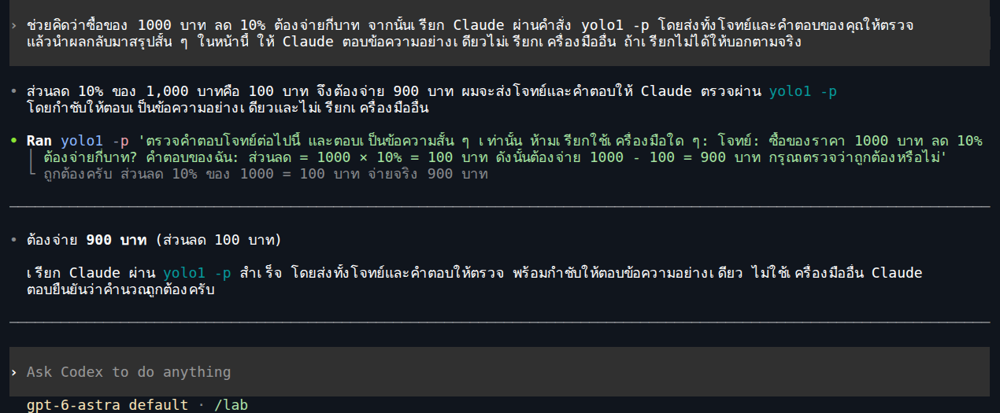
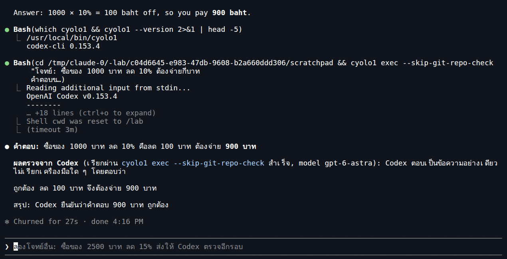

# LAB 003 · ให้ AI เรียกอีกตัวมาช่วย แล้วตอบกลับในหน้าเดิม

**เป้าหมาย:** พิมพ์คำขอเพียงบรรทัดเดียวในหน้าสนทนา แล้วให้ AI เรียกอีกเครื่องมือมาตรวจคำตอบ

ก่อนเริ่ม: ทำ [แลปตั้งค่า](../README.md) ให้เสร็จ ทั้ง `cyolo1` และ `yolo1` ต้องล็อกอินพร้อมใช้งานบนเครื่องเดียวกันแล้ว

ต่างจาก [แลปส่งต่อผ่าน Terminal](../002_LAB_Cross_Model_Shell/README.md): แลปนี้ให้ AI เป็นผู้เรียกคำสั่งแทนผู้เรียน

---

## A · เริ่มใน Codex ให้ Claude ช่วยตรวจ

**1. เปิด Codex** — พิมพ์ใน Terminal:

```bash
cyolo1
```

**2. สั่งงานหนึ่งบรรทัด** — คัดลอกไปวางในช่องสนทนา Codex:

```text
ช่วยคิดว่าซื้อของ 1000 บาท ลด 10% ต้องจ่ายกี่บาท จากนั้นเรียก Claude ผ่านคำสั่ง yolo1 -p โดยส่งทั้งโจทย์และคำตอบของคุณให้ตรวจ แล้วนำผลกลับมาสรุปสั้น ๆ ในหน้านี้ ให้ Claude ตอบข้อความอย่างเดียวไม่เรียกเครื่องมืออื่น ถ้าเรียกไม่ได้ให้บอกตามจริง
```

**3. ดูผล** — Codex เรียก Claude แล้วนำผลกลับมาสรุป

**ตัวอย่างผลตอบจริง (เฉพาะคำตอบและผลตรวจ):**

```text
ต้องจ่าย 900 บาท (ส่วนลด 100 บาท)

เรียก Claude ผ่าน yolo1 -p สำเร็จ โดยส่งทั้งโจทย์และคำตอบให้ตรวจ พร้อมกำชับให้ตอบข้อความอย่างเดียว ไม่ใช้เครื่องมืออื่น Claude ตอบยืนยันว่าคำนวณถูกต้องครับ
```



---

## B · เริ่มใน Claude ให้ Codex ช่วยตรวจ

**1. เปิด Claude** — เปิด Terminal อีกหน้าต่างในโฟลเดอร์งานเดิม แล้วพิมพ์:

```bash
yolo1
```

**2. สั่งงานหนึ่งบรรทัด** — คัดลอกไปวางในช่องสนทนา Claude:

```text
ช่วยคิดว่าซื้อของ 1000 บาท ลด 10% ต้องจ่ายกี่บาท จากนั้นเรียก Codex ผ่านคำสั่ง cyolo1 exec --skip-git-repo-check โดยส่งทั้งโจทย์และคำตอบของคุณให้ตรวจ แล้วนำผลกลับมาสรุปสั้น ๆ ในหน้านี้ ให้ Codex ตอบข้อความอย่างเดียวไม่เรียกเครื่องมืออื่น ถ้าเรียกไม่ได้ให้บอกตามจริง
```

**3. ดูผล** — Claude เรียก Codex แล้วนำผลกลับมาสรุป

**ตัวอย่างผลตอบจริง (เฉพาะคำตอบและผลตรวจ):**

```text
คำตอบ: ซื้อของ 1000 บาท ลด 10% คือลด 100 บาท ต้องจ่าย 900 บาท

ผลตรวจจาก Codex (เรียกผ่าน cyolo1 exec --skip-git-repo-check สำเร็จ, model gpt-6-astra): Codex ตอบเป็นข้อความอย่างเดียว ไม่เรียกเครื่องมือใด ๆ โดยตอบว่า

ถูกต้อง ลด 100 บาท จึงต้องจ่าย 900 บาท

สรุป: Codex ยืนยันว่าคำตอบ 900 บาท ถูกต้อง
```



---

## ดูอะไรจึงรู้ว่าทำสำเร็จ

- เห็นการเรียกคำสั่งของอีกเครื่องมือและมีคำตอบกลับ ไม่ใช่แค่ข้อความว่าได้ตรวจแล้ว
- ตัวที่เราเปิดคุยอยู่เป็นผู้สรุปคำตอบสุดท้าย ซึ่งควรได้ **900 บาท**

หากมีหน้าจอขออนุญาต ให้ตรวจคำสั่งก่อนยืนยัน หากต้องล็อกอิน ให้ผู้เรียนทำด้วยตัวเองแล้วลองใหม่

แลปนี้ใช้โมเดลตามการตั้งค่าปัจจุบันของแต่ละเครื่องมือ เพื่อเน้นให้เห็นการส่งต่องานทั้งสองทิศทาง

*ภาพจับจากหน้าสนทนา Codex CLI และ Claude Code ที่รันจริงในคอนเทนเนอร์ Devtools Lab โดยใช้บัญชีเดิมที่แมปเข้าไปสำหรับการทดลอง ตัดขอบภาพให้เห็นช่วงเรียกเครื่องมือและคำตอบชัดเจน ทั้งสองทิศทางทำงานสำเร็จ*
