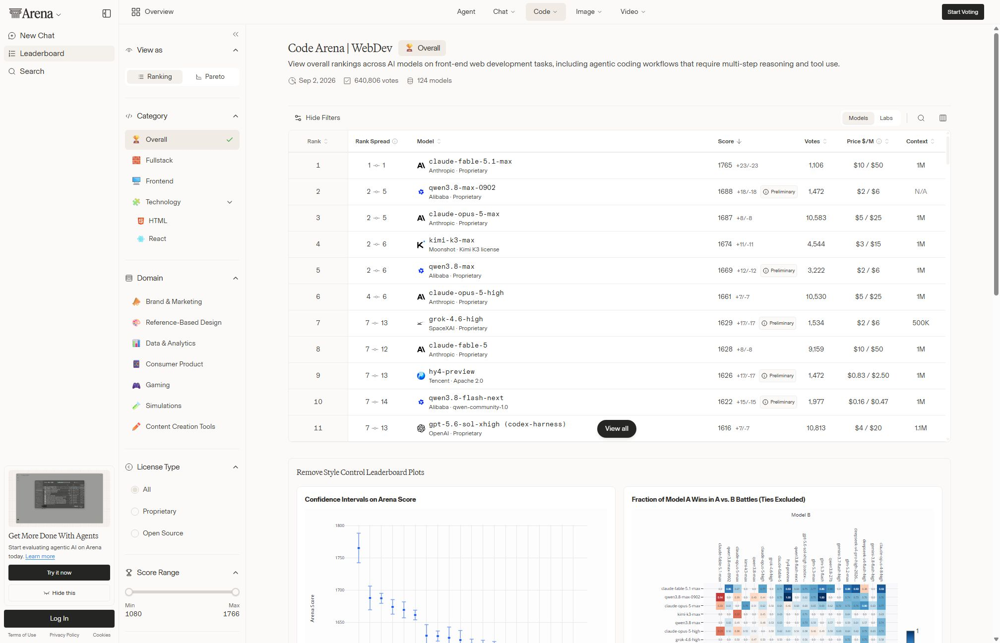

# Multi-Account AI CLI Setup บน Ubuntu — สื่อการสอน

หลักสูตรเชิงปฏิบัติ: ติดตั้งและใช้งาน **Claude Code, Codex CLI และ Qwen Code หลาย account พร้อมกัน**
บนเครื่อง Ubuntu เดียว โดยแยก credential / config / session ออกจากกัน **100%**

---

## 0. ภาพรวมหลักสูตร

| หัวข้อ | รายละเอียด |
|---|---|
| กลุ่มเป้าหมาย | Dev / DevOps ที่ใช้ AI CLI มากกว่า 1 บัญชี (งานส่วนตัว + งานลูกค้า + งานทีม) |
| ความรู้พื้นฐาน | Linux shell พื้นฐาน, environment variable, สิทธิ์ไฟล์ (chmod), Node.js/npm เบื้องต้น |
| ระยะเวลา | 6.5 ชั่วโมง (กรณีศึกษา 0.5 ชม. + บรรยาย 2 ชม. + Lab 3.5 ชม. + ตรวจรับ 0.5 ชม.) |
| รูปแบบ | สอนแบบ **ปัญหานำ → แนวคิด → สาธิต → Lab → จุดตรวจ** |
| ผลลัพธ์ | ผู้เรียนได้ installer ที่รันซ้ำได้ + คำสั่ง `yolo1..5`, `cyolo1..5`, `qyolo1..3` ใช้งานจริง |
| หลักฐานจริง | ทุก Module อ้างอิงแล็บที่รันจริงวันที่ 2026-09-03 ใน `labs/` (Lab A/B/C) ผัง `img/d1–d6` และบทเรียนเว็บ `lesson.html` |

### ผลลัพธ์การเรียนรู้ (Learning Outcomes)

จบหลักสูตรแล้วผู้เรียนต้อง:

1. **เปรียบเทียบ** โมเดลตามประเภทงาน คุณภาพ ราคา ความเร็ว และโควตา โดยไม่ยึดอันดับรวมเพียงอย่างเดียว
2. **เลือก** โมเดลและบัญชีให้เหมาะกับงาน พร้อมอธิบายเหตุผลด้านคุณภาพและต้นทุนได้
3. **อธิบาย** ได้ว่าทำไม config root ต่อ CLI จึงเป็นวิธีที่ถูกต้องกว่าการสลับ `$HOME`
4. **ระบุ** กลไก official ของแต่ละ CLI สำหรับกำหนด config root ได้ พร้อมบอกแหล่งอ้างอิง
5. **เขียน** wrapper script ที่ส่งต่อ argument และตั้ง env ได้ถูกต้อง
6. **จัดการ** credential อย่างปลอดภัย (สิทธิ์ 600, ไม่รั่วผ่าน process list / log)
7. **ออกแบบ** shared skills/MCP ที่แก้ที่เดียวแล้วทุก account เห็น
8. **เขียน** installer ที่ idempotent (รันซ้ำไม่ทำลายของเดิม)
9. **ทดสอบและรายงานผล** ตามจริงในรูปแบบ PASS / FAIL / SKIP

### แผนการสอน (Teaching Sequence)

ลำดับนี้ออกแบบให้ **แต่ละ Module ใช้ผลลัพธ์ของ Module ก่อนหน้า** — ห้ามข้ามลำดับ

```
P0  กรณีศึกษา LMArena: เลือกโมเดลให้ถูกงาน   (30 นาที)  ── เหตุผลทางธุรกิจ
     │
M0  เตรียมเครื่อง + ตรวจเวอร์ชันจริง         (30 นาที)  ── พื้นฐาน
     │
M1  ปัญหา: ทำไม account ชนกัน                (20 นาที)  ── แรงจูงใจ
     │
M2  ตัวแปรกลาง + โครงสร้างไดเรกทอรี          (30 นาที)  ── โครงกระดูก
     │
M3  Config root ต่อ CLI (หัวใจของหลักสูตร)   (60 นาที)  ── แกนหลัก
     │
M4  Wrapper commands yolo / cyolo / qyolo     (45 นาที)  ── ใช้งานได้จริง
     │
M5  Qwen credential + ความปลอดภัย             (45 นาที)  ── ของยาก
     │
M6  Shared Skills / MCP                       (45 นาที)  ── ต่อยอด
     │
M7  Installer ที่รันซ้ำได้                    (45 นาที)  ── รวมร่าง
     │
M8  ทดสอบ + ตรวจรับ + รายงาน                 (30 นาที)  ── ปิดจ๊อบ
```

**เหตุผลของลำดับนี้:** P0 ทำให้ผู้เรียนเห็นจากข้อมูลจริงว่าไม่มีโมเดลเดียวเหมาะกับทุกงาน และเชื่อมคุณภาพ
กับราคา/โควตาไปสู่เหตุผลของ Multi-Model และ Multi-Account · M1 ทำให้เห็นปัญหาทางเทคนิคก่อนสอนวิธีแก้
· M2 วางโครงให้ทุก Module หลังอ้างอิงได้
· M3 เป็นแนวคิดแกน ถ้าไม่เข้าใจ M4–M7 จะกลายเป็นการ copy-paste · M7 เอาทุกอย่างมาห่อรวม
จึงต้องอยู่หลังสุดก่อนทดสอบ

---

## ผลการทดลองจริง (2026-09-03) — อ่านก่อนสอน

สื่อชุดนี้ถูกปรับจากการรันจริง 3 แล็บ (รายละเอียดเต็มใน `lesson.html` และโฟลเดอร์ `labs/`):

| แล็บ | ทำอะไร | ที่ไหน | ผลสำคัญ |
|---|---|---|---|
| Lab A fresh-install | container Ubuntu 24.04 เปล่า → ติดตั้ง claude 2.1.258 / codex 0.152.1 / qwen 0.22.3 → ทำตาม `prompt_multi_account_cli.md` → ทดสอบ | `labs/labA-fresh-install/` | PASS 14 · FAIL 0 · SKIP 4 (ข้อที่ต้อง login จริง); container เปล่า → wrapper ใช้ได้ ≈ 16 s ของคำสั่ง; gotcha 12 ข้อใน report §2 |
| Lab B collision | พิสูจน์ path ชนกัน / `$HOME` switch พัง / config root แก้ได้ (strace + md5) | `labs/labB-collision/` | `{"fake":"A"}` → `{"fake":"B"}` ทับทันที; HOME switch ทำ git identity หายแต่ ssh ไม่ย้าย; `CLAUDE_CONFIG_DIR` / `CODEX_HOME` / `QWEN_HOME` แยกครบ 5 อย่าง |
| Lab C multimodel | เรียก 7 โมเดลผ่าน yolo1–3 + cyolo1: matrix / tool / effort / fan-out / relay / verify + โควตา | `labs/labC-multimodel/` (`bash run_all.sh`) | 29 การเรียกใน 306 s; UC1 6/7 ถูก (gpt-5.3-codex-spark เร็วสุดแต่ผิด); สั่งใช้เชลล์แล้วโมเดลเล็กถูกหมด; relay 4 hop ถูก; fan-out 5/6 ถูกและ parent จับตัวผิดได้; verify พบช่องโหว่สเปกที่ hidden test ไม่ครอบคลุม |

ผัง Excalidraw 6 ภาพอยู่ใน `img/` (ไฟล์แก้ไขได้ใน `img/src/*.excalidraw`): d1 โครงสร้าง BASE_PATH · d2 เส้นทางคำสั่ง wrapper · d3 ไม่แยก/HOME switch/config root · d4 4 บัญชี → 7 โมเดล · d5 4 รูปแบบ multi-model · d6 สถาปัตยกรรมการทดลอง

กับดักที่ต้องบอกนักศึกษาตั้งแต่ต้น (ยืนยันแล้วในแล็บ):

1. npm ≥ 12 บล็อก postinstall ของ Claude Code → `Error: claude native binary not installed.` → ติดตั้งด้วย `--allow-scripts=@anthropic-ai/claude-code,@qwen-code/audio-capture`
2. รันเป็น root: `--dangerously-skip-permissions cannot be used with root/sudo privileges` → wrapper ต้องตั้ง `IS_SANDBOX=1`
3. `CODEX_HOME` ต้อง `mkdir -p` ก่อน และ `codex login status` เชื่อไม่ได้ (ตอบ "Logged in" ให้ `auth.json` ปลอม) → ยืนยันด้วย `codex exec`
4. Qwen: `-y` ซ่อนจาก `--help`, sub-command ห้ามใส่ `-y`, OAuth ฟรียกเลิกแล้ว (2026-04-15) → API key ตาม plan
5. `VAR=x; claude` (มี `;`) ไม่ export → CLI ใช้ default เงียบ ๆ ต้องเขียน `VAR=x claude` หรือ export แล้วตรวจด้วย `find <root>`
6. บน WSL2 + Docker Desktop port 2222–2280 bind ไม่ได้ → เลือก port ถัดไป และตรวจ container ด้วย `docker exec` แทน localhost

use case ทุกข้อในบทเรียนใหม่ใช้โมเดลต่างกันอย่างน้อย 3 ตัว (สูงสุด 7) — ดูตาราง S7 ใน `lesson.html`

---

## ช่วงเปิดบทเรียน P0 — จาก Leaderboard สู่เหตุผลของ Multi-Account AI CLI

### คำถามตั้งต้น

> เราควรถามว่า “โมเดลใดเก่งที่สุด” หรือควรถามว่า “งานนี้ควรใช้โมเดลใด บัญชีใด และมีต้นทุนเท่าใด”

### จุดประสงค์

ผู้เรียนอ่าน Leaderboard อย่างมีวิจารณญาณ เปรียบเทียบโมเดลตามประเภทงาน และเชื่อมผลที่เห็นไปสู่เหตุผล
ในการติดตั้ง AI CLI หลายค่ายและหลายบัญชี

### กิจกรรม P0.1 — อ่าน LMArena แบบไม่ยึดอันดับรวม

เปิด [LMArena Leaderboard](https://huggingface.co/spaces/lmarena-ai/arena-leaderboard) แล้วให้ผู้เรียนเลือกอย่างน้อย
3 หมวดงาน เช่น Coding, งานที่ใช้บริบทยาว และงานทั่วไป จากนั้นบันทึกผลที่เห็น ณ วันสอน

> **ข้อควรระวัง:** Leaderboard เปลี่ยนแปลงได้ตามรุ่นโมเดลและข้อมูลโหวต จึงไม่ควรเขียนชื่อโมเดลหรืออันดับ
> แบบตายตัวลงในสื่อ ให้ผู้เรียนอ่านค่าปัจจุบันจากหน้าเว็บและบันทึกวันที่ทุกครั้ง

| ประเภทงาน | โมเดลที่น่าสนใจ ณ วันสอน | เหตุผลจากข้อมูล | ราคา/โควตา | ตัวเลือกที่เหมาะสม |
|---|---|---|---|---|
| Coding / Frontend | | | | |
| Long context / วิเคราะห์ | | | | |
| งานทั่วไป | | | | |

#### ตัวอย่างอภิปรายจากข้อมูลวันที่ 2 กันยายน 2026

ในหมวด WebDev Overall หน้าเว็บแสดง `qwen3.8-max-0902` อยู่ในกลุ่มอันดับ 2–5 คะแนน 1688
ที่ราคา input/output $2/$6 ต่อหนึ่งล้านโทเคน ขณะที่โมเดลอันดับสูงสุดในตารางมีราคา $10/$50
ตัวเลขนี้ไม่ได้พิสูจน์ว่า Qwen ดีกว่าในทุกกรณี แต่เป็นตัวอย่างชัดเจนว่าโมเดลที่คะแนนใกล้กลุ่มบน
อาจมีต้นทุนต่ำกว่ามาก ผู้เรียนจึงต้องตัดสินใจจาก **ประเภทงาน + ช่วงความเชื่อมั่น + ราคา + ข้อจำกัดจริง**



### กิจกรรม P0.2 — ตัดสินใจด้วยหลายปัจจัย

อันดับสูงไม่ได้แปลว่าเหมาะที่สุดเสมอ ให้ประเมินอย่างน้อย 6 ด้าน:

1. **คุณภาพตามประเภทงาน** — ผลในหมวดที่ตรงกับงานจริง ไม่ใช่อันดับ Overall เพียงอย่างเดียว
2. **ราคา** — คุณภาพที่เพิ่มขึ้นคุ้มกับค่าใช้จ่ายหรือไม่
3. **ความเร็ว** — งานแบบโต้ตอบและงาน batch ต้องการ latency ต่างกัน
4. **โควตา** — แต่ละบัญชีหรือแพ็กเกจมีข้อจำกัดไม่เท่ากัน
5. **ความเป็นส่วนตัว** — ข้อมูลของลูกค้าหรือองค์กรส่งไปยังบริการใดได้บ้าง
6. **เครื่องมือและ workflow** — CLI ใดรองรับงาน เครื่องมือ และ automation ที่ต้องใช้

### กิจกรรม P0.3 — เชื่อมสู่ Multi-Model และ Multi-Account

ใช้สถานการณ์ตัวอย่าง: โมเดลหนึ่งอาจเหมาะกับการสร้าง Frontend หรือต้นแบบและมีต้นทุนต่ำกว่า
ขณะที่อีกโมเดลเหมาะกับการวิเคราะห์หรือรีวิวโค้ดที่ซับซ้อน แม้มีราคาสูงกว่า จึงควรใช้โมเดลราคาแพง
เฉพาะขั้นตอนที่สร้างคุณค่าเพิ่มจริง

การติดตั้ง Claude Code, Codex CLI และ Qwen Code ร่วมกันช่วยให้:

- เลือกโมเดลให้ตรงกับงาน แทนการบังคับใช้ตัวเดียวกับทุกงาน
- ควบคุมต้นทุนและกระจายการใช้โควตา
- เปรียบเทียบคำตอบหรือใช้โมเดลหนึ่งสร้างและอีกโมเดลตรวจ
- ทำงานต่อได้เมื่อบริการหนึ่งติดโควตาหรือขัดข้อง
- ลดการผูกติดกับผู้ให้บริการรายเดียว

ส่วน **Multi-Account** จำเป็นเมื่อมีบัญชีส่วนตัว บัญชีทีม บัญชีลูกค้า หรือแพ็กเกจต่างกัน เพราะต้องป้องกัน
credential, config, session, history และ cache ปะปนกัน นี่คือปัญหาที่จะพิสูจน์ใน Module 1

### จุดตรวจ P0

- [ ] เปรียบเทียบอย่างน้อย 3 ประเภทงานจากข้อมูล ณ วันสอน
- [ ] อธิบายได้ว่าทำไมอันดับ Overall ไม่เพียงพอต่อการเลือกโมเดล
- [ ] เสนอ workflow อย่างน้อย 1 แบบที่ใช้มากกว่าหนึ่งโมเดล พร้อมเหตุผลด้านคุณภาพและต้นทุน
- [ ] อธิบายความต่างระหว่างเหตุผลของ Multi-Model และ Multi-Account ได้

---

## Module 0 — เตรียมเครื่องและตรวจสอบเวอร์ชันจริง

> **กฎเหล็กของทั้งหลักสูตร: ห้ามเดา env / path / endpoint / model / flag**
> ทุกค่าต้องยืนยันจาก `--help` ของเวอร์ชันที่ติดตั้งจริง หรือ official docs
> ถ้า docs กับ CLI ไม่ตรงกัน → **รายงานความต่าง แล้วใช้ค่าที่ CLI จริงยืนยัน**

### จุดประสงค์
ผู้เรียนตรวจสอบสภาพเครื่องและจดเวอร์ชันจริงของ CLI ทั้งสามตัวได้

### Lab 0
```bash
# ตรวจ OS และ shell
lsb_release -a ; echo $SHELL ; node -v ; npm -v

# ตรวจว่าติดตั้ง CLI แล้วหรือยัง + จดเวอร์ชัน
claude --version ; codex --version ; qwen --version

# อ่าน help เพื่อหา flag/env ที่ใช้จริง (จดใส่ตารางด้านล่าง)
claude --help | less
codex --help | less
qwen  --help | less
```

### ใบจดบันทึก (ค่าที่ยืนยันแล้ว 2026-09-03 จาก Lab A — ผู้เรียนต้องตรวจซ้ำกับเวอร์ชันของตนเอง)

| CLI | เวอร์ชันจริง | env กำหนด config root | flag skip permission | หมายเหตุ/ข้อจำกัด |
|---|---|---|---|---|
| Claude Code | 2.1.258 (latest วันนั้น 2.1.259) | `CLAUDE_CONFIG_DIR` (พิสูจน์ด้วย strace/find) | `--dangerously-skip-permissions` | native binary ไม่มี `cli.js`; รันเป็น root ต้อง `IS_SANDBOX=1`; npm 12 ต้อง `--allow-scripts`; MCP log ไป `~/.cache/claude-cli-nodejs` (ย้ายด้วย `XDG_CACHE_HOME`) |
| Codex CLI | 0.152.1 (latest 0.153.0) | `CODEX_HOME` (ต้อง mkdir ก่อน) | `--dangerously-bypass-approvals-and-sandbox` (บรรทัด 96 ของ `codex --help`) | `login status` ไม่ validate token; ครั้งแรกที่ `exec` สร้าง system skills + sqlite ≈ 77 MB ต่อ account |
| Qwen Code | 0.22.3 | `QWEN_HOME` (ยืนยันจาก source + strace; `~/.qwen` ไม่ถูกแตะ) | `-y` / `--yolo` / `--approval-mode` (ซ่อนจาก `--help` แต่ใช้ได้; sub-command ห้ามใส่) | OAuth ฟรียกเลิก 2026-04-15 → API key ตาม plan ใน `$QWEN_HOME/.env` (600) + `settings.json`; CLI เขียน settings.json ทับเป็น 644 |

### แหล่งอ้างอิงทางการ
- https://code.claude.com/docs/
- https://github.com/openai/codex
- https://docs.qwencloud.com/developer-guides/clients-and-developer-tools/qwen-code

### จุดตรวจ M0
- [ ] จดเวอร์ชันครบ 3 CLI
- [ ] ระบุกลไก config root ของแต่ละ CLI ได้ พร้อมลิงก์อ้างอิง
- [ ] CLI ตัวใดไม่มีกลไก official → **เขียนข้อจำกัดไว้ชัดเจน** ไม่หาทางลัด

---

## Module 1 — ปัญหา: ทำไมหลาย account ถึงชนกัน

### จุดประสงค์
ผู้เรียนอธิบายอาการชนของ credential/session ได้ และบอกได้ว่าทำไม "สลับ `$HOME`" เป็นทางแก้ที่ผิด

### สาธิตให้เห็นปัญหา (Demo — 5 นาที)
เปิด CLI ตัวเดียวกันสอง terminal ด้วย account ต่างกัน แล้วให้ผู้เรียนสังเกต:
- login ตัวที่สอง **เขียนทับ** credential ตัวแรก
- session / history ปนกัน
- cache ใช้ร่วมกัน → พฤติกรรมไม่แน่นอน

### แนวคิดหลัก
สิ่งที่ต้องแยกให้ครบมี **5 อย่าง**: `credential` · `config` · `session` · `history` · `cache`
แยกไม่ครบข้อใดข้อหนึ่ง = ยังชนอยู่

### กับดักที่พบบ่อย
| วิธีที่คนมักทำ | ทำไมถึงพัง |
|---|---|
| `HOME=/path/to/acc1 claude` | พัง Git, SSH, npm cache และ tool อื่นทั้งเครื่อง |
| สลับไฟล์ credential ไปมาด้วย script | เปิดพร้อมกันไม่ได้ และมีโอกาสไฟล์หาย |
| ใช้ Docker แยกทุก account | ได้ผลแต่หนักเกินความจำเป็นสำหรับงาน CLI |

### คำถามชวนคิด
> ถ้าเปลี่ยน `$HOME` แล้ว `git commit` จะใช้ identity ของใคร? และ `~/.ssh` จะยังหาเจอไหม?

### จุดตรวจ M1
- [ ] อธิบายได้ว่าต้องแยกอะไรบ้าง 5 อย่าง
- [ ] อธิบายผลเสียของการเปลี่ยน `$HOME` ได้อย่างน้อย 2 ข้อ

---

## Module 2 — ตัวแปรตั้งค่ากลางและโครงสร้างไดเรกทอรี

### จุดประสงค์
ผู้เรียนวางโครงสร้างไดเรกทอรีจากตัวแปรกลางตัวเดียวได้

### หลักการ: Single Source of Truth
**แก้ที่เดียว ที่อื่นอ้างอิงตัวแปรนี้เท่านั้น** — ห้าม hard-code path ซ้ำที่ใดในระบบ

```bash
BASE_PATH="/root/workspace"
```

### โครงสร้างเป้าหมาย
```
$BASE_PATH/
├── .Claude/          yolo1..yolo5    + shared/{skills,mcp}
├── .Codex/           cyolo1..cyolo5  + shared/{skills,mcp}
└── .Qwen/            qyolo1..qyolo3  + shared/{skills,mcp}
```

### ตารางคำสั่งเป้าหมาย
| คำสั่ง | CLI | ผูกกับบัญชี | หมายเหตุ |
|---|---|---|---|
| `yolo1` .. `yolo5` | Claude Code | Anthropic account | |
| `cyolo1` .. `cyolo5` | Codex CLI | OpenAI account | |
| `qyolo1` .. `qyolo3` | Qwen Code | QwenCloud account | **เรียก Qwen Code โดยตรง** ห้ามผ่าน Claude Code/Codex |

### Lab 2
```bash
BASE_PATH="/root/workspace"
mkdir -p "$BASE_PATH"/.Claude/{yolo1,yolo2,yolo3,yolo4,yolo5,shared/{skills,mcp}}
mkdir -p "$BASE_PATH"/.Codex/{cyolo1,cyolo2,cyolo3,cyolo4,cyolo5,shared/{skills,mcp}}
mkdir -p "$BASE_PATH"/.Qwen/{qyolo1,qyolo2,qyolo3,shared/{skills,mcp}}
tree -L 2 "$BASE_PATH"/.Claude "$BASE_PATH"/.Codex "$BASE_PATH"/.Qwen
```

### จุดตรวจ M2
- [ ] โครงสร้างครบตามผัง
- [ ] ค้นทั้งโปรเจกต์แล้ว **ไม่มี path ที่ hard-code** นอกจากตัวแปร `BASE_PATH`

---

## Module 3 — Config Root ต่อ CLI *(หัวใจของหลักสูตร)*

### จุดประสงค์
ผู้เรียนใช้กลไก official ของแต่ละ CLI ชี้ config root ไปยังโฟลเดอร์ของแต่ละ account ได้

### กฎ 3 ข้อของการทำ Isolation
1. **แยกครบ 5 อย่าง** — credential / config / session / history / cache เปิดพร้อมกันต้องไม่ชน
2. **ห้ามเปลี่ยน `$HOME`** — ใช้กลไก official ต่อ CLI เท่านั้น
   - Claude Code → `CLAUDE_CONFIG_DIR`
   - Codex CLI → `CODEX_HOME`
   - Qwen Code → ตาม docs ล่าสุด (ยืนยันก่อนใช้)
   - CLI ใดไม่มีกลไก official → **ระบุข้อจำกัดให้ชัด และทำเฉพาะเท่าที่รองรับจริง**
3. **ห้ามแก้ของเดิมโดยไม่จำเป็น** — `.bashrc`, Git config, SSH config, project environment

### สาธิต
```bash
CLAUDE_CONFIG_DIR="$BASE_PATH/.Claude/yolo1" claude --version
CODEX_HOME="$BASE_PATH/.Codex/cyolo1"        codex --version
```

### Lab 3 — พิสูจน์ว่าแยกกันจริง
```bash
# terminal 1
CLAUDE_CONFIG_DIR="$BASE_PATH/.Claude/yolo1" claude
# terminal 2 (พร้อมกัน)
CLAUDE_CONFIG_DIR="$BASE_PATH/.Claude/yolo2" claude

# ตรวจว่าไฟล์ credential เกิดแยกกันจริง
find "$BASE_PATH/.Claude/yolo1" "$BASE_PATH/.Claude/yolo2" -maxdepth 2 -type f
```

### กับดักที่พบบ่อย
- ตั้ง env ใน `.bashrc` แบบ global → ทุก account กลายเป็นตัวเดียวกัน (**ผิดกฎข้อ 3**)
- ตั้ง env แล้วไม่ `export` ให้ subprocess เห็น
- เชื่อว่า Qwen ใช้ env ชื่อเดียวกับ Claude/Codex → **ต้องเช็ค docs เสมอ**

### จุดตรวจ M3
- [ ] `yolo1` และ `yolo2` เปิดพร้อมกันได้ ไม่แย่ง credential กัน
- [ ] `.bashrc` / Git config / SSH config **ไม่ถูกแก้**
- [ ] ระบุกลไกที่ใช้ของทั้ง 3 CLI ได้ พร้อมข้อจำกัดของตัวที่ไม่รองรับ

---

## Module 4 — Wrapper Commands

### จุดประสงค์
ผู้เรียนเขียน wrapper ที่ผูก account + ส่งต่อ argument + เปิดโหมด skip permission ได้

### ข้อกำหนด
ทุกคำสั่งต้อง **ส่งต่อ `"$@"`** และรันแบบ skip permissions ด้วย flag ล่าสุดของแต่ละ CLI

| Wrapper | รูปแบบคำสั่งจริง |
|---|---|
| `yoloN` | `claude --dangerously-skip-permissions "$@"` |
| `cyoloN` | `codex` + flag bypass approval/sandbox + `"$@"` |
| `qyoloN` | `qwen` + flag permission/approval ที่รองรับ + `"$@"` |

> ⚠️ **สอนเรื่องความเสี่ยงตรงนี้ด้วย:** skip permissions = CLI ทำงานได้โดยไม่ถามยืนยัน
> ต้องอธิบายให้ผู้เรียนเข้าใจว่าเหมาะกับ sandbox/งานที่ควบคุมได้เท่านั้น

### แม่แบบ wrapper (`yolo1`)
```bash
#!/usr/bin/env bash
set -euo pipefail
BASE_PATH="/root/workspace"                       # อ้างอิงตัวแปรกลางเสมอ
export CLAUDE_CONFIG_DIR="$BASE_PATH/.Claude/yolo1"
export IS_SANDBOX=1                               # จำเป็นเมื่อรันเป็น root (2.1.258 ปฏิเสธ skip-permissions ของ root)
exec claude --dangerously-skip-permissions "$@"   # exec = ไม่เหลือ process ซ้อน
```

### Lab 4
1. สร้าง `yolo1`, `yolo2`, `cyolo1` ตามแม่แบบ
2. `chmod +x` และวางในตำแหน่งที่อยู่ใน `PATH`
3. ทดสอบส่งต่อ argument: `yolo1 --version` และ `yolo1 -p "hello"`

### จุดตรวจ M4
- [ ] `yolo1 --version` แสดงผลถูก (แปลว่า `"$@"` ส่งต่อจริง)
- [ ] เปิด `yolo1` กับ `yolo2` พร้อมกันได้
- [ ] ใช้ `exec` และมี `set -euo pipefail`

---

## Module 5 — Qwen Credential และความปลอดภัย

### จุดประสงค์
ผู้เรียนรับ API key อย่างปลอดภัยและจับคู่ plan กับ endpoint/model ได้ถูกต้อง

### 5.1 เลือก plan ตอนใช้ `qyoloN` ครั้งแรก
ให้ผู้ใช้เลือก 1 ใน 4 แล้วกรอก API key แบบ **ซ่อนตัวอักษร**:

> ผลจริง 2026-09-03 (Lab A): Qwen OAuth ฟรีถูกยกเลิกตั้งแต่ 2026-04-15 จึงเหลือ API key ตาม plan เท่านั้น · Qwen Code 0.22.3 โหลด `$QWEN_HOME/.env` ก่อน · ชื่อตัวแปรที่พบใน source: `BAILIAN_CODING_PLAN_API_KEY`, `BAILIAN_TOKEN_PLAN_API_KEY`, `DASHSCOPE_API_KEY`, `OPENAI_API_KEY` · docs ของ Pay-as-you-go ไม่สอดคล้องกันเอง (provider `qwen3.6-plus` แต่ model `qwen3.7-plus`) ให้เจ้าของ key ยืนยัน · ดู `labs/labA-fresh-install/help-excerpts.md` §4

| Plan | endpoint | credential variable | default model |
|---|---|---|---|
| Token Plan Personal | *ตาม docs* | *ตาม docs* | *ตาม docs* |
| Token Plan Team | *ตาม docs* | *ตาม docs* | *ตาม docs* |
| Coding Plan | *ตาม docs* | *ตาม docs* | *ตาม docs* |
| Pay-as-you-go | *ตาม docs* | *ตาม docs* | *ตาม docs* |

> ค่าทั้ง 3 คอลัมน์ **ต้องตรงกับ plan ตาม docs** — ห้ามเดา ห้ามใช้ข้าม plan
> (ให้ผู้เรียนเปิด docs กรอกตารางนี้เองใน Lab)

### 5.2 กฎการเก็บ key
- เก็บแยกใน `$BASE_PATH/.Qwen/qyoloN` สิทธิ์ **600**
- ❌ ห้ามฝังใน source / template / ไฟล์ที่แจกจ่าย
- ❌ ห้ามส่งผ่าน command-line argument
- ❌ ห้ามแสดงใน terminal / process list / log
- ❌ ห้ามใช้ key เดียวข้ามหลาย account โดยไม่แจ้งเจ้าของ credential

### Lab 5 — รับ key แบบไม่รั่ว
```bash
read -rsp "Qwen API key: " QWEN_KEY ; echo      # -s = ไม่ echo ตัวอักษร
umask 077
printf '%s\n' "$QWEN_KEY" > "$BASE_PATH/.Qwen/qyolo1/credential"
chmod 600 "$BASE_PATH/.Qwen/qyolo1/credential"
unset QWEN_KEY

# พิสูจน์ว่าไม่รั่ว: ต้องไม่เห็น key ใน process list
qyolo1 & sleep 1 ; ps aux | grep -i qwen ; kill %1
```

### จุดตรวจ M5
- [ ] ไฟล์ credential สิทธิ์ `600` จริง (`ls -l`)
- [ ] `ps aux` และ log **ไม่ปรากฏ key**
- [ ] plan ↔ endpoint ↔ model จับคู่ตรงตาม docs

---

## Module 6 — Shared Skills และ MCP

### จุดประสงค์
ผู้เรียนตั้ง shared source ให้ **แก้ครั้งเดียว ทุก account ของ CLI นั้นเห็น**

### หลักการ
แต่ละ CLI ใช้ `<tool>/shared` เป็น source เดียว
- **Skills** → symlink หรือกลไก discovery ทางการของ CLI นั้น
- **MCP** → ถ้า CLI ไม่มี config include ให้ใช้วิธี sync
  ส่วนใดไม่รองรับ → **ระบุให้ชัดและทำเท่าที่รองรับจริง**

### Lab 6
```bash
# ตัวอย่าง: symlink skills เข้าทุก account ของ Claude
for d in "$BASE_PATH"/.Claude/yolo*; do
  ln -sfn "$BASE_PATH/.Claude/shared/skills" "$d/skills"
done

# ทดสอบ: เพิ่ม skill 1 ตัวใน shared แล้วเช็คว่าทุก account เห็น
```

### จุดตรวจ M6
- [ ] เพิ่ม Skill 1 ตัวใน shared ของแต่ละ CLI → ทุก account ของ CLI นั้นเห็น
- [ ] เพิ่ม MCP 1 ตัวใน shared → ทุก account ที่เกี่ยวข้องเห็น
- [ ] เขียนบันทึกข้อจำกัดของ CLI ที่รองรับไม่ครบ

---

## Module 7 — Installer ที่รันซ้ำได้ (Idempotent)

### จุดประสงค์
ผู้เรียนรวมทุก Module เป็น installer เดียวที่รันซ้ำได้อย่างปลอดภัย

### ข้อกำหนด
1. **รันซ้ำได้โดยไม่ลบ/เขียนทับ credential และ config เดิม**
2. เลือกวิธีติดตั้งและการจัดวางไฟล์เองได้ แต่ต้อง **อธิบายเหตุผลสั้น ๆ**

### เทคนิค idempotent ที่ควรสอน
| งาน | คำสั่งที่ปลอดภัย |
|---|---|
| สร้างโฟลเดอร์ | `mkdir -p` |
| สร้าง symlink | `ln -sfn` |
| เขียนไฟล์ credential | เช็ค `[ -f "$f" ] \|\| ...` **ก่อนเขียนเสมอ** |
| เขียน wrapper | เขียนทับได้ (เป็น generated file ไม่มี secret) |

### Lab 7
1. ใช้ `readme.original.md` เป็น Master Prompt ส่งให้ AI agent
2. ให้ agent ตรวจ OS และสร้าง `install.sh` สำหรับ Ubuntu หรือ PowerShell installer สำหรับ Windows
3. ตรวจ dry-run plan ก่อนอนุญาตให้ agent แก้เครื่อง
4. รันรอบที่ 1 → ตรวจผล
5. รันรอบที่ 2 → **credential และ config เดิมต้องอยู่ครบ ไม่ถูกแตะ**

### จุดตรวจ M7
- [ ] รันรอบที่ 2 แล้ว credential เดิมยังอยู่ (เทียบ checksum ก่อน/หลัง)
- [ ] อธิบายเหตุผลของการจัดวางไฟล์ที่เลือกได้

---

## Module 8 — ทดสอบและตรวจรับ

> **รายงานตามจริงเท่านั้น: PASS / FAIL / SKIP** — ห้ามเขียน PASS ถ้ายังไม่ได้ทดสอบจริง
> ตัวอย่างรายงานจริง: `labs/labA-fresh-install/report.md` §3 (PASS 14 · FAIL 0 · SKIP 4) และ `labs/labB-collision/report.md` §1–5

### ทดสอบแบบ Disposable ก่อนแตะ Host

- Ubuntu: ใช้ container ใหม่หรือ VM snapshot และ mount เฉพาะ installer ที่ทดสอบ
- Windows: ใช้ Windows Sandbox, disposable VM หรือ test user
- ใช้ fake credential เท่านั้นในรอบทดสอบ และปิด network ถ้าไม่จำเป็น
- ผลจาก Linux container ยืนยันได้เฉพาะส่วน Linux/Bash ห้ามนำไปอ้างว่า PowerShell/Windows ผ่านแล้ว
- ให้ AI agent แสดง environment report, dry-run, หลักฐานการทดสอบ และ rollback plan

| # | รายการทดสอบ | ผล |
|---|---|---|
| 1 | `yolo1`/`yolo2` login คนละ account, `cyolo1`/`cyolo2` login คนละ account, `qyolo1`/`qyolo2` ใส่ key ต่างกัน → เปิดพร้อมกัน ไม่ชน | ☐ |
| 2 | Qwen key ไม่ปรากฏใน argument / process list / log | ☐ |
| 3 | เพิ่ม Skill และ MCP อย่างละ 1 ใน shared ของแต่ละ CLI → ทุก account ที่เกี่ยวข้องเห็น | ☐ |
| 4 | รัน installer รอบ 2 → ไม่ทำลายของเดิม | ☐ |
| 5 | Git / SSH ยังทำงานปกติ | ☐ |
| 6 | เทสต์ที่ต้องใช้ credential จริง → ให้เจ้าของ credential เป็นผู้รัน (มิฉะนั้นรายงาน **SKIP**) | ☐ |
| 7 | ทดสอบ installer ใน container/sandbox/VM แยกจาก host ก่อน | ☐ |

### สิ่งที่ต้องส่งพร้อมรายงาน
- **config root** ของแต่ละ CLI
- **ตำแหน่ง credential** ของแต่ละ account
- **shared source** ของแต่ละ CLI
- **ข้อจำกัด** ที่พบของแต่ละ CLI (ตัวไหนไม่รองรับอะไร)

---

## ภาคผนวก A — ตารางสรุปสำหรับผู้สอน (Cheat Sheet)

| Module | แนวคิดที่ต้องได้ | Lab ส่งอะไร | เวลา |
|---|---|---|---|
| P0 | ไม่มีโมเดลเดียวเหมาะกับทุกงาน | ตารางเปรียบเทียบคุณภาพ/ราคา/โควตา | 30' |
| M0 | ห้ามเดา — ยืนยันจาก `--help`/docs | ตารางเวอร์ชัน + env | 30' |
| M1 | แยก 5 อย่าง, ห้ามแตะ `$HOME` | คำอธิบายปัญหา | 20' |
| M2 | Single source of truth | โครงสร้างไดเรกทอรี | 30' |
| M3 | Config root ต่อ CLI | 2 account เปิดพร้อมกัน | 60' |
| M4 | `"$@"` + `exec` + skip permission | wrapper 3 ตัว | 45' |
| M5 | Secret hygiene | credential 600 + พิสูจน์ไม่รั่ว | 45' |
| M6 | Shared source เดียว | symlink/sync ทำงาน | 45' |
| M7 | Idempotency | `install.sh` | 45' |
| M8 | รายงานตามจริง | ตารางผลทดสอบ | 30' |

## ภาคผนวก B — Troubleshooting

| อาการ | สาเหตุที่พบบ่อย | ทางแก้ |
|---|---|---|
| account ยังชนกัน | env ไม่ถูก `export` หรือชี้ path ผิด | `echo $CLAUDE_CONFIG_DIR` ใน wrapper |
| wrapper ไม่รับ argument | ลืม `"$@"` หรือใส่ `$@` ไม่มี quote | ใส่ `"$@"` ท้ายคำสั่ง |
| key โผล่ใน `ps` | ส่ง key ผ่าน argument | เปลี่ยนเป็นอ่านจากไฟล์ 600 |
| installer รอบ 2 ลบ credential | ใช้ `>` เขียนทับตรง ๆ | เช็ค `[ -f ]` ก่อนเขียน |
| Git/SSH พัง | ไปเปลี่ยน `$HOME` | เลิกใช้วิธีนั้น กลับไปใช้ config root |

## ภาคผนวก C — สเปกต้นฉบับ

ข้อกำหนดตั้งต้นเก็บไว้ที่ `readme.original.md` (ไฟล์เดิมก่อนจัดเรียงใหม่)
เนื้อหาถูกกระจายเข้าสู่ Module ตามนี้:

สำหรับกิจกรรมเลือก Agent แบบทีละขั้นและตัวอย่าง Routing Card ให้ใช้
`agent-routing-prompt.md` คู่กับข้อ 3, 4, 9, 10 และ 11 ของ `readme.original.md`

| ข้อกำหนดเดิม | อยู่ใน Module |
|---|---|
| ตัวแปร `BASE_PATH`, โครงสร้าง, รายการคำสั่ง | M2 |
| Isolation ข้อ 1–3 | M1, M3 |
| Wrapper ข้อ 4 | M4 |
| Qwen credential ข้อ 5–7 | M5 |
| Skills/MCP ข้อ 8 | M6 |
| Installer ข้อ 9–10 | M7 |
| Docs ข้อ 11 | M0 (ยกขึ้นเป็นกฎเหล็กของทั้งหลักสูตร) |
| รายการทดสอบ | M8 |

## ภาคผนวก D — ไฟล์หลักฐาน ผัง และเครื่องมือทำแล็บซ้ำ

| ไฟล์ / โฟลเดอร์ | ใช้ทำอะไร |
|---|---|
| `lesson.html` | บทเรียนเว็บฉบับปรับปรุง (ออกแบบโดย Claude Fable ตาม `labs/lesson-design-spec.md`, เขียนโดย Codex, ตรวจด้วย Playwright) · ฉบับเดิม `lesson.original.html` |
| `labs/labA-fresh-install/` | transcript, report (PASS/FAIL/SKIP), help-excerpts, `install-cli-accounts.sh`, `agent-yolo` ที่ทดสอบใน container |
| `labs/labB-collision/` | transcript 27 ขั้น + strace, report E1–E5 |
| `labs/labC-multimodel/` | `run_all.sh`, `uc1_matrix.sh` … `uc7_quota.sh`, `lib.sh`, `parse.py`, `answers.py`, `results/summary.md`, `results/results.json` |
| `labs/capture_screenshots.py` | จับภาพ `lesson.html` ด้วย Playwright (desktop/mobile/full page) + รายงาน console error และรูปที่โหลดไม่ได้ |
| `img/d1..d6-*.png` + `img/src/*.excalidraw` | ผัง 6 ภาพ (Excalidraw MCP) แก้ไขต่อได้ |
| `img/screenshots/` | ภาพจากการตรวจหน้าเว็บจริงด้วย Playwright |
| `prompt_multi_account_cli.md` | setup prompt (แก้ตัวอักษรเพี้ยนแล้ว + หมายเหตุจากการทดลอง) |
| `agent-routing-prompt.md` | ขั้นตอนเลือก Agent + Routing Card |

ทำแล็บซ้ำ: `docker run -dit --name devtools-<lab>-<hash> --privileged -p <port>:22 tuchsanai/devtools:2569_1` → `docker exec -i … bash -lc '…'` → `docker rm -f` เมื่อจบ · Lab C: `bash labs/labC-multimodel/run_all.sh` (ต้อง login yolo1–3 และ cyolo1 บน host ก่อน) · Playwright/Excalidraw: `pw-up`, `ex-up`
