# คู่มือเตรียมสภาพแวดล้อมทดลองด้วย Docker และ VS Code

## ก่อนเริ่ม: ทำไมการเรียนครั้งนี้จึงใช้ Linux Container?

การเรียนครั้งนี้มีหลาย LAB ที่ต้องใช้เครื่องมือร่วมกัน และต้องทดลองปรับคำสั่ง ติดตั้งแพ็กเกจ หรือเชื่อมต่อบริการหลายแบบ เราจึงเตรียม **Linux container เป็นพื้นที่ทดลองกลาง** ให้ผู้เรียนเริ่มจากเครื่องมือพื้นฐานชุดเดียวกัน แล้วใช้ Windows และ VS Code ที่คุ้นเคยเข้ามาทำงานในพื้นที่นั้น

### ภาพรวมของการเรียนและการทดลอง

ตลอดการเรียน เราจะได้ทดลองใช้เครื่องมือพัฒนาซอฟต์แวร์ ทำงานร่วมกับ AI ออกแบบกระบวนการทำงาน และเชื่อมต่อเครื่องมือหรือบริการต่าง ๆ โดยเนื้อหาและความซับซ้อนจะค่อย ๆ เพิ่มขึ้นในบทเรียนถัดไป

Linux container จึงเป็นพื้นที่ทดลองพื้นฐานที่ใช้ต่อยอดได้หลายรูปแบบ ช่วยให้ผู้เรียนเริ่มจากชุดเครื่องมือร่วมกัน และเตรียมพร้อมสำหรับ LAB ใหม่ ๆ ที่จะเพิ่มเติมในอนาคต แต่ละบทเรียนอาจมีแพ็กเกจ บัญชี หรือการตั้งค่าเฉพาะที่ต้องเตรียมเพิ่มตามโจทย์

ภาพรวมคือ **เครื่องของเรา (Windows + VS Code)** เชื่อมต่อเข้าไปทำงานใน **Linux container** ซึ่งติดตั้งเครื่องมือที่ใช้เรียนไว้พร้อมแล้ว จึงเริ่มทำงานได้ทันที และเมื่อต้องการพลังประมวลผลมากขึ้น container เดียวกันนี้ก็เชื่อมต่อออกไปยัง **cloud ภายนอก** ได้ เช่น ส่งงานให้ AI model บน cloud (เช่น AWS Bedrock หรือ API ของโมเดล) หรือส่งงานหนักไปรันบน GPU server เครื่องอื่น แล้วรับผลลัพธ์กลับมาทดสอบต่อ จนถึงขั้น deploy ขึ้น cloud server

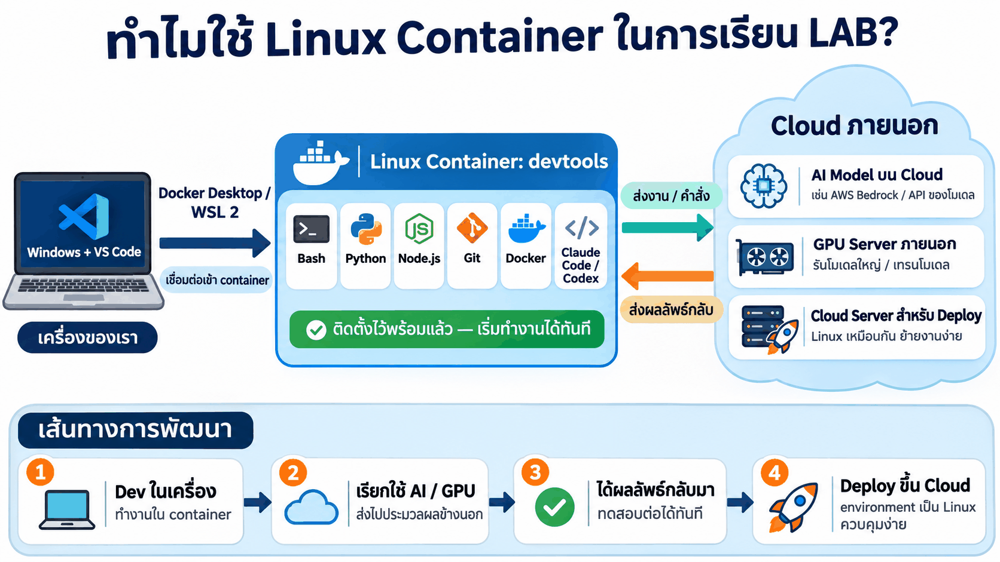

*ภาพแนวคิด: สร้างด้วย Imagegen เพื่ออธิบายการเรียน ไม่ใช่ภาพหน้าจอจริง บริการ cloud ในภาพเป็นเพียงตัวอย่าง การเชื่อมต่อจริงต้องมีบัญชี สิทธิ์ใช้งาน และ API key ของบริการนั้นเอง*

ภาพเคลื่อนไหวด้านล่างแสดงลำดับการทำงานทีละขั้น: เครื่องของเรา → container → ส่งงานไป AI model / GPU server แล้วรับผลลัพธ์กลับ → deploy ขึ้น cloud

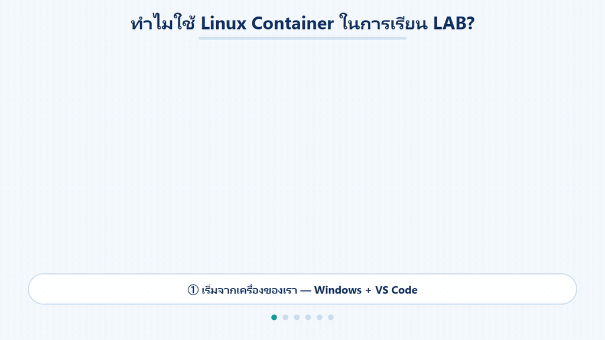

*ภาพเคลื่อนไหวประกอบแนวคิด (ประมาณ 14 วินาที วนซ้ำ) วาดขึ้นเพื่ออธิบาย ไม่ใช่การบันทึกการทำงานจริง*

### 1) ใช้ Linux ให้สอดคล้องกับคำสั่งและเครื่องมือของชุดทดลอง

Windows ใช้พัฒนาซอฟต์แวร์ได้ แต่เมื่อ LAB ใช้ Bash, พาธแบบ Linux, สิทธิ์ไฟล์ และสคริปต์ติดตั้งสำหรับ Linux การใช้สภาพแวดล้อมเดียวกับตัวอย่างช่วยลดงานแปลงคำสั่งและการแก้ความต่างระหว่างระบบปฏิบัติการ ผู้เรียนจึงมีเวลาให้กับเนื้อหาและการทดลองมากขึ้น

บน Windows สามารถใช้ Docker Desktop ผ่าน WSL 2 เพื่อรัน Linux containers ได้ โดย WSL 2 มี Linux kernel รองรับอยู่เบื้องหลัง เราจึงยังใช้ Windows เป็นเครื่องหลักและใช้ VS Code เป็นหน้าต่างทำงานได้ ตาม [เอกสาร Docker Desktop บน WSL 2](https://docs.docker.com/desktop/features/wsl/)

สำหรับงาน AI สิ่งที่ต้องเข้ากันได้คือ **เครื่องมือที่นำคำตอบหรือคำสั่งไปทำงานจริง** เช่น shell, runtime, ไลบรารี และบริการ ไม่ใช่ตัวข้อความ prompt เอง เป้าหมายของการเลือก Linux ในวิชานี้คือให้ workflow ใช้กับตัวอย่างได้สอดคล้องกัน ไม่ได้หมายความว่า Windows ใช้ AI ไม่ได้ หรือ Linux ทำให้โมเดลฉลาดขึ้นและได้ประสิทธิภาพสูงสุดทุกงาน

### 2) เริ่มจากเครื่องมือพื้นฐานชุดเดียวกัน

แทนที่จะให้ทุกคนไล่ติดตั้ง Python, Node.js, Git และเครื่องมือระบบบน Windows แยกกัน เราใช้ image ของวิชาเป็นต้นแบบ แล้วสร้าง container สำหรับทำ LAB ช่วยลดความต่างของเครื่องมือและทำให้ผู้สอนอธิบายหรือช่วยตรวจปัญหาได้ง่ายขึ้น แนวทางนี้สอดคล้องกับ [Docker ที่ใช้จัดสภาพแวดล้อมการพัฒนาให้เป็นมาตรฐาน](https://docs.docker.com/get-started/docker-overview/) และ [VS Code Dev Containers](https://code.visualstudio.com/docs/devcontainers/containers)

อย่างไรก็ตาม การติดตั้งเพิ่มภายหลังยังทำให้สภาพแวดล้อมต่างกันได้ หากต้องการทำซ้ำให้ใกล้เคียงเดิม ควรใช้ image รุ่นเดียวกัน บันทึกคำสั่งติดตั้ง และระบุเวอร์ชันแพ็กเกจของแต่ละ LAB

### 3) ทดลองผิดพลาดแล้วเริ่มใหม่ได้เป็นขั้นตอน

การเรียนต้องมีการลองผิดลองถูก หากติดตั้งแพ็กเกจหรือเปลี่ยนการตั้งค่าจนระบบทดลองมีปัญหา เราสามารถ **เก็บงานที่ต้องการ → ลบ container ที่มีปัญหา → สร้างใหม่จาก image → ทำขั้นตอนตั้งค่าเพิ่มเติมอีกครั้ง** ได้ โดยไม่ต้องเริ่มติดตั้งเครื่องมือทุกอย่างบน Windows ใหม่

Image เปรียบเหมือนต้นแบบ ส่วน container คือพื้นที่ทำงานที่สร้างจากต้นแบบนั้น การสร้างใหม่จะกลับไปสู่สถานะของ image ไม่ได้กู้คืนงานและแพ็กเกจที่เพิ่มไว้ใน container เดิมโดยอัตโนมัติ ไฟล์ใน writable layer จะหายเมื่อลบ container ส่วนข้อมูลใน volume หรือ bind mount มีวงจรชีวิตแยกต่างหาก ตาม [เอกสารการจัดเก็บข้อมูลของ Docker](https://docs.docker.com/engine/storage/)

### 4) แยกพื้นที่ทดลองให้จัดการง่ายขึ้น

Container แยกกระบวนการและระบบไฟล์ของงานออกเป็นขอบเขต ช่วยลดการปะปนของแพ็กเกจทดลองกับระบบหลัก ตาม [คำอธิบาย container ของ Docker](https://docs.docker.com/get-started/docker-concepts/the-basics/what-is-a-container/) แต่ไม่ได้รับประกันว่าจะไม่กระทบเครื่องหลักเลย โดยเฉพาะชุดนี้ที่ใช้ `--privileged` เพื่อรองรับ Docker-in-Docker รวมถึงกรณีที่เชื่อมโฟลเดอร์จากเครื่องหลักเข้า container

### 5) ต่อยอดไปยัง cloud และ deploy ได้จาก environment เดียวกัน

ระหว่างพัฒนา งานบางอย่างหนักเกินเครื่องของเรา เช่น เรียกใช้โมเดล AI ขนาดใหญ่ หรือรันงานที่ต้องใช้ GPU เราจึงให้ container ส่งงานออกไปประมวลผลที่ cloud ภายนอก แล้วรับผลลัพธ์กลับมาใช้ต่อใน container ได้เลย และเมื่อพร้อมใช้งานจริง server บน cloud ส่วนใหญ่ก็เป็น Linux เช่นกัน การพัฒนาใน Linux container ตั้งแต่ต้นจึงช่วยให้ environment ตอนพัฒนาใกล้เคียงกับตอน deploy ย้ายงานง่าย และควบคุมได้ง่ายขึ้น

ข้อควรรู้: container ไม่ได้ทำให้เชื่อมต่อ cloud ได้เองโดยอัตโนมัติ ทุกบริการต้องมีบัญชี สิทธิ์ใช้งาน และ API key ของตนเอง และมีค่าใช้จ่ายตามการใช้งาน รายละเอียดจะอยู่ใน LAB ที่เกี่ยวข้อง

**เป้าหมายของการเตรียมระบบครั้งนี้:** ให้ทุกคนมีพื้นที่ Linux สำหรับทำ LAB หลายชุด ใช้คำสั่งพื้นฐานร่วมกัน และเริ่มการทดลองใหม่ได้อย่างเป็นระบบ เมื่อเข้าใจเหตุผลแล้ว ขั้นตอนถัดไปคือเตรียม Docker บนเครื่องของเรา

---

## 1. ติดตั้ง Docker Desktop บน Windows

เริ่มจากดาวน์โหลดและติดตั้ง Docker Desktop บนเครื่องของผู้เรียนก่อนสร้าง container หากติดตั้งไว้แล้ว ให้ตรวจสถานะพร้อมใช้งานตามหัวข้อ 1.4

### 1.1 เปิดเว็บไซต์และเลือกไฟล์ดาวน์โหลด

1. เปิด [เว็บไซต์ Docker Desktop](https://www.docker.com/products/docker-desktop/)

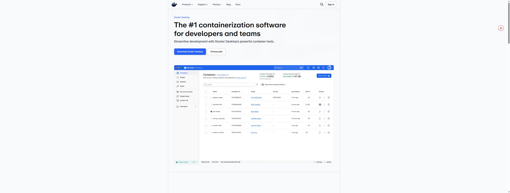

*ภาพหน้าเว็บไซต์จริงก่อนคลิกดาวน์โหลด ภาพโปรแกรมที่ปรากฏบนเว็บเป็นตัวอย่างของ Docker*

2. คลิก **Download Docker Desktop** เพื่อเปิดรายการระบบปฏิบัติการ
3. สำหรับ Windows ที่ใช้ CPU Intel หรือ AMD ทั่วไป เลือก **Download for Windows – AMD64** (รองรับทั้ง Intel และ AMD) ส่วนเครื่อง Windows on Arm ให้เลือก **ARM64**
4. หากไม่ทราบชนิดเครื่อง ให้ดู **Settings → System → About → System type** ก่อนเลือก

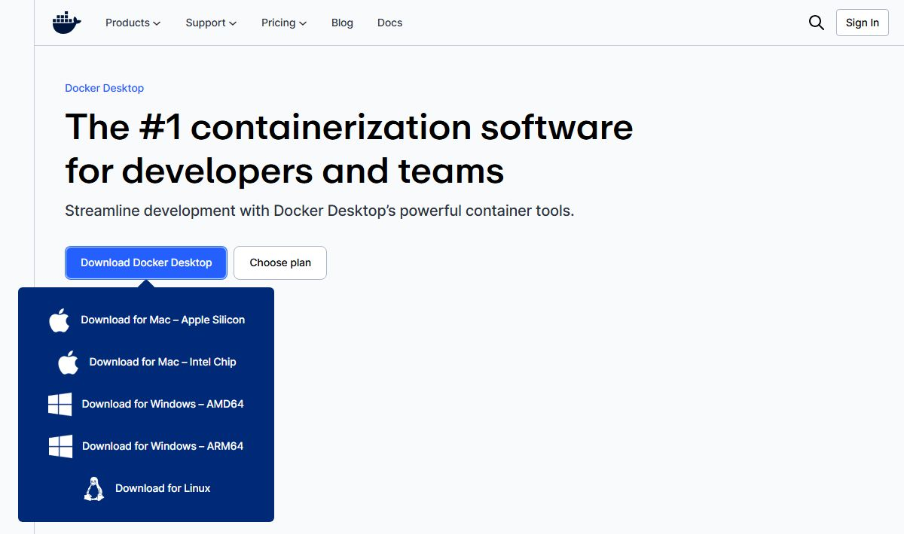

*ภาพจับจากเว็บไซต์ Docker จริงด้วย computer use แสดงตำแหน่งปุ่มและรายการดาวน์โหลด*

### 1.2 ไฟล์ที่ดาวน์โหลดอยู่ที่ไหน?

หลังเลือก Windows เบราว์เซอร์จะดาวน์โหลดไฟล์ **Docker Desktop Installer.exe** รอจนดาวน์โหลดเสร็จ หากมีหน้าต่างถามตำแหน่งจัดเก็บ ให้เลือกโฟลเดอร์ที่หาได้ง่าย เช่น **Downloads**

- เปิด File Explorer แล้วเลือก **Downloads** จากแถบด้านซ้าย โดยทั่วไปไฟล์จะอยู่ที่ `C:\Users\<ชื่อผู้ใช้>\Downloads` เว้นแต่ตั้งค่าเบราว์เซอร์ให้บันทึกไว้ที่อื่น
- อีกวิธีคือเปิดรายการดาวน์โหลดของ Chrome หรือ Edge ด้วย **Ctrl + J** แล้วเลือก **Show in folder / แสดงในโฟลเดอร์** ที่รายการ Docker Desktop Installer
- ถ้าเคยดาวน์โหลดซ้ำ ชื่อไฟล์อาจมีเลขต่อท้าย เช่น `Docker Desktop Installer (1).exe`

### 1.3 ติดตั้ง Docker Desktop

1. ดับเบิลคลิก **Docker Desktop Installer.exe** ที่ดาวน์โหลดไว้ แล้วทำตามขั้นตอนติดตั้ง โดยใช้ค่าเริ่มต้น และเลือก **Use WSL 2 instead of Hyper-V** หากมีตัวเลือกนี้
2. เมื่อติดตั้งเสร็จ กด **Close** และรีสตาร์ตเครื่องหากระบบร้องขอ
3. เปิด **Docker Desktop** อ่านและยอมรับข้อตกลงหากตกลง แล้วรอให้สถานะเป็น **Engine running** โดยใช้โหมด **Linux containers**

หากระบบแจ้งปัญหา WSL หรือข้อกำหนดเครื่อง ให้ดูวิธีแก้ใน [คู่มือติดตั้ง Docker Desktop สำหรับ Windows](https://docs.docker.com/desktop/setup/install/windows-install/)

### 1.4 เปิด Docker Desktop และตรวจด้วย PowerShell

ภาพเคลื่อนไหวด้านล่างแสดงขั้นตอนทั้งหมดหลังติดตั้งเสร็จ: ดับเบิลคลิกไอคอน **Docker Desktop** บนหน้าจอ → รอให้โปรแกรมเปิดขึ้นมาจนขึ้น **Engine running** → เปิด **PowerShell** แล้วพิมพ์ `docker --version` และ `docker info`

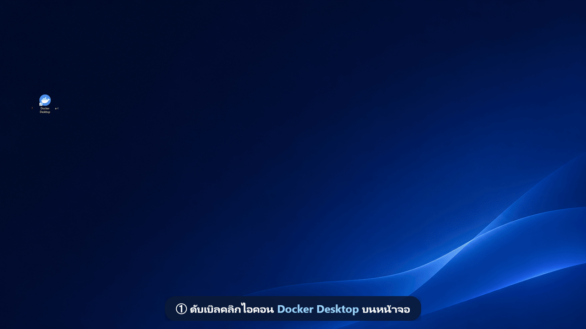

*อัดจากหน้าจอจริง (ประมาณ 32 วินาที วนซ้ำ) ช่วงรอโปรแกรมเปิดเร่งความเร็ว 2 เท่า พื้นหลังและไอคอนอื่นบนเดสก์ท็อปถูกแทนด้วยวอลเปเปอร์ที่สร้างด้วย Imagegen เพื่อซ่อนข้อมูลส่วนตัว และเบลออวาตาร์บัญชีกับบรรทัด ID ของ engine ไว้ ส่วนหน้าต่าง Docker Desktop และผลใน PowerShell เป็นของจริง*

**1) ดับเบิลคลิกไอคอน Docker Desktop** บนหน้าจอ หรือค้นหา **Docker Desktop** จาก Start menu แล้วรอให้หน้าต่างโปรแกรมเปิดขึ้นมา ครั้งแรกอาจใช้เวลาสักครู่

**2) ตรวจมุมล่างซ้ายของหน้าต่าง** ต้องขึ้น **Engine running** ถ้าเพิ่งติดตั้งใหม่ หน้า **Containers** จะว่าง และขึ้นข้อความ *Your running containers show up here* เพราะยังไม่ได้สร้าง container ใด ๆ ซึ่งถือว่าปกติ

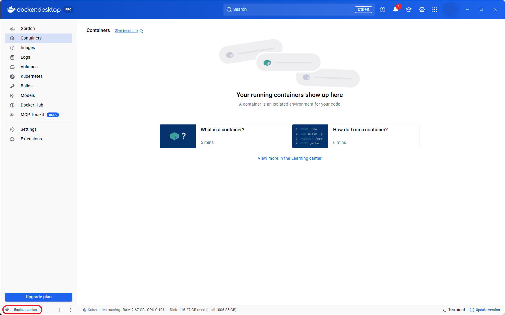

*ภาพที่ 1: Docker Desktop จริงหลังเปิดโปรแกรม ยังไม่มี container ใด ๆ กรอบสีแดงคือสถานะ Engine running (เบลออวาตาร์บัญชีไว้) เมนูบางรายการอาจต่างกันตามเวอร์ชันและการตั้งค่า เช่น Kubernetes จะแสดงเฉพาะเมื่อเปิดใช้งาน*

**3) เปิด PowerShell บน Windows** (ค้นหา *PowerShell* จาก Start menu) แล้วพิมพ์ทีละคำสั่ง:

```powershell
docker --version
docker info
```

- `docker --version` ตรวจว่ามีโปรแกรม Docker CLI แล้ว จะได้ผลประมาณ `Docker version 29.x.x, build ...`
- `docker info` ต้องแสดงข้อมูลส่วน **Server** ได้ด้วย เช่น `Operating System: Docker Desktop`, `CPUs`, `Total Memory` แปลว่า CLI ติดต่อ Docker Engine ได้สำเร็จ

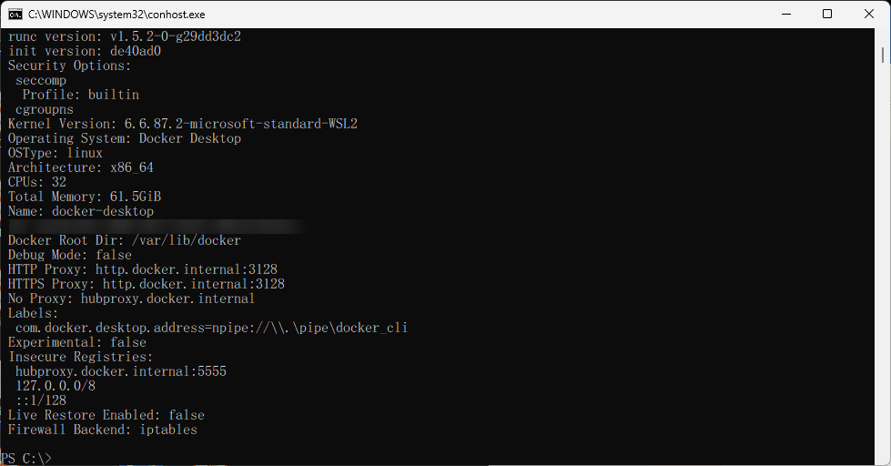

*ภาพที่ 2: ช่วงท้ายของผล `docker info` จริง ข้อมูลยาวจึงเลื่อนขึ้นไป ส่วนบนสุดคือ Client ส่วนที่เห็นคือข้อมูลฝั่ง Server (เบลอบรรทัด ID ไว้) ตัวเลขอย่าง CPUs, Memory และเวอร์ชันจะต่างกันตามเครื่อง*

หาก `docker info` ขึ้นข้อผิดพลาดว่าติดต่อ daemon ไม่ได้ (เช่น *error during connect* หรือ *Cannot connect to the Docker daemon*) แปลว่า engine ยังไม่พร้อม ให้รอจน Docker Desktop ขึ้น **Engine running** แล้วรันคำสั่งอีกครั้ง

## 2. เตรียม VS Code

**เปิดโปรแกรม VS Code**

เปิด **Visual Studio Code** จาก Start menu หรือไอคอนบนเครื่อง หากยังไม่มี ให้ติดตั้งจาก [เว็บไซต์ Visual Studio Code](https://code.visualstudio.com/) ก่อน

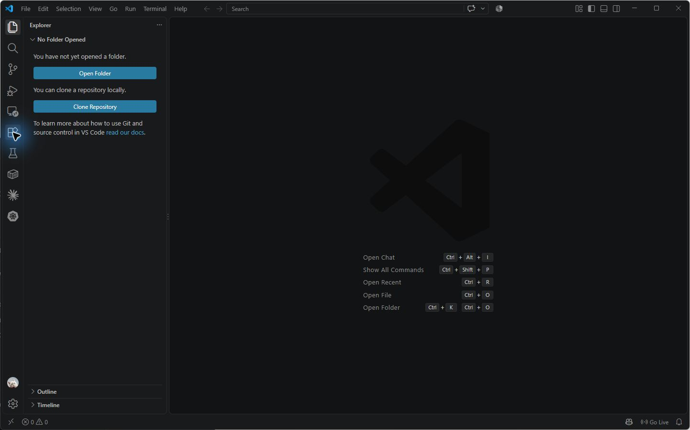

**คลิก Extensions แล้วค้นหา Dev Containers**

คลิกไอคอน **Extensions** รูปสี่เหลี่ยมที่แถบด้านซ้าย หรือกด `Ctrl+Shift+X` แล้วพิมพ์ **Dev Containers** ในช่องค้นหา

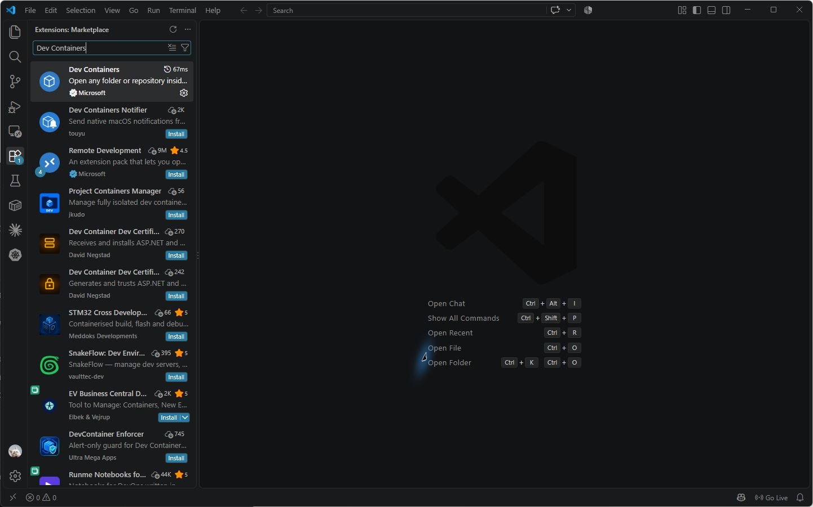

**เลือกของ Microsoft แล้วกด Install**

คลิก **Dev Containers** ของ **Microsoft** เพื่อเปิดรายละเอียด แล้วกด **Install** รอให้ติดตั้งเสร็จ

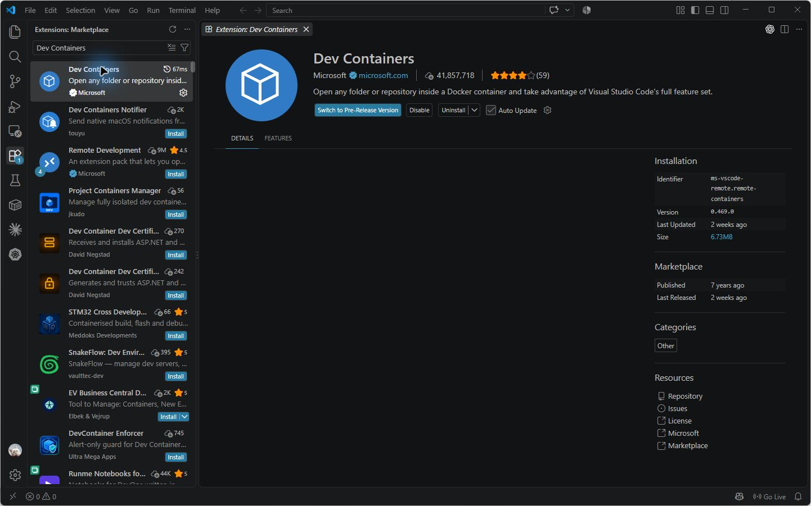

*เครื่องตัวอย่างติดตั้งแล้วจึงแสดง Disable / Uninstall เครื่องที่ยังไม่มีส่วนขยายจะเห็น Install ในบริเวณเดียวกัน*

**ตรวจว่าแถบ Dev Containers ขึ้นมาแล้ว**

เมื่อติดตั้งเสร็จ ปุ่มจะเปลี่ยนเป็น **Disable / Uninstall** และที่แถบด้านซ้ายจะมีไอคอน **Remote Explorer** (รูปจอคอมพิวเตอร์) เพิ่มขึ้นมา คลิกไอคอนนี้ แถบด้านข้างจะเปิดหัวข้อ **Dev Containers** ขึ้นมา แปลว่าส่วนขยายพร้อมใช้งานแล้ว ถ้ายังไม่มี container ก็จะเห็นข้อความแนะนำวิธีเริ่มต้นและปุ่ม **Open Folder in Container** แทน

ภาพเคลื่อนไหวด้านล่างแสดงทั้งขั้นตอนตั้งแต่เปิด Extensions จนแถบ Dev Containers ขึ้นมา:

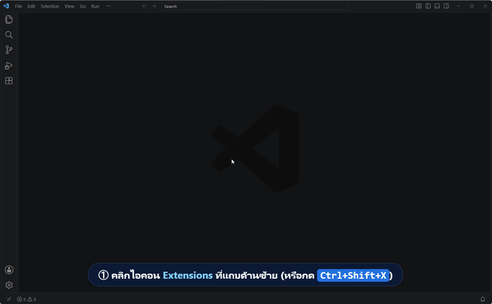

*อัดจากหน้าจอจริงด้วย VS Code โปรไฟล์ใหม่ที่ยังไม่มีส่วนขยาย (ประมาณ 30 วินาที วนซ้ำ) ช่วงรอหลังติดตั้งเร่งความเร็ว ครอปเฉพาะหน้าต่าง VS Code และเบลอรายชื่อ Dev Volumes ของเครื่องตัวอย่างไว้*

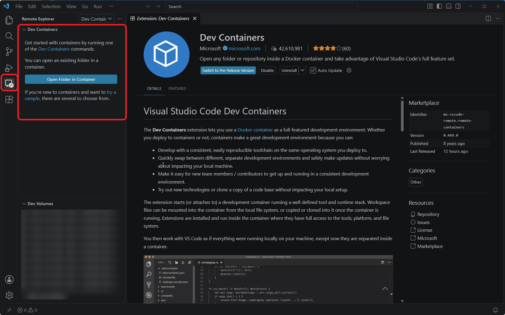

*ผลที่ต้องได้: ไอคอน Remote Explorer ที่แถบซ้าย (กรอบแดงล่าง) และแถบ Dev Containers ที่เปิดขึ้นมา (กรอบแดงบน) ส่วน Dev Volumes จะแสดงเฉพาะเมื่อเครื่องมี volume อยู่แล้ว (ในภาพเบลอไว้)*

เตรียม **Container Tools** ของ Microsoft เพื่อแสดงรายการ container และ **Claude Code** ของ Anthropic เพื่อรับพรอมป์ในหัวข้อถัดไป โดยติดตั้งผ่าน Extensions เช่นเดียวกัน แล้วเข้าสู่ระบบ Claude Code ด้วยบัญชีของตนเอง

## 3. สร้าง container ผ่าน Claude Code ใน VS Code

ใช้ image `tuchsanai/devtools:2569_1` ชื่อ `devtools` เริ่มตรวจพอร์ต SSH ที่ `2222` และ Jupyter ที่ `8885` หากชนให้ใช้เลขว่างถัดไป

| บริการ | พอร์ตบนเครื่องผู้เรียน | พอร์ตใน container |
| --- | --- | --- |
| SSH | 2222 หรือเลขว่างถัดไป | 22 |
| Jupyter | 8885 หรือเลขว่างถัดไป | 8888 |

### 3.1 พรอมป์สำหรับสร้าง container

**คัดลอกง่าย:** เปิด [ไฟล์พรอมป์พร้อมคัดลอก](prompt-create-devtools.txt) แล้วกด **Ctrl+A → Ctrl+C** จากนั้นใช้ **Ctrl+V** วางใน Claude Code ตามหัวข้อ 3.2

คัดลอกพรอมป์ด้านล่างไปวางใน Claude Code ตามหัวข้อ 3.2 เพื่อให้ดำเนินการกับ Docker บนเครื่องผู้เรียน

> ขั้นตอนตามต้นฉบับจะลบ devtools ตัวเดิม หากมีงานอยู่ ให้สำรองก่อน เพราะไฟล์ใน writable layer จะหายเมื่อลบ container

```text
เตรียม container `devtools`:

1. ถ้ามี container `devtools` อยู่แล้ว ให้ลบด้วย `docker rm -f devtools`
2. ตรวจ port <SSH_PORT>=2222 และ <JUPYTER_PORT>=8885 ถ้าชน ให้ใช้ port ว่างถัดไป
3. รัน:

docker run -dit --name devtools --privileged \
  -p <SSH_PORT>:22 -p <JUPYTER_PORT>:8888 \
  tuchsanai/devtools:2569_1

docker exec -it devtools bash -c \
'curl -fsSL https://claude.ai/install.sh | bash && npm install -g @openai/codex'


4. ตรวจด้วย `claude --version` และ `codex --version` แล้วสรุป port ที่ใช้


```

### 3.2 เปิด Claude Code แล้ววางพรอมป์

ทำขั้นตอนนี้ใน **VS Code บนเครื่องที่เปิด Docker Desktop อยู่** ก่อน Attach เข้า container

1. คลิกไอคอน **Claude Code** รูปดาวแฉกที่แถบด้านซ้าย แล้วเลือก **New session**
2. คัดลอกพรอมป์ทั้งหมดในหัวข้อ **3.1** แล้ววางลงในช่อง **Ask Claude to edit…** ด้านล่างของหน้าต่าง Claude Code
3. กดปุ่มส่ง ให้ Claude Code ดำเนินการตามพรอมป์ หากมีคำขออนุญาตรันคำสั่ง ให้ตรวจคำสั่งแล้วอนุญาตตามขั้นตอน
4. รอให้ Claude Code สร้าง container ติดตั้งเครื่องมือ และสรุปผลพร้อมพอร์ตที่ใช้จริง

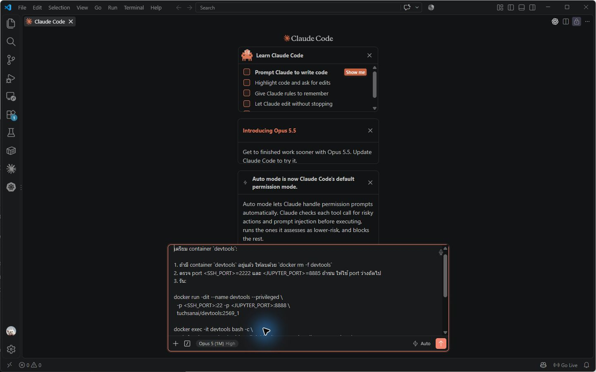

*ภาพจริงหลังวางพรอมป์จาก 3.1 ในช่องด้านล่าง จากนั้นผู้เรียนกดปุ่มส่งรูปลูกศรขึ้น และรอให้ทำงานสำเร็จก่อนตรวจ container ในภาพถัดไป*

การวางข้อความเพียงอย่างเดียวยังไม่เริ่มทำงาน ต้องกดส่งและรอให้คำสั่งสำเร็จ หาก Claude Code รายงานข้อผิดพลาด ให้แก้ตามผลที่แจ้งก่อนทำขั้นตอนถัดไป อ้างอิงการใช้งานจาก [คู่มือ Claude Code ใน VS Code](https://code.claude.com/docs/en/vs-code)

## 4. ตรวจว่า container พร้อมใช้งาน

เมื่อ Claude Code สร้างสำเร็จ ให้เปิดแถบ **Containers** ด้านซ้าย จะเห็น **devtools** ใต้ **Individual Containers** โดยรายการอัปเดตอัตโนมัติ หากยังไม่ปรากฏให้กด **Refresh**

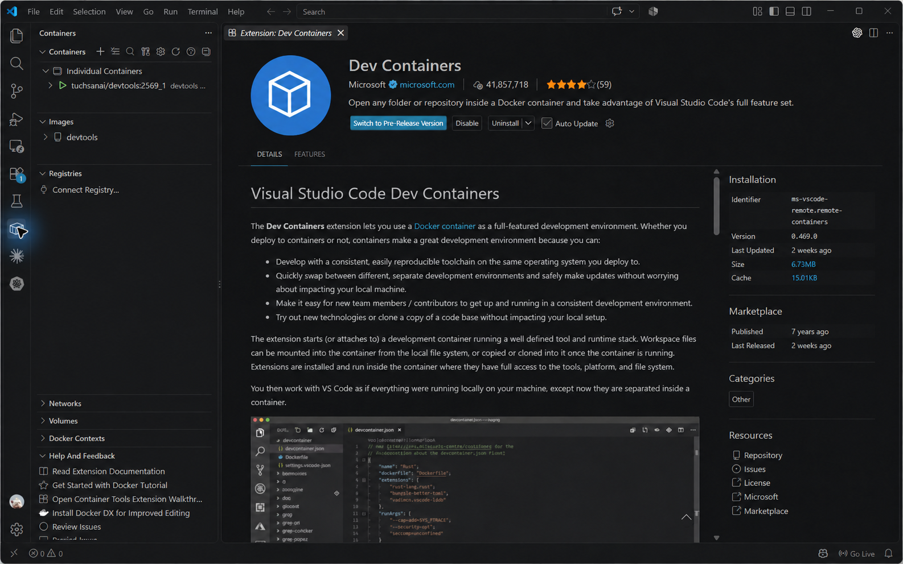

*ผลที่ต้องได้: devtools อยู่ในสถานะทำงาน พร้อมไป Attach VS Code ในหัวข้อ 5 ภาพปรับด้วย Imagegen เพื่อซ่อนรายการอื่นและจัด devtools ไว้ด้านบน*

ตรวจสรุปจาก Claude Code ว่าสร้าง container และตรวจเวอร์ชัน Claude Code/Codex สำเร็จ พร้อมจดพอร์ต SSH และ Jupyter ที่ใช้จริง ขั้นตอนติดตั้งเครื่องมืออยู่ในพรอมป์แล้ว ไม่ต้องรันชุดคำสั่งติดตั้งซ้ำเอง

## 5. เปิด VS Code เข้า container

1. เปิดแถบ **Containers** ด้านซ้าย
2. หา `devtools` ใต้ **Individual Containers**
3. คลิกขวาที่แถว container
4. เลือก **Attach Visual Studio Code**
5. รอหน้าต่างใหม่เชื่อมต่อและเตรียม VS Code Server

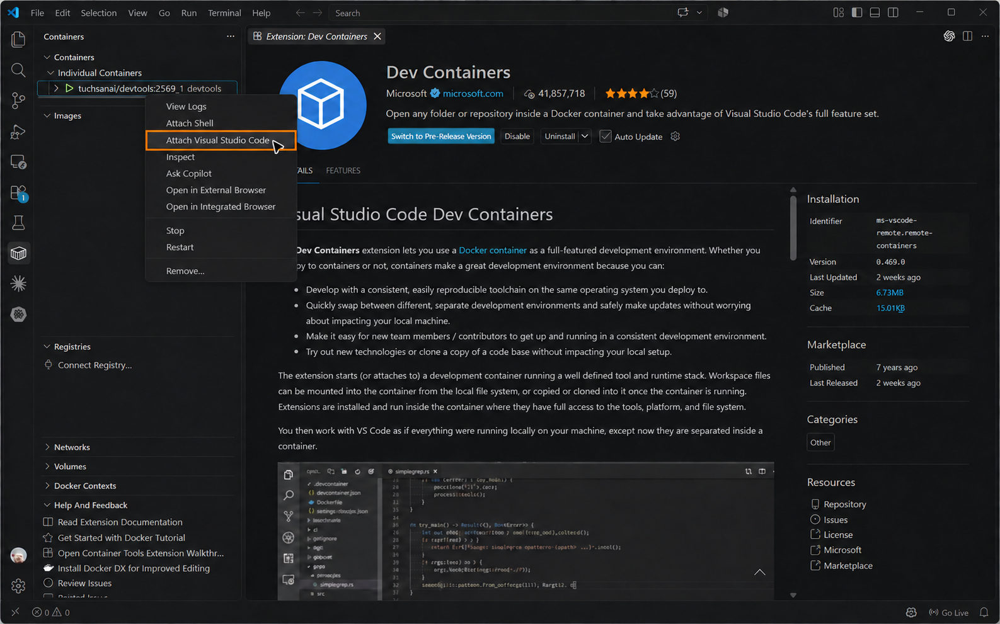

*เลือก Attach Visual Studio Code เพื่อเข้า container ภาพปรับด้วย Imagegen ให้เหลือ devtools ด้านบนและซ่อนรายการใน Images พร้อมตัวชี้เมาส์และกรอบสีส้มเน้นเมนู Attach Visual Studio Code*

อีกวิธีคือกด `Ctrl+Shift+P` แล้วค้นหา:

```text
Dev Containers: Attach to Running Container...
```

เลือก `devtools` จากรายการ วิธีนี้ต้องมี Dev Containers และ Docker พร้อมใช้งาน ตาม [คู่มือ Attach ของ VS Code](https://code.visualstudio.com/docs/devcontainers/attach-container)

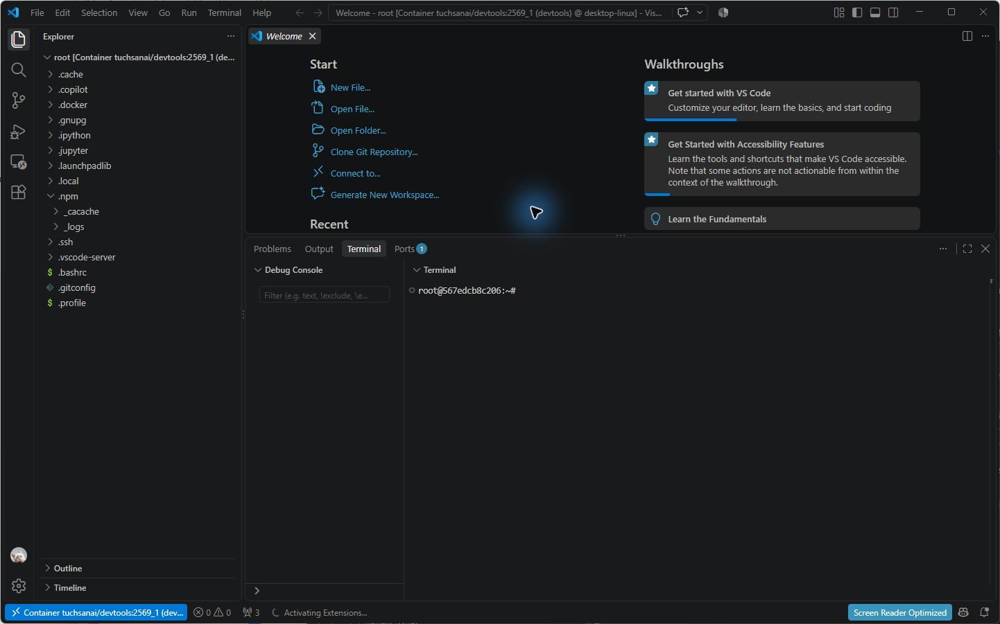

*ภาพที่ 5: ตรวจแถบล่างซ้ายว่าระบุ Container และ image ของวิชาก่อนทำ LAB*

### ตรวจเครื่องมือหลังเข้า container

เปิด **Terminal → New Terminal** ในหน้าต่าง VS Code ที่เชื่อมกับ container แล้วรันทีละคำสั่ง:

```bash
whoami
claude --version
codex --version
```

`whoami` ควรแสดง `root` และอีกสองคำสั่งต้องแสดงเวอร์ชัน หากไม่พบ `claude` ให้เปิด terminal ใหม่ หรือรัน `export PATH="$HOME/.local/bin:$PATH"` แล้วตรวจอีกครั้ง ถ้ายังไม่พบหลังแก้ PATH ให้ดูวิธีแยกสาเหตุในหัวข้อ 6.3

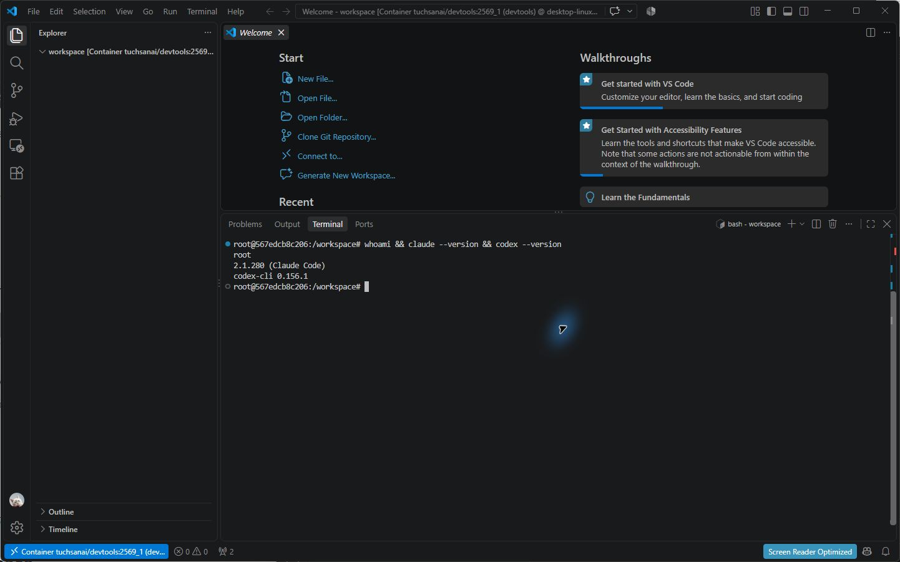

*ผลตรวจจริง: Claude Code 2.1.280 และ codex-cli 0.156.1 ภาพจริงจาก Integrated Terminal ของ VS Code ที่ Attach เข้า devtools แล้ว โดยรันคำสั่งตรวจในฐานะ root ภายใน container เวอร์ชันที่ผู้เรียนได้อาจใหม่กว่า การแสดงเวอร์ชันยืนยันว่ามีเครื่องมือแล้ว แต่ยังไม่ใช่การเข้าสู่ระบบ*

## 6. อีกวิธี: ใช้งานผ่าน JupyterLab

นอกจาก Terminal ใน VS Code เรายังใช้เครื่องมือชุดเดียวกันผ่าน Terminal ของ JupyterLab ภายใน devtools ได้

### 6.1 เปิด JupyterLab

1. ในหน้าต่าง VS Code บนเครื่อง เปิดแถบ **Containers** แล้วคลิกขวาที่ **devtools**
2. เลือก **Open in External Browser**
3. เลือก **8888 localhost:8885** คือพอร์ต **8888 ภายใน container** ที่แมปมายังพอร์ต **8885 บนเครื่อง**
4. เบราว์เซอร์จะเปิด [JupyterLab](http://localhost:8885/lab)

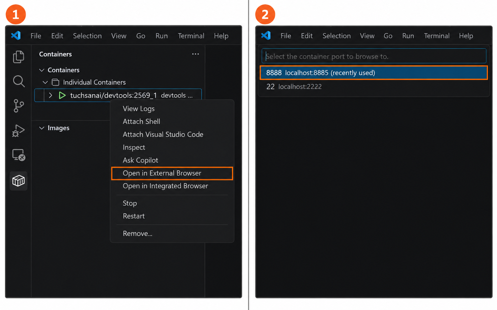

*ภาพจากหน้าจอจริง ปรับด้วย Imagegen เพื่อซ่อนรายการที่ไม่เกี่ยวข้องและเน้นจุดที่ต้องเลือก*

### 6.2 เปิด Terminal และใช้เครื่องมือ

ที่หน้า **Launcher** เลือก **Terminal** ในกลุ่ม **Other** หากไม่เห็น Launcher ให้กดปุ่ม **+**

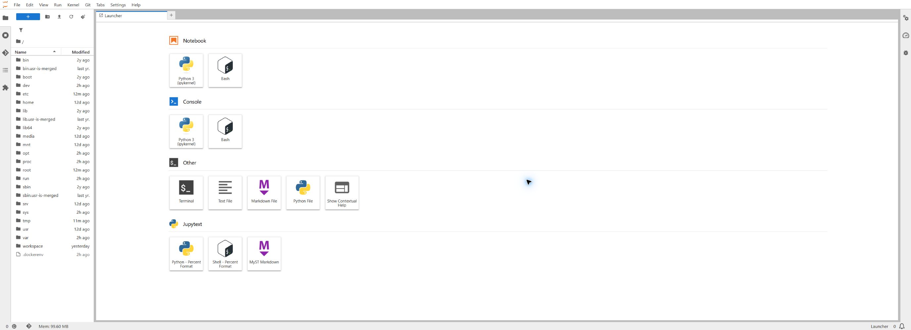

ตรวจเครื่องมือ:

```bash
whoami
claude --version
codex --version
```

หากพบ `claude: command not found` ให้เพิ่มตำแหน่งติดตั้งใน PATH ของ Terminal ปัจจุบัน แล้วตรวจอีกครั้ง:

```bash
export PATH="$HOME/.local/bin:$PATH"
claude --version
```

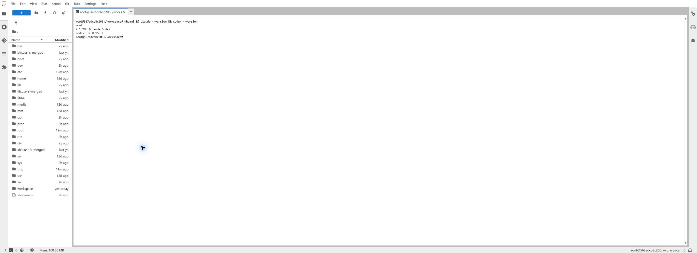

*ผลตรวจจริงหลังปรับ PATH: root, Claude Code 2.1.280 และ codex-cli 0.156.1 ภาพ Terminal เป็นภาพจริง ไม่ได้สร้างผลลัพธ์ด้วย AI*

### 6.3 แยกให้ออก: "ยังไม่ได้ติดตั้ง" กับ "ติดตั้งแล้วแต่ PATH ไม่เห็น"

ทั้งสองกรณีขึ้นข้อความเดียวกันคือ `claude: command not found` แต่แก้คนละแบบ ภาพด้านล่างรันต่อเนื่องในหน้าต่างเดียวเพื่อเทียบสามสถานะ

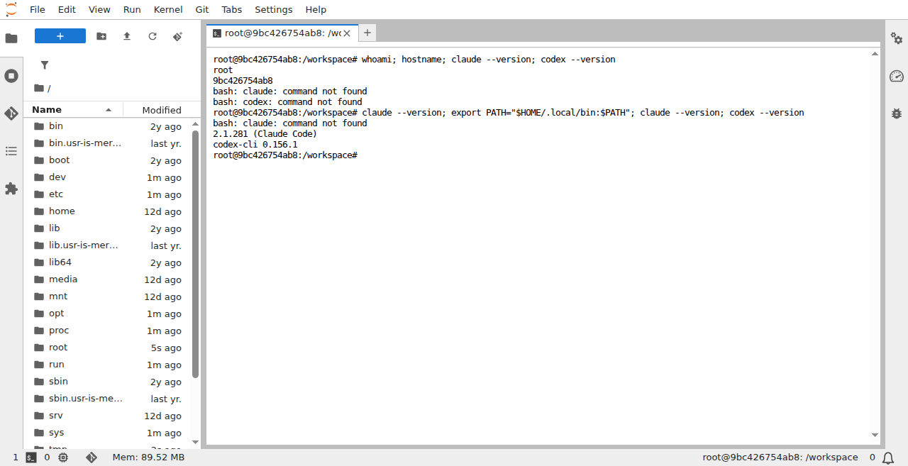

1. **บรรทัดบน — ยังไม่ได้ติดตั้ง** เปิด Terminal ทันทีหลังสร้าง container โดยยังไม่รันคำสั่งติดตั้งในพรอมป์หัวข้อ 3.1 ทั้ง `claude` และ `codex` จึงไม่พบ แก้ด้วยการรันขั้นตอนติดตั้งให้ครบ
2. **บรรทัดกลาง — ติดตั้งแล้วแต่ PATH ยังไม่มี** `claude` ถูกติดตั้งไว้ที่ `~/.local/bin` แล้ว แต่ Terminal ปัจจุบันยังไม่รู้จักตำแหน่งนั้น จึงยังขึ้น `command not found` เหมือนเดิม
3. **บรรทัดล่าง — หลัง `export PATH`** เห็นเวอร์ชันทั้งคู่ ยืนยันว่าติดตั้งสำเร็จมาตั้งแต่ข้อ 2 แล้ว

วิธีแยกอย่างเร็วคือตรวจว่าไฟล์มีอยู่จริงหรือไม่ ถ้าเจอไฟล์แต่เรียกไม่ได้ แปลว่าเป็นปัญหา PATH ไม่ใช่ปัญหาการติดตั้ง:

```bash
ls ~/.local/bin/claude
```

*ภาพถ่ายจากการทดสอบใน container ที่สร้างจาก image `tuchsanai/devtools:2569_1` ชุดเดียวกัน จึงเห็น hostname และเวอร์ชัน (2.1.281) ต่างจากภาพก่อนหน้าเล็กน้อย ผลลัพธ์ในภาพเป็นของจริงจาก Terminal ไม่ได้สร้างด้วย AI*

### 6.4 เริ่มใช้เครื่องมือ

เริ่ม Claude Code ด้วย:

```bash
claude
```

หรือเปิด Terminal อีกแท็บเพื่อใช้ Codex:

```bash
codex
```

ทำขั้นตอนเข้าสู่ระบบตามที่เครื่องมือแสดงเมื่อใช้ครั้งแรก ภาพในหัวข้อ 6.2 และ 6.3 ยืนยันการติดตั้งจากเวอร์ชัน ยังไม่ใช่ผลการเข้าสู่ระบบหรือส่งงานให้ AI

ทั้ง **VS Code → Terminal** และ **JupyterLab → Terminal** เป็นสองทางเข้าถึง shell ภายใน devtools เดียวกัน เลือกใช้ตามสะดวก
