# LAB 001 · ส่วนที่ 1: ปรับ devtools ให้รองรับหลายบัญชีด้วย Claude Code Desktop (Claude Code + Codex CLI)

เวลาโดยประมาณ: 40–55 นาที (ส่วนใหญ่คือเวลาล็อกอินแต่ละบัญชี)

**สิ่งที่จะได้:** container `devtools` ตัวเดิมจากบทที่แล้ว มีบัญชี AI หลายบัญชีทั้ง Claude Code (`yolo1`–`yolo5`) และ Codex (`cyolo1`–`cyolo5`) ใช้ skill และ MCP ชุดเดียวกันทุกบัญชี ทั้งหมดสั่งจาก Claude Code Desktop บน Windows

**สไลด์ประกอบการสอน:** [Multi_Account_Devtools_Slides.html](Multi_Account_Devtools_Slides.html) (เปิดในเบราว์เซอร์ กด ← → เปลี่ยนหน้า) · [ฉบับ PDF](Multi_Account_Devtools_Slides.pdf)

บทเรียนที่เชื่อมโยง: [AI Agent Routing](../ai-agent-routing.html) หัวข้อ 1.0 และ 4.0–4.3 · ขอบเขต: Claude Code และ Codex CLI เท่านั้น

## ทำไมต้องมีหลายบัญชี?

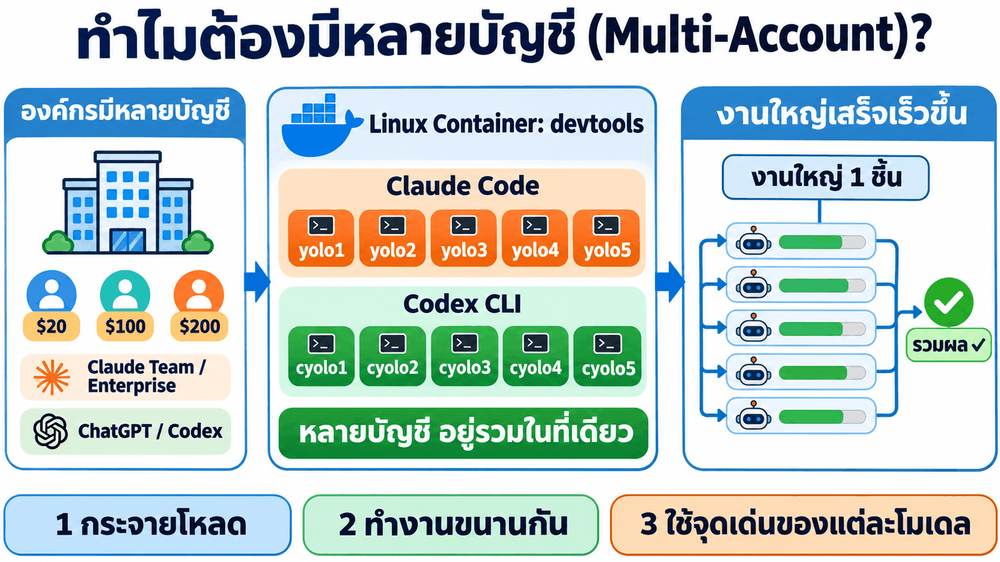

*ภาพแนวคิด สร้างด้วย Imagegen ราคาแพ็กเกจเป็นตัวอย่างระดับราคา ไม่ใช่ราคาทางการ*

หลายองค์กรซื้อ AI ให้ทีมเป็นแผน **Team / Enterprise** ในทีมจึงมีหลายบัญชี แต่ละบัญชีมีโควตาต่างกัน (เช่น ระดับ $20, $100, $200 ต่อเดือน) งานเล็กใช้บัญชีเดียวก็พอ แต่งานใหญ่ หรืองานที่ใช้ **multi-agent** หลายตัว จะเจอ 2 ปัญหา

1. **โควตาไม่พอ:** บัญชีเล็กใช้โควตาหมดกลางงาน ต้องรอรอบถัดไป
2. **ช้า:** งานที่ทำพร้อมกันได้ ต้องรอคิวทีละชิ้นในบัญชีเดียว

ทางออกคือเก็บหลายบัญชีไว้ใน container เดียว แล้วแบ่งงานให้ทำพร้อมกัน เหมือนครัวที่มีเชฟหลายคนใช้วัตถุดิบและสูตรชุดเดียวกัน: **ครัว** = `devtools`, **เชฟ** = แต่ละบัญชี, **สูตรกลาง** = skill และ MCP ใน `shared`


*ภาพเคลื่อนไหวจำลองแนวคิด ตัวเลขชั่วโมงเป็นตัวอย่าง ไม่ใช่ผลวัดจริง*

และไม่ใช่แค่หลายบัญชี แต่เป็น **หลายโมเดล** ด้วย Claude กับ Codex ถนัดงานต่างกัน ใช้ร่วมกันได้ และให้ตรวจงานของกันและกัน (cross-review)

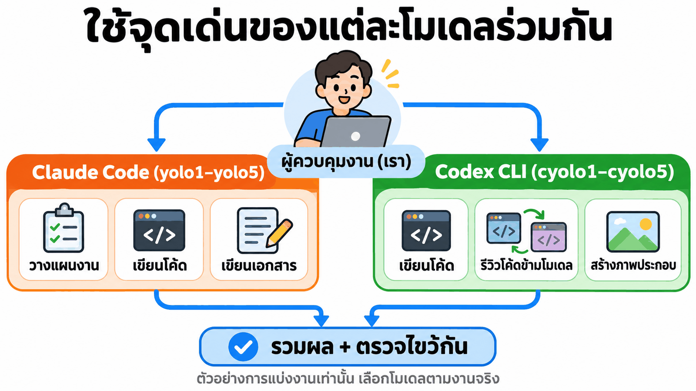

> **ข้อควรระวัง:** ใช้เฉพาะบัญชีที่ตนเองหรือองค์กรมีสิทธิ์ใช้จริง และทำตามเงื่อนไขของผู้ให้บริการ LAB นี้ไม่ได้สร้างบัญชีหรือเพิ่มโควตาให้ และห้ามแชร์ข้อมูลล็อกอินให้ผู้อื่น

## จุดเริ่มต้น → เป้าหมาย

`devtools` จาก [บทที่แล้ว](../01_Docker_VSCode_Setup/README.md) เป็น Linux ธรรมดา มี `claude` กับ `codex` แล้ว แต่ **ยังไม่มีโฟลเดอร์ `~/ai-accounts` และยังไม่มีคำสั่ง `yolo` / `cyolo`**

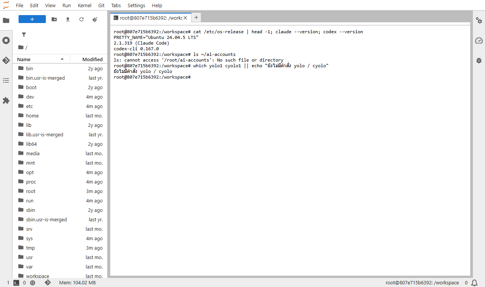

เราจะเพิ่มโครงสร้างเข้าไปใน container ตัวเดิม **ขณะที่ยังรันอยู่** โดยไม่สร้าง image ใหม่และไม่ลบ container

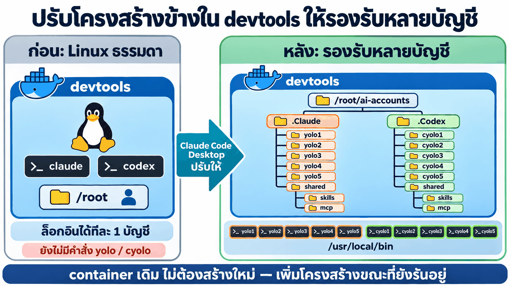

คนปรับคือ **Claude Code Desktop บน Windows** เราแค่วางพรอมต์ Claude จะส่งคำสั่งเข้าไปใน container ด้วย `docker exec devtools …` เอง สิ่งเดียวที่ Claude ทำแทนไม่ได้คือ **การล็อกอิน** ซึ่งเราทำเองใน JupyterLab

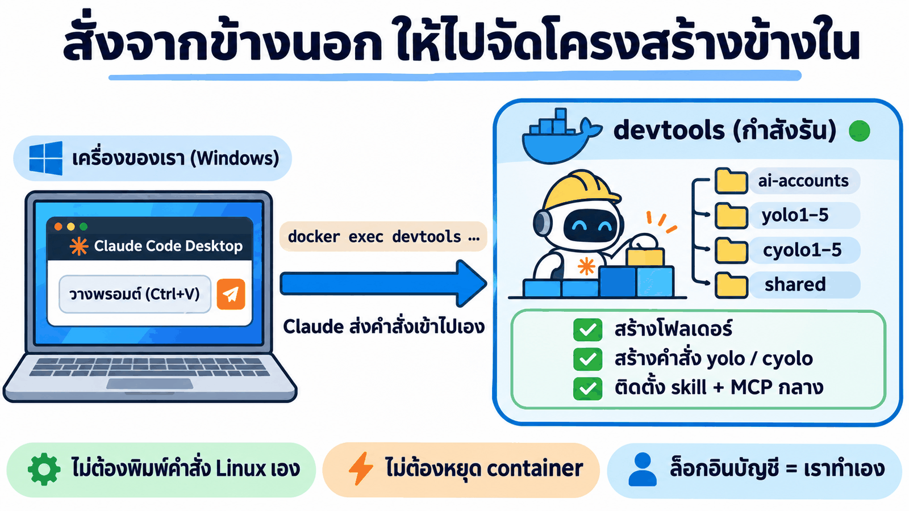

## ภาพรวมการทดลอง

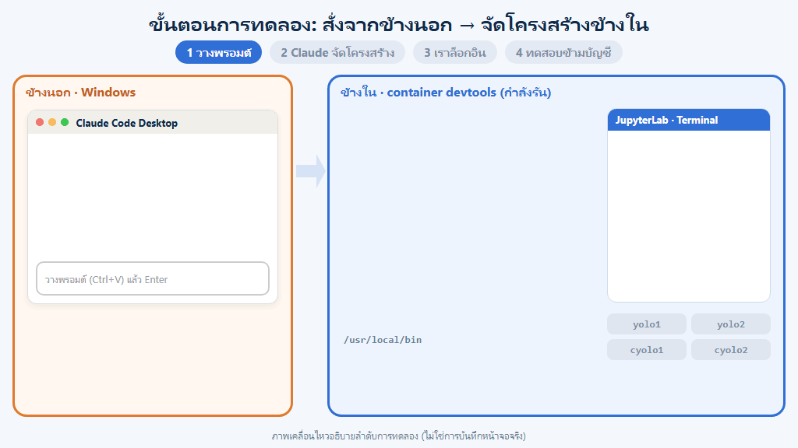

| ขั้น | ทำที่ไหน | ใครทำ |
|---|---|---|
| **1 · ตั้งค่าหลายบัญชี** | 💻 Claude Code Desktop | Claude |
| **2 · ตรวจผลข้างใน** | 🖥️ JupyterLab ของ `devtools` | เรา |
| **3 · ล็อกอิน + ตรวจล็อกอิน** | 🖥️ JupyterLab → 💻 Claude Code Desktop | เรา + Claude |
| **4 · ทดสอบ skill/MCP ข้ามบัญชี** | 💻 Claude Code Desktop | Claude |

**ก่อนเริ่ม ตรวจ 3 อย่าง:** Docker Desktop ขึ้น **Engine running** · container `devtools` กำลังรัน (VS Code แถบ Containers มีสามเหลี่ยมสีเขียว) · Claude Code Desktop ล็อกอินแล้ว

## ขั้นที่ 1 · 💻 ให้ Claude Code Desktop ตั้งค่าหลายบัญชี (~10 นาที)

เปิด Claude Code Desktop → **New session** → วางพรอมต์ทั้งกรอบ (Ctrl+V) → Enter แล้วรอจน Claude สรุปผล

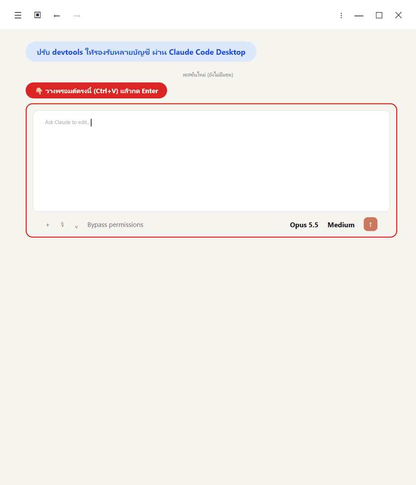

```text
ช่วยปรับโครงสร้างข้างใน container ชื่อ devtools ที่กำลังรันอยู่ ให้รองรับหลายบัญชี AI
ทำทุกอย่างข้างใน container ผ่าน docker exec เท่านั้น ห้ามแก้ไฟล์บนเครื่อง Windows ห้ามหยุด ลบ หรือสร้าง container ใหม่
ถ้า devtools ไม่ได้รันอยู่ ให้รายงานแล้วหยุด

ข้างในมี Claude Code และ Codex CLI แล้ว ห้ามติดตั้งซ้ำ ตรวจ --version ก่อน
ตรวจ --help ของเวอร์ชันจริงก่อนใช้ env/flag ห้ามเดา

## เป้าหมาย (BASE=/root/ai-accounts)
- yolo1..yolo5   → claude --dangerously-skip-permissions  (CLAUDE_CONFIG_DIR=$BASE/.Claude/yoloN)
- cyolo1..cyolo5 → codex --dangerously-bypass-approvals-and-sandbox  (CODEX_HOME=$BASE/.Codex/cyoloN)
- wrapper วางใน /usr/local/bin ให้พิมพ์ได้ทันที ส่งต่อ "$@" ครบ แจ้งชัดถ้าโฟลเดอร์บัญชีไม่มี ไม่พิมพ์ secret
- $BASE/.Claude/shared และ $BASE/.Codex/shared มี skills/ และ mcp/ แก้ครั้งเดียว ทุกบัญชีของ CLI นั้นเห็นตอนเปิดครั้งถัดไป

## กติกา
- แยก credential/config/session ต่อบัญชี เปิดพร้อมกันได้ ใช้ CLAUDE_CONFIG_DIR/CODEX_HOME เท่านั้น ห้ามเปลี่ยน $HOME
- Codex ใช้ file-based credential ต่อ CODEX_HOME ห้ามแชร์ credential ใน shared
- สร้าง installer เป็นไฟล์ใน container รันซ้ำได้ ไม่เขียนทับ credential/config เดิม ห้ามแก้ .bashrc/Git/SSH
- MCP ส่วนกลางตัวแรก: Playwright (@playwright/mcp) + Chromium ติดตั้งครั้งเดียว
- skill ตัวอย่าง shared-check: ตอบ SHARED_SKILL_OK-<tool>-<ค่าสุ่มตอนติดตั้ง> ซึ่งมีในไฟล์ skill เท่านั้น

## ข้อเท็จจริงจากการทดลอง (ตรวจว่ายังจริงกับเวอร์ชันนี้)
- root ต้องตั้ง IS_SANDBOX=1; CODEX_HOME ต้อง mkdir -p ก่อน
- Claude: skill อ่านจาก $CLAUDE_CONFIG_DIR/skills; MCP ส่งผ่าน --mcp-config=<ไฟล์> (ต้องมี =)
  ห้าม symlink .claude.json (มีสถานะล็อกอิน); claude mcp list ไม่แสดง MCP นี้ ให้ตรวจด้วย /mcp
- Codex: skill อ่านจาก $CODEX_HOME/skills และเขียน skills/.system เอง ห้าม symlink ทั้งโฟลเดอร์
  MCP ส่งด้วย -c mcp_servers.<name>={...} (ใช้กับ codex mcp list ได้)
- Playwright ใน root container: --browser chromium --headless --isolated --no-sandbox และ --output-dir นอกโฟลเดอร์งาน
  ติดตั้ง Chromium ด้วย playwright ในแพ็กเกจ @playwright/mcp ให้เวอร์ชันตรงกัน (อาจต้อง install-deps)

## ทดสอบใน container (PASS/FAIL/SKIP ตามจริง)
- 10 คำสั่ง --version ครบ, config root คนละโฟลเดอร์, installer รอบ 2 ไม่ทำลายของเดิม
- cyoloN mcp list เห็น playwright, skill shared-check ทุกบัญชี readlink -f ไปไฟล์เดียวกันใน shared
- อะไรที่ต้องล็อกอิน = SKIP

## รายงาน (ห้ามมี secret) เขียนไว้ใน container ที่ /workspace/multi-account/
- setup-report.md: โครงสร้างโฟลเดอร์, wrapper, แต่ละ CLI อ่าน skill/MCP จากไหน, ข้อจำกัด
- login-guide.md: ล็อกอินทีละบัญชีใน JupyterLab Terminal
- checklist.md: รายการ | หลักฐาน | PASS/FAIL/SKIP
เสร็จแล้วสรุปเป็นตารางสั้น ๆ แล้วหยุดรอ ห้ามล็อกอินแทนฉัน
```

ทำไมพรอมต์เขียนแบบนี้: บังคับให้ทำผ่าน `docker exec` จึงไม่แตะ Windows และไม่ต้องสร้าง container ใหม่ · วางคำสั่งใน `/usr/local/bin` จึงพิมพ์ `yolo1` ได้ทันที · ใส่ "ข้อเท็จจริงจากการทดลอง" ไว้ให้ Claude ไม่ต้องลองผิดลองถูก · ให้รายงาน PASS/FAIL/SKIP เพื่อตรวจผลได้

**ผลจริง** (7 พ.ย. 2026 · ~5 นาที): **18 PASS · 0 FAIL · 4 SKIP** ข้อที่ SKIP คือข้อที่ต้องล็อกอินก่อน ซึ่งทำในขั้นที่ 3–4

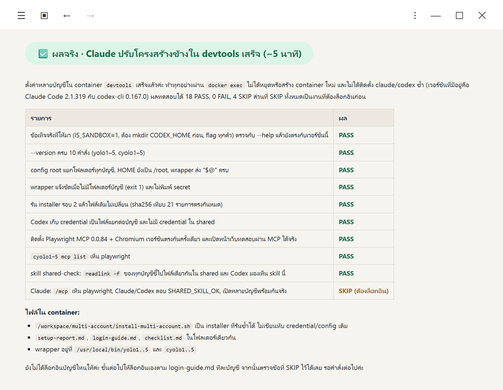

*ข้อความคำตอบจริงของ Claude จัดหน้าใหม่ให้อ่านง่าย ระหว่างทาง Claude ติดตั้ง library ของ Chromium เพิ่มเอง และแก้ปัญหา Git Bash แปลง path ผิด (ใช้ `MSYS_NO_PATHCONV=1`) เอง เป็นเรื่องปกติ*

## ขั้นที่ 2 · 🖥️ ตรวจผลข้างใน devtools (~5 นาที)

### 2.1 · เปิด JupyterLab แล้วตรวจคำสั่ง

ใน VS Code คลิกขวา **devtools** → **Open in External Browser** → **8888 localhost:8885** → ในหน้า Launcher คลิก **Terminal** แล้ววางคำสั่งนี้

```bash
which yolo1 cyolo1
yolo1 --version; cyolo1 --version
yolo2 --version; cyolo2 --version
yolo3 --version; cyolo3 --version
```

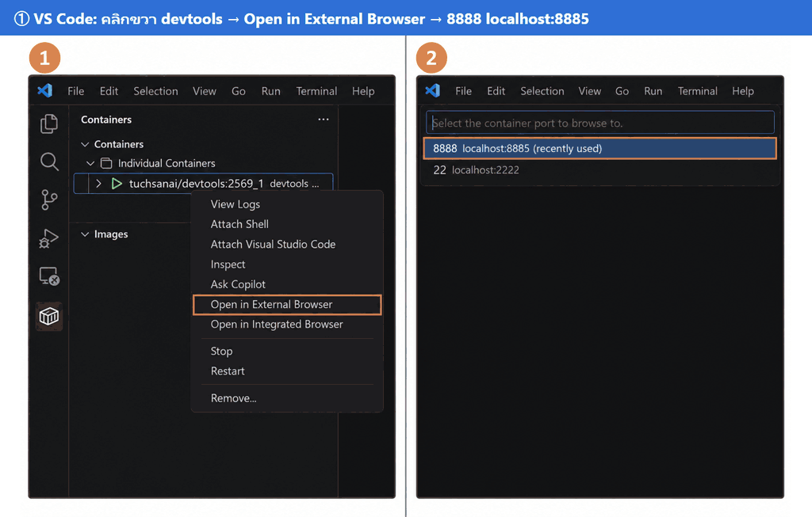

ต้องเห็น `/usr/local/bin/yolo1` และเวอร์ชันครบทุกบรรทัด **ระวัง:** `--version` บอกแค่ว่าคำสั่งพร้อมใช้ ยังไม่ได้บอกว่าล็อกอินแล้ว (ตรวจล็อกอินในขั้นที่ 3)

### 2.2 · ตรวจโครงสร้างโฟลเดอร์ใน File Browser

ใน File Browser ทางซ้าย ไปที่ `/` → **root** → **ai-accounts** แล้วเปิด **.Claude** และ **.Codex** ต้องตรงกับภาพก่อน/หลังด้านบน

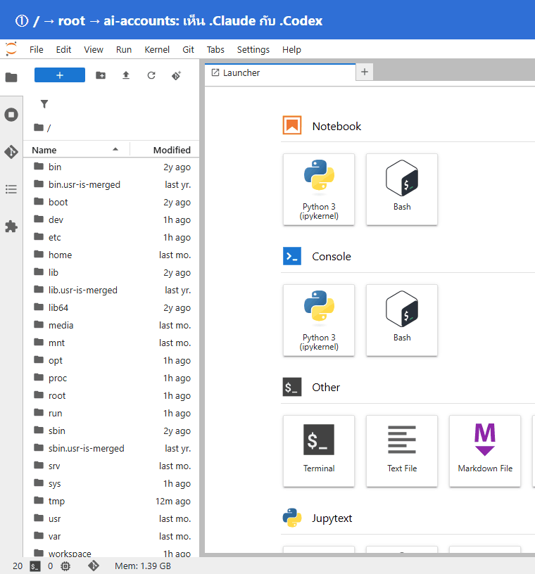

| โฟลเดอร์ | คืออะไร |
|---|---|
| `.Claude/yolo1` … `yolo5` | ข้อมูลของแต่ละบัญชี Claude (`CLAUDE_CONFIG_DIR`) ล็อกอิน การตั้งค่า และประวัติแยกกัน |
| `.Codex/cyolo1` … `cyolo5` | ข้อมูลของแต่ละบัญชี Codex (`CODEX_HOME`) เก็บ credential เป็นไฟล์แยกต่อบัญชี |
| `shared/skills`, `shared/mcp` | ของกลางที่ทุกบัญชีของ CLI นั้นใช้ร่วมกัน ไม่มีข้อมูลล็อกอินอยู่ในนี้ |

คำสั่ง `yolo1` คือสคริปต์สั้น ๆ ที่เลือกโฟลเดอร์ `yolo1` แล้วเปิด `claude` ให้ (ไม่ใช่คำสั่งมาตรฐานของ Linux) การแยกนี้เป็นการจัดระเบียบภายใต้ผู้ใช้ Linux เดียวกัน ไม่ใช่การแยกสิทธิ์ OS อ่านเพิ่มเติม: [Claude Code env vars](https://code.claude.com/docs/en/env-vars) · [Codex config](https://learn.chatgpt.com/docs/config-file/config-advanced)

**MCP พื้นฐานที่ติดตั้งมาให้:** ใน `shared/mcp` มี **Playwright MCP** พร้อม Chromium แบบไม่มีหน้าจอ ทุกบัญชีใช้ได้ทันทีโดยไม่ต้องติดตั้งเอง ทำให้ AI เปิดเว็บ กรอกฟอร์ม กดปุ่ม และถ่ายภาพหน้าจอได้เอง (ใช้ในขั้นที่ 4)

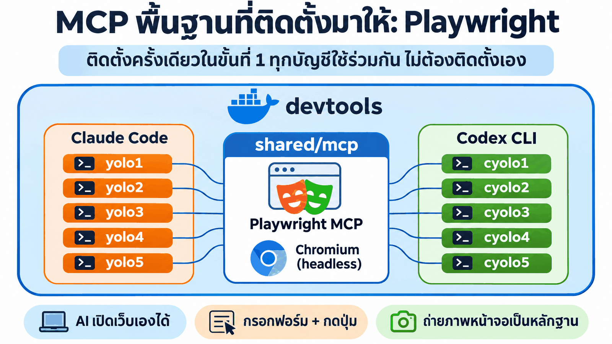

## ขั้นที่ 3 · 🖥️ ล็อกอินทีละบัญชี แล้วให้ Claude ตรวจ (~15 นาที)

### 3.1 · ล็อกอิน: 1 บัญชี = 1 แท็บ Terminal

ใน JupyterLab กด **+ → Terminal** เปิดแท็บใหม่ต่อ 1 บัญชี พิมพ์ชื่อบัญชี แล้วทำตามหน้าจอจนเข้าหน้าสนทนา ทำอย่างน้อย `yolo1`, `yolo2`, `cyolo1`, `cyolo2` ภาพเคลื่อนไหวด้านล่างแสดงครบทุกขั้นของ `yolo1` → `yolo2` → `cyolo1`

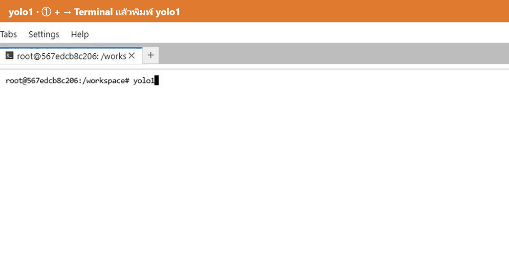

*ภาพจริงจาก JupyterLab ของ `devtools` (ช่วงล็อกอินถ่ายจากการรันจริงเดือน ก.ย. 2026 ภาพ yolo2 ถ่าย 7 พ.ย. 2026) ผู้เรียนยืนยันตัวตนในเบราว์เซอร์ด้วยตัวเอง ไม่ส่งรหัสหรือข้อมูลบัญชีให้ AI*

| พิมพ์ | หน้าจอล็อกอิน | เลือก | โมเดลที่ใช้ในแลป |
|---|---|---|---|
| `yolo1` … `yolo5` | Select login method | **Claude account with subscription** → ยืนยันในเบราว์เซอร์ → **Yes, I trust this folder** | `/model` → **Fable** · Medium |
| `cyolo1` … `cyolo5` | Choose how you want to use Codex | **Sign in with ChatGPT** (ถ้าเบราว์เซอร์ส่งผลกลับไม่ได้ ใช้ **Device Code** หรือ `cyolo1 login --device-auth`) | `/model` → **GPT-6-Astra** · Medium |

เสร็จแต่ละบัญชีพิมพ์ `/exit` (Claude) หรือกด Ctrl+C (Codex) เพื่อกลับ shell

### 3.2 · 💻 ให้ Claude Code Desktop ตรวจว่าล็อกอินครบหรือยัง

ไม่ต้องพิมพ์คำสั่งตรวจเอง วางพรอมต์นี้ใน Claude Code Desktop พรอมต์บอกไว้แล้วว่าต้องใช้คำสั่งไหน และห้ามแสดงอีเมลหรือ token

```text
ช่วยตรวจสถานะล็อกอินทุกบัญชีใน container devtools ทำผ่าน docker exec เท่านั้น ห้ามล็อกอินแทนฉัน ห้ามแก้ไฟล์ใด ๆ
- Claude: yolo1 ถึง yolo5 ใช้คำสั่ง yoloN auth status แล้วดูเฉพาะค่า "loggedIn"
- Codex: cyolo1 ถึง cyolo5 ใช้คำสั่ง cyoloN login status
สรุปเป็นตาราง บัญชี | ล็อกอินแล้ว/ยัง เท่านั้น ห้ามแสดงอีเมล ชื่อองค์กร หรือ token
ถ้ามีบัญชีที่ยังไม่ล็อกอิน ให้บอกวิธีล็อกอินใน JupyterLab Terminal
(พิมพ์ yoloN แล้วเลือก Claude account with subscription / พิมพ์ cyoloN หรือ cyoloN login --device-auth)
```

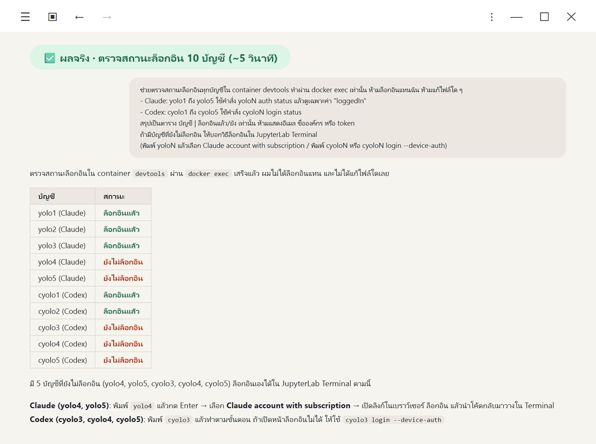

*ผลจริง (7 พ.ย. 2026 · ~5 วินาที) เครื่องตัวอย่างล็อกอินไว้ 5 บัญชี Claude จึงบอกวิธีล็อกอินบัญชีที่เหลือ ขั้นที่ 4 ต้องใช้ `yolo1`, `yolo2`, `cyolo1`, `cyolo2` ให้ครบก่อน*

## ขั้นที่ 4 · 💻 ให้ Claude Code Desktop ทดสอบ skill/MCP ข้ามบัญชี (~15 นาที)

แต่ละบัญชีจะเรียก skill กลาง `shared-check` และใช้ **Playwright MCP** เปิด Google Flights ค้น BKK → Tokyo เอง แล้วเก็บภาพหน้าจอเป็นหลักฐาน **ค้นหาอย่างเดียว ไม่จองและไม่ชำระเงิน**

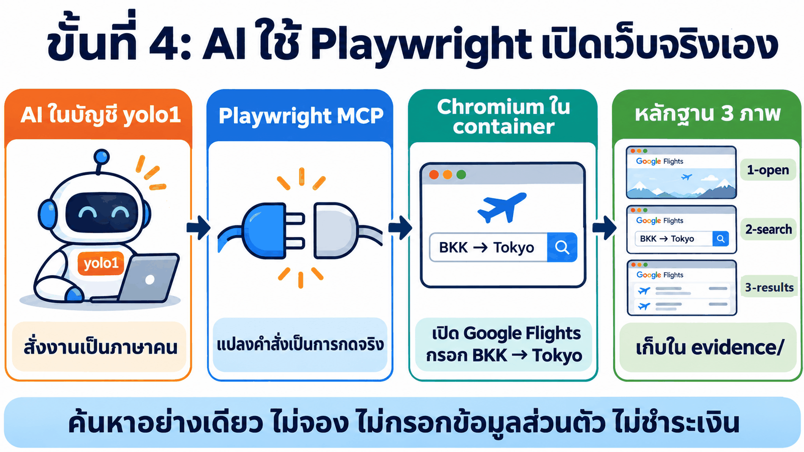

### 4.1 · วางพรอมต์ทดสอบ

ข้อ 0 ของพรอมต์ให้ Claude **ตรวจล็อกอินก่อน** ถ้ายังไม่ครบจะหยุดและบอกว่าต้องล็อกอินบัญชีไหน ถ้าครบแล้วจึงรันข้อความใต้เส้น `====` ให้ทีละบัญชีข้างใน container

```text
ช่วยทดสอบ skill/MCP ส่วนกลางข้ามบัญชี yolo1 yolo2 cyolo1 cyolo2 ใน container devtools
ทำงานใน container ผ่าน docker exec เท่านั้น ห้ามแก้ไฟล์ตั้งค่า ห้ามล็อกอินแทนฉัน
0. ตรวจสถานะล็อกอินทุกบัญชีก่อน: yoloN auth status และ cyoloN login status
   แสดงเป็นตาราง บัญชี | ล็อกอินแล้ว/ยัง เท่านั้น ห้ามแสดงอีเมล องค์กร หรือ token
   ถ้ามีบัญชีใดยังไม่ล็อกอิน ให้หยุดทันที แจ้งเตือนว่าต้องล็อกอินบัญชีไหน
   พร้อมวิธีล็อกอินใน JupyterLab Terminal (พิมพ์ yoloN แล้วเลือก Claude account with subscription / cyoloN login --device-auth)
   ห้ามทำข้อถัดไปจนกว่าจะล็อกอินครบ
1. บันทึกข้อความใต้เส้น ==== ตามตัวอักษรลง /workspace/multi-account/verify-prompt.txt ใน container
2. รันทีละบัญชีจาก shell ใน container (โฟลเดอร์ /workspace/multi-account):
   yolo1 -p "$(cat verify-prompt.txt)", yolo2 เช่นเดียวกัน,
   cyolo1 exec --skip-git-repo-check "$(cat verify-prompt.txt)", cyolo2 เช่นเดียวกัน
   รันแบบ foreground ทีละบัญชี timeout บัญชีละ 15 นาที รอจนจบก่อนไปบัญชีถัดไป
3. คัดลอกภาพที่แต่ละบัญชีรายงานไปเป็น /workspace/multi-account/evidence/<บัญชี>/1-open.png, 2-search.png, 3-results.png
   พร้อม log คำตอบเป็น run.log ในโฟลเดอร์เดียวกัน
4. สรุปตาราง บัญชี | config root | รหัส shared-check | tool ที่เรียก | เที่ยวบินอันดับ 1 | ภาพที่ได้ | PASS/FAIL
   บัญชีต่างกันแต่ CLI เดียวกันต้องได้รหัสเดียวกัน ถ้าบัญชีใดล้มเหลวให้รายงานตามจริง ห้ามแก้แทนหรือเดาผล
====
ตรวจว่า skill และ MCP ส่วนกลางใช้ได้จริงในบัญชีนี้ ทำตามลำดับ ห้ามแก้ไฟล์ตั้งค่าใด ๆ

1. แจ้ง config root ที่ใช้อยู่ (ค่า CLAUDE_CONFIG_DIR หรือ CODEX_HOME) ห้ามแสดง token อีเมล หรือข้อมูลบัญชี
2. ใช้ skill shared-check ตามกลไก skill ของ CLI นี้ แล้วรายงานรหัสที่ได้ พร้อม path ของ skill ตามที่ CLI แสดง
   ห้ามค้นหาไฟล์เอง (find, grep, ls) และห้ามเปิดไฟล์จาก path ที่ไม่ได้มาจากรายการ skill ของ CLI
3. ใช้เครื่องมือของ MCP ชื่อ playwright เท่านั้น ห้ามใช้ curl, python, web search หรือ browser อื่น
   เปิด https://www.google.com/travel/flights?hl=en
   ค้นหาเที่ยวบินเที่ยวเดียว Bangkok (BKK) ไป Tokyo ญี่ปุ่น ชั้นประหยัด ผู้ใหญ่ 1 คน วันเดินทางคือวันที่ 15 ของเดือนถัดไป
   ค้นหาอย่างเดียว ห้ามกดจอง ห้ามกรอกข้อมูลส่วนตัว ห้ามชำระเงิน ห้ามล็อกอินเว็บไซต์ใด
   ถ้าหน้าเว็บไม่แสดงผล ให้รายงานตามจริงว่าติดตรงไหน ห้ามเดาราคา
4. บันทึกภาพหน้าจอด้วย tool screenshot ของ playwright เฉพาะส่วนที่มองเห็น 3 ภาพ
   ตั้งชื่อ <บัญชี>-1-open.png (หน้าเว็บเปิดได้), <บัญชี>-2-search.png (กรอกเงื่อนไขครบก่อนกดค้นหา),
   <บัญชี>-3-results.png (รายการผลเที่ยวบิน) แล้วรายงาน path เต็มของแต่ละภาพ
5. สรุปเป็นตาราง รายการ | PASS/FAIL | หลักฐาน โดยมีแถว: config root, รหัสจาก skill shared-check,
   ชื่อ MCP server และชื่อ tool ที่เรียกจริง, ภาพหน้าจอ 3 ภาพ (path),
   เที่ยวบิน 3 อันดับแรก: สายการบิน เวลาออก-ถึง ระยะเวลา จำนวนแวะ ราคา (ตามที่เห็นบนหน้าเว็บ)
```

ถ้ายังล็อกอินไม่ครบ Claude จะหยุดที่ข้อ 0 (ภาพจริงเมื่อลองใส่บัญชีที่ยังไม่ล็อกอิน `yolo4`, `cyolo3`)

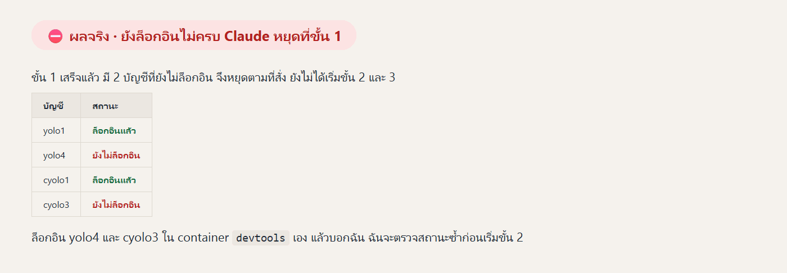

### 4.2 · ผลจริง (7 พ.ย. 2026 · ~10 นาที)

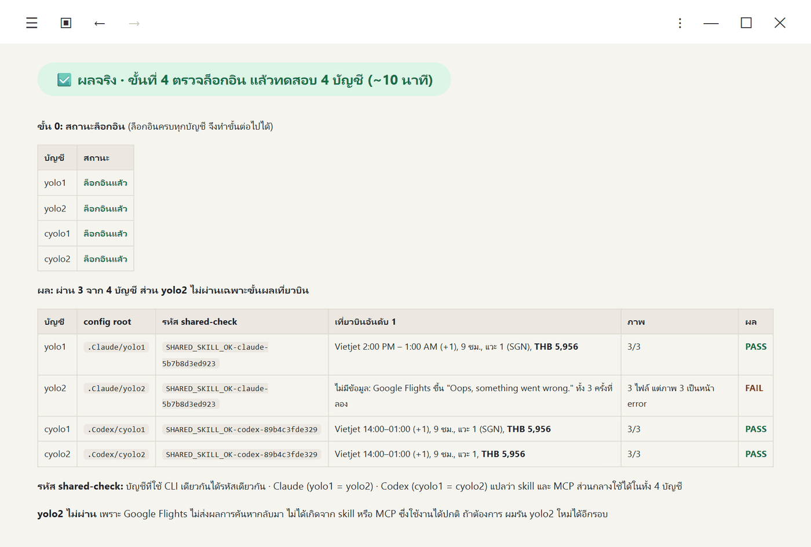

**อ่านผลอย่างไร**

- **skill กลางใช้ได้จริง:** `yolo1` กับ `yolo2` คนละบัญชีแต่ได้รหัสเดียวกัน `SHARED_SKILL_OK-claude-5b7b8d3ed923` ส่วน `cyolo1` กับ `cyolo2` ได้ `SHARED_SKILL_OK-codex-89b4c3fde329` เหมือนกัน แปลว่าอ่าน skill จากไฟล์เดียวกันใน `shared` (รหัสสุ่มตอนติดตั้ง ของผู้เรียนจะต่างจากนี้)
- **MCP กลางใช้ได้จริง:** ทุกบัญชีเรียก tool ของ `playwright` (`browser_navigate`, `browser_type`, `browser_take_screenshot` ฯลฯ) ได้เอง
- **yolo2 FAIL ไม่ได้แปลว่าตั้งค่าผิด:** skill และ MCP ผ่าน แต่ Google Flights ตอบ "Oops, something went wrong." ในรอบนั้น เป็นปัญหาของ **เว็บภายนอก** ไม่ใช่ **ระบบของเรา**

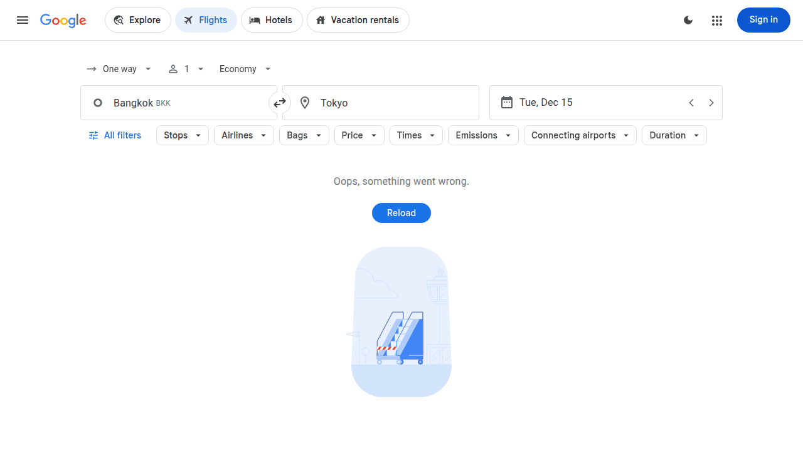

**ถ้าเจอแบบนี้ ให้รันเฉพาะบัญชีนั้นซ้ำ** เช่น พิมพ์ใน Claude Code Desktop ว่า "รัน yolo2 ซ้ำอีกรอบด้วยพรอมต์เดิม แล้วอัปเดตหลักฐาน" รอบที่ 2 ของ yolo2 ใช้ 124 วินาที ได้รหัสเดิมและผลเที่ยวบินครบ จึงผ่านทั้ง 4 บัญชี

| บัญชี | รหัสจาก `shared-check` | Playwright MCP | เที่ยวบินอันดับ 1 |
|---|---|---|---|
| yolo1 | `…claude-5b7b8d3ed923` | PASS | Vietjet · 9 ชม. · แวะ 1 · THB 5,956 |
| yolo2 | เหมือน yolo1 | รอบ 1 เว็บ error → รอบ 2 PASS | Vietjet · 9 ชม. · แวะ 1 · THB 5,956 |
| cyolo1 | `…codex-89b4c3fde329` | PASS | Vietjet · 9 ชม. · แวะ 1 · THB 5,956 |
| cyolo2 | เหมือน cyolo1 | PASS | Vietjet · 9 ชม. · แวะ 1 · THB 5,956 |

### 4.3 · ดูหลักฐานที่ Playwright เก็บไว้

ใน File Browser ไปที่ `/workspace/multi-account/evidence/` มีโฟลเดอร์ตามบัญชี แต่ละโฟลเดอร์มี `1-open.png` (เปิดเว็บได้), `2-search.png` (กรอกเงื่อนไขครบ), `3-results.png` (ผลเที่ยวบิน) และ `run.log`

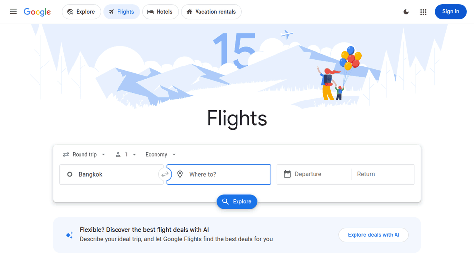

*ภาพจริง 3 ภาพที่ Playwright MCP ของ yolo1 บันทึก เรียงต่อกัน ไม่ได้ตกแต่ง*

ทั้ง 4 บัญชีเห็นเที่ยวบินชุดเดียวกัน แปลว่า Playwright MCP จาก `shared` ทำงานได้ทั้งฝั่ง Claude และ Codex (ราคาของผู้เรียนจะต่างตามวันที่ค้นหา)

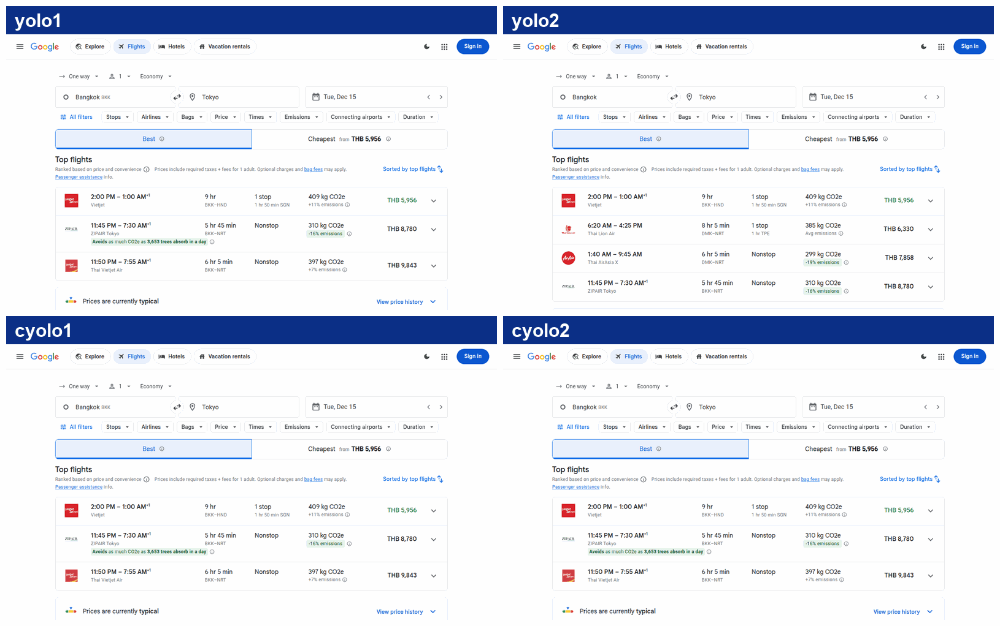

**ข้อควรรู้:** คำตอบของโมเดลเป็นเพียงคำบอกเล่า หลักฐานที่แน่นอนกว่าคือ `run.log` และภาพใน `evidence/` หรือ log ของ session ใน `$CLAUDE_CONFIG_DIR/projects/` และ `$CODEX_HOME/sessions/`
