# LAB 001 · ส่วนที่ 1: ปรับ devtools ให้รองรับหลายบัญชีด้วย Claude Code Desktop (Claude Code + Codex CLI)

เวลาโดยประมาณสำหรับส่วนนี้: 40–55 นาที ขึ้นอยู่กับการล็อกอินแต่ละบัญชี

**สิ่งที่จะได้:** container `devtools` ตัวเดิมจากบทที่แล้ว ถูกปรับโครงสร้างข้างในให้มีบัญชี AI หลายบัญชีทั้ง Claude Code และ Codex พร้อมให้แบ่งงานใหญ่ไปทำพร้อมกัน โดยใช้ skill และ MCP ชุดเดียวกันทุกบัญชี ทั้งหมดสั่งจาก Claude Code Desktop บน Windows

บทเรียนที่เชื่อมโยง: [AI Agent Routing](../ai-agent-routing.html) หัวข้อ 1.0 และ 4.0–4.3

ขอบเขต: Claude Code และ Codex CLI เท่านั้น

## ก่อนเริ่ม: ทำไมต้องมีหลายบัญชี (Multi-Account)?

ใน [LAB ก่อนหน้า](../01_Docker_VSCode_Setup/README.md) เราได้ container `devtools` ซึ่งเป็น **พื้นที่ทำงานกลาง** ที่ติดตั้ง Claude Code และ Codex CLI ไว้แล้ว LAB นี้ต่อยอดให้ container นั้นเก็บ **หลายบัญชีไว้รวมกัน** แต่ละบัญชีแยกข้อมูลกัน และเรียกใช้ได้ด้วยคำสั่งสั้น ๆ คำสั่งเดียว


*ภาพแนวคิด สร้างด้วย Imagegen ราคาแพ็กเกจในภาพเป็นตัวอย่างระดับราคา ไม่ใช่ราคาทางการ*

### ลองนึกภาพการทำงานในองค์กร

หลายองค์กรซื้อ AI ให้ทีมเป็นแผน **Team / Enterprise** (เช่น Claude Team หรือ ChatGPT Business) ในทีมจึงมีหลายบัญชี และแต่ละบัญชีมีโควตาต่างกัน เช่น แพ็กเกจระดับ $20, $100 หรือ $200 ต่อเดือน บางคนอาจมีบัญชีส่วนตัวเพิ่มอีกด้วย

ถ้างานเล็ก บัญชีเดียวก็พอ แต่ถ้า **งานใหญ่** เช่น สร้างเว็บทั้งระบบ ทดสอบหลายร้อยกรณี หรือใช้ **multi-agent** หลายตัวช่วยกันทำงานเดียว จะเจอปัญหา 2 ข้อ

1. **โควตาไม่พอ:** บัญชีเล็ก เช่นระดับ $20 อาจใช้โควตาหมดกลางงาน ต้องรอรอบถัดไปจึงทำงานต่อได้
2. **ช้า:** งานหลายชิ้นที่ทำพร้อมกันได้ ต้องรอคิวทำทีละชิ้นในบัญชีเดียว


*ภาพจำลองแนวสมจริง สร้างด้วย Imagegen บุคคลในภาพไม่มีตัวตนจริง*

### แนวคิด: กระจายงานไปหลายบัญชีใน container เดียว

เทียบกับร้านอาหารที่มีเชฟคนเดียว ต่อให้เก่งแค่ไหน ออเดอร์ 30 จานก็ต้องทำทีละจาน ถ้ามีเชฟหลายคนในครัวเดียวกัน ใช้วัตถุดิบและสูตรชุดเดียวกัน แบ่งกันทำคนละจาน อาหารก็ออกเร็วขึ้นมาก

- **ครัว** คือ container `devtools`
- **เชฟแต่ละคน** คือบัญชี `yolo1`–`yolo5` (Claude Code) และ `cyolo1`–`cyolo5` (Codex CLI)
- **สูตรและเครื่องมือกลาง** คือ skill และ MCP ใน `shared` ที่ทุกบัญชีใช้ร่วมกัน (ตั้งค่าในขั้นที่ 1)

ภาพเคลื่อนไหวด้านล่างเทียบงานใหญ่ 6 ชิ้นแบบทำในบัญชีเดียว กับแบบแบ่งให้ 6 บัญชีใน container เดียว


*ภาพเคลื่อนไหวจำลองแนวคิด (ประมาณ 20 วินาที วนซ้ำ) ตัวเลขชั่วโมงเป็นตัวอย่างประกอบ ไม่ใช่ผลวัดจริง*

### ไม่ใช่แค่ "หลายบัญชี" แต่เป็น "หลายโมเดล" ด้วย

Claude กับ Codex ถนัดงานต่างกัน เมื่อทั้งสองอยู่ใน container เดียว เราเลือกส่งงานให้ตัวที่เหมาะได้ทันที และให้โมเดลหนึ่ง **ตรวจงานของอีกโมเดลหนึ่ง** (cross-review) เพื่อลดจุดบอดที่โมเดลเดียวมองไม่เห็น


*ภาพแนวคิด สร้างด้วย Imagegen การแบ่งงานในภาพเป็นเพียงตัวอย่าง ควรทดลองเลือกโมเดลตามงานจริง*

### สรุปข้อดีของ LAB นี้

| ข้อดี | ความหมาย | ใช้เมื่อไร |
|---|---|---|
| **กระจายโหลด** | งานไม่ไปกองที่บัญชีเดียว ลดโอกาสโควตาหมดกลางงาน | งานยาวหรือใช้ token มาก |
| **ทำงานขนานกัน** | เปิดหลาย Terminal แต่ละแท็บใช้คนละบัญชี ทำหลายชิ้นพร้อมกัน | งานแบ่งเป็นชิ้นอิสระได้ เช่น backend / frontend / test |
| **ผสมหลายโมเดล** | ใช้ Claude และ Codex ร่วมกัน และให้ตรวจงานกันเอง | ต้องการคุณภาพสูงหรือมุมมองที่สอง |
| **ตั้งค่าครั้งเดียว ใช้ได้ทุกบัญชี** | skill และ MCP อยู่ใน `shared` แก้ที่เดียวทุกบัญชีเห็น | เพิ่มเครื่องมือใหม่ให้ทั้งทีม |
| **อยู่ใน container เดียว** | ย้าย ลบ หรือสร้างใหม่ได้ ไม่ปนกับเครื่องหลัก | ทดลองโดยไม่กระทบ Windows ของเรา |

> **ข้อควรระวัง:** ใช้เฉพาะบัญชีที่ตนเองหรือองค์กรมีสิทธิ์ใช้จริง และทำตามเงื่อนไขการใช้งานของผู้ให้บริการแต่ละราย LAB นี้ไม่ได้สร้างบัญชีหรือเพิ่มโควตาให้ เพียงช่วยให้สลับและใช้บัญชีที่มีอยู่แล้วได้สะดวกและแยกข้อมูลกัน ห้ามแชร์ข้อมูลล็อกอินให้ผู้อื่น

บัญชีเหล่านี้จะใช้ต่อในบทเรียนถัด ๆ ไปที่แบ่งงานใหญ่ให้ multi-agent ส่วนใน LAB นี้เราจะ **เตรียมครัวให้พร้อม**: ตั้งค่าบัญชี ล็อกอิน เลือกโมเดล และพิสูจน์ว่า skill กับ MCP ใช้ร่วมกันได้ทุกบัญชี

## จุดเริ่มต้น: ตอนนี้ devtools ยังเป็น Linux ธรรมดา

ใน [บทที่แล้ว](../01_Docker_VSCode_Setup/README.md) เราสร้าง container `devtools` จาก image `tuchsanai/devtools:2569_1` ข้างในเป็น Ubuntu ที่ติดตั้ง Python, Node.js, Git, Docker, JupyterLab, Claude Code และ Codex ไว้พร้อมแล้ว

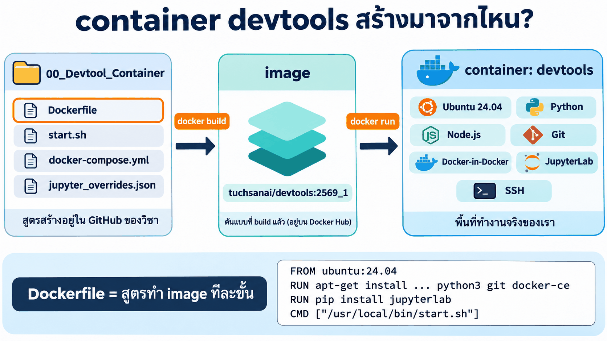

*ภาพจากบทที่แล้ว: ที่มาของ container `devtools`*

แต่ image นี้ **ไม่ได้ออกแบบมาให้มีหลายบัญชี** ภาพด้านล่างคือ Terminal ใน JupyterLab ของ `devtools` ก่อนเริ่ม LAB นี้ มี `claude` กับ `codex` แล้ว แต่ยังไม่มีโฟลเดอร์ `~/ai-accounts` และยังไม่มีคำสั่ง `yolo` / `cyolo`


*ภาพจริงจาก container `devtools` ที่เพิ่งสร้างตามบทที่แล้ว (7 พ.ย. 2026) ก่อนรันพรอมต์ของ LAB นี้*

### เป้าหมาย: ปรับโครงสร้างข้างใน ขณะที่ container ยังรันอยู่

เราจะ **ไม่สร้าง image ใหม่และไม่ลบ container** แต่จะเพิ่มโครงสร้างเข้าไปใน `devtools` ตัวเดิม ได้แก่ โฟลเดอร์แยกต่อบัญชี โฟลเดอร์ `shared` สำหรับ skill และ MCP ที่ใช้ร่วมกัน และคำสั่งสั้น `yolo1`–`yolo5` กับ `cyolo1`–`cyolo5`


*ภาพแนวคิด สร้างด้วย Imagegen ชื่อโฟลเดอร์และตำแหน่งคำสั่งตรงกับผลการรันจริงในขั้นที่ 1*

### ใครเป็นคนปรับ? Claude Code Desktop จากข้างนอก

ใน LAB นี้เราไม่ต้องเข้าไปพิมพ์คำสั่ง Linux เอง เราใช้ **Claude Code Desktop บน Windows** ตัวเดียวกับที่ใช้สร้าง container ในบทที่แล้ว แค่วางพรอมต์ Claude จะส่งคำสั่งเข้าไปทำงานใน container ด้วย `docker exec devtools …` (คำสั่งของ Docker ที่ใช้ "สั่งงานข้างใน container ที่กำลังรันอยู่") แล้วสร้างโครงสร้างทั้งหมดให้


*ภาพแนวคิด สร้างด้วย Imagegen*

สิ่งเดียวที่ Claude **ทำแทนไม่ได้** คือการล็อกอินบัญชี เพราะต้องยืนยันตัวตนในเบราว์เซอร์ด้วยตัวเราเอง ขั้นนี้จึงทำใน JupyterLab Terminal ข้างใน container

## ภาพรวมการทดลอง

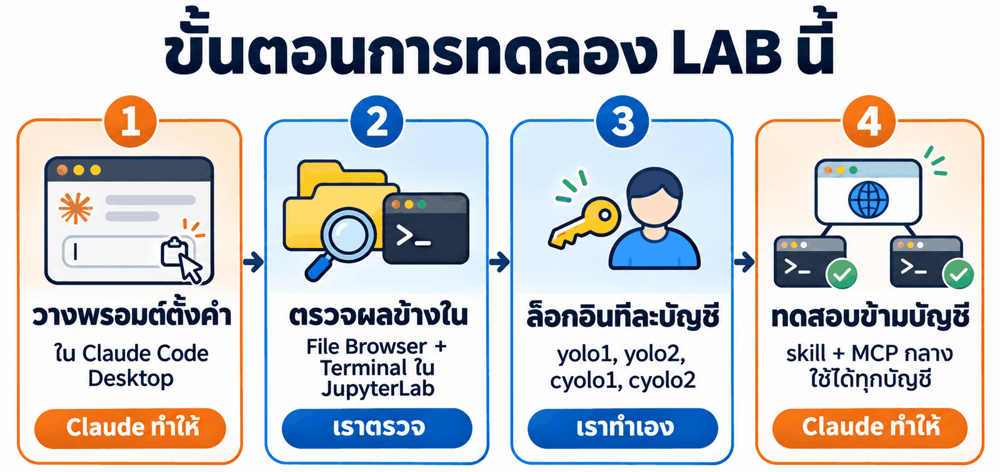

*ภาพแนวคิด สร้างด้วย Imagegen*

ภาพเคลื่อนไหวด้านล่างแสดงลำดับทั้ง 4 ขั้น: ข้างนอก (Windows) และข้างใน (container) ทำงานส่งต่อกันอย่างไร


*ภาพเคลื่อนไหวอธิบายลำดับ (ประมาณ 22 วินาที วนซ้ำ) ไม่ใช่การบันทึกหน้าจอจริง*

| ขั้น | ทำที่ไหน | ใครทำ | หลักฐานว่าสำเร็จ |
|---|---|---|---|
| **1 · วางพรอมต์ตั้งค่า** | 💻 Claude Code Desktop (ข้างนอก) | Claude | ตารางสรุป PASS/FAIL/SKIP และไฟล์รายงานใน `/workspace/multi-account/` |
| **2 · ตรวจผลข้างใน** | 🖥️ JupyterLab ของ `devtools` | เรา | เห็นโฟลเดอร์ `ai-accounts` และ `yolo1 --version` ใช้ได้ |
| **3 · ล็อกอินทีละบัญชี** | 🖥️ JupyterLab Terminal | เรา | เข้าหน้าสนทนาได้ และเลือกโมเดลได้ |
| **4 · ทดสอบข้ามบัญชี** | 💻 Claude Code Desktop (ข้างนอก) | Claude | ทุกบัญชีได้รหัส skill เดียวกัน และ Playwright MCP เก็บภาพเว็บจริงได้ |

**อ่านสัญลักษณ์ให้ถูก:** 💻 คือหน้าต่าง Claude Code Desktop บน Windows, 🖥️ คือ Terminal ใน JupyterLab ของ `devtools`, 💬 คือช่องสนทนาของ Claude Code หรือ Codex ที่เปิดอยู่ใน Terminal นั้น

## 0 · ก่อนเริ่ม (~3 นาที)

ตรวจ 3 อย่างนี้ก่อน:

1. **Docker Desktop** ขึ้น **Engine running** (ทบทวนหัวข้อ 1.4 ของบทที่แล้ว)
2. container **`devtools`** กำลังรัน: ใน VS Code แถบ **Containers** ต้องเห็น `devtools` มีสามเหลี่ยมสีเขียว
3. **Claude Code Desktop** บน Windows ล็อกอินแล้ว (บัญชีนี้เป็นตัวช่วยตั้งค่า ไม่ใช่หนึ่งในบัญชี yolo)

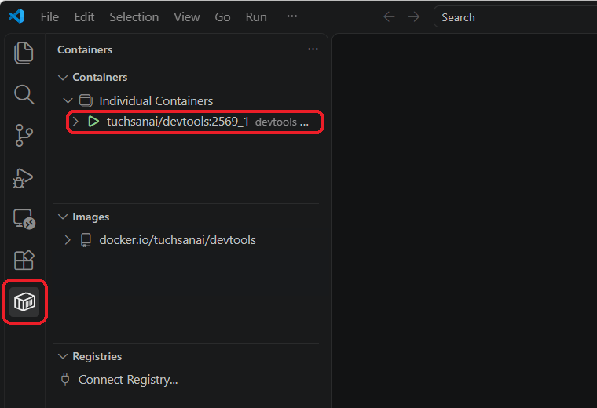

*ภาพจากบทที่แล้ว หัวข้อ 3.2*

## ขั้นที่ 1 · 💻 ให้ Claude Code Desktop ปรับโครงสร้างข้างใน (~10 นาที)

### 1.1 · ทำไมพรอมต์ต้องเขียนแบบนี้?

ลองนึกว่ามีลิ้นชักแยกตามบัญชี: คำสั่ง `yolo1` เลือกลิ้นชักของ Claude บัญชีที่ 1 ส่วน `yolo2` เลือกบัญชีที่ 2 ใช้โปรแกรม CLI เดิม แต่ชี้ไปยังข้อมูลคนละชุด หลักเดียวกันใช้กับ `cyolo1`–`cyolo5` ของ Codex

| สิ่งที่พรอมต์กำหนด | ช่วยผู้เรียนอย่างไร |
|---|---|
| ทำทุกอย่างผ่าน `docker exec` และห้ามหยุด/ลบ container | ปรับ `devtools` ตัวเดิมขณะรัน ไฟล์งานเดิมยังอยู่ครบ และไม่แตะเครื่อง Windows |
| คำสั่งสั้นแยกตามบัญชีใน `/usr/local/bin` | พิมพ์ `yolo1` หรือ `cyolo1` ได้ทันทีในทุก Terminal ไม่ต้องแก้ PATH |
| โฟลเดอร์การตั้งค่าต่อบัญชี | ข้อมูลล็อกอิน การตั้งค่า และประวัติของแต่ละบัญชีไม่ปนกัน |
| Skills/MCP ส่วนกลางต่อเครื่องมือ | แก้ที่ `shared` ครั้งเดียว ทุกบัญชีของ CLI นั้นเห็น |
| ข้อเท็จจริงจากการทดลอง + ตรวจ `--help` ก่อน | ให้ Claude ไม่เดา flag และไม่ต้องลองผิดลองถูกนาน |
| installer รันซ้ำได้ + รายงานในไฟล์ | ตรวจผลย้อนหลังได้ และรันซ้ำโดยไม่ทำลายของเดิม |

ข้อดีเหล่านี้เป็นเหตุผลของการออกแบบแลป พรอมต์สร้างตัวช่วยเลือกบัญชีที่มีอยู่ ไม่ได้สมัครบัญชีหรือเพิ่มสิทธิ์ใช้งานให้

### 1.2 · วางพรอมต์ใน Claude Code Desktop

**ขั้นตอน:** เปิด Claude Code Desktop → เริ่ม **New session** → คัดลอกพรอมต์ทั้งกรอบด้านล่างไปวาง (Ctrl+V) → กด Enter แล้วรอจน Claude สรุปผล


*ภาพเคลื่อนไหวจำลองขั้นตอนวางพรอมต์ (ประมาณ 7 วินาที วนซ้ำ) ข้อความพรอมต์ตรงกับกรอบด้านล่างทุกตัวอักษร*

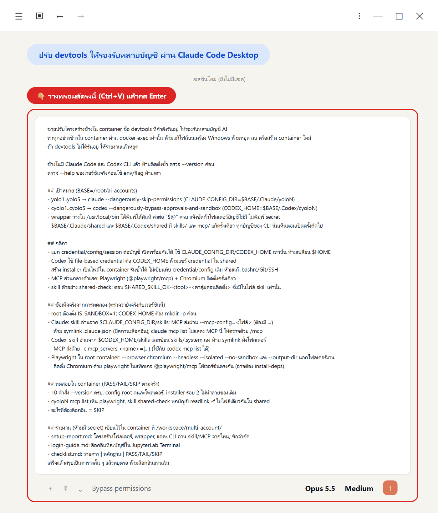

##### 📋 พรอมต์สำหรับคัดลอก (วางใน 💻 Claude Code Desktop แล้ว Enter)
```text
ช่วยปรับโครงสร้างข้างใน container ชื่อ devtools ที่กำลังรันอยู่ ให้รองรับหลายบัญชี AI
ทำทุกอย่างข้างใน container ผ่าน docker exec เท่านั้น ห้ามแก้ไฟล์บนเครื่อง Windows ห้ามหยุด ลบ หรือสร้าง container ใหม่
ถ้า devtools ไม่ได้รันอยู่ ให้รายงานแล้วหยุด

ข้างในมี Claude Code และ Codex CLI แล้ว ห้ามติดตั้งซ้ำ ตรวจ --version ก่อน
ตรวจ --help ของเวอร์ชันจริงก่อนใช้ env/flag ห้ามเดา

## เป้าหมาย (BASE=/root/ai-accounts)
- yolo1..yolo5   → claude --dangerously-skip-permissions  (CLAUDE_CONFIG_DIR=$BASE/.Claude/yoloN)
- cyolo1..cyolo5 → codex --dangerously-bypass-approvals-and-sandbox  (CODEX_HOME=$BASE/.Codex/cyoloN)
- wrapper วางใน /usr/local/bin ให้พิมพ์ได้ทันที ส่งต่อ "$@" ครบ แจ้งชัดถ้าโฟลเดอร์บัญชีไม่มี ไม่พิมพ์ secret
- $BASE/.Claude/shared และ $BASE/.Codex/shared มี skills/ และ mcp/ แก้ครั้งเดียว ทุกบัญชีของ CLI นั้นเห็นตอนเปิดครั้งถัดไป

## กติกา
- แยก credential/config/session ต่อบัญชี เปิดพร้อมกันได้ ใช้ CLAUDE_CONFIG_DIR/CODEX_HOME เท่านั้น ห้ามเปลี่ยน $HOME
- Codex ใช้ file-based credential ต่อ CODEX_HOME ห้ามแชร์ credential ใน shared
- สร้าง installer เป็นไฟล์ใน container รันซ้ำได้ ไม่เขียนทับ credential/config เดิม ห้ามแก้ .bashrc/Git/SSH
- MCP ส่วนกลางตัวแรก: Playwright (@playwright/mcp) + Chromium ติดตั้งครั้งเดียว
- skill ตัวอย่าง shared-check: ตอบ SHARED_SKILL_OK-<tool>-<ค่าสุ่มตอนติดตั้ง> ซึ่งมีในไฟล์ skill เท่านั้น

## ข้อเท็จจริงจากการทดลอง (ตรวจว่ายังจริงกับเวอร์ชันนี้)
- root ต้องตั้ง IS_SANDBOX=1; CODEX_HOME ต้อง mkdir -p ก่อน
- Claude: skill อ่านจาก $CLAUDE_CONFIG_DIR/skills; MCP ส่งผ่าน --mcp-config=<ไฟล์> (ต้องมี =)
  ห้าม symlink .claude.json (มีสถานะล็อกอิน); claude mcp list ไม่แสดง MCP นี้ ให้ตรวจด้วย /mcp
- Codex: skill อ่านจาก $CODEX_HOME/skills และเขียน skills/.system เอง ห้าม symlink ทั้งโฟลเดอร์
  MCP ส่งด้วย -c mcp_servers.<name>={...} (ใช้กับ codex mcp list ได้)
- Playwright ใน root container: --browser chromium --headless --isolated --no-sandbox และ --output-dir นอกโฟลเดอร์งาน
  ติดตั้ง Chromium ด้วย playwright ในแพ็กเกจ @playwright/mcp ให้เวอร์ชันตรงกัน (อาจต้อง install-deps)

## ทดสอบใน container (PASS/FAIL/SKIP ตามจริง)
- 10 คำสั่ง --version ครบ, config root คนละโฟลเดอร์, installer รอบ 2 ไม่ทำลายของเดิม
- cyoloN mcp list เห็น playwright, skill shared-check ทุกบัญชี readlink -f ไปไฟล์เดียวกันใน shared
- อะไรที่ต้องล็อกอิน = SKIP

## รายงาน (ห้ามมี secret) เขียนไว้ใน container ที่ /workspace/multi-account/
- setup-report.md: โครงสร้างโฟลเดอร์, wrapper, แต่ละ CLI อ่าน skill/MCP จากไหน, ข้อจำกัด
- login-guide.md: ล็อกอินทีละบัญชีใน JupyterLab Terminal
- checklist.md: รายการ | หลักฐาน | PASS/FAIL/SKIP
เสร็จแล้วสรุปเป็นตารางสั้น ๆ แล้วหยุดรอ ห้ามล็อกอินแทนฉัน
```

### 1.3 · ผลจริงจากการรันพรอมต์

พรอมต์นี้รันจริงกับ `devtools` ที่เพิ่งสร้างตามบทที่แล้ว (7 พ.ย. 2026 · Claude Code 2.1.319, codex-cli 0.167.0) ใช้เวลาประมาณ **5 นาที** ได้ผล **18 PASS · 0 FAIL · 4 SKIP** ข้อที่ SKIP คือข้อที่ต้องล็อกอินก่อน ซึ่งเราจะทำในขั้นที่ 3–4


*ข้อความคำตอบจริงของ Claude จัดหน้าใหม่ให้อ่านง่าย ตัดรายละเอียดบางบรรทัดออก ผลที่ผู้เรียนได้อาจต่างเล็กน้อยตามเวอร์ชัน*

สิ่งที่เกิดขึ้นระหว่างทาง (เป็นเรื่องปกติ Claude แก้ได้เอง):

- Claude ติดตั้ง Playwright MCP และ Chromium พร้อม system library ที่ image ยังไม่มี (`playwright install --with-deps chromium`)
- บน Windows, Bash ของ Claude Code Desktop (Git Bash) อาจแปลง path อย่าง `/workspace/...` ผิดตอนส่งเข้า `docker exec` Claude ตรวจพบแล้วรันใหม่ด้วย `MSYS_NO_PATHCONV=1` เอง
- ข้อเท็จจริงทุกข้อในพรอมต์ (เช่น ต้องตั้ง `IS_SANDBOX=1` เมื่อเป็น root) ยังเป็นจริงกับเวอร์ชันนี้

## ขั้นที่ 2 · 🖥️ ตรวจผลข้างใน devtools ผ่าน JupyterLab (~10 นาที)

Claude บอกว่าเสร็จแล้ว ต่อไปเราเข้าไปดูด้วยตาตัวเองว่าข้างใน container เปลี่ยนจริง

### 2.1 · เปิด JupyterLab และ Terminal

1. ในหน้าต่าง **VS Code** เปิดแถบ **Containers** คลิกขวาที่ **devtools** แล้วเลือก **Open in External Browser**
2. เลือก **8888 localhost:8885** (หรือเปิด [JupyterLab](http://localhost:8885/lab) เอง โดยปรับพอร์ตให้ตรงกับที่ใช้จริง)

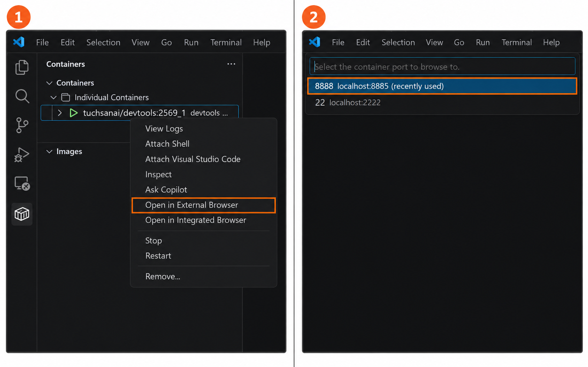

*ภาพจากหัวข้อ 6.1 ของบทที่แล้ว ปรับด้วย Imagegen เพื่อซ่อนรายการที่ไม่เกี่ยวข้อง*

3. ที่หน้า Launcher คลิก **Terminal** ในกลุ่ม **Other** (ถ้าไม่เห็น Launcher ให้กดปุ่ม **+** ก่อน)

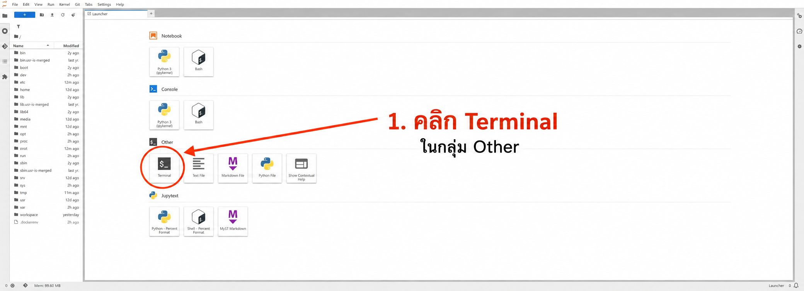

### 2.2 · ดูรายงานที่ Claude เขียนไว้

ใน File Browser ทางซ้าย ไปที่ `/` → **workspace** → **multi-account** จะเห็นไฟล์ 4 ไฟล์ ดับเบิลคลิก **checklist.md** เพื่อดูหลักฐานทีละข้อ

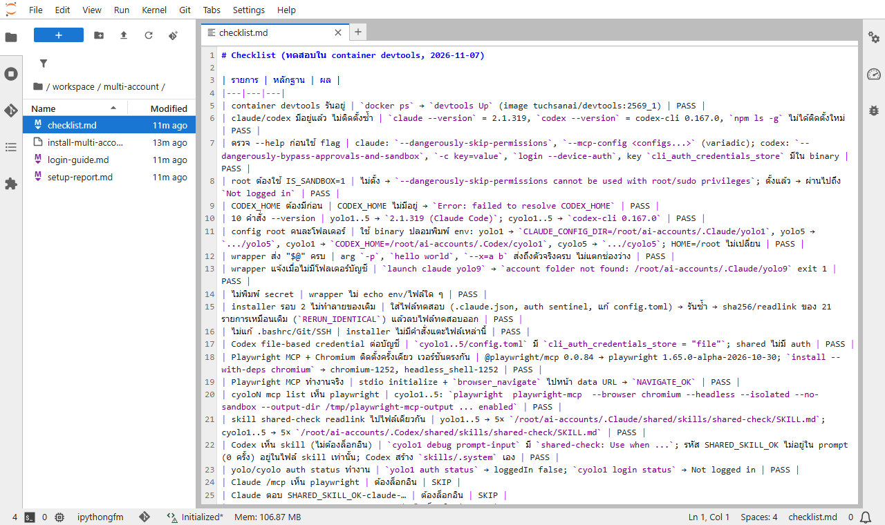

*ภาพจริงจาก JupyterLab หลังรันพรอมต์ขั้นที่ 1*

| ไฟล์ | ใช้ทำอะไร |
|---|---|
| `checklist.md` | รายการทดสอบ หลักฐาน และ PASS/FAIL/SKIP |
| `setup-report.md` | โครงสร้างโฟลเดอร์ คำสั่ง wrapper และที่มาของ skill/MCP |
| `login-guide.md` | วิธีล็อกอินทีละบัญชี (ใช้ในขั้นที่ 3) |
| `install-multi-account.sh` | ตัวติดตั้งที่ Claude เขียน รันซ้ำได้โดยไม่ทำลายของเดิม |

### 2.3 · โฟลเดอร์ที่ได้ และความหมายของส่วนกลาง

- โฟลเดอร์ของแต่ละบัญชีอยู่ใต้ `/root/ai-accounts` (`~/ai-accounts`) แยก `.Claude` กับ `.Codex`
- Claude Code เลือกโฟลเดอร์การตั้งค่าด้วย `CLAUDE_CONFIG_DIR` ซึ่งเอกสารระบุว่าใช้กับหลายบัญชีพร้อมกันได้ ดู [Claude Code environment variables](https://code.claude.com/docs/en/env-vars)
- Codex เลือกที่เก็บการตั้งค่าและสถานะด้วย `CODEX_HOME` ดู [Codex configuration](https://learn.chatgpt.com/docs/config-file/config-advanced) ส่วน credential ตั้งให้เก็บเป็นไฟล์ในโฟลเดอร์ของแต่ละบัญชี ดู [Codex authentication](https://learn.chatgpt.com/docs/auth)
- `shared/skills` และ `shared/mcp` ไม่ได้ถูก CLI อ่านเอง คำสั่ง `yolo`/`cyolo` เป็นตัวเชื่อมให้ทุกครั้งที่เปิด และไม่มี token หรือข้อมูลล็อกอินอยู่ในส่วนกลาง
- การแยก config เป็นการจัดระเบียบภายใต้ผู้ใช้ Linux เดียวกัน ไม่ใช่การแยกสิทธิ์ OS

เปิดดูใน File Browser: `/` → **root** → **ai-accounts** จะเห็น **.Claude** และ **.Codex**

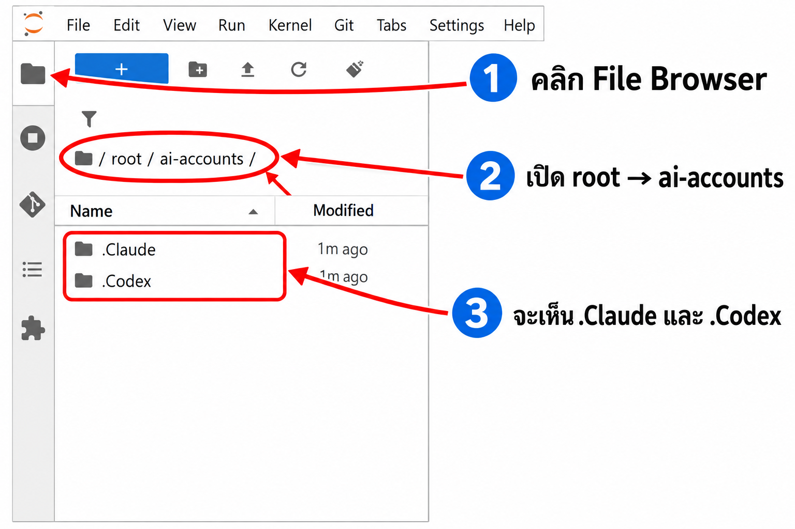

ดับเบิลคลิก **.Claude** จะเห็น **yolo1–yolo5** และ **shared** และใน **shared** มี **mcp** กับ **skills**

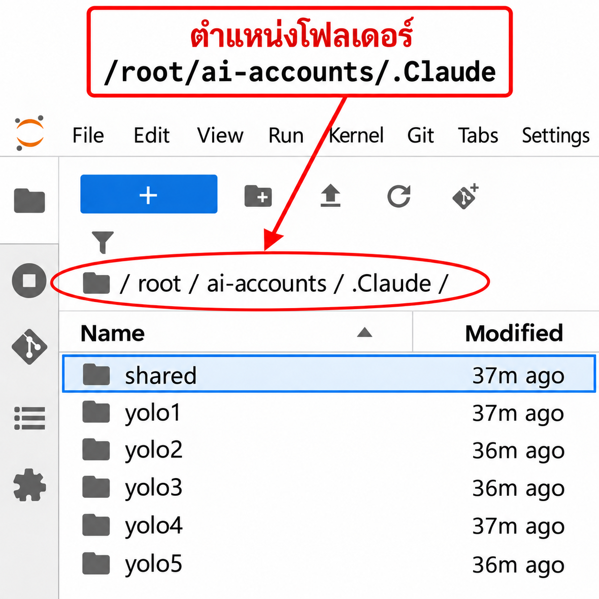

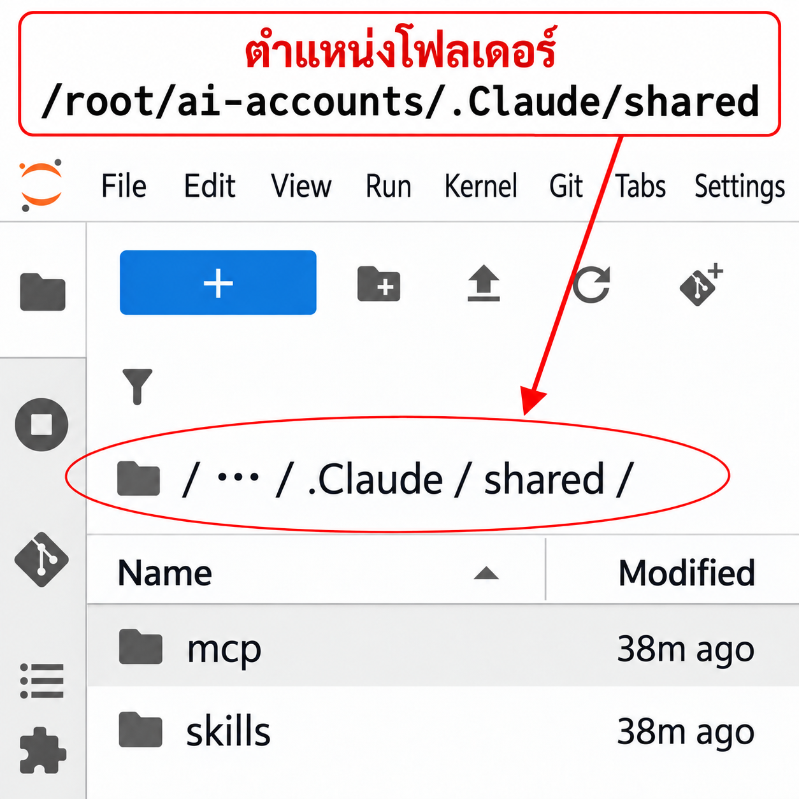

กลับไปที่ **ai-accounts** แล้วเปิด **.Codex** จะเห็น **cyolo1–cyolo5** และ **shared** แบบเดียวกัน

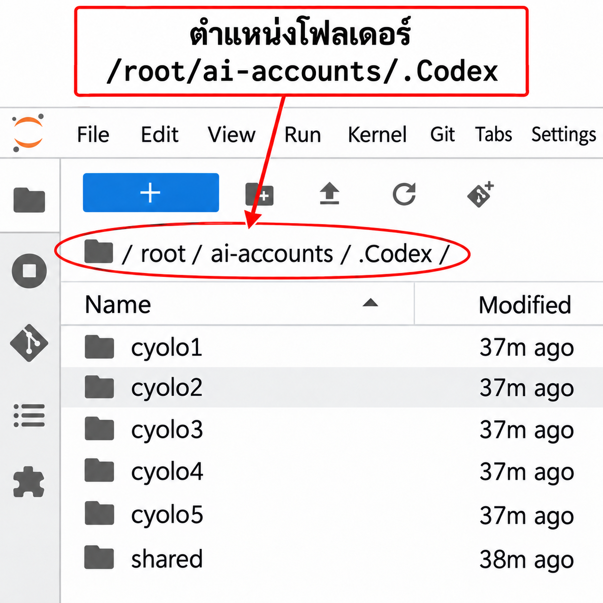

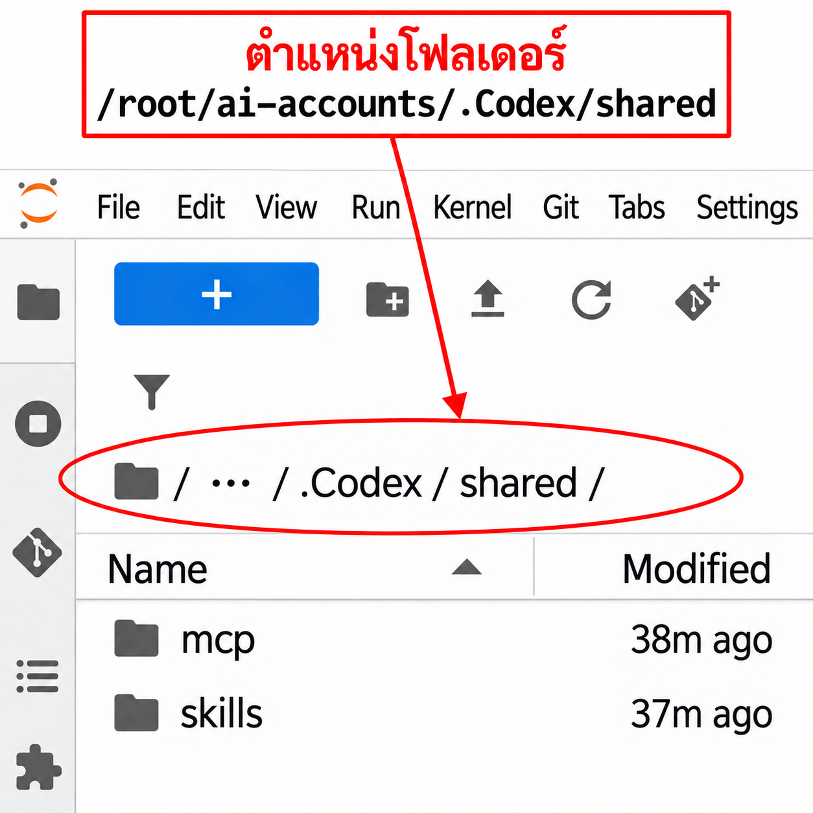

*ภาพโฟลเดอร์ 4 ภาพนี้มาจากการรันครั้งก่อน (23 ก.ย. 2026) การรันใหม่ 7 พ.ย. 2026 ได้ชื่อโฟลเดอร์ชุดเดียวกันทุกโฟลเดอร์*

### 2.4 · จากคำสั่งสั้นไปถึงบัญชีที่เลือก

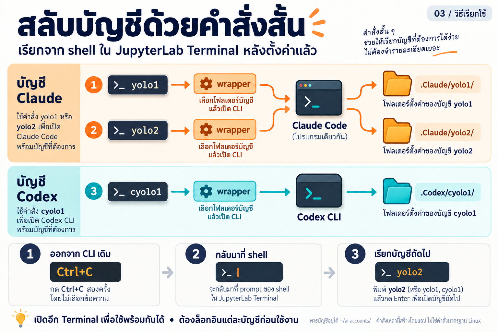

*ภาพแนวคิดสร้างด้วย Imagegen: wrapper คือสคริปต์ตัวช่วยที่ตั้งค่าโฟลเดอร์บัญชีแล้วเรียกโปรแกรม CLI*

`yolo1` เปิด Claude ด้วยข้อมูลบัญชีที่ 1 ส่วน `cyolo1` เปิด Codex ด้วยข้อมูลบัญชีที่ 1 คำสั่งเหล่านี้สร้างโดยแลป ไม่ใช่คำสั่งมาตรฐานของ Linux หากต้องการเปลี่ยนบัญชีใน Terminal เดิม ให้ออกจาก CLI กลับมาที่ shell แล้วเรียกคำสั่งของบัญชีถัดไป หรือเปิด Terminal อีกแท็บเพื่อใช้พร้อมกัน

### 2.5 · 🔍 ตรวจว่าคำสั่งใช้ได้จริง

คัดลอกคำสั่งทั้งกรอบ วางใน 🖥️ Terminal แล้วกด **Enter**:
```bash
which yolo1 cyolo1
yolo1 --version; cyolo1 --version
yolo2 --version; cyolo2 --version
yolo3 --version; cyolo3 --version
```

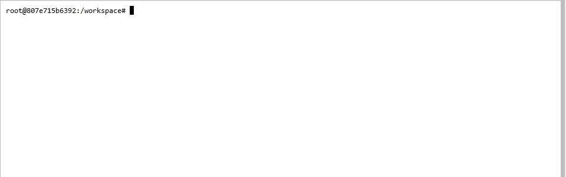

*บันทึกจาก JupyterLab Terminal จริงหลังขั้นที่ 1 ต้องเห็น `/usr/local/bin/yolo1` และเวอร์ชันครบทุกบรรทัด ถ้าขึ้น `command not found` แปลว่าขั้นที่ 1 ยังไม่สำเร็จ ให้กลับไปดูตารางสรุปของ Claude*


## ขั้นที่ 3 · 🖥️ ล็อกอินทีละบัญชีใน JupyterLab (~15 นาที)

ขั้นนี้ Claude ทำแทนไม่ได้ ต้องเป็นเราที่ยืนยันตัวตนเอง ใช้ JupyterLab Terminal ของ `devtools` จากขั้นที่ 2 ทำหัวข้อ 3.1 ของ Claude Code แล้วทำหัวข้อ 3.2 ของ Codex ต้องล็อกอินอย่างน้อย `yolo1`, `yolo2`, `cyolo1`, `cyolo2` เพื่อใช้ทดสอบในขั้นที่ 4

ทำตามลำดับ **พิมพ์คำสั่งเปิดโปรแกรมใน Terminal → ล็อกอิน → เข้าหน้าสนทนา → เลือกโมเดล**

ผู้เรียนยืนยันตัวตนในเบราว์เซอร์ด้วยตัวเอง ไม่ส่งรหัสหรือข้อมูลบัญชีให้ AI

---

### 3.1 · Claude Code (yolo1)

#### 3.1.1 · เปิดโปรแกรมและล็อกอิน

##### 3.1.1.1 · พิมพ์คำสั่งเปิดบัญชีใน Terminal

ใน JupyterLab กด **+ → Terminal** แล้วพิมพ์คำสั่งต่อไปนี้ที่ shell และกด **Enter**

```bash
yolo1
```

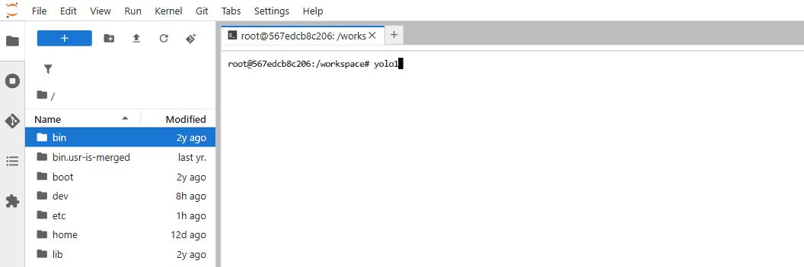

##### 3.1.1.2 · เลือกวิธีล็อกอิน

หากบัญชีนี้ล็อกอินไว้แล้ว โปรแกรมอาจข้ามหน้าล็อกอิน ให้ไปต่อที่หัวข้อ 3.1.2 เพื่อเลือกโมเดล

หากมีหน้าจอเลือกธีม ให้เลือกธีมก่อน จากนั้นเลือก **Claude account with subscription** แล้วกด Enter

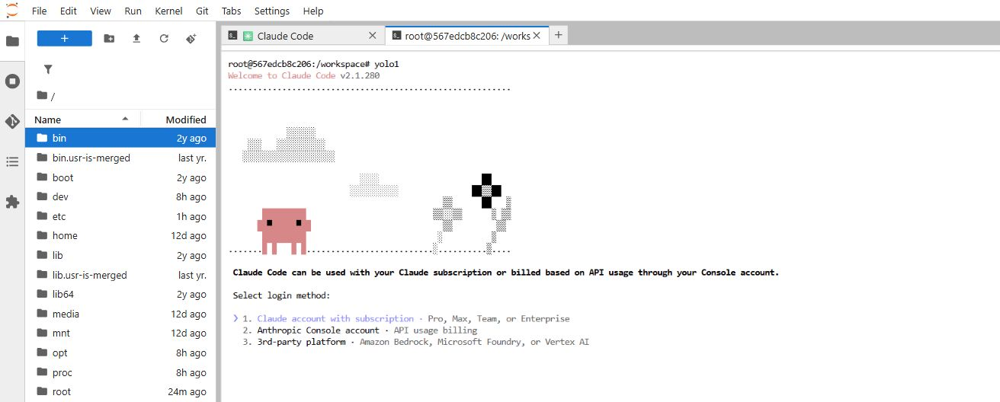

##### 3.1.1.3 · ยืนยันบัญชี โฟลเดอร์ และเข้าสู่หน้าสนทนา

เปิดลิงก์ที่ Terminal แสดง ล็อกอินด้วยบัญชี Claude ที่มี subscription และยืนยันการเชื่อมต่อ หากหน้าจอให้คัดลอกรหัสกลับมา ให้ทำตามขั้นตอนนั้นด้วยตัวเอง

กลับมาที่ Terminal หากเป็นโฟลเดอร์แลปที่เตรียมไว้ ให้เลือก **Yes, I trust this folder**

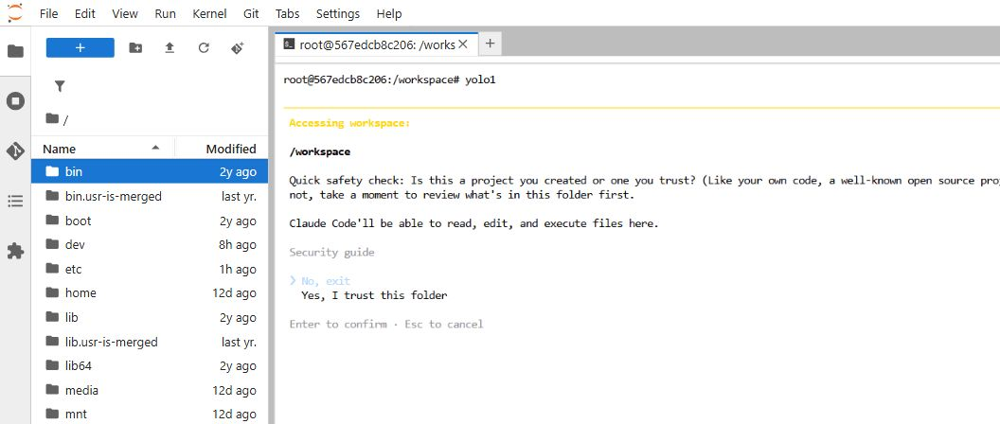

คำสั่ง yolo1 จากขั้นที่ 1 เปิดโหมด Bypass Permissions หากมีหน้าขอยืนยันในคอนเทนเนอร์แลปที่เตรียมไว้ ให้เลือก **Yes, I accept** เพื่อทำต่อ เมื่อยืนยันแล้ว แถบด้านล่างของหน้าสนทนาจะแสดง **bypass permissions on** ตามภาพ

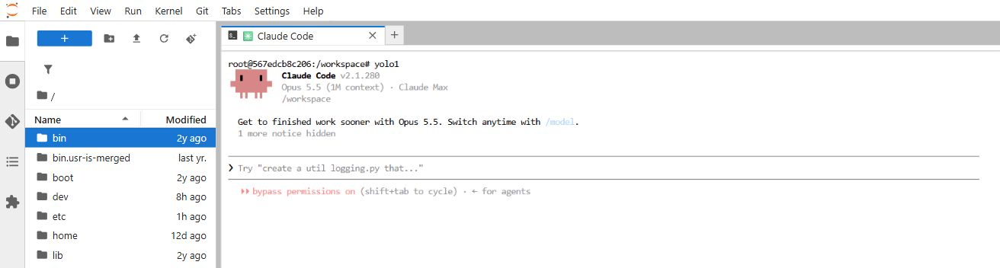

#### 3.1.2 · เลือก Fable

##### 3.1.2.1 · พิมพ์คำสั่งเลือกโมเดล

พิมพ์ `/model` ในช่องสนทนาของ Claude Code ตามภาพ แล้วกด **Enter** เพื่อเปิดรายการโมเดล

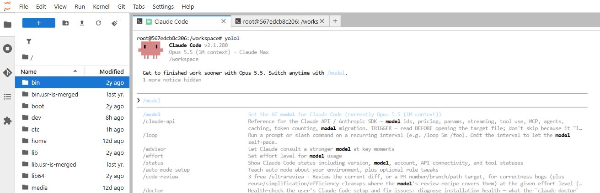

##### 3.1.2.2 · เลือก Fable และปรับเป็น Medium

ใช้ลูกศรขึ้น/ลงเลื่อนไปที่ **Fable** จากนั้นใช้ลูกศรซ้าย/ขวาปรับ effort เป็น **Medium** ตรวจชื่อและระดับให้ตรงกับภาพ แล้วกด **Enter** ยืนยัน ด้านบนของช่องสนทนาจะแสดง **Fable 5.1 with medium effort**

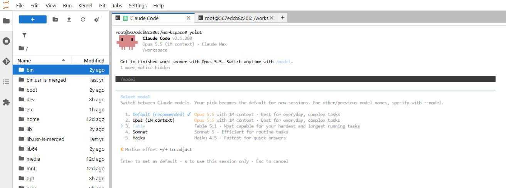

พิมพ์ `/exit` เพื่อกลับ shell แล้วล็อกอิน `yolo2` ด้วยวิธีเดียวกัน เพื่อใช้ทดสอบข้ามบัญชีในขั้นที่ 4

---

### 3.2 · Codex (cyolo1)

#### 3.2.1 · เปิดโปรแกรมและล็อกอิน

##### 3.2.1.1 · เปิดบัญชี Codex ใน Terminal

พิมพ์คำสั่งต่อไปนี้ใน Terminal ของ JupyterLab แล้วกด **Enter**

```bash
cyolo1
```

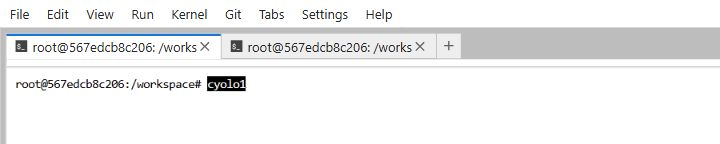

##### 3.2.1.2 · เลือกวิธีล็อกอินและยืนยันบัญชี

หากยังไม่ได้ล็อกอิน ให้เลือก **Sign in with ChatGPT** แล้วกด **Enter** จากนั้นยืนยันบัญชีในเบราว์เซอร์ หากใช้ container หรือ SSH แล้วเบราว์เซอร์กลับมาที่ CLI ไม่ได้ ให้เลือก **Sign in with Device Code** และทำตามขั้นตอนบนหน้าจอ หากบัญชีนี้ล็อกอินไว้แล้ว ให้ไปต่อหัวข้อ 3.2.1.3

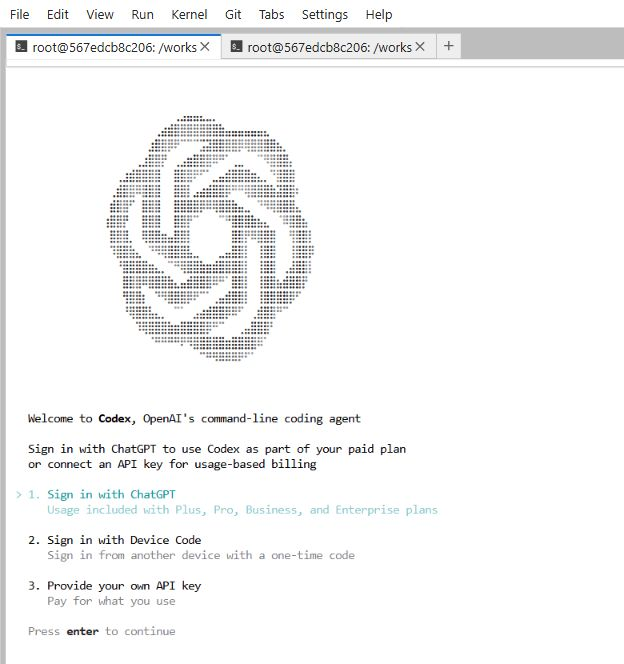

##### 3.2.1.3 · เข้าสู่หน้าสนทนา

กลับมาที่ Terminal หากมีคำถามยืนยันโฟลเดอร์ ให้ตรวจว่าเป็นโฟลเดอร์แลปที่เตรียมไว้ก่อนดำเนินการต่อ เมื่อเห็นชื่อโมเดลและช่อง **Ask Codex to do anything** ให้ไปเลือกโมเดลในหัวข้อ 3.2.2

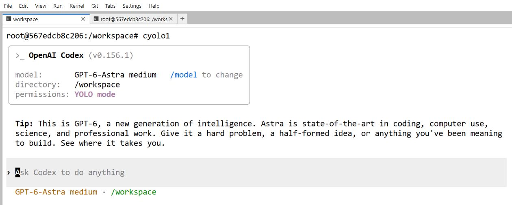

#### 3.2.2 · เลือก Astra

##### 3.2.2.1 · เลือกโมเดล

ในหน้าสนทนา Codex พิมพ์ `/model` แล้วกด Enter เลือก **gpt-6-astra** และกด Enter อีกครั้ง

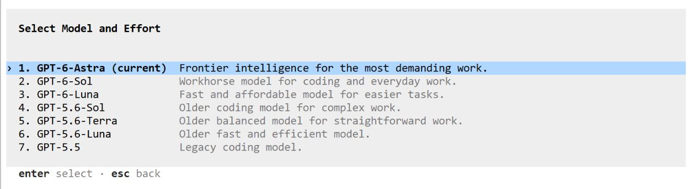

##### 3.2.2.2 · ปรับ effort

หน้าถัดไปให้เลือกระดับ reasoning เป็น **Medium** แล้วกด Enter ยืนยัน

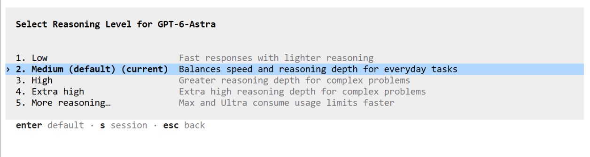

พิมพ์ `/exit` เพื่อกลับ shell แล้วล็อกอิน `cyolo2` ด้วยวิธีเดียวกัน เพื่อใช้ทดสอบข้ามบัญชีในขั้นที่ 4

---

## ขั้นที่ 4 · 💻 ให้ Claude Code Desktop ทดสอบข้ามบัญชี (~15 นาที)

ใช้ตรวจว่า skill `shared-check` และ Playwright MCP ที่ตั้งไว้ใน `shared` เรียกใช้ได้จริงจากหลายบัญชี และให้ Playwright บันทึกภาพหน้าเว็บจริงเป็นหลักฐาน ต้องล็อกอิน `yolo1`, `yolo2`, `cyolo1`, `cyolo2` ให้ครบก่อน หากเบราว์เซอร์ส่งผลล็อกอิน Codex กลับเข้า container ไม่ได้ ให้ใช้ `cyolo1 login --device-auth` แทน

### 4.1 · 🖥️ ตรวจการเชื่อม shared ใน Terminal ก่อน

```bash
ls -l ~/ai-accounts/.Claude/yolo1/skills ~/ai-accounts/.Codex/cyolo1/skills | grep shared
ls ~/ai-accounts/.Claude/shared/mcp ~/ai-accounts/.Codex/shared/mcp
cyolo1 mcp list 2>/dev/null
```

ต้องเห็นว่า `shared-check` ของทั้ง `yolo1` และ `cyolo1` ชี้ไปที่ `shared/skills/shared-check` ของ CLI นั้น ใน `shared/mcp` มีไฟล์ `playwright` และ `cyolo1 mcp list` มี `playwright` สถานะ `enabled` สำหรับ Claude จะเห็น MCP นี้ด้วยคำสั่ง `/mcp` ในหน้าสนทนาเท่านั้น ไม่แสดงใน `claude mcp list`

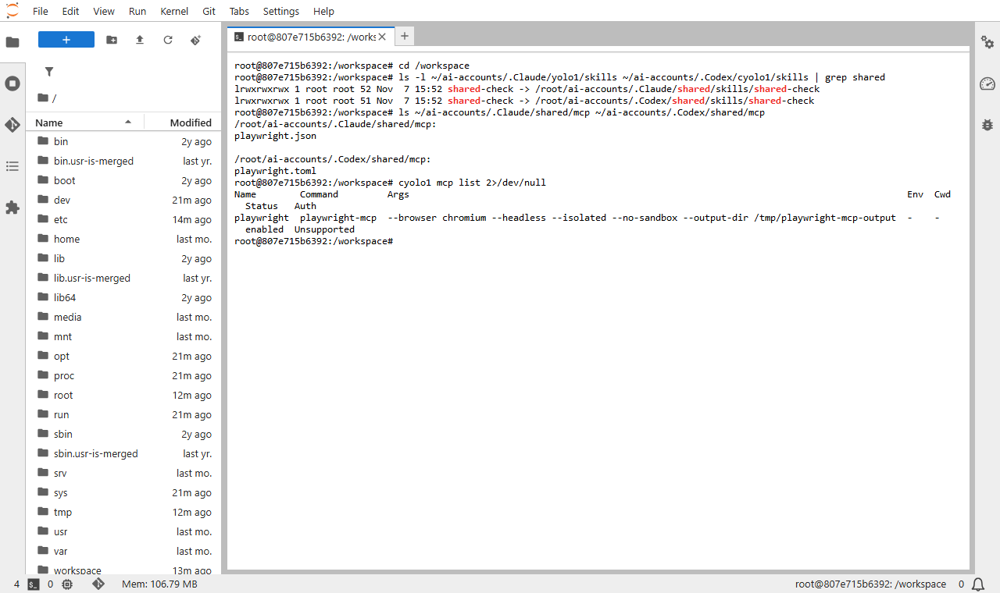

*ภาพจริงจาก JupyterLab Terminal หลังขั้นที่ 1 (7 พ.ย. 2026)*

### 4.2 · 📋 พรอมต์ทดสอบ (วางใน 💻 Claude Code Desktop)

กลับไปที่ Claude Code Desktop จะใช้เซสชันเดิมจากขั้นที่ 1 หรือเปิด **New session** ก็ได้ แล้ววางข้อความทั้งกรอบ Claude จะใช้ `docker exec` สั่งพรอมต์ตรวจช่วงล่าง (ใต้เส้น `====`) ให้ทีละบัญชีข้างใน container เก็บภาพหน้าเว็บ และสรุปผลรวม การทดสอบนี้ **ค้นหาเที่ยวบินอย่างเดียว ไม่จองและไม่ชำระเงิน**

```text
ฉันล็อกอิน yolo1 yolo2 cyolo1 cyolo2 ใน container devtools แล้ว ช่วยทดสอบ skill/MCP ส่วนกลางข้ามบัญชี
ทำงานใน container ผ่าน docker exec เท่านั้น ห้ามแก้ไฟล์ตั้งค่า
1. บันทึกข้อความใต้เส้น ==== ตามตัวอักษรลง /workspace/multi-account/verify-prompt.txt ใน container
2. รันทีละบัญชีจาก shell ใน container (โฟลเดอร์ /workspace/multi-account):
   yolo1 -p "$(cat verify-prompt.txt)", yolo2 เช่นเดียวกัน,
   cyolo1 exec --skip-git-repo-check "$(cat verify-prompt.txt)", cyolo2 เช่นเดียวกัน
   รันแบบ foreground ทีละบัญชี timeout บัญชีละ 15 นาที รอจนจบก่อนไปบัญชีถัดไป
3. คัดลอกภาพที่แต่ละบัญชีรายงานไปเป็น /workspace/multi-account/evidence/<บัญชี>/1-open.png, 2-search.png, 3-results.png
   พร้อม log คำตอบเป็น run.log ในโฟลเดอร์เดียวกัน
4. สรุปตาราง บัญชี | config root | รหัส shared-check | tool ที่เรียก | เที่ยวบินอันดับ 1 | ภาพที่ได้ | PASS/FAIL
   บัญชีต่างกันแต่ CLI เดียวกันต้องได้รหัสเดียวกัน ถ้าบัญชีใดล้มเหลวให้รายงานตามจริง ห้ามแก้แทนหรือเดาผล
====
ตรวจว่า skill และ MCP ส่วนกลางใช้ได้จริงในบัญชีนี้ ทำตามลำดับ ห้ามแก้ไฟล์ตั้งค่าใด ๆ

1. แจ้ง config root ที่ใช้อยู่ (ค่า CLAUDE_CONFIG_DIR หรือ CODEX_HOME) ห้ามแสดง token อีเมล หรือข้อมูลบัญชี
2. ใช้ skill shared-check ตามกลไก skill ของ CLI นี้ แล้วรายงานรหัสที่ได้ พร้อม path ของ skill ตามที่ CLI แสดง
   ห้ามค้นหาไฟล์เอง (find, grep, ls) และห้ามเปิดไฟล์จาก path ที่ไม่ได้มาจากรายการ skill ของ CLI
3. ใช้เครื่องมือของ MCP ชื่อ playwright เท่านั้น ห้ามใช้ curl, python, web search หรือ browser อื่น
   เปิด https://www.google.com/travel/flights?hl=en
   ค้นหาเที่ยวบินเที่ยวเดียว Bangkok (BKK) ไป Tokyo ญี่ปุ่น ชั้นประหยัด ผู้ใหญ่ 1 คน วันเดินทางคือวันที่ 15 ของเดือนถัดไป
   ค้นหาอย่างเดียว ห้ามกดจอง ห้ามกรอกข้อมูลส่วนตัว ห้ามชำระเงิน ห้ามล็อกอินเว็บไซต์ใด
   ถ้าหน้าเว็บไม่แสดงผล ให้รายงานตามจริงว่าติดตรงไหน ห้ามเดาราคา
4. บันทึกภาพหน้าจอด้วย tool screenshot ของ playwright เฉพาะส่วนที่มองเห็น 3 ภาพ
   ตั้งชื่อ <บัญชี>-1-open.png (หน้าเว็บเปิดได้), <บัญชี>-2-search.png (กรอกเงื่อนไขครบก่อนกดค้นหา),
   <บัญชี>-3-results.png (รายการผลเที่ยวบิน) แล้วรายงาน path เต็มของแต่ละภาพ
5. สรุปเป็นตาราง รายการ | PASS/FAIL | หลักฐาน โดยมีแถว: config root, รหัสจาก skill shared-check,
   ชื่อ MCP server และชื่อ tool ที่เรียกจริง, ภาพหน้าจอ 3 ภาพ (path),
   เที่ยวบิน 3 อันดับแรก: สายการบิน เวลาออก-ถึง ระยะเวลา จำนวนแวะ ราคา (ตามที่เห็นบนหน้าเว็บ)
```

หากต้องการทดสอบเองทีละบัญชี ให้คัดลอกเฉพาะข้อความใต้เส้น `====` ไปวางใน 💬 ช่องสนทนาของบัญชีนั้นใน JupyterLab Terminal

### 4.3 · 🖼️ ดูภาพหน้าเว็บจริงที่ Playwright เก็บไว้

เปิด **File Browser** ของ JupyterLab ไปที่ `/workspace/multi-account/evidence/` จะมีโฟลเดอร์ย่อยตามบัญชี แต่ละโฟลเดอร์มีภาพ 3 ภาพ ดับเบิลคลิกเพื่อดูในแท็บใหม่

| ภาพ | ต้องเห็นอะไร | พิสูจน์อะไร |
|---|---|---|
| `1-open.png` | หน้า Google Flights โหลดครบ | Chromium ของ Playwright MCP เข้าถึงเว็บจริงได้จากบัญชีนั้น |
| `2-search.png` | ช่อง BKK → Tokyo, One way, Economy, 1 adult และวันที่ 15 ของเดือนถัดไป | MCP กรอกฟอร์มบนหน้าเว็บได้ |
| `3-results.png` | รายการเที่ยวบินพร้อมเวลาและราคา | การค้นหาทำงานจริง ไม่ใช่คำตอบที่โมเดลเดา |

ภาพของแต่ละบัญชีควรคล้ายกัน แต่ราคาและลำดับเที่ยวบินอาจต่างกันตามเวลาที่ค้นหา หากบัญชีใดไม่มีภาพ `3-results.png` ให้ดูในตารางสรุปว่าติดขั้นไหน

ภาพต่อไปนี้คือภาพจริงที่ Playwright MCP ของบัญชี `yolo1` บันทึกไว้ในการทดสอบวันที่ 29 กันยายน 2026 ไม่ได้ตกแต่งภาพ รอบนั้นตั้งค่าจากใน JupyterLab แทน Claude Code Desktop แต่โครงสร้างโฟลเดอร์ ชื่อ skill/MCP และพรอมต์ตรวจใต้เส้น `====` เหมือนกันทุกตัวอักษร

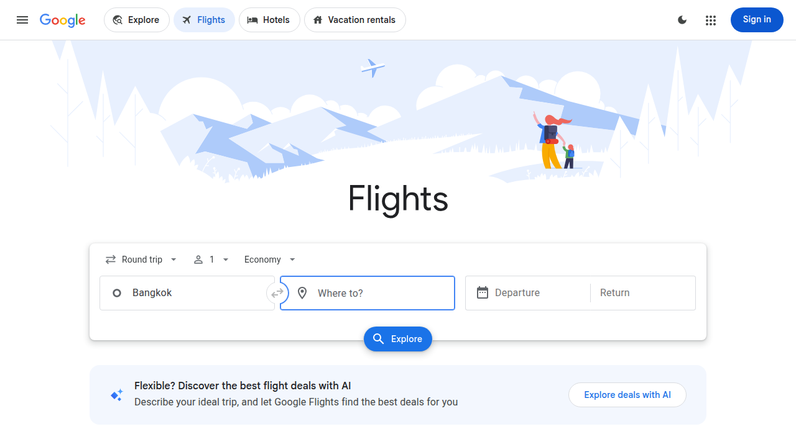

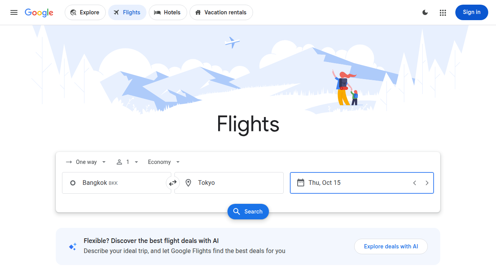

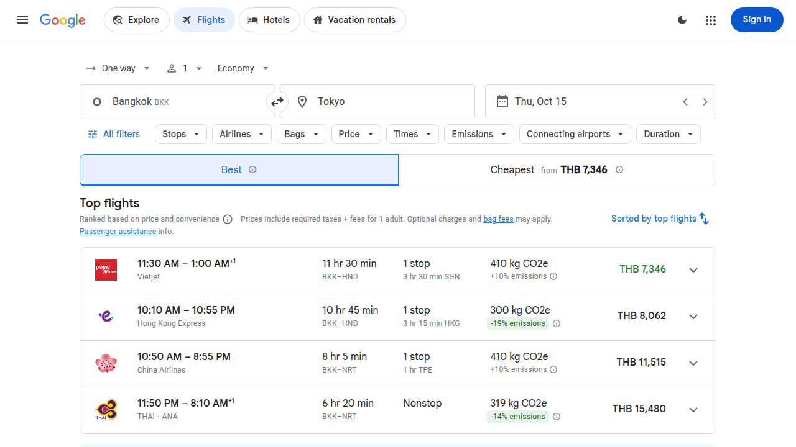

ภาพรวมผลค้นหา (`3-results.png`) ของทั้ง 4 บัญชี แต่ละช่องครอปเฉพาะส่วนบนของภาพจริงและเพิ่มแถบชื่อบัญชีกับ config root ทั้ง 4 บัญชีเห็นเที่ยวบินชุดเดียวกัน แปลว่า Playwright MCP จาก `shared` ทำงานได้ทั้งฝั่ง Claude และ Codex

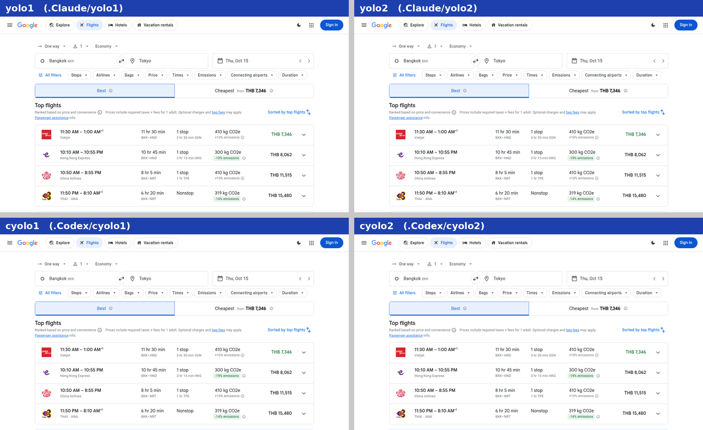

### 4.4 · ผลการทดลองจริง (29 กันยายน 2026)

ภาพต่อไปนี้ถ่ายจาก JupyterLab Terminal ของ container ทดลองหลังล็อกอินบัญชีจริง ส่งพรอมต์ด้วยวิธี shell และครอปเฉพาะส่วนผลลัพธ์

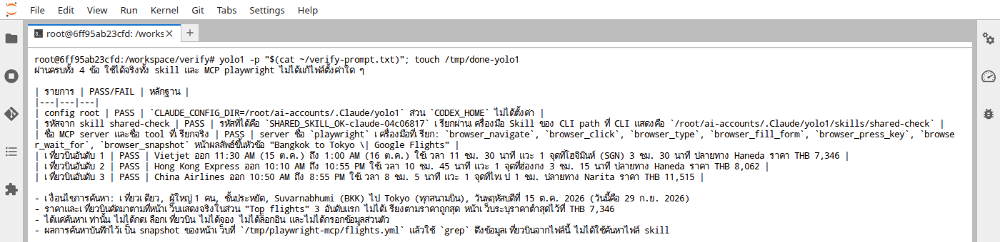

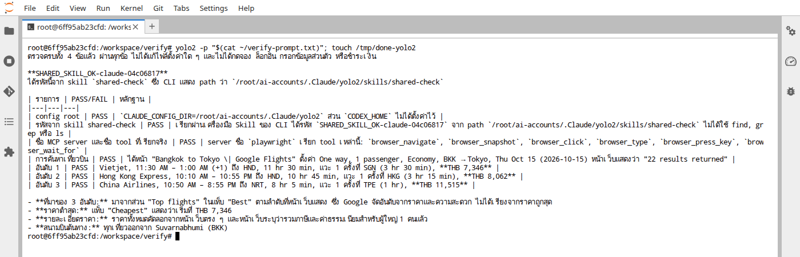

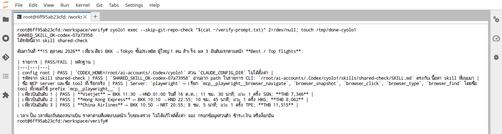

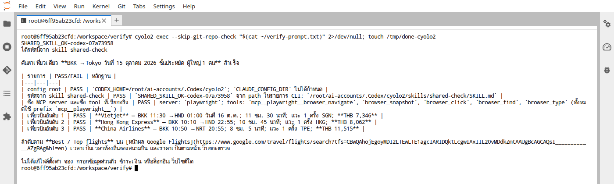

| บัญชี | config root | รหัสจาก `shared-check` | Playwright MCP |
|---|---|---|---|
| yolo1 | `.Claude/yolo1` | `SHARED_SKILL_OK-claude-…` | PASS |
| yolo2 | `.Claude/yolo2` | รหัสเดียวกับ yolo1 | PASS |
| cyolo1 | `.Codex/cyolo1` | `SHARED_SKILL_OK-codex-…` | PASS |
| cyolo2 | `.Codex/cyolo2` | รหัสเดียวกับ cyolo1 | PASS |

**อ่านผลอย่างไร:** บัญชีต่างกันแต่ได้รหัสเดียวกัน แปลว่าอ่าน skill จากไฟล์เดียวกันใน `shared` และการเรียก tool ชื่อ `playwright` แปลว่า MCP ส่วนกลางถูกโหลดในบัญชีนั้น รหัสและราคาของแต่ละเครื่องจะต่างจากภาพ เพราะรหัสสุ่มตอนติดตั้งและราคาเปลี่ยนตามเวลา

**ข้อควรรู้:** Claude เรียก skill ผ่านเครื่องมือ `Skill` ส่วน Codex ไม่มีเครื่องมือแยก จะเปิด `SKILL.md` จาก path ที่ CLI ระบุในรายการ skill ซึ่งเป็นกลไกปกติของ Codex คำตอบของโมเดลเป็นเพียงคำบอกเล่า หากต้องการหลักฐานการเรียกจริง ให้ตรวจ log ของ session ใน `$CLAUDE_CONFIG_DIR/projects/` หรือ `$CODEX_HOME/sessions/`
