# LAB 001 · ส่วนที่ 2: สร้าง image หลายบัญชีของเราเองจาก Dockerfile ด้วย Claude Code app

> 📽️ **สไลด์ประกอบการสอน:** [Multi_Account_Container_Slides.html](Multi_Account_Container_Slides.html) (ฉบับ PDF: [Multi_Account_Container_Slides.pdf](Multi_Account_Container_Slides.pdf)) เปิดด้วยเบราว์เซอร์บนเครื่อง กด **← →** เปลี่ยนหน้า **F** เต็มจอ **O** ดูทุกหน้า

เวลาโดยประมาณ: 45–60 นาที (ส่วนใหญ่คือรอ Claude เขียน Dockerfile และ build ครั้งแรก)

**สิ่งที่จะได้:** image ชื่อ `my-multi-account:1.0` ที่ **เราสร้างเองจาก Dockerfile** เปิด container จาก image นี้เมื่อไรก็มี `yolo1`–`yolo5` (Claude Code), `cyolo1`–`cyolo5` (Codex CLI), skill กลาง และ **Playwright MCP + Chromium** พร้อมใช้ทันที ไม่ต้องวางพรอมต์ติดตั้งซ้ำ ทุกขั้นสั่งจาก **Claude Code app** บนเครื่องเรา **ไม่ใช้ SSH แล้ว**

ต่อจาก: [บท Docker + VS Code](../01_Docker_VSCode_Setup/README.md) (Docker Desktop + Claude Code app) และ [ส่วนที่ 1 · ปรับ devtools ให้รองรับหลายบัญชี](../02_Setup_Multi_Account/README.md) (เข้าใจ `yolo1`, `cyolo1`, `shared`)

## ปัญหาของส่วนที่ 1: ของดีอยู่ในกล่องที่ลบได้

ในส่วนที่ 1 เราให้ Claude **ติดตั้งระบบหลายบัญชีลงใน container `devtools` ที่กำลังรันอยู่** ได้ผลดี แต่ทุกอย่างอยู่ในกล่องใบนั้นใบเดียว


*ภาพจำลอง สร้างด้วย Imagegen*

- **ลบ container หรือเครื่องพัง = เริ่มใหม่หมด:** คำสั่ง `yolo`/`cyolo`, Playwright + Chromium และล็อกอินทุกบัญชีหายไปพร้อมกล่อง ต้องวางพรอมต์ใหม่ รอติดตั้งใหม่ แล้วล็อกอินใหม่ทีละบัญชี
- **เปลี่ยนเครื่องหรือแชร์ให้เพื่อน = ทำซ้ำทุกเครื่อง:** ไม่มีอะไรให้หยิบไปใช้ต่อ นอกจากพรอมต์
- **ผลไม่เหมือนกันทุกครั้ง:** AI เขียน installer ใหม่ทุกครั้งที่วางพรอมต์ แต่ละเครื่องจึงได้ของที่ต่างกันเล็กน้อย บางเครื่องผ่าน บางเครื่องพัง


*ภาพจำลอง สร้างด้วย Imagegen*

## ทางออก: อบลง image ครั้งเดียว

แทนที่จะติดตั้งในกล่องที่รันอยู่ เราให้ Claude **เขียนสูตร (Dockerfile)** แล้ว **build เป็น image** ครั้งเดียว จากนั้นจะเปิด container กี่ครั้ง กี่เครื่อง ก็ได้ของชุดเดียวกันทุกครั้ง

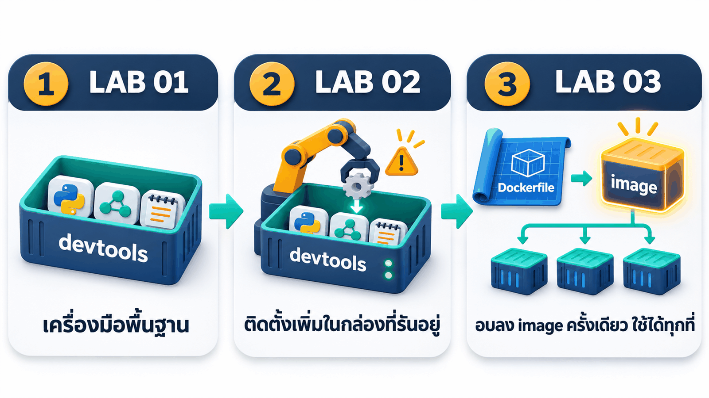

เหมือนการทำร้านแฟรนไชส์:

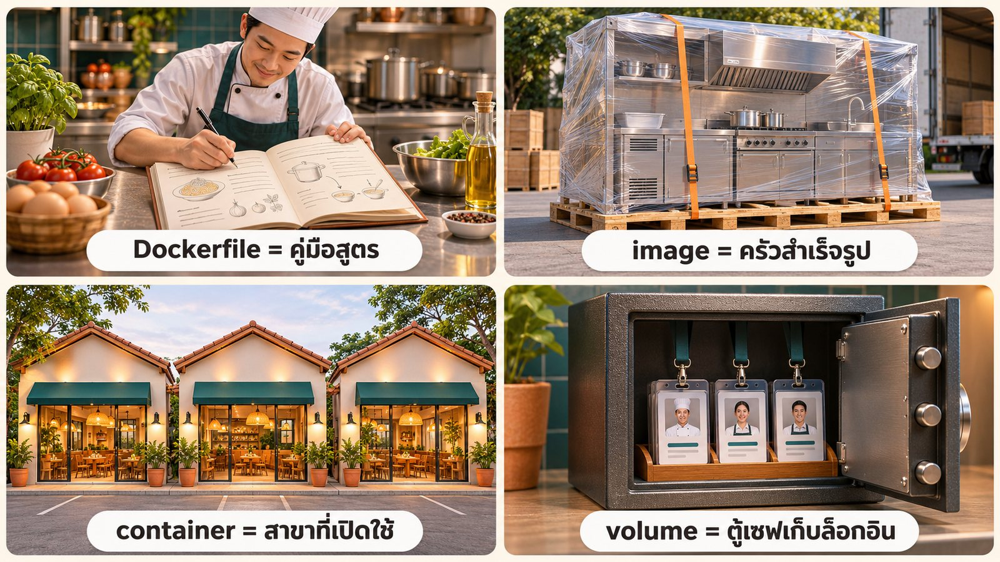

| คำ | เทียบกับ | ในแลปนี้ |
|---|---|---|
| **Dockerfile** | คู่มือสูตร | `_solution/MultiAccountDevtool/Dockerfile` ที่ Claude เขียน |
| **image** | ครัวสำเร็จรูปที่ประกอบเสร็จแล้ว | `my-multi-account:1.0` |
| **container** | สาขาที่เปิดใช้งาน | `my-multi-account` ลบแล้วเปิดใหม่ได้เสมอ |
| **volume** | ตู้เซฟเก็บบัตรพนักงาน | `ai-accounts` เก็บล็อกอิน skill และ MCP กลาง ไม่หายเมื่อลบ container |


*ภาพเคลื่อนไหวจำลองแนวคิด*

ข้างใน image มี 4 ชั้น ส่วนข้อมูลที่ต้องเก็บถาวรอยู่นอก image:


*ภาพแนวคิด (Imagegen) ชื่อ installer ในภาพเป็นชื่อทั่วไป ในการรันจริง Claude ตั้งชื่อว่า `multi-account-install`*

## ไม่มี SSH แล้ว: คุมทุกอย่างผ่าน Claude Code app

แลปก่อน ๆ มีทั้ง SSH (`root`/`passwd`, key `devtoolSSH`) และ JupyterLab ตั้งแต่ส่วนที่ 1 เราเห็นแล้วว่า **Claude Code app สั่งงานใน container ได้เองด้วย `docker exec`** ส่วนเราใช้ JupyterLab ในเบราว์เซอร์ตอนล็อกอิน SSH จึงไม่จำเป็นอีกต่อไป แลปนี้ตัดออกทั้งหมด (ไม่มี `openssh-server`, ไม่มีพอร์ต 22, ไม่มีโฟลเดอร์ key)

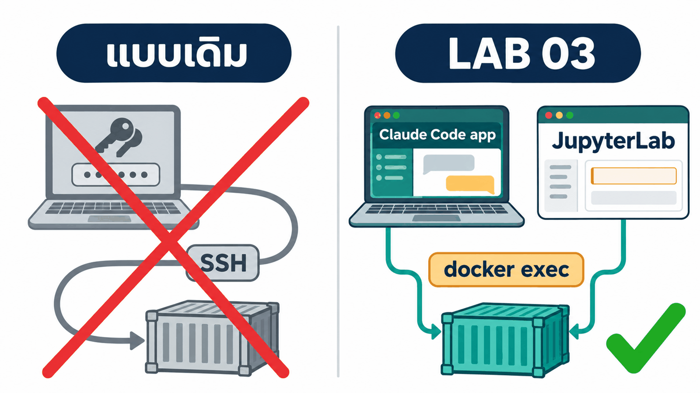

## ภาพรวมการทดลอง


| ขั้น | ทำที่ไหน | ใครทำ | เวลารันจริง |
|---|---|---|---|
| **1 · build image** | 💻 Claude Code app | Claude | ~28 นาที (build ครั้งสุดท้าย 5 นาที) |
| **2 · เปิด container จาก image** | 💻 Claude Code app | Claude | ~1 นาที |
| **3 · ล็อกอิน + ให้ Claude ตรวจ** | 🖥️ JupyterLab → 💻 Claude Code app | เรา + Claude | ~15 นาที |
| **4 · ทดสอบ skill/MCP ข้ามบัญชี (พร้อมกัน)** | 💻 Claude Code app | Claude | ~5 นาที |
| **5 · ลบแล้วสร้างใหม่ (พิสูจน์)** | 💻 Claude Code app | Claude | ~3 นาที |

**ก่อนเริ่ม ตรวจ 3 อย่าง:** Docker Desktop ขึ้น **Engine running** · Claude Code app ล็อกอินแล้ว · มีพื้นที่ดิสก์ว่างอย่างน้อย ~10 GB (image ~4.5 GB + build cache)

**เปิดโฟลเดอร์งาน:** ใน Claude Code app เลือก **Code** → **New session** → เลือกโฟลเดอร์ `03_MultiAccount_Container` ของรีโปนี้ ข้างในมีวัตถุดิบ 2 อย่าง

```text
03_MultiAccount_Container/
├── 00_Devtool_Container/     ← Dockerfile ของ devtools จาก LAB 01 (ตัด SSH ออกแล้ว) = จุดเริ่มต้น
├── prompt_multi_account.md   ← สเปกระบบหลายบัญชี (ชุดเดียวกับส่วนที่ 1)
└── _solution/                ← เฉลยจากการรันจริง (อยากให้ Claude ทำเองทั้งหมด ให้ย้ายโฟลเดอร์นี้ออกไปก่อน)
```

## ขั้นที่ 1 · 💻 ให้ Claude สร้าง image ของเราเอง (~30 นาที)

วางพรอมต์ทั้งกรอบใน Claude Code app (Ctrl+V) → Enter → อนุญาตคำสั่ง `docker` เมื่อถูกถาม แล้วรอจน Claude สรุปผล


```text
ช่วยสร้าง Docker image ของผมเองชื่อ my-multi-account:1.0 ให้เปิดมาแล้วใช้หลายบัญชี AI ได้ทันที
ทำบนเครื่องผมในโฟลเดอร์นี้ ใช้คำสั่ง docker ได้ แต่ห้ามลบ หยุด หรือแก้ container / image / volume ที่มีอยู่แล้ว
(ห้าม docker system prune และห้ามแตะ volume ai-accounts)

วัตถุดิบ
- ./00_Devtool_Container = Dockerfile ของ devtools จาก LAB 01 (ไม่มี SSH) คัดลอกเป็น ./MultiAccountDevtool แล้วแก้ในนั้นเท่านั้น
  ถ้ามี ./MultiAccountDevtool อยู่แล้ว ให้ตรวจเทียบสเปกแล้วแก้เฉพาะที่ขาด
- ./prompt_multi_account.md = สเปกระบบหลายบัญชี ทุกข้อต้องเป็นจริงใน image
  ส่วน "ข้อเท็จจริงจากการทดลอง" ให้ตรวจกับ --help ของเวอร์ชันจริงก่อนใช้

สิ่งที่ต้องอบลงใน image
- Claude Code, Codex CLI, Playwright MCP (pin เวอร์ชัน) + Chromium + ฟอนต์ไทย
- installer และคำสั่ง yolo1..5 / cyolo1..5 ใน /usr/local/bin พิมพ์ได้ทันทีทั้งใน JupyterLab Terminal และ docker exec
- ห้ามมีข้อมูลล็อกอินใน image: /root/ai-accounts เป็น volume และ installer รันทุกครั้งที่ container start โดยไม่ทับของเดิม
- ไม่ต้องมี SSH (ผมคุมทุกอย่างผ่าน Claude Code app) คง Docker-in-Docker และ JupyterLab ไว้

build ด้วย: docker build -t my-multi-account:1.0 ./MultiAccountDevtool

ทดสอบด้วย container และ volume ทดสอบชื่อใหม่ของตัวเอง แล้วลบทิ้งเมื่อเสร็จ (PASS/FAIL/SKIP ตามจริง)
- yolo1..5 / cyolo1..5 --version ครบ 10 คำสั่ง และ config root คนละโฟลเดอร์
- skill shared-check ทุกบัญชีชี้ไปไฟล์เดียวกันใน shared และ cyolo1 mcp list เห็น playwright
- Playwright MCP ผ่าน stdio เปิด https://example.com แล้ว screenshot ได้
- installer รอบ 2 ไม่ทับของเดิม และลบ container แล้วสร้างใหม่ ของใน volume ยังอยู่
- JupyterLab /lab ตอบ 200
อะไรที่ต้องล็อกอิน = SKIP ห้ามล็อกอินแทนผม

เขียนรายงานตามหัวข้อ "รายงาน" ของสเปกไว้ใน ./MultiAccountDevtool (ห้ามมี secret)
เสร็จแล้วสรุปเป็นตารางสั้น ๆ: ผลทดสอบ ขนาด image และเวลา build แล้วหยุด
```

**ทำไมพรอมต์เขียนแบบนี้**

- **ให้วัตถุดิบชัด:** เริ่มจาก Dockerfile ของ LAB 01 + สเปกเดิมจากส่วนที่ 1 Claude จึงไม่ต้องเดาว่าระบบหลายบัญชีหน้าตาเป็นอย่างไร
- **แยกของที่อยู่ใน image กับของที่อยู่ใน volume:** โปรแกรมอบลง image ส่วนล็อกอินอยู่ใน volume ถ้าล็อกอินติดไปกับ image แล้วแชร์ให้เพื่อน = แจกบัญชีของเรา
- **ห้ามแตะของเดิม + ทดสอบด้วย container/volume ทดสอบแล้วลบทิ้ง:** เครื่องเราไม่เลอะ และไม่เสี่ยงทำล็อกอินจริงเสีย
- **ให้รายงาน PASS/FAIL/SKIP:** ตรวจผลได้เอง ไม่ต้องเชื่อคำพูดของ AI

**ผลจริง** (7 พ.ย. 2026 · ~28 นาที): **9 PASS · 0 FAIL · 1 SKIP** (ข้อที่ต้องล็อกอิน) image ขนาด **4.47 GB** build ใหม่แบบไม่ใช้ cache ใช้ **302 วินาที** ได้ Claude Code 2.1.319, Codex 0.167.0, Playwright MCP 0.0.84


*ข้อความคำตอบจริงของ Claude จัดหน้าใหม่ให้อ่านง่าย ระหว่างทาง Claude build รอบแรก ตรวจ `--help` ของ CLI จริงใน container ทิ้งได้ เขียน installer แล้ว build รอบสุดท้ายแบบไม่ใช้ cache เพื่อจับเวลา เป็นเรื่องปกติ*

สิ่งที่ Claude สร้าง (เก็บเป็นเฉลยไว้ที่ [`_solution/MultiAccountDevtool/`](_solution/MultiAccountDevtool/))

```text
MultiAccountDevtool/
├── Dockerfile               ← สูตรเดิมของ LAB 01 + 4 ชั้นใหม่ (CLI, Playwright, ฟอนต์ไทย, ระบบหลายบัญชี)
├── start.sh                 ← dockerd + multi-account-install (ทุกครั้งที่ start) + jupyter lab
├── multi-account/           ← installer, wrapper ของ yoloN/cyoloN, ตัวแปลง MCP ให้ Codex
├── docker-compose.yml       ← ทางเลือก: build + run ด้วยคำสั่งเดียว
└── setup-report.md · login-guide.md · checklist.md   ← รายงาน 3 ไฟล์ตามสเปก
```

## ขั้นที่ 2 · 💻 เปิด container จาก image (~1 นาที)

```text
เปิด container my-multi-account จาก image my-multi-account:1.0 ที่เพิ่ง build
- ถ้ามี container ชื่อนี้อยู่แล้ว ให้ลบแล้วสร้างใหม่ ห้ามลบ volume ai-accounts (เก็บล็อกอินทุกบัญชี)
- โฟลเดอร์ ./workspace บนเครื่องผม (สร้างถ้ายังไม่มี) map เป็น /workspace งานจะได้ไม่หายเมื่อลบ container
- docker run -dit --name my-multi-account --privileged -p <PORT>:8888 -v ai-accounts:/root/ai-accounts -v <path เต็มของ ./workspace>:/workspace my-multi-account:1.0
  PORT เริ่มที่ 8886 ถ้าชนใช้เลขว่างถัดไป
- จับเวลาตั้งแต่สั่ง run จน http://localhost:<PORT>/lab ตอบ 200
- ตรวจผ่าน docker exec: yolo1..5 และ cyolo1..5 --version, cyolo1 mcp list,
  สถานะล็อกอิน (yoloN auth status ดูแค่ loggedIn / cyoloN login status) ห้ามแสดงอีเมลหรือ token
สรุปเป็นตาราง พร้อม URL ของ JupyterLab และเวลาที่ใช้
```


**ผลจริง** (~1 นาที): JupyterLab ตอบ 200 ใน **1.96 วินาที** หลังสั่ง `docker run` คำสั่งครบ 10 ตัว และ `cyolo1 mcp list` เห็น `playwright` ทันที เพราะทุกอย่างอยู่ใน image แล้ว


*เครื่องตัวอย่างใช้ volume `ai-accounts` ที่เคยล็อกอินไว้แล้ว 5 บัญชี จึงเห็น ✅ ตั้งแต่ยังไม่ล็อกอินในแลปนี้ (ของผู้เรียนจะเป็น ❌ ทั้งหมดจนกว่าจะทำขั้นที่ 3) MCP `rea` มาจากแลปอื่นที่เคยติดตั้งไว้ใน volume เดียวกัน*

ลองเปิด JupyterLab ด้วยตัวเอง: http://localhost:8886/lab → **Terminal** แล้ววางคำสั่งตรวจ

```bash
for a in yolo1 yolo2 yolo3 yolo4 yolo5 cyolo1 cyolo2 cyolo3 cyolo4 cyolo5; do printf '%-7s ' $a; $a --version; done
which yolo1 cyolo1 claude codex playwright-mcp; cyolo1 mcp list | head -4
```

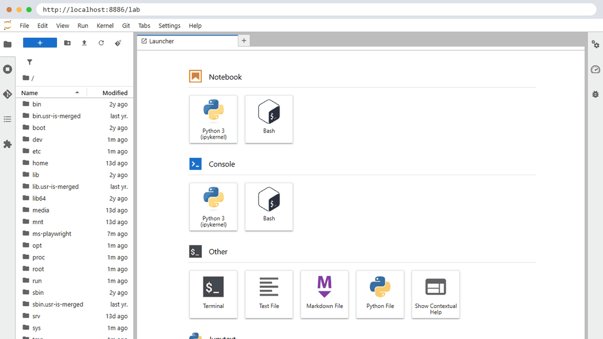

*ภาพหน้าจอจริงจาก container ที่รันจากขั้นที่ 2*

## ขั้นที่ 3 · 🖥️ ล็อกอิน แล้ว 💻 ให้ Claude ตรวจ (~15 นาที)

### 3.1 · ล็อกอินใน JupyterLab: 1 บัญชี = 1 แท็บ Terminal

วิธีเหมือนส่วนที่ 1 ทุกอย่าง (ดูภาพเคลื่อนไหวครบทุกขั้นที่ [ส่วนที่ 1 · ขั้นที่ 3.1](../02_Setup_Multi_Account/README.md#31--ล็อกอิน-1-บัญชี--1-แท็บ-terminal)) ทำอย่างน้อย `yolo1`, `yolo2`, `cyolo1`, `cyolo2`

| พิมพ์ | หน้าจอล็อกอิน | เลือก |
|---|---|---|
| `yolo1` … `yolo5` | Select login method | **Claude account with subscription** → ยืนยันในเบราว์เซอร์ → **Yes, I trust this folder** → `/exit` |
| `cyolo1` … `cyolo5` | Choose how you want to use Codex | **Sign in with ChatGPT** หรือ `cyolo1 login --device-auth` ถ้าเบราว์เซอร์ส่งผลกลับไม่ได้ |

**ต่างจากส่วนที่ 1 ตรงไหน:** ล็อกอินถูกเก็บใน **volume `ai-accounts`** ไม่ใช่ในตัว container จึงล็อกอิน **ครั้งเดียว** แล้วใช้ได้ตลอด แม้ลบ container หรือ build image ใหม่ (พิสูจน์ในขั้นที่ 5)

> **ล็อกอินเองเสมอ** ห้ามส่งรหัสผ่าน code หรือ URL ที่มี token ให้ AI หรือใคร

### 3.2 · ให้ Claude ตรวจว่าล็อกอินครบหรือยัง

```text
ช่วยตรวจสถานะล็อกอินทุกบัญชีใน container my-multi-account ทำผ่าน docker exec เท่านั้น ห้ามล็อกอินแทนฉัน ห้ามแก้ไฟล์ใด ๆ
- Claude: yolo1 ถึง yolo5 ใช้คำสั่ง yoloN auth status แล้วดูเฉพาะค่า "loggedIn"
- Codex: cyolo1 ถึง cyolo5 ใช้คำสั่ง cyoloN login status
สรุปเป็นตาราง บัญชี | ล็อกอินแล้ว/ยัง เท่านั้น ห้ามแสดงอีเมล ชื่อองค์กร หรือ token
ถ้ามีบัญชีที่ยังไม่ล็อกอิน ให้บอกวิธีล็อกอินใน JupyterLab Terminal
(พิมพ์ yoloN แล้วเลือก Claude account with subscription / พิมพ์ cyoloN login --device-auth)
```

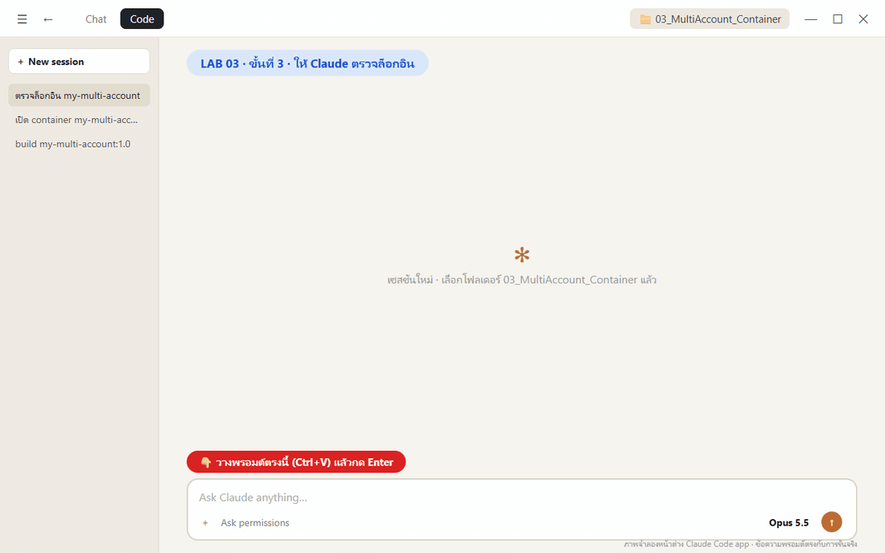

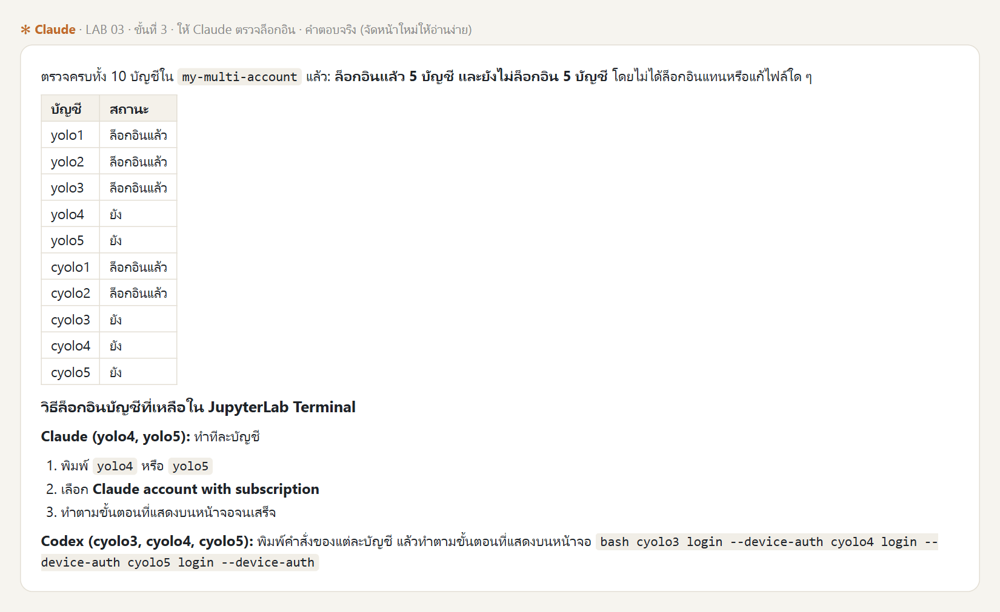

*ผลจริง (~20 วินาที) เครื่องตัวอย่างล็อกอินไว้ 5 บัญชี ขั้นที่ 4 ต้องมีอย่างน้อย 1 บัญชีต่อฝั่ง (แนะนำฝั่งละ 2 เพื่อเทียบรหัส)*

## ขั้นที่ 4 · 💻 ทดสอบ skill + MCP ข้ามบัญชี แบบรันพร้อมกัน (~5 นาที)

แต่ละบัญชีเรียก skill กลาง `shared-check` และใช้ **Playwright MCP** เปิด Google Flights ค้น BKK → Tokyo เอง แล้วเก็บภาพหน้าจอ **ค้นหาอย่างเดียว ไม่จองและไม่ชำระเงิน** ต่างจากส่วนที่ 1 ตรงที่ **ทุกบัญชีรันพร้อมกัน** ซึ่งเป็นเหตุผลที่เรามีหลายบัญชีตั้งแต่แรก

พรอมต์มี 2 ส่วน: **เหนือเส้น `====`** = งานของ Claude ใน Claude Code app (ตรวจล็อกอิน เลือกบัญชี สั่งรันพร้อมกัน สรุป) · **ใต้เส้น `====`** = งานที่แต่ละบัญชีทำเองข้างใน container

```text
ช่วยทดสอบ skill/MCP ส่วนกลางข้ามบัญชีใน container my-multi-account
ทำงานใน container ผ่าน docker exec เท่านั้น ห้ามแก้ไฟล์ตั้งค่า ห้ามล็อกอินแทนฉัน
0. ตรวจสถานะล็อกอิน yolo1..5 (yoloN auth status) และ cyolo1..5 (cyoloN login status)
   แสดงตาราง บัญชี | ล็อกอินแล้ว/ยัง ห้ามแสดงอีเมล องค์กร หรือ token
   เลือกบัญชีที่ล็อกอินแล้วฝั่งละไม่เกิน 2 บัญชี ถ้าไม่มีบัญชีไหนล็อกอินเลย ให้หยุดและบอกวิธีล็อกอินใน JupyterLab Terminal
1. บันทึกข้อความใต้เส้น ==== ตามตัวอักษรลง /workspace/multi-account/verify-prompt.txt ใน container
2. รันทุกบัญชีที่เลือกพร้อมกันจากโฟลเดอร์ /workspace/multi-account แล้วรอจนครบทุกบัญชี (timeout บัญชีละ 15 นาที):
   yoloN -p "$(cat verify-prompt.txt)" / cyoloN exec --skip-git-repo-check "$(cat verify-prompt.txt)"
3. คัดลอกภาพที่แต่ละบัญชีรายงานไปเป็น /workspace/multi-account/evidence/<บัญชี>/1-open.png, 2-search.png, 3-results.png
   พร้อม log คำตอบเป็น run.log ในโฟลเดอร์เดียวกัน
4. สรุปตาราง บัญชี | รหัส shared-check | tool ที่เรียก | เที่ยวบินอันดับ 1 | เวลาที่ใช้ | PASS/FAIL
   บัญชีต่างกันแต่ CLI เดียวกันต้องได้รหัสเดียวกัน ถ้าบัญชีใดล้มเหลวให้รายงานตามจริง ห้ามแก้แทนหรือเดาผล
====
ตรวจว่า skill และ MCP ส่วนกลางใช้ได้จริงในบัญชีนี้ ทำตามลำดับ ห้ามแก้ไฟล์ตั้งค่าใด ๆ

1. แจ้ง config root ที่ใช้อยู่ (ค่า CLAUDE_CONFIG_DIR หรือ CODEX_HOME) ห้ามแสดง token อีเมล หรือข้อมูลบัญชี
2. ใช้ skill shared-check ตามกลไก skill ของ CLI นี้ แล้วรายงานรหัสที่ได้ พร้อม path ของ skill ตามที่ CLI แสดง
   ห้ามค้นหาไฟล์เอง (find, grep, ls) และห้ามเปิดไฟล์จาก path ที่ไม่ได้มาจากรายการ skill ของ CLI
3. ใช้เครื่องมือของ MCP ชื่อ playwright เท่านั้น ห้ามใช้ curl, python, web search หรือ browser อื่น
   เปิด https://www.google.com/travel/flights?hl=en
   ค้นหาเที่ยวบินเที่ยวเดียว Bangkok (BKK) ไป Tokyo ญี่ปุ่น ชั้นประหยัด ผู้ใหญ่ 1 คน วันเดินทางคือวันที่ 15 ของเดือนถัดไป
   ค้นหาอย่างเดียว ห้ามกดจอง ห้ามกรอกข้อมูลส่วนตัว ห้ามชำระเงิน ห้ามล็อกอินเว็บไซต์ใด
   ถ้าหน้าเว็บไม่แสดงผล ให้รายงานตามจริงว่าติดตรงไหน ห้ามเดาราคา
4. บันทึกภาพหน้าจอด้วย tool screenshot ของ playwright เฉพาะส่วนที่มองเห็น 3 ภาพ
   ตั้งชื่อ <บัญชี>-1-open.png (หน้าเว็บเปิดได้), <บัญชี>-2-search.png (กรอกเงื่อนไขครบก่อนกดค้นหา),
   <บัญชี>-3-results.png (รายการผลเที่ยวบิน) แล้วรายงาน path เต็มของแต่ละภาพ
5. สรุปเป็นตาราง รายการ | PASS/FAIL | หลักฐาน โดยมีแถว: config root, รหัสจาก skill shared-check,
   ชื่อ MCP server และชื่อ tool ที่เรียกจริง, ภาพหน้าจอ 3 ภาพ (path),
   เที่ยวบิน 3 อันดับแรก: สายการบิน เวลาออก-ถึง ระยะเวลา จำนวนแวะ ราคา (ตามที่เห็นบนหน้าเว็บ)
```

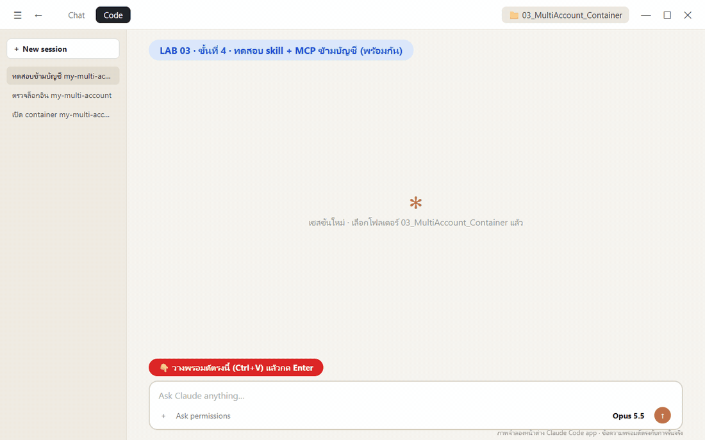

**ผลจริง** (7 พ.ย. 2026 · **5 นาที 20 วินาที** สำหรับ 4 บัญชีพร้อมกัน · ส่วนที่ 1 รันทีละบัญชีใช้ ~10 นาที)

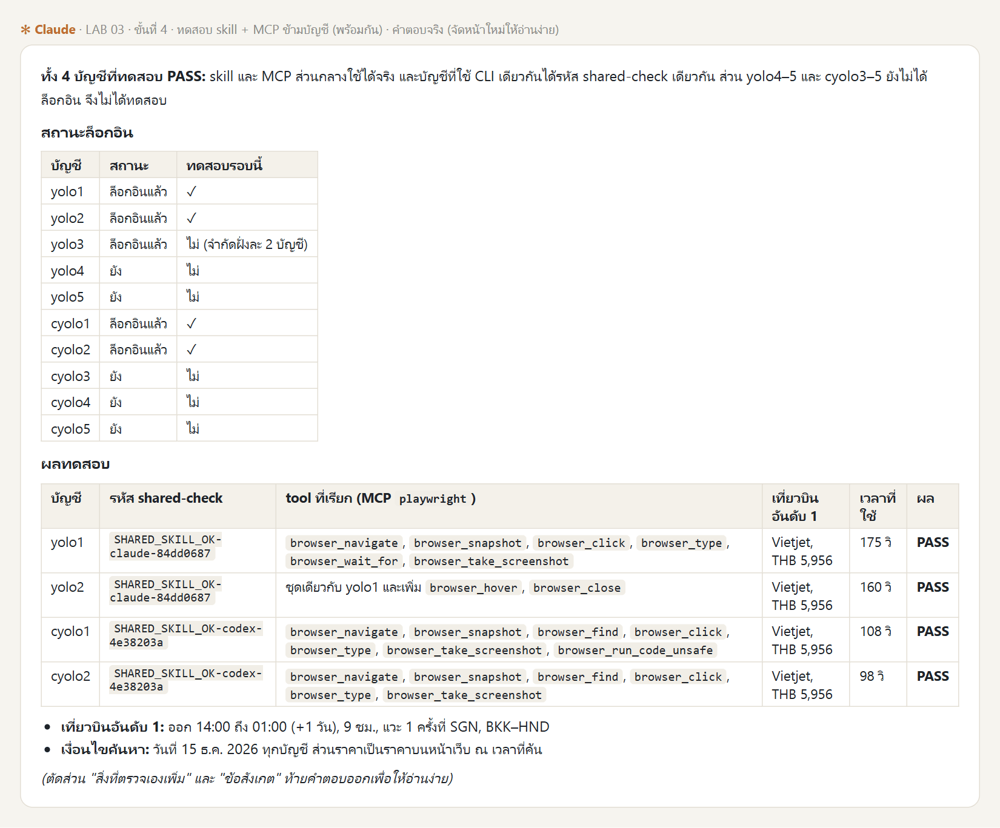

| บัญชี | รหัสจาก `shared-check` | Playwright MCP | เที่ยวบินอันดับ 1 | เวลา |
|---|---|---|---|---|
| yolo1 | `…claude-84dd0687` | PASS | Vietjet · 9 ชม. · แวะ 1 · THB 5,956 | 175 วินาที |
| yolo2 | เหมือน yolo1 | PASS | Vietjet · 9 ชม. · แวะ 1 · THB 5,956 | 160 วินาที |
| cyolo1 | `…codex-4e38203a` | PASS | Vietjet · 9 ชม. · แวะ 1 · THB 5,956 | 108 วินาที |
| cyolo2 | เหมือน cyolo1 | PASS | Vietjet · 9 ชม. · แวะ 1 · THB 5,956 | 98 วินาที |

**อ่านผลอย่างไร**

- **skill กลางใช้ได้จริง:** คนละบัญชีแต่ CLI เดียวกันได้รหัสเดียวกัน = อ่าน `shared-check` จากไฟล์เดียวกันใน `shared` (รหัสสุ่มตอนติดตั้ง ของผู้เรียนจะต่างจากนี้)
- **MCP กลางใช้ได้จริง:** ทุกบัญชีเรียก tool ของ `playwright` เอง (`browser_navigate`, `browser_type`, `browser_take_screenshot` ฯลฯ)
- **ทำงานพร้อมกันได้:** 4 บัญชีใช้ Chromium แยกกันคนละตัวใน container เดียว ไม่ชนกัน เวลารวมจึงใกล้กับบัญชีที่ช้าที่สุด (175 วินาที) บวกเวลาที่ Claude ใช้ตรวจและสรุป

หลักฐานอยู่บนเครื่องเราที่ `./workspace/multi-account/evidence/<บัญชี>/` (เพราะ map `./workspace` ไว้ในขั้นที่ 2) แต่ละโฟลเดอร์มี `1-open.png`, `2-search.png`, `3-results.png` และ `run.log`


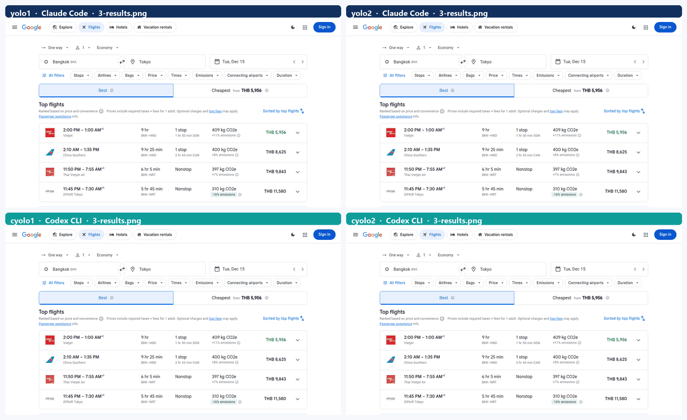

*ภาพจริงที่แต่ละบัญชีบันทึกเอง ภาพของ cyolo1 กับ cyolo2 เหมือนกันทุกพิกเซล เพราะทำขั้นตอนเดียวกันบนหน้าเว็บเดียวกันในนาทีเดียวกัน (แต่ละบัญชีเขียนไฟล์ของตัวเองคนละเวลา) ราคาของผู้เรียนจะต่างตามวันที่ค้นหา*

## ขั้นที่ 5 · 💻 พิสูจน์: ลบ container แล้วสร้างใหม่ (3 นาที)

นี่คือเหตุผลที่เราทำแลปนี้ ในส่วนที่ 1 ถ้าลบ `devtools` ต้องวางพรอมต์ตั้งค่าใหม่ (~5 นาที) ติดตั้ง Playwright ใหม่ และล็อกอินใหม่ทุกบัญชี ลองดูว่าแลปนี้เป็นอย่างไร


```text
พิสูจน์ว่าทุกอย่างถูกอบไว้ใน image แล้ว ด้วยการลบ container my-multi-account แล้วสร้างใหม่
- ก่อนลบ: บันทึกสถานะล็อกอินทุกบัญชี (ห้ามแสดงอีเมลหรือ token)
- ลบด้วย docker rm -f แล้วรัน docker run คำสั่งเดิม (port เดิม volume ai-accounts เดิม ./workspace เดิม)
  ห้ามลบ volume ห้ามติดตั้งอะไรเพิ่ม จับเวลาตั้งแต่ลบจน JupyterLab ตอบ 200
- หลังสร้างใหม่ ตรวจผ่าน docker exec: yolo1..5 และ cyolo1..5 --version, cyolo1 mcp list เห็น playwright,
  skill shared-check ยังอยู่, สถานะล็อกอินเทียบกับก่อนลบ, ไฟล์ใน /workspace/multi-account/evidence ยังอยู่
- ให้บัญชีแรกที่ล็อกอินแล้วของแต่ละฝั่งตอบสั้น ๆ ว่า "พร้อม" (yoloN -p / cyoloN exec --skip-git-repo-check) เพื่อยืนยันว่าใช้งานได้จริงทันที
สรุปเป็นตาราง ก่อนลบ | หลังสร้างใหม่ และเวลาที่ใช้
```

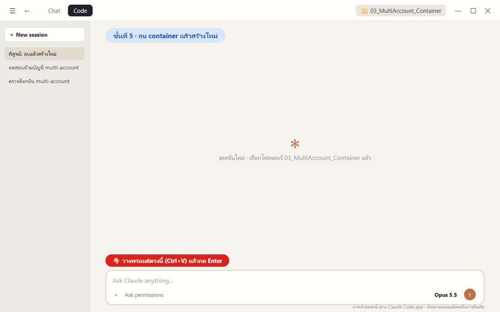

**ผลจริง** (7 พ.ย. 2026 · ~3 นาที): ลบจน JupyterLab ตอบ 200 ใช้ **3.27 วินาที** (ลบ 0.84 + สร้าง 0.71 + รอ 1.73) เวอร์ชัน CLI, `playwright`, skill `shared-check`, สถานะล็อกอินทั้ง 10 บัญชี และไฟล์ใน `evidence` **เหมือนก่อนลบทุกบรรทัด** และ `yolo1` / `cyolo1` ตอบ "พร้อม" ได้ทันที (13.5 / 5.6 วินาที) โดยไม่ต้องล็อกอินใหม่

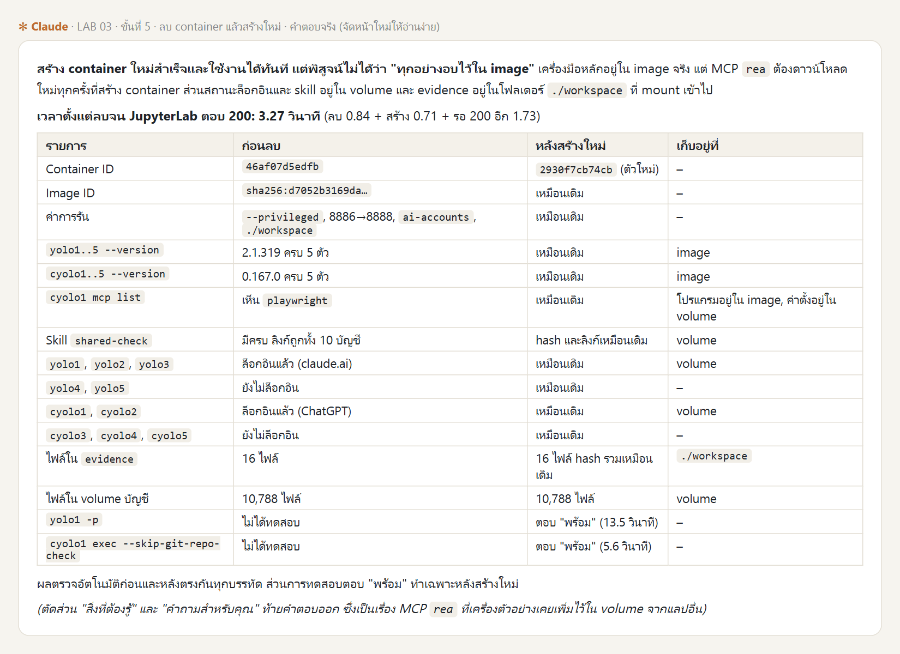

*คอลัมน์ "เก็บอยู่ที่" ในคำตอบคือหัวใจของแลปนี้: **โปรแกรมอยู่ใน image · ล็อกอินและ skill อยู่ใน volume · งานอยู่ใน `./workspace`** ไม่มีอะไรสำคัญอยู่ในตัว container เลย จึงลบได้ไม่ต้องกลัว ประโยคแรกของคำตอบที่บอกว่า "พิสูจน์ไม่ได้ว่าทุกอย่างอบไว้ใน image" มาจาก MCP `rea` ที่เครื่องตัวอย่างเคยเพิ่มไว้ใน volume จากแลปอื่น ซึ่งดาวน์โหลดผ่าน `npx` ตอนใช้งาน ผู้เรียนที่เริ่มจาก volume ใหม่จะไม่มี MCP ตัวนี้ (ข้อคิด: ถ้า MCP ตัวไหนใช้ประจำ ให้อบลง image ด้วย)*

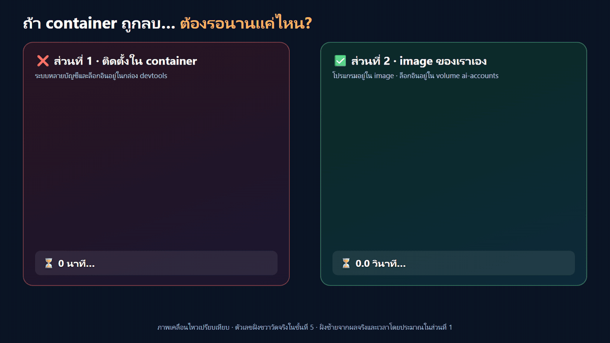

*ภาพเคลื่อนไหวเทียบเวลา ตัวเลขฝั่งส่วนที่ 2 มาจากการรันจริงในขั้นนี้ ฝั่งส่วนที่ 1 มาจากผลจริงในบทนั้น*


*ภาพจำลอง สร้างด้วย Imagegen*

## สรุป: ส่วนที่ 1 vs ส่วนที่ 2

| | ส่วนที่ 1 · ติดตั้งใน container ที่รันอยู่ | ส่วนที่ 2 · อบลง image ของเราเอง |
|---|---|---|
| ระบบหลายบัญชีอยู่ที่ | ใน container `devtools` | ใน image `my-multi-account:1.0` |
| ล็อกอินอยู่ที่ | ใน container (หายเมื่อลบ) | ใน volume `ai-accounts` (ไม่หาย) |
| ลบ container แล้ว | วางพรอมต์ใหม่ + ติดตั้งใหม่ + ล็อกอินใหม่ | `docker run` ใหม่ พร้อมใช้ใน 3.27 วินาที |
| เปิดเครื่องใหม่ / แชร์เพื่อน | ทำซ้ำทุกเครื่อง ผลอาจต่างกัน | build จาก Dockerfile เดียวกัน หรือ push image ให้ทีม pull ได้ของชุดเดียวกัน |
| เข้าไปทำงานข้างใน | SSH หรือ JupyterLab | Claude Code app (`docker exec`) + JupyterLab ไม่มี SSH |

## ข้อควรรู้

- **ล็อกอินอยู่ใน volume:** `docker rm -f my-multi-account` ปลอดภัย แต่ `docker volume rm ai-accounts` หรือ `docker system prune --volumes` = ล็อกอินหายทุกบัญชี
- **JupyterLab ไม่มีรหัสผ่าน:** Terminal ในนั้นเข้าถึง credential ทุกบัญชีได้ ถ้าไม่ต้องการให้เครื่องอื่นในเครือข่ายเข้าได้ ให้ใช้ `-p 127.0.0.1:8886:8888` หรือตั้ง `-e JUPYTER_PASSWORD=...` (ทั้งสองเรื่อง Claude เตือนเองในผลขั้นที่ 1–2)
- **image ห้ามมีล็อกอิน:** ถ้าจะ push image ขึ้น Docker Hub ให้ทีมใช้ ตรวจก่อนเสมอว่าไม่มี credential ติดไป (Claude ตรวจไว้แล้วในขั้นที่ 1 ข้อ "ไม่มีข้อมูลล็อกอินใน image")
- **แยกบัญชีระดับโฟลเดอร์:** ทุกบัญชีรันเป็น `root` คนเดียวกัน ไม่ใช่ OS isolation
- **anonymous volume ของ Docker-in-Docker:** `docker rm -f` ทิ้ง volume ของ `/var/lib/docker` ไว้ ใช้ `docker rm -f -v my-multi-account` ถ้าต้องการลบทิ้งด้วย (ไม่แตะ `ai-accounts` เพราะเป็น named volume)
- **ไม่อยาก build เอง:** ใช้ image สำเร็จรูปของผู้สอน `tuchsanai/multi-account-devtool:2569_1` ผ่านสกิล `/maccount` ได้ (ใช้ volume `ai-accounts` เดียวกัน)

## คำสั่งที่ใช้บ่อย

🖥️ บนเครื่อง (หรือสั่ง Claude Code app เป็นภาษาคนก็ได้)

```bash
docker logs -f my-multi-account          # ดู log ตอน start
docker exec -it my-multi-account bash    # เข้า shell ใน container (แทน SSH)
docker stop my-multi-account             # หยุด
docker start my-multi-account            # เริ่มใหม่
docker rm -f my-multi-account            # ลบ container (ล็อกอินยังอยู่ใน volume ai-accounts)
docker build -t my-multi-account:1.0 _solution/MultiAccountDevtool   # build จากเฉลย
```

🖥️ ใน container (JupyterLab Terminal)

```bash
yolo1 auth status         # สถานะล็อกอิน Claude
cyolo1 login status       # สถานะล็อกอิน Codex
cyolo1 mcp list           # ตรวจ MCP ของ Codex
multi-account-install     # รัน installer ซ้ำ (ไม่ทับของเดิม)
```
