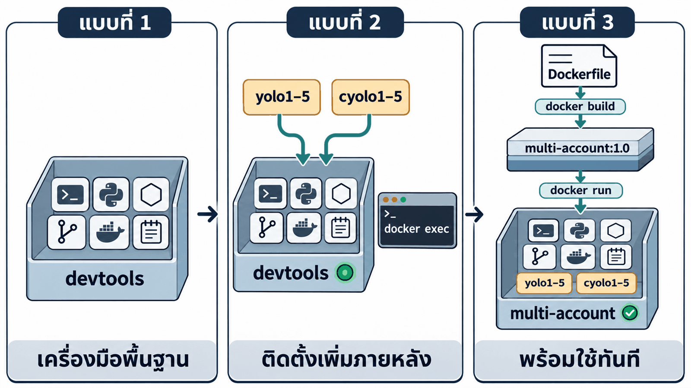
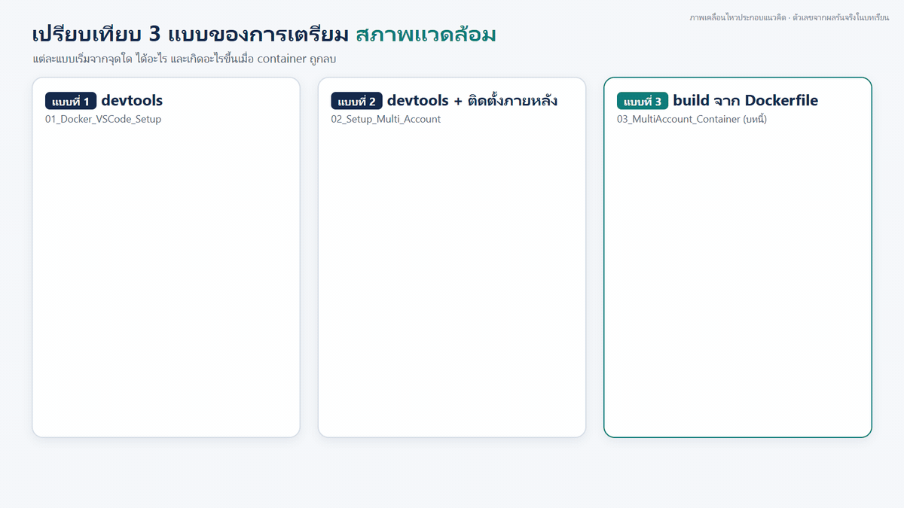
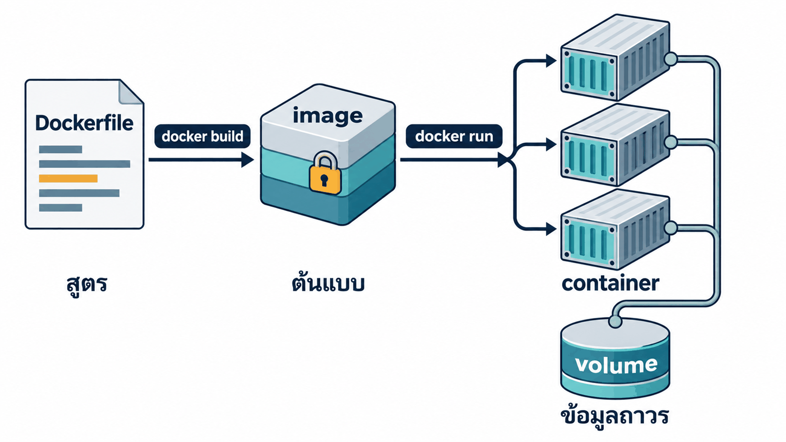
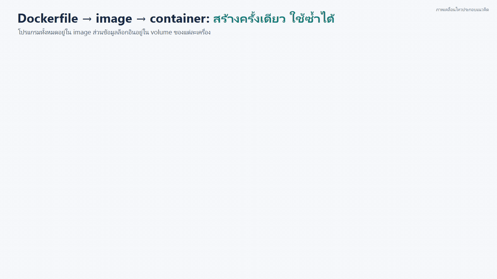
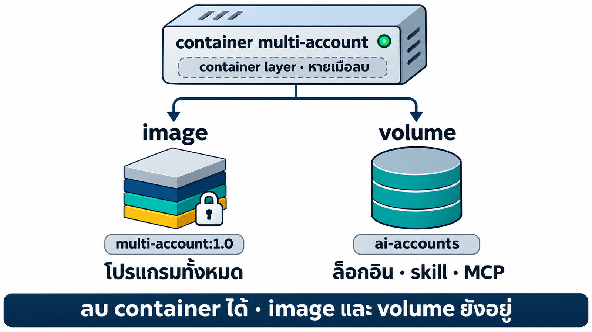
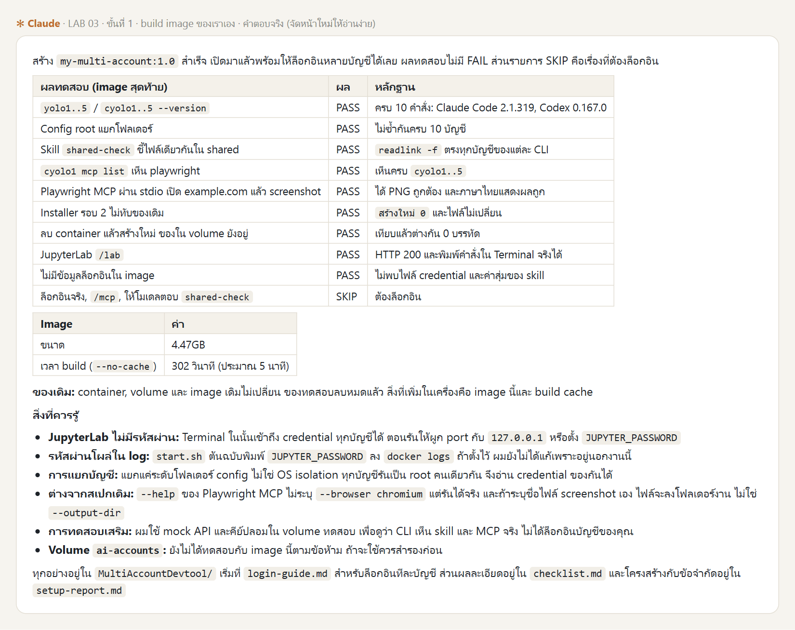
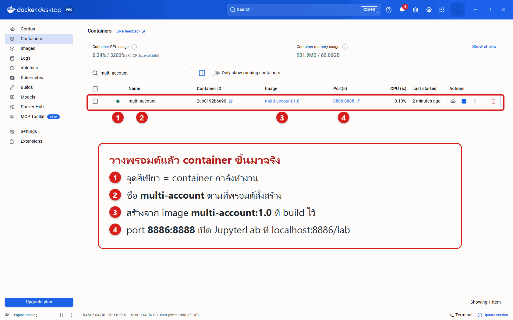
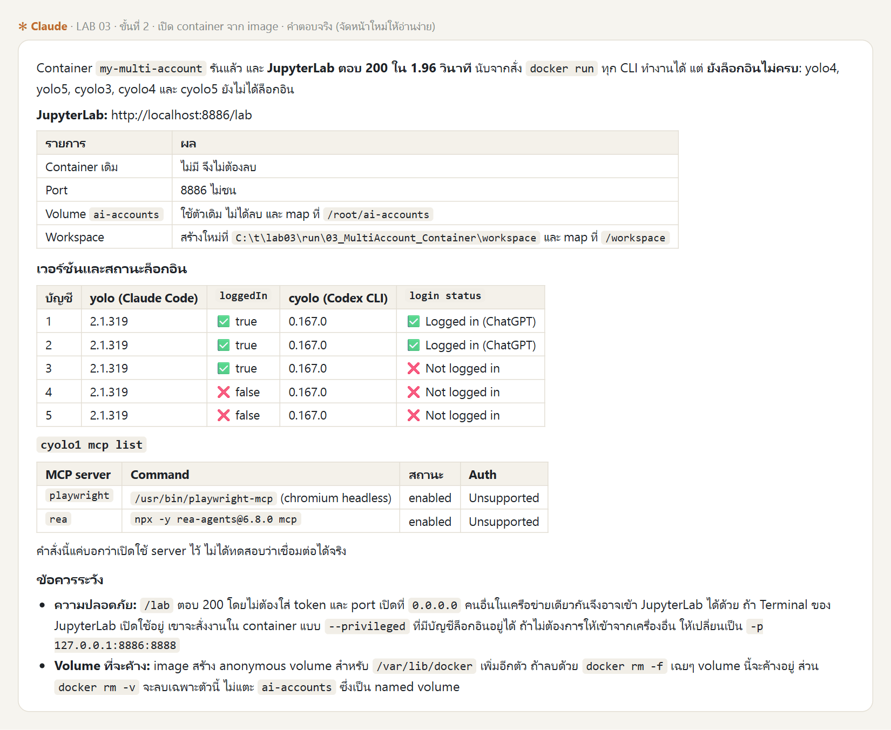
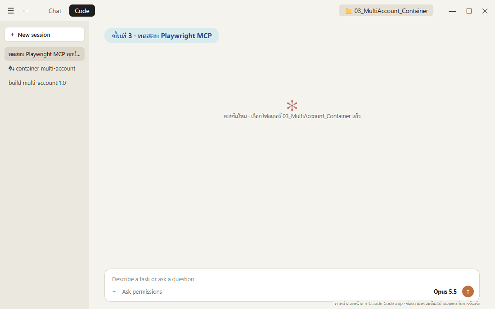
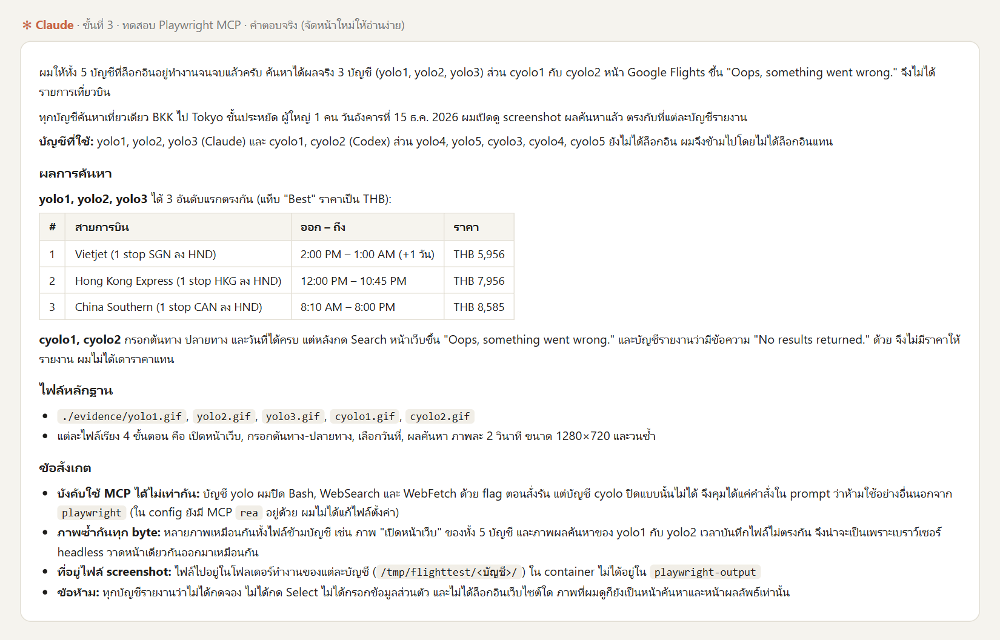

# การสร้าง Docker image สำหรับระบบหลายบัญชีจาก Dockerfile

**สไลด์ประกอบการสอน:** [Multi_Account_Container_Slides.html](Multi_Account_Container_Slides.html) (เปิดในเบราว์เซอร์ กด ← → เปลี่ยนหน้า) · [ฉบับ PDF](Multi_Account_Container_Slides.pdf)

## 1. เปรียบเทียบ 3 แบบของการเตรียมสภาพแวดล้อม

บทเรียนใน `01_week02` เตรียมสภาพแวดล้อมสำหรับทำงานกับ AI ไว้ 3 แบบ แต่ละแบบต่อยอดจากแบบก่อนหน้า



| | แบบที่ 1 · devtools | แบบที่ 2 · devtools + ติดตั้งภายหลัง | แบบที่ 3 · build จาก Dockerfile |
|---|---|---|---|
| บทเรียน | [01_Docker_VSCode_Setup](../01_Docker_VSCode_Setup/README.md) | [02_Setup_Multi_Account](../02_Setup_Multi_Account/README.md) | บทนี้ |
| จุดเริ่มต้น | image สำเร็จรูป `tuchsanai/devtools:2569_1` | container `devtools` จากแบบที่ 1 | Dockerfile |
| สิ่งที่มีใน container | เครื่องมือพื้นฐาน: Ubuntu, Python, Node.js, Git, Docker, JupyterLab | เครื่องมือพื้นฐาน + ระบบหลายบัญชี | เครื่องมือพื้นฐาน + ระบบหลายบัญชี |
| ระบบหลายบัญชีเข้ามาอย่างไร | ไม่มี | ติดตั้งภายหลังผ่าน `docker exec` | ติดตั้งไว้ตั้งแต่ขั้น build |
| ข้อมูลล็อกอินเก็บที่ | – | ภายใน container | volume `ai-accounts` |
| เมื่อ container ถูกลบ | สร้างใหม่ได้เครื่องมือพื้นฐานชุดเดิม | ต้องติดตั้งและล็อกอินใหม่ | `docker run` ใหม่แล้วพร้อมใช้ทันที |

ภาพเคลื่อนไหวด้านล่างแสดงขั้นตอนของแต่ละแบบ และผลที่เกิดขึ้นเมื่อ container ถูกลบ



*ภาพเคลื่อนไหวประกอบแนวคิด เวลาของแบบที่ 2 มาจากผลรันจริงในบท `02_Setup_Multi_Account` (ติดตั้ง ~5 นาที) และเวลาโดยประมาณของการล็อกอิน (~15 นาที) ตัวเลขของแบบที่ 3 มาจากการรันจริงในบทนี้*

## 2. องค์ประกอบของ Docker ที่ใช้ในบทนี้



| องค์ประกอบ | ความหมาย | ในบทนี้ |
|---|---|---|
| **Dockerfile** | ไฟล์ข้อความที่ระบุขั้นตอนการสร้าง image ทีละคำสั่ง | `MultiAccountDevtool/Dockerfile` ที่ Claude เขียน |
| **image** | ผลลัพธ์จากการ build เป็นต้นแบบที่อ่านได้อย่างเดียว (read-only) | `multi-account:1.0` |
| **container** | ตัวที่ทำงานจริง สร้างจาก image และมีชั้นข้อมูลที่เขียนได้ของตัวเอง ลบแล้วข้อมูลในชั้นนี้หายไปด้วย | `multi-account` |
| **volume** | พื้นที่เก็บข้อมูลที่ Docker จัดการแยกจาก container ข้อมูลยังคงอยู่แม้ลบ container | `ai-accounts` → `/root/ai-accounts` |

เมื่อ build image แล้ว จะสร้าง container จาก image นี้กี่ครั้ง หรือบนเครื่องใดก็ได้ ทุกครั้งจะได้โปรแกรมชุดเดียวกัน ส่วนข้อมูลล็อกอินเป็นของแต่ละเครื่อง เก็บใน volume ของเครื่องนั้น



*ภาพเคลื่อนไหวประกอบแนวคิด คำสั่งใน Dockerfile เป็นสรุปย่อ ดูฉบับเต็มได้ที่ [`_solution/MultiAccountDevtool/Dockerfile`](_solution/MultiAccountDevtool/Dockerfile)*

### 2.1 โครงสร้างของ image `multi-account:1.0`

image ประกอบด้วยชั้น (layer) ซ้อนกัน แต่ละชั้นเกิดจากคำสั่งใน Dockerfile ส่วนข้อมูลที่ต้องเก็บถาวรอยู่นอก image



| ส่วน | เก็บอะไร | เมื่อลบ container |
|---|---|---|
| **ชั้นของ image** (4 ชั้น) | โปรแกรมทั้งหมด: ชั้นพื้นฐานเดียวกับ devtools, Claude Code + Codex CLI, Playwright MCP + Chromium + ฟอนต์ไทย และระบบหลายบัญชี | ยังอยู่ (เป็นส่วนของ image) |
| **container layer** | ไฟล์ที่เกิดขึ้นระหว่างทำงานซึ่งไม่ได้อยู่ใน volume เช่น ไฟล์งานใน `/workspace` | หายไป (คัดลอกออกมาด้วย `docker cp` ก่อนลบ) |
| **volume `ai-accounts`** | ข้อมูลล็อกอินของทุกบัญชี skill กลาง และ MCP กลาง | ยังอยู่ |

ทุกครั้งที่ container เริ่มทำงาน `multi-account-install` จะเตรียมโครงสร้างใน volume โดยไม่เขียนทับข้อมูลเดิม image จึง**ไม่มีข้อมูลล็อกอินอยู่ภายใน** และแชร์ให้ผู้อื่นได้โดยไม่เปิดเผยบัญชีของเรา

## 3. ภาพรวมขั้นตอนการทดลอง


| ขั้น | ทำที่ไหน | ผู้ดำเนินการ | เวลารันจริง |
|---|---|---|---|
| **1 · build image** | Claude Code app | Claude | ~28 นาที (build ครั้งสุดท้าย 5 นาที) |
| **2 · สร้าง container + ล็อกอิน** | Claude Code app → JupyterLab | Claude + ผู้เรียน | ~1 นาที + ล็อกอิน ~15 นาที |
| **3 · ทดสอบ Playwright MCP ทุกบัญชี** | Claude Code app | Claude | ~5 นาที |

**ตรวจก่อนเริ่ม:** Docker Desktop แสดง **Engine running** · Claude Code app ล็อกอินแล้ว · มีพื้นที่ดิสก์ว่างอย่างน้อย ~10 GB (image ~4.5 GB + build cache)

**เปิดโฟลเดอร์งาน:** ใน Claude Code app เลือก **Code** → **New session** → เลือกโฟลเดอร์ `03_MultiAccount_Container` ของรีโปนี้

```text
03_MultiAccount_Container/
├── 00_Devtool_Container/     ← Dockerfile มาตรฐานของ devtools (input ที่ 1)
├── prompt_multi_account.md   ← สเปกระบบหลายบัญชี (input ที่ 2)
└── _solution/                ← เฉลยจากการรันจริง (หากต้องการให้ Claude ทำเองทั้งหมด ให้ย้ายโฟลเดอร์นี้ออกก่อน)
```

## ขั้นที่ 1 · ให้ Claude สร้าง image (~30 นาที)

### 1.1 · input และกระบวนการ

**เหตุผลที่ต้องทำขั้นนี้:** ในแบบที่ 2 ผู้เรียนแต่ละคนติดตั้งระบบหลายบัญชีลงใน container ของตนเองด้วยมือตามรายการบนกระดาน ผลที่ได้จึงต่างกันในแต่ละเครื่อง บางเครื่องไม่มีคำสั่ง `yolo1` บางเครื่องไม่มี Playwright ผู้สอนต้องเดินแก้ไขทีละเครื่อง และเมื่อลบ container ก็ต้องติดตั้งใหม่ทั้งหมด


**กระบวนการ:** ขั้นนี้นำรายการติดตั้งดังกล่าวมาเขียนเป็นสเปก แล้วให้ Claude ใช้สเปกนั้นร่วมกับ Dockerfile มาตรฐานสร้างโฟลเดอร์ `MultiAccountDevtool/` และ build เป็น image เพียงครั้งเดียว ถ้าการทดสอบไม่ผ่าน Claude จะกลับไปแก้ Dockerfile แล้ว build ใหม่ ทุกเครื่องที่รัน image นี้จะได้สภาพแวดล้อมเหมือนกัน


| input | บทบาท | เนื้อหา |
|---|---|---|
| [`00_Devtool_Container/`](00_Devtool_Container/readme.md) | ฐานของ image | `Dockerfile` และ `start.sh` ของ devtools: Ubuntu 24.04, Docker-in-Docker, Python, Node.js 22, JupyterLab |
| [`prompt_multi_account.md`](prompt_multi_account.md) | ข้อกำหนดของระบบหลายบัญชี | สิ่งที่ต้องมีใน image และเกณฑ์ทดสอบ (ดูข้อ 1.2) |

### 1.2 · เนื้อหาของ `prompt_multi_account.md`

สเปกนี้นำมาจากพรอมต์[ขั้นที่ 1 ของบท `02_Setup_Multi_Account`](../02_Setup_Multi_Account/README.md#ขั้นที่-1---ให้-claude-code-desktop-ตั้งค่าหลายบัญชี-10-นาที) บทดังกล่าวใช้สเปกนี้ติดตั้งลงใน container ที่กำลังทำงาน ส่วนบทนี้ใช้เป็นข้อกำหนดของ image ระบบหลายบัญชีของทั้งสองบทจึงมีโครงสร้างเหมือนกัน

| หัวข้อ | สาระ |
|---|---|
| เป้าหมาย | คำสั่ง `yolo1`–`yolo5` (Claude Code) และ `cyolo1`–`cyolo5` (Codex CLI) แยกโฟลเดอร์ต่อบัญชี และโฟลเดอร์ `shared` สำหรับ skill และ MCP กลาง |
| กติกา | แยก credential ต่อบัญชี installer รันซ้ำได้โดยไม่ทับของเดิม MCP ตัวแรกคือ Playwright และ skill ตัวอย่าง `shared-check` |
| ข้อเท็จจริงจากการทดลอง | ข้อควรรู้เฉพาะของแต่ละ CLI ที่พบจากการรันจริง เพื่อไม่ต้องลองผิดลองถูก |
| ทดสอบ | เกณฑ์ PASS/FAIL/SKIP |
| รายงาน | `setup-report.md`, `login-guide.md`, `checklist.md` |

ข้อความเต็มของไฟล์:

```text
ตรวจ --help ของเวอร์ชันจริงก่อนใช้ env/flag ห้ามเดา

## เป้าหมาย (BASE=/root/ai-accounts)
- yolo1..yolo5   → claude --dangerously-skip-permissions  (CLAUDE_CONFIG_DIR=$BASE/.Claude/yoloN)
- cyolo1..cyolo5 → codex --dangerously-bypass-approvals-and-sandbox  (CODEX_HOME=$BASE/.Codex/cyoloN)
- wrapper วางใน /usr/local/bin ให้พิมพ์ได้ทันที ส่งต่อ "$@" ครบ แจ้งชัดถ้าโฟลเดอร์บัญชีไม่มี ไม่พิมพ์ secret
- $BASE/.Claude/shared และ $BASE/.Codex/shared มี skills/ และ mcp/ แก้ครั้งเดียว ทุกบัญชีของ CLI นั้นเห็นตอนเปิดครั้งถัดไป

## กติกา
- แยก credential/config/session ต่อบัญชี เปิดพร้อมกันได้ ใช้ CLAUDE_CONFIG_DIR/CODEX_HOME เท่านั้น ห้ามเปลี่ยน $HOME
- Codex ใช้ file-based credential ต่อ CODEX_HOME ห้ามแชร์ credential ใน shared
- สร้าง installer เป็นไฟล์ใน container รันซ้ำได้ ไม่เขียนทับ credential/config เดิม ห้ามแก้ .bashrc/Git/SSH
- MCP ส่วนกลางตัวแรก: Playwright (@playwright/mcp) + Chromium ติดตั้งครั้งเดียว
- skill ตัวอย่าง shared-check: ตอบ SHARED_SKILL_OK-<tool>-<ค่าสุ่มตอนติดตั้ง> ซึ่งมีในไฟล์ skill เท่านั้น

## ข้อเท็จจริงจากการทดลอง (ตรวจว่ายังจริงกับเวอร์ชันนี้)
- root ต้องตั้ง IS_SANDBOX=1; CODEX_HOME ต้อง mkdir -p ก่อน
- Claude: skill อ่านจาก $CLAUDE_CONFIG_DIR/skills; MCP ส่งผ่าน --mcp-config=<ไฟล์> (ต้องมี =)
  ห้าม symlink .claude.json (มีสถานะล็อกอิน); claude mcp list ไม่แสดง MCP นี้ ให้ตรวจด้วย /mcp
- Codex: skill อ่านจาก $CODEX_HOME/skills และเขียน skills/.system เอง ห้าม symlink ทั้งโฟลเดอร์
  MCP ส่งด้วย -c mcp_servers.<name>={...} (ใช้กับ codex mcp list ได้)
- Playwright ใน root container: --browser chromium --headless --isolated --no-sandbox และ --output-dir นอกโฟลเดอร์งาน
  ติดตั้ง Chromium ด้วย playwright ในแพ็กเกจ @playwright/mcp ให้เวอร์ชันตรงกัน (อาจต้อง install-deps)

## ทดสอบใน container (PASS/FAIL/SKIP ตามจริง)
- 10 คำสั่ง --version ครบ, config root คนละโฟลเดอร์, installer รอบ 2 ไม่ทำลายของเดิม
- cyoloN mcp list เห็น playwright, skill shared-check ทุกบัญชี readlink -f ไปไฟล์เดียวกันใน shared
- อะไรที่ต้องล็อกอิน = SKIP

## รายงาน (ห้ามมี secret)
- setup-report.md: โครงสร้างโฟลเดอร์, wrapper, แต่ละ CLI อ่าน skill/MCP จากไหน, ข้อจำกัด
- login-guide.md: ล็อกอินทีละบัญชีใน JupyterLab Terminal
- checklist.md: รายการ | หลักฐาน | PASS/FAIL/SKIP
เสร็จแล้วสรุปเป็นตารางสั้น ๆ แล้วหยุดรอ ห้ามล็อกอินแทนฉัน
```

### 1.3 · วางพรอมต์

วางพรอมต์ทั้งกรอบใน Claude Code app (Ctrl+V) → Enter → อนุญาตคำสั่ง `docker` เมื่อระบบถาม แล้วรอจน Claude สรุปผล พรอมต์อ้างถึง input ทั้ง 2 อย่างในหัวข้อ "วัตถุดิบ"


> [!IMPORTANT]
> **📋 คัดลอกกล่องนี้ → Claude Code app แล้วกด Enter**
>
> ```text
> ช่วยสร้าง Docker image ชื่อ multi-account:1.0 ที่เปิดมาแล้วใช้หลายบัญชี AI ได้ทันที
> ทำในโฟลเดอร์นี้ ใช้คำสั่ง docker ได้ แต่ห้ามลบ หยุด หรือแก้ container / image / volume ที่มีอยู่
> (ห้าม docker system prune และห้ามแตะ volume ai-accounts)
>
> วัตถุดิบ
> - ./00_Devtool_Container = Dockerfile มาตรฐานของ devtools คัดลอกเป็น ./MultiAccountDevtool แล้วแก้ในนั้นเท่านั้น
>   ถ้ามี ./MultiAccountDevtool อยู่แล้ว ให้เทียบกับสเปกแล้วแก้เฉพาะที่ขาด
> - ./prompt_multi_account.md = สเปกระบบหลายบัญชี ทุกข้อต้องเป็นจริงใน image
>   ส่วน "ข้อเท็จจริงจากการทดลอง" ให้ตรวจกับ --help ของเวอร์ชันจริงก่อนใช้
>
> สิ่งที่ต้องอยู่ใน image
> - Claude Code, Codex CLI, Playwright MCP (pin เวอร์ชัน) + Chromium + ฟอนต์ไทย
> - installer และคำสั่ง yolo1..5 / cyolo1..5 ใน /usr/local/bin ใช้ได้ทั้งใน JupyterLab Terminal และ docker exec
> - ห้ามมีข้อมูลล็อกอินใน image: /root/ai-accounts เป็น volume และ installer รันทุกครั้งที่ container start โดยไม่ทับของเดิม
> - คง Docker-in-Docker และ JupyterLab ไว้
>
> build ด้วย: docker build -t multi-account:1.0 ./MultiAccountDevtool
>
> ทดสอบด้วย container และ volume ทดสอบชื่อใหม่ แล้วลบทิ้งเมื่อเสร็จ (PASS/FAIL/SKIP ตามจริง)
> - yolo1..5 / cyolo1..5 --version ครบ 10 คำสั่ง และ config root คนละโฟลเดอร์
> - skill shared-check ทุกบัญชีชี้ไปไฟล์เดียวกันใน shared และ cyolo1 mcp list เห็น playwright
> - Playwright MCP ผ่าน stdio เปิด https://example.com แล้ว screenshot ได้
> - installer รอบ 2 ไม่ทับของเดิม และลบ container แล้วสร้างใหม่ ของใน volume ยังอยู่
> - JupyterLab /lab ตอบ 200
> ข้อที่ต้องล็อกอิน = SKIP ห้ามล็อกอินแทนผม
>
> เขียนรายงานตามหัวข้อ "รายงาน" ของสเปกไว้ใน ./MultiAccountDevtool (ห้ามมี secret)
> เสร็จแล้วสรุปเป็นตารางสั้น ๆ: ผลทดสอบ ขนาด image และเวลา build แล้วหยุด
> ```

**หลักการออกแบบพรอมต์**

- **ระบุ input ชัดเจน:** Claude ไม่ต้องคาดเดาฐานของ image หรือโครงสร้างระบบหลายบัญชี
- **แยก image ออกจาก volume:** โปรแกรมอยู่ใน image ข้อมูลล็อกอินอยู่ใน volume การแชร์ image จึงไม่เปิดเผยบัญชี
- **ไม่แตะทรัพยากรเดิม:** ทดสอบด้วย container และ volume ชั่วคราวแล้วลบทิ้ง
- **รายงานเป็น PASS/FAIL/SKIP:** ตรวจผลจากหลักฐานได้ ไม่ต้องอาศัยคำบอกเล่าของ AI

### 1.4 · ผลจริง

**ผลจริง** (7 พ.ย. 2026 · ~28 นาที): **9 PASS · 0 FAIL · 1 SKIP** (ข้อที่ต้องล็อกอิน) image ขนาด **4.47 GB** build ใหม่แบบไม่ใช้ cache ใช้ **302 วินาที** ได้ Claude Code 2.1.319, Codex 0.167.0, Playwright MCP 0.0.84



*ข้อความคำตอบจริงของ Claude จัดหน้าใหม่ให้อ่านง่าย (ตอนรันจริงใช้ชื่อ `my-multi-account` ภาพผลจริงทุกขั้นปรับชื่อเป็น `multi-account` ให้ตรงกับบทเรียน) ระหว่างทาง Claude build รอบแรก ตรวจ `--help` ของ CLI จริงใน container ชั่วคราว เขียน installer แล้ว build รอบสุดท้ายแบบไม่ใช้ cache เพื่อจับเวลา*

ไฟล์ที่ Claude สร้าง (เก็บเป็นเฉลยไว้ที่ [`_solution/MultiAccountDevtool/`](_solution/MultiAccountDevtool/))

```text
MultiAccountDevtool/
├── Dockerfile               ← Dockerfile ของ devtools + 4 ชั้นใหม่ (CLI, Playwright, ฟอนต์ไทย, ระบบหลายบัญชี)
├── start.sh                 ← dockerd + multi-account-install (ทุกครั้งที่ start) + jupyter lab
├── multi-account/           ← installer, wrapper ของ yoloN/cyoloN, ตัวแปลง MCP ให้ Codex
├── docker-compose.yml       ← ทางเลือก: build + run ด้วยคำสั่งเดียว
└── setup-report.md · login-guide.md · checklist.md   ← รายงาน 3 ไฟล์ตามสเปก
```

## ขั้นที่ 2 · สร้าง container จาก image (~1 นาที)

ขั้นที่ 1 ได้ image `multi-account:1.0` ซึ่งเป็นแม่แบบแบบอ่านอย่างเดียว ยังใช้งานโดยตรงไม่ได้ ขั้นนี้ใช้ `docker run` สร้าง container จาก image นั้นเพื่อนำมาใช้งานจริง แต่ละ option ของคำสั่งกำหนดว่า container จะเชื่อมกับเครื่องของเราอย่างไร หากไม่ได้ทำขั้นที่ 1 พรอมต์นี้จะดึง image สำเร็จรูปของผู้สอน `tuchsanai/multi-account:1` จาก Docker Hub มาใช้แทน


> [!IMPORTANT]
> **📋 คัดลอกกล่องนี้ → Claude Code app แล้วกด Enter**
>
> ````markdown
> # รัน container ชื่อ `multi-account` จาก image `multi-account:1.0`
>
> ## 1. เตรียม image และ container
>
> ถ้ายังไม่มี image `multi-account:1.0` ให้ดึงจาก Docker Hub แล้วตั้งชื่อใหม่
>
> ```bash
> docker pull tuchsanai/multi-account:1
> docker tag  tuchsanai/multi-account:1 multi-account:1.0
> ```
>
> ถ้ามี container ชื่อ `multi-account` อยู่แล้ว ให้ลบออก (ห้ามลบ volume `ai-accounts`)
>
> ```bash
> docker rm -f multi-account
> ```
>
> ## 2. สร้าง container
>
> `PORT` เริ่มที่ `8886` ถ้าชนใช้เลขว่างถัดไป
>
> ```bash
> docker run -dit \
>   --name multi-account \
>   --privileged \
>   -p <PORT>:8888 \
>   -v ai-accounts:/root/ai-accounts \
>   multi-account:1.0
> ```
>
> จับเวลาตั้งแต่ `docker run` จน `http://localhost:<PORT>/lab` ตอบ `200`
>
> ## 3. ตรวจผ่าน `docker exec` แล้วสรุปเป็นตาราง
>
> - `yolo1..5 --version` และ `cyolo1..5 --version`
> - `cyolo1 mcp list` ต้องเห็น `playwright`
> - สถานะล็อกอินทุกบัญชี (ห้ามล็อกอินแทนผม ห้ามแก้ไฟล์ใด ๆ)
>   - Claude: `yolo1` ถึง `yolo5` ใช้คำสั่ง `yoloN auth status` แล้วดูเฉพาะค่า `loggedIn`
>   - Codex: `cyolo1` ถึง `cyolo5` ใช้คำสั่ง `cyoloN login status`
> - ตารางสรุป: image มาจากไหน (build เอง / pull) · URL ของ JupyterLab · เวลาที่ใช้
>   และตาราง บัญชี | เวอร์ชัน | ล็อกอินแล้ว/ยัง ห้ามแสดงอีเมล ชื่อองค์กร หรือ token
> - ถ้ามีบัญชีที่ยังไม่ล็อกอิน ให้บอกวิธีล็อกอินใน JupyterLab Terminal
>   (พิมพ์ `yoloN` แล้วเลือก Claude account with subscription / พิมพ์ `cyoloN login --device-auth`)
> ````

**ความหมายของแต่ละ option ใน `docker run`**

| option | ความหมาย |
|---|---|
| `-dit` | รันเบื้องหลัง (`-d`) พร้อม terminal (`-it`) |
| `--name multi-account` | ตั้งชื่อ container |
| `--privileged` | เปิดให้ใช้ Docker-in-Docker ภายใน container |
| `-p <PORT>:8888` | เปิด JupyterLab ที่ `http://localhost:<PORT>/lab` |
| `-v ai-accounts:/root/ai-accounts` | volume เก็บล็อกอิน skill และ MCP ไม่หายเมื่อลบ container |
| `multi-account:1.0` | image ที่ใช้สร้าง container |


เปิด Docker Desktop หน้า **Containers** แล้วค้นหา `multi-account` จะเห็น container ที่เพิ่งสร้าง





*เครื่องตัวอย่างใช้ volume `ai-accounts` ที่เคยล็อกอินไว้แล้ว 5 บัญชี จึงแสดง ✅ ตั้งแต่ยังไม่ได้ล็อกอินในแลปนี้ (ของผู้เรียนจะเป็น ❌ ทั้งหมดจนกว่าจะล็อกอินตามด้านล่าง) MCP `rea` มาจากแลปอื่นที่เคยติดตั้งไว้ใน volume เดียวกัน*

### ล็อกอินบัญชีที่ยังไม่ล็อกอิน (~15 นาที)

เปิด JupyterLab ตาม URL ที่ Claude แจ้ง แล้วล็อกอิน 1 บัญชีต่อ 1 แท็บ Terminal วิธีเดียวกับบท `02_Setup_Multi_Account` (ดูภาพเคลื่อนไหวครบทุกขั้นที่ [ขั้นที่ 3.1 ของบทดังกล่าว](../02_Setup_Multi_Account/README.md#31--ล็อกอิน-1-บัญชี--1-แท็บ-terminal)) อย่างน้อย CLI ละ 1 บัญชี

| พิมพ์ | หน้าจอล็อกอิน | เลือก |
|---|---|---|
| `yolo1` … `yolo5` | Select login method | **Claude account with subscription** → ยืนยันในเบราว์เซอร์ → **Yes, I trust this folder** → `/exit` |
| `cyolo1` … `cyolo5` | Choose how you want to use Codex | **Sign in with ChatGPT** หรือ `cyolo1 login --device-auth` หากเบราว์เซอร์ส่งผลกลับไม่ได้ |

**ความต่างจากแบบที่ 2:** ข้อมูลล็อกอินถูกเก็บใน **volume `ai-accounts`** ไม่ใช่ใน container จึงล็อกอินเพียง**ครั้งเดียว** และยังใช้ได้แม้ลบ container หรือ build image ใหม่

> **ผู้เรียนต้องล็อกอินด้วยตนเองเสมอ** ห้ามส่งรหัสผ่าน code หรือ URL ที่มี token ให้ AI หรือผู้อื่น

## ขั้นที่ 3 · ทดสอบ Playwright MCP ในทุกบัญชีที่ล็อกอินแล้ว (~5 นาที)

แต่ละบัญชีที่ล็อกอินแล้วใช้ **Playwright MCP** ที่ติดตั้งไว้ใน image เปิด Google Flights ค้นหาเที่ยวบิน BKK → Tokyo แล้ว screenshot ทุกขั้นตอน **ค้นหาอย่างเดียว ไม่จองและไม่ชำระเงิน** จากนั้น Claude รวมภาพของแต่ละบัญชีเป็น GIF

> [!IMPORTANT]
> **📋 คัดลอกกล่องนี้ → Claude Code app แล้วกด Enter**
>
> ```markdown
> # ทดสอบ Playwright MCP ในบัญชีที่ล็อกอินแล้วของ container `multi-account`
>
> ให้แต่ละบัญชีที่ล็อกอินแล้วใน container `multi-account` ทำงานต่อไปนี้ ห้ามล็อกอินแทนผม ห้ามแก้ไฟล์ตั้งค่า
>
> - ใช้ MCP ชื่อ `playwright` เท่านั้น ห้ามใช้ curl, python หรือ web search
> - เปิด https://www.google.com/travel/flights?hl=en
> - ค้นหาเที่ยวบินเที่ยวเดียว Bangkok (BKK) ไป Tokyo ชั้นประหยัด ผู้ใหญ่ 1 คน วันที่ 15 ของเดือนถัดไป
> - ค้นหาอย่างเดียว ห้ามกดจอง ห้ามกรอกข้อมูลส่วนตัว ห้ามชำระเงิน ห้ามล็อกอินเว็บไซต์ใด
> - screenshot ทุกขั้นตอนด้วย tool ของ playwright: เปิดหน้าเว็บ, กรอกต้นทาง-ปลายทาง, เลือกวันที่, ผลค้นหา
> - รายงานเที่ยวบิน 3 อันดับแรก (สายการบิน เวลาออก-ถึง ราคา) ตามที่เห็นบนหน้าเว็บ
>   ถ้าหน้าเว็บไม่แสดงผล ให้รายงานตามจริง ห้ามเดาราคา
>
> เมื่อทุกบัญชีเสร็จ ให้รวม screenshot ของแต่ละบัญชีตามลำดับขั้นตอนเป็นไฟล์ `./evidence/<บัญชี>.gif` บนเครื่องผม
> ```



**ผลจริง** (10 พ.ย. 2026 · ~4.5 นาที สำหรับ 5 บัญชีพร้อมกัน): Claude เลือกบัญชีที่ล็อกอินแล้ว 5 บัญชี (`yolo1–3`, `cyolo1–2`) ค้นหาได้ผล 3 บัญชี และอันดับแรกเป็น Vietjet THB 5,956 ส่วน `cyolo1` กับ `cyolo2` กรอกเงื่อนไขครบแต่ Google Flights ตอบว่า "Oops, something went wrong." Claude จึงรายงานตามจริงโดยไม่เดาราคา



ไฟล์ `./evidence/<บัญชี>.gif` ที่ Claude สร้าง แต่ละไฟล์มี 4 ภาพตามลำดับขั้นตอน ได้แก่ เปิดหน้าเว็บ, กรอกต้นทาง-ปลายทาง, เลือกวันที่ และผลค้นหา

| `yolo1.gif` (ค้นหาได้ผล) | `cyolo1.gif` (หน้าเว็บขึ้น error) |
|---|---|
|  |  |

*ภาพจริงที่แต่ละบัญชีบันทึกผ่าน Playwright MCP ไฟล์ของ `yolo2` เหมือนกับ `yolo1` และไฟล์ของ `cyolo2` เหมือนกับ `cyolo1` ทุก byte เพราะเบราว์เซอร์ headless วาดหน้าเดียวกันออกมาเหมือนกัน ราคาและผลของผู้เรียนจะต่างตามวันที่ค้นหา*
