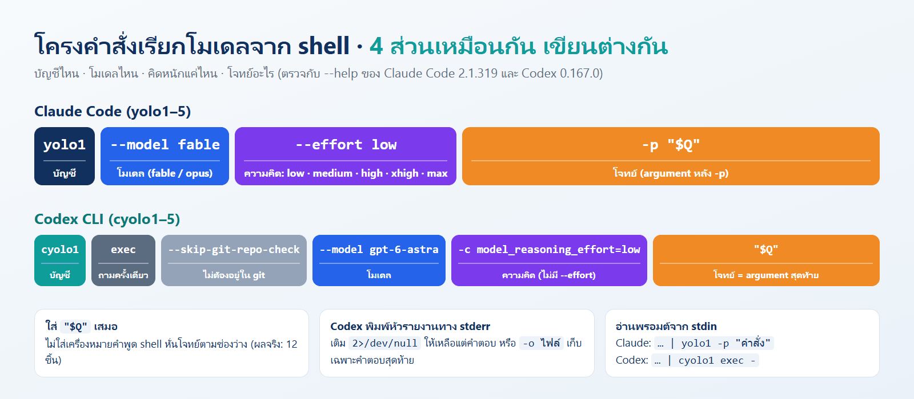
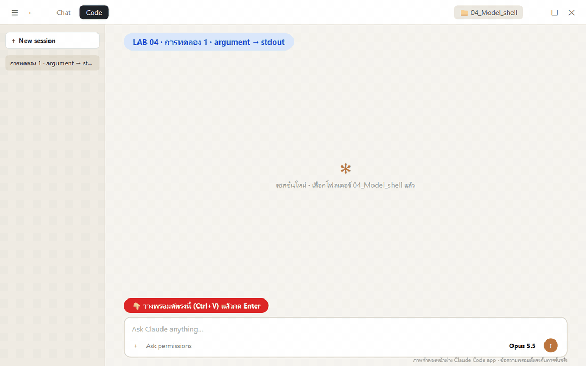
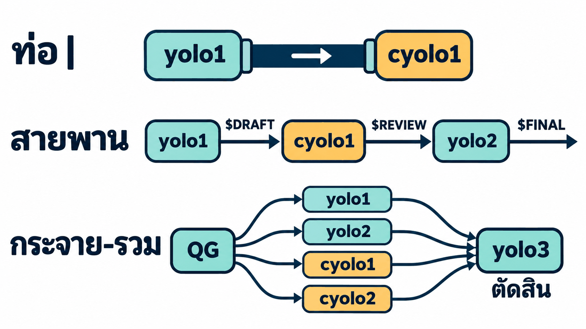
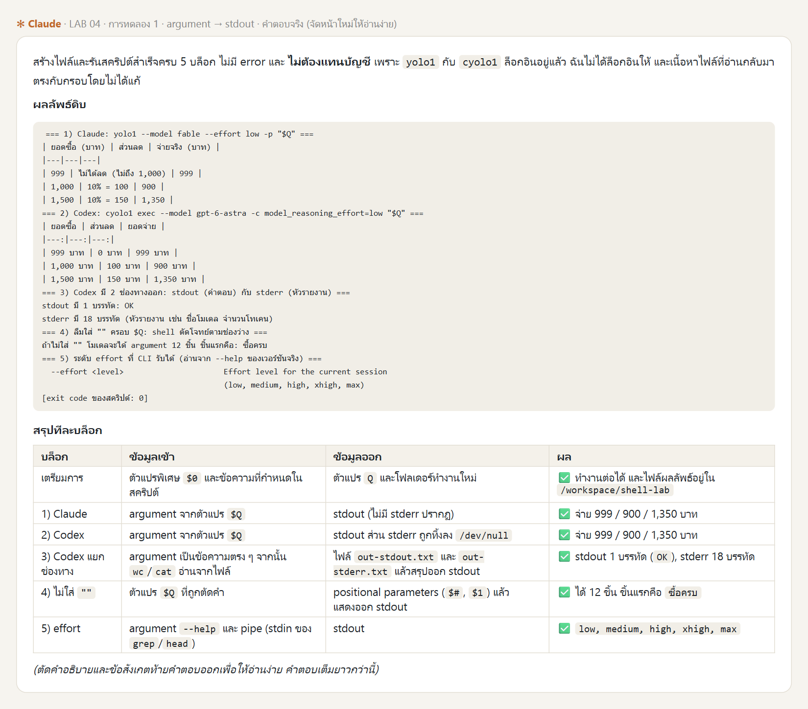
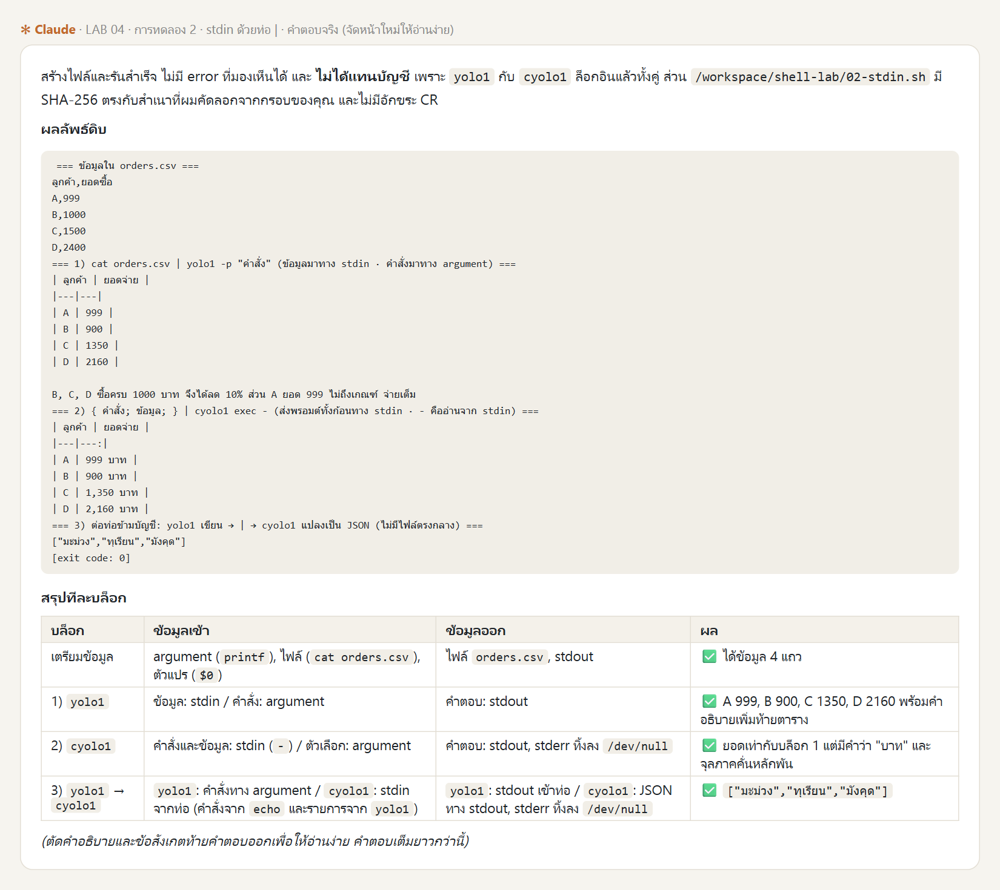
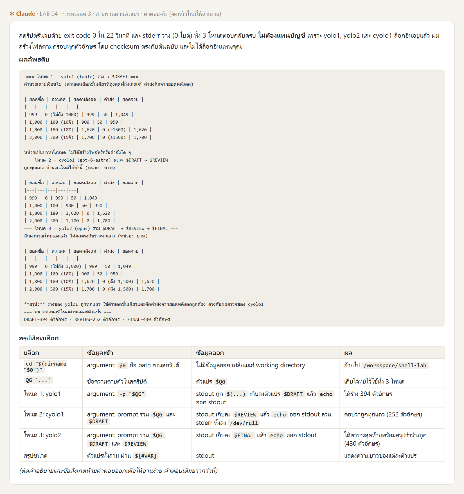
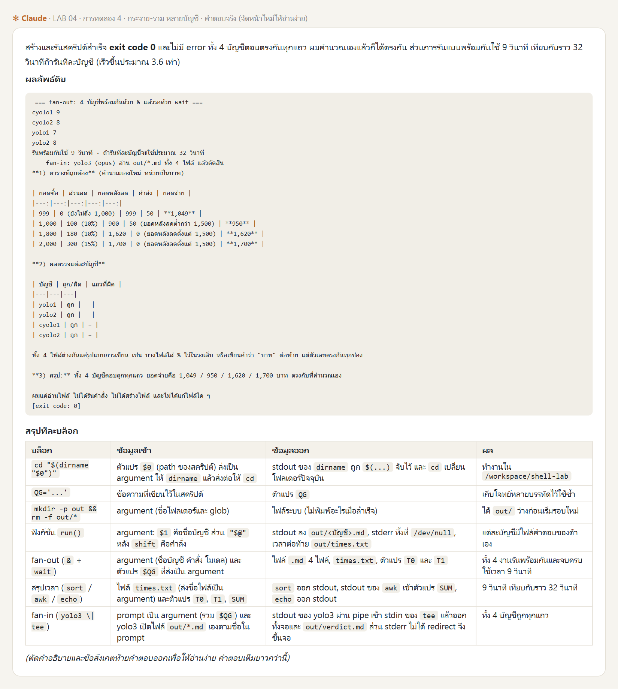

# LAB · เรียกโมเดลจาก shell: ข้อมูลไหลเข้า-ออกระหว่างบัญชีอย่างไร

**สิ่งที่จะได้:** เข้าใจว่าการเรียก `yolo1` / `cyolo1` หนึ่งครั้งคือ **โปรแกรมหนึ่งตัวที่รับข้อมูลเข้าและส่งข้อมูลออก** แล้วใช้ shell ต่อหลายบัญชีเข้าด้วยกันได้ 4 แบบ: ส่งทาง argument, ส่งทางท่อ `|`, ต่อเป็นสายพานผ่านตัวแปร และกระจายงานให้หลายบัญชีพร้อมกันแล้วรวมผล ซึ่งเป็นหลักการเดียวกับระบบ multi-account ทั้งหมด

**ทำอย่างไร:** วางพรอมต์ใน **Claude Code app** ทีละการทดลอง Claude เขียนสคริปต์ลงใน container `multi-account` แล้วรันให้ ผู้เรียนอ่านสคริปต์ ดูผลจริง และดู GIF ว่าข้อมูลวิ่งไปทางไหน

**ต้องมีก่อน:** container `multi-account` จาก บท [การสร้าง Docker image สำหรับระบบหลายบัญชีจาก Dockerfile](../03_MultiAccount_Container/README.md) ที่ล็อกอินแล้วอย่างน้อย `yolo1`, `yolo2`, `yolo3`, `cyolo1`, `cyolo2` (มีน้อยกว่านี้ก็ได้ พรอมต์สั่งให้ Claude แทนด้วยบัญชีที่ล็อกอินแล้วของ CLI เดียวกัน)

| การทดลอง | รูปแบบการไหลของข้อมูล | เวลารันจริง |
|---|---|---|
| 1 | argument เข้า → stdout ออก (และ stderr) | ~1.5 นาที |
| 2 | ข้อมูลเข้าทาง stdin ด้วยท่อ `\|` (รวมท่อข้ามบัญชี) | ~1.5 นาที |
| 3 | สายพาน A → B → C ผ่านตัวแปร `$( )` | ~1.5 นาที |
| 4 | กระจายงานให้ 4 บัญชีพร้อมกัน แล้วรวมผล | ~2 นาที |

---

## ทำไมต้องเข้าใจ shell ก่อนใช้หลายบัญชี

ทุกครั้งที่พิมพ์ `yolo1 …` หรือ `cyolo1 exec …` เรากำลังรัน **โปรแกรมหนึ่งตัว** ที่มีทางเข้า 2 ทาง และทางออก 2 ทาง เหมือนช่องส่งอาหารของครัว


*ภาพจำลอง สร้างด้วย Imagegen*

| ทาง | คืออะไร | ในคำสั่ง |
|---|---|---|
| **argument** (เข้า) | ข้อความที่พิมพ์ต่อท้ายคำสั่ง | `yolo1 -p "$Q"` · `cyolo1 exec "$Q"` |
| **stdin** (เข้า) | ข้อมูลที่ไหลมาทางท่อ `\|` | `cat file \| yolo1 -p "…"` |
| **stdout** (ออก) | คำตอบ ส่งต่อได้ด้วย `\|` `>` `$( )` | ทุกคำสั่ง |
| **stderr** (ออก) | ข้อความระหว่างทาง เช่น หัวรายงานของ Codex | ทิ้งด้วย `2>/dev/null` |

**multi-account ทั้งระบบก็คือการเอา stdout ของบัญชีหนึ่ง ไปเป็น argument หรือ stdin ของอีกบัญชี** ถ้าเข้าใจ 4 ทางนี้ ก็อ่านและออกแบบงานหลายบัญชีได้เอง

## โครงคำสั่งของ Claude และ Codex



- **Claude Code:** `--effort` รับ `low, medium, high, xhigh, max` (อ่านจาก `--help` ของ 2.1.319 ในการทดลองที่ 1) โมเดลที่ใช้ในแลปนี้คือ `fable` และ `opus`
- **Codex CLI:** ถามครั้งเดียวต้องมี `exec` ไม่มี `--effort` ให้ใช้ `-c model_reasoning_effort=…` แทน และโจทย์เป็น argument ตัวสุดท้าย (ไม่มี `-p`) โมเดลที่ใช้คือ `gpt-6-astra` และ `gpt-6-sol`

## วิธีทดลอง: วางพรอมต์ใน Claude Code app

เปิด Claude Code app → **Code** → **New session** (เลือกโฟลเดอร์ไหนก็ได้ เช่น `04_Model_shell`) แล้ววางพรอมต์ทีละการทดลอง ทุกพรอมต์มีโครงเดียวกัน

1. **เหนือเส้น `====`** = งานของ Claude: เขียนสคริปต์ลง `/workspace/shell-lab/` ใน container ตามตัวอักษร รัน แล้วอธิบายว่าข้อมูลเข้า-ออกทางไหน
2. **ใต้เส้น `====`** = สคริปต์ bash ที่ต้องอ่านให้เข้าใจ (เก็บสำเนาไว้ที่ [`scripts/`](scripts/) ด้วย)



> ไฟล์ที่ Claude เขียนอยู่ใน `/workspace/shell-lab/` ของ container ซึ่งคือโฟลเดอร์ `03_MultiAccount_Container/workspace/shell-lab/` บนเครื่องเรา (map ไว้ในบท 03_MultiAccount_Container) เปิดดูได้ทั้งใน VS Code และ File Browser ของ JupyterLab

ภาพรวม 3 รูปแบบที่จะต่อบัญชีเข้าด้วยกันในการทดลอง 2–4:



---

## การทดลอง 1 · argument เข้า → stdout ออก (~1.5 นาที)


```text
ทดลอง shell ใน container multi-account (ทำผ่าน docker exec เท่านั้น ห้ามล็อกอินแทนฉัน)
1. สร้างไฟล์ /workspace/shell-lab/01-args.sh ใน container ตามกรอบใต้เส้น ==== ทุกตัวอักษร ห้ามแก้
   ถ้าบัญชีในสคริปต์ยังไม่ล็อกอิน ให้แทนด้วยบัญชีที่ล็อกอินแล้วของ CLI เดียวกัน แล้วบอกฉันว่าแทนตัวไหน
2. รันด้วย bash /workspace/shell-lab/01-args.sh แล้วแสดงผลลัพธ์ดิบทั้งหมด ถ้า error ให้รายงานตามจริง ห้ามเดาผล
3. อธิบายสั้น ๆ ทีละบล็อก: ข้อมูลเข้าทางไหน (argument / stdin / ตัวแปร / ไฟล์) และออกทางไหน (stdout / stderr / ตัวแปร / ไฟล์)
   สรุปเป็นตาราง บล็อก | ข้อมูลเข้า | ข้อมูลออก | ผล
====
#!/bin/bash
# การทดลอง 1: ส่งโจทย์ทาง argument → คำตอบออกทาง stdout
cd "$(dirname "$0")"
Q='ซื้อครบ 1000 บาทลด 10%: ยอดซื้อ 999, 1000, 1500 บาท จ่ายเท่าไร? ตอบเป็นตารางสั้น ๆ'

echo "=== 1) Claude: yolo1 --model fable --effort low -p \"\$Q\" ==="
yolo1 --model fable --effort low -p "$Q"

echo "=== 2) Codex: cyolo1 exec --model gpt-6-astra -c model_reasoning_effort=low \"\$Q\" ==="
cyolo1 exec --skip-git-repo-check --model gpt-6-astra -c model_reasoning_effort=low "$Q" 2>/dev/null

echo "=== 3) Codex มี 2 ช่องทางออก: stdout (คำตอบ) กับ stderr (หัวรายงาน) ==="
cyolo1 exec --skip-git-repo-check --model gpt-6-astra -c model_reasoning_effort=low "ตอบคำว่า OK คำเดียว" > out-stdout.txt 2> out-stderr.txt
echo "stdout มี $(wc -l < out-stdout.txt) บรรทัด: $(cat out-stdout.txt)"
echo "stderr มี $(wc -l < out-stderr.txt) บรรทัด (หัวรายงาน เช่น ชื่อโมเดล จำนวนโทเคน)"

echo "=== 4) ลืมใส่ \"\" ครอบ \$Q: shell ตัดโจทย์ตามช่องว่าง ==="
set -- $Q
echo "ถ้าไม่ใส่ \"\" โมเดลจะได้ argument $# ชิ้น ชิ้นแรกคือ: $1"

echo "=== 5) ระดับ effort ที่ CLI รับได้ (อ่านจาก --help ของเวอร์ชันจริง) ==="
yolo1 --help | grep -A1 -- '--effort' | head -3
```

**ผลจริง** (7 พ.ย. 2026 · ~85 วินาที): ทั้ง Claude และ Codex ตอบ 999 / 900 / 1,350 บาทตรงกัน · Codex คำตอบออก stdout **1 บรรทัด** (`OK`) แต่ stderr มี **18 บรรทัด** · ไม่ใส่ `""` ครอบ `$Q` โจทย์ถูกหั่นเป็น **12 ชิ้น** ชิ้นแรกคือ `ซื้อครบ`



**สิ่งที่ต้องเข้าใจ**

- **`"$Q"` ต้องมีเครื่องหมายคำพูดเสมอ** ไม่งั้นโมเดลได้แค่คำแรก
- **Codex มีสองทางออก:** คำตอบใช้ต่อได้จาก stdout ส่วน stderr คือบันทึกระหว่างทาง (ชื่อโมเดล โจทย์ จำนวนโทเคน) Claude สังเกตเพิ่มว่า stderr มีคำตอบซ้ำอยู่ด้วย จึงควรอ่านคำตอบจาก stdout เสมอ
- **Codex อ่าน stdin ด้วย:** บรรทัดแรกของ stderr คือ `Reading additional input from stdin...` ถ้ารันในสคริปต์แล้วไม่อยากให้มันรอ stdin ให้ต่อท้ายด้วย `< /dev/null`

> 🔍 **ลองเอง** ใน Terminal ของ JupyterLab: รัน `cyolo1 exec --skip-git-repo-check "ตอบ OK" 2>&1 | head -5` แล้วเทียบกับแบบมี `2>/dev/null`

---

## การทดลอง 2 · ข้อมูลเข้าทาง stdin ด้วยท่อ `|` (~1.5 นาที)


```text
ทดลอง shell ใน container multi-account (ทำผ่าน docker exec เท่านั้น ห้ามล็อกอินแทนฉัน)
1. สร้างไฟล์ /workspace/shell-lab/02-stdin.sh ใน container ตามกรอบใต้เส้น ==== ทุกตัวอักษร ห้ามแก้
   ถ้าบัญชีในสคริปต์ยังไม่ล็อกอิน ให้แทนด้วยบัญชีที่ล็อกอินแล้วของ CLI เดียวกัน แล้วบอกฉันว่าแทนตัวไหน
2. รันด้วย bash /workspace/shell-lab/02-stdin.sh แล้วแสดงผลลัพธ์ดิบทั้งหมด ถ้า error ให้รายงานตามจริง ห้ามเดาผล
3. อธิบายสั้น ๆ ทีละบล็อก: ข้อมูลเข้าทางไหน (argument / stdin / ตัวแปร / ไฟล์) และออกทางไหน (stdout / stderr / ตัวแปร / ไฟล์)
   สรุปเป็นตาราง บล็อก | ข้อมูลเข้า | ข้อมูลออก | ผล
====
#!/bin/bash
# การทดลอง 2: ส่งข้อมูลเข้าทาง stdin ด้วยท่อ |
cd "$(dirname "$0")"
printf 'ลูกค้า,ยอดซื้อ\nA,999\nB,1000\nC,1500\nD,2400\n' > orders.csv
echo "=== ข้อมูลใน orders.csv ==="
cat orders.csv

echo "=== 1) cat orders.csv | yolo1 -p \"คำสั่ง\" (ข้อมูลมาทาง stdin · คำสั่งมาทาง argument) ==="
cat orders.csv | yolo1 --model fable --effort low -p "ข้อมูล CSV มาทาง stdin: ลด 10% เมื่อซื้อครบ 1000 บาท ตอบเป็นตาราง ลูกค้า | ยอดจ่าย"

echo "=== 2) { คำสั่ง; ข้อมูล; } | cyolo1 exec - (ส่งพรอมต์ทั้งก้อนทาง stdin · - คืออ่านจาก stdin) ==="
{ echo "ลด 10% เมื่อซื้อครบ 1000 บาท ตอบเป็นตาราง ลูกค้า | ยอดจ่าย จากข้อมูล CSV นี้"; cat orders.csv; } \
  | cyolo1 exec --skip-git-repo-check --model gpt-6-astra -c model_reasoning_effort=low - 2>/dev/null

echo "=== 3) ต่อท่อข้ามบัญชี: yolo1 เขียน → | → cyolo1 แปลงเป็น JSON (ไม่มีไฟล์ตรงกลาง) ==="
yolo1 --model fable --effort low -p "เขียนชื่อผลไม้ไทย 3 ชนิด บรรทัดละชนิด ไม่ต้องมีคำอธิบาย" \
  | { echo "แปลงรายการต่อไปนี้เป็น JSON array ของ string ตอบ JSON อย่างเดียว"; cat; } \
  | cyolo1 exec --skip-git-repo-check --model gpt-6-astra -c model_reasoning_effort=low - 2>/dev/null
```

**ผลจริง** (~79 วินาที): ทั้งสองค่ายคิดจาก CSV ได้ A 999 · B 900 · C 1,350 · D 2,160 และท่อข้ามบัญชี (Claude เขียน → Codex แปลง) ได้ `["มะม่วง","ทุเรียน","มังคุด"]` **โดยไม่มีไฟล์ตรงกลางเลย**



**สิ่งที่ต้องเข้าใจ**

- **Claude รวมสองทางเข้า:** ข้อมูลมาทาง stdin + คำสั่งมาทาง `-p` แล้วตอบรวมกัน
- **Codex ใช้ `exec -`** เพื่อบอกว่า "พรอมต์ทั้งก้อนอยู่ใน stdin" จึงต้องรวมคำสั่งกับข้อมูลเป็นสายเดียวด้วย `{ echo …; cat; }`
- **ท่อข้ามบัญชี** คือรูปแบบที่เล็กที่สุดของ multi-account: stdout ของบัญชีหนึ่ง = stdin ของอีกบัญชี

---

## การทดลอง 3 · สายพาน A → B → C ผ่านตัวแปร (~1.5 นาที)


```text
ทดลอง shell ใน container multi-account (ทำผ่าน docker exec เท่านั้น ห้ามล็อกอินแทนฉัน)
1. สร้างไฟล์ /workspace/shell-lab/03-chain.sh ใน container ตามกรอบใต้เส้น ==== ทุกตัวอักษร ห้ามแก้
   ถ้าบัญชีในสคริปต์ยังไม่ล็อกอิน ให้แทนด้วยบัญชีที่ล็อกอินแล้วของ CLI เดียวกัน แล้วบอกฉันว่าแทนตัวไหน
2. รันด้วย bash /workspace/shell-lab/03-chain.sh แล้วแสดงผลลัพธ์ดิบทั้งหมด ถ้า error ให้รายงานตามจริง ห้ามเดาผล
3. อธิบายสั้น ๆ ทีละบล็อก: ข้อมูลเข้าทางไหน (argument / stdin / ตัวแปร / ไฟล์) และออกทางไหน (stdout / stderr / ตัวแปร / ไฟล์)
   สรุปเป็นตาราง บล็อก | ข้อมูลเข้า | ข้อมูลออก | ผล
====
#!/bin/bash
# การทดลอง 3: ต่อโมเดลเป็นสาย A → B → C ส่งงานต่อผ่านตัวแปร (ไม่เขียนไฟล์)
cd "$(dirname "$0")"
QG='ร้านลด 10% เมื่อซื้อครบ 1000 บาท และลด 15% เมื่อซื้อครบ 2000 บาท ใช้สิทธิ์ได้ขั้นเดียว
ค่าส่ง 50 บาท ยกเว้นค่าส่งเมื่อยอดหลังหักส่วนลดตั้งแต่ 1500 บาทขึ้นไป
หายอดจ่ายจริงของยอดซื้อ 999, 1000, 1800, 2000 บาท ตอบเป็นตาราง ยอดซื้อ | ส่วนลด | ยอดหลังลด | ค่าส่ง | ยอดจ่าย
ห้ามสร้างไฟล์หรือรันคำสั่งอื่น'

echo "=== โหนด 1 · yolo1 (fable) ร่าง → \$DRAFT ==="
DRAFT=$(yolo1 --model fable --effort low -p "$QG")
echo "$DRAFT"

echo "=== โหนด 2 · cyolo1 (gpt-6-astra) ตรวจ \$DRAFT → \$REVIEW ==="
REVIEW=$(cyolo1 exec --skip-git-repo-check --model gpt-6-astra -c model_reasoning_effort=medium \
"ตรวจคำตอบด้านล่าง คำนวณเองอีกรอบ ตอบสั้น ๆ ว่าแถวไหนถูกหรือผิด
โจทย์:
$QG
คำตอบที่ต้องตรวจ:
$DRAFT" 2>/dev/null)
echo "$REVIEW"

echo "=== โหนด 3 · yolo2 (opus) รวม \$DRAFT + \$REVIEW → \$FINAL ==="
FINAL=$(yolo2 --model opus --effort medium -p "โจทย์:
$QG
ร่างจาก yolo1:
$DRAFT
ผลตรวจจาก cyolo1:
$REVIEW
ตอบตารางสุดท้ายที่ถูกต้อง และสรุป 1 บรรทัดว่าร่างถูกหรือผิด")
echo "$FINAL"

echo "=== ขนาดข้อมูลที่ไหลผ่านแต่ละตัวแปร ==="
echo "DRAFT=${#DRAFT} ตัวอักษร · REVIEW=${#REVIEW} ตัวอักษร · FINAL=${#FINAL} ตัวอักษร"
```

**ผลจริง** (~92 วินาที · ตัวสคริปต์ 22 วินาที): ร่างของ yolo1 (fable) ถูกทุกแถว cyolo1 ตรวจแล้วยืนยัน yolo2 (opus) สรุป **1,049 / 950 / 1,620 / 1,700 บาท** ข้อมูลที่ไหลผ่านตัวแปร: `DRAFT` 394 → `REVIEW` 252 → `FINAL` 430 ตัวอักษร



**สิ่งที่ต้องเข้าใจ**

- **`$( )` จับ stdout มาเก็บในตัวแปร** แล้วแทรกเข้าไปในโจทย์ของโหนดถัดไป
- **เลือกโมเดลให้เหมาะกับงาน:** ร่างใช้ตัวเร็ว (fable low) ตรวจใช้อีกค่าย (astra medium) ตัดสินใช้ตัวเก่ง (opus medium)
- **ข้อจำกัดที่ Claude ชี้:** โหนดหลังเห็นคำตอบของโหนดก่อน การตอบตรงกันจึงยังไม่ใช่การยืนยันที่เป็นอิสระเต็มที่ ถ้าต้องการความเป็นอิสระ ให้ทำแบบการทดลอง 4

> โจทย์ข้อนี้ยากขึ้น: ส่วนลดใช้ได้ขั้นเดียว และค่าส่งคิดจาก **ยอดหลังหักส่วนลด** ไม่ใช่ยอดซื้อ (1,800 ลดเหลือ 1,620 จึงส่งฟรี)

---

## การทดลอง 4 · กระจายงานให้หลายบัญชีพร้อมกัน แล้วรวมผล (~2 นาที)

นี่คือหัวใจของการมีหลายบัญชี: งานที่แยกกันได้ให้ทำ **พร้อมกัน** คนละโควตา แล้วให้อีกบัญชีรวมและตัดสิน


```text
ทดลอง shell ใน container multi-account (ทำผ่าน docker exec เท่านั้น ห้ามล็อกอินแทนฉัน)
1. สร้างไฟล์ /workspace/shell-lab/04-fanout.sh ใน container ตามกรอบใต้เส้น ==== ทุกตัวอักษร ห้ามแก้
   ถ้าบัญชีในสคริปต์ยังไม่ล็อกอิน ให้แทนด้วยบัญชีที่ล็อกอินแล้วของ CLI เดียวกัน แล้วบอกฉันว่าแทนตัวไหน
2. รันด้วย bash /workspace/shell-lab/04-fanout.sh แล้วแสดงผลลัพธ์ดิบทั้งหมด ถ้า error ให้รายงานตามจริง ห้ามเดาผล
3. อธิบายสั้น ๆ ทีละบล็อก: ข้อมูลเข้าทางไหน (argument / stdin / ตัวแปร / ไฟล์) และออกทางไหน (stdout / stderr / ตัวแปร / ไฟล์)
   สรุปเป็นตาราง บล็อก | ข้อมูลเข้า | ข้อมูลออก | ผล
====
#!/bin/bash
# การทดลอง 4: กระจายงานให้หลายบัญชีพร้อมกัน (fan-out) แล้วรวมผล (fan-in) ผ่านไฟล์
cd "$(dirname "$0")"
QG='ร้านลด 10% เมื่อซื้อครบ 1000 บาท และลด 15% เมื่อซื้อครบ 2000 บาท ใช้สิทธิ์ได้ขั้นเดียว
ค่าส่ง 50 บาท ยกเว้นค่าส่งเมื่อยอดหลังหักส่วนลดตั้งแต่ 1500 บาทขึ้นไป
หายอดจ่ายจริงของยอดซื้อ 999, 1000, 1800, 2000 บาท ตอบเป็นตาราง ยอดซื้อ | ส่วนลด | ยอดหลังลด | ค่าส่ง | ยอดจ่าย
ห้ามสร้างไฟล์หรือรันคำสั่งอื่น'

mkdir -p out && rm -f out/*

run() {  # run <บัญชี> <คำสั่ง...> : จับเวลาแต่ละบัญชี แล้วเขียนคำตอบลง out/<บัญชี>.md
  local acc=$1; shift
  local s=$(date +%s)
  "$@" > "out/$acc.md" 2>/dev/null
  echo "$acc $(( $(date +%s) - s ))" >> out/times.txt
}

echo "=== fan-out: 4 บัญชีพร้อมกันด้วย & แล้วรอด้วย wait ==="
T0=$(date +%s)
run yolo1  yolo1  --model fable --effort low -p "$QG" &
run yolo2  yolo2  --model opus  --effort low -p "$QG" &
run cyolo1 cyolo1 exec --skip-git-repo-check --model gpt-6-astra -c model_reasoning_effort=low "$QG" &
run cyolo2 cyolo2 exec --skip-git-repo-check --model gpt-6-sol   -c model_reasoning_effort=low "$QG" &
wait
T1=$(date +%s)
sort out/times.txt
SUM=$(awk '{s+=$2} END {print s}' out/times.txt)
echo "รันพร้อมกันใช้ $(( T1 - T0 )) วินาที · ถ้ารันทีละบัญชีจะใช้ประมาณ $SUM วินาที"

echo "=== fan-in: yolo3 (opus) อ่าน out/*.md ทั้ง 4 ไฟล์ แล้วตัดสิน ==="
yolo3 --model opus --effort medium -p "โจทย์:
$QG
คำตอบจาก 4 บัญชีอยู่ในไฟล์ out/yolo1.md out/yolo2.md out/cyolo1.md out/cyolo2.md ในโฟลเดอร์ปัจจุบัน
อ่านทั้ง 4 ไฟล์ คำนวณเองอีกรอบ แล้วตอบ 1) ตารางที่ถูกต้อง 2) ตาราง บัญชี | ถูก/ผิด | แถวที่ผิด 3) สรุป 1 บรรทัด
ห้ามแก้ไฟล์ใด ๆ" | tee out/verdict.md
```

**ผลจริง** (~102 วินาที): 4 บัญชีจบใน **9 วินาที** เมื่อรันพร้อมกัน (yolo1 7 · yolo2 8 · cyolo2 8 · cyolo1 9 วินาที) ถ้ารันทีละบัญชีจะใช้ราว **32 วินาที** = เร็วขึ้น ~3.6 เท่า และ yolo3 ตัดสินว่า **ทั้ง 4 บัญชีถูกทุกแถว**



**สิ่งที่ต้องเข้าใจ**

- **`&` + `wait`:** ใส่ `&` ท้ายคำสั่ง = ทำเบื้องหลัง แล้ว `wait` รอให้ครบทุกตัว
- **ไฟล์ของใครของมัน:** แต่ละบัญชีเขียน `out/<บัญชี>.md` จึงไม่ชนกัน (ถ้าเขียนไฟล์เดียวกันพร้อมกัน ข้อมูลจะปนกัน)
- **fan-in ส่งแค่ชื่อไฟล์:** yolo3 ไม่ได้รับเนื้อคำตอบในโจทย์ แต่เปิดไฟล์อ่านเอง เหมาะกับคำตอบยาว ๆ ที่ยัดใส่ argument ไม่ไหว
- **`tee`** ส่ง stdout ไปทั้งจอและไฟล์พร้อมกัน

---

## สรุป: 4 รูปแบบการไหลของข้อมูล

| รูปแบบ | ข้อมูลเข้า | ข้อมูลออก | ใช้เมื่อ |
|---|---|---|---|
| argument → stdout | `-p "$Q"` / `exec "$Q"` | stdout (+ stderr) | ถามครั้งเดียว |
| ท่อ `\|` | stdin | stdout | ส่งไฟล์หรือผลของโปรแกรมอื่นเข้าโมเดล ต่อสองบัญชีแบบไม่ใช้ไฟล์ |
| สายพาน `$( )` | ตัวแปรในโจทย์ | ตัวแปร | ร่าง → ตรวจ → สรุป ที่ต้องทำตามลำดับ |
| กระจาย-รวม `&` `wait` | โจทย์เดียวกันหลายบัญชี | ไฟล์ของแต่ละบัญชี → ผู้ตัดสิน | งานแยกกันได้ อยากได้เร็วและได้ความเห็นอิสระหลายค่าย |

## ข้อควรรู้

- **exit code 0 ไม่ได้แปลว่าทุกโหนดสำเร็จ:** สคริปต์ไม่ได้ตั้ง `set -o pipefail` exit code จึงมาจากคำสั่งสุดท้ายเท่านั้น (Claude เตือนเรื่องนี้เองทุกการทดลอง) งานจริงควรตรวจว่าไฟล์หรือตัวแปรของแต่ละโหนดไม่ว่าง
- **`2>/dev/null` ซ่อน error ด้วย:** ถ้าโหนดไหนล้ม จะได้ผลว่างเปล่าโดยไม่มีข้อความบอกสาเหตุ ตอนพัฒนาให้เก็บ stderr ลงไฟล์ (`2> err.txt`) แทน
- **ขนาดของ argument มีจำกัด:** คำตอบยาวมากให้ส่งต่อผ่านไฟล์ (แบบการทดลอง 4) แทนการยัดใส่ตัวแปร
- **ราคาและโควตา:** ทุกโหนดใช้โควตาของบัญชีนั้น การกระจายงานจึงช่วยไม่ให้บัญชีเดียวหมดโควตา
- **ผลของโมเดลอาจต่างกันในแต่ละรอบ:** ตัวเลขในแลปนี้มาจากการรันจริงรอบเดียว ลองรันซ้ำแล้วเทียบผลเอง

## ภาคผนวก · ระดับ effort ที่ Codex แต่ละโมเดลรับได้

ผลจากการรันจริงครบ 21 ช่องในรอบก่อน (23 ก.ย. 2026 · codex-cli 0.156) เวอร์ชันใหม่อาจต่างได้ ให้ตรวจซ้ำบนเครื่องตัวเอง

| โมเดล | `none` | `minimal` | `low` | `medium` | `high` | `xhigh` | `max` |
|---|:--:|:--:|:--:|:--:|:--:|:--:|:--:|
| `gpt-6-astra` | ❌ | ❌ | ✅ | ✅ | ✅ | ✅ | ✅ |
| `gpt-6-sol` | ✅ | ❌ | ✅ | ✅ | ✅ | ✅ | ✅ |
| `gpt-6-luna` | ✅ | ❌ | ✅ | ✅ | ✅ | ✅ | ✅ |

สคริปต์ที่ต้องสลับโมเดลได้ควรใช้ `low`, `medium`, `high`, `xhigh`, `max` ซึ่งใช้ได้ครบทุกโมเดล
