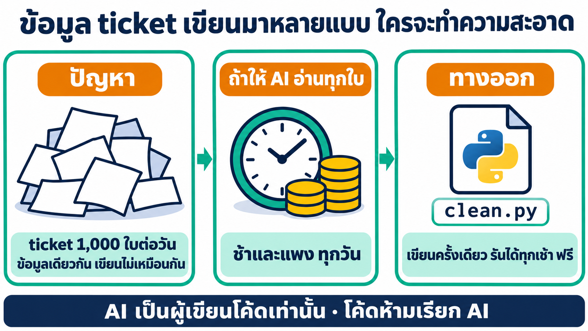
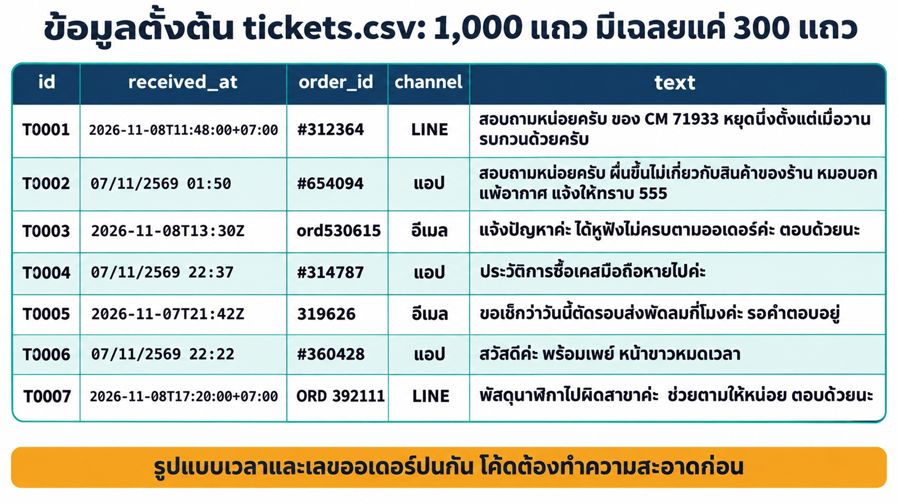
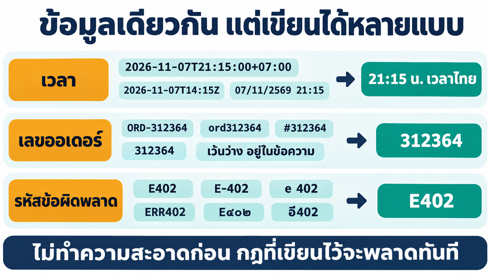
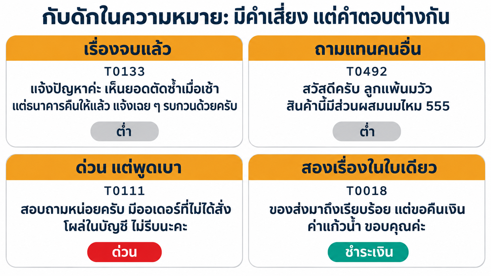
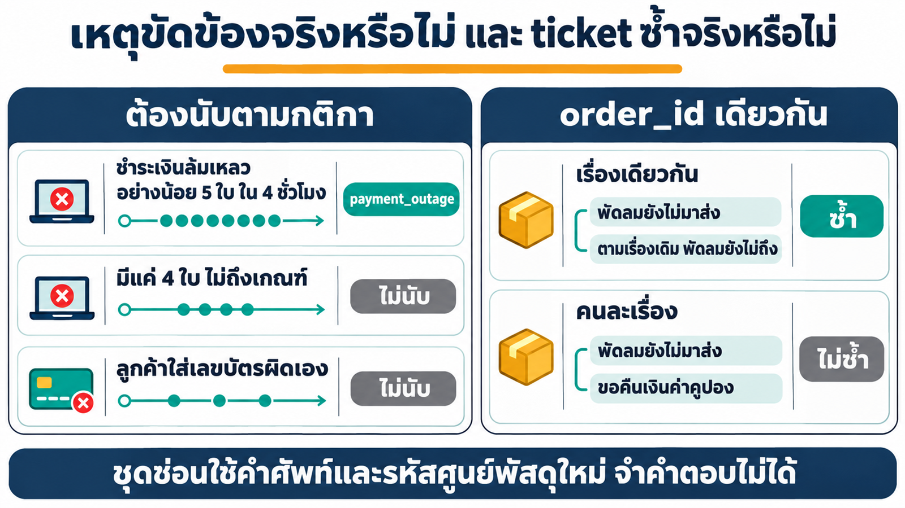
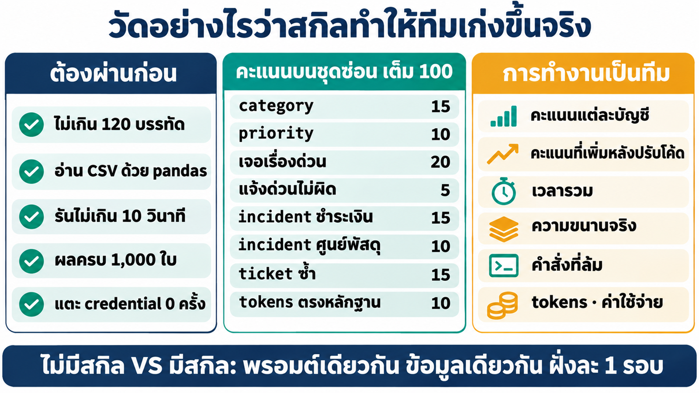
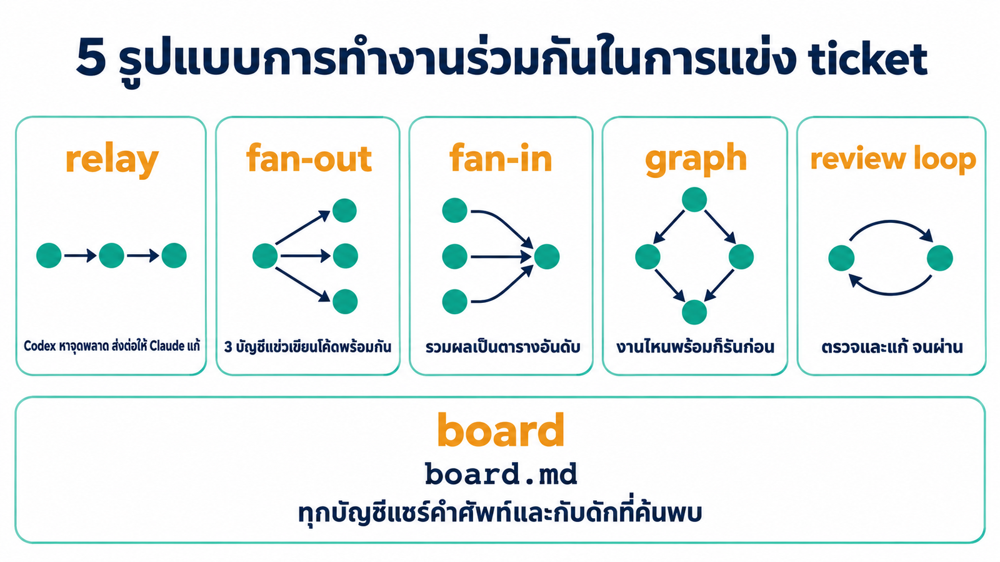
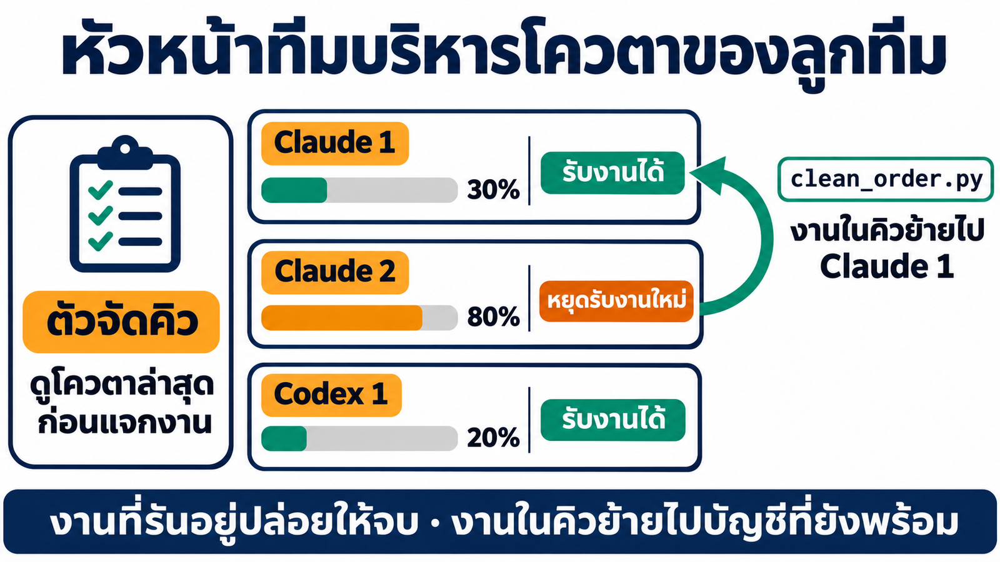
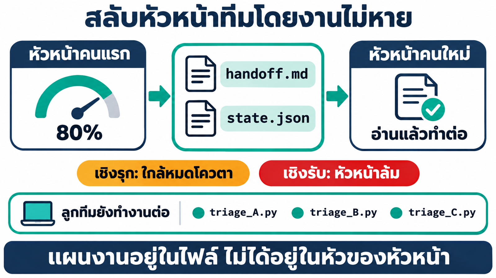
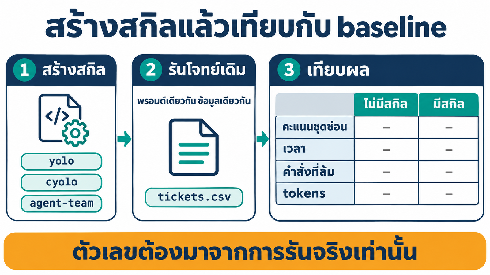

# 04_MultiAccount_Skill

## 1. ปัญหา: มีคำสั่งครบ แต่ AI ยังใช้ไม่เป็น

`yolo2` หรือ `cyolo1` เปิดบัญชีได้ทันที แต่ AI ที่จะสั่งบัญชีเหล่านี้ต้องรู้ว่าใส่ flag อะไร ผลลัพธ์อยู่ที่ไหน บัญชีไหนใช้ได้จริง และโควตาเหลือเท่าไร เมื่อไม่รู้ก็ต้องลองผิดลองถูกใหม่ทุกครั้ง


### 1.1 Baseline: แข่งเขียน Python คัดแยก ticket

> [!NOTE]
> **หัวข้อนี้คือ baseline ของทั้งบท** วัดผลตอนที่ใน container ยังไม่มีสกิล หลังสร้างสกิล `yolo`, `cyolo` และ `agent-team` แล้ว เราจะใช้พรอมต์และข้อมูลชุดเดียวกันอีกครั้ง เพื่อเทียบว่าทีมเก่งขึ้นจริงหรือไม่

**Pain point:** ทุกเช้าทีม Support มี ticket 1,000 ใบ อ่านเองไม่ทัน เรื่องด่วนจึงจมในกองงาน ส่วนการให้ AI อ่านทุกใบทุกวันก็ทั้งช้าและแพง เราจึงให้ทีม AI แข่งกันเขียนสคริปต์ Python ตัวเดียวที่รันได้ทุกเช้าโดยไม่ต้องเรียก AI



*(ภาพจำลอง)*

Claude 2 บัญชีกับ Codex 1 บัญชีแข่งกันเขียนโค้ด (fan-out) จัดอันดับด้วยชุดฝึก (fan-in) แล้วทีมตัดสินใจเองว่าจะเทียบหรือรวมโค้ดอย่างไร **AI เป็นผู้เขียนโค้ดเท่านั้น โค้ดห้ามเรียก AI**


ข้อมูลอยู่ที่ [`baseline/tickets.csv`](baseline/tickets.csv) จำนวน 1,000 ใบ และ [`baseline/labels.json`](baseline/labels.json) มีเฉลยเพียง 300 ใบ โปรแกรมต้องอ่านไฟล์ด้วย `pandas.read_csv`









คะแนนจริงวัดกับ**ชุดซ่อน** 1,000 ใบที่ทีมไม่เห็น ถ้อยคำและรหัสศูนย์พัสดุต่างจากชุดฝึก จึงจำคำตอบไม่ได้



เปิด Claude Code app เลือก **Code** → **New session** → โฟลเดอร์ `04_MultiAccount_Skill` แล้ววางพรอมต์

> [!IMPORTANT]
> **📋 คัดลอกกล่องนี้ → Claude Code app แล้วกด Enter**
>
> ```text
> ใช้ทีมเอเจนต์ใน container multi-account จัดการแข่งเขียนโปรแกรม Python คัดแยก ticket ของทีม Support งานของทีมทำใน container ผ่าน docker exec เท่านั้น (ใช้ได้เฉพาะ 3 บัญชีนี้เท่านั้นตลอดทุกขั้น: yolo1, yolo2 และ cyolo1 ห้ามเรียกบัญชีอื่นเด็ดขาด)
> เตรียมก่อนเริ่ม (ถ้า container multi-account กำลังรันอยู่แล้ว ข้ามไปได้ ห้ามลบ container / image / volume ที่มีอยู่)
> - ถ้าเครื่องนี้ไม่มีทั้ง image multi-account:1.0 และ tuchsanai/multi-account:1 ให้ docker pull tuchsanai/multi-account:1
> - ถ้ายังไม่มีชื่อ multi-account:1.0 ให้ docker tag tuchsanai/multi-account:1 multi-account:1.0
> - ถ้า container หยุดอยู่ให้ docker start ถ้ายังไม่มีให้ docker run -dit --name multi-account --privileged -p <PORT>:8888 -v ai-accounts:/root/ai-accounts -v <path เต็มของ ../03_MultiAccount_Container/workspace>:/workspace multi-account:1.0 (PORT เริ่มที่ 8886 ถ้าชนใช้เลขว่างถัดไป)
> - ถ้าใน container ยังไม่มี pandas ให้ติดตั้งด้วย pip install pandas
> - ถ้าไม่มีบัญชี Claude หรือ Codex ที่ล็อกอินเลย ให้หยุดและบอกวิธีล็อกอินใน JupyterLab Terminal ห้ามล็อกอินแทนผม
> ก่อนเริ่ม ดูว่าใน container มีสกิลที่ช่วยงานนี้ได้หรือไม่ (/root/ai-accounts/.Claude/shared/skills) ถ้ามีให้อ่านและใช้
> โฟลเดอร์งานใน container: /workspace/team-demo คัดลอก ./baseline/tickets.csv และ ./baseline/labels.json ไปไว้ที่ /workspace/team-demo/data
>
> โจทย์: ทุกเช้าทีม Support มี ticket 1,000 ใบ ต้องการสคริปต์ที่คัดแยกได้เองทุกวัน โดยไม่ต้องเรียก AI อ่านทีละใบ
> - ticket อยู่ในไฟล์ tickets.csv คอลัมน์ id, received_at, order_id, channel, text โปรแกรมต้องอ่านไฟล์ด้วย pandas.read_csv
> - labels.json คือเฉลยของ ticket เพียง 300 ใบจาก 1,000 ใบในไฟล์ ใช้พัฒนาโค้ดได้
> - ข้อมูลไม่สะอาด: เวลา เลขออเดอร์ รหัสข้อผิดพลาด ตัวเลข และการเว้นวรรคมีหลายรูปแบบ เลขออเดอร์บางใบเว้นว่างและอยู่ในข้อความแทน เวลาที่ไม่ระบุเขตเวลาคือเวลาไทยแบบ พ.ศ.
> - python3 triage.py <ไฟล์ csv> ต้องพิมพ์ JSON เป็น {id: {"category": ..., "priority": ..., "incident": ..., "duplicate_of": ...}} ครบทุกใบ
> - category: ชำระเงิน / จัดส่ง / สินค้า / บัญชี ถ้าใบเดียวพูดหลายเรื่อง ให้ยึดเรื่องที่ลูกค้าขอให้จัดการ
> - priority: ด่วน = เงินลูกค้าหายจริง บัญชีถูกเข้าถึงโดยไม่ได้รับอนุญาต หรืออันตรายต่อสุขภาพและความปลอดภัยที่เกิดขึ้นจริง · ต่ำ = คำถามทั่วไป ถามแทนหรือถามเผื่อ และเรื่องที่ลูกค้าบอกว่าจบแล้วหรือเข้าใจผิด · ปกติ = ที่เหลือ น้ำเสียงหรือคำว่าด่วนไม่ได้แปลว่าด่วน
> - incident: payment_outage = ชำระเงินล้มเหลวโดยไม่ได้เกิดจากลูกค้าเอง และมีอย่างน้อย 5 ใบภายในช่วง 4 ชั่วโมงเดียวกัน · hub_delay = พัสดุค้างที่รหัสพัสดุขึ้นต้นด้วยอักษร 2 ตัวเดียวกันอย่างน้อย 5 ใบ · ถ้าไม่เข้าข่ายให้เป็น null
> - duplicate_of: ถ้าเป็น order เดียวกันและประเภทเดียวกับใบที่มาก่อน ให้ใส่ id ของใบแรก ออเดอร์เดียวกันแต่คนละประเภทไม่นับว่าซ้ำ ถ้าไม่ซ้ำให้เป็น null
>
> กติกาการแข่ง
> - ไฟล์เดียว ไม่เกิน 120 บรรทัด และไม่เกิน 5,000 ตัวอักษร · ใช้ได้เฉพาะ Python มาตรฐานและ pandas · ห้ามใช้เน็ต · รันไม่เกิน 10 วินาที
> - โค้ดห้ามเรียก AI เด็ดขาด ไม่ว่า Claude, Codex, ChatGPT หรือคำสั่ง CLI อย่าง claude, codex, yoloN, cyoloN ทั้งทางตรงและผ่าน os หรือ subprocess AI มีหน้าที่เขียนและปรับโค้ดเท่านั้น
> - ห้ามใส่ ticket id หรือ order_id ของข้อมูลลงในโค้ด เพราะคะแนนจริงจะวัดกับ ticket ชุดใหม่ที่ไม่มีใครเห็น ถ้อยคำและรหัสจะต่างจากชุดนี้
>
> ลำดับการทำงาน
> 1. แข่งพร้อมกัน: ให้ yolo1, yolo2 และ cyolo1 เขียนโปรแกรมคนละไฟล์พร้อมกัน triage_A.py, triage_B.py, triage_C.py แต่ละบัญชีเห็นแค่ข้อมูลในโฟลเดอร์ data และกติกาข้างต้น ห้ามดูไฟล์ของคนอื่น
> 2. รวมผล: ให้ทุกไฟล์รันกับข้อมูลชุดฝึก เทียบกับ labels.json (300 ใบ) แล้วทำตารางอันดับ scoreboard.md (ความถูกต้องของ category, priority, recall ของเรื่องด่วน, incident, duplicate_of, จำนวนบรรทัด)
> 3. ปรับให้ดีที่สุด: ใช้เฉพาะ 3 บัญชีเดิม ให้ทีมตัดสินใจเองว่าจะเทียบโค้ด รวมจุดเด่นของหลายไฟล์ แบ่งกันแก้ หรือวนปรับอย่างไร แล้วได้ triage.py ตัวสุดท้ายที่ยังอยู่ในกติกา
> 4. สรุปตาราง บัญชี | งาน | รุ่น | เวลา (วินาที) | input tokens | output tokens | สำเร็จ/ล้ม ตัวเลขต้องมาจากผลจริงของแต่ละบัญชี ห้ามประมาณ และบอกโควตาที่เหลือของแต่ละบัญชีพร้อมเวลาของข้อมูล บันทึกสรุปนี้เป็น run-summary.md ด้วย
> ```

**Output ของ baseline** (ผลจริง 9 พ.ย. 2026 · ไม่มีสกิล · รัน 1 รอบ)

| โค้ด | ผู้เขียน | บรรทัด | ชุดฝึก | **ชุดซ่อน** |
|---|---|---|---|---|
| `triage_A.py` | `yolo1` | 94 | 90.00 | 37.80 |
| `triage_B.py` | `yolo2` | 95 | 90.00 | 29.77 |
| `triage_C.py` | `cyolo1` | 57 | 85.99 | 27.75 |
| `triage.py` (ตัวสุดท้ายของทีม) | ทีม | 71 | 90.00 | **54.85** |

*คะแนนเต็ม 90 จากโค้ด (อีก 10 คะแนนคือความตรงของตัวเลข tokens ซึ่งยังไม่ได้ตรวจ) · ทุกไฟล์ผ่านกติกา*

| ตัวชี้วัด | ผล |
|---|---|
| เวลารวม | 1,931.2 วินาที (ประมาณ 32 นาที) |
| คำสั่งของ Claude Code app | 40 คำสั่ง (ล้ม 5) |
| ค่าใช้จ่ายของ Claude Code app | $1.96 |
| ความขนานของรอบแข่ง | 2.32 เท่า |
| tokens ของ 3 บัญชี (ตามที่ทีมรายงาน) | input รวม cache 6,095,247 · output 206,741 |
| แตะไฟล์ credential | 0 ครั้ง |

**สิ่งที่อ่านได้จากผล**

- **ชุดฝึกเกือบเต็มทุกไฟล์ จึงแยกผู้ชนะไม่ได้:** ความต่างเห็นชัดเมื่อวัดกับชุดซ่อน
- **การทำงานเป็นทีมช่วยจริง:** ตัวสุดท้ายได้ 54.85 สูงกว่าไฟล์ที่ดีที่สุดจากรอบแข่ง (37.80) ทีมเลือกเองว่าจะรีวิวและโหวต แบ่งกันแก้ แล้วเขียนชุดตรวจรับขึ้นมาทดสอบเพิ่ม
- **จุดอ่อนที่ยังเหลือ:** เรื่องด่วนบนชุดซ่อนได้เพียง 6 จาก 20 และเหตุขัดข้องชำระเงินได้ 4.81 จาก 15
- **นี่คือตัวเลขที่สกิลต้องเอาชนะ:** ผลรอบเดียวมีความผันผวน ความต่างเล็กน้อยจึงสรุปไม่ได้

## 2. ทำไมสกิลแก้ปัญหานี้ได้

ใน baseline ทุกครั้งที่สั่งทีม Claude Code app ต้องหาวิธีเรียกแต่ละบัญชี เขียนสคริปต์คุมการแข่ง จับเวลา และรวมตัวเลขขึ้นมาเอง ความรู้เหล่านี้เป็น **"รู้ว่าทำอย่างไร"** จึงเก็บไว้ในสกิลได้ตามหลักใน[บททฤษฎีสกิล](../../00_week01/05_agent-skills/01_skill-theory/README.md)

- **งานซ้ำให้สคริปต์ทำ งานคิดให้ AI ทำ:** การเรียกบัญชี ตรวจความพร้อม จับเวลา และรวมสถิติให้สคริปต์ทำ ส่วนการออกแบบกฎคัดแยก ticket เป็นหน้าที่ของ AI
- **เปิดทีละชั้น:** AI เห็นแค่ชื่อและคำอธิบายของสกิล จะเปิดรายละเอียดเมื่อถึงขั้นที่ต้องใช้


## 3. ออกแบบสกิล 3 ตัว

ระบบต้องมีมากกว่าคำสั่งเรียกบัญชี จึงแบ่งเป็นสกิล 3 ตัว และกำหนดคุณสมบัติที่สกิลต้องทำได้ในหัวข้อย่อยถัดไป


| สกิล | หน้าที่ | สคริปต์ |
|---|---|---|
| `yolo` | เรียก Claude Code ทุกบัญชีแบบไม่โต้ตอบ เลือกรุ่นตามความยาก ตรวจความพร้อมด้วยการเรียกจริง | `yolo.py` |
| `cyolo` | เรียก Codex ทุกบัญชี เลือกรุ่น สร้างภาพ และอ่านโควตา | `cyolo.py` |
| `agent-team` | ให้หลายบัญชีทำงานร่วมกัน ส่งข้อมูล แชร์ความรู้ บริหารโทเค็น สลับหัวหน้าทีม และสรุปสถิติ | `team.py` |

### 3.1 รูปแบบการทำงานร่วมกัน




| รูปแบบ | ตัวอย่างในการแข่ง ticket | การส่งข้อมูล |
|---|---|---|
| relay | Codex หาจุดที่พลาด แล้วส่งให้ Claude แก้ | `{{node}}` แทรกค่าสั้นลง prompt |
| fan-out / fan-in | 3 บัญชีแข่งเขียนโค้ด แล้วรวมเป็นตารางอันดับ | งานรวมผลอ่านไฟล์ `{{file:node}}` |
| graph | ให้คะแนนได้เมื่อทุกไฟล์เสร็จ | ระบุ `depends_on` |
| review loop | อีกบัญชีตรวจ `triage.py` จนผ่าน | วนจนได้ `APPROVED` หรือครบ `max_rounds` |
| board | แชร์คำศัพท์และกับดักที่แต่ละบัญชีเจอ | ทุก agent อ่าน `board.md` ก่อนเริ่ม |

ข้อมูลยาวอย่าง `tickets.csv` ส่งเป็น **path ของไฟล์** ไม่ยัดลง prompt

### 3.2 รูปแบบขั้นสูง


| รูปแบบ | ตัวอย่างในการแข่ง ticket |
|---|---|
| debate | Claude กับ Codex ถกกันว่า ticket นี้ด่วนจริงไหม แล้วให้ผู้ตัดสินสรุป |
| best-of-N + judge | แข่งหลายไฟล์ แล้วเลือกไฟล์ที่ได้คะแนนสูงสุด |
| router | ส่งงานเขียนกฎและงานตรวจโค้ดให้บัญชีที่ถนัด |
| failover | บัญชีโควตาหมดหรือล็อกอินหมดอายุ ย้ายงานไปบัญชีอื่น |
| human gate | รอคนอนุมัติก่อนนำ `triage.py` ไปใช้จริง |

### 3.3 สถิติทุกบัญชี (ledger)


- ทุกครั้งที่สคริปต์ของสกิลเรียกบัญชี จะเพิ่ม 1 บรรทัดใน `/workspace/.agent-team/ledger.jsonl`
- `team.py stats` สรุปตามบัญชี รุ่น และงาน · `team.py quota` แสดงโควตาพร้อม**เวลาของข้อมูล**
- ledger **ไม่เก็บข้อความ prompt และ secret**

### 3.4 หัวหน้าทีมบริหารโทเค็นของลูกทีม


| สถานการณ์ | ตัวจัดคิวทำอะไร |
|---|---|
| ก่อนสั่งงาน | แจกให้บัญชีที่เหลือโควตามากก่อน งานง่ายใช้รุ่นเล็ก |
| ลูกทีมใกล้หมด (≥ 80% หรือเกินงบ) | **หยุดรับงานใหม่** งานที่รันอยู่ปล่อยให้จบ งานในคิวย้ายไปคนอื่น |
| ลูกทีมล้มกลางคัน | ย้ายงานไปบัญชีอื่น พร้อมความคืบหน้า |
| งานที่ผู้ใช้ระบุบัญชีเอง | ไม่ย้ายเงียบ ๆ หยุดและรายงาน |

**กรณีศึกษา: การแข่ง ticket**



### 3.5 สลับหัวหน้าทีมโดยงานไม่หาย

ถ้าแผนงานอยู่ในบริบทแชตของหัวหน้า เมื่อโควตาหมด แผนและงานที่ค้างจะหายไปด้วย วิธีแก้คล้ายการส่งเวรของพยาบาล


*(ภาพจำลอง) `handoff.md` ทำหน้าที่เดียวกับใบส่งเวร*


| หลักการ | รายละเอียด |
|---|---|
| สถานะอยู่ในไฟล์ | `state.json` และ `handoff.md` ทำหน้าที่เหมือนใบส่งเวร |
| ผู้ควบคุมเป็นสคริปต์ | `team.py lead` ไม่ใช้โทเค็นจึงไม่หมดโควตา |
| ลูกทีมไม่ผูกกับหัวหน้า | หัวหน้าเปลี่ยนตัวแล้วงานที่สั่งไปไม่หาย |
| สลับเชิงรุก | โควตาหัวหน้า ≥ 80% หรือเกินงบ → ส่งไม้ก่อนหมด |
| สลับเชิงรับ | หัวหน้าล้มหรือเงียบไป → เริ่มคนใหม่จาก checkpoint ล่าสุด |

**กรณีศึกษา: การแข่ง ticket**



### 3.6 Claude Code app เข้าใจระบบใน container ได้อย่างไร


- **ใน container:** `yoloN` และ `cyoloN` โหลดสกิลจาก `shared/skills` อัตโนมัติ
- **จาก host:** ทุก `SKILL.md` มีหัวข้อ "เรียกจาก host" บอกวิธีอ่านสกิลและเรียกสคริปต์ผ่าน `docker exec`

### 3.7 สร้างสกิลแล้วเทียบกับ baseline

เมื่อออกแบบครบแล้ว ขั้นสุดท้ายคือสร้างสกิลตามคุณสมบัติข้างต้น แล้วกลับไปรันโจทย์เดิมในหัวข้อ 1.1



| เทียบ | ไม่มีสกิล (1.1) | ใช้สกิล |
|---|---|---|
| คะแนนชุดซ่อน | 54.85 | 57.21 |
| เวลารวม (วินาที) | 1,931.2 | 3,603.5 |
| คำสั่งที่ล้ม | 5 จาก 40 | 7 จาก 44 |
| ค่าใช้จ่ายของ app | $1.96 | $2.50 |

**อ่านผลอย่างไร**

- **คะแนนต่างกัน 2.36 จึงยังสรุปไม่ได้ว่าวิธีไหนดีกว่า** แต่ละวิธีรันรอบเดียว และโจทย์เกือบเดียวกันแบบไม่มีสกิลเคยได้ทั้ง 33.42 และ 54.85
- **ทั้งสองวิธีได้ชุดฝึก 89–90 แต่ชุดซ่อนเหลือ 55–57** โค้ดจึงยังใช้กับข้อมูลใหม่ได้ไม่ดี
- **ผลนี้ยังไม่ได้วัดการจัดทีมของ `agent-team`** รอบที่ใช้สกิลไม่ได้ใช้ `team.py` สั่งงาน เพราะมันตรวจทุกบัญชีก่อนเริ่ม ซึ่งผิดกติกาที่ให้ใช้แค่ 3 บัญชี ทีมจึงเรียก `yolo.py` และ `cyolo.py` โดยตรง
- คะแนนคิดจาก 90 คะแนน ยังไม่รวมเกณฑ์โทเค็น 10 คะแนน

## 4. สกิลเก็บไว้ที่ไหน: volume และโฟลเดอร์สำรอง

สกิลถูกติดตั้งไว้ใน `/root/ai-accounts/.Claude/shared/skills` และ `/root/ai-accounts/.Codex/shared/skills` ซึ่งอยู่ใน **volume `ai-accounts`** ทุกบัญชีลิงก์เข้ามาที่นี่ สกิลจึงคงอยู่แม้ลบ container แต่เมื่อย้ายไป**เครื่องใหม่**หรือสร้าง **volume ใหม่** สกิลเหล่านี้จะไม่ติดไปด้วย จึงเก็บโฟลเดอร์ `skills/` สำรองไว้**นอก container** แล้วคัดลอกไปติดตั้งได้ทันทีโดยไม่ต้องสร้างสกิลใหม่


| ที่เก็บ | อยู่ที่ไหน | เมื่อลบ container | เมื่อย้ายเครื่อง / volume ใหม่ |
|---|---|---|---|
| โฟลเดอร์สำรอง `skills/` | บนเครื่องเรา (เก็บใน Git ได้) | ยังอยู่ | **นำไปติดตั้งใหม่ได้** |
| `shared/skills` | volume `ai-accounts` | ยังอยู่ | ไม่ติดไป |
| container | ชั้นที่เขียนได้ของ container | หายไป | ไม่ติดไป |


โฟลเดอร์สำรองมี**แค่ 3 โฟลเดอร์สกิล** ไม่มีสคริปต์ติดตั้ง เมื่อเปิดบัญชี `yoloN` หรือ `cyoloN` ครั้งถัดไป wrapper ใน image จะเชื่อมสกิลจาก `shared/skills` ให้บัญชีนั้นเอง

## 5. ภาพรวมขั้นตอนการทดลอง

| ขั้น | ทำที่ไหน | เวลารันจริง |
|---|---|---|
| **1 · ให้ Claude สร้างสกิล** | Claude Code app | 30 นาที |
| **2 · ติดตั้งสกิลด้วยการคัดลอกโฟลเดอร์** | Claude Code app (หรือลากวางใน JupyterLab) | 67.9 วินาที (วัดจากสกิลชุดเดิม) |
| **3 · รันโจทย์ baseline ซ้ำแล้วเทียบผล** | Claude Code app | 3,603.5 วินาที |
| **4 · สลับหัวหน้าทีมและบริหารโทเค็น** | Claude Code app | 138.6 วินาที (วัดจากสกิลชุดเดิม) |

**ต้องมีก่อน:** ทำหัวข้อ 1.1 แล้ว พรอมต์ในหัวข้อนั้นเตรียม image และเปิด container `multi-account` ให้

บทนี้ใช้ค่าต่อไปนี้จากบท 03 โดยตรง

| ค่า | ชื่อ | ใช้ในบทนี้ |
|---|---|---|
| image | `multi-account:1.0` (ของ Docker Hub คือ `tuchsanai/multi-account:1`) | ต้นแบบของ container |
| container | `multi-account` | ทุกคำสั่ง `docker exec` และ `docker cp` |
| volume | `ai-accounts` → `/root/ai-accounts` | ล็อกอินทุกบัญชี และ `shared/skills` |
| โฟลเดอร์งาน | `03_MultiAccount_Container/workspace` → `/workspace` | ผลงานและข้อมูลของทุก run |
| JupyterLab | `http://localhost:8886/lab` | ลากวางสกิลในขั้นที่ 2 (ถ้าบท 03 ใช้ port อื่น ให้เปลี่ยน `8886`) |

สกิลและพรอมต์ระบุชื่อ `multi-account` ไว้ตายตัว พรอมต์ในหัวข้อ 1.1 จึงเปิด container ด้วยชื่อนี้ ส่วน `/maccount` สร้าง container ชื่อ `multi-account-devtool` จึงใช้กับบทนี้ไม่ได้

**เปิดโฟลเดอร์งาน:** ใน Claude Code app เลือก **Code** → **New session** → เลือกโฟลเดอร์ `04_MultiAccount_Skill` ของรีโปนี้

```text
04_MultiAccount_Skill/
├── prompt_skill_spec.md     ← สเปกของสกิล 3 ตัว: ต้องทำอะไร + เกณฑ์ทดสอบ
├── prompt_skill_hints.md    ← ค่าที่วัดแล้ว + กับดักจากการใช้งานจริง
├── baseline/                ← tickets.csv และ labels.json ของโจทย์ใน 1.1
└── _solution/
    ├── skills/              ← สกิลชุดเดิม
    └── skills-with-hints/   ← สกิลที่ใช้ทดลองในบทนี้ + TEST-REPORT.md
```

## ขั้นที่ 1 · ให้ Claude สร้างสกิล

สร้างโฟลเดอร์งานใหม่ แล้วคัดลอก [`prompt_skill_spec.md`](prompt_skill_spec.md) และ [`prompt_skill_hints.md`](prompt_skill_hints.md) เข้าไป เปิด session ใหม่ที่โฟลเดอร์นั้นก่อนวางพรอมต์ ผลลัพธ์ที่เราได้จากการรันจริงเก็บไว้ที่ `_solution/skills-with-hints/`

> [!IMPORTANT]
> **📋 คัดลอกกล่องนี้ → Claude Code app แล้วกด Enter**
>
> ```text
> ช่วยสร้างสกิลชุดใหม่ที่ทำให้ AI ใช้ระบบหลายบัญชีใน container multi-account ได้เต็มประสิทธิภาพ
> ทำในโฟลเดอร์นี้ ใช้คำสั่ง docker ได้ แต่ห้ามลบ หยุด หรือสร้าง container / volume ใหม่ ห้ามแตะ credential และห้ามล็อกอินแทนผม
>
> วัตถุดิบ
> - ./prompt_skill_spec.md = สเปกของสกิล 3 ตัว (yolo, cyolo, agent-team) ทุกข้อต้องเป็นจริง
> - ./prompt_skill_hints.md = ข้อเท็จจริงที่วัดมาแล้วและกับดักที่พบจากการใช้งานจริง ใช้แทนการลองผิดลองถูก
> - container multi-account ที่กำลังรัน = ที่ทดสอบจริง (บัญชีที่พร้อมอาจมีไม่ครบ ให้ตรวจเอง)
>
> สร้างจากศูนย์ไว้ใน ./skills (นอก container นี่คือต้นฉบับที่เก็บสำรอง)
> ทดสอบ: คัดลอกโฟลเดอร์สกิลใน ./skills ไปวางที่ shared ของทั้งสองฝั่งใน container แล้วทดสอบทุกข้อในหัวข้อ "ทดสอบ" ของสเปก
> ใช้บัญชีอย่างประหยัด (haiku/low กับงานทดสอบ) ข้อที่ต้องใช้บัญชีที่ไม่พร้อม = SKIP
> เขียน ./TEST-REPORT.md (นอกโฟลเดอร์ skills) แล้วสรุปเป็นตารางสั้น ๆ: ผลทดสอบ ไฟล์ที่สร้าง และเวลาที่ใช้ แล้วหยุด
> ```

**ผลจริง:** ใช้เวลาสร้าง 30 นาที คำสั่งล้ม 5 จาก 63 ค่าใช้จ่ายของ app $5.06

## ขั้นที่ 2 · ติดตั้งสกิลด้วยการคัดลอกโฟลเดอร์

ติดตั้ง = คัดลอกโฟลเดอร์ `yolo`, `cyolo` และ `agent-team` ไปวางใน `shared/skills` ทั้งฝั่ง Claude และ Codex **ไม่ต้องรันสคริปต์ติดตั้ง**

### วิธีที่ 1 · สั่ง Claude Code app


> [!IMPORTANT]
> **📋 คัดลอกกล่องนี้ → Claude Code app แล้วกด Enter**
>
> ```text
> ติดตั้งสกิลจาก ./skills ลง container multi-account ด้วยการคัดลอกโฟลเดอร์อย่างเดียว
> - คัดลอกโฟลเดอร์ yolo, cyolo และ agent-team ใน ./skills ไปวางที่ /root/ai-accounts/.Claude/shared/skills และ /root/ai-accounts/.Codex/shared/skills ใน container
> - เปิดแต่ละบัญชีหนึ่งครั้งด้วย yoloN --version และ cyoloN --version (wrapper จะเชื่อมสกิลให้แต่ละบัญชีเอง)
> - ตรวจว่าทุกบัญชี yolo1–5 และ cyolo1–5 มองเห็น SKILL.md ของทั้ง 3 สกิล และตรวจความพร้อมด้วยคำสั่ง check ของสกิล agent-team
> สรุปเป็นตาราง สกิล | ฝั่ง Claude | ฝั่ง Codex แล้วหยุด
> ```


*ผลจริง ตัดรายชื่อบัญชีที่ล็อกอินบนเครื่องผู้สอนออก · ใช้สกิลที่เตรียมไว้: เปลี่ยน `./skills` ในพรอมต์เป็น `./_solution/skills`*

คัดลอกเองโดยไม่ใช้ Claude (รันจากโฟลเดอร์ `04_MultiAccount_Skill` ทีละบรรทัด) ใช้ได้ทั้งเครื่องเดิมและเครื่องใหม่ที่เพิ่งสร้าง volume:

```bash
for d in .Claude .Codex; do for s in yolo cyolo agent-team; do docker cp ./_solution/skills/$s multi-account:/root/ai-accounts/$d/shared/skills/; done; done
docker exec multi-account bash -lc 'for n in 1 2 3 4 5; do yolo$n --version; cyolo$n --version; done'
```

### วิธีที่ 2 · ลากวางใน JupyterLab

เปิด File Explorer ที่โฟลเดอร์ `04_MultiAccount_Skill\_solution\skills` (หรือ `skills` ที่สร้างในขั้นที่ 1) วางคู่กับ JupyterLab แล้วลาก `yolo`, `cyolo` และ `agent-team` **ทีละโฟลเดอร์** ไปปล่อยในพื้นที่ว่างของแถบไฟล์ ทำ 2 ที่


| ปลายทาง | เปิดใน JupyterLab | ใช้กับ |
|---|---|---|
| 1 | http://localhost:8886/lab/tree/root/ai-accounts/.Claude/shared/skills | `yolo1–5` |
| 2 | http://localhost:8886/lab/tree/root/ai-accounts/.Codex/shared/skills | `cyolo1–5` |

- **ลากทีละโฟลเดอร์:** ลากหลายโฟลเดอร์พร้อมกันอาจได้โฟลเดอร์ไม่ครบ
- **อย่าปล่อยบนชื่อโฟลเดอร์อื่น** เช่น `shared-check` จะกลายเป็นวางเข้าไปข้างในโฟลเดอร์นั้น
- **ลากวางครบแล้ว** ให้เปิด `yolo1` และ `cyolo1` หนึ่งครั้ง wrapper จะเชื่อมสกิลให้บัญชีนั้นเอง

## ขั้นที่ 3 · รันโจทย์ baseline ซ้ำแล้วเทียบผล

ติดตั้งสกิลตามขั้นที่ 2 แล้ววางพรอมต์**ชุดเดียวกับหัวข้อ 1.1 ทุกตัวอักษร**

> [!IMPORTANT]
> **📋 คัดลอกกล่องนี้ → Claude Code app แล้วกด Enter**
>
> ```text
> ใช้ทีมเอเจนต์ใน container multi-account จัดการแข่งเขียนโปรแกรม Python คัดแยก ticket ของทีม Support งานของทีมทำใน container ผ่าน docker exec เท่านั้น (ใช้ได้เฉพาะ 3 บัญชีนี้เท่านั้นตลอดทุกขั้น: yolo1, yolo2 และ cyolo1 ห้ามเรียกบัญชีอื่นเด็ดขาด)
> เตรียมก่อนเริ่ม (ถ้า container multi-account กำลังรันอยู่แล้ว ข้ามไปได้ ห้ามลบ container / image / volume ที่มีอยู่)
> - ถ้าเครื่องนี้ไม่มีทั้ง image multi-account:1.0 และ tuchsanai/multi-account:1 ให้ docker pull tuchsanai/multi-account:1
> - ถ้ายังไม่มีชื่อ multi-account:1.0 ให้ docker tag tuchsanai/multi-account:1 multi-account:1.0
> - ถ้า container หยุดอยู่ให้ docker start ถ้ายังไม่มีให้ docker run -dit --name multi-account --privileged -p <PORT>:8888 -v ai-accounts:/root/ai-accounts -v <path เต็มของ ../03_MultiAccount_Container/workspace>:/workspace multi-account:1.0 (PORT เริ่มที่ 8886 ถ้าชนใช้เลขว่างถัดไป)
> - ถ้าใน container ยังไม่มี pandas ให้ติดตั้งด้วย pip install pandas
> - ถ้าไม่มีบัญชี Claude หรือ Codex ที่ล็อกอินเลย ให้หยุดและบอกวิธีล็อกอินใน JupyterLab Terminal ห้ามล็อกอินแทนผม
> ก่อนเริ่ม ดูว่าใน container มีสกิลที่ช่วยงานนี้ได้หรือไม่ (/root/ai-accounts/.Claude/shared/skills) ถ้ามีให้อ่านและใช้
> โฟลเดอร์งานใน container: /workspace/team-demo คัดลอก ./baseline/tickets.csv และ ./baseline/labels.json ไปไว้ที่ /workspace/team-demo/data
>
> โจทย์: ทุกเช้าทีม Support มี ticket 1,000 ใบ ต้องการสคริปต์ที่คัดแยกได้เองทุกวัน โดยไม่ต้องเรียก AI อ่านทีละใบ
> - ticket อยู่ในไฟล์ tickets.csv คอลัมน์ id, received_at, order_id, channel, text โปรแกรมต้องอ่านไฟล์ด้วย pandas.read_csv
> - labels.json คือเฉลยของ ticket เพียง 300 ใบจาก 1,000 ใบในไฟล์ ใช้พัฒนาโค้ดได้
> - ข้อมูลไม่สะอาด: เวลา เลขออเดอร์ รหัสข้อผิดพลาด ตัวเลข และการเว้นวรรคมีหลายรูปแบบ เลขออเดอร์บางใบเว้นว่างและอยู่ในข้อความแทน เวลาที่ไม่ระบุเขตเวลาคือเวลาไทยแบบ พ.ศ.
> - python3 triage.py <ไฟล์ csv> ต้องพิมพ์ JSON เป็น {id: {"category": ..., "priority": ..., "incident": ..., "duplicate_of": ...}} ครบทุกใบ
> - category: ชำระเงิน / จัดส่ง / สินค้า / บัญชี ถ้าใบเดียวพูดหลายเรื่อง ให้ยึดเรื่องที่ลูกค้าขอให้จัดการ
> - priority: ด่วน = เงินลูกค้าหายจริง บัญชีถูกเข้าถึงโดยไม่ได้รับอนุญาต หรืออันตรายต่อสุขภาพและความปลอดภัยที่เกิดขึ้นจริง · ต่ำ = คำถามทั่วไป ถามแทนหรือถามเผื่อ และเรื่องที่ลูกค้าบอกว่าจบแล้วหรือเข้าใจผิด · ปกติ = ที่เหลือ น้ำเสียงหรือคำว่าด่วนไม่ได้แปลว่าด่วน
> - incident: payment_outage = ชำระเงินล้มเหลวโดยไม่ได้เกิดจากลูกค้าเอง และมีอย่างน้อย 5 ใบภายในช่วง 4 ชั่วโมงเดียวกัน · hub_delay = พัสดุค้างที่รหัสพัสดุขึ้นต้นด้วยอักษร 2 ตัวเดียวกันอย่างน้อย 5 ใบ · ถ้าไม่เข้าข่ายให้เป็น null
> - duplicate_of: ถ้าเป็น order เดียวกันและประเภทเดียวกับใบที่มาก่อน ให้ใส่ id ของใบแรก ออเดอร์เดียวกันแต่คนละประเภทไม่นับว่าซ้ำ ถ้าไม่ซ้ำให้เป็น null
>
> กติกาการแข่ง
> - ไฟล์เดียว ไม่เกิน 120 บรรทัด และไม่เกิน 5,000 ตัวอักษร · ใช้ได้เฉพาะ Python มาตรฐานและ pandas · ห้ามใช้เน็ต · รันไม่เกิน 10 วินาที
> - โค้ดห้ามเรียก AI เด็ดขาด ไม่ว่า Claude, Codex, ChatGPT หรือคำสั่ง CLI อย่าง claude, codex, yoloN, cyoloN ทั้งทางตรงและผ่าน os หรือ subprocess AI มีหน้าที่เขียนและปรับโค้ดเท่านั้น
> - ห้ามใส่ ticket id หรือ order_id ของข้อมูลลงในโค้ด เพราะคะแนนจริงจะวัดกับ ticket ชุดใหม่ที่ไม่มีใครเห็น ถ้อยคำและรหัสจะต่างจากชุดนี้
>
> ลำดับการทำงาน
> 1. แข่งพร้อมกัน: ให้ yolo1, yolo2 และ cyolo1 เขียนโปรแกรมคนละไฟล์พร้อมกัน triage_A.py, triage_B.py, triage_C.py แต่ละบัญชีเห็นแค่ข้อมูลในโฟลเดอร์ data และกติกาข้างต้น ห้ามดูไฟล์ของคนอื่น
> 2. รวมผล: ให้ทุกไฟล์รันกับข้อมูลชุดฝึก เทียบกับ labels.json (300 ใบ) แล้วทำตารางอันดับ scoreboard.md (ความถูกต้องของ category, priority, recall ของเรื่องด่วน, incident, duplicate_of, จำนวนบรรทัด)
> 3. ปรับให้ดีที่สุด: ใช้เฉพาะ 3 บัญชีเดิม ให้ทีมตัดสินใจเองว่าจะเทียบโค้ด รวมจุดเด่นของหลายไฟล์ แบ่งกันแก้ หรือวนปรับอย่างไร แล้วได้ triage.py ตัวสุดท้ายที่ยังอยู่ในกติกา
> 4. สรุปตาราง บัญชี | งาน | รุ่น | เวลา (วินาที) | input tokens | output tokens | สำเร็จ/ล้ม ตัวเลขต้องมาจากผลจริงของแต่ละบัญชี ห้ามประมาณ และบอกโควตาที่เหลือของแต่ละบัญชีพร้อมเวลาของข้อมูล บันทึกสรุปนี้เป็น run-summary.md ด้วย
> ```

**ผลจริง:** ชุดซ่อนได้ 57.21 คะแนน เทียบกับ 54.85 คะแนนเมื่อไม่มีสกิล ตารางเทียบอยู่ที่[หัวข้อ 3.7](#37-สร้างสกิลแล้วเทียบกับ-baseline)

## ขั้นที่ 4 · สลับหัวหน้าทีมและบริหารโทเค็นของลูกทีม (138.6 วินาที)

*ตัวเลขในขั้นนี้วัดจากสกิลชุดเดิมใน `_solution/skills`*

ขั้นนี้ให้ทีมทำงานจริงด้วยคำสั่ง `lead` ของสกิล `agent-team` แล้วบังคับให้เกิดเหตุการณ์ทั้ง 3 แบบในหัวข้อ 3.4–3.5 โดย**จำลอง**แทนการใช้โควตาจริงจนหมด


> [!IMPORTANT]
> **📋 คัดลอกกล่องนี้ → Claude Code app แล้วกด Enter**
>
> ```text
> ใช้ทีมเอเจนต์ใน container multi-account ทดลองการสลับหัวหน้าทีมและการบริหารโทเค็นของลูกทีม
> งานของทีม: สร้างตารางสูตรคูณแม่ 2 ถึงแม่ 9 แบ่งให้ลูกทีมทำคนละแม่ แล้วรวมเป็นไฟล์เดียว /workspace/demo/table.md
> - ใช้คำสั่ง lead ของสกิล agent-team งานทุกชิ้นใช้ความยาก 1
> - ตั้งงบโทเค็นของหัวหน้าให้ต่ำ เพื่อให้เกิดการสลับหัวหน้าแบบเชิงรุกอย่างน้อย 1 ครั้ง
> - จำลองให้หัวหน้าคนหนึ่งล้มกลางคัน เพื่อดูการสลับแบบเชิงรับ
> - ตั้งงบโทเค็นของลูกทีมคนหนึ่งให้ต่ำ เพื่อดูการย้ายงานไปลูกทีมคนอื่น
> สรุปเป็นตาราง: ประวัติการสลับหัวหน้า (จากใคร ไปใคร เพราะอะไร) การย้ายงานของลูกทีม ผลงานครบหรือไม่ และสถิติแยกตามบัญชี
> ```

**ผลจริง** (app 138.6 วินาที · 10 คำสั่ง · run 69 วินาที · 11 การเรียก): ตารางสูตรคูณครบ 8 แม่ 96 แถว ถูกทุกแถว app ใช้ `lead` คำสั่งเดียวโดยไม่ต้องเปิดโค้ดของสกิล

| เหตุการณ์ | เกิดอะไรขึ้น |
|---|---|
| สลับหัวหน้า**เชิงรับ** | `yolo2` แจกงานครั้งแรกแล้วถูกจำลองให้ล้ม (`--simulate-crash yolo2`) ผู้ควบคุมเริ่ม `yolo1` ต่อจาก `state.json` · งานที่สั่งไปแล้วรันต่อจนเสร็จและไม่ถูกเพิ่มซ้ำ |
| สลับหัวหน้า**เชิงรุก** | `yolo1` ใช้ไป 135,098 โทเค็น เกินงบหัวหน้า (ตั้งไว้ 1) จึงเขียน checkpoint แล้วส่งไม้ให้ `cyolo1` (หัวหน้าฝั่ง Codex) ซึ่งปิดงานจนจบ |
| ย้ายงานลูกทีม | `cyolo2` ใช้โทเค็นเกินงบหลังทำ t4 เสร็จ จึงหยุดรับงานใหม่ งาน t8 (แม่ 8) ย้ายไป `cyolo1` |


*ผลจริง ตัดรายชื่อบัญชีที่ล็อกอินบนเครื่องผู้สอนออก · งบที่ตั้งต่ำเพียง 1 โทเค็นทำหน้าที่เป็นสวิตช์จำลอง การใช้งานจริงให้ตั้งงบตามโควตาของบัญชี หรือใช้เกณฑ์โควตา 80% ที่เป็นค่าเริ่มต้น · ตัวเลขถูกครบ แต่รูปแบบหัวข้อของแต่ละแม่ไม่เหมือนกัน เพราะพรอมต์ไม่ได้กำหนดรูปแบบ*

ไฟล์ของ run นี้ (`state.json`, `handoff.md`, `board.md`, `ledger.jsonl`) อยู่ใน `03_MultiAccount_Container/workspace/.agent-team/<run_id>/` บนเครื่องเรา เปิด `handoff.md` เพื่อดูใบส่งเวรที่หัวหน้าแต่ละคนเขียนให้คนถัดไป

## สรุป

| | ไม่มีสกิล | มีสกิล |
|---|---|---|
| วิธีเรียกแต่ละบัญชี | ลองผิดลองถูก เปิด `--help` | สคริปต์ที่ใส่ flag ถูกและตรวจผลให้ |
| บัญชีไหนใช้ได้ | ดู `auth status` (ไม่ตรงจริง) | `check` ด้วยการเรียกจริง |
| การทำงานร่วมกัน | สั่งทีละตัว ยัดข้อมูลลง prompt | relay · fan-out · graph · review · board · ขั้นสูง |
| สถิติ | ต้องเดา | ledger ทุกครั้งที่เรียก + โควตาพร้อมเวลาของข้อมูล |
| หัวหน้าหรือลูกทีมโควตาหมด | งานค้างหรือหาย | สลับหัวหน้าและย้ายงานโดยงานไม่หาย |
| เครื่องใหม่ / volume ใหม่ | สร้างสกิลใหม่ | คัดลอกโฟลเดอร์สำรองไปวาง (ขั้นที่ 2) |
| โจทย์ baseline (ชุดซ่อน / เวลา) | 54.85 คะแนน / 1,931.2 วินาที | 57.21 คะแนน / 3,603.5 วินาที |

## ข้อควรรู้

- **ล็อกอินเองเสมอ:** สกิลไม่ล็อกอินแทน และไม่อ่านไฟล์ credential (`.credentials.json`, `.claude.json`, `auth.json`)
- **บัญชีทุกตัวรันแบบข้าม permission:** ใช้กับงานที่อนุญาตเท่านั้น และตรวจผลของ agent อื่นซ้ำเสมอ
- **ไม่ retry งานที่เสียโทเค็นอัตโนมัติ:** งานที่ล้มหลังใช้โทเค็นไปแล้วจะหยุดและรายงาน
- **Git Bash บน Windows แปลง path `/root/...`:** ห่อคำสั่งด้วย `sh -c "…"` ตามตัวอย่างใน `SKILL.md` ใช้ได้ทั้ง Git Bash และ PowerShell
- **แก้สกิลที่ต้นฉบับ:** แก้ใน `skills/` บนเครื่องเรา แล้วคัดลอกทับใน `shared/skills` อีกครั้ง
- **ติดตั้งครบทั้ง 3 โฟลเดอร์:** `team.py` ของ `agent-team` เรียก `yolo.py` และ `cyolo.py` ของสกิลข้างเคียงใน `shared/skills` เดียวกัน

## คำสั่งที่ใช้บ่อย

ใน container (JupyterLab Terminal)

```bash
T=/root/ai-accounts/.Claude/shared/skills/agent-team/scripts/team.py
python3 $T check            # บัญชีไหนใช้ได้ (เรียกจริง)
python3 $T quota            # โควตาทุกบัญชี + เวลาของข้อมูล
python3 $T run graph.json   # รันกราฟงานจนจบ แล้วพิมพ์ตาราง + โควตา
python3 $T status           # ภาพรวมทีม
python3 $T stats            # สถิติตามบัญชี / รุ่น / run
```

จาก host

```bash
docker exec multi-account sh -c "cat /root/ai-accounts/.Claude/shared/skills/agent-team/SKILL.md"
docker exec multi-account sh -c "python3 /root/ai-accounts/.Claude/shared/skills/agent-team/scripts/team.py stats"
docker exec multi-account sh -c "python3 /root/ai-accounts/.Claude/shared/skills/agent-team/scripts/team.py lead --demo --lead-model haiku"
```
