# 04_MultiAccount_Skill

**สไลด์:** [HTML](MultiAccount_Skill_Slides.html) · [PDF](MultiAccount_Skill_Slides.pdf)

ใช้ container `multi-account` จาก [03_MultiAccount_Container](../03_MultiAccount_Container/README.md) สร้างสกิลให้ AI สั่ง `yolo1–5` และ `cyolo1–5` เป็นทีม พร้อมสถิติของทุกบัญชี

> [!CAUTION]
> **ต้องมี image `multi-account:1.0` หรือ `tuchsanai/multi-account:1` ก่อน** ถ้าไม่มีทั้งสองตัว จะทำบทนี้ไม่ได้เลย ให้ build จาก[บท 03](../03_MultiAccount_Container/README.md) หรือดึงจาก Docker Hub ตาม[ขั้นที่ 0](#ขั้นที่-0--ตรวจว่ามี-image-แล้วเปิด-container)

## 1. ปัญหา: มีคำสั่งครบ แต่ AI ยังใช้ไม่เป็น

คำสั่ง `yolo2` หรือ `cyolo1` เปิด Claude Code หรือ Codex ของบัญชีนั้นได้ทันที แต่การให้ AI อีกตัวสั่งงานบัญชีเหล่านี้แบบอัตโนมัติต้องรู้รายละเอียดอีกมาก: ต้องใส่ flag ใด ต้องปิด input อย่างไร ผลลัพธ์อยู่ที่ไหน บัญชีไหนใช้ได้จริง และโควตาเหลือเท่าไร AI ที่ไม่มีความรู้เหล่านี้จึงต้องลองผิดลองถูกใหม่ทุกครั้ง

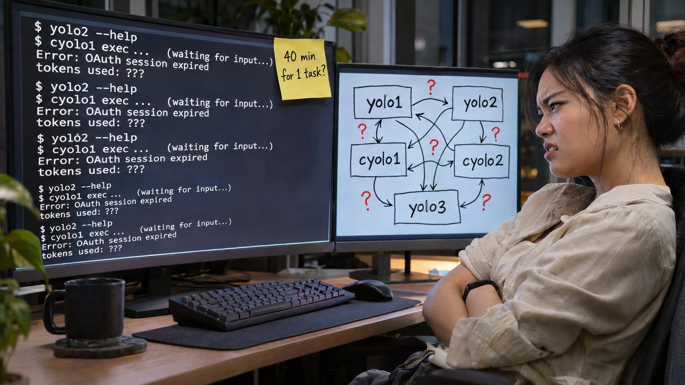

*(ภาพจำลอง)*

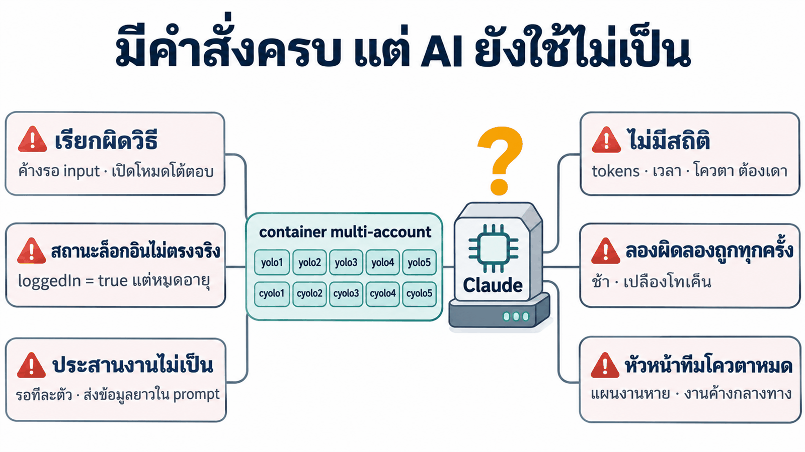

| เพนพอยต์ | สิ่งที่เกิดขึ้นจริง |
|---|---|
| เรียกผิดวิธี | `codex exec` ที่ไม่ปิด stdin จะค้างรอ input · ไม่ใส่ `-p` จะเปิดโหมดโต้ตอบ · exit code 0 ไม่ได้แปลว่าสำเร็จ |
| สถานะล็อกอินไม่ตรงจริง | `auth status` ตอบ `loggedIn: true` แต่เรียกจริงได้ `OAuth session expired` |
| ประสานงานไม่เป็น | สั่งทีละบัญชีแล้วรอ · ยัดข้อมูลยาวลง prompt · ไม่มีที่แชร์ความรู้ระหว่างกัน |
| ไม่มีสถิติ | ไม่รู้ว่าแต่ละบัญชีใช้โทเค็น เวลา และโควตาไปเท่าไร |
| ลองผิดลองถูกทุกครั้ง | เปิด `--help` ซ้ำ เขียนสคริปต์ช่วยใหม่ทุกครั้ง ช้าและเปลืองโทเค็น |
| หัวหน้าทีมโควตาหมด | แผนงานอยู่ในบริบทแชตของหัวหน้า เมื่อบัญชีหัวหน้าหยุด งานที่ค้างหายไปด้วย |

### 1.1 ทดลองก่อนมีสกิล: Claude Code app สั่งทีมใน container

ทุกการทดลองในบทนี้เริ่มจาก**วางพรอมต์ใน Claude Code app** แล้ว Claude Code app เข้าไปทำงานใน container ผ่าน `docker exec` การทดลองนี้ให้ Claude Code app เป็นหัวหน้าทีม สั่งบัญชี Claude และ Codex ใน container ทำงาน 4 ขั้น โดย**ใน container ยังไม่มีสกิล**


หลังกด Enter พรอมต์จะทำงานตามลำดับนี้: เข้า container ด้วย `docker exec` → หาสกิลตาม path ที่กำหนด → สร้างโฟลเดอร์ทำงาน `/workspace/team-demo` → ให้แต่ละบัญชีทำงานจริง รอบนี้ยังไม่มีสกิลใน path จึงต้องหาวิธีเอง ส่วนในขั้นที่ 3 จะพบสกิลแล้วอ่านมาใช้


บรรทัด "ก่อนเริ่ม ดูว่าใน container มีสกิล…" ใส่ไว้ทั้งรอบก่อนและหลังมีสกิล เพื่อให้เทียบกันได้ยุติธรรม และเป็นวิธีที่ทำให้ Claude Code app รู้จักสกิลใน container

> [!IMPORTANT]
> **📋 คัดลอกกล่องนี้ → Claude Code app แล้วกด Enter**
>
> ```text
> ใช้ทีมเอเจนต์ใน container multi-account ทำงานต่อไปนี้ ทำงานใน container ผ่าน docker exec เท่านั้น (บัญชี yolo1–5 และ cyolo1–5 ใช้เฉพาะบัญชีที่พร้อม)
> ก่อนเริ่ม ดูว่าใน container มีสกิลที่ช่วยงานนี้ได้หรือไม่ (/root/ai-accounts/.Claude/shared/skills) ถ้ามีให้อ่านและใช้
> โฟลเดอร์งานใน container: /workspace/team-demo
> 1. ให้บัญชี Claude 1 บัญชี และบัญชี Codex 1 บัญชี เขียนฟังก์ชัน Python parse_duration(text) ที่แปลง "1h30m", "45s", "2h" เป็นจำนวนวินาที คนละแบบพร้อมกัน บันทึกเป็น a_claude.py และ a_codex.py
> 2. ส่งทั้งสองไฟล์ให้บัญชี Codex อีกบัญชีหนึ่งเลือกแบบที่ดีกว่าและบอกจุดที่ต้องแก้
> 3. ส่งคำแนะนำนั้นให้บัญชี Claude แก้เป็น final.py แล้วรันทดสอบ 5 กรณี
> 4. สรุปตาราง บัญชี | งาน | เวลา (วินาที) | input tokens | output tokens | สำเร็จ/ล้ม ตัวเลขต้องมาจากผลจริงของแต่ละบัญชี ห้ามประมาณ
> 5. บอกโควตาที่เหลือของแต่ละบัญชีที่ใช้
> ```

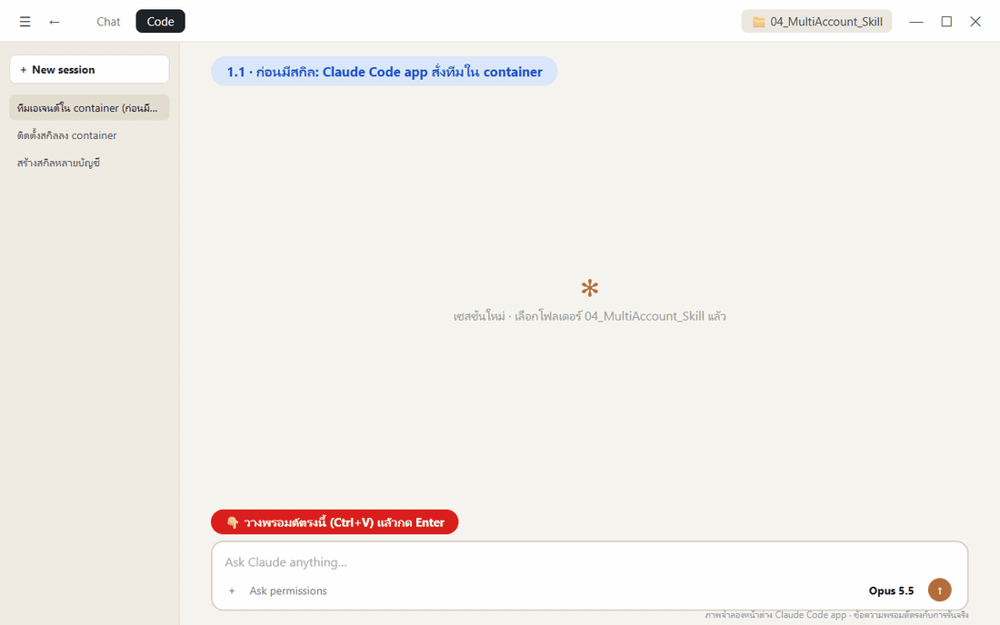

**ผลจริง** (8 พ.ย. 2026): งานเสร็จและ `final.py` ผ่าน 5/5 แต่ใช้เวลารวม **810.2 วินาที** และ Claude Code app ใช้ไป 30 คำสั่ง (ล้ม 9 คำสั่ง)

| สิ่งที่สังเกตได้ | รายละเอียด |
|---|---|
| สำรวจระบบเอง | ไล่เปิด container อื่น โฟลเดอร์บัญชี และ `/usr/local/lib/multi-account` · หลายคำสั่งล้มเพราะ Git Bash แปลง path |
| **ยุ่งกับไฟล์ credential** | ไล่ตรวจ `.credentials.json` ทุกบัญชี และ**เปิดอ่าน `auth.json` ของ Codex** เพื่อเทียบตัวตนของบัญชี ซึ่งไม่ควรเกิดขึ้น |
| อ่านโค้ดเบื้องหลังเอง | เปิดอ่านโค้ด wrapper ของ `yoloN` / `cyoloN` เพื่อเดาวิธีเรียก |
| เขียนเครื่องมือช่วยเอง | เขียน `run_agent.py` สำหรับเรียกบัญชีและจับเวลาขึ้นมาใหม่ แล้วคัดลอกเข้า container |

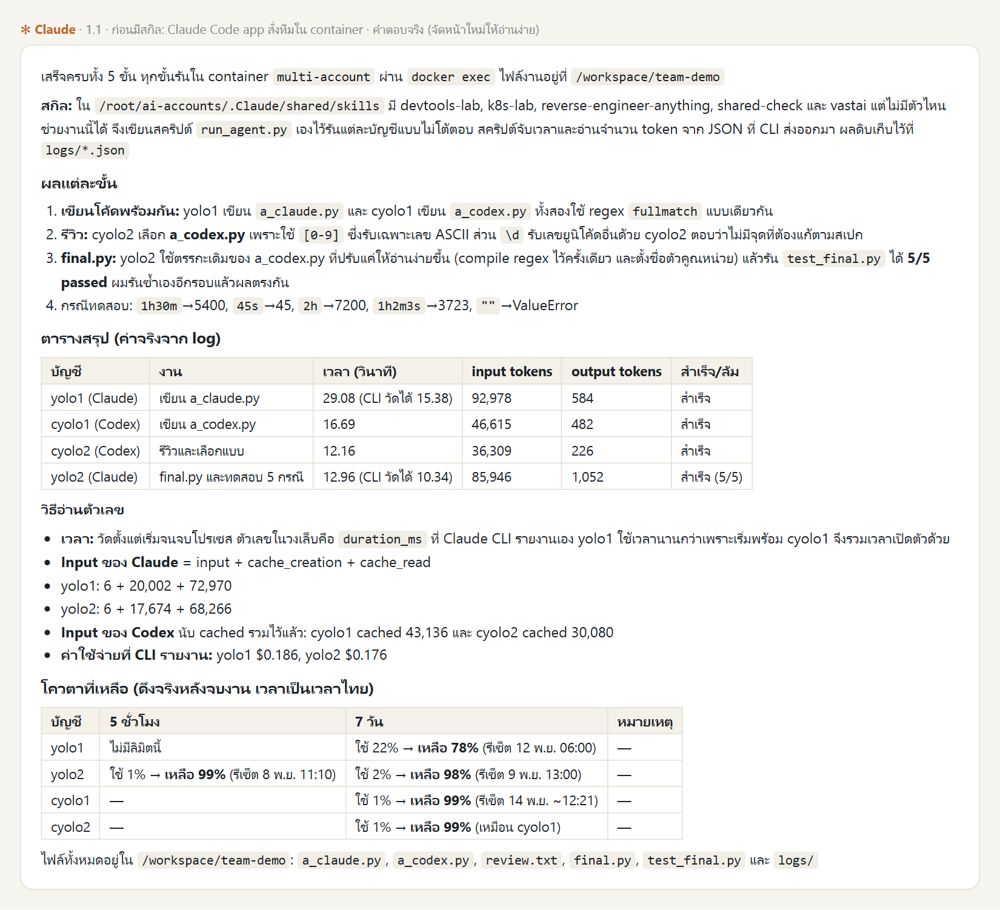

*คำตอบจริง ตัดส่วนที่ระบุบัญชีที่ล็อกอินและข้อมูลแพ็กเกจของเครื่องผู้สอนออก · ในการทดลองก่อนหน้าที่สั่ง `yolo1` ใน container โดยตรง หัวหน้าทีมเรียก `codex exec` โดยไม่ปิด stdin จนค้างนานกว่า 600 วินาที*

## 2. ทำไมสกิลแก้ปัญหานี้ได้

ความรู้ทั้งหมดในหัวข้อ 1 คือ **"รู้ว่าทำอย่างไร"** ซึ่งเป็นสิ่งที่สกิลเก็บไว้ได้ตามหลักใน [บททฤษฎีสกิล](../../00_week01/05_agent-skills/01_skill-theory/README.md):

- **งานซ้ำให้สคริปต์ทำ งานคิดให้ AI ทำ:** การเรียกบัญชีให้ถูก flag การตรวจความพร้อม การจับเวลา และการรวมสถิติต้องได้ผลเหมือนเดิมทุกครั้ง จึงเขียนเป็นสคริปต์ในสกิล ส่วนการแบ่งงานและตัดสินใจเป็นหน้าที่ของ AI
- **เปิดทีละชั้น (progressive disclosure):** AI เห็นแค่ชื่อและคำอธิบายของสกิลตลอดเวลา เปิด `SKILL.md` เมื่อจะใช้ และเปิดสคริปต์หรือรายละเอียดเมื่อถึงขั้นนั้นเท่านั้น

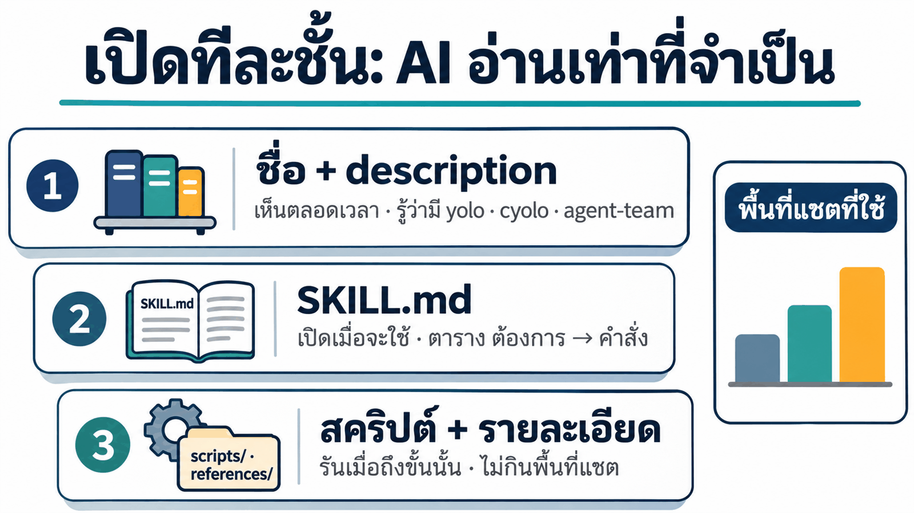

## 3. ออกแบบสกิล 3 ตัว

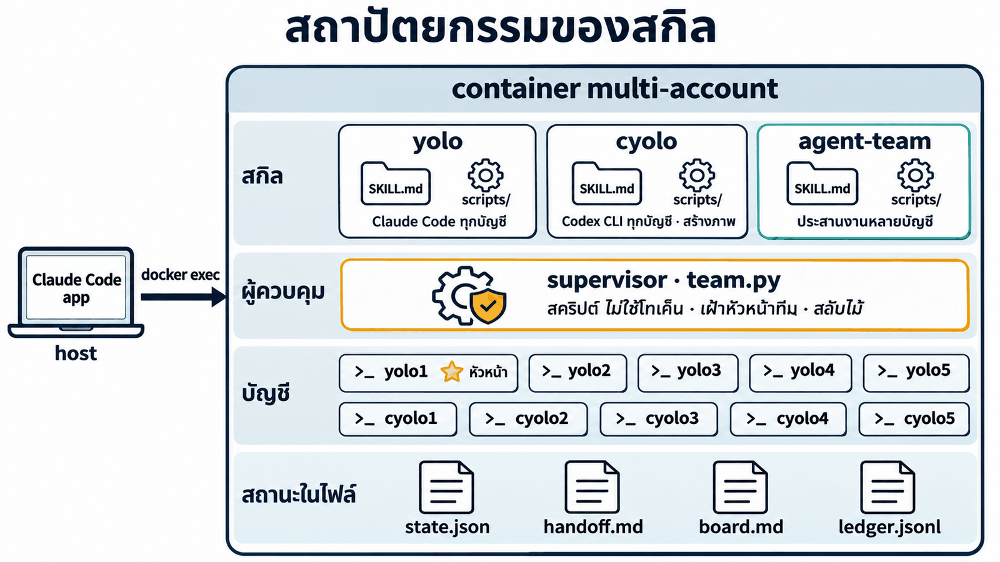

| สกิล | รู้เรื่องอะไร | สคริปต์ |
|---|---|---|
| `yolo` | เรียก Claude Code ทุกบัญชีแบบไม่โต้ตอบ เลือกรุ่นและ effort ตามความยาก ตรวจความพร้อมด้วยการเรียกจริง โควตา | `yolo.py` |
| `cyolo` | เรียก Codex ทุกบัญชี เลือกรุ่นจาก `models_cache.json` สร้างภาพ ตรวจความพร้อม โควตาจาก rollout | `cyolo.py` |
| `agent-team` | ให้หลายบัญชีทำงานร่วมกัน ทั้งใน CLI เดียวกันและข้าม CLI ส่งข้อมูล แชร์ความรู้ บริหารโทเค็น สลับหัวหน้าทีม และสรุปสถิติทั้งทีม | `team.py` |

ทั้งสามสกิลใช้ตารางความยากเดียวกัน (1 = งานง่ายใช้รุ่นเล็ก effort ต่ำ ถึง 6 = งานใหญ่) จึงไม่ต้องใช้รุ่นแพงกับทุกงาน

```text
skills/
├── yolo/        SKILL.md · scripts/ · references/
├── cyolo/       SKILL.md · scripts/ · references/
└── agent-team/  SKILL.md · scripts/team.py · references/
```

### 3.1 รูปแบบการทำงานร่วมกัน

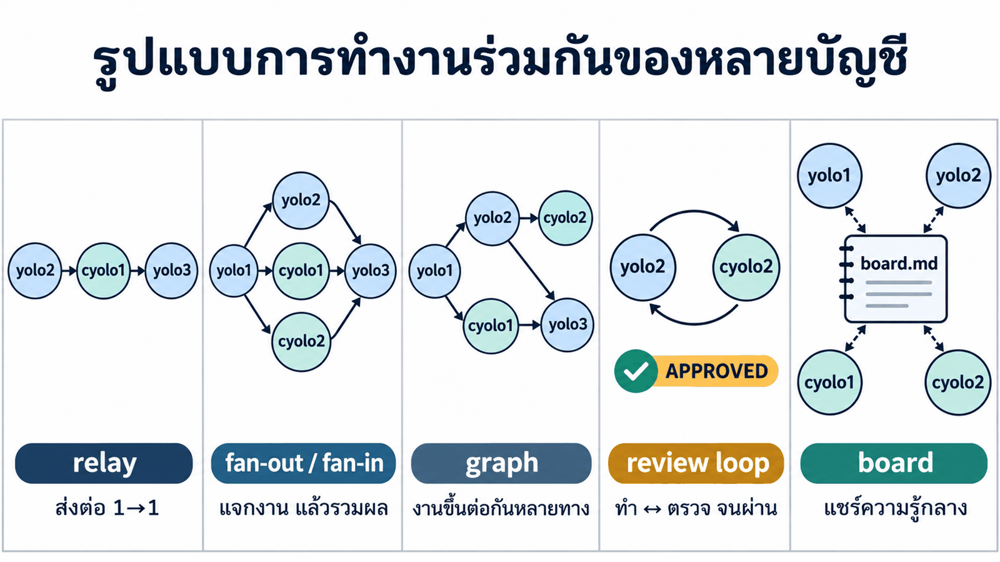

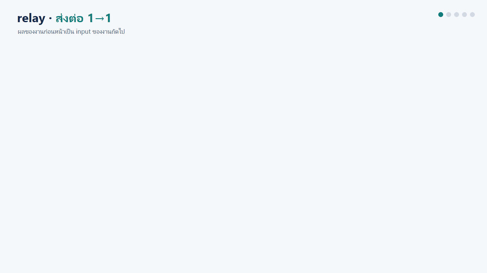

| รูปแบบ | ใช้เมื่อ | การส่งข้อมูล |
|---|---|---|
| relay | งานเป็นลำดับ ผลก่อนหน้าเป็น input ของงานถัดไป | `{{node}}` แทรกค่าสั้นลง prompt |
| fan-out / fan-in | งานย่อยไม่ขึ้นต่อกัน ทำพร้อมกันแล้วรวมผล | งานรวมผลอ่านไฟล์ `{{file:node}}` ทุกตัว |
| graph | งานขึ้นต่อกันหลายทาง | ระบุ `depends_on` ตัวจัดคิวรันงานที่พร้อมให้เอง |
| review loop | ต้องการคุณภาพ ให้อีกบัญชีตรวจจนผ่าน | วนจนผู้ตรวจตอบ `APPROVED` หรือครบ `max_rounds` |
| board | agent ที่มาทีหลังควรรู้สิ่งที่ทีมค้นพบแล้ว | ทุก agent อ่าน `board.md` ก่อนเริ่ม และเพิ่มข้อค้นพบต่อท้าย |

ข้อมูลยาวส่งเป็น **path ของไฟล์** ไม่ยัดลง prompt ผลของทุกงานอยู่ในโฟลเดอร์ของ run (`/workspace/.agent-team/<run_id>/`) ซึ่งบนเครื่องเราคือ `03_MultiAccount_Container/workspace/.agent-team/<run_id>/`

### 3.2 รูปแบบขั้นสูง

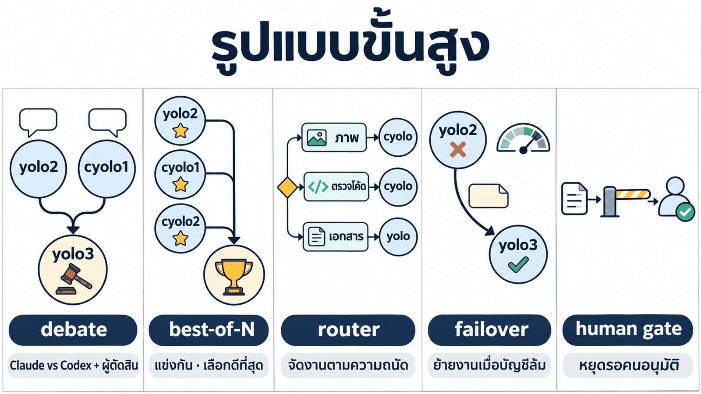

| รูปแบบ | ความหมาย |
|---|---|
| debate / ตรวจไขว้ | Claude และ Codex ตอบโจทย์เดียวกันแยกกัน ผู้ตัดสินเทียบและสรุปพร้อมเหตุผล ลดคำตอบผิดจากโมเดลเดียว |
| best-of-N + judge | หลายบัญชีทำงานเดียวกัน ผู้ตัดสินให้คะแนนตามเกณฑ์แล้วเลือกผลที่ดีที่สุด |
| router | เลือกฝั่งให้อัตโนมัติตามชนิดงาน: ภาพ → cyolo · ตรวจโค้ด → Codex · เอกสารยาว → Claude |
| failover | งานที่ล้มเพราะโควตาหมดหรือล็อกอินหมดอายุ ย้ายไปบัญชีอื่น (ยกเว้นงานที่ผู้ใช้ระบุบัญชีเอง) |
| human gate | หยุดรอคนอนุมัติก่อนขั้นที่เสียเงินหรือแก้ของจริง |

รูปแบบอื่นที่ต่อยอดได้จากสคริปต์เดียวกัน: ทีมซ้อนทีม (หัวหน้าคุมหัวหน้าย่อย), โหวตเสียงข้างมาก, map-reduce ข้อมูลใหญ่, ยิงซ้ำเผื่อ (hedging) สำหรับงานเร่งด่วน และ planner–executor–critic

### 3.3 สถิติทุกบัญชี (ledger)

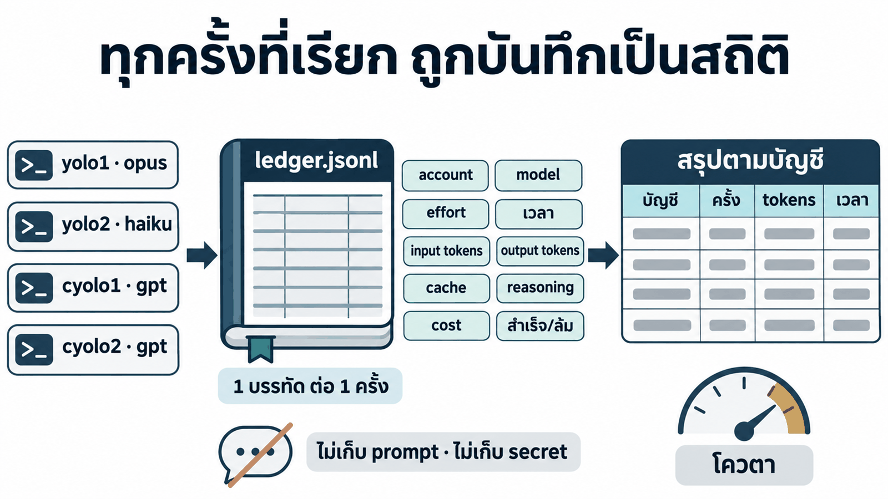

- ทุกครั้งที่สคริปต์ของสกิลเรียกบัญชีใด จะเพิ่ม 1 บรรทัดใน `/workspace/.agent-team/ledger.jsonl`
- `team.py stats` สรุปตามบัญชี ตามรุ่น และตามงาน · `team.py quota` แสดงโควตาพร้อม**เวลาของข้อมูล**
- ledger **ไม่เก็บข้อความ prompt และ secret** เก็บแค่จำนวนตัวอักษร

### 3.4 หัวหน้าทีมบริหารโทเค็นของลูกทีม

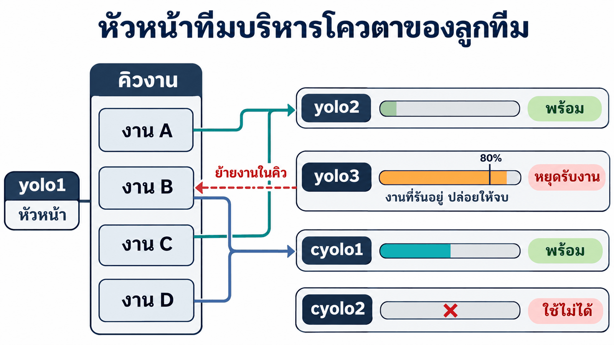

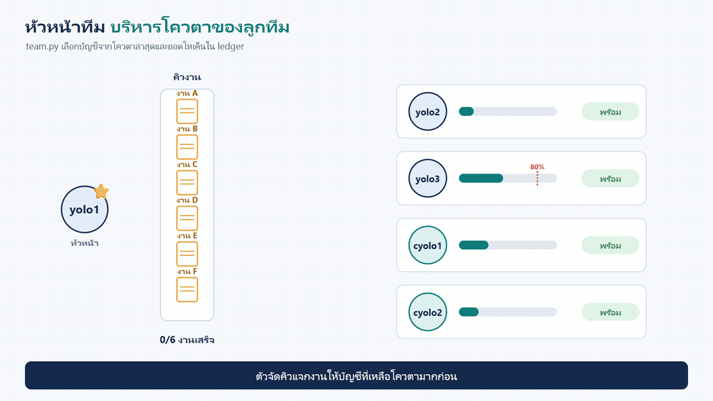

| สถานการณ์ | ตัวจัดคิวทำอะไร |
|---|---|
| ก่อนสั่งงาน | อ่านโควตาล่าสุดและยอดโทเค็นใน ledger แล้วแจกให้บัญชีที่เหลือมากก่อน งานง่ายใช้รุ่นเล็ก |
| ลูกทีมใกล้หมด (≥ 80% หรือเกินงบ) | **หยุดรับงานใหม่** งานที่รันอยู่ปล่อยให้จบ งานในคิวย้ายไปคนอื่น |
| ลูกทีมล้มกลางคัน | ย้ายงานไปบัญชีอื่น พร้อมความคืบหน้าใน `msgs/` |
| งานที่ผู้ใช้ระบุบัญชีเอง | ไม่ย้ายเงียบ ๆ หยุดและรายงาน |

### 3.5 สลับหัวหน้าทีมโดยงานไม่หาย

ถ้าแผนงานอยู่ในบริบทแชตของหัวหน้า เมื่อโควตาของบัญชีหัวหน้าหมด แผนและงานที่ค้างจะหายไปด้วย วิธีแก้คล้ายการส่งเวรของพยาบาล: ก่อนออกเวร ต้องเขียนสรุปว่าทำอะไรไปแล้ว อะไรกำลังทำ และต้องทำอะไรต่อ


*(ภาพจำลอง) `handoff.md` ทำหน้าที่เดียวกับใบส่งเวร*

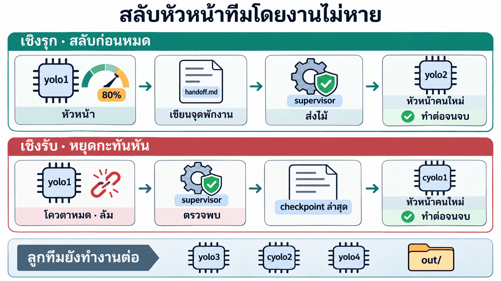

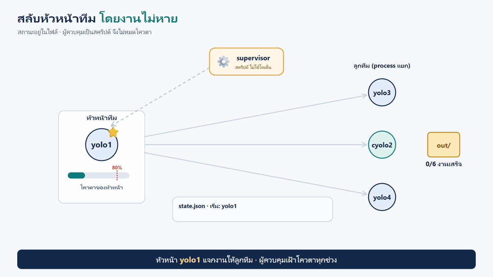

| หลักการ | รายละเอียด |
|---|---|
| สถานะอยู่ในไฟล์ | `state.json` (งานทั้งหมด หัวหน้าปัจจุบัน ประวัติการสลับ) และ `handoff.md` (สรุปสำหรับคนรับไม้) |
| ผู้ควบคุมเป็นสคริปต์ | `team.py lead` ไม่ใช้โทเค็นจึงไม่หมดโควตา รันหัวหน้าเป็นรอบสั้น ๆ ทุกรอบต้องเขียน checkpoint |
| ลูกทีมไม่ผูกกับหัวหน้า | ลูกทีมรันเป็น process แยก หัวหน้าเปลี่ยนตัวแล้วงานที่สั่งไปไม่หาย |
| สลับเชิงรุก | โควตาหัวหน้า ≥ 80% หรือเกินงบโทเค็น → ส่งไม้ตั้งแต่ยังเหลือพอเขียน checkpoint |
| สลับเชิงรับ | หัวหน้าล้ม ติด rate limit หรือเงียบไป → เริ่มหัวหน้าคนใหม่จาก checkpoint ล่าสุด |
| ผู้สืบทอด | บัญชีที่พร้อมและโควตาเหลือมากสุด ฝั่งเดียวกันก่อนแล้วจึงข้ามฝั่ง (หัวหน้าเป็น Codex ได้) |

### 3.6 Claude Code app เข้าใจระบบใน container ได้อย่างไร

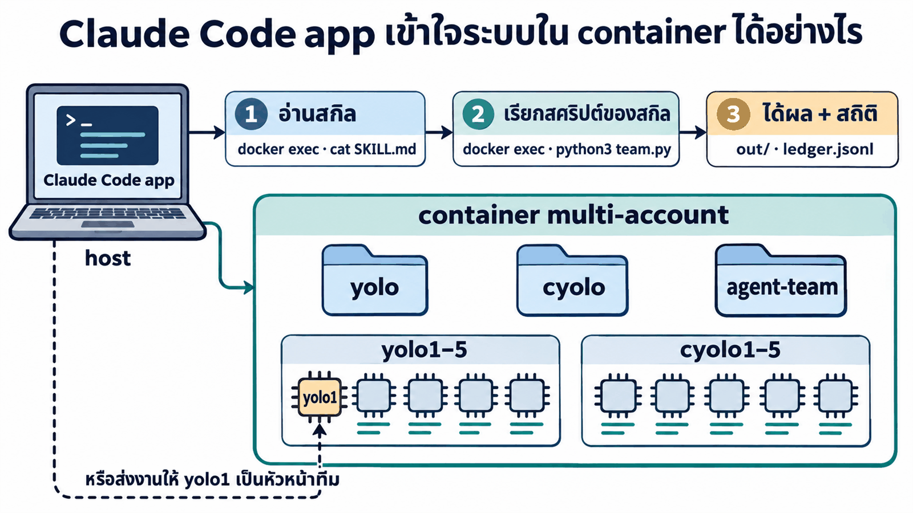

- **ใน container:** `yoloN` และ `cyoloN` โหลดสกิลจาก `shared/skills` อัตโนมัติ
- **จาก host:** ทุก `SKILL.md` มีหัวข้อ "เรียกจาก host" บอกวิธีอ่านสกิลและเรียกสคริปต์ผ่าน `docker exec` หรือส่งงานให้ `yolo1` ใน container เป็นหัวหน้าทีม

## 4. สกิลเก็บไว้ที่ไหน: volume และโฟลเดอร์สำรอง

สกิลถูกติดตั้งไว้ใน `/root/ai-accounts/.Claude/shared/skills` และ `/root/ai-accounts/.Codex/shared/skills` ซึ่งอยู่ใน **volume `ai-accounts`** ทุกบัญชีลิงก์เข้ามาที่นี่ สกิลจึงคงอยู่แม้ลบ container แต่เมื่อย้ายไป**เครื่องใหม่**หรือสร้าง **volume ใหม่** สกิลเหล่านี้จะไม่ติดไปด้วย จึงเก็บโฟลเดอร์ `skills/` สำรองไว้**นอก container** แล้วคัดลอกไปติดตั้งได้ทันทีโดยไม่ต้องสร้างสกิลใหม่

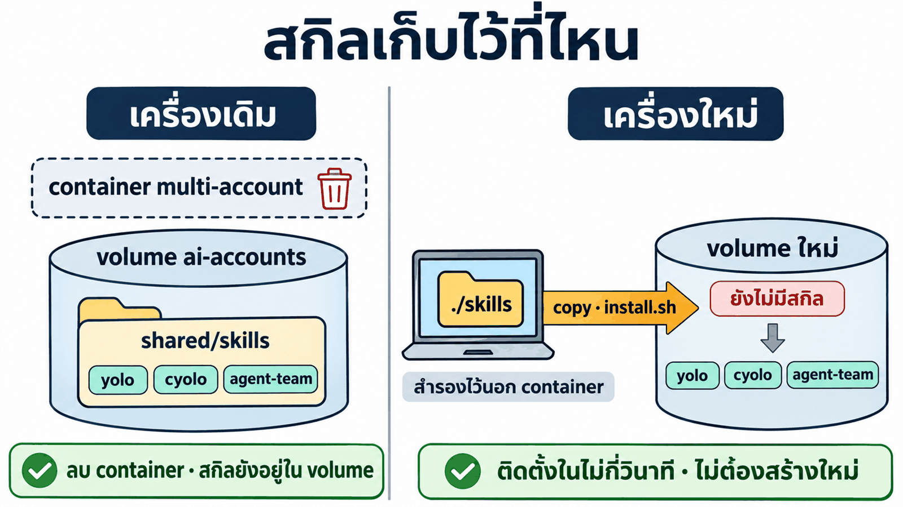

| ที่เก็บ | อยู่ที่ไหน | เมื่อลบ container | เมื่อย้ายเครื่อง / volume ใหม่ |
|---|---|---|---|
| โฟลเดอร์สำรอง `skills/` | บนเครื่องเรา (เก็บใน Git ได้) | ยังอยู่ | **นำไปติดตั้งใหม่ได้** |
| `shared/skills` | volume `ai-accounts` | ยังอยู่ | ไม่ติดไป |
| container | ชั้นที่เขียนได้ของ container | หายไป | ไม่ติดไป |

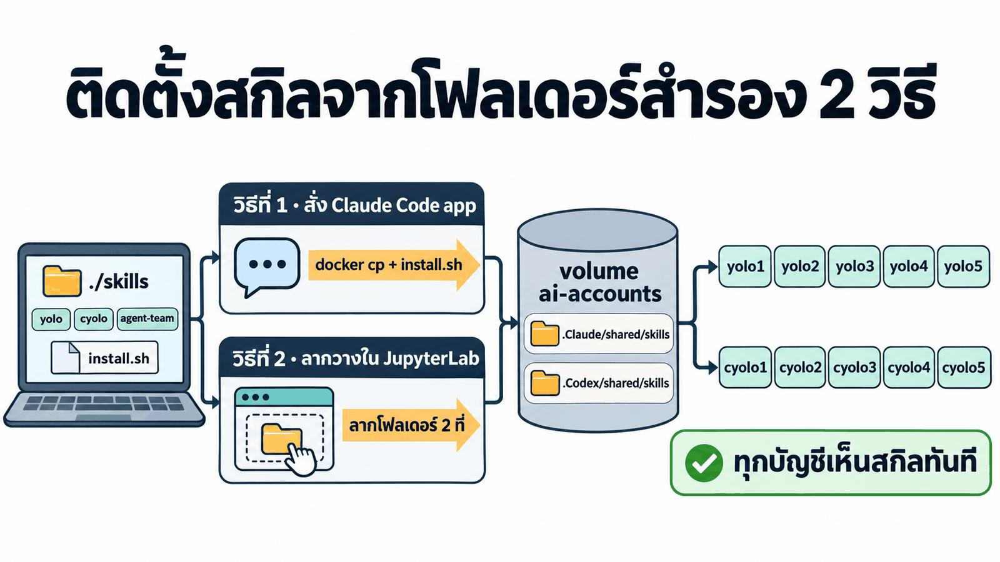

โฟลเดอร์สำรองมี**แค่ 3 โฟลเดอร์สกิล** ไม่มีสคริปต์ติดตั้ง เมื่อเปิดบัญชี `yoloN` หรือ `cyoloN` ครั้งถัดไป wrapper ใน image จะเชื่อมสกิลจาก `shared/skills` ให้บัญชีนั้นเอง

## 5. ภาพรวมขั้นตอนการทดลอง

| ขั้น | ทำที่ไหน | เวลารันจริง |
|---|---|---|
| **0 · ตรวจว่ามี image แล้วเปิด container** | Claude Code app | – |
| **1 · ให้ Claude สร้างสกิลจากสเปก (จากศูนย์)** | Claude Code app | ~43 นาที |
| **2 · ติดตั้งสกิลด้วยการคัดลอกโฟลเดอร์** | Claude Code app (หรือลากวางใน JupyterLab) | 67.9 วินาที |
| **3 · ทดสอบงานทีมชุดเดิมอีกครั้ง** | Claude Code app | 170.5 วินาที |
| **4 · สลับหัวหน้าทีมและบริหารโทเค็น** | Claude Code app | 138.6 วินาที (run 69 วินาที) |

> [!CAUTION]
> **ไม่มี image `multi-account:1.0` หรือ `tuchsanai/multi-account:1` = เริ่มบทนี้ไม่ได้** ทุกขั้นทำงานใน container ที่สร้างจาก image นี้ ถ้ายังไม่มี พรอมต์ใน[ขั้นที่ 0](#ขั้นที่-0--ตรวจว่ามี-image-แล้วเปิด-container) จะดึงจาก Docker Hub ให้

**ต้องมีก่อน:** image `multi-account:1.0` หรือ `tuchsanai/multi-account:1`

บทนี้ใช้ค่าต่อไปนี้จากบท 03 โดยตรง

| ค่า | ชื่อ | ใช้ในบทนี้ |
|---|---|---|
| image | `multi-account:1.0` (ของ Docker Hub คือ `tuchsanai/multi-account:1`) | ต้นแบบของ container |
| container | `multi-account` | ทุกคำสั่ง `docker exec` และ `docker cp` |
| volume | `ai-accounts` → `/root/ai-accounts` | ล็อกอินทุกบัญชี และ `shared/skills` |
| โฟลเดอร์งาน | `03_MultiAccount_Container/workspace` → `/workspace` | ผลงานและข้อมูลของทุก run |
| JupyterLab | `http://localhost:8886/lab` | ลากวางสกิลในขั้นที่ 2 (ถ้าบท 03 ใช้ port อื่น ให้เปลี่ยน `8886`) |

สกิลและพรอมต์ระบุชื่อ `multi-account` ไว้ตายตัว ขั้นที่ 0 จึงเปิด container ด้วยชื่อนี้ ส่วน `/maccount` สร้าง container ชื่อ `multi-account-devtool` จึงใช้กับบทนี้ไม่ได้

**เปิดโฟลเดอร์งาน:** ใน Claude Code app เลือก **Code** → **New session** → เลือกโฟลเดอร์ `04_MultiAccount_Skill` ของรีโปนี้

```text
04_MultiAccount_Skill/
├── prompt_skill_spec.md   ← สเปกของสกิล 3 ตัว: ต้องทำอะไร + เกณฑ์ทดสอบ (input ที่ 1)
├── prompt_skill_hints.md  ← ข้อเท็จจริงที่วัดแล้ว + กับดักจากการใช้งานจริง (input ที่ 2)
└── _solution/
    ├── skills/            ← สกิลที่ได้จากการรันจริง = โฟลเดอร์สำรองพร้อมติดตั้ง
    ├── TEST-REPORT.md     ← รายงานทดสอบของขั้นที่ 1
    └── BENCHMARK.md       ← ผลวัด: สกิลจากศูนย์เทียบกับสกิลชุดเดิม
```

## ขั้นที่ 0 · ตรวจว่ามี image แล้วเปิด container

บทนี้เริ่มจากคำถามเดียว: **มี image หรือไม่** พรอมต์นี้ทำงานได้ 2 โหมด

| โหมด | เงื่อนไข | สิ่งที่พรอมต์ทำ |
|---|---|---|
| **มี image** | มี `multi-account:1.0` หรือ `tuchsanai/multi-account:1` ในเครื่อง | ใช้ตัวที่มี แล้วเปิด container |
| **ไม่มี image** | ไม่มีทั้งสองตัว | `docker pull tuchsanai/multi-account:1` (image สำเร็จรูปของผู้สอน) แล้วเปิด container |


> [!IMPORTANT]
> **📋 คัดลอกกล่องนี้ → Claude Code app แล้วกด Enter**
>
> ```text
> เตรียม image แล้วเปิด container สำหรับบท 04 ห้ามลบ container / image / volume ที่มีอยู่ และห้ามล็อกอินแทนผม
> 1. ตรวจว่ามี image multi-account:1.0 หรือ tuchsanai/multi-account:1 ในเครื่องหรือไม่ (docker image inspect)
>    - โหมดมี image: ใช้ตัวที่มี
>    - โหมดไม่มี image (ไม่มีทั้งสองตัว): docker pull tuchsanai/multi-account:1
>    จากนั้นถ้ายังไม่มีชื่อ multi-account:1.0 ให้สั่ง docker tag tuchsanai/multi-account:1 multi-account:1.0
> 2. ถ้า container multi-account กำลังรันอยู่แล้ว ใช้ตัวเดิม ถ้าหยุดอยู่ให้ docker start ถ้ายังไม่มีให้สร้างด้วย
>    docker run -dit --name multi-account --privileged -p <PORT>:8888 -v ai-accounts:/root/ai-accounts -v <path เต็มของ ../03_MultiAccount_Container/workspace>:/workspace multi-account:1.0
>    PORT เริ่มที่ 8886 ถ้าชนใช้เลขว่างถัดไป และสร้างโฟลเดอร์ workspace ถ้ายังไม่มี
> 3. รอจน http://localhost:<PORT>/lab ตอบ 200 แล้วดูสถานะล็อกอิน yolo1..5 (yoloN auth status ดูแค่ loggedIn) และ cyolo1..5 (cyoloN login status) ห้ามแสดงอีเมล องค์กร หรือ token
> สรุปเป็นตาราง โหมดที่ใช้ (มี image / pull) | image | container | URL ของ JupyterLab | บัญชี | ล็อกอินแล้ว/ยัง แล้วหยุด
> ```

จบขั้นนี้แล้ว ทุกส่วนจะเชื่อมกันตามภาพนี้


ขั้นถัดไปใช้บัญชีจริง ถ้ายังไม่ได้ล็อกอิน ให้ล็อกอินอย่างน้อย 1 บัญชี Claude กับ 1 บัญชี Codex ตาม[ขั้นที่ 3 ของบท 03](../03_MultiAccount_Container/README.md#ขั้นที่-3--ล็อกอินและให้-claude-ตรวจสถานะ-15-นาที)

ถ้าต้องการ build image เอง ให้ทำ[ขั้นที่ 1 ของบท 03](../03_MultiAccount_Container/README.md#ขั้นที่-1--ให้-claude-สร้าง-image-30-นาที) ก่อนเริ่มขั้นนี้

## ขั้นที่ 1 · ให้ Claude สร้างสกิลจากสเปก (~43 นาที)

### 1.1 · input

Claude สร้างสกิล**จากศูนย์** ไม่มีสกิลชุดเก่าให้ลอก ทุกอย่างที่ต้องรู้อยู่ในไฟล์ markdown 2 ไฟล์

| input | บทบาท |
|---|---|
| [`prompt_skill_spec.md`](prompt_skill_spec.md) | **ต้องทำอะไร:** สกิล 3 ตัว, รูปแบบการทำงานร่วมกัน, การบริหารโทเค็น, การสลับหัวหน้าทีม, ledger, การใช้งานจาก host, การติดตั้งด้วยการคัดลอก และเกณฑ์ทดสอบ |
| [`prompt_skill_hints.md`](prompt_skill_hints.md) | **รู้อะไรแล้วบ้าง:** ข้อเท็จจริงของแต่ละ CLI ที่วัดจากการรันจริง (flag, รูปแบบ JSON, โควตา, ตัวเลขเวลา) และกับดักที่เห็นจากการที่ Claude Code app ใช้สกิลทำงานจริง |

| หัวข้อในสเปก | สาระ |
|---|---|
| เป้าหมาย | 3 สกิล แต่ละตัวเป็น `SKILL.md` + `scripts/` + `references/` · Python มาตรฐาน |
| ผู้ใช้ 2 ฝั่ง | ใน container และ Claude Code app บน host (ผ่าน `docker exec`) |
| ข้อเท็จจริงจากการทดลอง | flag ที่ถูก, การปิด stdin, exit code ไม่ใช่ตัวบอกผล, `auth status` ไม่ตรงจริง, ตำแหน่งโควตา |
| agent-team | run directory, รูปแบบพื้นฐาน 5 แบบ, ขั้นสูง 5 แบบ, บริหารโทเค็นลูกทีม, สลับหัวหน้าทีม |
| ใช้งานให้จบในไม่กี่คำสั่ง | กราฟตัวอย่างใน `SKILL.md`, `run` จบด้วยตาราง + โควตา, `--resume`, คำสั่งที่ใช้ได้ทั้ง PowerShell และ Git Bash, คำสั่งสาธิตหัวหน้าทีมคำสั่งเดียว |
| ledger / การติดตั้ง / ทดสอบ / รายงาน | ฟิลด์ที่ต้องเก็บ, ติดตั้งด้วยการคัดลอกโฟลเดอร์อย่างเดียว, เกณฑ์ PASS/FAIL/SKIP และทดสอบแบบผู้ใช้จริง |

| หัวข้อใน hint | สาระ |
|---|---|
| สภาพแวดล้อมใน container | wrapper `yoloN` / `cyoloN` ตั้งค่าอะไรให้ · ไฟล์ที่ห้ามอ่าน |
| Claude Code / Codex CLI | ค่าที่วัดได้ (เวลา โทเค็น), JSON ที่ได้, สถานะล็อกอิน, โควตา (`/usage`, rollout), สร้างภาพ |
| ความเร็ว | งานขนานต่อบัญชี, ส่ง path แทนข้อมูลยาว, งานภาพเป็นคอขวด |
| บทเรียนจากการใช้งานจริง | สิ่งที่ทำให้ Claude Code app ช้าหรือล้ม → สิ่งที่สกิลควรทำ (หา container, path ใน Git Bash, `expect` เข้มเกิน, สาธิตหัวหน้าทีม ฯลฯ) |

### 1.2 · วางพรอมต์

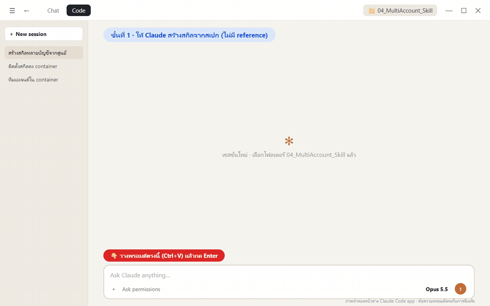

> [!IMPORTANT]
> **📋 คัดลอกกล่องนี้ → Claude Code app แล้วกด Enter**
>
> ```text
> ช่วยสร้างสกิลชุดใหม่ที่ทำให้ AI ใช้ระบบหลายบัญชีใน container multi-account ได้เต็มประสิทธิภาพ
> ทำในโฟลเดอร์นี้ ใช้คำสั่ง docker ได้ แต่ห้ามลบ หยุด หรือสร้าง container / volume ใหม่ ห้ามแตะ credential และห้ามล็อกอินแทนผม
>
> วัตถุดิบ
> - ./prompt_skill_spec.md = สเปกของสกิล 3 ตัว (yolo, cyolo, agent-team) ทุกข้อต้องเป็นจริง
> - ./prompt_skill_hints.md = ข้อเท็จจริงที่วัดมาแล้วและกับดักที่พบจากการใช้งานจริง ใช้แทนการลองผิดลองถูก
> - container multi-account ที่กำลังรัน = ที่ทดสอบจริง (บัญชีที่พร้อมอาจมีไม่ครบ ให้ตรวจเอง)
>
> สร้างจากศูนย์ไว้ใน ./skills (นอก container นี่คือต้นฉบับที่เก็บสำรอง)
> ทดสอบ: คัดลอกโฟลเดอร์สกิลใน ./skills ไปวางที่ shared ของทั้งสองฝั่งใน container แล้วทดสอบทุกข้อในหัวข้อ "ทดสอบ" ของสเปก
> ใช้บัญชีอย่างประหยัด (haiku/low กับงานทดสอบ) ข้อที่ต้องใช้บัญชีที่ไม่พร้อม = SKIP
> เขียน ./TEST-REPORT.md (นอกโฟลเดอร์ skills) แล้วสรุปเป็นตารางสั้น ๆ: ผลทดสอบ ไฟล์ที่สร้าง และเวลาที่ใช้ แล้วหยุด
> ```

**หลักการออกแบบพรอมต์**

- **แยก "ต้องทำอะไร" ออกจาก "รู้อะไรแล้วบ้าง":** สเปกบอกเป้าหมายและเกณฑ์ทดสอบ hint บอกข้อเท็จจริงที่วัดแล้ว Claude จึงไม่ต้องลองผิดลองถูกเอง และไม่ต้องมีสกิลเก่าเป็นต้นแบบ
- **hint มาจากการใช้งานจริง:** สังเกตว่า Claude Code app ติดตรงไหนเมื่อใช้สกิล (หา container, path ใน Git Bash, ต้องเปิดโค้ดเพื่อหาวิธีสาธิต) แล้วเขียนเป็นตาราง "สิ่งที่ทำให้ช้า → สิ่งที่สกิลควรทำ"
- **ต้นฉบับอยู่นอก container:** `./skills` คือโฟลเดอร์สำรองที่นำไปติดตั้งเครื่องใหม่ได้
- **ทดสอบทุกข้อด้วยบัญชีจริงแบบประหยัด:** งานทดสอบใช้รุ่นเล็ก และจำลองโควตาหมดแทนการใช้โควตาจริงจนหมด

### 1.3 · ผลจริง

**ผลจริง** (8 พ.ย. 2026 · ~43 นาที · 93 คำสั่ง): **PASS 21 · SKIP บางส่วน 1** ผ่านทุกรูปแบบการทำงานร่วมกัน การสลับหัวหน้าทีมทั้งเชิงรุกและเชิงรับ และการทดสอบแบบผู้ใช้จริง 3 โจทย์ ตลอดการรันไม่ได้เปิดสกิลชุดเก่าเลย

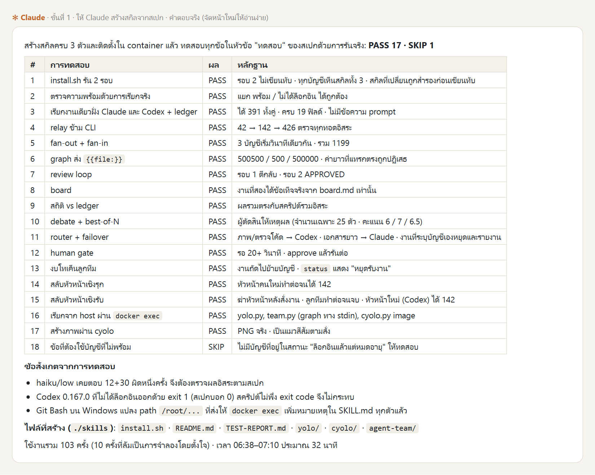

*คำตอบจริง จัดหน้าใหม่ให้อ่านง่าย รายงานฉบับเต็มอยู่ที่ [`_solution/TEST-REPORT.md`](_solution/TEST-REPORT.md) · SKIP บางส่วนคือกรณี `auth status` บอกว่าล็อกอินอยู่แต่ token หมดอายุ ซึ่งไม่มีบัญชีใดอยู่ในสถานะนั้นขณะทดสอบ*

ไฟล์ที่ Claude สร้างเก็บไว้ที่ [`_solution/skills/`](_solution/skills/) เปิดอ่าน [`agent-team/SKILL.md`](_solution/skills/agent-team/SKILL.md) เพื่อดูตัวอย่าง `SKILL.md` ที่เปิดด้วยตาราง "ต้องการ → คำสั่ง" ตามด้วยกราฟพร้อมดัดแปลงและคำสั่งสาธิต

### 1.4 · พิสูจน์: สกิลจากศูนย์ดีกว่าสกิลชุดเดิม

ก่อนหน้านี้ขั้นที่ 1 ใช้ `reference/` (สกิล yolo / cyolo ชุดเก่า ไฟล์ละ ~44 KB) เป็นแหล่งความรู้ ตอนนี้ตัดออกแล้ว จึงต้องวัดว่าสกิลที่สร้างจากศูนย์ไม่แย่ลง วิธีวัด: ให้ Claude Code app ตัวใหม่ทำงาน 3 งาน งานละ 2 รอบ กับสกิลทั้งสองชุด ในวันเดียวกันและด้วยบัญชีชุดเดียวกัน แล้วตรวจผลด้วยสคริปต์อิสระ (B3 เป็นงานที่ไม่อยู่ในสเปก)

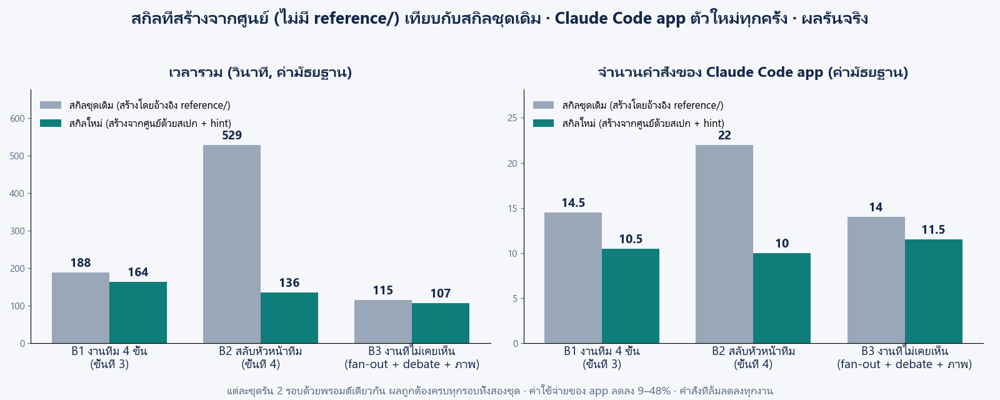

| งาน | ผลถูก | เวลา (วินาที) | คำสั่งของ app | คำสั่งที่ล้ม | ค่าใช้จ่าย app |
|---|---|---|---|---|---|
| B1 งานทีม 4 ขั้น (ขั้นที่ 3) | ครบทั้งสองชุด | 188.1 → **164.1** | 14.5 → **10.5** | 3.5 → **2** | $0.68 → **$0.47** |
| B2 สลับหัวหน้าทีม (ขั้นที่ 4) | ครบทั้งสองชุด | 528.6 → **135.5** | 22 → **10** | 5 → **2.5** | $0.97 → **$0.50** |
| B3 งานที่ไม่เคยเห็น (fan-out + debate + ภาพ) | ครบทั้งสองชุด | 115.1 → **107.4** | 14 → **11.5** | 5 → **3** | $0.58 → **$0.53** |

- **วนปรับ 2 รอบ:** รอบแรกผ่านเกณฑ์แบบหวุดหวิด (app ยังต้องเปิดโค้ดเพื่อหาวิธีสาธิตหัวหน้าทีม และ `check` คืน exit code ผิด) จึงเพิ่มสิ่งที่เห็นลงสเปกและ hint แล้วสร้างใหม่จากศูนย์ รอบที่ 2 ดีกว่าเดิมทุกงาน สเปกและ hint ในโฟลเดอร์นี้คือฉบับรอบที่ 2
- **ขั้นที่ 1 เอง:** ชุดเดิม 32.6 นาที 125 คำสั่ง (ล้ม 19) · รอบที่ 2 42.9 นาที 93 คำสั่ง (ล้ม 3) ใช้เวลานานกว่าเพราะมีข้อทดสอบแบบผู้ใช้จริงเพิ่ม
- **สร้างจากศูนย์จริง:** ไล่ตรวจทุกคำสั่งของตัวสร้างแล้ว ไม่มีการเปิดสกิลชุดเก่าเลย

ตัวเลขทุกรอบ พรอมต์ทดสอบ และสคริปต์ตรวจผล: [`_solution/BENCHMARK.md`](_solution/BENCHMARK.md)

## ขั้นที่ 2 · ติดตั้งสกิลด้วยการคัดลอกโฟลเดอร์ (67.9 วินาที)

ติดตั้ง = คัดลอกโฟลเดอร์ `yolo`, `cyolo` และ `agent-team` ไปวางใน `shared/skills` ทั้งฝั่ง Claude และ Codex **ไม่ต้องรันสคริปต์ติดตั้ง**

### วิธีที่ 1 · สั่ง Claude Code app

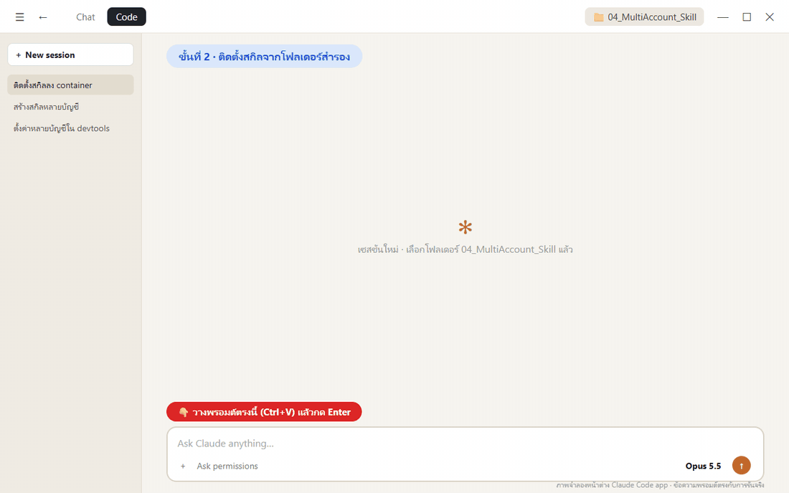

> [!IMPORTANT]
> **📋 คัดลอกกล่องนี้ → Claude Code app แล้วกด Enter**
>
> ```text
> ติดตั้งสกิลจาก ./skills ลง container multi-account ด้วยการคัดลอกโฟลเดอร์อย่างเดียว
> - คัดลอกโฟลเดอร์ yolo, cyolo และ agent-team ใน ./skills ไปวางที่ /root/ai-accounts/.Claude/shared/skills และ /root/ai-accounts/.Codex/shared/skills ใน container
> - เปิดแต่ละบัญชีหนึ่งครั้งด้วย yoloN --version และ cyoloN --version (wrapper จะเชื่อมสกิลให้แต่ละบัญชีเอง)
> - ตรวจว่าทุกบัญชี yolo1–5 และ cyolo1–5 มองเห็น SKILL.md ของทั้ง 3 สกิล และตรวจความพร้อมด้วยคำสั่ง check ของสกิล agent-team
> สรุปเป็นตาราง สกิล | ฝั่ง Claude | ฝั่ง Codex แล้วหยุด
> ```

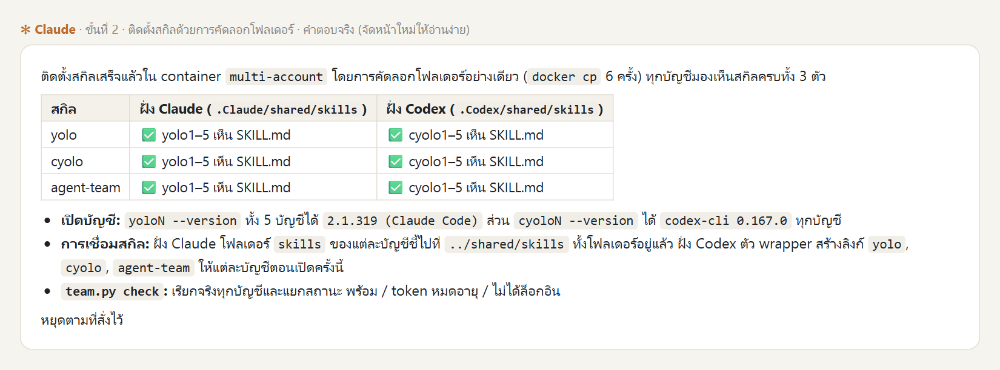

*ผลจริง ตัดรายชื่อบัญชีที่ล็อกอินบนเครื่องผู้สอนออก · ใช้สกิลที่เตรียมไว้: เปลี่ยน `./skills` ในพรอมต์เป็น `./_solution/skills`*

คัดลอกเองโดยไม่ใช้ Claude (รันจากโฟลเดอร์ `04_MultiAccount_Skill` ทีละบรรทัด) ใช้ได้ทั้งเครื่องเดิมและเครื่องใหม่ที่เพิ่งสร้าง volume:

```bash
for d in .Claude .Codex; do for s in yolo cyolo agent-team; do docker cp ./_solution/skills/$s multi-account:/root/ai-accounts/$d/shared/skills/; done; done
docker exec multi-account bash -lc 'for n in 1 2 3 4 5; do yolo$n --version; cyolo$n --version; done'
```

### วิธีที่ 2 · ลากวางใน JupyterLab

เปิด File Explorer ที่โฟลเดอร์ `04_MultiAccount_Skill\_solution\skills` (หรือ `skills` ที่สร้างในขั้นที่ 1) วางคู่กับ JupyterLab แล้วลาก `yolo`, `cyolo` และ `agent-team` **ทีละโฟลเดอร์** ไปปล่อยในพื้นที่ว่างของแถบไฟล์ ทำ 2 ที่


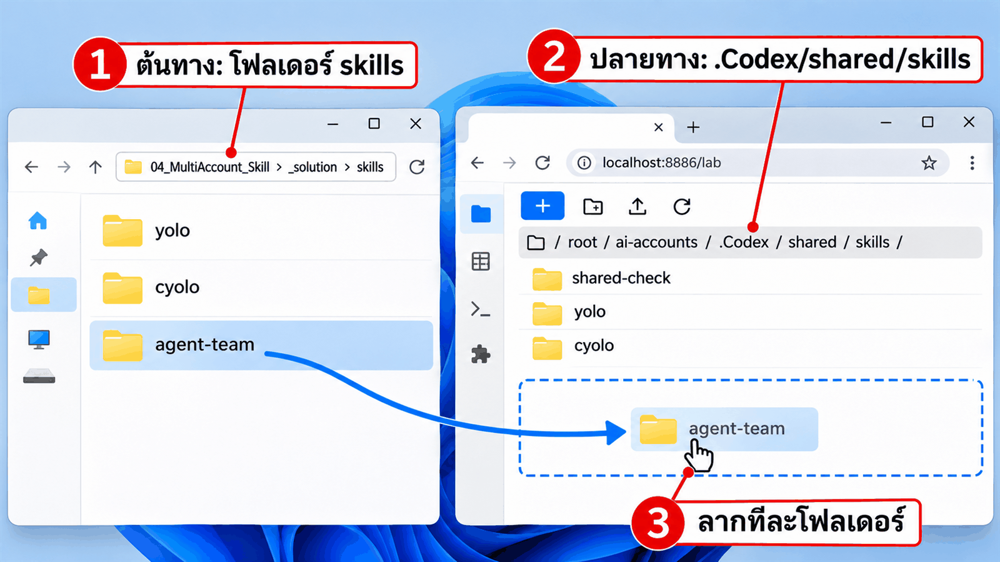

| ปลายทาง | เปิดใน JupyterLab | ใช้กับ |
|---|---|---|
| 1 | http://localhost:8886/lab/tree/root/ai-accounts/.Claude/shared/skills | `yolo1–5` |
| 2 | http://localhost:8886/lab/tree/root/ai-accounts/.Codex/shared/skills | `cyolo1–5` |

- **ลากทีละโฟลเดอร์:** ลากหลายโฟลเดอร์พร้อมกันอาจได้โฟลเดอร์ไม่ครบ
- **อย่าปล่อยบนชื่อโฟลเดอร์อื่น** เช่น `shared-check` จะกลายเป็นวางเข้าไปข้างในโฟลเดอร์นั้น
- **ลากวางครบแล้ว** ให้เปิด `yolo1` และ `cyolo1` หนึ่งครั้ง wrapper จะเชื่อมสกิลให้บัญชีนั้นเอง

## ขั้นที่ 3 · ทดสอบงานทีมชุดเดิมอีกครั้ง (170.5 วินาที)

เปิด Claude Code app (โฟลเดอร์ `04_MultiAccount_Skill`) แล้ววางพรอมต์งานทีม**ชุดเดียวกับหัวข้อ 1.1 ทุกตัวอักษร** ต่างกันแค่ตอนนี้ใน container มีสกิลแล้ว

> [!IMPORTANT]
> **📋 คัดลอกกล่องนี้ → Claude Code app แล้วกด Enter**
>
> ```text
> ใช้ทีมเอเจนต์ใน container multi-account ทำงานต่อไปนี้ ทำงานใน container ผ่าน docker exec เท่านั้น (บัญชี yolo1–5 และ cyolo1–5 ใช้เฉพาะบัญชีที่พร้อม)
> ก่อนเริ่ม ดูว่าใน container มีสกิลที่ช่วยงานนี้ได้หรือไม่ (/root/ai-accounts/.Claude/shared/skills) ถ้ามีให้อ่านและใช้
> โฟลเดอร์งานใน container: /workspace/team-demo
> 1. ให้บัญชี Claude 1 บัญชี และบัญชี Codex 1 บัญชี เขียนฟังก์ชัน Python parse_duration(text) ที่แปลง "1h30m", "45s", "2h" เป็นจำนวนวินาที คนละแบบพร้อมกัน บันทึกเป็น a_claude.py และ a_codex.py
> 2. ส่งทั้งสองไฟล์ให้บัญชี Codex อีกบัญชีหนึ่งเลือกแบบที่ดีกว่าและบอกจุดที่ต้องแก้
> 3. ส่งคำแนะนำนั้นให้บัญชี Claude แก้เป็น final.py แล้วรันทดสอบ 5 กรณี
> 4. สรุปตาราง บัญชี | งาน | เวลา (วินาที) | input tokens | output tokens | สำเร็จ/ล้ม ตัวเลขต้องมาจากผลจริงของแต่ละบัญชี ห้ามประมาณ
> 5. บอกโควตาที่เหลือของแต่ละบัญชีที่ใช้
> ```

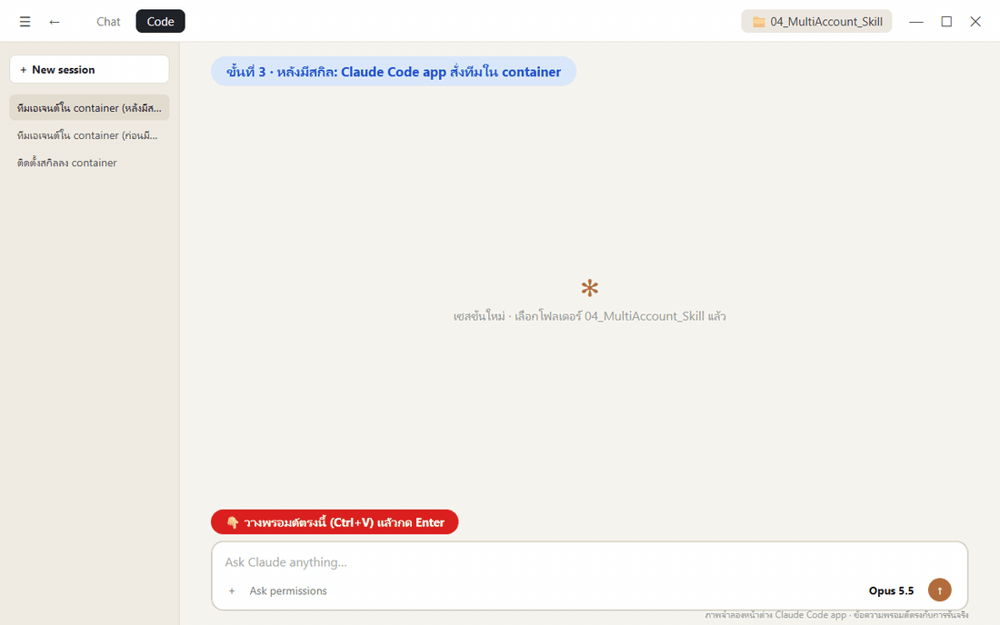

**ผลจริง:** Claude Code app ตรวจโฟลเดอร์สกิลตามบรรทัด "ก่อนเริ่ม…" แล้ว**เจอ `agent-team`** อ่านแค่ `SKILL.md` (ไม่ต้องเปิด `references/`) ใช้ `team.py check` ตรวจบัญชี เขียน `graph.json` ของงาน 4 ขั้น แล้วสั่ง `team.py run` ผ่าน `docker exec` ครั้งเดียวได้ทั้งผลงาน ตารางสถิติจาก ledger และโควตา ก่อนตอบยังรันชุดทดสอบซ้ำเองและดึงโควตา Codex ใหม่ด้วย `quota --refresh`

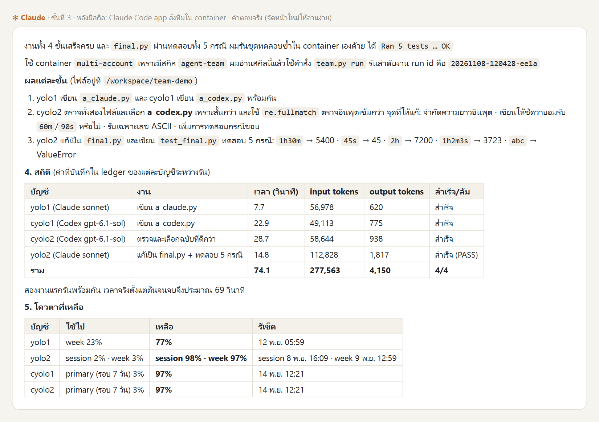

*คำตอบจริงของ Claude Code app เป็นภาษาอังกฤษ แปลและจัดหน้าใหม่เป็นภาษาไทย ตัดส่วนที่ระบุบัญชีที่ล็อกอินบนเครื่องผู้สอนออก*

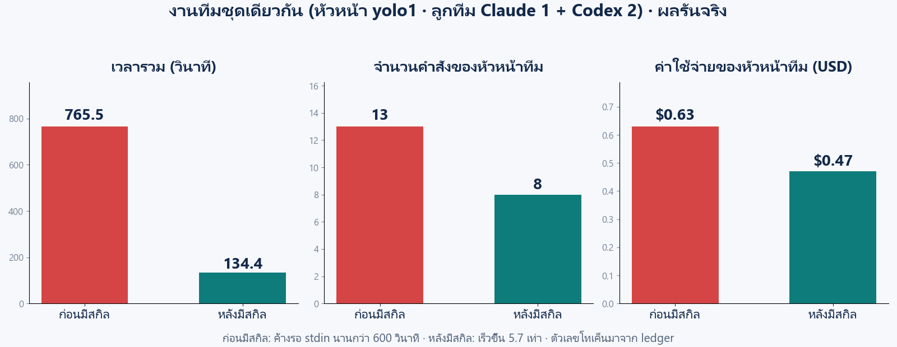

| | ก่อนมีสกิล | หลังมีสกิล |
|---|---|---|
| เวลารวม | 810.2 วินาที | **170.5 วินาที** (เร็วขึ้น 4.8 เท่า) |
| คำสั่งของ Claude Code app | 30 (ล้ม 9) | 10 (ล้ม 2) |
| ค่าใช้จ่ายของ Claude Code app | $0.94 | $0.47 |
| วิธีเรียกแต่ละบัญชี | อ่านโค้ด wrapper แล้วเขียน `run_agent.py` เอง | `team.py run` ของสกิล |
| ไฟล์ credential | ไล่ตรวจ `.credentials.json` และเปิด `auth.json` | ไม่แตะ |
| ตัวเลขโทเค็นและโควตา | สคริปต์ที่เขียนเอง + อ่านไฟล์ session เอง | ตารางที่ `team.py run` พิมพ์จาก ledger + โควตาพร้อมเวลาของข้อมูล |

*คำสั่งที่ล้ม 2 คำสั่งเกิดก่อนเจอสกิล: app ลองเปิด container ชื่ออื่นก่อน และตัวตรวจสิทธิ์ของ app บล็อกคำสั่งที่มีตัวแปร · รอบที่ 2 ของงานเดียวกันใช้ 157.7 วินาที 11 คำสั่ง (ดู [BENCHMARK](_solution/BENCHMARK.md))*

## ขั้นที่ 4 · สลับหัวหน้าทีมและบริหารโทเค็นของลูกทีม (138.6 วินาที)

ขั้นนี้ให้ทีมทำงานจริงด้วยคำสั่ง `lead` ของสกิล `agent-team` แล้วบังคับให้เกิดเหตุการณ์ทั้ง 3 แบบในหัวข้อ 3.4–3.5 โดย**จำลอง**แทนการใช้โควตาจริงจนหมด


> [!IMPORTANT]
> **📋 คัดลอกกล่องนี้ → Claude Code app แล้วกด Enter**
>
> ```text
> ใช้ทีมเอเจนต์ใน container multi-account ทดลองการสลับหัวหน้าทีมและการบริหารโทเค็นของลูกทีม
> งานของทีม: สร้างตารางสูตรคูณแม่ 2 ถึงแม่ 9 แบ่งให้ลูกทีมทำคนละแม่ แล้วรวมเป็นไฟล์เดียว /workspace/demo/table.md
> - ใช้คำสั่ง lead ของสกิล agent-team งานทุกชิ้นใช้ความยาก 1
> - ตั้งงบโทเค็นของหัวหน้าให้ต่ำ เพื่อให้เกิดการสลับหัวหน้าแบบเชิงรุกอย่างน้อย 1 ครั้ง
> - จำลองให้หัวหน้าคนหนึ่งล้มกลางคัน เพื่อดูการสลับแบบเชิงรับ
> - ตั้งงบโทเค็นของลูกทีมคนหนึ่งให้ต่ำ เพื่อดูการย้ายงานไปลูกทีมคนอื่น
> สรุปเป็นตาราง: ประวัติการสลับหัวหน้า (จากใคร ไปใคร เพราะอะไร) การย้ายงานของลูกทีม ผลงานครบหรือไม่ และสถิติแยกตามบัญชี
> ```

**ผลจริง** (app 138.6 วินาที · 10 คำสั่ง · run 69 วินาที · 11 การเรียก): ตารางสูตรคูณครบ 8 แม่ 96 แถว ถูกทุกแถว app ใช้ `lead` คำสั่งเดียวโดยไม่ต้องเปิดโค้ดของสกิล

| เหตุการณ์ | เกิดอะไรขึ้น |
|---|---|
| สลับหัวหน้า**เชิงรับ** | `yolo2` แจกงานครั้งแรกแล้วถูกจำลองให้ล้ม (`--simulate-crash yolo2`) ผู้ควบคุมเริ่ม `yolo1` ต่อจาก `state.json` · งานที่สั่งไปแล้วรันต่อจนเสร็จและไม่ถูกเพิ่มซ้ำ |
| สลับหัวหน้า**เชิงรุก** | `yolo1` ใช้ไป 135,098 โทเค็น เกินงบหัวหน้า (ตั้งไว้ 1) จึงเขียน checkpoint แล้วส่งไม้ให้ `cyolo1` (หัวหน้าฝั่ง Codex) ซึ่งปิดงานจนจบ |
| ย้ายงานลูกทีม | `cyolo2` ใช้โทเค็นเกินงบหลังทำ t4 เสร็จ จึงหยุดรับงานใหม่ งาน t8 (แม่ 8) ย้ายไป `cyolo1` |

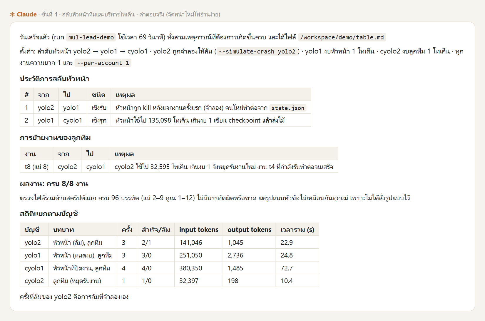

*ผลจริง ตัดรายชื่อบัญชีที่ล็อกอินบนเครื่องผู้สอนออก · งบที่ตั้งต่ำเพียง 1 โทเค็นทำหน้าที่เป็นสวิตช์จำลอง การใช้งานจริงให้ตั้งงบตามโควตาของบัญชี หรือใช้เกณฑ์โควตา 80% ที่เป็นค่าเริ่มต้น · ตัวเลขถูกครบ แต่รูปแบบหัวข้อของแต่ละแม่ไม่เหมือนกัน เพราะพรอมต์ไม่ได้กำหนดรูปแบบ*

ไฟล์ของ run นี้ (`state.json`, `handoff.md`, `board.md`, `ledger.jsonl`) อยู่ใน `03_MultiAccount_Container/workspace/.agent-team/<run_id>/` บนเครื่องเรา เปิด `handoff.md` เพื่อดูใบส่งเวรที่หัวหน้าแต่ละคนเขียนให้คนถัดไป

## สรุป

| | ไม่มีสกิล | มีสกิล |
|---|---|---|
| วิธีเรียกแต่ละบัญชี | ลองผิดลองถูก เปิด `--help` | สคริปต์ที่ใส่ flag ถูกและตรวจผลให้ |
| บัญชีไหนใช้ได้ | ดู `auth status` (ไม่ตรงจริง) | `check` ด้วยการเรียกจริง |
| การทำงานร่วมกัน | สั่งทีละตัว ยัดข้อมูลลง prompt | relay · fan-out · graph · review · board · ขั้นสูง |
| สถิติ | ต้องเดา | ledger ทุกครั้งที่เรียก + โควตาพร้อมเวลาของข้อมูล |
| หัวหน้าหรือลูกทีมโควตาหมด | งานค้างหรือหาย | สลับหัวหน้าและย้ายงานโดยงานไม่หาย |
| เครื่องใหม่ / volume ใหม่ | สร้างสกิลใหม่ | คัดลอกโฟลเดอร์สำรองไปวาง (ขั้นที่ 2) |
| งานทีมชุดเดียวกัน | 810.2 วินาที | 170.5 วินาที |

## ข้อควรรู้

- **ล็อกอินเองเสมอ:** สกิลไม่ล็อกอินแทน และไม่อ่านไฟล์ credential (`.credentials.json`, `.claude.json`, `auth.json`)
- **บัญชีทุกตัวรันแบบข้าม permission:** ใช้กับงานที่อนุญาตเท่านั้น และตรวจผลของ agent อื่นซ้ำเสมอ
- **ไม่ retry งานที่เสียโทเค็นอัตโนมัติ:** งานที่ล้มหลังใช้โทเค็นไปแล้วจะหยุดและรายงาน
- **Git Bash บน Windows แปลง path `/root/...`:** ห่อคำสั่งด้วย `sh -c "…"` ตามตัวอย่างใน `SKILL.md` ใช้ได้ทั้ง Git Bash และ PowerShell
- **แก้สกิลที่ต้นฉบับ:** แก้ใน `skills/` บนเครื่องเรา แล้วคัดลอกทับใน `shared/skills` อีกครั้ง
- **ติดตั้งครบทั้ง 3 โฟลเดอร์:** `team.py` ของ `agent-team` เรียก `yolo.py` และ `cyolo.py` ของสกิลข้างเคียงใน `shared/skills` เดียวกัน

## คำสั่งที่ใช้บ่อย

ใน container (JupyterLab Terminal)

```bash
T=/root/ai-accounts/.Claude/shared/skills/agent-team/scripts/team.py
python3 $T check            # บัญชีไหนใช้ได้ (เรียกจริง)
python3 $T quota            # โควตาทุกบัญชี + เวลาของข้อมูล
python3 $T run graph.json   # รันกราฟงานจนจบ แล้วพิมพ์ตาราง + โควตา
python3 $T status           # ภาพรวมทีม
python3 $T stats            # สถิติตามบัญชี / รุ่น / run
```

จาก host

```bash
docker exec multi-account sh -c "cat /root/ai-accounts/.Claude/shared/skills/agent-team/SKILL.md"
docker exec multi-account sh -c "python3 /root/ai-accounts/.Claude/shared/skills/agent-team/scripts/team.py stats"
docker exec multi-account sh -c "python3 /root/ai-accounts/.Claude/shared/skills/agent-team/scripts/team.py lead --demo --lead-model haiku"
```
