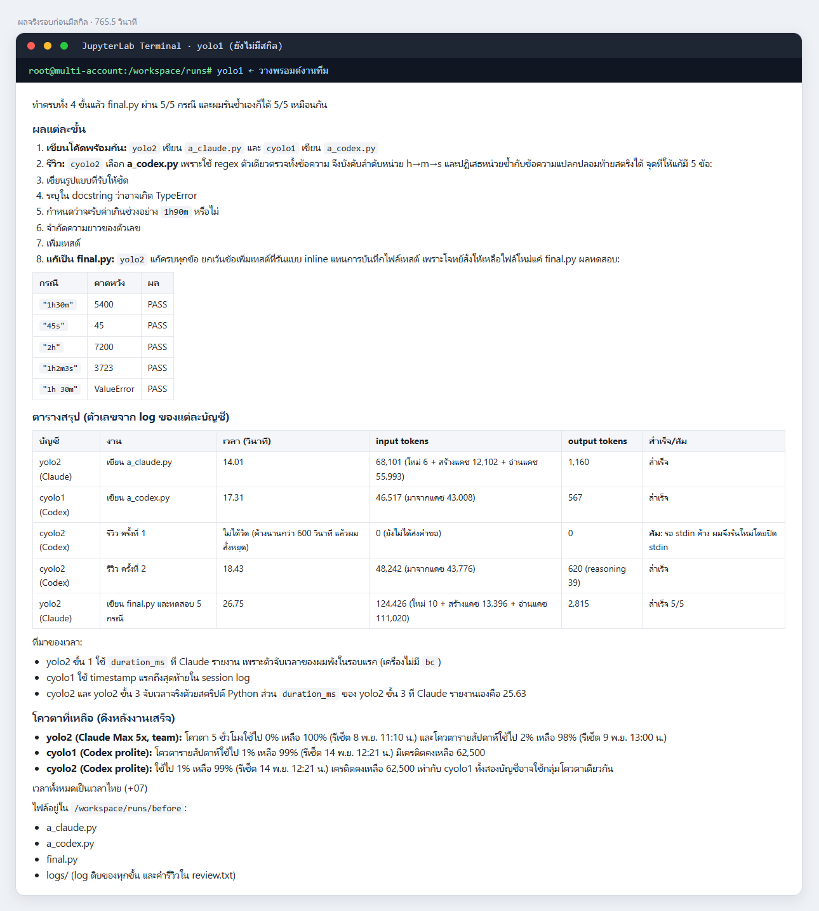
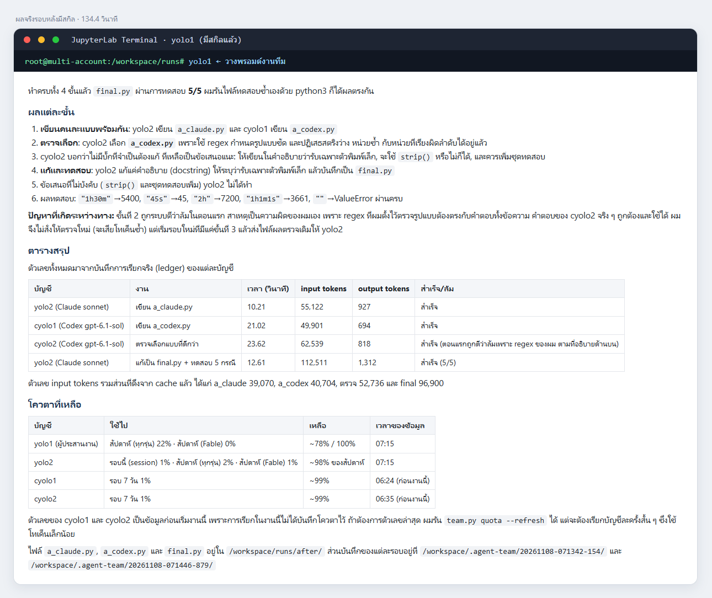
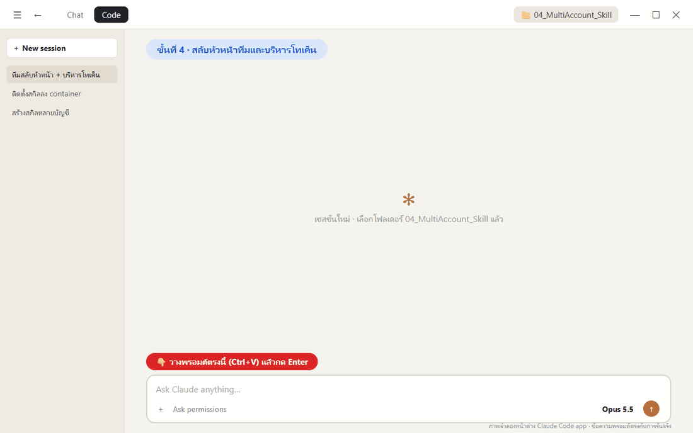
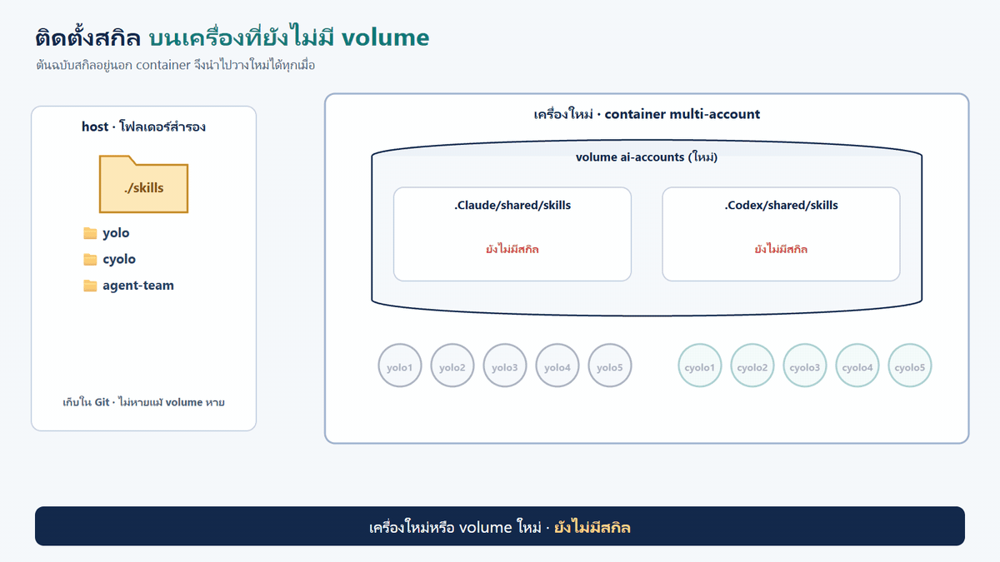
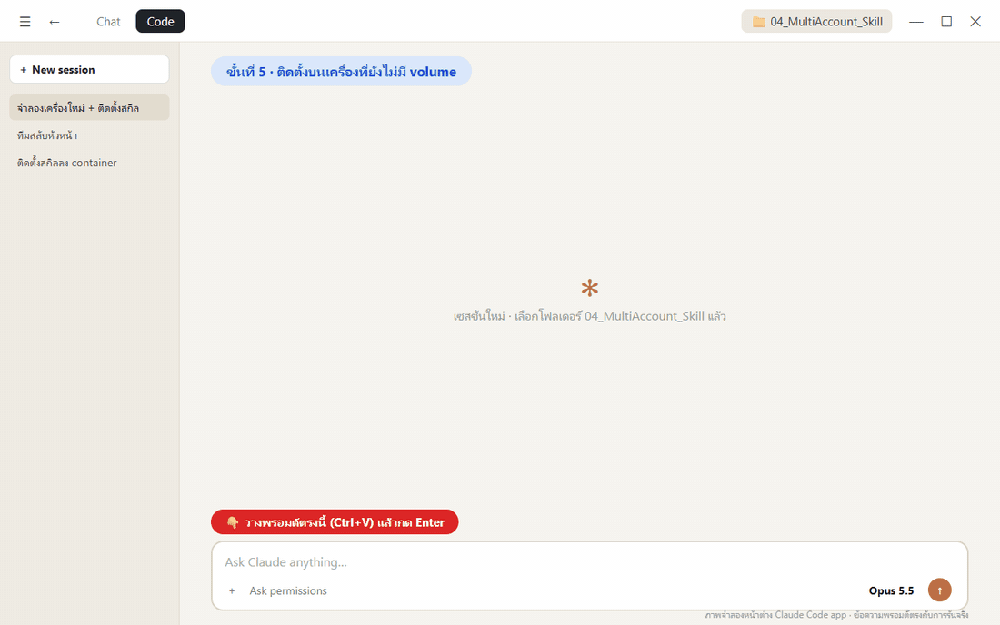
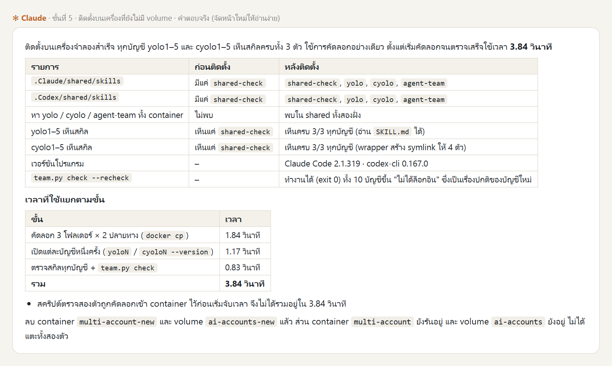

# การสร้างสกิลสำหรับระบบหลายบัญชี (yolo · cyolo · agent-team)

**สไลด์ประกอบการสอน:** [MultiAccount_Skill_Slides.html](MultiAccount_Skill_Slides.html) (เปิดในเบราว์เซอร์ กด ← → เปลี่ยนหน้า) · [ฉบับ PDF](MultiAccount_Skill_Slides.pdf)

บทนี้ต่อจาก [การสร้าง Docker image สำหรับระบบหลายบัญชีจาก Dockerfile](../03_MultiAccount_Container/README.md) container `multi-account` มีคำสั่ง `yolo1–5` (Claude Code) และ `cyolo1–5` (Codex CLI) ครบแล้ว บทนี้สร้าง **สกิล** ที่ทำให้ AI ใช้คำสั่งเหล่านี้ได้ถูกวิธี ทำงานร่วมกันเป็นทีม และรู้สถิติการใช้งานของทุกบัญชี

## 1. ปัญหา: มีคำสั่งครบ แต่ AI ยังใช้ไม่เป็น

คำสั่ง `yolo2` หรือ `cyolo1` เปิด Claude Code หรือ Codex ของบัญชีนั้นได้ทันที แต่การให้ AI อีกตัวสั่งงานบัญชีเหล่านี้แบบอัตโนมัติต้องรู้รายละเอียดอีกมาก: ต้องใส่ flag ใด ต้องปิด input อย่างไร ผลลัพธ์อยู่ที่ไหน บัญชีไหนใช้ได้จริง และโควตาเหลือเท่าไร AI ที่ไม่มีความรู้เหล่านี้จึงต้องลองผิดลองถูกใหม่ทุกครั้ง


*(ภาพจำลอง)*


| เพนพอยต์ | สิ่งที่เกิดขึ้นจริง |
|---|---|
| เรียกผิดวิธี | `codex exec` ที่ไม่ปิด stdin จะค้างรอ input · ไม่ใส่ `-p` จะเปิดโหมดโต้ตอบ · exit code 0 ไม่ได้แปลว่าสำเร็จ |
| สถานะล็อกอินไม่ตรงจริง | `auth status` ตอบ `loggedIn: true` แต่เรียกจริงได้ `OAuth session expired` |
| ประสานงานไม่เป็น | สั่งทีละบัญชีแล้วรอ · ยัดข้อมูลยาวลง prompt · ไม่มีที่แชร์ความรู้ระหว่างกัน |
| ไม่มีสถิติ | ไม่รู้ว่าแต่ละบัญชีใช้โทเค็น เวลา และโควตาไปเท่าไร |
| ลองผิดลองถูกทุกครั้ง | เปิด `--help` ซ้ำ เขียนสคริปต์ช่วยใหม่ทุกครั้ง ช้าและเปลืองโทเค็น |
| หัวหน้าทีมโควตาหมด | แผนงานอยู่ในบริบทแชตของหัวหน้า เมื่อบัญชีหัวหน้าหยุด งานที่ค้างหายไปด้วย |

### 1.1 ผลจริงเมื่อยังไม่มีสกิล

ทดลองให้ `yolo1` เป็นหัวหน้าทีม (เปิด JupyterLab Terminal พิมพ์ `yolo1` แล้ววางพรอมต์) โดยใน container ยังไม่มีสกิล

```text
ช่วยจัดทีมเอเจนต์จากบัญชีอื่นใน container นี้ (yolo1–5 และ cyolo1–5 ใช้เฉพาะบัญชีที่พร้อมใช้งาน) ทำงานต่อไปนี้ในโฟลเดอร์ปัจจุบัน
1. ให้บัญชี Claude 1 บัญชี และบัญชี Codex 1 บัญชี เขียนฟังก์ชัน Python parse_duration(text) ที่แปลง "1h30m", "45s", "2h" เป็นจำนวนวินาที คนละแบบพร้อมกัน บันทึกเป็น a_claude.py และ a_codex.py
2. ส่งทั้งสองไฟล์ให้บัญชี Codex อีกบัญชีหนึ่งเลือกแบบที่ดีกว่าและบอกจุดที่ต้องแก้
3. ส่งคำแนะนำนั้นให้บัญชี Claude แก้เป็น final.py แล้วรันทดสอบ 5 กรณี
4. สรุปตาราง บัญชี | งาน | เวลา (วินาที) | input tokens | output tokens | สำเร็จ/ล้ม ตัวเลขต้องมาจากผลจริงของแต่ละบัญชี ห้ามประมาณ
5. บอกโควตาที่เหลือของแต่ละบัญชีที่ใช้
```

**ผลจริง** (8 พ.ย. 2026): งานเสร็จและ `final.py` ผ่าน 5/5 แต่ใช้เวลารวม **765.5 วินาที** ขณะที่งานจริงของลูกทีมรวมกันประมาณ 77 วินาที

| สิ่งที่สังเกตได้ | รายละเอียด |
|---|---|
| สำรวจระบบเอง | 4 คำสั่งแรกไล่เปิดโฟลเดอร์บัญชี อ่าน `--help` และตรวจเวอร์ชัน |
| **อ่านไฟล์ credential เอง** | เปิด `.credentials.json` เพื่อดูวันหมดอายุของ token ซึ่งไม่ควรเกิดขึ้น |
| **ค้างรอ input** | เรียก `codex exec` โดยไม่ปิด stdin ค้างนานกว่า 600 วินาทีจึงรู้ตัวและรันใหม่ |
| เขียนเครื่องมือช่วยเอง | เขียนตัวจับเวลาเองแล้วพังในรอบแรก (เครื่องไม่มี `bc`) |



*คำตอบจริงของ `yolo1` ตัดเฉพาะส่วนที่ระบุบัญชีที่ล็อกอินบนเครื่องผู้สอน*

## 2. ทำไมสกิลแก้ปัญหานี้ได้

ความรู้ทั้งหมดในหัวข้อ 1 คือ **"รู้ว่าทำอย่างไร"** ซึ่งเป็นสิ่งที่สกิลเก็บไว้ได้ตามหลักใน [บททฤษฎีสกิล](../../00_week01/05_agent-skills/01_skill-theory/README.md):

- **งานซ้ำให้สคริปต์ทำ งานคิดให้ AI ทำ:** การเรียกบัญชีให้ถูก flag การตรวจความพร้อม การจับเวลา และการรวมสถิติต้องได้ผลเหมือนเดิมทุกครั้ง จึงเขียนเป็นสคริปต์ในสกิล ส่วนการแบ่งงานและตัดสินใจเป็นหน้าที่ของ AI
- **เปิดทีละชั้น (progressive disclosure):** AI เห็นแค่ชื่อและคำอธิบายของสกิลตลอดเวลา เปิด `SKILL.md` เมื่อจะใช้ และเปิดสคริปต์หรือรายละเอียดเมื่อถึงขั้นนั้นเท่านั้น


## 3. ออกแบบสกิล 3 ตัว


| สกิล | รู้เรื่องอะไร | สคริปต์ |
|---|---|---|
| `yolo` | เรียก Claude Code ทุกบัญชีแบบไม่โต้ตอบ เลือกรุ่นและ effort ตามความยาก ตรวจความพร้อมด้วยการเรียกจริง โควตา | `yolo.py` |
| `cyolo` | เรียก Codex ทุกบัญชี เลือกรุ่นจาก `models_cache.json` สร้างภาพ ตรวจความพร้อม โควตาจาก rollout | `cyolo.py` |
| `agent-team` | ให้หลายบัญชีทำงานร่วมกัน ทั้งใน CLI เดียวกันและข้าม CLI ส่งข้อมูล แชร์ความรู้ บริหารโทเค็น สลับหัวหน้าทีม และสรุปสถิติทั้งทีม | `team.py` |

ทั้งสามสกิลใช้ตารางความยากเดียวกัน (1 = งานง่ายใช้รุ่นเล็ก effort ต่ำ ถึง 6 = งานใหญ่) จึงไม่ต้องใช้รุ่นแพงกับทุกงาน

```text
skills/
├── install.sh            ติดตั้งลง shared ของทั้งสอง CLI
├── README.md · TEST-REPORT.md
├── yolo/        SKILL.md · scripts/ · references/
├── cyolo/       SKILL.md · scripts/ · references/
└── agent-team/  SKILL.md · scripts/team.py · references/
```

### 3.1 รูปแบบการทำงานร่วมกัน


| รูปแบบ | ใช้เมื่อ | การส่งข้อมูล |
|---|---|---|
| relay | งานเป็นลำดับ ผลก่อนหน้าเป็น input ของงานถัดไป | `{{node}}` แทรกค่าสั้นลง prompt |
| fan-out / fan-in | งานย่อยไม่ขึ้นต่อกัน ทำพร้อมกันแล้วรวมผล | งานรวมผลอ่านไฟล์ `{{file:node}}` ทุกตัว |
| graph | งานขึ้นต่อกันหลายทาง | ระบุ `depends_on` ตัวจัดคิวรันงานที่พร้อมให้เอง |
| review loop | ต้องการคุณภาพ ให้อีกบัญชีตรวจจนผ่าน | วนจนผู้ตรวจตอบ `APPROVED` หรือครบ `max_rounds` |
| board | agent ที่มาทีหลังควรรู้สิ่งที่ทีมค้นพบแล้ว | ทุก agent อ่าน `board.md` ก่อนเริ่ม และเพิ่มข้อค้นพบต่อท้าย |

ข้อมูลยาวส่งเป็น **path ของไฟล์** ไม่ยัดลง prompt ผลของทุกงานอยู่ในโฟลเดอร์ของ run (`/workspace/.agent-team/<run_id>/`) ซึ่ง map ออกมาบนเครื่องเรา

### 3.2 รูปแบบขั้นสูง


| รูปแบบ | ความหมาย |
|---|---|
| debate / ตรวจไขว้ | Claude และ Codex ตอบโจทย์เดียวกันแยกกัน ผู้ตัดสินเทียบและสรุปพร้อมเหตุผล ลดคำตอบผิดจากโมเดลเดียว |
| best-of-N + judge | หลายบัญชีทำงานเดียวกัน ผู้ตัดสินให้คะแนนตามเกณฑ์แล้วเลือกผลที่ดีที่สุด |
| router | เลือกฝั่งให้อัตโนมัติตามชนิดงาน: ภาพ → cyolo · ตรวจโค้ด → Codex · เอกสารยาว → Claude |
| failover | งานที่ล้มเพราะโควตาหมดหรือล็อกอินหมดอายุ ย้ายไปบัญชีอื่น (ยกเว้นงานที่ผู้ใช้ระบุบัญชีเอง) |
| human gate | หยุดรอคนอนุมัติก่อนขั้นที่เสียเงินหรือแก้ของจริง |

รูปแบบอื่นที่ต่อยอดได้จากสคริปต์เดียวกัน: ทีมซ้อนทีม (หัวหน้าคุมหัวหน้าย่อย), โหวตเสียงข้างมาก, map-reduce ข้อมูลใหญ่, ยิงซ้ำเผื่อ (hedging) สำหรับงานเร่งด่วน และ planner–executor–critic

### 3.3 สถิติทุกบัญชี (ledger)


- ทุกครั้งที่สคริปต์ของสกิลเรียกบัญชีใด จะเพิ่ม 1 บรรทัดใน `/workspace/.agent-team/ledger.jsonl`
- `team.py stats` สรุปตามบัญชี ตามรุ่น และตามงาน · `team.py quota` แสดงโควตาพร้อม**เวลาของข้อมูล**
- ledger **ไม่เก็บข้อความ prompt และ secret** เก็บแค่จำนวนตัวอักษร

### 3.4 หัวหน้าทีมบริหารโทเค็นของลูกทีม


| สถานการณ์ | ตัวจัดคิวทำอะไร |
|---|---|
| ก่อนสั่งงาน | อ่านโควตาล่าสุดและยอดโทเค็นใน ledger แล้วแจกให้บัญชีที่เหลือมากก่อน งานง่ายใช้รุ่นเล็ก |
| ลูกทีมใกล้หมด (≥ 80% หรือเกินงบ) | **หยุดรับงานใหม่** งานที่รันอยู่ปล่อยให้จบ งานในคิวย้ายไปคนอื่น |
| ลูกทีมล้มกลางคัน | ย้ายงานไปบัญชีอื่น พร้อมความคืบหน้าใน `msgs/` |
| งานที่ผู้ใช้ระบุบัญชีเอง | ไม่ย้ายเงียบ ๆ หยุดและรายงาน |

### 3.5 สลับหัวหน้าทีมโดยงานไม่หาย

ถ้าแผนงานอยู่ในบริบทแชตของหัวหน้า เมื่อโควตาของบัญชีหัวหน้าหมด แผนและงานที่ค้างจะหายไปด้วย วิธีแก้คล้ายการส่งเวรของพยาบาล: ก่อนออกเวร ต้องเขียนสรุปว่าทำอะไรไปแล้ว อะไรกำลังทำ และต้องทำอะไรต่อ


*(ภาพจำลอง) `handoff.md` ทำหน้าที่เดียวกับใบส่งเวร*


| หลักการ | รายละเอียด |
|---|---|
| สถานะอยู่ในไฟล์ | `state.json` (งานทั้งหมด หัวหน้าปัจจุบัน ประวัติการสลับ) และ `handoff.md` (สรุปสำหรับคนรับไม้) |
| ผู้ควบคุมเป็นสคริปต์ | `team.py lead` ไม่ใช้โทเค็นจึงไม่หมดโควตา รันหัวหน้าเป็นรอบสั้น ๆ ทุกรอบต้องเขียน checkpoint |
| ลูกทีมไม่ผูกกับหัวหน้า | ลูกทีมรันเป็น process แยก หัวหน้าเปลี่ยนตัวแล้วงานที่สั่งไปไม่หาย |
| สลับเชิงรุก | โควตาหัวหน้า ≥ 80% หรือเกินงบโทเค็น → ส่งไม้ตั้งแต่ยังเหลือพอเขียน checkpoint |
| สลับเชิงรับ | หัวหน้าล้ม ติด rate limit หรือเงียบไป → เริ่มหัวหน้าคนใหม่จาก checkpoint ล่าสุด |
| ผู้สืบทอด | บัญชีที่พร้อมและโควตาเหลือมากสุด ฝั่งเดียวกันก่อนแล้วจึงข้ามฝั่ง (หัวหน้าเป็น Codex ได้) |

### 3.6 Claude Code app เข้าใจระบบใน container ได้อย่างไร


- **ใน container:** `yoloN` และ `cyoloN` โหลดสกิลจาก `shared/skills` อัตโนมัติ
- **จาก host:** ทุก `SKILL.md` มีหัวข้อ "เรียกจาก host" บอกวิธีอ่านสกิลและเรียกสคริปต์ผ่าน `docker exec` หรือส่งงานให้ `yolo1` ใน container เป็นหัวหน้าทีม

## 4. สกิลเก็บไว้ที่ไหน: volume และโฟลเดอร์สำรอง

สกิลถูกติดตั้งไว้ใน `/root/ai-accounts/.Claude/shared/skills` และ `/root/ai-accounts/.Codex/shared/skills` ซึ่งอยู่ใน **volume `ai-accounts`** ทุกบัญชีลิงก์เข้ามาที่นี่ สกิลจึงคงอยู่แม้ลบ container แต่เมื่อย้ายไป**เครื่องใหม่**หรือสร้าง **volume ใหม่** สกิลเหล่านี้จะไม่ติดไปด้วย จึงเก็บโฟลเดอร์ `skills/` สำรองไว้**นอก container** แล้วคัดลอกไปติดตั้งได้ทันทีโดยไม่ต้องสร้างสกิลใหม่


| ที่เก็บ | อยู่ที่ไหน | เมื่อลบ container | เมื่อย้ายเครื่อง / volume ใหม่ |
|---|---|---|---|
| โฟลเดอร์สำรอง `skills/` | บนเครื่องเรา (เก็บใน Git ได้) | ยังอยู่ | **นำไปติดตั้งใหม่ได้** |
| `shared/skills` | volume `ai-accounts` | ยังอยู่ | ไม่ติดไป |
| container | ชั้นที่เขียนได้ของ container | หายไป | ไม่ติดไป |


## 5. ภาพรวมขั้นตอนการทดลอง

| ขั้น | ทำที่ไหน | เวลารันจริง |
|---|---|---|
| **1 · ให้ Claude สร้างสกิลจากสเปก** | Claude Code app | ~33 นาที |
| **2 · ติดตั้งสกิลจากโฟลเดอร์สำรอง** | Claude Code app (หรือลากวางใน JupyterLab) | 39 วินาที |
| **3 · ทดสอบงานทีมชุดเดิมอีกครั้ง** | JupyterLab Terminal (`yolo1`) | 134.4 วินาที |
| **4 · สลับหัวหน้าทีมและบริหารโทเค็น** | Claude Code app | ~3 นาที (run 64 วินาที) |
| **5 · ติดตั้งบนเครื่องที่ยังไม่มี volume** | Claude Code app | ~2 นาที (ติดตั้ง 1.59 วินาที) |

**ต้องมีก่อน:** container `multi-account` จาก[บทก่อนหน้า](../03_MultiAccount_Container/README.md) กำลังรัน และล็อกอินอย่างน้อย 1 บัญชี Claude และ 1 บัญชี Codex (ล็อกอินมากขึ้น ทีมก็ทำงานขนานได้มากขึ้น)

**เปิดโฟลเดอร์งาน:** ใน Claude Code app เลือก **Code** → **New session** → เลือกโฟลเดอร์ `04_MultiAccount_Skill` ของรีโปนี้

```text
04_MultiAccount_Skill/
├── prompt_skill_spec.md   ← สเปกของสกิล 3 ตัว (input ที่ 1)
├── reference/             ← สกิล yolo / cyolo ชุดเดิม ใช้เป็นแหล่งความรู้ (input ที่ 2)
└── _solution/skills/      ← สกิลที่ได้จากการรันจริง = โฟลเดอร์สำรองพร้อมติดตั้ง
```

## ขั้นที่ 1 · ให้ Claude สร้างสกิลจากสเปก (~33 นาที)

### 1.1 · input

| input | บทบาท |
|---|---|
| [`prompt_skill_spec.md`](prompt_skill_spec.md) | สเปกของสกิล 3 ตัว: ข้อเท็จจริงของแต่ละ CLI ที่ตรวจจริงแล้ว, รูปแบบการทำงานร่วมกัน, การบริหารโทเค็น, การสลับหัวหน้าทีม, ledger, install.sh และเกณฑ์ทดสอบ |
| [`reference/`](reference/) | สกิล `yolo` / `cyolo` ชุดเดิม (ไฟล์เดียวยาวประมาณ 44 KB ต่อสกิล) ใช้เป็นแหล่งความรู้ที่วัดมาแล้ว |

| หัวข้อในสเปก | สาระ |
|---|---|
| เป้าหมาย | 3 สกิล แต่ละตัวเป็น `SKILL.md` + `scripts/` + `references/` · Python มาตรฐาน |
| ผู้ใช้ 2 ฝั่ง | ใน container และ Claude Code app บน host (ผ่าน `docker exec`) |
| ข้อเท็จจริงจากการทดลอง | flag ที่ถูก, การปิด stdin, exit code ไม่ใช่ตัวบอกผล, `auth status` ไม่ตรงจริง, ตำแหน่งโควตา |
| agent-team | run directory, รูปแบบพื้นฐาน 5 แบบ, ขั้นสูง 5 แบบ, บริหารโทเค็นลูกทีม, สลับหัวหน้าทีม |
| ledger / install.sh / ทดสอบ / รายงาน | ฟิลด์ที่ต้องเก็บ, การติดตั้งที่รันซ้ำได้, เกณฑ์ PASS/FAIL/SKIP |

### 1.2 · วางพรอมต์


```text
ช่วยสร้างสกิลชุดใหม่ที่ทำให้ AI ใช้ระบบหลายบัญชีใน container multi-account ได้เต็มประสิทธิภาพ
ทำในโฟลเดอร์นี้ ใช้คำสั่ง docker ได้ แต่ห้ามลบ หยุด หรือสร้าง container / volume ใหม่ ห้ามแตะ credential และห้ามล็อกอินแทนผม

วัตถุดิบ
- ./prompt_skill_spec.md = สเปกของสกิล 3 ตัว (yolo, cyolo, agent-team) ทุกข้อต้องเป็นจริง
- ./reference/ = สกิล yolo และ cyolo ชุดเดิม ใช้เป็นแหล่งความรู้ที่วัดมาแล้ว แต่ห้ามคัดลอกโครงสร้างไฟล์เดียวยาว ๆ
- container multi-account ที่กำลังรัน = ที่ทดสอบจริง (บัญชีที่พร้อมอาจมีไม่ครบ ให้ตรวจเอง)

สร้างไว้ใน ./skills (นอก container นี่คือต้นฉบับที่เก็บสำรอง)
ทดสอบ: คัดลอก ./skills ไปที่ /tmp/skills ใน container แล้วรัน install.sh ติดตั้งลง shared ทดสอบทุกข้อในหัวข้อ "ทดสอบ" ของสเปก
ใช้บัญชีอย่างประหยัด (haiku/low กับงานทดสอบ) ข้อที่ต้องใช้บัญชีที่ไม่พร้อม = SKIP
เขียน skills/TEST-REPORT.md แล้วสรุปเป็นตารางสั้น ๆ: ผลทดสอบ ไฟล์ที่สร้าง และเวลาที่ใช้ แล้วหยุด
```

**หลักการออกแบบพรอมต์**

- **ให้ข้อเท็จจริงที่ตรวจแล้ว:** สเปกรวมกับดักที่เจอจากการรันจริงไว้ Claude จึงไม่ต้องลองผิดลองถูกเอง
- **ห้ามคัดลอกโครงสร้างเดิม:** สกิลเดิมเป็นไฟล์เดียวยาวและฝังสคริปต์ซ้ำกัน สกิลใหม่ต้องแยกชั้นตามหลักการเปิดทีละชั้น
- **ต้นฉบับอยู่นอก container:** `./skills` คือโฟลเดอร์สำรองที่นำไปติดตั้งเครื่องใหม่ได้
- **ทดสอบทุกข้อด้วยบัญชีจริงแบบประหยัด:** งานทดสอบใช้รุ่นเล็ก และจำลองโควตาหมดแทนการใช้โควตาจริงจนหมด

### 1.3 · ผลจริง

**ผลจริง** (8 พ.ย. 2026 · ~33 นาที): **PASS 17 · SKIP 1** ผ่านทุกรูปแบบการทำงานร่วมกัน รวมถึงการสลับหัวหน้าทีมทั้งเชิงรุกและเชิงรับ


*คำตอบจริงของ Claude เป็นภาษาอังกฤษ แปลและจัดหน้าใหม่เป็นภาษาไทย รายงานฉบับเต็มอยู่ที่ [`_solution/skills/TEST-REPORT.md`](_solution/skills/TEST-REPORT.md) · SKIP คือสถานะ "ล็อกอินแล้วแต่หมดอายุ" ที่ไม่มีบัญชีใดอยู่ในสถานะนั้นขณะทดสอบ*

ไฟล์ที่ Claude สร้างเก็บไว้ที่ [`_solution/skills/`](_solution/skills/) เปิดอ่าน [`agent-team/SKILL.md`](_solution/skills/agent-team/SKILL.md) เพื่อดูตัวอย่าง `SKILL.md` ที่สั้นและเปิดด้วยตาราง "ต้องการ → คำสั่ง"

## ขั้นที่ 2 · ติดตั้งสกิลจากโฟลเดอร์สำรอง (39 วินาที)

### วิธีที่ 1 · สั่ง Claude Code app


```text
ติดตั้งสกิลจาก ./skills ลง container multi-account
- คัดลอกโฟลเดอร์ ./skills เข้า container แล้วรัน install.sh
- ตรวจว่าทุกบัญชี yolo1–5 และ cyolo1–5 มองเห็นสกิล yolo, cyolo และ agent-team
- ตรวจความพร้อมของทุกบัญชีด้วยคำสั่ง check ของสกิล agent-team
สรุปเป็นตาราง สกิล | ฝั่ง Claude | ฝั่ง Codex พร้อมรายชื่อบัญชีที่พร้อมใช้งาน แล้วหยุด
```


*ผลจริง ตัดรายชื่อบัญชีที่ล็อกอินบนเครื่องผู้สอนออก*

หากใช้สกิลที่เตรียมไว้แล้ว ให้เปลี่ยน `./skills` ในพรอมต์เป็น `./_solution/skills`

### วิธีที่ 2 · ลากวางใน JupyterLab

ลากโฟลเดอร์ `yolo`, `cyolo` และ `agent-team` **ทีละโฟลเดอร์** ไปวาง 2 ที่ (วิธีเดียวกับ [บทติดตั้ง Skill ส่วนกลาง](../04_Skill_Setup/00_Setup_Skill/readme.md))

| ปลายทาง | ใช้กับ |
|---|---|
| http://localhost:8886/lab/tree/root/ai-accounts/.Claude/shared/skills | `yolo1–5` |
| http://localhost:8886/lab/tree/root/ai-accounts/.Codex/shared/skills | `cyolo1–5` |

หลังลากวาง เรียก `cyolo1` หนึ่งครั้ง (wrapper จะสร้าง link รายสกิลของฝั่ง Codex ให้) หรือรัน `install.sh` ใน Terminal เพื่อให้แน่ใจว่าทุกบัญชีเห็นสกิล

## ขั้นที่ 3 · ทดสอบงานทีมชุดเดิมอีกครั้ง (134.4 วินาที)

เปิด JupyterLab Terminal พิมพ์ `yolo1` แล้ววางพรอมต์งานทีมชุดเดียวกับหัวข้อ 1.1

**ผลจริง:** คำสั่งแรกของ `yolo1` คือ `Skill(agent-team)` ระบบโหลดสกิลจากชั้นที่ 1 เองโดยไม่ต้องสั่ง หัวหน้าทีมตรวจบัญชีด้วย `team.py check` สร้าง graph ของงานแล้วสั่ง `team.py run` ตัวเลขทุกค่าในตารางสรุปมาจาก ledger




| | ก่อนมีสกิล | หลังมีสกิล |
|---|---|---|
| เวลารวม | 765.5 วินาที | **134.4 วินาที** (เร็วขึ้น 5.7 เท่า) |
| คำสั่งแรกของหัวหน้าทีม | สำรวจโฟลเดอร์บัญชี | `Skill(agent-team)` |
| ค้างรอ input | นานกว่า 600 วินาที | ไม่เกิด |
| อ่านไฟล์ credential | อ่านเอง | ไม่อ่าน |
| ตัวเลขโทเค็นและโควตา | เขียนตัวจับเวลาเอง | จาก ledger พร้อมเวลาของข้อมูลโควตา |

*ระหว่างทาง หัวหน้าทีมตั้งเงื่อนไขตรวจรูปแบบคำตอบของขั้นรีวิวเข้มเกินไป ระบบจึงตีว่าล้มทั้งที่คำตอบถูก หัวหน้าไม่สั่งงานซ้ำ (ไม่เสียโทเค็นซ้ำ) แต่เริ่มรอบใหม่ที่มีเฉพาะขั้นสุดท้าย และส่งไฟล์ผลรีวิวเดิมต่อ*

## ขั้นที่ 4 · สลับหัวหน้าทีมและบริหารโทเค็นของลูกทีม (~3 นาที)

ขั้นนี้ให้ทีมทำงานจริงด้วยคำสั่ง `lead` ของสกิล `agent-team` แล้วบังคับให้เกิดเหตุการณ์ทั้ง 3 แบบในหัวข้อ 3.4–3.5 โดย**จำลอง**แทนการใช้โควตาจริงจนหมด



```text
ใช้ทีมเอเจนต์ใน container multi-account ทดลองการสลับหัวหน้าทีมและการบริหารโทเค็นของลูกทีม
งานของทีม: สร้างตารางสูตรคูณแม่ 2 ถึงแม่ 9 แบ่งให้ลูกทีมทำคนละแม่ แล้วรวมเป็นไฟล์เดียว /workspace/demo/table.md
- ใช้คำสั่ง lead ของสกิล agent-team งานทุกชิ้นใช้ความยาก 1
- ตั้งงบโทเค็นของหัวหน้าให้ต่ำ เพื่อให้เกิดการสลับหัวหน้าแบบเชิงรุกอย่างน้อย 1 ครั้ง
- จำลองให้หัวหน้าคนหนึ่งล้มกลางคัน เพื่อดูการสลับแบบเชิงรับ
- ตั้งงบโทเค็นของลูกทีมคนหนึ่งให้ต่ำ เพื่อดูการย้ายงานไปลูกทีมคนอื่น
สรุปเป็นตาราง: ประวัติการสลับหัวหน้า (จากใคร ไปใคร เพราะอะไร) การย้ายงานของลูกทีม ผลงานครบหรือไม่ และสถิติแยกตามบัญชี
```

**ผลจริง** (run ใช้เวลา 64 วินาที · 12 การเรียก): ตารางสูตรคูณครบ 8 แม่ 96 แถว ถูกทุกแถว

| เหตุการณ์ | เกิดอะไรขึ้น |
|---|---|
| สลับหัวหน้า**เชิงรับ** | `yolo1` สั่งงาน m2–m9 แล้วถูกจำลองให้ล้ม ผู้ควบคุมเริ่ม `yolo2` จาก checkpoint · งานทั้ง 8 ชิ้นรันต่อจนเสร็จและไม่ถูกเพิ่มซ้ำ |
| สลับหัวหน้า**เชิงรุก** | `yolo2` ใช้โทเค็นเกินงบหัวหน้า ผู้ควบคุมส่งไม้ให้ `cyolo1` (หัวหน้าฝั่ง Codex) ซึ่งทำงานรวมผลจนจบ |
| ย้ายงานลูกทีม | `cyolo2` ใช้โทเค็นเกินงบหลังทำ m3 เสร็จ จึงหยุดรับงานใหม่ งาน m5 ย้ายไป `cyolo1` |


*ผลจริง ตัดรายชื่อบัญชีที่ล็อกอินบนเครื่องผู้สอนและ path บนเครื่องผู้สอนออก · งบที่ตั้งต่ำเพียง 1 โทเค็นทำหน้าที่เป็นสวิตช์จำลอง การใช้งานจริงให้ตั้งงบตามโควตาของบัญชี หรือใช้เกณฑ์โควตา 80% ที่เป็นค่าเริ่มต้น*

ไฟล์ของ run นี้ (`state.json`, `handoff.md`, `board.md`, `ledger.jsonl`) อยู่ใน `workspace/.agent-team/<run_id>/` บนเครื่องเรา เปิด `handoff.md` เพื่อดูใบส่งเวรที่หัวหน้าแต่ละคนเขียนให้คนถัดไป

## ขั้นที่ 5 · ติดตั้งบนเครื่องที่ยังไม่มี volume (~2 นาที)

ขั้นนี้จำลองเครื่องใหม่ด้วย volume ใหม่ที่ยังไม่มีสกิล แล้วติดตั้งจากโฟลเดอร์สำรอง



```text
จำลองเครื่องใหม่ที่ยังไม่มี volume ai-accounts แล้วติดตั้งสกิลจากโฟลเดอร์สำรอง ./skills
- สร้าง volume ai-accounts-new และ container multi-account-new จาก image multi-account:1.0 (พอร์ต 8889 · --privileged)
- ตรวจว่าใน container ใหม่ยังไม่มีสกิล yolo, cyolo, agent-team
- ติดตั้งจาก ./skills (docker cp + install.sh) และจับเวลาตั้งแต่เริ่มคัดลอกจนตรวจเสร็จ
- ตรวจว่าทุกบัญชี yolo1–5 และ cyolo1–5 มองเห็นสกิลครบ และ team.py check ทำงานได้ (บัญชีใหม่ยังไม่ได้ล็อกอินเป็นเรื่องปกติ)
- เสร็จแล้วลบ container multi-account-new และ volume ai-accounts-new ทิ้ง ห้ามแตะ container multi-account และ volume ai-accounts
สรุปเป็นตาราง ก่อนติดตั้ง | หลังติดตั้ง และเวลาที่ใช้ แล้วหยุด
```



**ผลจริง:** ติดตั้งเสร็จใน **1.59 วินาที** (คัดลอก 0.39 · install.sh 0.55 · ตรวจทุกบัญชี 0.65) ทุกบัญชีเห็นสกิลครบ 30/30



**สิ่งที่ขั้นนี้พบ:** `install.sh` รอบแรกติดตั้งแล้ว `yolo1–5` มองไม่เห็นสกิล เพราะใน volume ใหม่ โฟลเดอร์ `skills` ของบัญชี Claude เป็นโฟลเดอร์จริง ไม่ใช่ symlink เหมือน volume เดิม Claude แก้ `install.sh` ให้สร้าง link รายสกิลให้ทั้งสองฝั่ง แล้วทดสอบใหม่บน volume ว่าง การทดสอบติดตั้งบนเครื่องใหม่จริงจึงจำเป็น เพราะสภาพแวดล้อมของเครื่องเดิมอาจซ่อนปัญหาไว้ (ไฟล์ใน `_solution/skills/` เป็นฉบับที่แก้แล้ว)

ติดตั้งเองโดยไม่ใช้ Claude (รันจากโฟลเดอร์ `04_MultiAccount_Skill`):

```bash
docker cp ./_solution/skills multi-account:/tmp/skills
docker exec multi-account bash /tmp/skills/install.sh
```

## สรุป

| | ไม่มีสกิล | มีสกิล |
|---|---|---|
| วิธีเรียกแต่ละบัญชี | ลองผิดลองถูก เปิด `--help` | สคริปต์ที่ใส่ flag ถูกและตรวจผลให้ |
| บัญชีไหนใช้ได้ | ดู `auth status` (ไม่ตรงจริง) | `check` ด้วยการเรียกจริง |
| การทำงานร่วมกัน | สั่งทีละตัว ยัดข้อมูลลง prompt | relay · fan-out · graph · review · board · ขั้นสูง |
| สถิติ | ต้องเดา | ledger ทุกครั้งที่เรียก + โควตาพร้อมเวลาของข้อมูล |
| หัวหน้าหรือลูกทีมโควตาหมด | งานค้างหรือหาย | สลับหัวหน้าและย้ายงานโดยงานไม่หาย |
| เครื่องใหม่ | สร้างใหม่ | คัดลอกโฟลเดอร์สำรอง ติดตั้ง 1.59 วินาที |

## ข้อควรรู้

- **ล็อกอินเองเสมอ:** สกิลไม่ล็อกอินแทน และไม่อ่านไฟล์ credential (`.credentials.json`, `.claude.json`, `auth.json`)
- **บัญชีทุกตัวรันแบบข้าม permission:** ใช้กับงานที่อนุญาตเท่านั้น และตรวจผลของ agent อื่นซ้ำเสมอ
- **ไม่ retry งานที่เสียโทเค็นอัตโนมัติ:** งานที่ล้มหลังใช้โทเค็นไปแล้วจะหยุดและรายงาน
- **Git Bash บน Windows แปลง path `/root/...`:** เมื่อสั่ง `docker exec` จาก Git Bash ให้เขียน `//root/...` หรือใช้ PowerShell
- **แก้สกิลที่ต้นฉบับ:** แก้ใน `skills/` บนเครื่องเรา แล้วรัน `install.sh` ใหม่ (รันซ้ำได้ สกิลเดิมที่ต่างกันถูกสำรองไว้ก่อนเขียนทับ)
- **`macore.py` มี 2 สำเนา** ใน `yolo/scripts` และ `cyolo/scripts` เพื่อให้แต่ละสกิลใช้เดี่ยว ๆ ได้ แก้แล้วต้องคัดลอกให้ตรงกัน (`install.sh` ตรวจให้)

## คำสั่งที่ใช้บ่อย

ใน container (JupyterLab Terminal)

```bash
T=/root/ai-accounts/.Claude/shared/skills/agent-team/scripts/team.py
python3 $T check            # บัญชีไหนใช้ได้ (เรียกจริง)
python3 $T quota            # โควตาทุกบัญชี + เวลาของข้อมูล
python3 $T run graph.json   # รันกราฟงานจนจบ
python3 $T status           # ภาพรวมทีม
python3 $T stats            # สถิติตามบัญชี / รุ่น / run
```

จาก host

```bash
docker exec multi-account cat /root/ai-accounts/.Claude/shared/skills/agent-team/SKILL.md
docker exec multi-account python3 /root/ai-accounts/.Claude/shared/skills/agent-team/scripts/team.py stats
```
