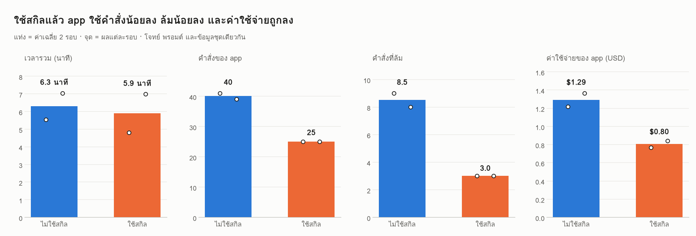
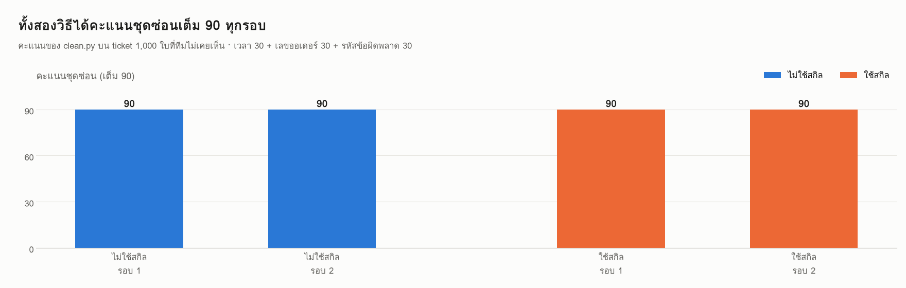
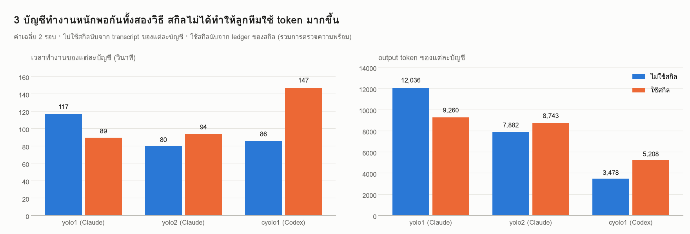
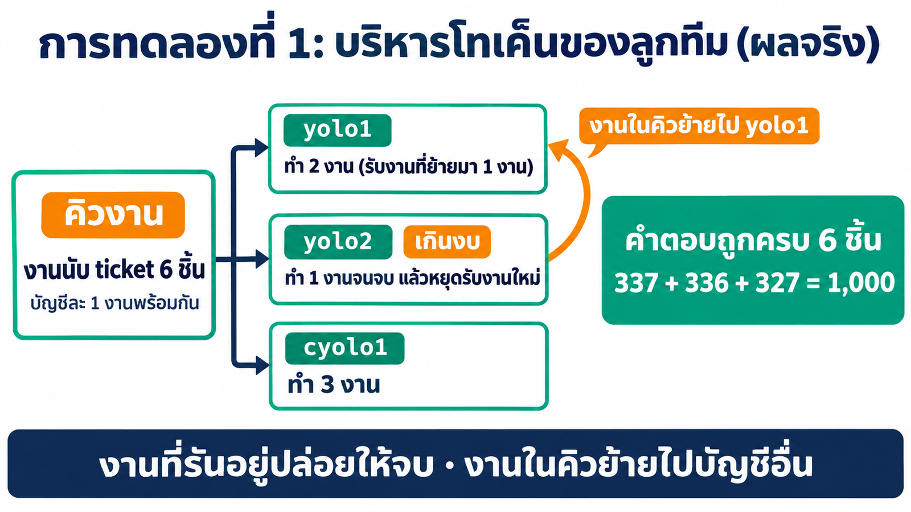

# 04_MultiAccount_Skill

## 1. ปัญหา: มีคำสั่งครบ แต่ AI ยังใช้ไม่เป็น

`yolo2` หรือ `cyolo1` เปิดบัญชีได้ทันที แต่ AI ที่จะสั่งบัญชีเหล่านี้ต้องรู้ว่าใส่ flag อะไร ผลลัพธ์อยู่ที่ไหน บัญชีไหนใช้ได้จริง และโควตาเหลือเท่าไร เมื่อไม่รู้ก็ต้องลองผิดลองถูกใหม่ทุกครั้ง


### 1.1 Baseline: ทีม AI ทำความสะอาดข้อมูล ticket

> [!NOTE]
> **หัวข้อนี้คือ baseline ของทั้งบท** วัดผลตอนที่ใน container ยังไม่มีสกิล หลังสร้างสกิล `yolo`, `cyolo` และ `agent-team` แล้ว เราจะใช้พรอมต์และข้อมูลชุดเดียวกันอีกครั้ง เพื่อเทียบว่าทีมทำงานดีขึ้นจริงหรือไม่

**Pain point:** ทุกเช้าทีม Support มี ticket 1,000 ใบ ข้อมูลเดียวกันถูกเขียนมาหลายรูปแบบ จึงนับและค้นหาไม่ได้ ส่วนการให้ AI อ่านทุกใบทุกวันก็ทั้งช้าและแพง เราจึงให้ทีม AI เขียนโปรแกรม Python ที่รันได้ทุกเช้าโดยไม่ต้องเรียก AI


*(ภาพจำลอง)*

โจทย์ใช้รูปแบบการทำงานร่วมกันแบบเดียวคือ **fan-out แล้ว fan-in**: Claude 2 บัญชีกับ Codex 1 บัญชีเขียนโค้ดคนละไฟล์พร้อมกัน แล้วให้บัญชีเดียวรวมเป็นโปรแกรมเดียว **AI เป็นผู้เขียนโค้ดเท่านั้น โค้ดห้ามเรียก AI**


ข้อมูลอยู่ที่ [`baseline/tickets.csv`](baseline/tickets.csv) จำนวน 1,000 ใบ โปรแกรมต้องอ่านไฟล์ด้วย `pandas.read_csv`


งานย่อยมี 3 ชิ้น ชิ้นละ 1 ไฟล์ 1 ฟังก์ชัน คำตอบถูกหรือผิดชัดเจน


| ไฟล์ | ผู้เขียน | หน้าที่ |
|---|---|---|
| `clean_time.py` | `yolo1` | แปลงเวลา 3 รูปแบบ (+07:00, UTC, พ.ศ.) เป็นเวลาไทย `YYYY-MM-DDTHH:MM` |
| `clean_order.py` | `yolo2` | แปลงเลขออเดอร์ทุกรูปแบบเป็น `ORD-######` ถ้าคอลัมน์ว่างให้หาในข้อความ |
| `clean_code.py` | `cyolo1` | หารหัสข้อผิดพลาดในข้อความ แล้วแปลงเป็น `E###` |
| `clean.py` + `report.md` | `yolo1` (fan-in) | รวม 3 ฟังก์ชัน พิมพ์ JSON ครบทุกใบ และเขียนรายงานสรุป |

คะแนนจริงวัดกับ**ชุดซ่อน** 1,000 ใบที่ทีมไม่เห็น รูปแบบเหมือนชุดนี้แต่ค่าต่างกันทั้งหมด จึงจำคำตอบไม่ได้


เปิด Claude Code app เลือก **Code** → **New session** → โฟลเดอร์ `04_MultiAccount_Skill` แล้ววางพรอมต์

> [!IMPORTANT]
> **📋 คัดลอกกล่องนี้ → Claude Code app แล้วกด Enter**
>
> ```text
> ใช้ทีมเอเจนต์ใน container multi-account ทำความสะอาดข้อมูล ticket ของทีม Support งานของทีมทำใน container ผ่าน docker exec เท่านั้น (ใช้ได้เฉพาะ 3 บัญชีนี้เท่านั้นตลอดทุกขั้น: yolo1, yolo2 และ cyolo1 ห้ามเรียกบัญชีอื่นเด็ดขาด)
> เตรียมก่อนเริ่ม (ถ้า container multi-account กำลังรันอยู่แล้ว ข้ามไปได้ ห้ามลบ container / image / volume ที่มีอยู่)
> - ถ้าเครื่องนี้ไม่มีทั้ง image multi-account:1.0 และ tuchsanai/multi-account:1 ให้ docker pull tuchsanai/multi-account:1
> - ถ้ายังไม่มีชื่อ multi-account:1.0 ให้ docker tag tuchsanai/multi-account:1 multi-account:1.0
> - ถ้า container หยุดอยู่ให้ docker start ถ้ายังไม่มีให้ docker run -dit --name multi-account --privileged -p <PORT>:8888 -v ai-accounts:/root/ai-accounts -v <path เต็มของ ../03_MultiAccount_Container/workspace>:/workspace multi-account:1.0 (PORT เริ่มที่ 8886 ถ้าชนใช้เลขว่างถัดไป)
> - ถ้าใน container ยังไม่มี pandas ให้ติดตั้งด้วย pip install pandas
> - ถ้าไม่มีบัญชี Claude หรือ Codex ที่ล็อกอินเลย ให้หยุดและบอกวิธีล็อกอินใน JupyterLab Terminal ห้ามล็อกอินแทนผม
> ก่อนเริ่ม ดูว่าใน container มีสกิลที่ช่วยงานนี้ได้หรือไม่ (Claude: /root/ai-accounts/.Claude/shared/skills · Codex: /root/ai-accounts/.Codex/shared/skills) ถ้ามีให้อ่านและใช้
> โฟลเดอร์งานใน container: /workspace/team-demo คัดลอก ./baseline/tickets.csv ไปไว้ที่ /workspace/team-demo/data
>
> โจทย์: tickets.csv มี ticket 1,000 ใบ คอลัมน์ id, received_at, order_id, channel, text ข้อมูลเดียวกันถูกเขียนมาหลายรูปแบบ มีเลขไทย การเว้นวรรคหลายแบบ และอักขระที่มองไม่เห็นปนอยู่ ต้องการโปรแกรม Python ที่แปลงให้เป็นรูปแบบเดียว
> - ใช้ได้เฉพาะ Python มาตรฐานและ pandas อ่านไฟล์ด้วย pandas.read_csv โค้ดห้ามเรียก AI และห้ามใช้เน็ต AI มีหน้าที่เขียนโค้ดเท่านั้น
> - โปรแกรมจะถูกตรวจกับ ticket ชุดใหม่ที่ไม่มีใครเห็น ค่าจะต่างจากชุดนี้ จึงห้ามใส่ id เลขออเดอร์ หรือรหัสของข้อมูลชุดนี้ลงในโค้ด
>
> ขั้นที่ 1 แบ่งงาน (fan-out): ให้ 3 บัญชีเขียนคนละไฟล์พร้อมกันใน /workspace/team-demo แต่ละไฟล์มีฟังก์ชันเดียว เจ้าของไฟล์ทดสอบกับ data/tickets.csv เองจนมั่นใจ
> - yolo1 เขียน clean_time.py ฟังก์ชัน clean_time(received_at) คืนเวลาไทย ปี ค.ศ. รูปแบบ YYYY-MM-DDTHH:MM ข้อมูลมี 3 รูปแบบ: ลงท้าย +07:00 คือเวลาไทย · ลงท้าย Z คือ UTC ต้องบวก 7 ชั่วโมง · วัน/เดือน/ปี พ.ศ. ชั่วโมง:นาที คือเวลาไทย
> - yolo2 เขียน clean_order.py ฟังก์ชัน clean_order(order_id, text) คืนเลขออเดอร์รูปแบบ ORD-ตามด้วยเลข 6 หลัก ข้อมูลเขียนมาหลายแบบ เช่น #312364, ord312364, ORD 312364, 312364 ถ้าคอลัมน์ order_id ว่าง เลขออเดอร์จะอยู่ในข้อความ ถ้าไม่มีเลยให้คืน None
> - cyolo1 เขียน clean_code.py ฟังก์ชัน clean_code(text) คืนรหัสข้อผิดพลาดในข้อความ รูปแบบ E ตามด้วยเลข 3 หลัก เช่น E402 ข้อมูลเขียนมาหลายแบบ เช่น E-402, e 402, ERR402, E๔๐๒, อี402 ถ้าไม่มีรหัสให้คืน None เลขพัสดุและเลขออเดอร์ไม่ใช่รหัสข้อผิดพลาด
>
> ขั้นที่ 2 รวมงาน (fan-in): เมื่อครบ 3 ไฟล์ ให้ yolo1 เขียน clean.py ที่เรียกใช้ทั้ง 3 ฟังก์ชัน
> - python3 clean.py <ไฟล์ csv> ต้องพิมพ์ JSON เป็น {id: {"time": ..., "order_id": ..., "error_code": ...}} ครบทุกใบ ค่าที่ไม่มีให้เป็น null
> - รันกับ data/tickets.csv ให้ผ่าน แล้วเขียน report.md สรุปจำนวน ticket ต่อวัน จำนวน ticket ของแต่ละรหัสข้อผิดพลาด และจำนวนใบที่คอลัมน์ order_id ว่าง
>
> ขั้นที่ 3 สรุป: ตาราง บัญชี | งาน | รุ่น | เวลา (วินาที) | input tokens | output tokens | สำเร็จ/ล้ม ตัวเลขต้องมาจากผลจริงของแต่ละบัญชี ห้ามประมาณ และบอกโควตาที่เหลือของแต่ละบัญชีพร้อมเวลาของข้อมูล บันทึกสรุปนี้เป็น /workspace/team-demo/run-summary.md ด้วย
> ```

**Output ของ baseline** (ผลจริง 10 พ.ย. 2026 · ไม่มีสกิล · รัน 2 รอบ)

| รอบ | คะแนนชุดซ่อน (เต็ม 90) | เวลารวม | คำสั่งของ app | คำสั่งที่ล้ม | ค่าใช้จ่ายของ app | แตะไฟล์ credential |
|---|---|---|---|---|---|---|
| 1 | 90 | 332.6 วินาที | 41 | 9 | $1.22 | 1 ครั้ง |
| 2 | 90 | 422.1 วินาที | 39 | 8 | $1.36 | 0 ครั้ง |
| **เฉลี่ย** | **90** | **377.4 วินาที** | **40.0** | **8.5** | **$1.29** | |

**สิ่งที่อ่านได้จากผล**

- **โค้ดถูกทั้งหมด:** `clean.py` ได้ 90 เต็มบนชุดซ่อนทั้ง 2 รอบ โจทย์นี้ทีม AI ทำได้แม้ไม่มีสกิล
- **app เสียคำสั่งไปกับการหาวิธีเอง:** ใช้ประมาณ 40 คำสั่งต่อรอบ ล้ม 8–9 คำสั่ง ส่วนใหญ่เป็นการเขียนสคริปต์คุมงาน สคริปต์รอผล และการรวมตัวเลขขึ้นมาเอง
- **รอบที่ 1 app อ่านไฟล์ credential:** เพื่อรายงานโควตา app เขียนสคริปต์อ่าน token ใน `.credentials.json` ไปถาม API เอง ซึ่งเป็นสิ่งที่เราไม่ต้องการให้เกิด
- **นี่คือตัวเลขที่สกิลต้องเอาชนะ:** ผล 2 รอบยังแกว่งได้ เวลารวมของสองรอบต่างกันถึง 90 วินาที

## 2. ทำไมสกิลแก้ปัญหานี้ได้

ใน baseline ทุกครั้งที่สั่งทีม Claude Code app ต้องหาวิธีเรียกแต่ละบัญชี เขียนสคริปต์คุมงาน จับเวลา และรวมตัวเลขขึ้นมาเอง ความรู้เหล่านี้เป็น **"รู้ว่าทำอย่างไร"** จึงเก็บไว้ในสกิลได้ตามหลักใน[บททฤษฎีสกิล](../../00_week01/05_agent-skills/01_skill-theory/README.md)

- **งานซ้ำให้สคริปต์ทำ งานคิดให้ AI ทำ:** การเรียกบัญชี ตรวจความพร้อม จับเวลา และรวมสถิติให้สคริปต์ทำ ส่วนการเขียนโค้ดทำความสะอาด ticket เป็นหน้าที่ของ AI
- **เปิดทีละชั้น:** AI เห็นแค่ชื่อและคำอธิบายของสกิล จะเปิดรายละเอียดเมื่อถึงขั้นที่ต้องใช้


## 3. ออกแบบสกิล 3 ตัว

ระบบต้องมีมากกว่าคำสั่งเรียกบัญชี จึงแบ่งเป็นสกิล 3 ตัว คุณสมบัติด้านการทำงานเป็นทีมของ `agent-team` ทดลองทีละข้อใน[ส่วนที่ 2](#ส่วนที่-2--ทดลอง-feature-ของสกิล-agent-team)


| สกิล | หน้าที่ | สคริปต์ |
|---|---|---|
| `yolo` | เรียก Claude Code ทุกบัญชีแบบไม่โต้ตอบ เลือกรุ่นตามความยาก ตรวจความพร้อมด้วยการเรียกจริง | `yolo.py` |
| `cyolo` | เรียก Codex ทุกบัญชี เลือกรุ่น สร้างภาพ และอ่านโควตา | `cyolo.py` |
| `agent-team` | ให้หลายบัญชีทำงานร่วมกัน ส่งข้อมูล แชร์ความรู้ บริหารโทเค็น สลับหัวหน้าทีม และสรุปสถิติ | `team.py` |

### 3.1 สถิติทุกบัญชี (ledger)


- ทุกครั้งที่สคริปต์ของสกิลเรียกบัญชี จะเพิ่ม 1 บรรทัดใน `/workspace/.agent-team/ledger.jsonl`
- `team.py stats` สรุปตามบัญชี รุ่น และงาน · `team.py quota` แสดงโควตาพร้อม**เวลาของข้อมูล**
- ledger **ไม่เก็บข้อความ prompt และ secret**

### 3.2 Claude Code app เข้าใจระบบใน container ได้อย่างไร


- **ใน container:** `yoloN` และ `cyoloN` โหลดสกิลจาก `shared/skills` อัตโนมัติ
- **จาก host:** ทุก `SKILL.md` มีหัวข้อ "เรียกจาก host" บอกวิธีอ่านสกิลและเรียกสคริปต์ผ่าน `docker exec`

## 4. ภาพรวม: บทนี้แบ่งเป็น 2 ส่วน


**ส่วนที่ 1** สร้างสกิล ติดตั้ง แล้ววัดผลกับโจทย์ baseline · **ส่วนที่ 2** ทดลอง feature ของสกิล `agent-team` ทีละข้อ ทุกขั้นทำใน Claude Code app

| ส่วน | ขั้น / การทดลอง | เวลารันจริง |
|---|---|---|
| **1** | ขั้นที่ 1 · ให้ Claude สร้างสกิลจากสเปก | 48 นาที |
| **1** | ขั้นที่ 2 · ติดตั้งสกิลด้วยการคัดลอกโฟลเดอร์ (หรือลากวางใน JupyterLab) | 43.4 วินาที |
| **1** | ขั้นที่ 3 · รันโจทย์ baseline ซ้ำแล้วเทียบผล | 353.0 วินาที (เฉลี่ย 2 รอบ) |
| **2** | การทดลองที่ 1 · หัวหน้าทีมบริหารโทเค็นของลูกทีม | 129.1 วินาที |
| **2** | การทดลองที่ 2 · สลับหัวหน้าทีมโดยงานไม่หาย | 213.3 วินาที |
| **2** | การทดลองที่ 3 · รูปแบบการทำงานร่วมกัน 5 แบบ | 369.9 วินาที |
| **2** | การทดลองที่ 4 · รูปแบบขั้นสูง 5 แบบ | 306.8 วินาที |

**ต้องมีก่อน:** ทำหัวข้อ 1.1 แล้ว พรอมต์ในหัวข้อนั้นเตรียม image และเปิด container `multi-account` ให้

บทนี้ใช้ค่าต่อไปนี้จากบท 03 โดยตรง

| ค่า | ชื่อ | ใช้ในบทนี้ |
|---|---|---|
| image | `multi-account:1.0` (ของ Docker Hub คือ `tuchsanai/multi-account:1`) | ต้นแบบของ container |
| container | `multi-account` | ทุกคำสั่ง `docker exec` และ `docker cp` |
| volume | `ai-accounts` → `/root/ai-accounts` | ล็อกอินทุกบัญชี และ `shared/skills` |
| โฟลเดอร์งาน | `03_MultiAccount_Container/workspace` → `/workspace` | ผลงานและข้อมูลของทุก run |
| JupyterLab | `http://localhost:8886/lab` | ลากวางสกิลในขั้นที่ 2 ของส่วนที่ 1 (ถ้าบท 03 ใช้ port อื่น ให้เปลี่ยน `8886`) |

สกิลและพรอมต์ระบุชื่อ `multi-account` ไว้ตายตัว พรอมต์ในหัวข้อ 1.1 จึงเปิด container ด้วยชื่อนี้ ส่วน `/maccount` สร้าง container ชื่อ `multi-account-devtool` จึงใช้กับบทนี้ไม่ได้

**เปิดโฟลเดอร์งาน:** ใน Claude Code app เลือก **Code** → **New session** → เลือกโฟลเดอร์ `04_MultiAccount_Skill` ของรีโปนี้

```text
04_MultiAccount_Skill/
├── prompt_skill_spec.md     ← สเปกของสกิล 3 ตัว: ต้องทำอะไร + เกณฑ์ทดสอบ
├── baseline/tickets.csv     ← ข้อมูลของโจทย์ใน 1.1
└── _solution/
    ├── skills/              ← สกิล 3 ตัวที่สร้างในขั้นที่ 1 (ใช้ทดลองในบทนี้)
    ├── TEST-REPORT.md       ← รายงานทดสอบสกิลจากขั้นที่ 1
    ├── eval/                ← พรอมต์ของทุกขั้น ชุดซ่อน ตัวตรวจคะแนน และสคริปต์ที่ใช้วัดผล
    └── results/             ← ผลจริงของส่วนที่ 1 (results.json + โค้ดของแต่ละรอบ) และของส่วนที่ 2 (lead, token, basic, advanced)
```

---

# ส่วนที่ 1 · สร้างสกิล ติดตั้ง และเทียบกับ baseline

ส่วนนี้มี 3 ขั้น: ให้ Claude สร้างสกิลจากสเปก ติดตั้งด้วยการคัดลอกโฟลเดอร์ แล้วรันโจทย์ในหัวข้อ 1.1 ซ้ำเพื่อเทียบกับตอนไม่มีสกิล

## ขั้นที่ 1 · ให้ Claude สร้างสกิลจากสเปก


สร้างโฟลเดอร์งานใหม่ แล้วคัดลอก [`prompt_skill_spec.md`](prompt_skill_spec.md) เข้าไป เปิด session ใหม่ที่โฟลเดอร์นั้นก่อนวางพรอมต์ ผลลัพธ์ที่เราได้จากการรันจริงเก็บไว้ที่ [`_solution/skills`](_solution/skills) และ [`_solution/TEST-REPORT.md`](_solution/TEST-REPORT.md)

> [!IMPORTANT]
> **📋 คัดลอกกล่องนี้ → Claude Code app แล้วกด Enter**
>
> ```text
> ช่วยสร้างสกิลชุดใหม่ที่ทำให้ AI ใช้ระบบหลายบัญชีใน container multi-account ได้เต็มประสิทธิภาพ
> ทำในโฟลเดอร์นี้ ใช้คำสั่ง docker ได้ แต่ห้ามลบ หยุด หรือสร้าง container / volume ใหม่ ห้ามแตะ credential และห้ามล็อกอินแทนผม
>
> วัตถุดิบ
> - ./prompt_skill_spec.md = สเปกของสกิล 3 ตัว (yolo, cyolo, agent-team) ทุกข้อต้องเป็นจริง
> - container multi-account ที่กำลังรัน = ที่ทดสอบจริง
>
> สร้างจากศูนย์ไว้ใน ./skills (นอก container นี่คือต้นฉบับที่เก็บสำรอง)
> ทดสอบ: คัดลอกโฟลเดอร์สกิลใน ./skills ไปวางที่ shared ของทั้งสองฝั่งใน container แล้วทดสอบทุกข้อในหัวข้อ "ทดสอบ" ของสเปก
> ทดสอบด้วยบัญชีที่ล็อกอินอยู่ในตอนนี้ (ตรวจเองว่าบัญชีไหนพร้อม) ใช้รุ่นและ effort ตามค่าเริ่มต้นของสกิลเหมือนการใช้งานจริง
> เขียน ./TEST-REPORT.md (นอกโฟลเดอร์ skills) แล้วสรุปเป็นตารางสั้น ๆ: ผลทดสอบ ไฟล์ที่สร้าง และเวลาที่ใช้ แล้วหยุด
> ```

**ผลจริง:** ใช้เวลาสร้างและทดสอบ 48 นาที (2,890 วินาที) คำสั่งล้ม 2 จาก 94 ค่าใช้จ่ายของ app $8.57 สกิลผ่านการทดสอบครบ 21 ข้อของสเปก โดยใช้บัญชีที่พร้อม 5 บัญชี (`yolo1–3`, `cyolo1–2`)

## ขั้นที่ 2 · ติดตั้งสกิลด้วยการคัดลอกโฟลเดอร์

### สกิลเก็บไว้ที่ไหน: volume และโฟลเดอร์สำรอง

สกิลถูกติดตั้งไว้ใน `/root/ai-accounts/.Claude/shared/skills` และ `/root/ai-accounts/.Codex/shared/skills` ซึ่งอยู่ใน **volume `ai-accounts`** ทุกบัญชีลิงก์เข้ามาที่นี่ สกิลจึงคงอยู่แม้ลบ container แต่เมื่อย้ายไป**เครื่องใหม่**หรือสร้าง **volume ใหม่** สกิลเหล่านี้จะไม่ติดไปด้วย จึงเก็บโฟลเดอร์ `skills/` สำรองไว้**นอก container** แล้วคัดลอกไปติดตั้งได้ทันทีโดยไม่ต้องสร้างสกิลใหม่


| ที่เก็บ | อยู่ที่ไหน | เมื่อลบ container | เมื่อย้ายเครื่อง / volume ใหม่ |
|---|---|---|---|
| โฟลเดอร์สำรอง `skills/` | บนเครื่องเรา (เก็บใน Git ได้) | ยังอยู่ | **นำไปติดตั้งใหม่ได้** |
| `shared/skills` | volume `ai-accounts` | ยังอยู่ | ไม่ติดไป |
| container | ชั้นที่เขียนได้ของ container | หายไป | ไม่ติดไป |


โฟลเดอร์สำรองมี**แค่ 3 โฟลเดอร์สกิล** ไม่มีสคริปต์ติดตั้ง เมื่อเปิดบัญชี `yoloN` หรือ `cyoloN` ครั้งถัดไป wrapper ใน image จะเชื่อมสกิลจาก `shared/skills` ให้บัญชีนั้นเอง

ติดตั้ง = คัดลอกโฟลเดอร์ `yolo`, `cyolo` และ `agent-team` ไปวางใน `shared/skills` ทั้งฝั่ง Claude และ Codex **ไม่ต้องรันสคริปต์ติดตั้ง**

### วิธีที่ 1 · สั่ง Claude Code app


> [!IMPORTANT]
> **📋 คัดลอกกล่องนี้ → Claude Code app แล้วกด Enter**
>
> ```text
> ติดตั้งสกิลจาก ./skills ลง container multi-account ด้วยการคัดลอกโฟลเดอร์อย่างเดียว
> - คัดลอกโฟลเดอร์ yolo, cyolo และ agent-team ใน ./skills ไปวางที่ /root/ai-accounts/.Claude/shared/skills และ /root/ai-accounts/.Codex/shared/skills ใน container
> - เปิดแต่ละบัญชีหนึ่งครั้งด้วย yoloN --version และ cyoloN --version (wrapper จะเชื่อมสกิลให้แต่ละบัญชีเอง)
> - ตรวจว่าทุกบัญชี yolo1–5 และ cyolo1–5 มองเห็น SKILL.md ของทั้ง 3 สกิล และตรวจความพร้อมด้วยคำสั่ง check ของสกิล agent-team
> สรุปเป็นตาราง สกิล | ฝั่ง Claude | ฝั่ง Codex แล้วหยุด
> ```

**ผลจริง** (43.4 วินาที · 8 คำสั่ง ล้ม 1 · $0.18): ทั้ง 10 บัญชีมองเห็น `SKILL.md` ของทั้ง 3 สกิล ฝั่ง Claude เห็นทันทีเพราะโฟลเดอร์ `skills` ของทุกบัญชีชี้ไปที่ `shared/skills` ส่วนฝั่ง Codex wrapper สร้างลิงก์รายสกิลให้ตอนรัน `cyoloN --version` และ `team.py check` รายงานว่าพร้อมใช้จริง 5 บัญชี อีก 5 บัญชียังไม่ได้ล็อกอิน

*ใช้สกิลที่เตรียมไว้: เปลี่ยน `./skills` ในพรอมต์เป็น `./_solution/skills`*

คัดลอกเองโดยไม่ใช้ Claude (รันจากโฟลเดอร์ `04_MultiAccount_Skill` ทีละบรรทัด) ใช้ได้ทั้งเครื่องเดิมและเครื่องใหม่ที่เพิ่งสร้าง volume:

```bash
for d in .Claude .Codex; do for s in yolo cyolo agent-team; do docker cp ./_solution/skills/$s multi-account:/root/ai-accounts/$d/shared/skills/; done; done
docker exec multi-account bash -lc 'for n in 1 2 3 4 5; do yolo$n --version; cyolo$n --version; done'
```

### วิธีที่ 2 · ลากวางใน JupyterLab

เปิด File Explorer ที่โฟลเดอร์ `04_MultiAccount_Skill\_solution\skills` (หรือ `skills` ที่สร้างในขั้นที่ 1) วางคู่กับ JupyterLab แล้วลาก `yolo`, `cyolo` และ `agent-team` **ทีละโฟลเดอร์** ไปปล่อยในพื้นที่ว่างของแถบไฟล์ ทำ 2 ที่


| ปลายทาง | เปิดใน JupyterLab | ใช้กับ |
|---|---|---|
| 1 | http://localhost:8886/lab/tree/root/ai-accounts/.Claude/shared/skills | `yolo1–5` |
| 2 | http://localhost:8886/lab/tree/root/ai-accounts/.Codex/shared/skills | `cyolo1–5` |

- **ลากทีละโฟลเดอร์:** ลากหลายโฟลเดอร์พร้อมกันอาจได้โฟลเดอร์ไม่ครบ
- **อย่าปล่อยบนชื่อโฟลเดอร์อื่น** เช่น `shared-check` จะกลายเป็นวางเข้าไปข้างในโฟลเดอร์นั้น
- **ลากวางครบแล้ว** ให้เปิด `yolo1` และ `cyolo1` หนึ่งครั้ง wrapper จะเชื่อมสกิลให้บัญชีนั้นเอง

## ขั้นที่ 3 · รันโจทย์ baseline ซ้ำแล้วเทียบผล


ติดตั้งสกิลตามขั้นที่ 2 แล้ววางพรอมต์**ชุดเดียวกับหัวข้อ 1.1 ทุกตัวอักษร**

> [!IMPORTANT]
> **📋 คัดลอกกล่องนี้ → Claude Code app แล้วกด Enter**
>
> ```text
> ใช้ทีมเอเจนต์ใน container multi-account ทำความสะอาดข้อมูล ticket ของทีม Support งานของทีมทำใน container ผ่าน docker exec เท่านั้น (ใช้ได้เฉพาะ 3 บัญชีนี้เท่านั้นตลอดทุกขั้น: yolo1, yolo2 และ cyolo1 ห้ามเรียกบัญชีอื่นเด็ดขาด)
> เตรียมก่อนเริ่ม (ถ้า container multi-account กำลังรันอยู่แล้ว ข้ามไปได้ ห้ามลบ container / image / volume ที่มีอยู่)
> - ถ้าเครื่องนี้ไม่มีทั้ง image multi-account:1.0 และ tuchsanai/multi-account:1 ให้ docker pull tuchsanai/multi-account:1
> - ถ้ายังไม่มีชื่อ multi-account:1.0 ให้ docker tag tuchsanai/multi-account:1 multi-account:1.0
> - ถ้า container หยุดอยู่ให้ docker start ถ้ายังไม่มีให้ docker run -dit --name multi-account --privileged -p <PORT>:8888 -v ai-accounts:/root/ai-accounts -v <path เต็มของ ../03_MultiAccount_Container/workspace>:/workspace multi-account:1.0 (PORT เริ่มที่ 8886 ถ้าชนใช้เลขว่างถัดไป)
> - ถ้าใน container ยังไม่มี pandas ให้ติดตั้งด้วย pip install pandas
> - ถ้าไม่มีบัญชี Claude หรือ Codex ที่ล็อกอินเลย ให้หยุดและบอกวิธีล็อกอินใน JupyterLab Terminal ห้ามล็อกอินแทนผม
> ก่อนเริ่ม ดูว่าใน container มีสกิลที่ช่วยงานนี้ได้หรือไม่ (Claude: /root/ai-accounts/.Claude/shared/skills · Codex: /root/ai-accounts/.Codex/shared/skills) ถ้ามีให้อ่านและใช้
> โฟลเดอร์งานใน container: /workspace/team-demo คัดลอก ./baseline/tickets.csv ไปไว้ที่ /workspace/team-demo/data
>
> โจทย์: tickets.csv มี ticket 1,000 ใบ คอลัมน์ id, received_at, order_id, channel, text ข้อมูลเดียวกันถูกเขียนมาหลายรูปแบบ มีเลขไทย การเว้นวรรคหลายแบบ และอักขระที่มองไม่เห็นปนอยู่ ต้องการโปรแกรม Python ที่แปลงให้เป็นรูปแบบเดียว
> - ใช้ได้เฉพาะ Python มาตรฐานและ pandas อ่านไฟล์ด้วย pandas.read_csv โค้ดห้ามเรียก AI และห้ามใช้เน็ต AI มีหน้าที่เขียนโค้ดเท่านั้น
> - โปรแกรมจะถูกตรวจกับ ticket ชุดใหม่ที่ไม่มีใครเห็น ค่าจะต่างจากชุดนี้ จึงห้ามใส่ id เลขออเดอร์ หรือรหัสของข้อมูลชุดนี้ลงในโค้ด
>
> ขั้นที่ 1 แบ่งงาน (fan-out): ให้ 3 บัญชีเขียนคนละไฟล์พร้อมกันใน /workspace/team-demo แต่ละไฟล์มีฟังก์ชันเดียว เจ้าของไฟล์ทดสอบกับ data/tickets.csv เองจนมั่นใจ
> - yolo1 เขียน clean_time.py ฟังก์ชัน clean_time(received_at) คืนเวลาไทย ปี ค.ศ. รูปแบบ YYYY-MM-DDTHH:MM ข้อมูลมี 3 รูปแบบ: ลงท้าย +07:00 คือเวลาไทย · ลงท้าย Z คือ UTC ต้องบวก 7 ชั่วโมง · วัน/เดือน/ปี พ.ศ. ชั่วโมง:นาที คือเวลาไทย
> - yolo2 เขียน clean_order.py ฟังก์ชัน clean_order(order_id, text) คืนเลขออเดอร์รูปแบบ ORD-ตามด้วยเลข 6 หลัก ข้อมูลเขียนมาหลายแบบ เช่น #312364, ord312364, ORD 312364, 312364 ถ้าคอลัมน์ order_id ว่าง เลขออเดอร์จะอยู่ในข้อความ ถ้าไม่มีเลยให้คืน None
> - cyolo1 เขียน clean_code.py ฟังก์ชัน clean_code(text) คืนรหัสข้อผิดพลาดในข้อความ รูปแบบ E ตามด้วยเลข 3 หลัก เช่น E402 ข้อมูลเขียนมาหลายแบบ เช่น E-402, e 402, ERR402, E๔๐๒, อี402 ถ้าไม่มีรหัสให้คืน None เลขพัสดุและเลขออเดอร์ไม่ใช่รหัสข้อผิดพลาด
>
> ขั้นที่ 2 รวมงาน (fan-in): เมื่อครบ 3 ไฟล์ ให้ yolo1 เขียน clean.py ที่เรียกใช้ทั้ง 3 ฟังก์ชัน
> - python3 clean.py <ไฟล์ csv> ต้องพิมพ์ JSON เป็น {id: {"time": ..., "order_id": ..., "error_code": ...}} ครบทุกใบ ค่าที่ไม่มีให้เป็น null
> - รันกับ data/tickets.csv ให้ผ่าน แล้วเขียน report.md สรุปจำนวน ticket ต่อวัน จำนวน ticket ของแต่ละรหัสข้อผิดพลาด และจำนวนใบที่คอลัมน์ order_id ว่าง
>
> ขั้นที่ 3 สรุป: ตาราง บัญชี | งาน | รุ่น | เวลา (วินาที) | input tokens | output tokens | สำเร็จ/ล้ม ตัวเลขต้องมาจากผลจริงของแต่ละบัญชี ห้ามประมาณ และบอกโควตาที่เหลือของแต่ละบัญชีพร้อมเวลาของข้อมูล บันทึกสรุปนี้เป็น /workspace/team-demo/run-summary.md ด้วย
> ```

### ผลจริง: ไม่ใช้สกิลเทียบกับใช้สกิล


ทั้งสองวิธีรัน **2 รอบ** ด้วยพรอมต์และข้อมูลเดียวกัน คะแนนชุดซ่อนตรวจหลังทีมทำเสร็จแล้ว ทีมไม่เคยเห็นชุดนี้ สกิลที่ใช้คือชุดที่สร้างในขั้นที่ 1 ([`_solution/skills`](_solution/skills))

### ตารางสรุป (ค่าเฉลี่ยต่อรอบ)

| วิธี | รอบ | คะแนนชุดซ่อน (เต็ม 90) | เวลารวม (นาที) | คำสั่งของ app | คำสั่งที่ล้ม | ค่าใช้จ่ายของ app | output token Claude | output token Codex | แตะไฟล์ credential |
| --- | --- | --- | --- | --- | --- | --- | --- | --- | --- |
| **ไม่ใช้สกิล** | 2 | **90** | 6.3 | 40.0 | 8.5 | $1.29 | 19,918 | 3,478 | 1 ครั้ง |
| **ใช้สกิล** | 2 | **90** | 5.9 | 25.0 | 3.0 | $0.80 | 18,003 | 5,208 | 0 ครั้ง |







### ผลแต่ละรอบ

| วิธี | รอบ | ชุดซ่อน | เวลารวม (วินาที) | คำสั่งของ app | คำสั่งที่ล้ม | ค่าใช้จ่าย | เวลา yolo1 / yolo2 / cyolo1 (วินาที) | output token yolo1 / yolo2 / cyolo1 | input รวม cache Claude / Codex |
| --- | --- | --- | --- | --- | --- | --- | --- | --- | --- |
| ไม่ใช้สกิล | 1 | 90 | 332.6 | 41 | 9 | $1.22 | 117 / 49 / 71 | 11,814 / 4,818 / 2,981 | 864,061 / 231,047 |
| ไม่ใช้สกิล | 2 | 90 | 422.1 | 39 | 8 | $1.36 | 116 / 110 / 101 | 12,258 / 10,947 / 3,974 | 792,917 / 271,148 |
| ใช้สกิล | 1 | 90 | 287.5 | 25 | 3 | $0.77 | 79 / 94 / 92 | 8,275 / 8,687 / 3,254 | 640,739 / 171,849 |
| ใช้สกิล | 2 | 90 | 418.5 | 25 | 3 | $0.84 | 100 / 94 / 201 | 10,245 / 8,799 / 7,161 | 795,235 / 323,797 |

<details>
<summary>คะแนนย่อยและจำนวนบรรทัดของโค้ดทุกรอบ</summary>

| วิธี | รอบ | เวลา (30) | เลขออเดอร์ (30) | รหัสข้อผิดพลาด (30) | รวม (90) | คะแนนบน `tickets.csv` | บรรทัด `clean_time` / `clean_order` / `clean_code` / `clean` |
| --- | --- | --- | --- | --- | --- | --- | --- |
| ไม่ใช้สกิล | 1 | 30 | 30 | 30 | 90 | 90 | 78 / 70 / 26 / 72 |
| ไม่ใช้สกิล | 2 | 30 | 30 | 30 | 90 | 90 | 149 / 160 / 35 / 81 |
| ใช้สกิล | 1 | 30 | 30 | 30 | 90 | 90 | 102 / 129 / 34 / 56 |
| ใช้สกิล | 2 | 30 | 30 | 30 | 90 | 90 | 76 / 119 / 56 / 57 |

</details>

**อ่านผลอย่างไร**

- **ความถูกต้องเท่ากัน:** ทั้งสองวิธีได้ 90 เต็มทุกรอบ สกิลไม่ได้ทำให้โค้ดดีขึ้น เพราะคนเขียนโค้ดยังเป็นบัญชีชุดเดิม
- **สกิลช่วยที่การสั่งงาน:** app ใช้คำสั่งลดลงจาก 40 เหลือ 25 คำสั่งที่ล้มลดจาก 8.5 เหลือ 3 และค่าใช้จ่ายของ app ลดจาก $1.29 เหลือ $0.80 ทั้ง 2 รอบ app สั่ง `team.py run` ครั้งเดียวด้วยกราฟ fan-out แล้ว fan-in และได้ตารางสถิติพร้อมโควตากลับมาเลย
- **เวลารวมยังสรุปไม่ได้:** ค่าเฉลี่ยเร็วขึ้น 24 วินาที (6.3 เหลือ 5.9 นาที) แต่เวลาของวิธีเดียวกันต่างกันระหว่างรอบได้ถึง 90–130 วินาที
- **ไม่แตะบัญชีอื่นและไม่แตะ credential:** รอบที่ใช้สกิลสั่งด้วย `--workers yolo1,yolo2,cyolo1` ใน ledger จึงมีแค่ 3 บัญชีนี้ และอ่านโควตาผ่านสกิล ส่วนรอบไม่ใช้สกิลรอบที่ 1 app อ่านไฟล์ credential เองเพื่อถามโควตา
- **ลูกทีมใช้ token พอกัน:** output token ของ 3 บัญชีรวมกันประมาณ 23,000 ต่อรอบทั้งสองวิธี
- **ข้อจำกัดของการวัด:** รันฝั่งละ 2 รอบเท่านั้น · token ของรอบไม่ใช้สกิลนับจาก transcript ของแต่ละบัญชี ส่วนรอบใช้สกิลนับจาก ledger ของสกิล ซึ่งรวมการตรวจความพร้อมด้วย · รอบไม่ใช้สกิล app เรียกบัญชี Claude ด้วยรุ่นเริ่มต้น (opus) ส่วนรอบใช้สกิล app เลือกความยาก 3 (opus/high และ Codex high)

---

# ส่วนที่ 2 · ทดลอง feature ของสกิล agent-team

ส่วนนี้ทดลอง feature ทีละข้อกับงาน ticket ชุดเดิม แต่ละการทดลองมีแนวคิด พรอมต์ และผลจริง **ต้องมีก่อน:** ทำส่วนที่ 1 ครบแล้ว (สกิลติดตั้งอยู่ และ `/workspace/team-demo` มี `clean.py` กับ `data/tickets.csv` จากขั้นที่ 3) · ผลจริงในส่วนนี้รันการทดลองละ 1 รอบด้วย [`_solution/eval/feature.sh`](_solution/eval/feature.sh)

| การทดลอง | feature | คำสั่งของสกิล |
|---|---|---|
| 1 | หัวหน้าทีมบริหารโทเค็นของลูกทีม | `team.py run --worker-token-budget` |
| 2 | สลับหัวหน้าทีมโดยงานไม่หาย | `team.py lead` |
| 3 | relay · fan-out / fan-in · graph · review loop · board | `team.py run` กราฟเดียว |
| 4 | debate · best-of-N + judge · router · failover · human gate | `team.py run` + `approve` |

## การทดลองที่ 1 · หัวหน้าทีมบริหารโทเค็นของลูกทีม


| สถานการณ์ | ตัวจัดคิวทำอะไร |
|---|---|
| ก่อนสั่งงาน | แจกให้บัญชีที่เหลือโควตามากก่อน งานง่ายใช้รุ่นเล็ก |
| ลูกทีมใกล้หมด (≥ 80% หรือเกินงบ) | **หยุดรับงานใหม่** งานที่รันอยู่ปล่อยให้จบ งานในคิวย้ายไปคนอื่น |
| ลูกทีมล้มกลางคัน | ย้ายงานไปบัญชีอื่น พร้อมความคืบหน้า |
| งานที่ผู้ใช้ระบุบัญชีเอง | ไม่ย้ายเงียบ ๆ หยุดและรายงาน |

**กรณีศึกษา: งานทำความสะอาด ticket**


### ทดลองจริง (129.1 วินาที)

งาน 6 ชิ้นนับ ticket ตามช่องทาง ไม่ระบุบัญชี แล้วตั้งงบโทเค็นของ `yolo2` ให้ต่ำมากเพื่อ**จำลอง**ว่าลูกทีมคนนี้ใกล้หมดโควตา

> [!IMPORTANT]
> **📋 คัดลอกกล่องนี้ → Claude Code app แล้วกด Enter**
>
> ```text
> ใช้ทีมเอเจนต์ใน container multi-account ทดลองการบริหารโทเค็นของลูกทีม ใช้เฉพาะ 3 บัญชี: yolo1, yolo2 และ cyolo1
> งานของทีม: ข้อมูล /workspace/team-demo/data/tickets.csv มีช่องทาง 3 แบบ (LINE, แอป, อีเมล) แบ่งเป็นงานย่อย 6 ชิ้น: นับจำนวน ticket ของแต่ละช่องทาง (3 ชิ้น) และนับจำนวน ticket ที่คอลัมน์ order_id ว่างของแต่ละช่องทาง (3 ชิ้น) แต่ละชิ้นตอบเป็นตัวเลขตัวเดียว
> - ใช้คำสั่ง run ของสกิล agent-team งานทุกชิ้นใช้ความยาก 1 ไม่ระบุบัญชี ให้ตัวจัดคิวเลือกเอง
> - ให้แต่ละบัญชีรันได้ครั้งละ 1 งาน เพื่อให้มีงานรอในคิว
> - ตั้งงบโทเค็นของ yolo2 ให้ต่ำมาก เพื่อดูว่าเมื่อลูกทีมเกินงบ ตัวจัดคิวทำอย่างไรกับงานที่รันอยู่และงานที่รอในคิว
> สรุปเป็นตาราง: งาน | บัญชีที่ทำ | โทเค็น | คำตอบ จากนั้นบอกว่า yolo2 ทำไปกี่งานก่อนหยุดรับงาน งานไหนถูกย้าย (จากใคร ไปใคร เพราะอะไร) และตรวจว่า 3 ช่องทางรวมกันได้ 1,000
> ```



**ผลจริง** (app 129.1 วินาที · 13 คำสั่ง ล้ม 2 · $0.36): app สั่ง `team.py run` ครั้งเดียวด้วย `--workers yolo1,yolo2,cyolo1 --per-account 1 --worker-token-budget yolo2=1` คำตอบถูกทั้ง 6 ชิ้น (ตรวจซ้ำด้วยการนับเอง)

| งาน | บัญชีที่ทำ | คำตอบ |
|---|---|---|
| นับ ticket ช่องทาง LINE | `cyolo1` | 337 |
| นับ ticket ช่องทาง แอป | `yolo2` | 336 |
| นับ ticket ช่องทาง อีเมล | `cyolo1` | 327 |
| `order_id` ว่าง ช่องทาง LINE | `yolo1` (ย้ายมาจาก `yolo2`) | 39 |
| `order_id` ว่าง ช่องทาง แอป | `yolo1` | 38 |
| `order_id` ว่าง ช่องทาง อีเมล | `cyolo1` | 35 |

| เหตุการณ์ | เกิดอะไรขึ้น |
|---|---|
| งานที่รันอยู่ | `yolo2` ทำงานแรกจนจบ ผล 336 ใช้ได้ตามปกติ ไม่ถูกตัดกลางทาง |
| เกินงบ | หลังงานจบ ตัวจัดคิวพบว่า `yolo2` ใช้ไป 15,795 โทเค็น เกินงบที่ตั้งไว้ จึง**หยุดรับงานใหม่** |
| งานในคิว | งานที่วางแผนให้ `yolo2` ทำต่อ ย้ายไป `yolo1` ซึ่งเพิ่งว่าง |
| ผลรวม | 337 + 336 + 327 = 1,000 ครบทุกใบ |

*งบ 1 โทเค็นเป็นสวิตช์จำลอง การใช้งานจริงให้ตั้งงบตามโควตาของบัญชี หรือใช้เกณฑ์โควตา 80% ที่เป็นค่าเริ่มต้น* · สรุปของ app อยู่ที่ [`_solution/results/token/summary.md`](_solution/results/token/summary.md)

## การทดลองที่ 2 · สลับหัวหน้าทีมโดยงานไม่หาย

ถ้าแผนงานอยู่ในบริบทแชตของหัวหน้า เมื่อโควตาหมด แผนและงานที่ค้างจะหายไปด้วย วิธีแก้คล้ายการส่งเวรของพยาบาล


*(ภาพจำลอง) `handoff.md` ทำหน้าที่เดียวกับใบส่งเวร*


| หลักการ | รายละเอียด |
|---|---|
| สถานะอยู่ในไฟล์ | `state.json` และ `handoff.md` ทำหน้าที่เหมือนใบส่งเวร |
| ผู้ควบคุมเป็นสคริปต์ | `team.py lead` ไม่ใช้โทเค็นจึงไม่หมดโควตา |
| ลูกทีมไม่ผูกกับหัวหน้า | หัวหน้าเปลี่ยนตัวแล้วงานที่สั่งไปไม่หาย |
| สลับเชิงรุก | โควตาหัวหน้า ≥ 80% หรือเกินงบ → ส่งไม้ก่อนหมด |
| สลับเชิงรับ | หัวหน้าล้มหรือเงียบไป → เริ่มคนใหม่จาก checkpoint ล่าสุด |

**กรณีศึกษา: งานทำความสะอาด ticket**


### ทดลองจริง (213.3 วินาที)

ให้ทีมทำงานจริงด้วยคำสั่ง `lead` ของสกิล `agent-team` แล้วบังคับให้เกิดการสลับหัวหน้าทั้งเชิงรับและเชิงรุก รวมถึงการย้ายงานของลูกทีมภายใต้หัวหน้า โดย**จำลอง**แทนการใช้โควตาจริงจนหมด


> [!IMPORTANT]
> **📋 คัดลอกกล่องนี้ → Claude Code app แล้วกด Enter**
>
> ```text
> ใช้ทีมเอเจนต์ใน container multi-account ทดลองการสลับหัวหน้าทีมและการบริหารโทเค็นของลูกทีม
> งานของทีม: สร้างตารางสูตรคูณแม่ 2 ถึงแม่ 9 แบ่งให้ลูกทีมทำคนละแม่ แล้วรวมเป็นไฟล์เดียว /workspace/demo/table.md
> - ใช้คำสั่ง lead ของสกิล agent-team งานทุกชิ้นใช้ความยาก 1
> - ตั้งงบโทเค็นของหัวหน้าให้ต่ำ เพื่อให้เกิดการสลับหัวหน้าแบบเชิงรุกอย่างน้อย 1 ครั้ง
> - จำลองให้หัวหน้าคนหนึ่งล้มกลางคัน เพื่อดูการสลับแบบเชิงรับ
> - ตั้งงบโทเค็นของลูกทีมคนหนึ่งให้ต่ำ เพื่อดูการย้ายงานไปลูกทีมคนอื่น
> สรุปเป็นตาราง: ประวัติการสลับหัวหน้า (จากใคร ไปใคร เพราะอะไร) การย้ายงานของลูกทีม ผลงานครบหรือไม่ และสถิติแยกตามบัญชี
> ```

**ผลจริง** (app 213.3 วินาที · 16 คำสั่ง ล้ม 2 · $0.50 · run 90 วินาที · 17 การเรียก): ตารางสูตรคูณครบ 8 แม่ 96 แถว ถูกทุกแถว app สั่ง `lead` คำสั่งเดียวพร้อม `--simulate-crash yolo1`, `--lead-token-budget yolo2=2000` และ `--worker-token-budget cyolo2=1`

| เหตุการณ์ | เกิดอะไรขึ้น |
|---|---|
| สลับหัวหน้า**เชิงรับ** | `yolo1` สั่งงาน m2–m9 ครบ 8 ชิ้นแล้วถูกจำลองให้ล้ม (`--simulate-crash yolo1`) ผู้ควบคุมเริ่ม `yolo2` ต่อจาก `handoff.md` · งานที่สั่งไปแล้วรันต่อจนเสร็จ |
| สลับหัวหน้า**เชิงรุก** | `yolo2` ใช้ไป 16,994 โทเค็น เกินงบหัวหน้า (ตั้งไว้ 2,000) จึงเขียน checkpoint แล้วส่งไม้ให้ `yolo3` ซึ่งปิดงานจนจบ |
| ย้ายงานลูกทีม | `cyolo2` ทำ m2 เสร็จแล้วใช้โทเค็นเกินงบ จึงหยุดรับงานใหม่ งาน m7 (แม่ 7) ที่รออยู่ในคิวย้ายไป `yolo2` |

*งบที่ตั้งต่ำทำหน้าที่เป็นสวิตช์จำลอง การใช้งานจริงให้ตั้งงบตามโควตาของบัญชี หรือใช้เกณฑ์โควตา 80% ที่เป็นค่าเริ่มต้น*

**จุดที่ยังไม่เรียบร้อยในรอบนี้**

- **app เปิดอ่านโค้ดของสกิล 2 คำสั่ง** (`grep` และ `sed` ใน `team.py`) เพื่อดูว่างบโทเค็นของหัวหน้าทำงานอย่างไร ก่อนเลือกค่างบ
- **หัวหน้าคนสุดท้ายสั่งงานซ้ำ 6 ชิ้น** (แม่ 4–9) เพราะไฟล์ผลของลูกทีมรุ่น haiku มีแค่ข้อความว่า "เขียนไฟล์แล้ว" ไม่มีตาราง ถ้าเขียนเป้าหมายให้ลูกทีม "ตอบเป็นตารางในข้อความ" จะไม่ต้องสั่งซ้ำ

ไฟล์ของ run นี้ (`state.json`, `handoff.md`, `board.md`, `ledger.jsonl`) อยู่ใน `03_MultiAccount_Container/workspace/.agent-team/<run_id>/` บนเครื่องเรา เปิด `handoff.md` เพื่อดูใบส่งเวรที่หัวหน้าแต่ละคนเขียนให้คนถัดไป

## การทดลองที่ 3 · รูปแบบการทำงานร่วมกัน 5 แบบ


| รูปแบบ | ตัวอย่างในงาน ticket | การส่งข้อมูล |
|---|---|---|
| relay | Codex หาจุดที่พลาด แล้วส่งให้ Claude แก้ | `{{node}}` แทรกค่าสั้นลง prompt |
| fan-out / fan-in | 3 บัญชีเขียนคนละไฟล์ แล้วรวมเป็น `clean.py` (โจทย์ในหัวข้อ 1.1) | งานรวมผลอ่านไฟล์ `{{file:node}}` |
| graph | `clean.py` เริ่มได้เมื่อครบ 3 ไฟล์ | ระบุ `depends_on` |
| review loop | อีกบัญชีตรวจ `clean.py` จนผ่าน | วนจนได้ `APPROVED` หรือครบ `max_rounds` |
| board | แชร์รูปแบบข้อมูลที่แต่ละบัญชีเจอ | ทุก agent อ่าน `board.md` ก่อนเริ่ม |

ข้อมูลยาวอย่าง `tickets.csv` ส่งเป็น **path ของไฟล์** ไม่ยัดลง prompt

### ทดลองจริง (369.9 วินาที)

ทำโจทย์ในหัวข้อ 1.1 อีกครั้งในโฟลเดอร์ใหม่ แต่เขียนเป็น**กราฟงานเดียวที่ใช้ครบ 5 รูปแบบ**


> [!IMPORTANT]
> **📋 คัดลอกกล่องนี้ → Claude Code app แล้วกด Enter**
>
> ```text
> ใช้ทีมเอเจนต์ใน container multi-account ทดลองรูปแบบการทำงานร่วมกันพื้นฐาน 5 แบบของสกิล agent-team ในกราฟงานเดียว ใช้เฉพาะ 3 บัญชี: yolo1, yolo2 และ cyolo1 งานทุกชิ้นใช้ความยาก 2
> ข้อมูล: /workspace/team-demo/data/tickets.csv (คอลัมน์ id, received_at, order_id, channel, text) โฟลเดอร์งานใหม่: /workspace/patterns-demo ห้ามแก้ไฟล์ใน /workspace/team-demo
> โค้ดใช้ได้เฉพาะ Python มาตรฐานและ pandas ห้ามใส่ id เลขออเดอร์ หรือรหัสของข้อมูลชุดนี้ลงในโค้ด
>
> กราฟงาน
> 1. board: cyolo1 สำรวจ tickets.csv แล้วเขียนรูปแบบที่พบของเวลา เลขออเดอร์ และรหัสข้อผิดพลาดลงกระดาน ให้งานถัดไปใช้
> 2. fan-out (เริ่มหลังข้อ 1): 3 บัญชีเขียนคนละไฟล์พร้อมกัน
>    - yolo1: clean_time.py ฟังก์ชัน clean_time(received_at) คืนเวลาไทย ปี ค.ศ. รูปแบบ YYYY-MM-DDTHH:MM (ลงท้าย +07:00 คือเวลาไทย · ลงท้าย Z คือ UTC ต้องบวก 7 ชั่วโมง · วัน/เดือน/ปี พ.ศ. คือเวลาไทย)
>    - yolo2: clean_order.py ฟังก์ชัน clean_order(order_id, text) คืน ORD-ตามด้วยเลข 6 หลัก ถ้าคอลัมน์ว่างให้หาในข้อความ ไม่มีเลยคืน None
>    - cyolo1: clean_code.py ฟังก์ชัน clean_code(text) คืนรหัสข้อผิดพลาดรูปแบบ E ตามด้วยเลข 3 หลัก ไม่มีคืน None (เลขพัสดุและเลขออเดอร์ไม่ใช่รหัส)
> 3. fan-in + graph: เมื่อครบ 3 ไฟล์ yolo1 เขียน clean.py ที่ python3 clean.py <ไฟล์ csv> พิมพ์ JSON {id: {"time": ..., "order_id": ..., "error_code": ...}} ครบทุกใบ
> 4. review loop: yolo2 เป็นผู้แก้ cyolo1 เป็นผู้ตรวจ clean.py (รันกับ tickets.csv จริง) วนจนได้ APPROVED ไม่เกิน 2 รอบ
> 5. relay: cyolo1 รัน clean.py แล้วตอบ id ของ ticket 1 ใบที่ผลน่าสงสัยที่สุด (ตอบ id อย่างเดียว) ส่งต่อให้ yolo2 ตรวจใบนั้น ถ้าผิดจริงให้แก้โค้ด แล้วตอบว่า แก้ หรือ ไม่ต้องแก้ พร้อมเหตุผล 1 บรรทัด
>
> สรุปเป็นตาราง: รูปแบบ | งานในกราฟ | บัญชี | เกิดอะไรขึ้นจริง (เช่น ข้อความบนกระดาน จำนวนรอบของ review ค่าที่ส่งต่อใน relay) | เวลา (วินาที) และสถิติโทเค็นแยกตามบัญชี
> ```

**ผลจริง** (app 369.9 วินาที · 21 คำสั่ง ล้ม 5 · $0.63 · 9 การเรียก): app เขียนกราฟ 8 งานแล้วสั่ง `team.py run` ครั้งเดียว งานผ่านทั้ง 8 ชิ้น `clean.py` ที่ได้ **90 เต็มบนชุดซ่อน** (ตรวจด้วย `grade.py` หลังทีมทำเสร็จ)

| รูปแบบ | งานในกราฟ | บัญชี | เกิดอะไรขึ้นจริง | เวลา (วินาที) |
|---|---|---|---|---|
| board | `board` | `cyolo1` | สำรวจครบ 1,000 แถว แล้วเขียนกระดาน 7 บรรทัด: เวลา 3 รูปแบบ · เลขออเดอร์ 5 รูปแบบ และช่องว่าง 112 แถว · รหัสข้อผิดพลาด 26 แถว · เตือนว่าเลขพัสดุไม่ใช่รหัส และข้อความมีอักขระ U+200B กับเลขไทยปน | 71.9 |
| fan-out | `time`, `order`, `code` | `yolo1` / `yolo2` / `cyolo1` | เริ่มพร้อมกันหลัง `board` แต่ละบัญชีใช้ข้อมูลจากกระดาน (เช่น ลบ U+200B ก่อนค้นหา) แล้วเขียนผลกลับลงกระดาน | 17.8 / 26.3 / 31.3 |
| fan-in + graph | `merge` | `yolo1` | เริ่มเมื่อครบ 3 ไฟล์ เขียน `clean.py` ได้ JSON 1,000 ใบ | 12.6 |
| review loop | `review` | `yolo2` แก้ · `cyolo1` ตรวจ | ได้ `APPROVED` ในรอบที่ 1 จากไม่เกิน 2 รอบ ผู้ตรวจรัน `clean.py` กับไฟล์จริงก่อนตัดสิน | 49.9 |
| relay | `pick` → `verify` | `cyolo1` → `yolo2` | ค่าที่ส่งต่อคือ `T0052` เท่านั้น `yolo2` ตรวจใบนั้นแล้วตอบว่า "ไม่ต้องแก้" เพราะผลถูกทั้ง 3 ช่อง | 30.3 |

กระดานของ run นี้อยู่ที่ [`_solution/results/basic/board.md`](_solution/results/basic/board.md) และสรุปของ app อยู่ที่ [`summary.md`](_solution/results/basic/summary.md)

**ข้อสังเกต**

- **กระดานทำให้งานหลังไม่ต้องสำรวจซ้ำ:** `board` ใช้เวลา 71.9 วินาที แต่งาน fan-out ทั้ง 3 ชิ้นจบใน 18–31 วินาที
- **review loop ไม่ได้วนจริงในรอบนี้:** งานผ่านตั้งแต่รอบแรก จึงไม่เห็นรอบแก้ไข
- **relay ไม่เจอจุดผิด:** `cyolo1` เลือกใบที่ยากที่สุด (ปี พ.ศ. + เลขออเดอร์ในข้อความ + `E-๔๐๒`) แต่ผลถูกอยู่แล้ว

## การทดลองที่ 4 · รูปแบบขั้นสูง 5 แบบ


| รูปแบบ | ตัวอย่างในงาน ticket |
|---|---|
| debate | Claude กับ Codex ถกกันว่าข้อความนี้มีรหัสข้อผิดพลาดหรือไม่ แล้วให้ผู้ตัดสินสรุป |
| best-of-N + judge | ให้หลายบัญชีเขียนไฟล์เดียวกัน แล้วเลือกไฟล์ที่ดีที่สุด |
| router | ส่งงานเขียนโค้ดและงานตรวจโค้ดให้บัญชีที่ถนัด |
| failover | บัญชีโควตาหมดหรือล็อกอินหมดอายุ ย้ายงานไปบัญชีอื่น |
| human gate | รอคนอนุมัติก่อนนำ `clean.py` ไปใช้จริง |

### ทดลองจริง (306.8 วินาที)

ทดลองกับงานจากส่วนที่ 1 ใน `/workspace/team-demo` และใช้ได้ 5 บัญชี เพราะ failover ต้องมีบัญชีสำรองฝั่ง Codex


> [!IMPORTANT]
> **📋 คัดลอกกล่องนี้ → Claude Code app แล้วกด Enter**
>
> ```text
> ใช้ทีมเอเจนต์ใน container multi-account ทดลองรูปแบบขั้นสูง 5 แบบของสกิล agent-team กับงาน ticket ใน /workspace/team-demo (มี clean.py, clean_code.py และ data/tickets.csv จากการทดลองก่อนหน้า) ใช้ได้ 5 บัญชี: yolo1, yolo2, yolo3, cyolo1 และ cyolo2 งานทุกชิ้นใช้ความยาก 2 ห้ามแก้ไฟล์เดิมใน /workspace/team-demo
>
> 1. debate: ให้ Claude กับ Codex ถกกันว่าข้อความ "ของ EX 402 ยังไม่มาเลย แอปก็ค้างตลอด" มีรหัสข้อผิดพลาดหรือไม่ (เกณฑ์: รหัสคือ E ตามด้วยเลข 3 หลัก เลขพัสดุไม่ใช่รหัส) แล้วให้ผู้ตัดสินสรุปเป็น มี หรือ ไม่มี พร้อมเหตุผล
> 2. best-of-N: ให้ yolo1, yolo2 และ cyolo1 เขียนฟังก์ชัน clean_channel(channel) ที่แปลงชื่อช่องทางเป็น line, app หรือ email (ตอบเป็นโค้ด) แล้วให้ผู้ตัดสินเลือกอันที่ดีที่สุด บันทึกอันที่ชนะเป็น /workspace/advanced-demo/clean_channel.py
> 3. router: ส่งงาน 3 ชิ้นโดยไม่ระบุบัญชี ให้ระบบเลือกเอง: งานเขียนโค้ด (เขียน unittest 3 กรณีให้ clean_code) งานตรวจโค้ด (ตรวจ clean.py แล้วบอกจุดเสี่ยง 3 ข้อ) และงานเขียนเอกสาร (เขียน README สั้น ๆ วิธีใช้ clean.py)
> 4. failover: จำลองให้ cyolo1 โควตาหมด แล้วดูว่างานของ cyolo1 ถูกย้ายไปบัญชีไหน
> 5. human gate: งานสุดท้ายคัดลอก clean.py ไปที่ /workspace/advanced-demo/prod/clean.py ต้องรออนุมัติก่อน เมื่องานหยุดรอ ให้แสดงสถานะที่รออนุมัติให้ผมเห็นก่อน แล้วอนุมัติแทนผมได้เลยในการทดลองนี้
>
> สรุปเป็นตาราง: รูปแบบ | บัญชีที่เกี่ยวข้อง | เกิดอะไรขึ้นจริง | เวลา (วินาที) และสถิติโทเค็นแยกตามบัญชี
> ```

**ผลจริง** (app 306.8 วินาที · 39 คำสั่ง ล้ม 6 · $1.00 · 14 การเรียก): งานเสร็จทุกชิ้น app แบ่งเป็น 3 run คือ debate + best-of-N + router, failover และ human gate

| รูปแบบ | บัญชี | เกิดอะไรขึ้นจริง | เวลา (วินาที) |
|---|---|---|---|
| debate | `yolo2` กับ `cyolo2` · ผู้ตัดสิน `yolo1` | ทั้งสองฝั่งตอบ "ไม่มี" ผู้ตัดสินสรุป **ไม่มี**: `EX 402` มีตัว X และช่องว่างคั่น จึงไม่ใช่ E ตามด้วยเลข 3 หลัก และบริบทเป็นเลขพัสดุ | 21.6 |
| best-of-N + judge | `yolo1`, `yolo2`, `cyolo1` · ผู้ตัดสิน `cyolo2` | คะแนน 8 / 7 / **9** ไฟล์ของ `cyolo1` ชนะเพราะใช้ตารางชื่อช่องทางที่ระบุชัด ส่วนอีก 2 ไฟล์จับคู่จากบางส่วนของคำ จึงแปลง "apple" เป็น app | 41.8 |
| router | ระบบเลือกเอง | งานเขียนโค้ด → `cyolo2` · งานตรวจโค้ด → `cyolo1` · งานเอกสาร → `yolo2` (โค้ดและงานตรวจไป Codex เอกสารไป Claude) unittest ผ่าน 3 กรณี | 33.3 |
| failover | `cyolo1` → `cyolo2` | จำลองว่า `cyolo1` โควตาหมด งานล้มใน 0.1 วินาที แล้วย้ายไป `cyolo2` ฝั่งเดียวกันเอง ผลถูก | 24.1 |
| human gate | `cyolo2` | งานหยุดที่ `waiting_approval` ใช้ 0 โทเค็น และโฟลเดอร์ `prod/` ยังว่าง หลังสั่ง `team.py approve` จึงคัดลอก `clean.py` ไฟล์ตรงกับต้นฉบับ | 11.8 |

ผลของผู้ตัดสินอยู่ที่ [`debate.judge.md`](_solution/results/advanced/debate.judge.md) และ [`bestof.judge.md`](_solution/results/advanced/bestof.judge.md) · ไฟล์ที่ชนะคือ [`clean_channel.py`](_solution/results/advanced/clean_channel.py)

**จุดที่ยังไม่เรียบร้อยในรอบนี้**

- **debate ไม่มีข้อโต้แย้ง:** ทั้งสองฝั่งเห็นตรงกันตั้งแต่ต้น ถ้าต้องการเห็นการถกจริง ให้ใช้ข้อความที่กำกวมกว่านี้
- **failover ต้องแยก run:** บัญชีที่ระบุเจาะจงจะไม่ถูกย้ายอัตโนมัติ ถ้าจำลองโควตาหมดใน run เดียวกับ best-of-N ที่ระบุ `cyolo1` ไว้ งานนั้นจะล้ม
- **app เปิดอ่านโค้ดของสกิล 2 คำสั่ง** (`grep` และ `sed` ใน `team.py`) เพื่อดูวิธีจำลองโควตาหมดและวิธีที่ router เลือกบัญชี
- **`yolo3` ไม่ได้งานเลย:** บัญชีนี้ใช้โควตาไปแล้ว 46% ระบบจึงส่งงานให้บัญชีที่เหลือมากกว่า
- **human gate อนุมัติโดย app:** พรอมต์อนุญาตให้ app อนุมัติแทน การใช้งานจริงให้คนสั่ง `team.py approve <run_id> <งาน>` เอง

---

## สรุป

**ส่วนที่ 1:** สกิลไม่ได้ทำให้โค้ดดีขึ้น (90 เต็มทั้งสองวิธี) แต่ทำให้ app สั่งงานทีมได้ด้วยคำสั่งที่น้อยลงและล้มน้อยลง · **ส่วนที่ 2:** feature ของ `agent-team` ทำงานได้จริงทุกข้อกับงาน ticket

| การทดลอง (ส่วนที่ 2) | ผลจริง | เวลาของ app | คำสั่ง (ล้ม) | ค่าใช้จ่าย |
|---|---|---|---|---|
| 1 · บริหารโทเค็นของลูกทีม | `yolo2` เกินงบ หยุดรับงานใหม่ งานในคิวย้ายไป `yolo1` คำตอบถูก 6 จาก 6 | 129.1 วินาที | 13 (2) | $0.36 |
| 2 · สลับหัวหน้าทีม | สลับเชิงรับ 1 ครั้ง เชิงรุก 1 ครั้ง ตารางครบ 96 แถว | 213.3 วินาที | 16 (2) | $0.50 |
| 3 · รูปแบบการทำงานร่วมกัน 5 แบบ | งานผ่าน 8 จาก 8 `clean.py` ได้ 90 เต็มบนชุดซ่อน | 369.9 วินาที | 21 (5) | $0.63 |
| 4 · รูปแบบขั้นสูง 5 แบบ | งานเสร็จทุกชิ้น ใช้ 3 run | 306.8 วินาที | 39 (6) | $1.00 |

**ไม่มีสกิลเทียบกับมีสกิล**

| | ไม่มีสกิล | มีสกิล |
|---|---|---|
| วิธีเรียกแต่ละบัญชี | ลองผิดลองถูก เปิด `--help` | สคริปต์ที่ใส่ flag ถูกและตรวจผลให้ |
| บัญชีไหนใช้ได้ | ดู `auth status` (ไม่ตรงจริง) | `check` ด้วยการเรียกจริง |
| ใช้ได้เฉพาะบางบัญชี | ต้องระวังเองทุกคำสั่ง | `--workers yolo1,yolo2,cyolo1` ไม่แตะบัญชีอื่น |
| การทำงานร่วมกัน | สั่งทีละตัว ยัดข้อมูลลง prompt | relay · fan-out · graph · review · board · ขั้นสูง |
| สถิติและโควตา | รวมตัวเลขเอง บางครั้งอ่านไฟล์ credential เพื่อถามโควตา | ledger ทุกครั้งที่เรียก + โควตาพร้อมเวลาของข้อมูล โดยไม่แตะ credential |
| หัวหน้าหรือลูกทีมโควตาหมด | งานค้างหรือหาย | สลับหัวหน้าและย้ายงานโดยงานไม่หาย |
| เครื่องใหม่ / volume ใหม่ | สร้างสกิลใหม่ | คัดลอกโฟลเดอร์สำรองไปวาง (ขั้นที่ 2) |
| โจทย์ baseline เฉลี่ย 2 รอบ (ชุดซ่อน / เวลา) | 90 คะแนน / 377.4 วินาที | 90 คะแนน / 353.0 วินาที |
| โจทย์ baseline เฉลี่ย 2 รอบ (คำสั่งของ app / ล้ม / ค่าใช้จ่าย) | 40 คำสั่ง / 8.5 / $1.29 | 25 คำสั่ง / 3 / $0.80 |

## ข้อควรรู้

- **ล็อกอินเองเสมอ:** สกิลไม่ล็อกอินแทน และไม่อ่านไฟล์ credential (`.credentials.json`, `.claude.json`, `auth.json`)
- **บัญชีทุกตัวรันแบบข้าม permission:** ใช้กับงานที่อนุญาตเท่านั้น และตรวจผลของ agent อื่นซ้ำเสมอ
- **ไม่ retry งานที่เสียโทเค็นอัตโนมัติ:** งานที่ล้มหลังใช้โทเค็นไปแล้วจะหยุดและรายงาน
- **Git Bash บน Windows แปลง path `/root/...`:** ใช้ `//root/...` ตามตัวอย่างในหัวข้อ "เรียกจาก host" ของ `SKILL.md` ใช้ได้ทั้ง Git Bash และ PowerShell
- **แก้สกิลที่ต้นฉบับ:** แก้ใน `skills/` บนเครื่องเรา แล้วคัดลอกทับใน `shared/skills` อีกครั้ง
- **ติดตั้งครบทั้ง 3 โฟลเดอร์:** แต่ละสกิลมีสำเนา `ma_common.py` ของตัวเอง จึงไม่พึ่งไฟล์นอกโฟลเดอร์ แต่ `SKILL.md` ของแต่ละสกิลอ้างถึงสกิลข้างเคียง ควรติดตั้งให้ครบ

## คำสั่งที่ใช้บ่อย

ใน container (JupyterLab Terminal)

```bash
T=/root/ai-accounts/.Claude/shared/skills/agent-team/scripts/team.py
python3 $T check            # บัญชีไหนใช้ได้ (เรียกจริง)
python3 $T quota            # โควตาทุกบัญชี + เวลาของข้อมูล
python3 $T run graph.json   # รันกราฟงานจนจบ แล้วพิมพ์ตาราง + โควตา
python3 $T status           # ภาพรวมทีม
python3 $T stats            # สถิติตามบัญชี / รุ่น / run
```

จาก host

```bash
docker exec multi-account cat //root/ai-accounts/.Claude/shared/skills/agent-team/SKILL.md
docker exec multi-account python3 //root/ai-accounts/.Claude/shared/skills/agent-team/scripts/team.py stats
docker exec multi-account python3 //root/ai-accounts/.Claude/shared/skills/agent-team/scripts/team.py lead --demo
cat graph.json | docker exec -i multi-account python3 //root/ai-accounts/.Claude/shared/skills/agent-team/scripts/team.py run - --workers yolo1,yolo2,cyolo1
```
