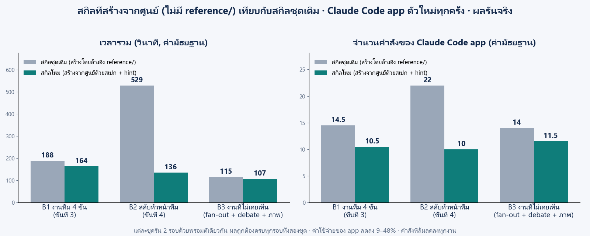

# BENCHMARK — สกิลที่สร้างจากศูนย์ เทียบกับสกิลชุดเดิม

> คำถาม: ถ้าตัด `reference/` (สกิล yolo / cyolo ชุดเดิม) ออกจากขั้นที่ 1 แล้วให้ Claude สร้างสกิลจากศูนย์ด้วยสเปก + hint อย่างเดียว สกิลที่ได้ทำงานได้ดีเท่าเดิมหรือไม่
> คำตอบจากการรันจริง (8 พ.ย. 2026): **ทำงานถูกครบทุกงานเหมือนเดิม และดีกว่าเดิมในทุกงานที่วัด** ทั้งเวลา จำนวนคำสั่ง คำสั่งที่ล้ม และค่าใช้จ่าย

## วิธีวัด

| เรื่อง | ทำอย่างไร |
|---|---|
| ชุดที่เทียบ | **เดิม** = สกิลใน `_solution/skills` ก่อนการปรับนี้ (ขั้นที่ 1 อ้างอิง `reference/`) · **ใหม่** = สกิลจากขั้นที่ 1 ที่ใช้แค่ `prompt_skill_spec.md` + `prompt_skill_hints.md` |
| ผู้ใช้สกิล | Claude Code ตัวใหม่บน host ทุกครั้ง (opus, effort medium, สิทธิ์จำกัดเฉพาะ `docker`) วางพรอมต์ใน `benchmark/prompts/` ทีละงาน เหมือน Claude Code app ของผู้เรียน |
| ความยุติธรรม | container ทดสอบแยก (โฟลเดอร์สกิลแยกจากของจริง) · ล้าง `/workspace` ทุกครั้งก่อนเริ่ม · รันสลับกันในวันเดียวกัน บัญชีชุดเดียวกัน · แต่ละงานรัน 2 รอบต่อชุด |
| ตรวจผลอิสระ | `scripts/verify.py` ตรวจจาก container เอง: B1 รัน `final.py` กับ 6 กรณีที่ app ไม่เห็น · B2 นับสูตรคูณที่ถูก 96 บรรทัด + มี `lead_switch` ≥ 2 และ `worker_switch` ≥ 1 · B3 ยอดรวมคำ 3607 + จำนวนเฉพาะ 95 + PNG จริง · ทุกงาน: ไม่แตะไฟล์ credential |
| สร้างจากศูนย์จริง | `scripts/integrity.py` ไล่ทุกคำสั่งของตัวสร้าง: ไม่มีการเปิดสกิลเก่า `reference/` `_solution/` หรือโฟลเดอร์สำรองสกิลใน volume (ซึ่งถูกซ่อนจาก container ทดสอบด้วย) = 0 ครั้ง |

| งาน | พรอมต์ | ตรงกับ |
|---|---|---|
| B1 | [prompts/B1.txt](benchmark/prompts/B1.txt) งานทีม 4 ขั้น parse_duration | ขั้นที่ 3 ของบทเรียน (ตัวอักษรเดียวกับหัวข้อ 1.1) |
| B2 | [prompts/B2.txt](benchmark/prompts/B2.txt) สลับหัวหน้าทีม + งบลูกทีม | ขั้นที่ 4 ของบทเรียน |
| B3 | [prompts/B3.txt](benchmark/prompts/B3.txt) fan-out นับคำ + debate + สร้างภาพ | **งานที่ไม่อยู่ในสเปกและบทเรียน** (วัดว่าสกิลใช้กับงานใหม่ได้) |

## ผล (ค่ามัธยฐานของ 2 รอบ)

| งาน | ผลถูก | เวลา (วินาที) | คำสั่งของ app | คำสั่งที่ล้ม | ค่าใช้จ่าย app |
|---|---|---|---|---|---|
| B1 | 2/2 → 2/2 | 188.1 → **164.1** | 14.5 → **10.5** | 3.5 → **2** | $0.68 → **$0.47** |
| B2 | 2/2 → 2/2 | 528.6 → **135.5** | 22 → **10** | 5 → **2.5** | $0.97 → **$0.50** |
| B3 | 2/2 → 2/2 | 115.1 → **107.4** | 14 → **11.5** | 5 → **3** | $0.58 → **$0.53** |

คำสั่งที่ล้มเกือบทั้งหมดของชุดใหม่เกิด**ก่อน** app เจอสกิล (ตามหา container / โฟลเดอร์สกิล และตัวตรวจสิทธิ์ของ app บล็อกคำสั่งบางรูปแบบ) หลังเปิด `SKILL.md` แล้ว ชุดใหม่ล้มรวม 1 คำสั่งจาก 6 รอบ ชุดเดิมล้ม 13 คำสั่งจาก 6 รอบ (`scripts/phase.py`)

### ทุกรอบ

| งาน | ชุด | เวลา (วินาที) | คำสั่ง | ล้ม | $ | ผล |
|---|---|---|---|---|---|---|
| B1 | เดิม | 198.7 | 15 | 4 | 0.736 | ผ่าน |
| B1 | เดิม | 177.5 | 14 | 3 | 0.615 | ผ่าน |
| B1 | ใหม่ | 170.5 | 10 | 2 | 0.469 | ผ่าน |
| B1 | ใหม่ | 157.7 | 11 | 2 | 0.467 | ผ่าน |
| B2 | เดิม | 801.1 | 24 | 3 | 1.080 | ผ่าน (app ต้องรัน lead 2 รอบ เพราะรอบแรกไม่เกิดการสลับเชิงรุก) |
| B2 | เดิม | 256.1 | 20 | 7 | 0.867 | ผ่าน |
| B2 | ใหม่ | 138.6 | 10 | 3 | 0.526 | ผ่าน |
| B2 | ใหม่ | 132.4 | 10 | 2 | 0.465 | ผ่าน |
| B3 | เดิม | 105.0 | 14 | 5 | 0.581 | ผ่าน |
| B3 | เดิม | 125.1 | 14 | 5 | 0.588 | ผ่าน |
| B3 | ใหม่ | 107.7 | 9 | 3 | 0.464 | ผ่าน |
| B3 | ใหม่ | 107.1 | 14 | 3 | 0.587 | ผ่าน |

## การวนปรับสเปก (2 รอบ)

ตั้งเกณฑ์ไว้ก่อนเริ่ม: ใหม่ต้องผลถูกทุกรอบ, B1 เวลาไม่เกินเดิม 10% และคำสั่งไม่มากกว่าเดิม, B2/B3 เวลาไม่เกินเดิม 25% · ถ้าไม่ผ่าน ให้ปรับสเปก/hint แล้วสร้างใหม่จากศูนย์ วนได้ถึง 5 รอบ ถ้าไม่ผ่านจะใช้สกิลชุดเดิมต่อ

| รอบ | สเปก + hint ที่ใช้ | ขั้นที่ 1 (สร้าง + ทดสอบ) | ผลวัด |
|---|---|---|---|
| 1 | ข้อเท็จจริงของ CLI ที่วัดแล้ว + บทเรียนจากการใช้งานจริงของ Claude Code app (ทั้ง B1 และ B2 ของชุดเดิม) | 30.9 นาที · 63 คำสั่ง · ล้ม 1 · $7.20 · PASS ทุกข้อ | B1 เร็วขึ้น 23% · B2 เร็วขึ้น 36% แต่ app ยังเปิดโค้ด `team.py` เพื่อหาวิธีจำลอง · `check` คืน exit 2 · `status` ก่อนมี run ขึ้น Traceback · ผ่านเกณฑ์แบบหวุดหวิด |
| 2 | รอบ 1 + ตารางปัญหาที่เห็นจากรอบ 1 (exit code, `--demo` ใช้กับ `--goal` ใดก็ได้, ส่งกราฟโดยไม่ใช้ heredoc, `SKILL.md` สั้นลง, ทดสอบผู้ใช้จริง 3 แบบ) | 42.9 นาที · 93 คำสั่ง · ล้ม 3 · $9.71 · PASS 21 · SKIP บางส่วน 1 | **ดีกว่าเดิมทุกงานทุกตัวชี้วัด** (ตารางด้านบน) → ใช้รอบนี้ |

สเปกและ hint ใน `04_MultiAccount_Skill/` คือฉบับรอบ 2 ที่ใช้รันจริง · ชุดเดิม (ขั้นที่ 1 อ้างอิง `reference/`) ใช้เวลา 32.6 นาที 125 คำสั่ง ล้ม 19 $9.58 PASS 17 · SKIP 1

## ไฟล์

| ไฟล์ | ใช้ทำอะไร |
|---|---|
| `benchmark/prompts/B1–B3.txt` | พรอมต์ที่วางให้ Claude Code app |
| `benchmark/data/part1–3.txt` | ข้อมูลของ B3 (1200 + 873 + 1534 = 3607 คำ) |
| `benchmark/scripts/bench.sh` | ติดตั้งสกิลชุดที่จะวัด → ล้าง workspace → รันพรอมต์ → ตรวจผล ต่อเนื่องทุกงาน |
| `benchmark/scripts/run-build.sh` | ขั้นที่ 1 ในโฟลเดอร์ใหม่ที่มีแค่สเปก + hint (ลบสกิลทั้ง 3 ออกจาก container ก่อนเริ่ม) |
| `benchmark/scripts/verify.py` · `compare.py` · `phase.py` · `integrity.py` | ตรวจผลอิสระ · เทียบค่ามัธยฐานตามเกณฑ์ · แยกคำสั่งก่อน/หลังเจอสกิล · ตรวจว่าตัวสร้างไม่ได้เปิดของเก่า |

สคริปต์เขียนสำหรับเครื่องผู้สอน (path `C:/t/s04b/...`, container ทดสอบชื่อ `multi-account` ที่ต่อ volume `ai-accounts` และวางโฟลเดอร์ `shared/skills` แยกเป็น volume ของตัวเอง) ใช้เป็นต้นแบบเมื่อต้องการวัดซ้ำ
