# DAG Planner Skill: แตกงานเป็นบล็อก · แต่ละบล็อกใช้สกิล · วาด DAG + Gantt (ต่อยอดจาก base skills)

## 1. ปัญหา: มีทีมแล้ว แต่ยังไม่มีแผน

ในบท 04 คำสั่ง `team.py run graph.json` ของสกิล `agent-team` รันทีมได้ทันที แต่ต้องมีคน **เขียน `graph.json` ก่อน** และต้องตอบคำถามเหล่านี้ให้ได้

| คำถาม | ถ้าตอบไม่ได้ |
|---|---|
| งานมีกี่ชิ้น ชิ้นไหนต้องรอชิ้นไหน | สั่งงานผิดลำดับ งานหลังเริ่มก่อนงานที่มันต้องใช้ |
| แต่ละชิ้นควรใช้สกิลไหน (Claude · Codex · สร้างภาพ · ให้ตรวจ · ให้หลายคนเสนอ) | ใช้บัญชีแพงกับงานง่าย หรือไม่มีใครตรวจงานสำคัญ |
| ชิ้นไหนให้บัญชีไหน เมื่อไร | บัญชีที่โควตาเหลือน้อยรับงานใหญ่จนค้าง |
| ทั้งโปรเจกต์จะเสร็จเมื่อไร | ไม่รู้ว่าเพิ่มบัญชีแล้วจะเร็วขึ้นหรือไม่ |

สกิล `dag-planner` ตอบคำถามทั้ง 4 ข้อนี้ให้ โดยเปลี่ยนโจทย์ 1 ข้อเป็นแผนที่ทีมรันได้จริง เริ่มจากแตกงานใหญ่เป็นชิ้นเล็ก


จากนั้นจัดบล็อกทั้งหมดให้เป็นระเบียบด้วย DAG จัดเวลาด้วย Gantt แล้วจึงให้ทีมรันจริง คาบนี้ทำถึง **Gantt แผน** ส่วนการรันจริงเป็นภาคต่อ


| คำศัพท์ | ความหมาย |
|---|---|
| **บล็อกงาน** | งานชิ้นเล็ก 1 ชิ้น ที่บอกว่าใช้สกิลอะไรทำ ได้ไฟล์อะไร และเสร็จแล้วตรวจอย่างไร |
| **DAG** (Directed Acyclic Graph) | แผนผังว่างานไหนต้องรองานไหน ลูกศร `A → B` แปลว่า B ต้องรอ A เสร็จก่อน และห้ามวนกลับ |
| **Gantt** (แกนต์ชาร์ต) | ตารางเวลาว่าบัญชีไหนทำงานไหน เริ่มและจบเมื่อไร |

## 2. ทฤษฎี: DAG · rank · สายวิกฤต · Gantt

ใช้ตัวอย่างเดียวตลอดหัวข้อนี้: ระบบเว็บร้านค้า มีงาน 14 ชิ้น เรียงได้ 6 ชั้น ขนาดงานสมมติเป็นนาที

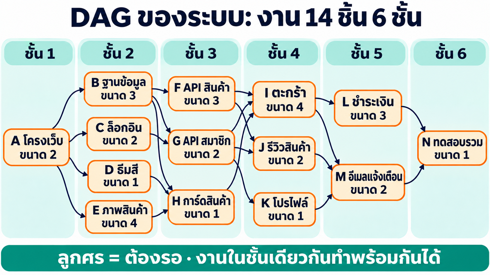

ตัวเลขในวงกลมมุมขวาบนของแต่ละกล่องคือ rank ซึ่งจะคำนวณให้ดูทีละชั้นในหัวข้อ 2.1

| ชั้น | งาน | ชื่อ | ขนาด | ต้องรอ | งานที่รอมันอยู่ |
|---|---|---|---|---|---|
| 1 | A | โครงเว็บ | 2 | – | B, C, D, E |
| 2 | B | ฐานข้อมูล | 3 | A | F, G, H |
| 2 | C | ล็อกอิน | 2 | A | G |
| 2 | D | ธีมสี | 1 | A | H |
| 2 | E | ภาพสินค้า | 4 | A | H |
| 3 | F | API สินค้า | 3 | B | I, J |
| 3 | G | API สมาชิก | 2 | B, C | I, J, K |
| 3 | H | การ์ดสินค้า | 1 | B, D, E | I |
| 4 | I | ตะกร้า | 4 | F, G, H | L, M |
| 4 | J | รีวิวสินค้า | 2 | F, G | M |
| 4 | K | โปรไฟล์ | 1 | G | M |
| 5 | L | ชำระเงิน | 3 | I | N |
| 5 | M | อีเมลแจ้งเตือน | 2 | I, J, K | N |
| 6 | N | ทดสอบรวม | 1 | L, M | – |

งานในชั้นเดียวกันไม่ได้รอกัน จึงทำพร้อมกันได้ถ้ามีบัญชีพอ

### 2.1 rank คำนวณอย่างไร

**rank** คือระยะทางที่ยาวที่สุดจากงานนี้ไปจนจบโปรเจกต์ โดยนับรวมตัวมันเอง rank สูงแปลว่างานนี้ยังมีงานรออยู่ข้างหลังอีกยาว จึงควรได้เริ่มก่อน

$$\mathrm{rank}(j) = c_j + \max_{k \in \mathrm{succ}(j)} \mathrm{rank}(k)$$

$c_j$ คือขนาดของงาน $j$ และ $\mathrm{succ}(j)$ คืองานที่รองาน $j$ อยู่ ถ้าไม่มีใครรอ ส่วน $\max$ มีค่าเป็น 0

ต้อง**คิดย้อนจากชั้นสุดท้าย** เพราะ rank ของงานหนึ่งต้องใช้ rank ของงานที่รอมันอยู่


| ชั้น | งาน | ใครรออยู่ (rank) | คำนวณ | rank |
|---|---|---|---|---|
| 6 | N | ไม่มี | 1 + 0 | **1** |
| 5 | L | N (1) | 3 + 1 | **4** |
| 5 | M | N (1) | 2 + 1 | **3** |
| 4 | I | L (4), M (3) | 4 + max(4, 3) = 4 + 4 | **8** |
| 4 | J | M (3) | 2 + 3 | **5** |
| 4 | K | M (3) | 1 + 3 | **4** |
| 3 | F | I (8), J (5) | 3 + max(8, 5) = 3 + 8 | **11** |
| 3 | G | I (8), J (5), K (4) | 2 + max(8, 5, 4) = 2 + 8 | **10** |
| 3 | H | I (8) | 1 + 8 | **9** |
| 2 | B | F (11), G (10), H (9) | 3 + max(11, 10, 9) = 3 + 11 | **14** |
| 2 | C | G (10) | 2 + 10 | **12** |
| 2 | D | H (9) | 1 + 9 | **10** |
| 2 | E | H (9) | 4 + 9 | **13** |
| 1 | A | B (14), C (12), D (10), E (13) | 2 + max(14, 12, 10, 13) = 2 + 14 | **16** |

สิ่งที่ควรสังเกตจากตารางนี้

- **ทำไมใช้ `max` ไม่ใช่บวกทั้งหมด:** F, G, H ทำพร้อมกันได้ งานที่ยาวที่สุดเป็นตัวกำหนดว่าจะจบเมื่อไร ถ้าบวกทั้งหมด B จะได้ 3 + 11 + 10 + 9 = 33 ซึ่งเกินเวลาของทั้งโปรเจกต์
- **งานใหญ่ไม่ได้แปลว่าสำคัญกว่า:** E มีขนาด 4 ใหญ่กว่า B ที่มีขนาด 3 แต่ rank ของ B (14) สูงกว่า E (13) เพราะงานที่รอ B อยู่ยาวกว่า
- **งานชั้นเดียวกัน rank ต่างกันได้:** ชั้น 2 มี rank ตั้งแต่ 10 ถึง 14 ชั้นบอกแค่ลำดับก่อนหลัง ส่วน rank บอกว่างานไหนเร่งด่วนกว่า
- **rank เท่ากันได้แม้อยู่คนละชั้น:** D (ชั้น 2) และ G (ชั้น 3) ได้ 10 เท่ากัน

### 2.2 สายวิกฤต

**สายวิกฤต** คือเส้นทางจากต้นจนจบที่ยาวที่สุด ตัวอย่างนี้มีทั้งหมด 17 เส้นทาง ตารางแสดงเฉพาะเส้นที่น่าสนใจ


| เส้นทาง | คำนวณ | ความยาว |
|---|---|---|
| **A → B → F → I → L → N** | 2 + 3 + 3 + 4 + 3 + 1 | **16 (สายวิกฤต)** |
| A → B → F → I → M → N | 2 + 3 + 3 + 4 + 2 + 1 | 15 |
| A → B → G → I → L → N | 2 + 3 + 2 + 4 + 3 + 1 | 15 |
| A → E → H → I → L → N | 2 + 4 + 1 + 4 + 3 + 1 | 15 |
| A → C → G → I → L → N | 2 + 2 + 2 + 4 + 3 + 1 | 14 |
| A → D → H → I → L → N | 2 + 1 + 1 + 4 + 3 + 1 | 12 |
| A → C → G → K → M → N | 2 + 2 + 2 + 1 + 2 + 1 | 10 |

ไม่ต้องไล่ทั้ง 17 เส้นทางก็หาได้: เริ่มจากงาน A แล้วเดินไปหางานที่รออยู่ซึ่ง rank มากที่สุดทีละก้าว A (16) → B (14) → F (11) → I (8) → L (4) → N (1) และ rank ของงานแรกเท่ากับความยาวสายวิกฤตพอดี

| งาน | เส้นทางที่ยาวที่สุดที่ผ่านงานนี้ | ช้าได้อีกเท่าไรก่อนกระทบทั้งโปรเจกต์ |
|---|---|---|
| A, B, F, I, L, N (บนสายวิกฤต) | 16 | 0 ช้าเท่าไร ทั้งโปรเจกต์ช้าเท่านั้น |
| E, G, H, M | 15 | 1 |
| C | 14 | 2 |
| J | 13 | 3 |
| D | 12 | 4 |
| K | 11 | 5 |

เส้นทางที่ยาว 15 มีถึง 3 เส้น ถ้า E ช้าลง 2 เส้น A → E → H → I → L → N จะยาว 17 และกลายเป็นสายวิกฤตใหม่ สายวิกฤตจึงเปลี่ยนได้เมื่อเวลาจริงต่างจากที่ประเมิน

งานบนสายวิกฤตจึงได้เลือกบัญชีก่อน

### 2.3 จาก DAG เป็น Gantt

**Gantt** คือตารางเวลา แถว = บัญชี · แท่ง = งาน · แกนนอน = เวลา เมื่อมีงานพร้อมทำหลายชิ้น งานที่ rank สูงกว่าได้บัญชีก่อน ถ้า rank เท่ากันงานใหญ่กว่าได้ก่อน


| บัญชี | เวลารวม | เหตุผล |
|---|---|---|
| 1 | 31 | ทำทีละงาน จึงเท่ากับผลรวมขนาดทุกงาน |
| 2 | 19 | ทำคู่กันได้ แต่ช่วงที่ชั้น 2 พร้อมทั้ง 4 งาน มีบัญชีไม่พอ จึงต้องรอกัน |
| 3 | 16 | เท่ากับความยาวสายวิกฤตพอดี |
| 4 | 16 | บัญชีที่ 4 ได้ทำแค่ D เพราะงานบนสายวิกฤตต้องทำต่อกัน เพิ่มบัญชีก็ไม่เร็วขึ้น |

ใน Gantt จริงของบทนี้ สีแท่งบอกสกิล และบล็อกที่ใช้หลายบัญชีจะมีหลายแถว


ผู้ตัดสินว่า "บล็อกนี้ให้บัญชีไหน" คืออัลกอริทึม **KC-QUEST** (ดูโควตาที่เหลือ วันรีเซ็ต ขนาดงาน และ rank) รายละเอียดสมการอยู่ใน [บท 06 · KC-QUEST](../06_KC_QUEST/readme.md)

## 3. บล็อกงาน: จากกล่องใน DAG สู่การ์ดงาน

กล่องใน DAG ของหัวข้อ 2 บอกแค่ชื่อและขนาด แต่ถ้าจะให้ทีมเอเจนต์ทำงานจริง ต้องบอกมากกว่านั้น กล่องแต่ละกล่องจึงกลายเป็น**บล็อกงาน**

### 3.1 หนึ่งบล็อกบอกอะไรบ้าง

ใช้งาน `I ตะกร้า` จากระบบในหัวข้อ 2 เป็นตัวอย่าง

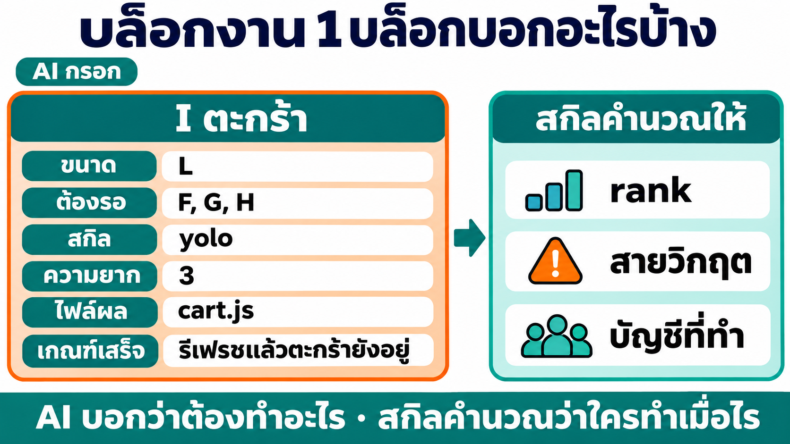

```json
{"id": "I", "title": "ตะกร้า", "size": "L", "depends_on": ["F", "G", "H"],
 "skill": "yolo", "difficulty": 3,
 "output": "cart.js", "done": "รีเฟรชแล้วตะกร้ายังอยู่"}
```

| ฟิลด์ | ความหมาย | ใครกำหนด |
|---|---|---|
| `size` | ขนาดงาน S / M / L = 0.6 / 1.5 / 3 ล้านโทเคน ใหญ่กว่า L ต้องแบ่ง | AI |
| `depends_on` | บล็อกที่ต้องเสร็จก่อน คือลูกศรใน DAG | AI |
| `skill` | สกิลที่ใช้ทำ (หัวข้อ 3.2) | AI |
| `difficulty` | ความยาก 1–6 ตามตารางของ base skill `agent-team` ใช้เลือกรุ่นและ effort | AI |
| `output` | ไฟล์ผล บล็อกถัดไปอ่านไฟล์นี้ต่อ | AI |
| `done` | เกณฑ์เสร็จที่ตรวจได้ | AI |
| `exclusive` | บล็อกรวมระบบและทดสอบสุดท้าย รันคนเดียว | AI |
| rank · สายวิกฤต | คำนวณจาก `size` และ `depends_on` ตามหัวข้อ 2 | สกิล |
| บัญชีและเวลา | อัลกอริทึม KC-QUEST แจกงานจากโควตาจริง | สกิล |

หัวข้อ 2 ใช้ขนาดเป็นเลขง่าย ๆ เพื่อให้คิดตามได้ ของจริงใช้ S / M / L แต่วิธีคิด rank เหมือนกันทุกอย่าง

### 3.2 แต่ละบล็อกใช้สกิลอะไร

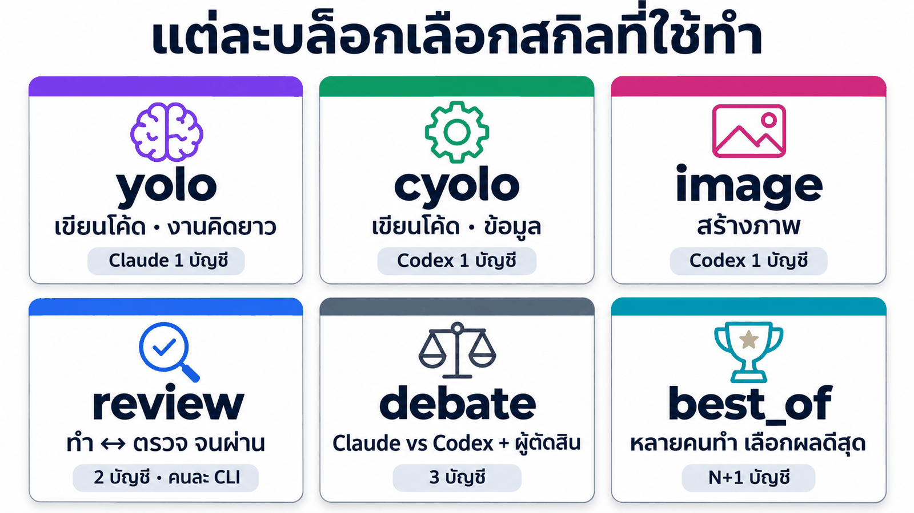

| `skill` | ใช้เมื่อ | ตัวอย่างจากระบบในหัวข้อ 2 | ทีมทำจริงด้วย (base skill `agent-team`) | บัญชี |
|---|---|---|---|---|
| `yolo` | งานที่ต้องคิดยาว | I ตะกร้า | งานเดี่ยวฝั่ง Claude | 1 |
| `cyolo` | งานตรงไปตรงมา | F API สินค้า | งานเดี่ยวฝั่ง Codex | 1 |
| `image` | สร้างภาพ | E ภาพสินค้า | งานภาพ ไปฝั่ง Codex เสมอ | 1 |
| `review` | งานสำคัญที่ต้องมีคนตรวจ | L ชำระเงิน | review loop ผู้ทำและผู้ตรวจคนละ CLI | 2 |
| `debate` | การตัดสินใจที่มีคำตอบถูกผิด | C เลือกวิธีล็อกอิน | Claude กับ Codex ตอบ แล้วมีผู้ตัดสิน | 3 |
| `best_of` | งานสร้างสรรค์ อยากได้ตัวเลือกที่ดีที่สุด | D ธีมสี | หลายคนทำ แล้วมีผู้ตัดสิน | N+1 |

`review`, `debate` และ `best_of` ใช้หลายบัญชีต่อบล็อก จึงเลือกใช้เฉพาะบล็อกที่คุ้ม และจำนวนบัญชีที่ทำงานพร้อมกันต้องไม่น้อยกว่าที่บล็อกนั้นต้องใช้

### 3.3 แตกบล็อกอย่างไรให้ดี

| กติกา | เหตุผล |
|---|---|
| ทั้งโปรเจกต์ควรมี 6–14 บล็อก | น้อยไปไม่ได้ประโยชน์จากการทำขนาน มากไปประสานงานยาก |
| บล็อกหนึ่งไม่ใหญ่เกิน L | งานใหญ่เกินไปมีโอกาสล้มกลางทาง |
| ใส่ `depends_on` เฉพาะงานที่ต้องใช้ไฟล์ผลจริง | ยิ่งรอน้อย ยิ่งทำพร้อมกันได้มาก |
| อย่าตัด `depends_on` ที่จำเป็นออก | งานที่ไม่รอข้อมูลของกันจะได้ผลที่ไม่ตรงกัน |
| บล็อกสุดท้ายเป็นงานรวมและทดสอบ แบบ `exclusive` | มีคนเดียวแก้ไฟล์ของบล็อกอื่นได้ จึงไม่ชนกัน |

## 4. สกิล `dag-planner` ทำงานอย่างไร

### 4.1 ต่อยอดจาก base skills

`dag-planner` ไม่ได้เรียก Claude หรือ Codex เอง แต่ใช้สกิล 3 ตัวที่มีอยู่แล้วเป็นฐาน เรียกว่า **base skills** เก็บไว้ในโฟลเดอร์ `./base_skills` ของบทนี้ (ชุดเดียวกับสกิลที่ได้จาก[บท 04](../04_MultiAccount_Skill/README.md))

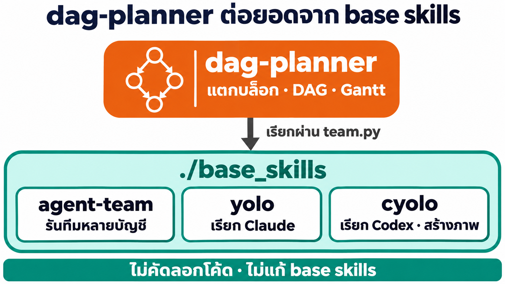

| base skill | ทำอะไร | `dag-planner` ใช้ตรงไหน |
|---|---|---|
| `agent-team` | รันทีมหลายบัญชีตาม `graph.json` · ตรวจความพร้อมและโควตา | `team.py check` · `quota` (ตอน `plan`) · `team.py run` (ตอนรันจริง) |
| `yolo` | เรียก Claude 1 บัญชี | บล็อกที่ `skill` เป็น `yolo` และฝั่ง Claude ของ review · debate · best_of |
| `cyolo` | เรียก Codex 1 บัญชี · สร้างภาพ | บล็อกที่ `skill` เป็น `cyolo` · `image` และฝั่ง Codex ของ review · debate · best_of |

กติกา 2 ข้อ: `dag-planner` **ไม่คัดลอกโค้ด**ของ base skill (เรียกผ่าน `team.py` เท่านั้น) และ**ไม่แก้ไฟล์**ใน `./base_skills` ถ้า base skill เปลี่ยนรุ่น ให้สร้าง `dag-planner` ใหม่จากสเปกเดิม

### 4.2 ขั้นตอนและผู้รับผิดชอบ


| ใคร | ทำอะไร | ใช้โทเคนไหม |
|---|---|---|
| **AI** (Claude Code app) | อ่านโจทย์ แตกเป็นบล็อก เลือกสกิลและความยาก | ใช้ |
| **`dagplan.py`** (สคริปต์ในสกิล) | ตรวจกราฟ คิด rank วาด DAG แจกบล็อกให้บัญชี วาด Gantt และสรุปผลจริง | ไม่ใช้ |
| **`agent-team`** (base skill) | รันแต่ละบล็อกด้วยสกิลที่ระบุ บนบัญชีจริง | ใช้ |

คาบนี้และการบ้านทำขั้น 1–4 ส่วนขั้น 5–6 เป็นภาคต่อ

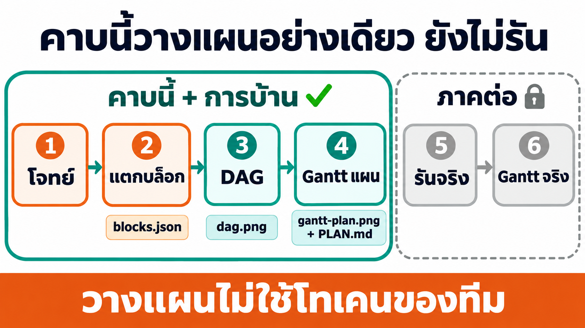

### 4.3 คำสั่งของสกิล

| ขั้น | คำสั่ง | ผลที่ได้ |
|---|---|---|
| ตรวจเครื่อง | `doctor` | python · base skills ที่พบ · ตัววาด PNG และบัญชีที่พร้อม |
| 3 · DAG | `dag <แผน>` | ตรวจวงวน id ซ้ำ id ที่ไม่มีจริง และ skill ที่ไม่รู้จัก แล้วได้ rank สายวิกฤต และ `dag.png` |
| 4 · Gantt แผน | `plan <แผน>` | แจกบล็อกให้บัญชีจากโควตาจริง ได้ `gantt-plan.png` และ `PLAN.md` ที่บอกเหตุผลทุกบล็อก |
| 5 · รันจริง (ภาคต่อ) | `export` แล้ว `run <แผน>` | แปลงเป็น `graph.json` ของ agent-team แล้วรันจริง |
| 6 · Gantt จริง (ภาคต่อ) | `report <แผน>` | `gantt-actual.png`, `compare.png`, `REPORT.md` และ `calib.json` |

### 4.4 ใครอยู่ตรงไหน


### 4.5 แผนกับของจริงต่างกันได้

Gantt แผนคำนวณจากขนาดงานที่**ประเมิน** เมื่อรันจริง คำสั่ง `report` อ่านเวลาเริ่มและจบของทุกบล็อกจาก ledger ของ agent-team แล้ววาด **Gantt จริง** เทียบกับแผน พร้อมคำนวณตัวปรับเวลา $k$ แยกตามสกิล

$$k_{\text{skill}} = \frac{\text{เวลาจริง}}{\text{เวลาแผน (ก่อนคูณ } k)}$$

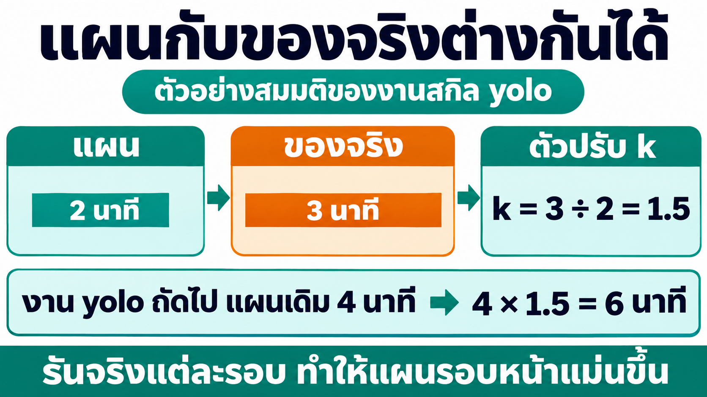

ค่า $k$ ถูกเก็บใน `calib.json` และ `plan` ครั้งถัดไปจะคูณเวลาของแต่ละบล็อกด้วย $k$ ของสกิลนั้น

อีกเรื่องที่ต่างได้คือ**บัญชี** `export` ส่งงานให้ agent-team เป็น**ฝั่ง** (`yolo` หรือ `cyolo`) ไม่ผูกบัญชีเจาะจง เพราะถ้าผูก ระบบย้ายงานเมื่อบัญชีล้มของ agent-team จะปิดไป agent-team จึงเลือกบัญชีในฝั่งเองตามโหลด และ `report` แสดงส่วนต่างนี้ให้เห็น

## 5. ภาพรวมขั้นตอนการทดลอง

| ขั้น | ทำอะไร | ใช้โทเคนของทีมไหม |
|---|---|---|
| **1 · ให้ Claude สร้างสกิลจากสเปก + `./base_skills`** | สร้าง `skills/dag-planner` แล้วทดสอบ 8 ข้อ | ไม่ใช้ (ทดสอบการรันด้วยตัวจำลอง) |
| **2 · ติดตั้งด้วยการคัดลอกโฟลเดอร์** | `docker cp` base skills 3 ตัวและ `dag-planner` ลง shared ทั้งสองฝั่ง | ไม่ใช้ |
| **3 · วางแผนโจทย์ "เหมียวช็อป" (ยังไม่รัน)** | บล็อกงาน + DAG + Gantt แผน | ไม่ใช้ |
| **การบ้าน** | วางแผน 10 โจทย์ ได้ DAG + Gantt โจทย์ละชุด (มีเฉลยครบ 10 ข้อ) | ไม่ใช้ |
| ภาคต่อ · รันแผนจริงและ what-if | agent-team ทำทุกบล็อก แล้วเทียบแผนกับของจริง | ใช้ |

ทุกขั้น **วางพรอมต์ใน Claude Code app** แล้ว Claude Code app ทำงานใน container ผ่าน `docker exec`

**ต้องมีก่อน:** container `multi-account` จาก[บท 03](../03_MultiAccount_Container/README.md) กำลังรัน · ล็อกอินอย่างน้อย 2 บัญชี Claude และ 2 บัญชี Codex (บล็อก review และ best_of ต้องใช้หลายบัญชีพร้อมกัน) · ไม่จำเป็นต้องทำบท 04 มาก่อน เพราะ base skills อยู่ใน `./base_skills` แล้ว

**เปิดโฟลเดอร์งาน:** ใน Claude Code app เลือก **Code** → **New session** → เลือกโฟลเดอร์ `05_DAG_Planner` ของรีโปนี้

```text
05_DAG_Planner/
├── base_skills/               ← base skills 3 ตัว: agent-team · yolo · cyolo (input ที่ 1 · ห้ามแก้)
├── prompt_dag_skill_spec.md   ← สเปกของสกิล dag-planner (input ที่ 2)
├── tools/                     ← planner.py + orch.py ตัววางแผนชุดเดิม (DAG · Gantt · KC-QUEST) ใช้เป็นแหล่งความรู้ (input ที่ 3)
├── homework/                  ← โจทย์การบ้าน 10 ข้อ + ตัวอย่างข้อ 1
└── _solution/                 ← skills/dag-planner (เฉลย) · TEST-REPORT.md · homework (เฉลยการบ้าน 10 ข้อ) · plans/meow-shop (แผนและผลรันจริงของภาคต่อ)
```

## ขั้นที่ 1 · ให้ Claude สร้างสกิลจากสเปก + `./base_skills`

### 1.1 · input

| input | บทบาท |
|---|---|
| [`base_skills/`](base_skills/) | base skills 3 ตัว Claude อ่าน `SKILL.md` · `references/` · `scripts/team.py` ของ `agent-team` เพื่อรู้รูปแบบ `graph.json` และผลของ `check` · `quota` จริง |
| [`prompt_dag_skill_spec.md`](prompt_dag_skill_spec.md) | สเปกของสกิล: ฟิลด์ของบล็อก · ตารางสกิล → node ของ agent-team · คำสั่ง 6 คำสั่ง · ภาพ DAG/Gantt · การรันจริง · ตัวปรับ k · การติดตั้ง · เกณฑ์ทดสอบ 8 ข้อ |
| [`tools/`](tools/) | `planner.py` + `orch.py` ตัววางแผนชุดเดิม ใช้เป็นแหล่งความรู้ (ห้ามคัดลอกทั้งไฟล์ ดึงเฉพาะส่วน KC-QUEST) |

### 1.2 · วางพรอมต์

```text
ช่วยสร้างสกิล dag-planner ที่ทำให้ AI วางแผนงานเป็น DAG + Gantt โดยแต่ละบล็อกงานใช้ base skill ใน ./base_skills แล้วส่งแผนให้ทีมเอเจนต์รันจริงได้
ทำในโฟลเดอร์นี้ ใช้คำสั่ง docker ได้ แต่ห้ามลบ หยุด หรือสร้าง container / volume ใหม่ ห้ามแตะ credential และห้ามล็อกอินแทนผม

วัตถุดิบ
- ./base_skills = base skills 3 ตัว (agent-team · yolo · cyolo) อ่าน SKILL.md references และ scripts ของแต่ละตัวก่อนใช้ ห้ามเดา ห้ามแก้ไฟล์ในโฟลเดอร์นี้
- ./prompt_dag_skill_spec.md = สเปกของสกิล ทุกข้อต้องเป็นจริง
- ./tools/planner.py และ ./tools/orch.py = ตัววางแผนชุดเดิม (DAG · Gantt · KC-QUEST) ใช้เป็นแหล่งความรู้ ห้ามคัดลอกทั้งไฟล์
- container multi-account ที่กำลังรัน = ที่ทดสอบจริง

สร้างไว้ใน ./skills/dag-planner (นอก container = ต้นฉบับที่เก็บสำรอง)
ทดสอบ: คัดลอก base skills (ถ้าใน container ยังไม่มีหรือไม่ตรงกับ ./base_skills) และ dag-planner ไปวางที่ shared ของทั้งสองฝั่งใน container แล้วทดสอบทุกข้อในหัวข้อ "ทดสอบ" ของสเปก
ห้ามรันทีมจริงด้วยโทเคน ทดสอบการรันด้วยตัวจำลองของ agent-team เท่านั้น ข้อที่ต้องใช้บัญชีที่ไม่พร้อม = SKIP
เขียน ./TEST-REPORT.md (นอกโฟลเดอร์ skills) แล้วสรุปเป็นตารางสั้น ๆ: ผลทดสอบ ไฟล์ที่สร้าง และสิ่งที่ยังไม่ได้ทดสอบ แล้วหยุด
```

**หลักการออกแบบพรอมต์**

- **ให้ base skills เป็นไฟล์ในโฟลเดอร์งาน:** Claude อ่าน `./base_skills` ได้ตรง ๆ ไม่ต้องเข้าไปค้นใน container และผู้เรียนเห็นว่าสกิลใหม่ต่อยอดจากอะไร
- **ให้สเปกที่ชัด:** ฟิลด์ของบล็อก ตารางสกิล คำสั่ง และเกณฑ์ทดสอบอยู่ในสเปก Claude ไม่ต้องเดา
- **ความรู้เดิมเป็นแค่แหล่งอ้างอิง:** `tools/` มีโค้ดที่ไม่เกี่ยว (worker · postgres) ห้ามคัดลอกทั้งไฟล์ สกิลใหม่ต้องแยกชั้นตามหลักการเปิดทีละชั้น
- **ทดสอบโดยไม่ใช้โทเคน:** เส้นทาง `run` → `report` ทดสอบด้วยตัวจำลอง `MA_SIMULATE_LIMIT` ของ agent-team ซึ่งทำให้ทุกการเรียกล้มทันทีเหมือนโควตาหมด

### 1.3 · ผลจริง

**ผลจริง** (10 พ.ย. 2026): **PASS 8 / 8** โดยไม่ได้รันทีมจริงด้วยโทเคน


*จัดหน้าใหม่จากผลทดสอบจริง · รายงานฉบับเต็มอยู่ที่ [`_solution/TEST-REPORT.md`](_solution/TEST-REPORT.md) · การทดสอบข้อ 7 เจอข้อบกพร่อง 1 จุด (`report` ล้มเมื่อมีบล็อกที่ถูกบล็อก) และแก้แล้วก่อนสรุปผล*

ภาพจากการทดสอบข้อ 3–4: แผนตัวอย่าง 8 บล็อกที่ใช้สกิลครบทั้ง 6 แบบ ทุกกล่องมี **ป้ายสีของสกิล** (พร้อมรุ่น/effort จากความยาก) และป้ายล่างบอกบัญชีที่ KC-QUEST แจก บล็อกที่ใช้หลายบัญชี (debate · review · best_of) จึงมีหลายป้าย


ไฟล์ที่ Claude สร้าง (เก็บเป็นเฉลยไว้ที่ [`_solution/skills/dag-planner/`](_solution/skills/dag-planner/))

```text
skills/dag-planner/
├── SKILL.md            ← base skills ที่ใช้ · ตาราง "ต้องการ → คำสั่ง" · ขั้นตอน · กติกาแตกบล็อก · ตารางเลือกสกิล · เรียกจาก host
├── scripts/            ← dagplan.py (คำสั่งหลัก) · kcquest.py (KC-QUEST ที่ดึงจาก orch.py) · render.py (วาด DAG · Gantt · compare)
└── references/         ← blocks.md (ฟิลด์ + ตัวอย่าง 8 บล็อก) · kcquest.md (สูตรย่อ) · run.md (รันจริงและรายงาน)
```

สคริปต์หา base skills ตามลำดับ: ตัวแปร `DAGPLAN_BASE_SKILLS` → โฟลเดอร์ข้างเคียงใน `shared/skills` → `./base_skills` ของโฟลเดอร์ที่สั่งงาน

## ขั้นที่ 2 · ติดตั้งด้วยการคัดลอกโฟลเดอร์

ติดตั้ง = คัดลอก 4 โฟลเดอร์ (`agent-team` · `yolo` · `cyolo` จาก `./base_skills` และ `dag-planner`) ไปวางใน `shared/skills` ทั้งฝั่ง Claude และ Codex **ไม่ต้องรันสคริปต์ติดตั้ง** base skills ต้องอยู่ข้าง `dag-planner` เสมอ

```text
ติดตั้งสกิลลง container multi-account ด้วยการคัดลอกโฟลเดอร์อย่างเดียว
- คัดลอก ./base_skills/agent-team ./base_skills/yolo ./base_skills/cyolo และ ./skills/dag-planner ไปวางที่ /root/ai-accounts/.Claude/shared/skills และ /root/ai-accounts/.Codex/shared/skills ใน container (base skill ตัวใดที่มีอยู่แล้วและตรงกันทุกไฟล์ ไม่ต้องคัดลอกซ้ำ)
- เปิดแต่ละบัญชีหนึ่งครั้งด้วย yoloN --version และ cyoloN --version (wrapper จะเชื่อมสกิลให้แต่ละบัญชีเอง)
- ตรวจว่าทุกบัญชี yolo1–5 และ cyolo1–5 มองเห็น dag-planner/SKILL.md แล้วรันคำสั่ง doctor ของสกิล
สรุปเป็นตาราง สกิล | มาจาก | ตรงกับไฟล์บนเครื่องไหม และตาราง ฝั่ง | มองเห็นสกิล | ผล doctor แล้วหยุด
```


*ผลจริง 10 พ.ย. 2026 จัดหน้าใหม่ · ใช้สกิลที่เตรียมไว้: เปลี่ยน `./skills/dag-planner` ในพรอมต์เป็น `./_solution/skills/dag-planner`*

คัดลอกเองโดยไม่ใช้ Claude (รันจากโฟลเดอร์ `05_DAG_Planner`) หรือลากโฟลเดอร์ทั้ง 4 ไปวางใน JupyterLab ที่ `.Claude/shared/skills` และ `.Codex/shared/skills`:

```bash
for d in .Claude .Codex; do
  for s in base_skills/agent-team base_skills/yolo base_skills/cyolo _solution/skills/dag-planner; do
    docker cp ./$s multi-account:/root/ai-accounts/$d/shared/skills/
  done
done
docker exec multi-account bash -lc 'for n in 1 2 3 4 5; do yolo$n --version; cyolo$n --version; done'
docker exec multi-account python3 /root/ai-accounts/.Claude/shared/skills/dag-planner/scripts/dagplan.py doctor
```

## ขั้นที่ 3 · วางแผนโจทย์ "เหมียวช็อป" (ยังไม่รัน · 82 วินาที)

ขั้นนี้จบที่แผน คือได้บล็อกงาน DAG และ Gantt ยังไม่ให้ทีมลงมือทำ

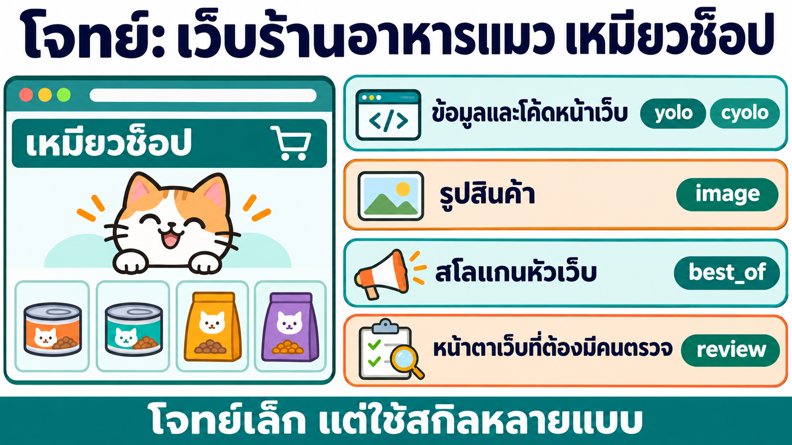

โจทย์เล็กพอที่จะรันจริงได้ในไม่กี่นาที แต่มีงานที่ต้องใช้สกิลต่างกันครบ: โค้ด (Claude/Codex) · ภาพสินค้า · สโลแกนที่อยากได้ตัวเลือกดีสุด · CSS ที่ควรมีคนตรวจ · และการทดสอบรวม พรอมต์มีบรรทัด "ก่อนเริ่ม ดูว่าใน container มีสกิล…" เพื่อให้ Claude Code app เจอสกิล `dag-planner` เอง


```text
โจทย์: ทำหน้าเว็บร้านอาหารแมว "เหมียวช็อป" แบบหน้าเดียว (HTML + CSS + JavaScript ไม่ต้องมี server) มีสินค้า 6 รายการพร้อมรูป ตะกร้าสินค้าที่จำได้หลังรีเฟรช และสโลแกนหัวเว็บ แล้วทดสอบว่าใช้งานได้จริง
ชื่อแผน: meow-shop
จำนวน agent สูงสุด: 4

ใช้ทีมเอเจนต์ใน container multi-account วางแผนงานนี้ ทำงานใน container ผ่าน docker exec เท่านั้น ห้ามแก้ไฟล์ตั้งค่า ห้ามล็อกอินแทนฉัน
ก่อนเริ่ม ดูว่าใน container มีสกิลที่ช่วยงานนี้ได้หรือไม่ (/root/ai-accounts/.Claude/shared/skills) ถ้ามีให้อ่านและใช้
1. แตกโจทย์เป็นบล็อกงาน 6–10 บล็อก แต่ละบล็อกบอกสกิลที่ใช้ทำ ความยาก ไฟล์ผล และเกณฑ์เสร็จ
2. วาด DAG แล้ววางแผนว่าบล็อกไหนให้บัญชีไหน เมื่อไร (Gantt) จากโควตาจริง ยังไม่ต้องรันงานจริง
ตอบภาษาไทยสั้น ๆ: ตาราง บล็อก | ชื่อ | สกิล | ความยาก | ต้องรอ | rank · สายวิกฤตพร้อมเหตุผล 1 บรรทัด · ตาราง บล็อก | บัญชี | เริ่ม–จบ (นาที) · path ของ dag.png และ gantt-plan.png
```

**ผลจริง** (8 พ.ย. 2026 · 82 วินาที): Claude Code app **เจอสกิล `dag-planner`** แตกโจทย์เป็น **8 บล็อก** ใช้สกิล 5 แบบ (ไม่มีบล็อกที่ต้องตัดสินถูก/ผิดจึงไม่ใช้ debate) และวางแผนว่าใช้เวลารวมประมาณ **1.7 นาที**


### 3.1 · DAG ที่ได้ (`dag.png`)


| อ่านภาพ | ตัวอย่างจากผลจริง |
|---|---|
| **แถบสีซ้ายกล่อง + ป้ายสี** = สกิลของบล็อก | B05 สีน้ำเงิน 🔍 review · B04 สีฟ้าอมเขียว 🏆 best_of |
| **ป้ายล่าง** = บัญชีที่ KC-QUEST แจก | B05 = yolo2 (ทำ) + cyolo1 (ตรวจ) · B04 = yolo2 + yolo1 (ตอบ) + cyolo1 (ตัดสิน) |
| **rank** มุมขวาบน · **ขอบส้ม** = สายวิกฤต | B01 → B05 → B08 = 0.6 + 1.5 + 1.5 = **3.6** ล้านโทเคน |
| 🔒 | B08 รวม + ทดสอบ รันคนเดียว (exclusive) |

ตรวจ rank ด้วยมือ: rank(B08) = 1.5 (ไม่มีใครรอ) · rank(B05) = 1.5 + 1.5 = 3 · rank(B01) = 0.6 + max(rank B05 3, rank B07 3) = **3.6** · B02 และ B03 ก็ได้ 3.6 เท่ากันเพราะต่อกับ B06/B07 ที่ rank 3 · AI เลือกเส้นที่ผ่าน B05 เป็นสายวิกฤต เพราะ review ต้องมีทั้งคนทำและคนตรวจ

### 3.2 · Gantt แผน (`gantt-plan.png`)

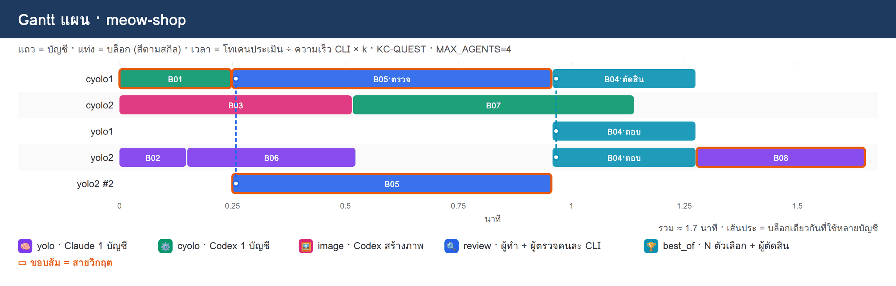

- **บล็อกหลายบัญชีมีแท่งหลายแถว** เชื่อมด้วยเส้นประ: B05 (review) อยู่ทั้ง yolo2 #2 (ทำ) และ cyolo1 (ตรวจ) · B04 (best_of) อยู่ 3 แถว
- **yolo2 ได้งานมากที่สุด** เพราะโควตาจะรีเซ็ตเร็วที่สุด (26.6 ชม.) ใช้ให้คุ้มก่อนหายไปฟรี ๆ (ตัวแปร U ของ KC-QUEST) `yolo2 #2` = งานที่ 2 ที่ yolo2 ทำพร้อมกัน
- เวลาในแผนเป็นนาทีที่**ประเมิน** (โทเคน ÷ ความเร็ว × k) ไม่ใช่เวลาจริง เหตุผลของทุกบล็อกอยู่ใน [`PLAN.md`](_solution/plans/meow-shop/PLAN.md)
- **ตัวเลขนาทีขึ้นกับ k:** ผลในภาพใช้ k จาก `calib.json` ที่ได้จากการรันทดสอบเล็กก่อนหน้า จึงได้ 1.7 นาที เครื่องที่ยังไม่เคยรันจริงจะไม่มี `calib.json` (k = 1) แผนเดียวกันจะได้เวลารวมราว 45 นาที ลำดับงาน สายวิกฤต และวิธีแจกบัญชีเหมือนเดิม ต่างกันแค่สเกลเวลา
- บัญชีที่ได้งานขึ้นกับโควตา ณ เวลาที่สั่ง `plan` ผลบนเครื่องของแต่ละคนจึงไม่จำเป็นต้องตรงกับภาพ

## การบ้าน · วางแผน 10 โจทย์ (DAG + Gantt · ยังไม่รันจริง)

ทำแบบเดียวกับขั้นที่ 3 กับโจทย์ 10 ข้อ ข้อละ 1 แผน ส่ง `blocks.json` · `dag.png` · `gantt-plan.png` · `PLAN.md` และ `ANSWER.md` ต่อโจทย์ ห้ามสั่ง `export` · `run` · `report` รายละเอียด พรอมต์ สิ่งที่ต้องส่ง และเกณฑ์ให้คะแนนอยู่ใน [`homework/README.md`](homework/README.md)


| ข้อ | ชื่อแผน | โจทย์ (ย่อ) |
|---|---|---|
| 1 | `hw01-catfood-next` | เว็บขายอาหารแมว ใช้ Next.js กับ Docker มีแชทบอทช่วยแนะนำอาหาร |
| 2 | `hw02-gov-rag-k8s` | RAG ถามตอบเอกสารภาครัฐ deployment ด้วย Kubernetes |
| 3 | `hw03-clinic-line-queue` | จองคิวคลินิกผ่าน LINE chatbot มีแจ้งเตือนและ dashboard |
| 4 | `hw04-iot-farm-dashboard` | IoT ฟาร์มผัก MQTT → ฐานข้อมูล time series → Grafana + แจ้งเตือน |
| 5 | `hw05-receipt-ocr-api` | API อ่านใบเสร็จภาษาไทย (OCR) ด้วย FastAPI + คิวงาน + Docker |
| 6 | `hw06-churn-ml-pipeline` | pipeline ทำนายลูกค้าเลิกใช้บริการ ถึง API และ dashboard |
| 7 | `hw07-expense-mobile` | แอปมือถือบันทึกรายจ่าย สแกนสลิป มี backend และกราฟสรุป |
| 8 | `hw08-cicd-microservices` | แยก monolith เป็น 3 microservices + CI/CD + Helm บน Kubernetes |
| 9 | `hw09-course-media` | สื่อการสอนออนไลน์ 1 บท: สไลด์ ภาพ สคริปต์ แบบทดสอบ หน้าเว็บ |
| 10 | `hw10-ai-autograder` | ระบบส่งการบ้านเขียนโปรแกรม ตรวจใน sandbox และให้ AI เขียนคำแนะนำ |

ตัวอย่างข้อ 1 ที่ทำให้ดู (ผลจริงจาก `dag` และ `plan` เมื่อ 10 พ.ย. 2026 ยังไม่ได้รันทีม): 11 บล็อก ใช้สกิลครบ 6 แบบ สายวิกฤต B01 → B08 → B11


### เฉลยการบ้าน (ผลจริงจากสกิล · 10 พ.ย. 2026)

เฉลยครบ 10 ข้ออยู่ใน [`_solution/homework/README.md`](_solution/homework/README.md) แต่ละข้อเรียงเป็น พรอมต์ที่คัดลอกไปวาง (โจทย์ + ให้ใช้สกิล) → ตารางบล็อกงาน → DAG → Gantt แผน → `ANSWER.md`

| ข้อ | ชื่อแผน | บล็อก | สกิลที่ใช้ | สายวิกฤต | ยาว (M tok) | เวลารวม agent 4 | agent 2 |
|---|---|---|---|---|---|---|---|
| 1 | [`hw01-catfood-next`](_solution/homework/hw01-catfood-next/) | 11 | yolo · cyolo · image · review · debate · best_of | B01 → B08 → B11 | 6.6 | 110.5 นาที | ได้ 6/11 บล็อก |
| 2 | [`hw02-gov-rag-k8s`](_solution/homework/hw02-gov-rag-k8s/) | 12 | yolo · cyolo · review · debate | B01 → B04 → B05 → B06 → B07 → B12 | 11.1 | 127.5 นาที | ได้ 5/12 บล็อก |
| 3 | [`hw03-clinic-line-queue`](_solution/homework/hw03-clinic-line-queue/) | 10 | yolo · cyolo · image · review · best_of | B02 → B05 → B10 | 7.5 | 83.4 นาที | ได้ 7/10 บล็อก |
| 4 | [`hw04-iot-farm-dashboard`](_solution/homework/hw04-iot-farm-dashboard/) | 10 | yolo · cyolo · image · review · debate | B02 → B05 → B07 → B10 | 5.7 | 70.9 นาที | ได้ 3/10 บล็อก |
| 5 | [`hw05-receipt-ocr-api`](_solution/homework/hw05-receipt-ocr-api/) | 11 | yolo · cyolo · image · review · debate | B02 → B05 → B06 → B08 → B11 | 9.6 | 101.5 นาที | ได้ 5/11 บล็อก |
| 6 | [`hw06-churn-ml-pipeline`](_solution/homework/hw06-churn-ml-pipeline/) | 10 | yolo · cyolo · review · debate · best_of | B02 → B04 → B05 → B06 → B10 | 9.6 | 100.0 นาที | ได้ 4/10 บล็อก |
| 7 | [`hw07-expense-mobile`](_solution/homework/hw07-expense-mobile/) | 10 | yolo · cyolo · image · review · debate · best_of | B01 → B04 → B06 → B10 | 8.1 | 101.5 นาที | ได้ 1/10 บล็อก |
| 8 | [`hw08-cicd-microservices`](_solution/homework/hw08-cicd-microservices/) | 11 | yolo · cyolo · review · debate | B01 → B02 → B03 → B11 | 7.5 | 96.9 นาที | ได้ 0/11 บล็อก |
| 9 | [`hw09-course-media`](_solution/homework/hw09-course-media/) | 10 | yolo · cyolo · image · review · best_of | B01 → B03 → B08 → B10 | 6.6 | 89.8 นาที | ได้ 7/10 บล็อก |
| 10 | [`hw10-ai-autograder`](_solution/homework/hw10-ai-autograder/) | 11 | yolo · cyolo · review · debate | B02 → B05 → B11 | 6.6 | 89.0 นาที | ได้ 7/11 บล็อก |

| อ่านตาราง | ความหมาย |
|---|---|
| โควตาที่ใช้ | **สมมติ** `--accounts yolo1:80,yolo2:60,cyolo1:90,cyolo2:70` สกิลจึงไม่เรียกบัญชีใดเลย และสั่งซ้ำแล้วได้แผนเดียวกัน ถ้าใช้โควตาจริง บัญชีที่ได้งานจะต่างจากเฉลย |
| เวลารวม | ค่าประเมินก่อนรันจริง (ยังไม่มี `calib.json` ตัวปรับเวลา k = 1) ใช้ดูลำดับและการแจกบัญชี ไม่ใช่เวลาจริง |
| คอลัมน์ agent 2 | ทุกโจทย์มีบล็อก `debate` หรือ `best_of` ที่ต้องใช้ 3 บัญชีพร้อมกัน เมื่อจำกัด agent สูงสุด 2 บล็อกนั้นจึงไม่มีบัญชีรับ และบล็อกที่รออยู่ถูกบล็อกตาม (ข้อ 8 ได้ 0/11 เพราะบล็อกแรกเป็น `debate`) |
| ที่รัน | สั่ง `dag` และ `plan` บนเครื่องโดยตรงด้วย `./base_skills` ไม่ได้รันทีมจริง ไม่มีการสั่ง `export` · `run` · `report` |

ตัวอย่างเฉลยข้อ 2 (RAG ถามตอบเอกสารภาครัฐบน Kubernetes): 12 บล็อก สายวิกฤตยาว 6 บล็อก เพราะงาน ingest → ทำดัชนี → ตอบ → API ต้องทำต่อกัน ส่วนชุดคำถามทดสอบ (B03) หน้าเว็บ (B08) และ Dockerfile (B09) ทำขนานได้

![DAG ของ hw02-gov-rag-k8s 12 บล็อก: B01 โครงโปรเจกต์และสัญญา API cyolo · B02 เลือก vector DB และโมเดล embedding debate · B03 ชุดคำถามทดสอบ 20 ข้อ yolo · B04 อ่าน PDF เป็นข้อความรายหน้า cyolo · B05 ตัดข้อความ ทำ embedding และสร้างดัชนี yolo · B06 ค้นคืนและตอบพร้อมอ้างอิงหน้า review · B07 API ถามตอบ cyolo · B08 หน้าเว็บถามตอบ cyolo · B09 Dockerfile ของระบบ cyolo · B10 Kubernetes manifests review · B11 ประเมินความแม่นด้วยชุดคำถาม yolo · B12 รวมระบบและทดสอบบน kind yolo exclusive · สายวิกฤต B01 → B04 → B05 → B06 → B07 → B12 ยาว 11.1M tok](_solution/homework/hw02-gov-rag-k8s/dag.png)


## ภาคต่อ · รันแผนจริงและ what-if (ยังไม่ทำในคาบนี้)

ขั้นที่ 4–5 ด้านล่างเป็นภาคต่อ **ใช้โทเคนของทีม** จึงไม่อยู่ในคาบนี้และไม่อยู่ในการบ้าน เก็บไว้ให้เห็นว่าแผนจากขั้นที่ 3 ถูกนำไปรันอย่างไร · ผลทั้งหมดในภาคต่อมาจากการรันจริงเมื่อ 8 พ.ย. 2026 ด้วย agent-team รุ่นก่อน (สถานะที่เสร็จแสดงเป็น `done` ส่วน base skills ชุดปัจจุบันใช้ `ok`) ยังไม่ได้รันซ้ำกับ base skills ชุดปัจจุบัน

## ขั้นที่ 4 · รันแผนจริงด้วยทีมเอเจนต์ (230 วินาที)

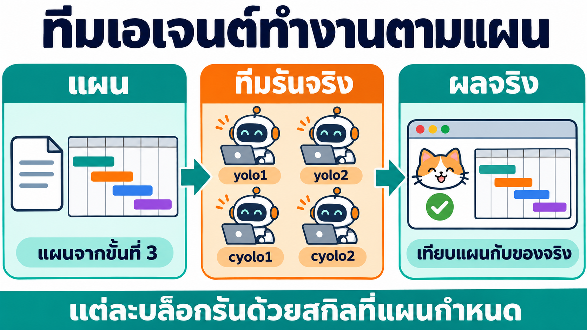


```text
ชื่อแผน: meow-shop
รันแผนนี้จริงด้วยทีมเอเจนต์ใน container multi-account ทำงานผ่าน docker exec เท่านั้น ห้ามแก้ไฟล์ตั้งค่า ห้ามล็อกอินแทนฉัน
- ใช้แผนที่วางไว้แล้ว (ไม่ต้องวางแผนใหม่) ส่งให้ agent-team รันจนจบด้วยสกิล dag-planner แล้วทำรายงานเทียบแผนกับของจริง
- ถ้าบล็อกใดล้ม ให้รายงานตามจริง ห้ามแก้แทนหรือเดาผล
ตอบภาษาไทยสั้น ๆ: ตาราง บล็อก | สกิล | บัญชีแผน → จริง | นาทีแผน → จริง | tokens | สถานะ · เวลารวมแผนเทียบของจริง · path ของ gantt-actual.png, compare.png และหน้าเว็บที่ได้
```

บรรทัด "ใช้แผนที่วางไว้แล้ว (ไม่ต้องวางแผนใหม่)" สำคัญ: ถ้าไม่บอก Claude อาจสั่ง `plan` ใหม่ด้วยค่าเริ่มต้น (6 agent) ทับแผนของขั้นที่ 3 แล้วเทียบผลจริงกับแผนคนละฉบับ (เจอจริงในรอบแรกของการทดลอง)

**ผลจริง** (8 พ.ย. 2026): ทีมรันจริง **2.8 นาที** เสร็จ **8/8 บล็อก** ไม่มีบล็อกล้ม · tokens รวม **1,324,807** ตรงกับ ledger


### 4.1 · ดูการรันย้อนหลังตามเวลา


*วาดจาก `plan.json` (แผน) และ ledger ของ run จริง ไม่ได้แต่งตัวเลข*

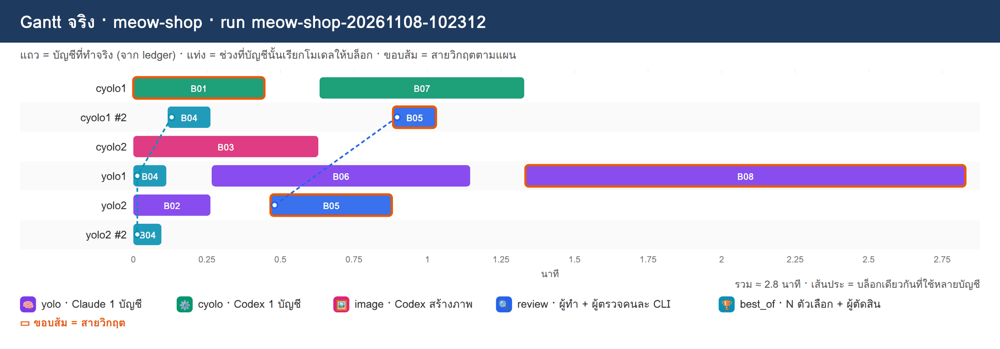

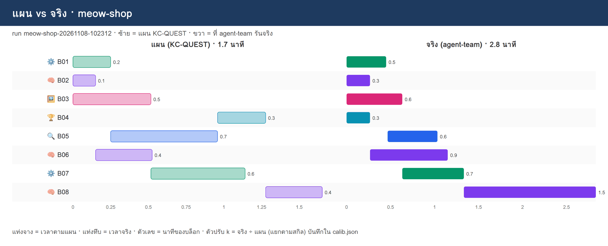

**อ่านผลอย่างไร**

| สิ่งที่เห็น | เหตุผล |
|---|---|
| **review ของจริงเป็นลำดับ** (yolo2 ทำ 0.47–0.88 แล้ว cyolo1 ตรวจ 0.88–1.03) | ผู้ตรวจต้องรอร่างก่อน ส่วนแผนจองทั้งสองบัญชีไว้พร้อมกัน |
| **best_of** ผู้ตอบ 2 คนรันพร้อมกัน แล้วผู้ตัดสินตามหลัง | ตรงกับรูปแบบ best_of ของ agent-team |
| **B06 B07 B08 ไปบัญชีอื่น** (yolo2 → yolo1 · cyolo2 → cyolo1) | export ส่งเป็นฝั่ง agent-team เลือกบัญชีที่ว่างเอง |
| **B08 ช้าที่สุด** (แผน 0.38 → จริง 1.50 นาที) | บล็อกรวมต้องแก้ไฟล์ของบล็อกอื่นให้ต่อกันได้ และรัน Playwright ทดสอบจริง |
| **ตัวปรับ k** ใหม่: yolo 0.0884 · cyolo 0.0438 · image 0.0844 · best_of 0.0368 · review 0.0313 | `report` เก็บไว้ใน `calib.json` ให้แผนครั้งถัดไป (ขั้นที่ 5) |

### 4.2 · หน้าเว็บที่ทีมสร้าง (ทดสอบจริงด้วย Playwright)


*ภาพจริงจากการเปิด `app/index.html` ด้วย Playwright หลังรันเสร็จ (ตรวจซ้ำแยกจากที่ B08 รายงาน) · ไฟล์ทั้งหมดอยู่ที่ [`_solution/plans/meow-shop/app/`](_solution/plans/meow-shop/app/)*

| ไฟล์ | มาจากบล็อก | สกิล |
|---|---|---|
| `index.html` | B01 (+ B08 แก้ตอนรวม) | ⚙️ cyolo |
| `products.js` | B02 | 🧠 yolo |
| `products.png` | B03 | 🖼️ image |
| `slogan.txt` "อาหารแมวอร่อย เจ้าเหมียวชอบทุกวัน" | B04 | 🏆 best_of |
| `style.css` | B05 | 🔍 review |
| `cart.js` | B06 | 🧠 yolo |
| `shop.js` | B07 | ⚙️ cyolo |
| `TEST.md` · `test-e2e.js` · `cart-ui.js` | B08 | 🧠 yolo |

**บทเรียนจากของจริง: ลูกศรที่ขาดไป = งานที่ไม่ตรงกัน** · B08 บันทึกไว้ใน `TEST.md` ว่า **รูปบางช่องไม่ตรงกับชื่อสินค้า** เช่น "อาหารเปียก รสแซลมอน" ได้รูปกระป๋องทูน่า สาเหตุอยู่ที่ DAG: บล็อกภาพ B03 **ไม่ได้รอ** บล็อกข้อมูลสินค้า B02 (ไม่มีลูกศร B02 → B03) คนวาดภาพจึงไม่รู้ว่าสินค้าแต่ละช่องคืออะไร การตัด dependency ทำให้เร็วขึ้น แต่ต้องตัดเฉพาะเมื่องานไม่ต้องใช้ข้อมูลของกันจริง

## ขั้นที่ 5 · what-if ด้วย k ที่เรียนรู้แล้ว (83 วินาที)

ขั้นนี้ **ไม่รันทีมจริง** ใช้แค่ `plan` (ไม่ใช้โทเคนของทีม) เพื่อถามว่า "ถ้า…จะเป็นอย่างไร"


```text
ชื่อแผน: meow-shop
วางแผนใหม่ 2 แบบ (ยังไม่รันจริง) โดยใช้ตัวปรับ k ที่ได้จากการรันจริงรอบที่แล้ว แล้วเทียบกับแผนเดิม
ก. จำนวน agent สูงสุด 2
ข. yolo1 เหลือโควตาแค่ 5%
ทำผ่าน docker exec ใน container multi-account ด้วยสกิล dag-planner
ตอบเป็นตาราง แบบ | เวลารวม (นาที) | บล็อกบนสายวิกฤตไปบัญชีไหน | อะไรเปลี่ยน พร้อม path ของ gantt ทั้ง 2 แบบ
```


| แบบ | เวลารวม | สิ่งที่เห็น |
|---|---|---|
| แผนเดิม (k จากการทดสอบขั้นที่ 1) | 1.7 นาที | ประเมินต่ำไป (รันจริง 2.8 นาที) |
| **k ใหม่ · agent 4** | **2.8 นาที** | **เท่ากับเวลาจริง** แผนแม่นขึ้นหลังเรียนรู้จากการรันครั้งเดียว |
| ก. agent สูงสุด 2 | 2.4 นาที แต่**เสร็จแค่ 6/8** | B04 (best_of) ต้องใช้ 3 บัญชีพร้อมกัน เกินเพดาน 2 จึงไม่มีใครรับ และ B08 ที่รอ B04 ติดตาม · ตัวเลขเวลาที่ "เร็วขึ้น" จึงหลอกตา |
| ข. yolo1 เหลือโควตา 5% | 2.9 นาที | yolo1 ไม่ได้บล็อกเลย สายวิกฤตไม่ได้ใช้ yolo1 อยู่แล้ว จึงช้าลงแค่ 0.1 นาที |


**ข้อสังเกต:** แบบ ก. ต้องแก้ `blocks.json` ก่อนใช้จริง เช่นเปลี่ยน B04 เป็น `yolo` หรือ `review` หรือใช้ agent อย่างน้อย 3 · ส่วนแบบ ข. ถ้ารันจริง agent-team อาจยังส่งงานไป yolo1 เพราะ export ไม่ผูกบัญชี ควรตัด yolo1 ออกจาก `--accounts` ไปเลย

## สรุป

| | บท 04 (ไม่มีแผน) | บท 05 (มี `dag-planner`) |
|---|---|---|
| ต่อยอดจากอะไร | – | base skills ใน `./base_skills` (agent-team · yolo · cyolo) |
| ใครเขียน `graph.json` | คน / AI เขียนเอง | สกิลแปลงจาก `blocks.json` ให้ (`export`) |
| แต่ละงานใช้สกิลอะไร | ระบุเองทีละ node | ทุกบล็อกมี `skill` + `difficulty` ตามตาราง |
| ใครทำบล็อกไหน เมื่อไร | ไม่รู้จนกว่าจะรัน | Gantt แผนจาก KC-QUEST + โควตาจริง |
| เสร็จเมื่อไร | ไม่รู้ | แผน 1.7 นาที → จริง 2.8 นาที → แผนใหม่ 2.8 นาที (เรียนรู้ k) |
| what-if | ต้องรันจริง | `plan` ใหม่ ไม่ใช้โทเคนของทีม |
| การบ้าน | – | 10 โจทย์ วางแผนเป็น DAG + Gantt โดยไม่รัน พร้อมเฉลย |

## ข้อควรรู้

- **base skills ต้องอยู่ข้าง `dag-planner`:** ใน `shared/skills` เดียวกัน และห้ามแก้ไฟล์ใน `./base_skills` ถ้า base skill เปลี่ยนรุ่น ให้สร้าง `dag-planner` ใหม่จากสเปก
- **แผนเป็นค่าประมาณ:** ขนาด S/M/L เป็นการประเมิน แผนแรกอาจต่างจากจริงมาก หลังรันจริงครั้งแรก `calib.json` ช่วยให้แม่นขึ้น
- **รันจริงใช้โทเคน:** `run` ให้ทีมทำงานจริง สกิลจึงให้ถามผู้ใช้ก่อน และเริ่มจากความยากต่ำ
- **วางแผนได้โดยไม่มี container:** ถ้าทุกบัญชีใน `--accounts` ระบุ % สกิลไม่เรียกบัญชีใดเลย จึงสั่ง `dag` และ `plan` บนเครื่องด้วย `./base_skills` ได้ (เฉลยการบ้านทำแบบนี้) ต้องมี Python 3.8+ และถ้าไม่มี headless Chromium จะได้ภาพเป็น SVG
- **บัญชีจริงอาจไม่ตรงแผน:** export ส่งเป็นฝั่งเพื่อให้ failover ทำงาน ถ้าอยากห้ามบัญชีไหนให้ตัดออกจาก `--accounts`
- **dependency ที่ขาดทำให้งานไม่ตรงกัน:** ตัดลูกศรได้เฉพาะงานที่ไม่ใช้ข้อมูลของกันจริง (บทเรียนรูปสินค้าในขั้นที่ 4)
- **บล็อกหลายบัญชีต้องมีบัญชีพอ:** best_of n=2 ใช้ 3 บัญชีพร้อมกัน จำนวน agent สูงสุดต้องไม่ต่ำกว่านั้น (ขั้นที่ 5 แบบ ก.)
- **บอกให้ใช้แผนเดิมก่อนรัน:** ไม่เช่นนั้น Claude อาจวางแผนใหม่ทับแผนที่ตั้งใจไว้
- **ล็อกอินเองเสมอ:** สกิลไม่ล็อกอินแทน และไม่อ่านไฟล์ credential
- **Git Bash บน Windows แปลง path `/root/...`:** เมื่อสั่ง `docker exec` จาก Git Bash ให้เขียน `//root/...` หรือใช้ PowerShell

## คำสั่งที่ใช้บ่อย

ใน container (JupyterLab Terminal)

```bash
D=/root/ai-accounts/.Claude/shared/skills/dag-planner/scripts/dagplan.py
python3 $D doctor                                  # เครื่องพร้อมไหม
python3 $D dag meow-shop --blocks blocks.json      # ตรวจบล็อก + rank + dag.png
python3 $D plan meow-shop --max-agents 4           # Gantt แผนจากโควตาจริง
python3 $D plan meow-shop --accounts yolo1:5,yolo2,cyolo1,cyolo2   # what-if (สมมติโควตา)
python3 $D plan meow-shop --accounts yolo1:80,yolo2:80,cyolo1:80,cyolo2:80   # สมมติทั้งหมด ไม่เรียกบัญชีใดเลย
# ภาคต่อ (ใช้โทเคน)
python3 $D export meow-shop && python3 $D run meow-shop --detach   # รันจริง
python3 $D report meow-shop                        # Gantt จริง + แผน vs จริง + calib.json
```

บนเครื่องโดยตรง ไม่ผ่าน container (รันจากโฟลเดอร์ `05_DAG_Planner` ใช้ `./base_skills` และโควตาสมมติ)

```bash
export DAGPLAN_DIR=./workspace/plans
D=_solution/skills/dag-planner/scripts/dagplan.py
python3 $D dag hw02-gov-rag-k8s --blocks _solution/homework/hw02-gov-rag-k8s/blocks.json
python3 $D plan hw02-gov-rag-k8s --max-agents 4 --accounts yolo1:80,yolo2:60,cyolo1:90,cyolo2:70
```

จาก host

```bash
docker exec multi-account cat /root/ai-accounts/.Claude/shared/skills/dag-planner/SKILL.md
docker exec -i multi-account python3 /root/ai-accounts/.Claude/shared/skills/dag-planner/scripts/dagplan.py dag meow-shop --blocks - < blocks.json
```

ผลทุกแผนอยู่ที่ `./workspace/plans/<ชื่อแผน>/` บนเครื่องเรา (= `/workspace/plans/` ใน container) · ต่อด้วย [บท 06 · KC-QUEST](../06_KC_QUEST/readme.md) เพื่อดูสมการที่ใช้แจกบล็อกให้บัญชีแบบละเอียด
