# DAG Planner Skill: แตกงานเป็นบล็อก · แต่ละบล็อกใช้สกิล · วาด DAG + Gantt · ให้ทีมรันจริง

## 1. ปัญหา: มีทีมแล้ว แต่ยังไม่มีแผน

ในบท 04 คำสั่ง `team.py run graph.json` ของสกิล `agent-team` รันทีมได้ทันที แต่ต้องมีคน **เขียน `graph.json` ก่อน** และต้องตอบคำถามเหล่านี้ให้ได้

| คำถาม | ถ้าตอบไม่ได้ |
|---|---|
| งานมีกี่ชิ้น ชิ้นไหนต้องรอชิ้นไหน | สั่งงานผิดลำดับ งานหลังเริ่มก่อนงานที่มันต้องใช้ |
| แต่ละชิ้นควรใช้สกิลไหน (Claude · Codex · สร้างภาพ · ให้ตรวจ · ให้หลายคนเสนอ) | ใช้บัญชีแพงกับงานง่าย หรือไม่มีใครตรวจงานสำคัญ |
| ชิ้นไหนให้บัญชีไหน เมื่อไร | บัญชีที่โควตาเหลือน้อยรับงานใหญ่จนค้าง |
| ทั้งโปรเจกต์จะเสร็จเมื่อไร | ไม่รู้ว่าเพิ่มบัญชีแล้วจะเร็วขึ้นหรือไม่ |

สกิล `dag-planner` ตอบคำถามทั้ง 4 ข้อนี้ให้ โดยเปลี่ยนโจทย์ 1 ข้อเป็นแผนที่ทีมรันได้จริง เริ่มจากแตกงานใหญ่เป็นชิ้นเล็ก

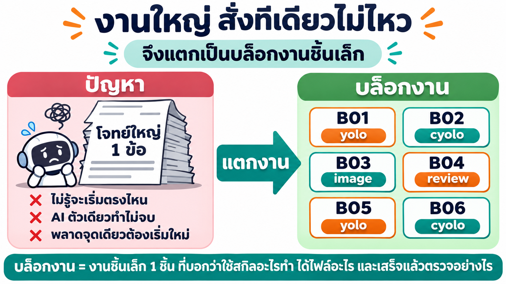

จากนั้นจัดบล็อกทั้งหมดให้เป็นระเบียบด้วย DAG จัดเวลาด้วย Gantt แล้วให้ทีมรันจริง

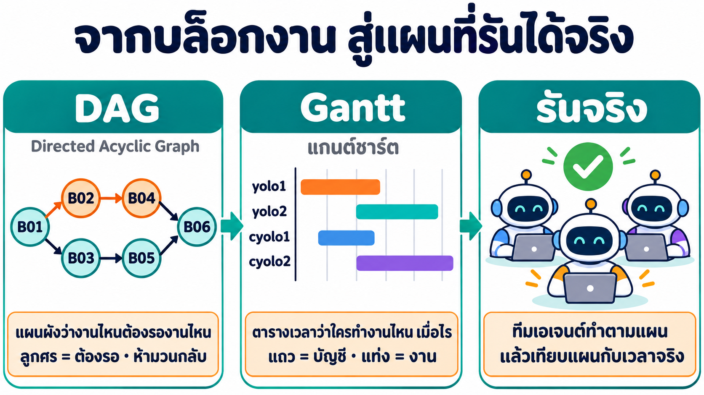

| คำศัพท์ | ความหมาย |
|---|---|
| **บล็อกงาน** | งานชิ้นเล็ก 1 ชิ้น ที่บอกว่าใช้สกิลอะไรทำ ได้ไฟล์อะไร และเสร็จแล้วตรวจอย่างไร |
| **DAG** (Directed Acyclic Graph) | แผนผังว่างานไหนต้องรองานไหน ลูกศร `A → B` แปลว่า B ต้องรอ A เสร็จก่อน และห้ามวนกลับ |
| **Gantt** (แกนต์ชาร์ต) | ตารางเวลาว่าบัญชีไหนทำงานไหน เริ่มและจบเมื่อไร |

## 2. ทฤษฎี: DAG · rank · สายวิกฤต · Gantt

ใช้ตัวอย่างเดียวตลอดหัวข้อนี้: เว็บร้านค้า มีงาน 9 ชิ้น ขนาดงานสมมติเป็นนาที

| งาน | ชื่อ | ขนาด | ต้องรอ | งานที่รอมันอยู่ |
|---|---|---|---|---|
| A | โครงเว็บ | 2 | – | B, C, D, E |
| B | ฐานข้อมูล | 3 | A | F, G, H |
| C | ล็อกอิน | 2 | A | F, G |
| D | ธีมสี | 1 | A | H |
| E | ภาพสินค้า | 4 | A | H |
| F | ตะกร้า | 4 | B, C | I |
| G | ชำระเงิน | 3 | B, C | I |
| H | การ์ดสินค้า | 2 | B, D, E | I |
| I | ทดสอบรวม | 1 | F, G, H | – |

งานที่ไม่ได้รอกันทำพร้อมกันได้ เช่น B, C, D, E หรือ F, G, H

### 2.1 rank คำนวณอย่างไร

**rank** คือระยะทางที่ยาวที่สุดจากงานนี้ไปจนจบโปรเจกต์ โดยนับรวมตัวมันเอง rank สูงแปลว่างานนี้ยังมีงานรออยู่ข้างหลังอีกยาว จึงควรได้เริ่มก่อน

$$\mathrm{rank}(j) = c_j + \max_{k \in \mathrm{succ}(j)} \mathrm{rank}(k)$$

$c_j$ คือขนาดของงาน $j$ และ $\mathrm{succ}(j)$ คืองานที่รองาน $j$ อยู่ ถ้าไม่มีใครรอ ส่วน $\max$ มีค่าเป็น 0

ต้อง**คิดย้อนจากงานสุดท้าย** เพราะ rank ของงานหนึ่งต้องใช้ rank ของงานที่รอมันอยู่

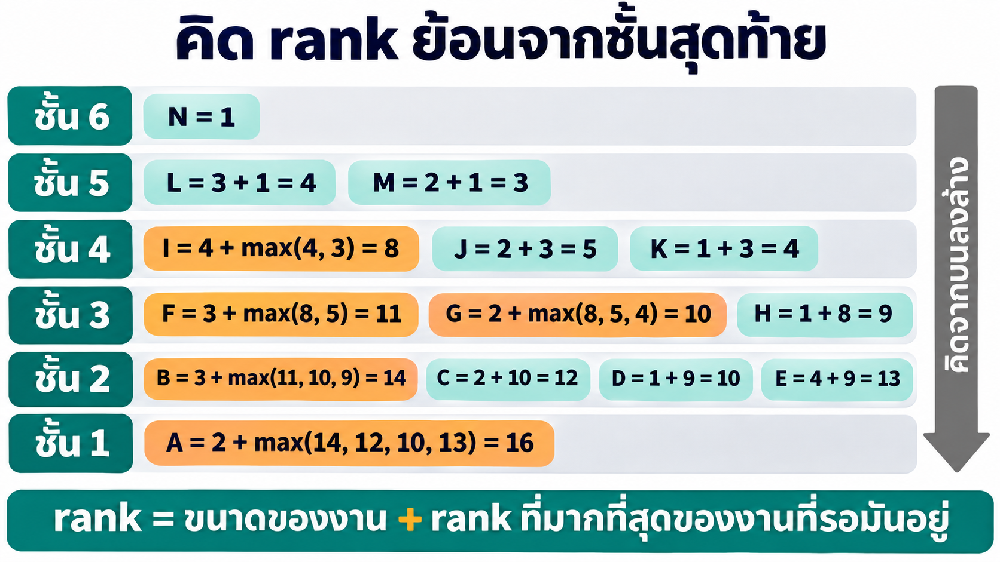

| ลำดับคิด | งาน | ใครรออยู่ (rank) | คำนวณ | rank |
|---|---|---|---|---|
| 1 | I | ไม่มี | 1 + 0 | **1** |
| 2 | F | I (1) | 4 + 1 | **5** |
| 3 | G | I (1) | 3 + 1 | **4** |
| 4 | H | I (1) | 2 + 1 | **3** |
| 5 | B | F (5), G (4), H (3) | 3 + max(5, 4, 3) = 3 + 5 | **8** |
| 6 | C | F (5), G (4) | 2 + max(5, 4) = 2 + 5 | **7** |
| 7 | D | H (3) | 1 + 3 | **4** |
| 8 | E | H (3) | 4 + 3 | **7** |
| 9 | A | B (8), C (7), D (4), E (7) | 2 + max(8, 7, 4, 7) = 2 + 8 | **10** |

สิ่งที่ควรสังเกตจากตารางนี้

- **ทำไมใช้ `max` ไม่ใช่บวกทั้งหมด:** F, G, H ทำพร้อมกันได้ งานที่ยาวที่สุดเป็นตัวกำหนดว่าจะจบเมื่อไร ถ้าบวกทั้งหมด B จะได้ 3 + 5 + 4 + 3 = 15 ซึ่งเกินความจริง
- **งานใหญ่ไม่ได้แปลว่าสำคัญกว่า:** E มีขนาด 4 ใหญ่กว่า B ที่มีขนาด 3 แต่ rank ของ B (8) สูงกว่า E (7) เพราะงานที่รอ B อยู่ยาวกว่า
- **rank เท่ากันได้:** C และ E ได้ 7 เท่ากันจากคนละเหตุผล C ตัวเล็กแต่มีงานยาวรออยู่ ส่วน E ตัวใหญ่แต่งานที่รอสั้น

### 2.2 สายวิกฤต

**สายวิกฤต** คือเส้นทางจากต้นจนจบที่ยาวที่สุด ตัวอย่างนี้มี 7 เส้นทาง

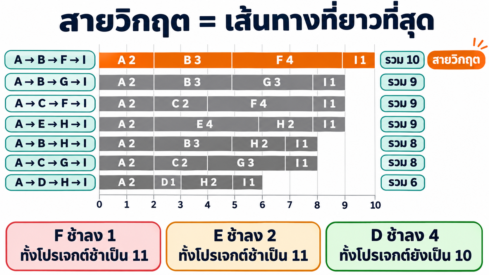

| เส้นทาง | คำนวณ | ความยาว |
|---|---|---|
| **A → B → F → I** | 2 + 3 + 4 + 1 | **10 (สายวิกฤต)** |
| A → B → G → I | 2 + 3 + 3 + 1 | 9 |
| A → C → F → I | 2 + 2 + 4 + 1 | 9 |
| A → E → H → I | 2 + 4 + 2 + 1 | 9 |
| A → B → H → I | 2 + 3 + 2 + 1 | 8 |
| A → C → G → I | 2 + 2 + 3 + 1 | 8 |
| A → D → H → I | 2 + 1 + 2 + 1 | 6 |

ไม่ต้องไล่ทุกเส้นทางก็หาได้: เริ่มจากงาน A แล้วเดินไปหางานที่รออยู่ซึ่ง rank มากที่สุดทีละก้าว A (10) → B (8) → F (5) → I (1) และ rank ของงานแรกเท่ากับความยาวสายวิกฤตพอดี

| งาน | เส้นทางที่ยาวที่สุดที่ผ่านงานนี้ | ช้าได้อีกเท่าไรก่อนกระทบทั้งโปรเจกต์ |
|---|---|---|
| A, B, F, I (บนสายวิกฤต) | 10 | 0 ช้าเท่าไร ทั้งโปรเจกต์ช้าเท่านั้น |
| C, E, G, H | 9 | 1 |
| D | 6 | 4 |

เส้นทางที่ยาว 9 มีถึง 3 เส้น ถ้า E ช้าลง 2 เส้น A → E → H → I จะยาว 11 และกลายเป็นสายวิกฤตใหม่ สายวิกฤตจึงเปลี่ยนได้เมื่อเวลาจริงต่างจากที่ประเมิน

งานบนสายวิกฤตจึงได้เลือกบัญชีก่อน

### 2.3 จาก DAG เป็น Gantt

**Gantt** คือตารางเวลา แถว = บัญชี · แท่ง = งาน · แกนนอน = เวลา เมื่อมีงานพร้อมทำหลายชิ้น งานที่ rank สูงกว่าได้บัญชีก่อน ถ้า rank เท่ากันงานใหญ่กว่าได้ก่อน

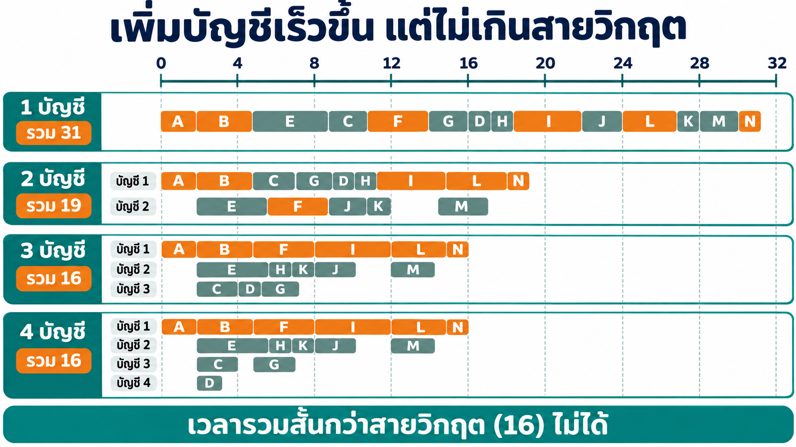

| บัญชี | เวลารวม | เหตุผล |
|---|---|---|
| 1 | 22 | ทำทีละงาน จึงเท่ากับผลรวมขนาดทุกงาน |
| 2 | 13 | ทำคู่กันได้ แต่ช่วงที่ B, C, D, E พร้อมทั้ง 4 งาน มีบัญชีไม่พอ จึงต้องรอกัน |
| 3 | 10 | เท่ากับความยาวสายวิกฤตพอดี |
| 4 | 10 | บัญชีที่ 4 ได้ทำแค่ D เพราะงานบนสายวิกฤตต้องทำต่อกัน เพิ่มบัญชีก็ไม่เร็วขึ้น |

ใน Gantt จริงของบทนี้ สีแท่งบอกสกิล และบล็อกที่ใช้หลายบัญชีจะมีหลายแถว

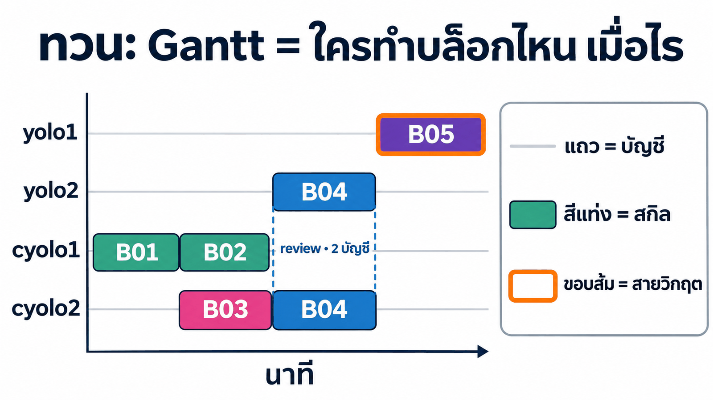

ผู้ตัดสินว่า "บล็อกนี้ให้บัญชีไหน" คืออัลกอริทึม **KC-QUEST** (ดูโควตาที่เหลือ วันรีเซ็ต ขนาดงาน และ rank) รายละเอียดสมการอยู่ใน [บท 06 · KC-QUEST](../06_KC_QUEST/readme.md)

## 3. บล็อกงาน = การ์ดที่บอกว่าใช้สกิลอะไร

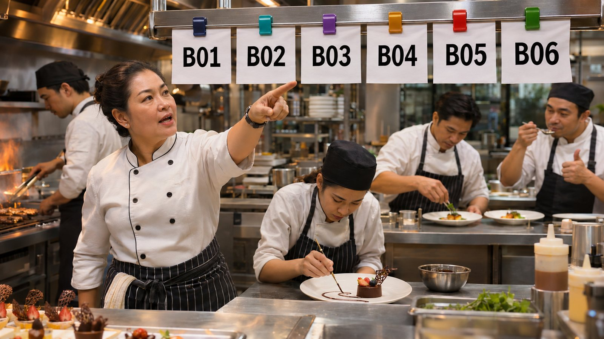

*(ภาพจำลอง) ใบสั่งแต่ละใบบอกว่าจานนี้ไปสถานีไหน บล็อกงานแต่ละบล็อกก็บอกว่าใช้สกิลไหน*

เหมือนครัวร้านอาหาร: ใบสั่งแต่ละใบ (บล็อก) ไม่ได้บอกแค่ว่าทำอะไร แต่บอกว่า **ไปสถานีไหน** (สกิล) บางจานต้องมีคนชิมก่อนเสิร์ฟ (review) บางจานให้เชฟหลายคนเสนอแล้วหัวหน้าเลือก (best_of)


| `skill` ของบล็อก | ใช้เมื่อ | ทีมทำจริงด้วย (agent-team บท 04) | บัญชีที่ใช้ |
|---|---|---|---|
| 🧠 `yolo` | เขียนโค้ด/เอกสาร งานที่ต้องคิดยาว | งานเดี่ยวฝั่ง Claude | 1 |
| ⚙️ `cyolo` | เขียนโค้ด/ข้อมูลที่ตรงไปตรงมา | งานเดี่ยวฝั่ง Codex | 1 |
| 🖼️ `image` | สร้างภาพ | งานภาพ (ไป Codex เสมอ) | 1 |
| 🔍 `review` | งานสำคัญที่ต้องมีคนตรวจ | review loop: ผู้ทำ ↔ ผู้ตรวจคนละ CLI | 2 |
| ⚖️ `debate` | การตัดสินใจที่มีคำตอบถูก/ผิด | Claude vs Codex + ผู้ตัดสิน | 3 |
| 🏆 `best_of` | งานสร้างสรรค์ อยากได้ตัวเลือกที่ดีที่สุด | หลายคนทำ + ผู้ตัดสิน | N+1 |

review · debate · best_of ใช้หลายบัญชีต่อบล็อก จึงใช้เฉพาะบล็อกที่คุ้ม ไม่ใช้กับทุกบล็อก

### หน้าตาของบล็อก 1 บล็อก


*กล่องในภาพมาจาก `dag.png` ของการทดลองรอบแรก (แผนที่ AI แตกเป็น 9 บล็อก) · ทุกการวางแผน AI อาจแตกบล็อกต่างกันได้*

| ฟิลด์ | ความหมาย |
|---|---|
| `size` | ขนาดที่ประเมิน S / M / L = 0.6 / 1.5 / 3 ล้านโทเคน ใช้คิด rank และเวลาในแผน (ใหญ่กว่า L ต้องแบ่ง) |
| `skill` · `difficulty` | สกิลที่ใช้ทำ และความยาก 1–6 (ตารางเดียวกับบท 04: 1 = haiku/low … 3 = opus/high … 6 = งานใหญ่) |
| `depends_on` | บล็อกที่ต้องเสร็จก่อน ใส่เฉพาะที่ต้องรอจริง ยิ่งรอน้อยยิ่งทำพร้อมกันได้มาก |
| `output` · `done` | ไฟล์ผลของบล็อก (บล็อกถัดไปอ่านไฟล์นี้ต่อ) และเกณฑ์เสร็จที่ตรวจได้ |
| `exclusive` | บล็อกรวมระบบ + ทดสอบสุดท้าย รันคนเดียว |

## 4. สกิล `dag-planner`


| ใคร | ทำอะไร | ใช้โทเคน? |
|---|---|---|
| **AI = สมอง** (Claude Code app) | อ่านโจทย์ แตกเป็นบล็อก เลือกสกิลและความยากของแต่ละบล็อก | ใช้ |
| **`dagplan.py` = มือ** (สคริปต์ในสกิล) | ตรวจกราฟ คิด rank วาด DAG · ใช้ KC-QUEST แจกบล็อกให้บัญชี วาด Gantt แผน · แปลงเป็น `graph.json` · อ่านผลจริงวาด Gantt จริง | ไม่ใช้ |
| **`agent-team` = ทีม** (บท 04) | รันแต่ละบล็อกด้วยสกิลที่ระบุ บนบัญชีจริง | ใช้ |

| คำสั่งของสกิล | ผล |
|---|---|
| `doctor` | ตรวจ python · สกิลบท 04 · ตัววาด PNG · บัญชีที่พร้อม |
| `dag <แผน>` | ตรวจไฟล์บล็อก (วงวน · id ซ้ำ · อ้าง id ที่ไม่มี · skill ไม่รู้จัก) → rank · สายวิกฤต · `dag.png` |
| `plan <แผน>` | KC-QUEST แจกบล็อกให้บัญชีจากโควตาจริง → `gantt-plan.png` · `PLAN.md` (เหตุผลทุกบล็อก) |
| `export` · `run <แผน>` | แปลงเป็น `graph.json` ของ agent-team แล้วรันจริง |
| `report <แผน>` | อ่านผลจริงจาก ledger → `gantt-actual.png` · `compare.png` · `REPORT.md` · ตัวปรับเวลา `calib.json` |


### แผน vs ของจริง


*(ภาพจำลอง) Gantt แผนเหมือน ETA ของแอปนำทาง เป็นค่าประมาณจากข้อมูลที่มี ของจริงต่างได้*

Gantt แผนคำนวณจากขนาดงานที่ **ประเมิน** เมื่อรันจริง คำสั่ง `report` อ่านเวลาเริ่ม–จบของทุกบล็อกจาก ledger ของ agent-team แล้ววาด **Gantt จริง** เทียบกับแผน พร้อมคำนวณตัวปรับ

$$k_{\text{skill}} = \frac{\text{เวลาจริง}}{\text{เวลาแผน (ก่อนคูณ } k)}$$

แยกตามสกิล แล้วเก็บไว้ใน `calib.json` ให้ `plan` ครั้งถัดไปคูณเวลาของแต่ละบล็อกด้วย k ของสกิลนั้น (เหมือนแอปนำทางที่เรียนรู้สภาพจราจร) ตรงกับขั้น ⑥ "เรียนรู้" ของ KC-QUEST

อีกเรื่องที่ต่างได้คือ **บัญชี**: `export` ส่งงานให้ agent-team เป็น **ฝั่ง** (`yolo` / `cyolo`) ไม่ผูกบัญชีเจาะจง เพราะถ้าผูก failover ของบท 04 (ย้ายงานเมื่อบัญชีล้ม) จะปิด agent-team จึงเลือกบัญชีในฝั่งเองตามโหลด และ `report` แสดงส่วนต่างนี้ให้เห็น

## 5. ภาพรวมขั้นตอนการทดลอง

| ขั้น | ทำอะไร | เวลารันจริง |
|---|---|---|
| **1 · ให้ Claude สร้างสกิลจากสเปก** | สร้าง `skills/dag-planner` แล้วทดสอบ 8 ข้อ | ~16.6 นาที |
| **2 · ติดตั้งสกิลด้วยการคัดลอกโฟลเดอร์** | `docker cp` ลง shared ทั้งสองฝั่ง | 117 วินาที |
| **3 · วางแผนโจทย์ "เหมียวช็อป"** | บล็อกงาน + DAG + Gantt แผน (ยังไม่ใช้โทเคนของทีม) | 82 วินาที |
| **4 · รันแผนจริงด้วยทีมเอเจนต์** | agent-team ทำทุกบล็อก แล้ว `report` เทียบแผนกับของจริง | 230 วินาที (ทีมรัน 2.8 นาที) |
| **5 · what-if ด้วย k ที่เรียนรู้แล้ว** | วางแผนใหม่ 2 แบบโดยไม่รันจริง | 83 วินาที |

ทุกขั้น **วางพรอมต์ใน Claude Code app** แล้ว Claude Code app ทำงานใน container ผ่าน `docker exec` เหมือนบท 04

**ต้องมีก่อน:** container `multi-account` จาก[บท 03](../03_MultiAccount_Container/README.md) กำลังรัน · ติดตั้งสกิล `yolo` · `cyolo` · `agent-team` จาก[บท 04](../04_MultiAccount_Skill/README.md) แล้ว · ล็อกอินอย่างน้อย 2 บัญชี Claude และ 2 บัญชี Codex (บล็อก review และ best_of ต้องใช้หลายบัญชีพร้อมกัน)

**เปิดโฟลเดอร์งาน:** ใน Claude Code app เลือก **Code** → **New session** → เลือกโฟลเดอร์ `05_DAG_Planner` ของรีโปนี้

```text
05_DAG_Planner/
├── prompt_dag_skill_spec.md   ← สเปกของสกิล dag-planner (input ที่ 1)
├── tools/                     ← planner.py + orch.py ตัววางแผนชุดเดิม (DAG · Gantt · KC-QUEST) ใช้เป็นแหล่งความรู้ (input ที่ 2)
└── _solution/                 ← skills/dag-planner (สกิลจากการรันจริง) · TEST-REPORT.md · plans/meow-shop (แผน รายงาน และหน้าเว็บที่ทีมสร้าง)
```

## ขั้นที่ 1 · ให้ Claude สร้างสกิลจากสเปก (~16.6 นาที)

### 1.1 · input

| input | บทบาท |
|---|---|
| [`prompt_dag_skill_spec.md`](prompt_dag_skill_spec.md) | สเปกของสกิล: ฟิลด์ของบล็อก · ตารางสกิล → node ของ agent-team · คำสั่ง 6 คำสั่ง · ภาพ DAG/Gantt · การรันจริง · ตัวปรับ k · การติดตั้ง · เกณฑ์ทดสอบ 8 ข้อ |
| [`tools/`](tools/) | `planner.py` + `orch.py` ตัววางแผนชุดเดิม ใช้เป็นแหล่งความรู้ (ห้ามคัดลอกทั้งไฟล์ ดึงเฉพาะส่วน KC-QUEST) |
| สกิลบท 04 ใน container | Claude อ่าน `SKILL.md` และ `team.py` ของ agent-team ใน container เพื่อรู้รูปแบบ `graph.json` จริง |

### 1.2 · วางพรอมต์


```text
ช่วยสร้างสกิล dag-planner ที่ทำให้ AI วางแผนงานเป็น DAG + Gantt โดยแต่ละบล็อกงานใช้สกิลของบท 04 แล้วส่งแผนให้ทีมเอเจนต์รันจริงได้
ทำในโฟลเดอร์นี้ ใช้คำสั่ง docker ได้ แต่ห้ามลบ หยุด หรือสร้าง container / volume ใหม่ ห้ามแตะ credential และห้ามล็อกอินแทนผม

วัตถุดิบ
- ./prompt_dag_skill_spec.md = สเปกของสกิล ทุกข้อต้องเป็นจริง
- ./tools/planner.py และ ./tools/orch.py = ตัววางแผนชุดเดิม (DAG · Gantt · KC-QUEST) ใช้เป็นแหล่งความรู้ ห้ามคัดลอกทั้งไฟล์
- container multi-account ที่กำลังรัน = ที่ทดสอบจริง มีสกิล yolo · cyolo · agent-team ของบท 04 อยู่แล้ว (อ่าน SKILL.md ของสกิลเหล่านั้นใน container ก่อนใช้)

สร้างไว้ใน ./skills/dag-planner (นอก container = ต้นฉบับที่เก็บสำรอง)
ทดสอบ: คัดลอกโฟลเดอร์ไปวางที่ shared ของทั้งสองฝั่งใน container แล้วทดสอบทุกข้อในหัวข้อ "ทดสอบ" ของสเปก
ใช้บัญชีอย่างประหยัด (difficulty 1 กับงานทดสอบ) ข้อที่ต้องใช้บัญชีที่ไม่พร้อม = SKIP
เขียน ./TEST-REPORT.md (นอกโฟลเดอร์ skills) แล้วสรุปเป็นตารางสั้น ๆ: ผลทดสอบ ไฟล์ที่สร้าง และเวลาที่ใช้ แล้วหยุด
```

**หลักการออกแบบพรอมต์**

- **ให้สเปกที่ชัด:** ฟิลด์ของบล็อก ตารางสกิล คำสั่ง และเกณฑ์ทดสอบอยู่ในสเปก Claude ไม่ต้องเดา
- **ความรู้เดิมเป็นแค่แหล่งอ้างอิง:** `tools/` มีโค้ดที่ไม่เกี่ยว (worker · postgres) ห้ามคัดลอกทั้งไฟล์ สกิลใหม่ต้องแยกชั้นตามหลักการเปิดทีละชั้น
- **รู้จักสกิลบท 04 จากของจริง:** ให้อ่าน `SKILL.md` ใน container ก่อนใช้ จึงได้ `graph.json` ที่ agent-team ยอมรับ
- **ทดสอบแบบประหยัด:** รันจริงแค่แผนเล็ก 4 บล็อก ความยาก 1

### 1.3 · ผลจริง

**ผลจริง** (8 พ.ย. 2026 · ~16.6 นาที): **PASS 8 / 8**

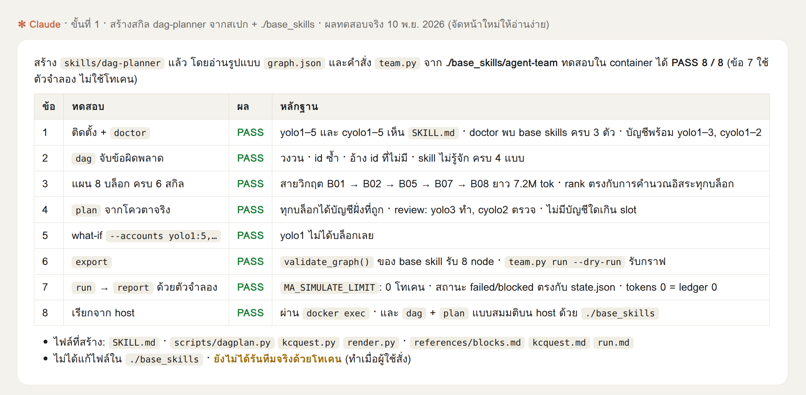

*คำตอบจริงเป็นภาษาอังกฤษ แปลและจัดหน้าใหม่ · รายงานฉบับเต็มอยู่ที่ [`_solution/TEST-REPORT.md`](_solution/TEST-REPORT.md) · ตอนรันจริงใช้ชื่อ container `my-multi-account` ภาพผลจริงทุกขั้นปรับชื่อเป็น `multi-account` ให้ตรงกับบทเรียน*

ภาพจากการทดสอบข้อ 3–4: แผนตัวอย่าง 8 บล็อกที่ใช้สกิลครบทั้ง 6 แบบ ทุกกล่องมี **ป้ายสีของสกิล** (พร้อมรุ่น/effort จากความยาก) และป้ายล่างบอกบัญชีที่ KC-QUEST แจก บล็อกที่ใช้หลายบัญชี (debate · review · best_of) จึงมีหลายป้าย

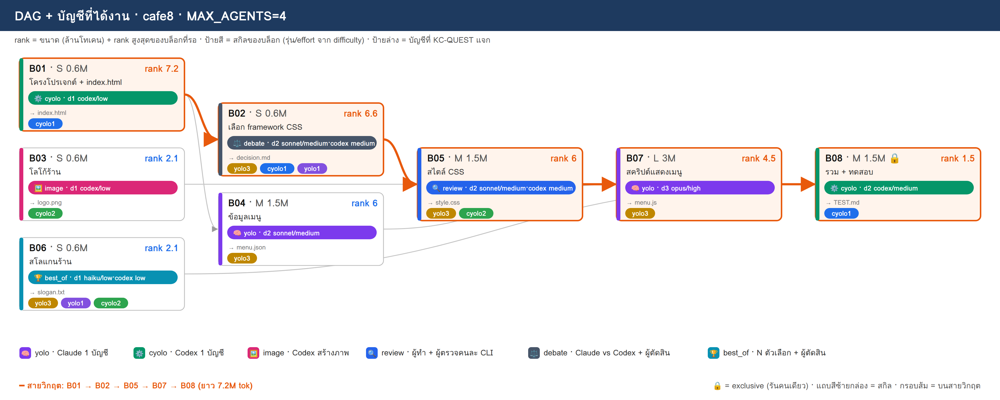

ไฟล์ที่ Claude สร้าง (เก็บเป็นเฉลยไว้ที่ [`_solution/skills/dag-planner/`](_solution/skills/dag-planner/))

```text
skills/dag-planner/
├── SKILL.md            ← ตาราง "ต้องการ → คำสั่ง" · ขั้นตอน · กติกาแตกบล็อก · ตารางเลือกสกิล · เรียกจาก host
├── scripts/            ← dagplan.py (คำสั่งหลัก) · kcquest.py (KC-QUEST ที่ดึงจาก orch.py) · render.py (วาด DAG · Gantt · compare)
└── references/         ← blocks.md (ฟิลด์ + ตัวอย่าง 8 บล็อก) · kcquest.md (สูตรย่อ) · run.md (รันจริงและรายงาน)
```

## ขั้นที่ 2 · ติดตั้งสกิลด้วยการคัดลอกโฟลเดอร์ (117 วินาที)

ติดตั้ง = คัดลอกโฟลเดอร์ `dag-planner` ไปวางใน `shared/skills` ทั้งฝั่ง Claude และ Codex **ไม่ต้องรันสคริปต์ติดตั้ง** (วิธีเดียวกับบท 04)

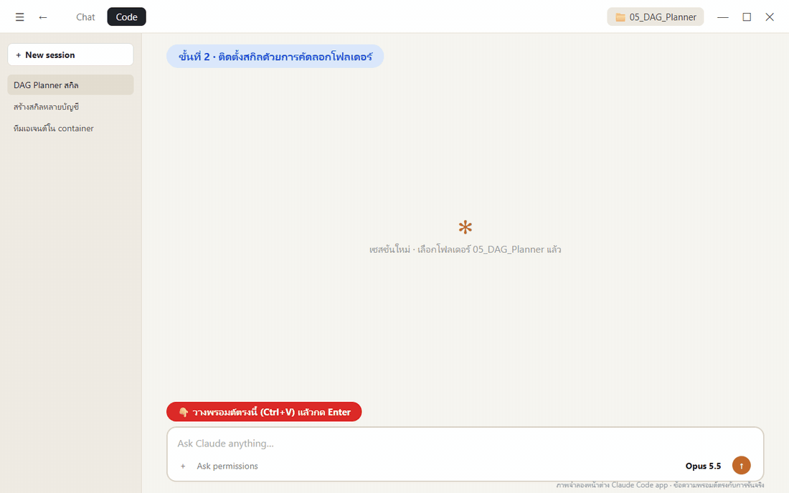

```text
ติดตั้งสกิลจาก ./skills/dag-planner ลง container multi-account ด้วยการคัดลอกโฟลเดอร์อย่างเดียว
- คัดลอกโฟลเดอร์ dag-planner ไปวางที่ /root/ai-accounts/.Claude/shared/skills และ /root/ai-accounts/.Codex/shared/skills ใน container
- เปิดแต่ละบัญชีหนึ่งครั้งด้วย yoloN --version และ cyoloN --version (wrapper จะเชื่อมสกิลให้แต่ละบัญชีเอง)
- ตรวจว่าทุกบัญชี yolo1–5 และ cyolo1–5 มองเห็น dag-planner/SKILL.md แล้วรันคำสั่ง doctor ของสกิล
สรุปเป็นตาราง ฝั่ง | มองเห็นสกิล · ผล doctor แล้วหยุด
```

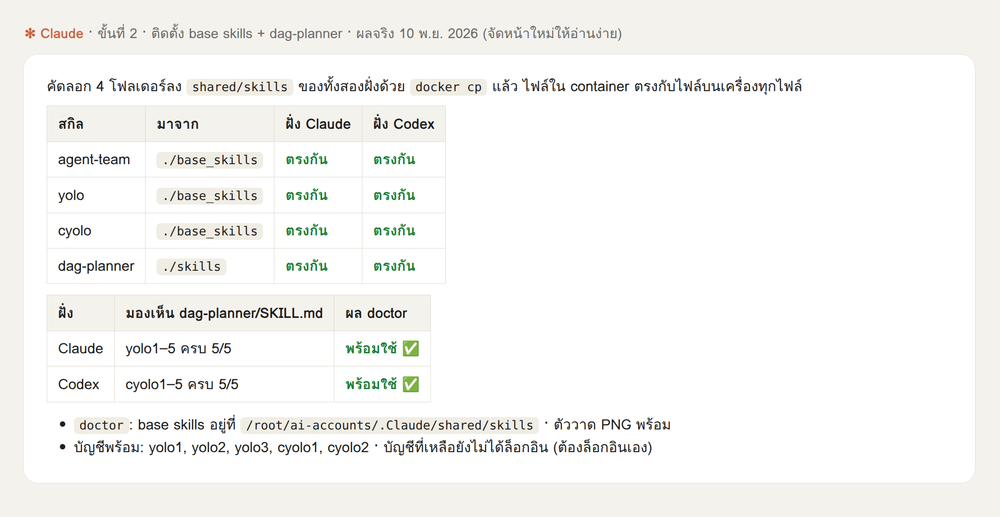

*ผลจริง · ใช้สกิลที่เตรียมไว้: เปลี่ยน `./skills/dag-planner` ในพรอมต์เป็น `./_solution/skills/dag-planner`*

คัดลอกเองโดยไม่ใช้ Claude (รันจากโฟลเดอร์ `05_DAG_Planner`) หรือลากโฟลเดอร์ `dag-planner` ไปวางใน JupyterLab ที่ `.Claude/shared/skills` และ `.Codex/shared/skills` แบบเดียวกับ[ขั้นที่ 2 ของบท 04](../04_MultiAccount_Skill/README.md#วิธีที่-2--ลากวางใน-jupyterlab):

```bash
for d in .Claude .Codex; do docker cp ./_solution/skills/dag-planner multi-account:/root/ai-accounts/$d/shared/skills/; done
docker exec multi-account bash -lc 'for n in 1 2 3 4 5; do yolo$n --version; cyolo$n --version; done'
```

## ขั้นที่ 3 · วางแผนโจทย์ "เหมียวช็อป" (82 วินาที)

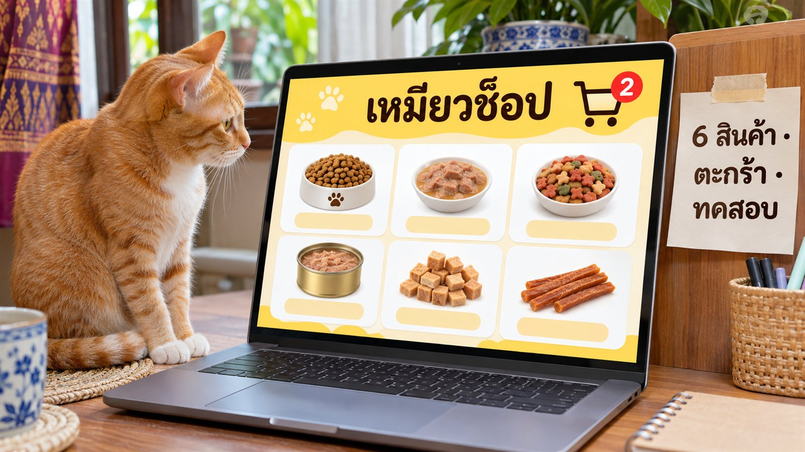

*(ภาพจำลอง) โจทย์ของขั้นที่ 3–5*

โจทย์เล็กพอที่จะรันจริงได้ในไม่กี่นาที แต่มีงานที่ต้องใช้สกิลต่างกันครบ: โค้ด (Claude/Codex) · ภาพสินค้า · สโลแกนที่อยากได้ตัวเลือกดีสุด · CSS ที่ควรมีคนตรวจ · และการทดสอบรวม พรอมต์มีบรรทัด "ก่อนเริ่ม ดูว่าใน container มีสกิล…" แบบเดียวกับบท 04 เพื่อให้ Claude Code app เจอสกิล `dag-planner` เอง

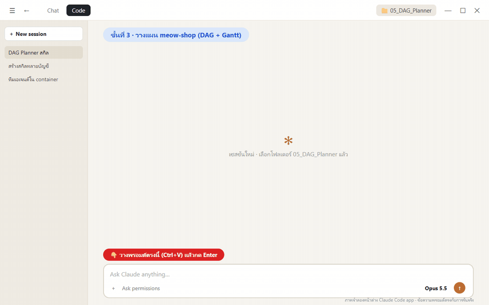

```text
โจทย์: ทำหน้าเว็บร้านอาหารแมว "เหมียวช็อป" แบบหน้าเดียว (HTML + CSS + JavaScript ไม่ต้องมี server) มีสินค้า 6 รายการพร้อมรูป ตะกร้าสินค้าที่จำได้หลังรีเฟรช และสโลแกนหัวเว็บ แล้วทดสอบว่าใช้งานได้จริง
ชื่อแผน: meow-shop
จำนวน agent สูงสุด: 4

ใช้ทีมเอเจนต์ใน container multi-account วางแผนงานนี้ ทำงานใน container ผ่าน docker exec เท่านั้น ห้ามแก้ไฟล์ตั้งค่า ห้ามล็อกอินแทนฉัน
ก่อนเริ่ม ดูว่าใน container มีสกิลที่ช่วยงานนี้ได้หรือไม่ (/root/ai-accounts/.Claude/shared/skills) ถ้ามีให้อ่านและใช้
1. แตกโจทย์เป็นบล็อกงาน 6–10 บล็อก แต่ละบล็อกบอกสกิลที่ใช้ทำ ความยาก ไฟล์ผล และเกณฑ์เสร็จ
2. วาด DAG แล้ววางแผนว่าบล็อกไหนให้บัญชีไหน เมื่อไร (Gantt) จากโควตาจริง ยังไม่ต้องรันงานจริง
ตอบภาษาไทยสั้น ๆ: ตาราง บล็อก | ชื่อ | สกิล | ความยาก | ต้องรอ | rank · สายวิกฤตพร้อมเหตุผล 1 บรรทัด · ตาราง บล็อก | บัญชี | เริ่ม–จบ (นาที) · path ของ dag.png และ gantt-plan.png
```

**ผลจริง** (82 วินาที): Claude Code app **เจอสกิล `dag-planner`** แตกโจทย์เป็น **8 บล็อก** ใช้สกิล 5 แบบ (ไม่มีบล็อกที่ต้องตัดสินถูก/ผิดจึงไม่ใช้ debate) และวางแผนว่าใช้เวลารวมประมาณ **1.7 นาที**

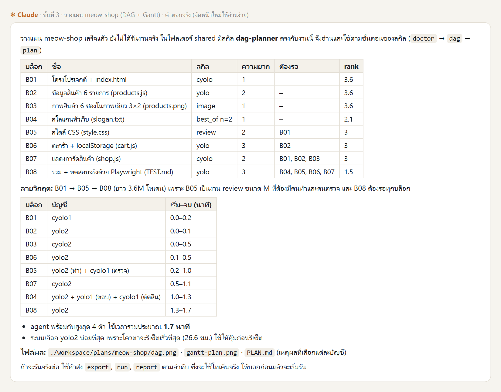

### 3.1 · DAG ที่ได้ (`dag.png`)


| อ่านภาพ | ตัวอย่างจากผลจริง |
|---|---|
| **แถบสีซ้ายกล่อง + ป้ายสี** = สกิลของบล็อก | B05 สีน้ำเงิน 🔍 review · B04 สีฟ้าอมเขียว 🏆 best_of |
| **ป้ายล่าง** = บัญชีที่ KC-QUEST แจก | B05 = yolo2 (ทำ) + cyolo1 (ตรวจ) · B04 = yolo2 + yolo1 (ตอบ) + cyolo1 (ตัดสิน) |
| **rank** มุมขวาบน · **ขอบส้ม** = สายวิกฤต | B01 → B05 → B08 = 0.6 + 1.5 + 1.5 = **3.6** ล้านโทเคน |
| 🔒 | B08 รวม + ทดสอบ รันคนเดียว (exclusive) |

ตรวจ rank ด้วยมือ: rank(B08) = 1.5 (ไม่มีใครรอ) · rank(B05) = 1.5 + 1.5 = 3 · rank(B01) = 0.6 + max(rank B05 3, rank B07 3) = **3.6** · B02 และ B03 ก็ได้ 3.6 เท่ากันเพราะต่อกับ B06/B07 ที่ rank 3 · AI เลือกเส้นที่ผ่าน B05 เป็นสายวิกฤต เพราะ review ต้องมีทั้งคนทำและคนตรวจ

### 3.2 · Gantt แผน (`gantt-plan.png`)


- **บล็อกหลายบัญชีมีแท่งหลายแถว** เชื่อมด้วยเส้นประ: B05 (review) อยู่ทั้ง yolo2 #2 (ทำ) และ cyolo1 (ตรวจ) · B04 (best_of) อยู่ 3 แถว
- **yolo2 ได้งานมากที่สุด** เพราะโควตาจะรีเซ็ตเร็วที่สุด (26.6 ชม.) ใช้ให้คุ้มก่อนหายไปฟรี ๆ (ตัวแปร U ของ KC-QUEST) `yolo2 #2` = งานที่ 2 ที่ yolo2 ทำพร้อมกัน
- เวลาในแผนเป็นนาทีที่**ประเมิน** (โทเคน ÷ ความเร็ว × k) ไม่ใช่เวลาจริง · k ตอนนี้มาจากแผนทดสอบเล็ก 4 บล็อกในขั้นที่ 1 เหตุผลของทุกบล็อกอยู่ใน [`PLAN.md`](_solution/plans/meow-shop/PLAN.md)

## ขั้นที่ 4 · รันแผนจริงด้วยทีมเอเจนต์ (230 วินาที)

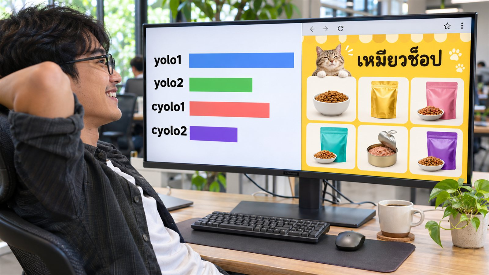

*(ภาพจำลอง)*

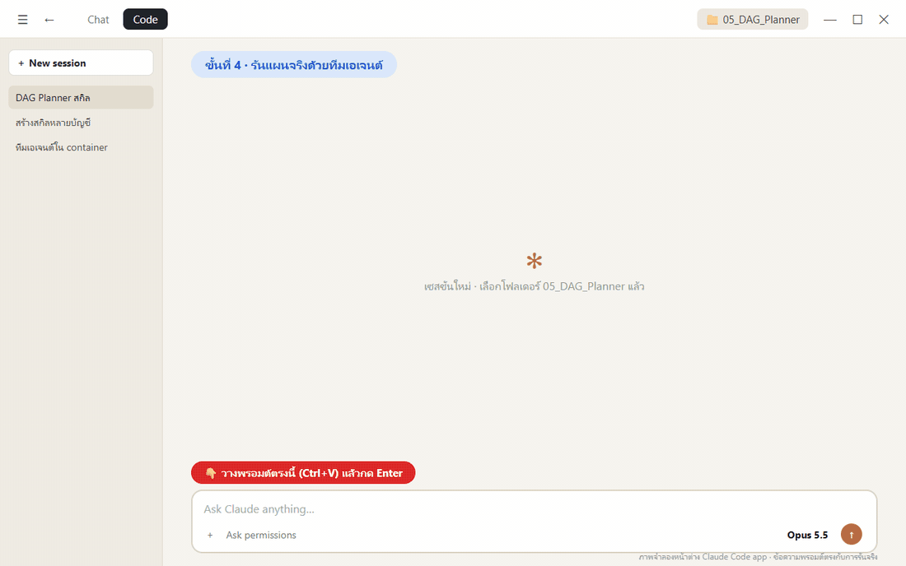

```text
ชื่อแผน: meow-shop
รันแผนนี้จริงด้วยทีมเอเจนต์ใน container multi-account ทำงานผ่าน docker exec เท่านั้น ห้ามแก้ไฟล์ตั้งค่า ห้ามล็อกอินแทนฉัน
- ใช้แผนที่วางไว้แล้ว (ไม่ต้องวางแผนใหม่) ส่งให้ agent-team รันจนจบด้วยสกิล dag-planner แล้วทำรายงานเทียบแผนกับของจริง
- ถ้าบล็อกใดล้ม ให้รายงานตามจริง ห้ามแก้แทนหรือเดาผล
ตอบภาษาไทยสั้น ๆ: ตาราง บล็อก | สกิล | บัญชีแผน → จริง | นาทีแผน → จริง | tokens | สถานะ · เวลารวมแผนเทียบของจริง · path ของ gantt-actual.png, compare.png และหน้าเว็บที่ได้
```

บรรทัด "ใช้แผนที่วางไว้แล้ว (ไม่ต้องวางแผนใหม่)" สำคัญ: ถ้าไม่บอก Claude อาจสั่ง `plan` ใหม่ด้วยค่าเริ่มต้น (6 agent) ทับแผนของขั้นที่ 3 แล้วเทียบผลจริงกับแผนคนละฉบับ (เจอจริงในรอบแรกของการทดลอง)

**ผลจริง** (8 พ.ย. 2026): ทีมรันจริง **2.8 นาที** เสร็จ **8/8 บล็อก** ไม่มีบล็อกล้ม · tokens รวม **1,324,807** ตรงกับ ledger

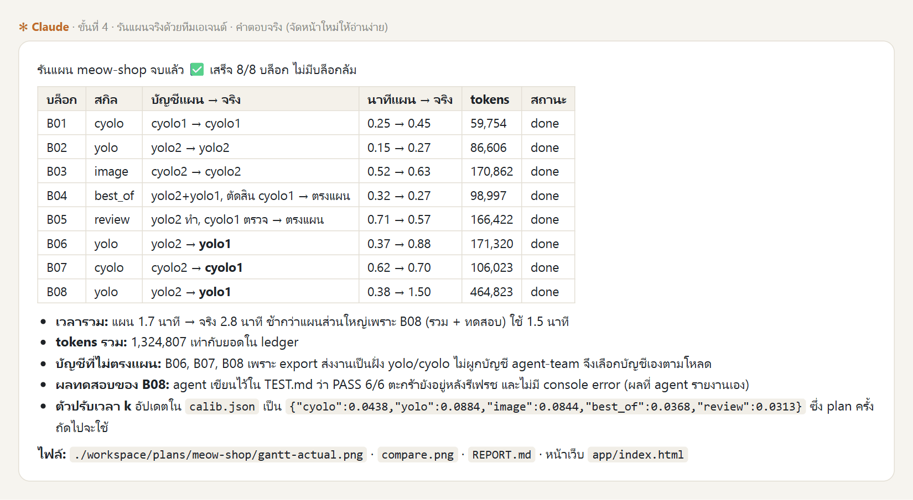

### 4.1 · ดูการรันย้อนหลังตามเวลา

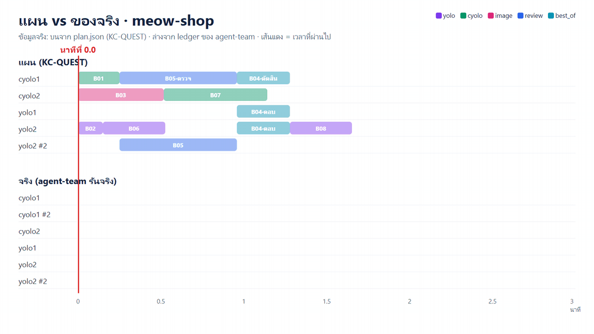

*วาดจาก `plan.json` (แผน) และ ledger ของ run จริง ไม่ได้แต่งตัวเลข*


**อ่านผลอย่างไร**

| สิ่งที่เห็น | เหตุผล |
|---|---|
| **review ของจริงเป็นลำดับ** (yolo2 ทำ 0.47–0.88 แล้ว cyolo1 ตรวจ 0.88–1.03) | ผู้ตรวจต้องรอร่างก่อน ส่วนแผนจองทั้งสองบัญชีไว้พร้อมกัน |
| **best_of** ผู้ตอบ 2 คนรันพร้อมกัน แล้วผู้ตัดสินตามหลัง | ตรงกับรูปแบบ best_of ของ agent-team |
| **B06 B07 B08 ไปบัญชีอื่น** (yolo2 → yolo1 · cyolo2 → cyolo1) | export ส่งเป็นฝั่ง agent-team เลือกบัญชีที่ว่างเอง |
| **B08 ช้าที่สุด** (แผน 0.38 → จริง 1.50 นาที) | บล็อกรวมต้องแก้ไฟล์ของบล็อกอื่นให้ต่อกันได้ และรัน Playwright ทดสอบจริง |
| **ตัวปรับ k** ใหม่: yolo 0.0884 · cyolo 0.0438 · image 0.0844 · best_of 0.0368 · review 0.0313 | `report` เก็บไว้ใน `calib.json` ให้แผนครั้งถัดไป (ขั้นที่ 5) |

### 4.2 · หน้าเว็บที่ทีมสร้าง (ทดสอบจริงด้วย Playwright)

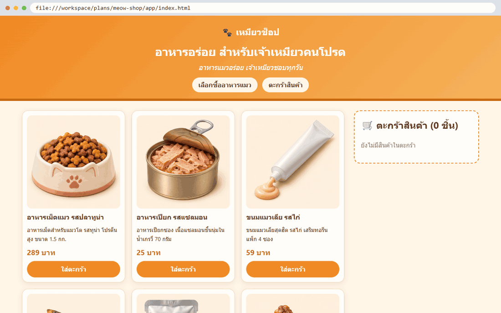

*ภาพจริงจากการเปิด `app/index.html` ด้วย Playwright หลังรันเสร็จ (ตรวจซ้ำแยกจากที่ B08 รายงาน) · ไฟล์ทั้งหมดอยู่ที่ [`_solution/plans/meow-shop/app/`](_solution/plans/meow-shop/app/)*

| ไฟล์ | มาจากบล็อก | สกิล |
|---|---|---|
| `index.html` | B01 (+ B08 แก้ตอนรวม) | ⚙️ cyolo |
| `products.js` | B02 | 🧠 yolo |
| `products.png` | B03 | 🖼️ image |
| `slogan.txt` "อาหารแมวอร่อย เจ้าเหมียวชอบทุกวัน" | B04 | 🏆 best_of |
| `style.css` | B05 | 🔍 review |
| `cart.js` | B06 | 🧠 yolo |
| `shop.js` | B07 | ⚙️ cyolo |
| `TEST.md` · `test-e2e.js` · `cart-ui.js` | B08 | 🧠 yolo |

**บทเรียนจากของจริง: ลูกศรที่ขาดไป = งานที่ไม่ตรงกัน** · B08 บันทึกไว้ใน `TEST.md` ว่า **รูปบางช่องไม่ตรงกับชื่อสินค้า** เช่น "อาหารเปียก รสแซลมอน" ได้รูปกระป๋องทูน่า สาเหตุอยู่ที่ DAG: บล็อกภาพ B03 **ไม่ได้รอ** บล็อกข้อมูลสินค้า B02 (ไม่มีลูกศร B02 → B03) คนวาดภาพจึงไม่รู้ว่าสินค้าแต่ละช่องคืออะไร การตัด dependency ทำให้เร็วขึ้น แต่ต้องตัดเฉพาะเมื่องานไม่ต้องใช้ข้อมูลของกันจริง

## ขั้นที่ 5 · what-if ด้วย k ที่เรียนรู้แล้ว (83 วินาที)

ขั้นนี้ **ไม่รันทีมจริง** ใช้แค่ `plan` (ไม่ใช้โทเคนของทีม) เพื่อถามว่า "ถ้า…จะเป็นอย่างไร"

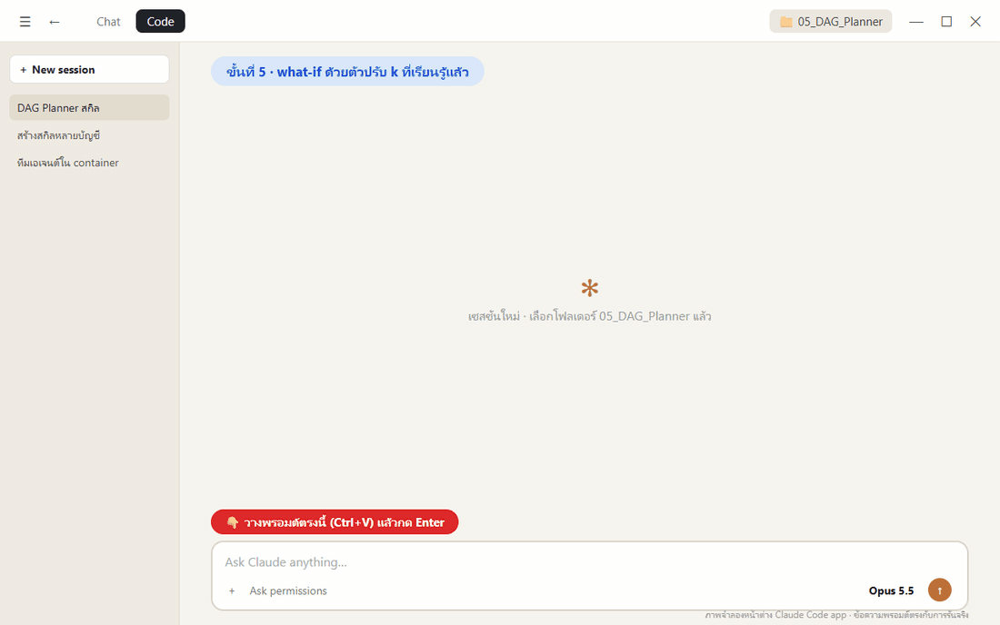

```text
ชื่อแผน: meow-shop
วางแผนใหม่ 2 แบบ (ยังไม่รันจริง) โดยใช้ตัวปรับ k ที่ได้จากการรันจริงรอบที่แล้ว แล้วเทียบกับแผนเดิม
ก. จำนวน agent สูงสุด 2
ข. yolo1 เหลือโควตาแค่ 5%
ทำผ่าน docker exec ใน container multi-account ด้วยสกิล dag-planner
ตอบเป็นตาราง แบบ | เวลารวม (นาที) | บล็อกบนสายวิกฤตไปบัญชีไหน | อะไรเปลี่ยน พร้อม path ของ gantt ทั้ง 2 แบบ
```

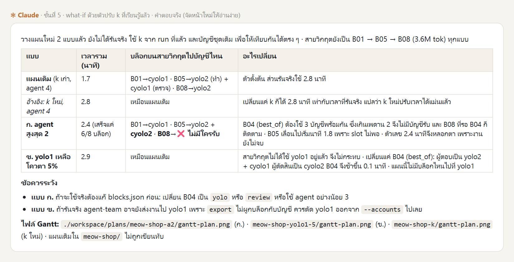

| แบบ | เวลารวม | สิ่งที่เห็น |
|---|---|---|
| แผนเดิม (k จากการทดสอบขั้นที่ 1) | 1.7 นาที | ประเมินต่ำไป (รันจริง 2.8 นาที) |
| **k ใหม่ · agent 4** | **2.8 นาที** | **เท่ากับเวลาจริง** แผนแม่นขึ้นหลังเรียนรู้จากการรันครั้งเดียว |
| ก. agent สูงสุด 2 | 2.4 นาที แต่**เสร็จแค่ 6/8** | B04 (best_of) ต้องใช้ 3 บัญชีพร้อมกัน เกินเพดาน 2 จึงไม่มีใครรับ และ B08 ที่รอ B04 ติดตาม · ตัวเลขเวลาที่ "เร็วขึ้น" จึงหลอกตา |
| ข. yolo1 เหลือโควตา 5% | 2.9 นาที | yolo1 ไม่ได้บล็อกเลย สายวิกฤตไม่ได้ใช้ yolo1 อยู่แล้ว จึงช้าลงแค่ 0.1 นาที |

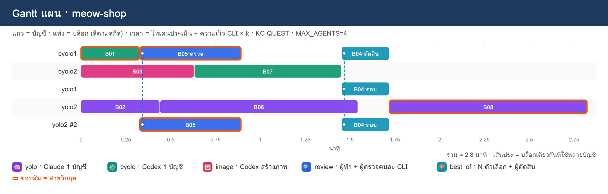

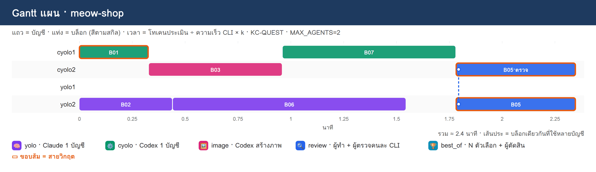

**ข้อสังเกต:** แบบ ก. ต้องแก้ `blocks.json` ก่อนใช้จริง เช่นเปลี่ยน B04 เป็น `yolo` หรือ `review` หรือใช้ agent อย่างน้อย 3 · ส่วนแบบ ข. ถ้ารันจริง agent-team อาจยังส่งงานไป yolo1 เพราะ export ไม่ผูกบัญชี ควรตัด yolo1 ออกจาก `--accounts` ไปเลย

## สรุป

| | บท 04 (ไม่มีแผน) | บท 05 (มี `dag-planner`) |
|---|---|---|
| ใครเขียน `graph.json` | คน / AI เขียนเอง | สกิลแปลงจาก `blocks.json` ให้ (`export`) |
| แต่ละงานใช้สกิลอะไร | ระบุเองทีละ node | ทุกบล็อกมี `skill` + `difficulty` ตามตาราง |
| ใครทำบล็อกไหน เมื่อไร | ไม่รู้จนกว่าจะรัน | Gantt แผนจาก KC-QUEST + โควตาจริง |
| เสร็จเมื่อไร | ไม่รู้ | แผน 1.7 นาที → จริง 2.8 นาที → แผนใหม่ 2.8 นาที (เรียนรู้ k) |
| what-if | ต้องรันจริง | `plan` ใหม่ ไม่ใช้โทเคนของทีม |

## ข้อควรรู้

- **แผนเป็นค่าประมาณ:** ขนาด S/M/L เป็นการประเมิน แผนแรกอาจต่างจากจริงมาก หลังรันจริงครั้งแรก `calib.json` ช่วยให้แม่นขึ้น
- **รันจริงใช้โทเคน:** `run` ให้ทีมทำงานจริง สกิลจึงให้ถามผู้ใช้ก่อน และเริ่มจากความยากต่ำ
- **บัญชีจริงอาจไม่ตรงแผน:** export ส่งเป็นฝั่งเพื่อให้ failover ทำงาน ถ้าอยากห้ามบัญชีไหนให้ตัดออกจาก `--accounts`
- **dependency ที่ขาดทำให้งานไม่ตรงกัน:** ตัดลูกศรได้เฉพาะงานที่ไม่ใช้ข้อมูลของกันจริง (บทเรียนรูปสินค้าในขั้นที่ 4)
- **บล็อกหลายบัญชีต้องมีบัญชีพอ:** best_of n=2 ใช้ 3 บัญชีพร้อมกัน จำนวน agent สูงสุดต้องไม่ต่ำกว่านั้น (ขั้นที่ 5 แบบ ก.)
- **บอกให้ใช้แผนเดิมก่อนรัน:** ไม่เช่นนั้น Claude อาจวางแผนใหม่ทับแผนที่ตั้งใจไว้
- **ล็อกอินเองเสมอ:** สกิลไม่ล็อกอินแทน และไม่อ่านไฟล์ credential
- **Git Bash บน Windows แปลง path `/root/...`:** เมื่อสั่ง `docker exec` จาก Git Bash ให้เขียน `//root/...` หรือใช้ PowerShell

## คำสั่งที่ใช้บ่อย

ใน container (JupyterLab Terminal)

```bash
D=/root/ai-accounts/.Claude/shared/skills/dag-planner/scripts/dagplan.py
python3 $D doctor                                  # เครื่องพร้อมไหม
python3 $D dag meow-shop --blocks blocks.json      # ตรวจบล็อก + rank + dag.png
python3 $D plan meow-shop --max-agents 4           # Gantt แผนจากโควตาจริง
python3 $D plan meow-shop --accounts yolo1:5,yolo2,cyolo1,cyolo2   # what-if (สมมติโควตา)
python3 $D export meow-shop && python3 $D run meow-shop --detach   # รันจริง (ใช้โทเคน)
python3 $D report meow-shop                        # Gantt จริง + แผน vs จริง + calib.json
```

จาก host

```bash
docker exec multi-account cat /root/ai-accounts/.Claude/shared/skills/dag-planner/SKILL.md
docker exec -i multi-account python3 /root/ai-accounts/.Claude/shared/skills/dag-planner/scripts/dagplan.py dag meow-shop --blocks - < blocks.json
```

ผลทุกแผนอยู่ที่ `./workspace/plans/<ชื่อแผน>/` บนเครื่องเรา (= `/workspace/plans/` ใน container) · ต่อด้วย [บท 06 · KC-QUEST](../06_KC_QUEST/readme.md) เพื่อดูสมการที่ใช้แจกบล็อกให้บัญชีแบบละเอียด
