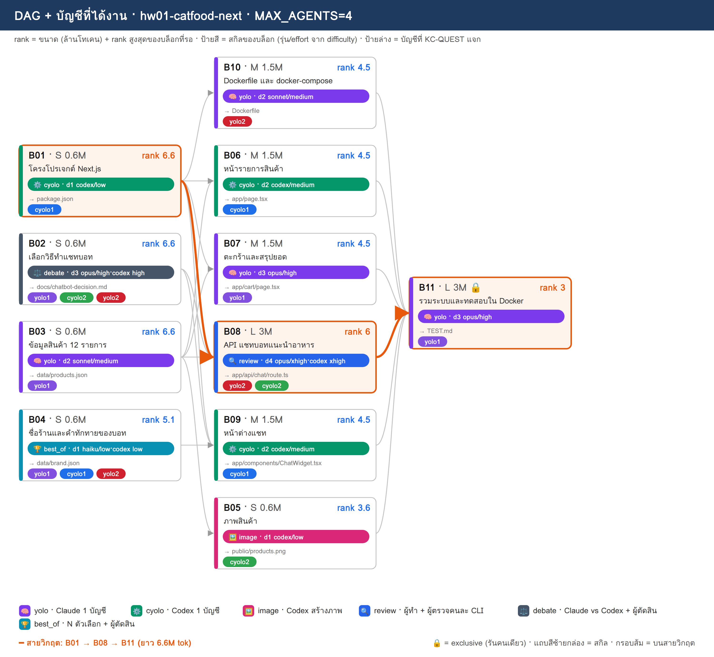
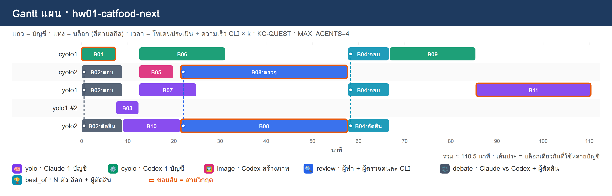

# PLAN · hw01-catfood-next

**โจทย์:** เว็บขายอาหารแมว ใช้ Next.js กับ Docker มีแชทบอทช่วยแนะนำอาหาร

วางแผนเมื่อ 10/11/2026 10:51 · MAX_AGENTS 4 · บัญชี cyolo1, cyolo2, yolo1, yolo2 · ตัวปรับเวลา k (ยังไม่มี calib.json → k=1)

> แผนนี้ยังไม่ได้รันจริง — KC-QUEST เลือกบัญชีจากโควตา แล้วจำลองเวลาตาม dependency

## 1) โควตาของแต่ละบัญชี

| บัญชี | แพลน | ใช้ไป 5 ชม. | ใช้ไปสัปดาห์ | headroom | รีเซ็ต/หมดอายุ (ชม.) | U | slot | ที่มา |
|---|---|---|---|---|---|---|---|---|
| cyolo1 | default | 10% | 0% | **90%** | 168.0 | 0.125 | 3 | สมมติ (--accounts) |
| cyolo2 | default | 30% | 0% | **70%** | 168.0 | 0.125 | 3 | สมมติ (--accounts) |
| yolo1 | default | 20% | 0% | **80%** | 168.0 | 0.125 | 3 | สมมติ (--accounts) |
| yolo2 | default | 40% | 0% | **60%** | 168.0 | 0.125 | 3 | สมมติ (--accounts) |

- ⚠ ทุกบัญชีเป็นค่าสมมติ (--accounts มี % ครบ) → ไม่ได้เรียก team.py check/quota

## 2) DAG + สกิล + บัญชี

**สายวิกฤต:** B01 → B08 → B11 · ยาว 6.6M tok

## 3) ตารางแจกงาน (เหตุผล KC-QUEST ทุกบล็อก)

| บล็อก | สกิล | ชื่อ | ขนาด · c | รอ | rank | บัญชี (บทบาท) | เริ่ม–จบ (นาที) | เหตุผล KC-QUEST |
|---|---|---|---|---|---|---|---|---|
| **B01** | ⚙️ cyolo | โครงโปรเจกต์ Next.js | S · 0.6 | – | 6.6 | cyolo1 (ทำ) | 0.0–7.5 | ทำ: cyolo1 28.8 (U=0.125 F=0.002 S=0.884 S=0.7 L=0.0) · 0.60M ≈ 5ชม. 1.56% / สัปดาห์ 0.2% · อันดับ 2 cyolo2 25.8 |
| B02 | ⚖️ debate | เลือกวิธีทำแชทบอท | S · 0.6 | – | 6.6 | yolo1 (ตอบ), cyolo2 (ตอบ), yolo2 (ตัดสิน) | 0.0–9.0 | ตอบ: yolo1 31.8 (U=0.125 F=0.002 S=0.784 S=1.0 L=0.0) · 0.60M ≈ 5ชม. 1.56% / สัปดาห์ 0.2% · อันดับ 2 yolo2 28.8   ตอบ: cyolo2 25.8 (U=0.125 F=0.002 S=0.684 S=0.7 L=0.0) · 0.60M ≈ 5ชม. 1.56% / สัปดาห์ 0.2% · อันดับ 2 cyolo1 25.2   ตัดสิน: yolo2 28.9 (U=0.125 F=0.001 S=0.595 S=1.0 L=0.0) · 0.18M ≈ 5ชม. 0.47% / สัปดาห์ 0.06% · อันดับ 2 cyolo1 25.4 |
| B03 | 🧠 yolo | ข้อมูลสินค้า 12 รายการ | S · 0.6 | – | 6.6 | yolo1 (ทำ) | 7.5–12.5 | ทำ: yolo1 28.2 (U=0.125 F=0.002 S=0.769 S=1.0 L=0.333) · 0.60M ≈ 5ชม. 1.56% / สัปดาห์ 0.2% · อันดับ 2 yolo2 25.4 |
| B10 | 🧠 yolo | Dockerfile และ docker-compose | M · 1.5 | B01 | 4.5 | yolo2 (ทำ) | 9.0–21.5 | ทำ: yolo2 23.7 (U=0.125 F=0.005 S=0.556 S=0.682 L=0.0) · 1.50M ≈ 5ชม. 3.9% / สัปดาห์ 0.49% · อันดับ 2 yolo1 22.9 |
| B06 | ⚙️ cyolo | หน้ารายการสินค้า | M · 1.5 | B01, B03 | 4.5 | cyolo1 (ทำ) | 12.5–31.2 | ทำ: cyolo1 24.9 (U=0.125 F=0.005 S=0.845 S=0.477 L=0.0) · 1.50M ≈ 5ชม. 3.9% / สัปดาห์ 0.49% · อันดับ 2 cyolo2 21.9 |
| B07 | 🧠 yolo | ตะกร้าและสรุปยอด | M · 1.5 | B01, B03 | 4.5 | yolo1 (ทำ) | 12.5–25.0 | ทำ: yolo1 26.3 (U=0.125 F=0.005 S=0.73 S=0.682 L=0.0) · 1.50M ≈ 5ชม. 3.9% / สัปดาห์ 0.49% · อันดับ 2 yolo2 19.8 |
| B05 | 🖼️ image | ภาพสินค้า | S · 0.6 | B03 | 3.6 | cyolo2 (ทำ) | 12.5–20.0 | ทำ: cyolo2 20.8 (U=0.125 F=0.002 S=0.669 S=0.382 L=0.0) · 0.60M ≈ 5ชม. 1.56% / สัปดาห์ 0.2% · อันดับ 2 cyolo1 19.9 |
| **B08** | 🔍 review | API แชทบอทแนะนำอาหาร | L · 3 | B01, B02, B03 | 6 | yolo2 (ทำ), cyolo2 (ตรวจ) | 21.5–57.7 | ทำ: yolo2 26.0 (U=0.125 F=0.01 S=0.478 S=0.909 L=0.0) · 3.00M ≈ 5ชม. 7.8% / สัปดาห์ 0.98% · อันดับ 2 yolo1 25.3   ตรวจ: cyolo2 24.3 (U=0.125 F=0.003 S=0.645 S=0.636 L=0.0) · 0.90M ≈ 5ชม. 2.34% / สัปดาห์ 0.29% · อันดับ 2 cyolo1 23.6 |
| B04 | 🏆 best_of | ชื่อร้านและคำทักทายของบอท | S · 0.6 | – | 5.1 | yolo1 (ตอบ), cyolo1 (ตอบ), yolo2 (ตัดสิน) | 57.7–66.7 | ตอบ: yolo1 27.3 (U=0.125 F=0.002 S=0.714 S=0.773 L=0.0) · 0.60M ≈ 5ชม. 1.56% / สัปดาห์ 0.2% · อันดับ 2 cyolo1 25.6   ตอบ: cyolo1 25.6 (U=0.125 F=0.002 S=0.83 S=0.541 L=0.0) · 0.60M ≈ 5ชม. 1.56% / สัปดาห์ 0.2% · อันดับ 2 yolo2 23.6   ตัดสิน: yolo2 23.7 (U=0.125 F=0.001 S=0.474 S=0.773 L=0.0) · 0.18M ≈ 5ชม. 0.47% / สัปดาห์ 0.06% · อันดับ 2 cyolo2 22.8 |
| B09 | ⚙️ cyolo | หน้าต่างแชท | M · 1.5 | B01, B02, B04 | 4.5 | cyolo1 (ทำ) | 66.7–85.5 | ทำ: cyolo1 24.1 (U=0.125 F=0.005 S=0.791 S=0.477 L=0.0) · 1.50M ≈ 5ชม. 3.9% / สัปดาห์ 0.49% · อันดับ 2 cyolo2 21.3 |
| **B11** | 🧠 yolo | รวมระบบและทดสอบใน Docker | L · 3 | B05, B06, B07, B08, B09, B10 | 3 | yolo1 (ทำ) | 85.5–110.5 | ทำ: yolo1 21.6 (U=0.125 F=0.01 S=0.636 S=0.455 L=0.0) · 3.00M ≈ 5ชม. 7.8% / สัปดาห์ 0.98% · อันดับ 2 yolo2 18.0 |

## 4) Gantt แผน

## 5) รอบแจกงาน

| นาทีที่ | บล็อกที่เริ่ม |
|---|---|
| 0 | B01→cyolo1, B02→yolo1+cyolo2+yolo2 |
| 7.5 | B03→yolo1 |
| 9 | B10→yolo2 |
| 12.5 | B06→cyolo1, B07→yolo1, B05→cyolo2 |
| 21.5 | B08→yolo2+cyolo2 |
| 57.7 | B04→yolo1+cyolo1+yolo2 |
| 66.7 | B09→cyolo1 |
| 85.5 | B11→yolo1 |

## 6) สรุป

- บล็อก 11 · แจกได้ 11 · agent พร้อมกันสูงสุด 4/4
- เวลาประมาณ 110.5 นาที (แท่ง Gantt) · ไฟล์ผลของทีม: `/workspace/plans/hw01-catfood-next/app/`

ต่อไป: `dagplan.py export hw01-catfood-next` → `dagplan.py run hw01-catfood-next` → `dagplan.py report hw01-catfood-next`
