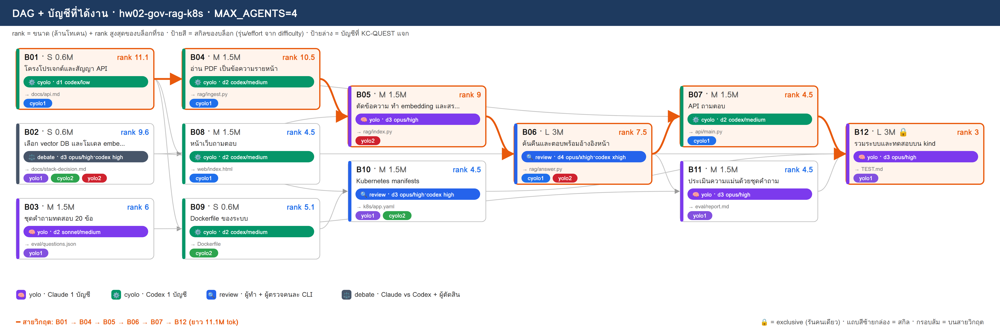
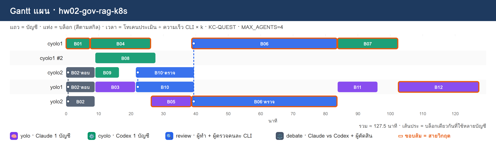

# PLAN · hw02-gov-rag-k8s

**โจทย์:** ระบบ RAG ถามตอบเอกสารภาครัฐ (ประกาศและระเบียบแบบ PDF) ตอบพร้อมอ้างอิงหน้าเอกสาร และ deployment ด้วย Kubernetes

วางแผนเมื่อ 10/11/2026 10:51 · MAX_AGENTS 4 · บัญชี cyolo1, cyolo2, yolo1, yolo2 · ตัวปรับเวลา k (ยังไม่มี calib.json → k=1)

> แผนนี้ยังไม่ได้รันจริง — KC-QUEST เลือกบัญชีจากโควตา แล้วจำลองเวลาตาม dependency

## 1) โควตาของแต่ละบัญชี

| บัญชี | แพลน | ใช้ไป 5 ชม. | ใช้ไปสัปดาห์ | headroom | รีเซ็ต/หมดอายุ (ชม.) | U | slot | ที่มา |
|---|---|---|---|---|---|---|---|---|
| cyolo1 | default | 10% | 0% | **90%** | 168.0 | 0.125 | 3 | สมมติ (--accounts) |
| cyolo2 | default | 30% | 0% | **70%** | 168.0 | 0.125 | 3 | สมมติ (--accounts) |
| yolo1 | default | 20% | 0% | **80%** | 168.0 | 0.125 | 3 | สมมติ (--accounts) |
| yolo2 | default | 40% | 0% | **60%** | 168.0 | 0.125 | 3 | สมมติ (--accounts) |

- ⚠ ทุกบัญชีเป็นค่าสมมติ (--accounts มี % ครบ) → ไม่ได้เรียก team.py check/quota

## 2) DAG + สกิล + บัญชี

**สายวิกฤต:** B01 → B04 → B05 → B06 → B07 → B12 · ยาว 11.1M tok

## 3) ตารางแจกงาน (เหตุผล KC-QUEST ทุกบล็อก)

| บล็อก | สกิล | ชื่อ | ขนาด · c | รอ | rank | บัญชี (บทบาท) | เริ่ม–จบ (นาที) | เหตุผล KC-QUEST |
|---|---|---|---|---|---|---|---|---|
| **B01** | ⚙️ cyolo | โครงโปรเจกต์และสัญญา API | S · 0.6 | – | 11.1 | cyolo1 (ทำ) | 0.0–7.5 | ทำ: cyolo1 28.8 (U=0.125 F=0.002 S=0.884 S=0.7 L=0.0) · 0.60M ≈ 5ชม. 1.56% / สัปดาห์ 0.2% · อันดับ 2 cyolo2 25.8 |
| B02 | ⚖️ debate | เลือก vector DB และโมเดล embedding | S · 0.6 | – | 9.6 | yolo1 (ตอบ), cyolo2 (ตอบ), yolo2 (ตัดสิน) | 0.0–9.0 | ตอบ: yolo1 29.8 (U=0.125 F=0.002 S=0.784 S=0.865 L=0.0) · 0.60M ≈ 5ชม. 1.56% / สัปดาห์ 0.2% · อันดับ 2 yolo2 26.8   ตอบ: cyolo2 24.4 (U=0.125 F=0.002 S=0.684 S=0.605 L=0.0) · 0.60M ≈ 5ชม. 1.56% / สัปดาห์ 0.2% · อันดับ 2 cyolo1 23.8   ตัดสิน: yolo2 26.9 (U=0.125 F=0.001 S=0.595 S=0.865 L=0.0) · 0.18M ≈ 5ชม. 0.47% / สัปดาห์ 0.06% · อันดับ 2 cyolo1 24.0 |
| **B04** | ⚙️ cyolo | อ่าน PDF เป็นข้อความรายหน้า | M · 1.5 | B01 | 10.5 | cyolo1 (ทำ) | 7.5–26.2 | ทำ: cyolo1 27.7 (U=0.125 F=0.005 S=0.845 S=0.662 L=0.0) · 1.50M ≈ 5ชม. 3.9% / สัปดาห์ 0.49% · อันดับ 2 cyolo2 21.4 |
| B03 | 🧠 yolo | ชุดคำถามทดสอบ 20 ข้อ | M · 1.5 | – | 6 | yolo1 (ทำ) | 9.0–21.5 | ทำ: yolo1 24.4 (U=0.125 F=0.005 S=0.745 S=0.541 L=0.0) · 1.50M ≈ 5ชม. 3.9% / สัปดาห์ 0.49% · อันดับ 2 yolo2 21.6 |
| B09 | ⚙️ cyolo | Dockerfile ของระบบ | S · 0.6 | B01 | 5.1 | cyolo2 (ทำ) | 9.0–16.5 | ทำ: cyolo2 19.9 (U=0.125 F=0.002 S=0.669 S=0.321 L=0.0) · 0.60M ≈ 5ชม. 1.56% / สัปดาห์ 0.2% · อันดับ 2 cyolo1 19.0 |
| B08 | ⚙️ cyolo | หน้าเว็บถามตอบ | M · 1.5 | B01 | 4.5 | cyolo1 (ทำ) | 9.0–27.8 | ทำ: cyolo1 18.1 (U=0.125 F=0.005 S=0.806 S=0.283 L=0.333) · 1.50M ≈ 5ชม. 3.9% / สัปดาห์ 0.49% · อันดับ 2 cyolo2 15.5 |
| B10 | 🔍 review | Kubernetes manifests | M · 1.5 | B02, B09 | 4.5 | yolo1 (ทำ), cyolo2 (ตรวจ) | 21.5–39.6 | ทำ: yolo1 21.8 (U=0.125 F=0.005 S=0.706 S=0.405 L=0.0) · 1.50M ≈ 5ชม. 3.9% / สัปดาห์ 0.49% · อันดับ 2 yolo2 19.5   ตรวจ: cyolo2 19.1 (U=0.125 F=0.001 S=0.657 S=0.283 L=0.0) · 0.45M ≈ 5ชม. 1.17% / สัปดาห์ 0.15% · อันดับ 2 cyolo1 14.5 |
| **B05** | 🧠 yolo | ตัดข้อความ ทำ embedding และสร้างดัชนี | M · 1.5 | B02, B04 | 9 | yolo2 (ทำ) | 26.2–38.7 | ทำ: yolo2 25.6 (U=0.125 F=0.005 S=0.556 S=0.811 L=0.0) · 1.50M ≈ 5ชม. 3.9% / สัปดาห์ 0.49% · อันดับ 2 yolo1 23.9 |
| **B06** | 🔍 review | ค้นคืนและตอบพร้อมอ้างอิงหน้า | L · 3 | B05 | 7.5 | cyolo1 (ทำ), yolo2 (ตรวจ) | 38.7–83.8 | ทำ: cyolo1 23.2 (U=0.125 F=0.01 S=0.728 S=0.473 L=0.0) · 3.00M ≈ 5ชม. 7.8% / สัปดาห์ 0.98% · อันดับ 2 yolo2 22.5   ตรวจ: yolo2 23.2 (U=0.125 F=0.003 S=0.533 S=0.676 L=0.0) · 0.90M ≈ 5ชม. 2.34% / สัปดาห์ 0.29% · อันดับ 2 yolo1 22.1 |
| **B07** | ⚙️ cyolo | API ถามตอบ | M · 1.5 | B01, B06 | 4.5 | cyolo1 (ทำ) | 83.8–102.5 | ทำ: cyolo1 19.7 (U=0.125 F=0.005 S=0.689 S=0.283 L=0.0) · 1.50M ≈ 5ชม. 3.9% / สัปดาห์ 0.49% · อันดับ 2 cyolo2 18.6 |
| B11 | 🧠 yolo | ประเมินความแม่นด้วยชุดคำถาม | M · 1.5 | B03, B06 | 4.5 | yolo1 (ทำ) | 83.8–96.2 | ทำ: yolo1 21.2 (U=0.125 F=0.005 S=0.667 S=0.405 L=0.0) · 1.50M ≈ 5ชม. 3.9% / สัปดาห์ 0.49% · อันดับ 2 yolo2 18.6 |
| **B12** | 🧠 yolo | รวมระบบและทดสอบบน kind | L · 3 | B07, B08, B10, B11 | 3 | yolo1 (ทำ) | 102.5–127.5 | ทำ: yolo1 18.1 (U=0.125 F=0.01 S=0.589 S=0.27 L=0.0) · 3.00M ≈ 5ชม. 7.8% / สัปดาห์ 0.98% · อันดับ 2 yolo2 16.1 |

## 4) Gantt แผน

## 5) รอบแจกงาน

| นาทีที่ | บล็อกที่เริ่ม |
|---|---|
| 0 | B01→cyolo1, B02→yolo1+cyolo2+yolo2 |
| 7.5 | B04→cyolo1 |
| 9 | B03→yolo1, B09→cyolo2, B08→cyolo1 |
| 21.5 | B10→yolo1+cyolo2 |
| 26.2 | B05→yolo2 |
| 38.7 | B06→cyolo1+yolo2 |
| 83.8 | B07→cyolo1, B11→yolo1 |
| 102.5 | B12→yolo1 |

## 6) สรุป

- บล็อก 12 · แจกได้ 12 · agent พร้อมกันสูงสุด 4/4
- เวลาประมาณ 127.5 นาที (แท่ง Gantt) · ไฟล์ผลของทีม: `/workspace/plans/hw02-gov-rag-k8s/app/`

ต่อไป: `dagplan.py export hw02-gov-rag-k8s` → `dagplan.py run hw02-gov-rag-k8s` → `dagplan.py report hw02-gov-rag-k8s`
