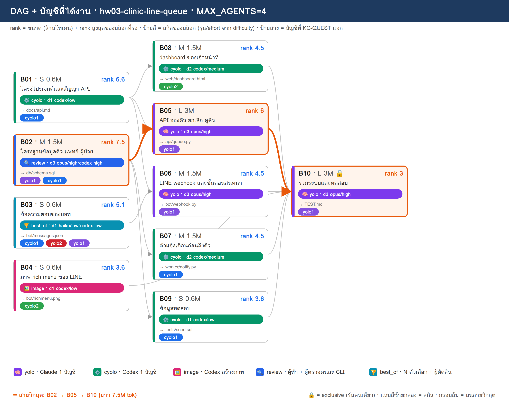
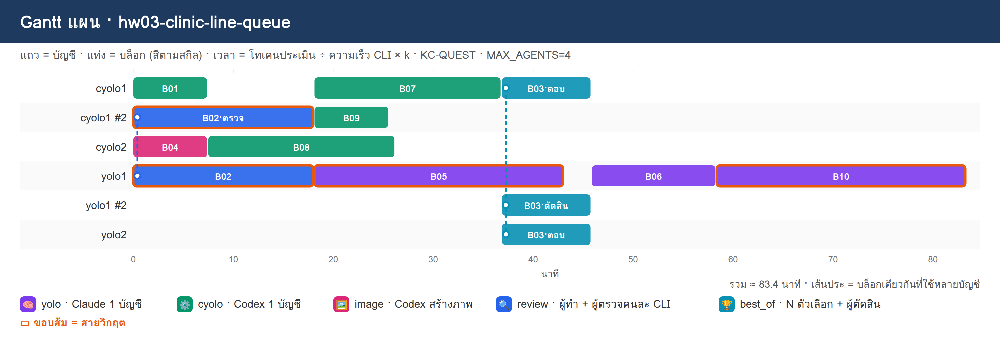

# PLAN · hw03-clinic-line-queue

**โจทย์:** ระบบจองคิวคลินิกผ่าน LINE chatbot มีแจ้งเตือนก่อนถึงคิว และหน้า dashboard ของเจ้าหน้าที่

วางแผนเมื่อ 10/11/2026 10:51 · MAX_AGENTS 4 · บัญชี cyolo1, cyolo2, yolo1, yolo2 · ตัวปรับเวลา k (ยังไม่มี calib.json → k=1)

> แผนนี้ยังไม่ได้รันจริง — KC-QUEST เลือกบัญชีจากโควตา แล้วจำลองเวลาตาม dependency

## 1) โควตาของแต่ละบัญชี

| บัญชี | แพลน | ใช้ไป 5 ชม. | ใช้ไปสัปดาห์ | headroom | รีเซ็ต/หมดอายุ (ชม.) | U | slot | ที่มา |
|---|---|---|---|---|---|---|---|---|
| cyolo1 | default | 10% | 0% | **90%** | 168.0 | 0.125 | 3 | สมมติ (--accounts) |
| cyolo2 | default | 30% | 0% | **70%** | 168.0 | 0.125 | 3 | สมมติ (--accounts) |
| yolo1 | default | 20% | 0% | **80%** | 168.0 | 0.125 | 3 | สมมติ (--accounts) |
| yolo2 | default | 40% | 0% | **60%** | 168.0 | 0.125 | 3 | สมมติ (--accounts) |

- ⚠ ทุกบัญชีเป็นค่าสมมติ (--accounts มี % ครบ) → ไม่ได้เรียก team.py check/quota

## 2) DAG + สกิล + บัญชี

**สายวิกฤต:** B02 → B05 → B10 · ยาว 7.5M tok

## 3) ตารางแจกงาน (เหตุผล KC-QUEST ทุกบล็อก)

| บล็อก | สกิล | ชื่อ | ขนาด · c | รอ | rank | บัญชี (บทบาท) | เริ่ม–จบ (นาที) | เหตุผล KC-QUEST |
|---|---|---|---|---|---|---|---|---|
| **B02** | 🔍 review | โครงฐานข้อมูลคิว แพทย์ ผู้ป่วย | M · 1.5 | – | 7.5 | yolo1 (ทำ), cyolo1 (ตรวจ) | 0.0–18.1 | ทำ: yolo1 31.5 (U=0.125 F=0.005 S=0.761 S=1.0 L=0.0) · 1.50M ≈ 5ชม. 3.9% / สัปดาห์ 0.49% · อันดับ 2 yolo2 28.5   ตรวจ: cyolo1 25.3 (U=0.125 F=0.001 S=0.873 S=0.7 L=0.333) · 0.45M ≈ 5ชม. 1.17% / สัปดาห์ 0.15% · อันดับ 2 cyolo2 22.3 |
| B01 | ⚙️ cyolo | โครงโปรเจกต์และสัญญา API | S · 0.6 | – | 6.6 | cyolo1 (ทำ) | 0.0–7.5 | ทำ: cyolo1 27.5 (U=0.125 F=0.002 S=0.884 S=0.616 L=0.0) · 0.60M ≈ 5ชม. 1.56% / สัปดาห์ 0.2% · อันดับ 2 cyolo2 24.5 |
| B04 | 🖼️ image | ภาพ rich menu ของ LINE | S · 0.6 | – | 3.6 | cyolo2 (ทำ) | 0.0–7.5 | ทำ: cyolo2 20.3 (U=0.125 F=0.002 S=0.684 S=0.336 L=0.0) · 0.60M ≈ 5ชม. 1.56% / สัปดาห์ 0.2% · อันดับ 2 cyolo1 19.8 |
| B08 | ⚙️ cyolo | dashboard ของเจ้าหน้าที่ | M · 1.5 | B01 | 4.5 | cyolo2 (ทำ) | 7.5–26.2 | ทำ: cyolo2 21.1 (U=0.125 F=0.005 S=0.645 S=0.42 L=0.0) · 1.50M ≈ 5ชม. 3.9% / สัปดาห์ 0.49% · อันดับ 2 cyolo1 20.6 |
| **B05** | 🧠 yolo | API จองคิว ยกเลิก ดูคิว | L · 3 | B01, B02 | 6 | yolo1 (ทำ) | 18.1–43.1 | ทำ: yolo1 27.4 (U=0.125 F=0.01 S=0.683 S=0.8 L=0.0) · 3.00M ≈ 5ชม. 7.8% / สัปดาห์ 0.98% · อันดับ 2 yolo2 25.0 |
| B07 | ⚙️ cyolo | ตัวแจ้งเตือนก่อนถึงคิว | M · 1.5 | B02 | 4.5 | cyolo1 (ทำ) | 18.1–36.9 | ทำ: cyolo1 23.9 (U=0.125 F=0.005 S=0.834 S=0.42 L=0.0) · 1.50M ≈ 5ชม. 3.9% / สัปดาห์ 0.49% · อันดับ 2 cyolo2 17.2 |
| B09 | ⚙️ cyolo | ข้อมูลทดสอบ | S · 0.6 | B02 | 3.6 | cyolo1 (ทำ) | 18.1–25.6 | ทำ: cyolo1 19.0 (U=0.125 F=0.002 S=0.818 S=0.336 L=0.333) · 0.60M ≈ 5ชม. 1.56% / สัปดาห์ 0.2% · อันดับ 2 cyolo2 16.2 |
| B03 | 🏆 best_of | ข้อความตอบของบอท | S · 0.6 | – | 5.1 | cyolo1 (ตอบ), yolo2 (ตอบ), yolo1 (ตัดสิน) | 36.9–45.9 | ตอบ: cyolo1 24.2 (U=0.125 F=0.002 S=0.802 S=0.476 L=0.0) · 0.60M ≈ 5ชม. 1.56% / สัปดาห์ 0.2% · อันดับ 2 yolo2 24.0   ตอบ: yolo2 24.0 (U=0.125 F=0.002 S=0.584 S=0.68 L=0.0) · 0.60M ≈ 5ชม. 1.56% / สัปดาห์ 0.2% · อันดับ 2 yolo1 21.9   ตัดสิน: yolo1 22.1 (U=0.125 F=0.001 S=0.678 S=0.68 L=0.333) · 0.18M ≈ 5ชม. 0.47% / สัปดาห์ 0.06% · อันดับ 2 cyolo2 21.8 |
| B06 | 🧠 yolo | LINE webhook และขั้นตอนสนทนา | M · 1.5 | B01, B03 | 4.5 | yolo1 (ทำ) | 45.9–58.4 | ทำ: yolo1 23.7 (U=0.125 F=0.005 S=0.639 S=0.6 L=0.0) · 1.50M ≈ 5ชม. 3.9% / สัปดาห์ 0.49% · อันดับ 2 yolo2 22.3 |
| **B10** | 🧠 yolo | รวมระบบและทดสอบ | L · 3 | B04, B05, B06, B07, B08, B09 | 3 | yolo1 (ทำ) | 58.4–83.4 | ทำ: yolo1 19.6 (U=0.125 F=0.01 S=0.561 S=0.4 L=0.0) · 3.00M ≈ 5ชม. 7.8% / สัปดาห์ 0.98% · อันดับ 2 yolo2 18.8 |

## 4) Gantt แผน

## 5) รอบแจกงาน

| นาทีที่ | บล็อกที่เริ่ม |
|---|---|
| 0 | B01→cyolo1, B04→cyolo2, B02→yolo1+cyolo1 |
| 7.5 | B08→cyolo2 |
| 18.1 | B05→yolo1, B07→cyolo1, B09→cyolo1 |
| 36.9 | B03→cyolo1+yolo2+yolo1 |
| 45.9 | B06→yolo1 |
| 58.4 | B10→yolo1 |

## 6) สรุป

- บล็อก 10 · แจกได้ 10 · agent พร้อมกันสูงสุด 4/4
- เวลาประมาณ 83.4 นาที (แท่ง Gantt) · ไฟล์ผลของทีม: `/workspace/plans/hw03-clinic-line-queue/app/`

ต่อไป: `dagplan.py export hw03-clinic-line-queue` → `dagplan.py run hw03-clinic-line-queue` → `dagplan.py report hw03-clinic-line-queue`
