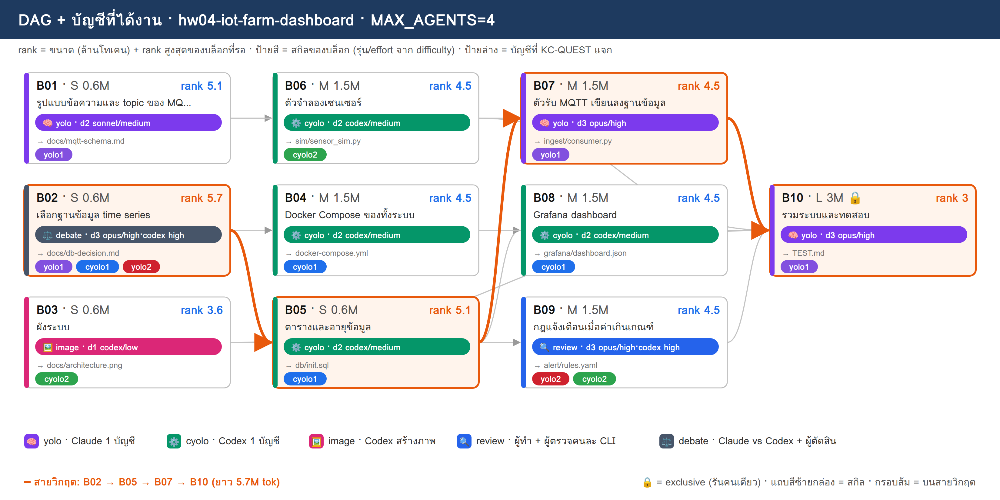
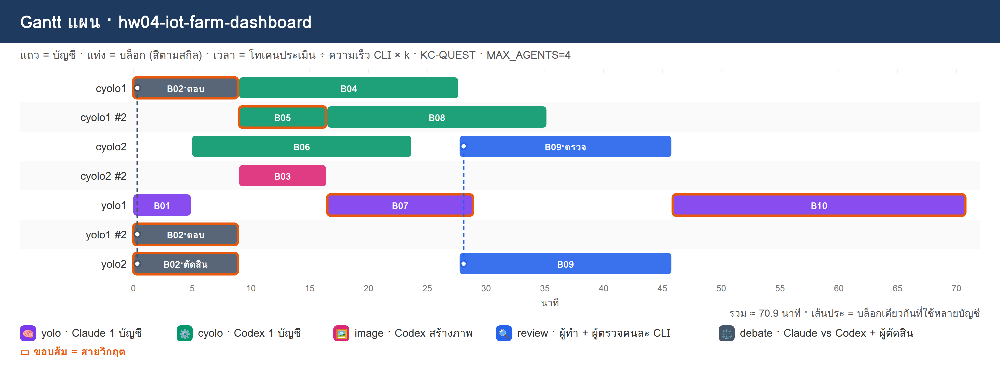

# PLAN · hw04-iot-farm-dashboard

**โจทย์:** ระบบ IoT ฟาร์มผัก เซนเซอร์ส่งค่าผ่าน MQTT เก็บลงฐานข้อมูล time series แสดงผลบน Grafana และแจ้งเตือนเมื่อค่าเกินเกณฑ์ ทั้งหมดรันด้วย Docker Compose

วางแผนเมื่อ 10/11/2026 10:51 · MAX_AGENTS 4 · บัญชี cyolo1, cyolo2, yolo1, yolo2 · ตัวปรับเวลา k (ยังไม่มี calib.json → k=1)

> แผนนี้ยังไม่ได้รันจริง — KC-QUEST เลือกบัญชีจากโควตา แล้วจำลองเวลาตาม dependency

## 1) โควตาของแต่ละบัญชี

| บัญชี | แพลน | ใช้ไป 5 ชม. | ใช้ไปสัปดาห์ | headroom | รีเซ็ต/หมดอายุ (ชม.) | U | slot | ที่มา |
|---|---|---|---|---|---|---|---|---|
| cyolo1 | default | 10% | 0% | **90%** | 168.0 | 0.125 | 3 | สมมติ (--accounts) |
| cyolo2 | default | 30% | 0% | **70%** | 168.0 | 0.125 | 3 | สมมติ (--accounts) |
| yolo1 | default | 20% | 0% | **80%** | 168.0 | 0.125 | 3 | สมมติ (--accounts) |
| yolo2 | default | 40% | 0% | **60%** | 168.0 | 0.125 | 3 | สมมติ (--accounts) |

- ⚠ ทุกบัญชีเป็นค่าสมมติ (--accounts มี % ครบ) → ไม่ได้เรียก team.py check/quota

## 2) DAG + สกิล + บัญชี

**สายวิกฤต:** B02 → B05 → B07 → B10 · ยาว 5.7M tok

## 3) ตารางแจกงาน (เหตุผล KC-QUEST ทุกบล็อก)

| บล็อก | สกิล | ชื่อ | ขนาด · c | รอ | rank | บัญชี (บทบาท) | เริ่ม–จบ (นาที) | เหตุผล KC-QUEST |
|---|---|---|---|---|---|---|---|---|
| **B02** | ⚖️ debate | เลือกฐานข้อมูล time series | S · 0.6 | – | 5.7 | yolo1 (ตอบ), cyolo1 (ตอบ), yolo2 (ตัดสิน) | 0.0–9.0 | ตอบ: yolo1 31.8 (U=0.125 F=0.002 S=0.784 S=1.0 L=0.0) · 0.60M ≈ 5ชม. 1.56% / สัปดาห์ 0.2% · อันดับ 2 yolo2 28.8   ตอบ: cyolo1 28.8 (U=0.125 F=0.002 S=0.884 S=0.7 L=0.0) · 0.60M ≈ 5ชม. 1.56% / สัปดาห์ 0.2% · อันดับ 2 cyolo2 25.8   ตัดสิน: yolo2 28.9 (U=0.125 F=0.001 S=0.595 S=1.0 L=0.0) · 0.18M ≈ 5ชม. 0.47% / สัปดาห์ 0.06% · อันดับ 2 cyolo2 25.9 |
| B01 | 🧠 yolo | รูปแบบข้อความและ topic ของ MQTT | S · 0.6 | – | 5.1 | yolo1 (ทำ) | 0.0–5.0 | ทำ: yolo1 26.7 (U=0.125 F=0.002 S=0.769 S=0.895 L=0.333) · 0.60M ≈ 5ชม. 1.56% / สัปดาห์ 0.2% · อันดับ 2 yolo2 23.8 |
| B06 | ⚙️ cyolo | ตัวจำลองเซนเซอร์ | M · 1.5 | B01 | 4.5 | cyolo2 (ทำ) | 5.0–23.8 | ทำ: cyolo2 23.3 (U=0.125 F=0.005 S=0.661 S=0.552 L=0.0) · 1.50M ≈ 5ชม. 3.9% / สัปดาห์ 0.49% · อันดับ 2 cyolo1 22.7 |
| **B05** | ⚙️ cyolo | ตารางและอายุข้อมูล | S · 0.6 | B02 | 5.1 | cyolo1 (ทำ) | 9.0–16.5 | ทำ: cyolo1 27.5 (U=0.125 F=0.002 S=0.869 S=0.626 L=0.0) · 0.60M ≈ 5ชม. 1.56% / สัปดาห์ 0.2% · อันดับ 2 cyolo2 20.8 |
| B04 | ⚙️ cyolo | Docker Compose ของทั้งระบบ | M · 1.5 | B02 | 4.5 | cyolo1 (ทำ) | 9.0–27.8 | ทำ: cyolo1 22.5 (U=0.125 F=0.005 S=0.83 S=0.552 L=0.333) · 1.50M ≈ 5ชม. 3.9% / สัปดาห์ 0.49% · อันดับ 2 cyolo2 19.4 |
| B03 | 🖼️ image | ผังระบบ | S · 0.6 | – | 3.6 | cyolo2 (ทำ) | 9.0–16.5 | ทำ: cyolo2 18.0 (U=0.125 F=0.002 S=0.645 S=0.442 L=0.333) · 0.60M ≈ 5ชม. 1.56% / สัปดาห์ 0.2% · อันดับ 2 cyolo1 17.2 |
| **B07** | 🧠 yolo | ตัวรับ MQTT เขียนลงฐานข้อมูล | M · 1.5 | B01, B05 | 4.5 | yolo1 (ทำ) | 16.5–29.0 | ทำ: yolo1 27.9 (U=0.125 F=0.005 S=0.73 S=0.789 L=0.0) · 1.50M ≈ 5ชม. 3.9% / สัปดาห์ 0.49% · อันดับ 2 yolo2 25.3 |
| B08 | ⚙️ cyolo | Grafana dashboard | M · 1.5 | B05 | 4.5 | cyolo1 (ทำ) | 16.5–35.2 | ทำ: cyolo1 21.9 (U=0.125 F=0.005 S=0.791 S=0.552 L=0.333) · 1.50M ≈ 5ชม. 3.9% / สัปดาห์ 0.49% · อันดับ 2 cyolo2 19.1 |
| B09 | 🔍 review | กฎแจ้งเตือนเมื่อค่าเกินเกณฑ์ | M · 1.5 | B05 | 4.5 | yolo2 (ทำ), cyolo2 (ตรวจ) | 27.8–45.9 | ทำ: yolo2 25.3 (U=0.125 F=0.005 S=0.556 S=0.789 L=0.0) · 1.50M ≈ 5ชม. 3.9% / สัปดาห์ 0.49% · อันดับ 2 yolo1 24.0   ตรวจ: cyolo2 22.8 (U=0.125 F=0.001 S=0.634 S=0.552 L=0.0) · 0.45M ≈ 5ชม. 1.17% / สัปดาห์ 0.15% · อันดับ 2 cyolo1 21.7 |
| **B10** | 🧠 yolo | รวมระบบและทดสอบ | L · 3 | B03, B04, B06, B07, B08, B09 | 3 | yolo1 (ทำ) | 45.9–70.9 | ทำ: yolo1 22.9 (U=0.125 F=0.01 S=0.652 S=0.526 L=0.0) · 3.00M ≈ 5ชม. 7.8% / สัปดาห์ 0.98% · อันดับ 2 yolo2 20.3 |

## 4) Gantt แผน

## 5) รอบแจกงาน

| นาทีที่ | บล็อกที่เริ่ม |
|---|---|
| 0 | B02→yolo1+cyolo1+yolo2, B01→yolo1 |
| 5 | B06→cyolo2 |
| 9 | B05→cyolo1, B04→cyolo1, B03→cyolo2 |
| 16.5 | B07→yolo1, B08→cyolo1 |
| 27.8 | B09→yolo2+cyolo2 |
| 45.9 | B10→yolo1 |

## 6) สรุป

- บล็อก 10 · แจกได้ 10 · agent พร้อมกันสูงสุด 4/4
- เวลาประมาณ 70.9 นาที (แท่ง Gantt) · ไฟล์ผลของทีม: `/workspace/plans/hw04-iot-farm-dashboard/app/`

ต่อไป: `dagplan.py export hw04-iot-farm-dashboard` → `dagplan.py run hw04-iot-farm-dashboard` → `dagplan.py report hw04-iot-farm-dashboard`
