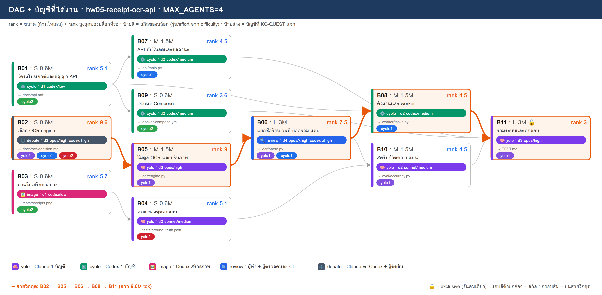
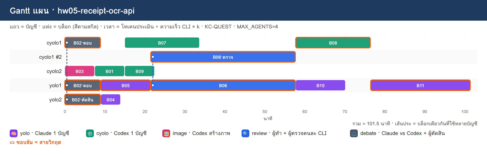

# PLAN · hw05-receipt-ocr-api

**โจทย์:** API อ่านใบเสร็จภาษาไทย (OCR) ด้วย FastAPI มีคิวงาน รันใน Docker และมีรายงานความแม่นยำจากชุดทดสอบ

วางแผนเมื่อ 10/11/2026 10:51 · MAX_AGENTS 4 · บัญชี cyolo1, cyolo2, yolo1, yolo2 · ตัวปรับเวลา k (ยังไม่มี calib.json → k=1)

> แผนนี้ยังไม่ได้รันจริง — KC-QUEST เลือกบัญชีจากโควตา แล้วจำลองเวลาตาม dependency

## 1) โควตาของแต่ละบัญชี

| บัญชี | แพลน | ใช้ไป 5 ชม. | ใช้ไปสัปดาห์ | headroom | รีเซ็ต/หมดอายุ (ชม.) | U | slot | ที่มา |
|---|---|---|---|---|---|---|---|---|
| cyolo1 | default | 10% | 0% | **90%** | 168.0 | 0.125 | 3 | สมมติ (--accounts) |
| cyolo2 | default | 30% | 0% | **70%** | 168.0 | 0.125 | 3 | สมมติ (--accounts) |
| yolo1 | default | 20% | 0% | **80%** | 168.0 | 0.125 | 3 | สมมติ (--accounts) |
| yolo2 | default | 40% | 0% | **60%** | 168.0 | 0.125 | 3 | สมมติ (--accounts) |

- ⚠ ทุกบัญชีเป็นค่าสมมติ (--accounts มี % ครบ) → ไม่ได้เรียก team.py check/quota

## 2) DAG + สกิล + บัญชี

**สายวิกฤต:** B02 → B05 → B06 → B08 → B11 · ยาว 9.6M tok

## 3) ตารางแจกงาน (เหตุผล KC-QUEST ทุกบล็อก)

| บล็อก | สกิล | ชื่อ | ขนาด · c | รอ | rank | บัญชี (บทบาท) | เริ่ม–จบ (นาที) | เหตุผล KC-QUEST |
|---|---|---|---|---|---|---|---|---|
| **B02** | ⚖️ debate | เลือก OCR engine | S · 0.6 | – | 9.6 | yolo1 (ตอบ), cyolo1 (ตอบ), yolo2 (ตัดสิน) | 0.0–9.0 | ตอบ: yolo1 31.8 (U=0.125 F=0.002 S=0.784 S=1.0 L=0.0) · 0.60M ≈ 5ชม. 1.56% / สัปดาห์ 0.2% · อันดับ 2 yolo2 28.8   ตอบ: cyolo1 28.8 (U=0.125 F=0.002 S=0.884 S=0.7 L=0.0) · 0.60M ≈ 5ชม. 1.56% / สัปดาห์ 0.2% · อันดับ 2 cyolo2 25.8   ตัดสิน: yolo2 28.9 (U=0.125 F=0.001 S=0.595 S=1.0 L=0.0) · 0.18M ≈ 5ชม. 0.47% / สัปดาห์ 0.06% · อันดับ 2 cyolo2 25.9 |
| B03 | 🖼️ image | ภาพใบเสร็จตัวอย่าง | S · 0.6 | – | 5.7 | cyolo2 (ทำ) | 0.0–7.5 | ทำ: cyolo2 21.5 (U=0.125 F=0.002 S=0.684 S=0.416 L=0.0) · 0.60M ≈ 5ชม. 1.56% / สัปดาห์ 0.2% · อันดับ 2 cyolo1 21.0 |
| B01 | ⚙️ cyolo | โครงโปรเจกต์และสัญญา API | S · 0.6 | – | 5.1 | cyolo2 (ทำ) | 7.5–15.0 | ทำ: cyolo2 20.7 (U=0.125 F=0.002 S=0.669 S=0.372 L=0.0) · 0.60M ≈ 5ชม. 1.56% / สัปดาห์ 0.2% · อันดับ 2 cyolo1 20.3 |
| **B05** | 🧠 yolo | โมดูล OCR และปรับภาพ | M · 1.5 | B02 | 9 | yolo1 (ทำ) | 9.0–21.5 | ทำ: yolo1 30.3 (U=0.125 F=0.005 S=0.745 S=0.938 L=0.0) · 1.50M ≈ 5ชม. 3.9% / สัปดาห์ 0.49% · อันดับ 2 yolo2 27.5 |
| B04 | 🧠 yolo | เฉลยของชุดทดสอบ | S · 0.6 | B03 | 5.1 | yolo2 (ทำ) | 9.0–14.0 | ทำ: yolo2 21.7 (U=0.125 F=0.002 S=0.58 S=0.531 L=0.0) · 0.60M ≈ 5ชม. 1.56% / สัปดาห์ 0.2% · อันดับ 2 yolo1 20.6 |
| B07 | ⚙️ cyolo | API อัปโหลดและดูสถานะ | M · 1.5 | B01 | 4.5 | cyolo1 (ทำ) | 15.0–33.8 | ทำ: cyolo1 22.7 (U=0.125 F=0.005 S=0.845 S=0.328 L=0.0) · 1.50M ≈ 5ชม. 3.9% / สัปดาห์ 0.49% · อันดับ 2 cyolo2 19.5 |
| B09 | ⚙️ cyolo | Docker Compose | S · 0.6 | B01 | 3.6 | cyolo2 (ทำ) | 15.0–22.5 | ทำ: cyolo2 18.8 (U=0.125 F=0.002 S=0.653 S=0.262 L=0.0) · 0.60M ≈ 5ชม. 1.56% / สัปดาห์ 0.2% · อันดับ 2 cyolo1 18.1 |
| **B06** | 🔍 review | แยกชื่อร้าน วันที่ ยอดรวม และ VAT | L · 3 | B05 | 7.5 | yolo1 (ทำ), cyolo1 (ตรวจ) | 21.5–57.7 | ทำ: yolo1 26.9 (U=0.125 F=0.01 S=0.667 S=0.781 L=0.0) · 3.00M ≈ 5ชม. 7.8% / สัปดาห์ 0.98% · อันดับ 2 yolo2 24.4   ตรวจ: cyolo1 22.3 (U=0.125 F=0.003 S=0.822 S=0.547 L=0.333) · 0.90M ≈ 5ชม. 2.34% / สัปดาห์ 0.29% · อันดับ 2 cyolo2 19.4 |
| **B08** | ⚙️ cyolo | คิวงานและ worker | M · 1.5 | B01, B06 | 4.5 | cyolo1 (ทำ) | 57.7–76.5 | ทำ: cyolo1 21.8 (U=0.125 F=0.005 S=0.783 S=0.328 L=0.0) · 1.50M ≈ 5ชม. 3.9% / สัปดาห์ 0.49% · อันดับ 2 cyolo2 19.2 |
| B10 | 🧠 yolo | สคริปต์วัดความแม่น | M · 1.5 | B04, B06 | 4.5 | yolo1 (ทำ) | 57.7–70.2 | ทำ: yolo1 21.6 (U=0.125 F=0.005 S=0.628 S=0.469 L=0.0) · 1.50M ≈ 5ชม. 3.9% / สัปดาห์ 0.49% · อันดับ 2 yolo2 20.2 |
| **B11** | 🧠 yolo | รวมระบบและทดสอบ | L · 3 | B07, B08, B09, B10 | 3 | yolo1 (ทำ) | 76.5–101.5 | ทำ: yolo1 18.1 (U=0.125 F=0.01 S=0.55 S=0.312 L=0.0) · 3.00M ≈ 5ชม. 7.8% / สัปดาห์ 0.98% · อันดับ 2 yolo2 17.4 |

## 4) Gantt แผน

## 5) รอบแจกงาน

| นาทีที่ | บล็อกที่เริ่ม |
|---|---|
| 0 | B02→yolo1+cyolo1+yolo2, B03→cyolo2 |
| 7.5 | B01→cyolo2 |
| 9 | B05→yolo1, B04→yolo2 |
| 15 | B07→cyolo1, B09→cyolo2 |
| 21.5 | B06→yolo1+cyolo1 |
| 57.7 | B08→cyolo1, B10→yolo1 |
| 76.5 | B11→yolo1 |

## 6) สรุป

- บล็อก 11 · แจกได้ 11 · agent พร้อมกันสูงสุด 4/4
- เวลาประมาณ 101.5 นาที (แท่ง Gantt) · ไฟล์ผลของทีม: `/workspace/plans/hw05-receipt-ocr-api/app/`

ต่อไป: `dagplan.py export hw05-receipt-ocr-api` → `dagplan.py run hw05-receipt-ocr-api` → `dagplan.py report hw05-receipt-ocr-api`
