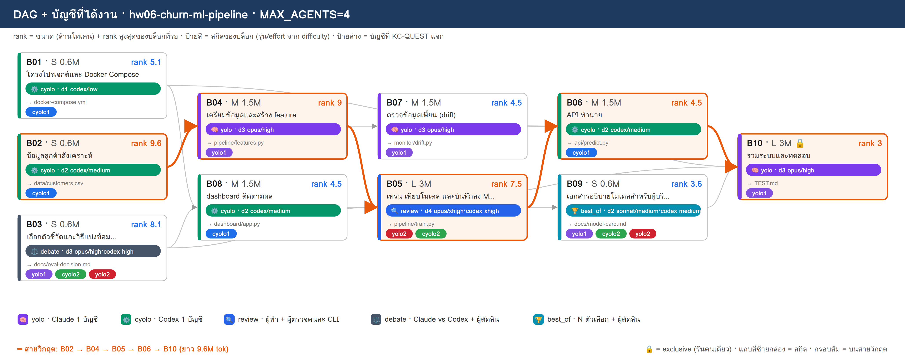
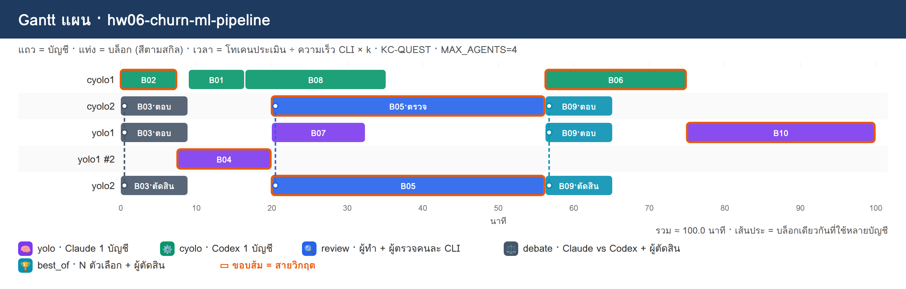

# PLAN · hw06-churn-ml-pipeline

**โจทย์:** pipeline ทำนายลูกค้าเลิกใช้บริการ ตั้งแต่เตรียมข้อมูล เทรนโมเดล เก็บผลการทดลอง เปิดเป็น API และหน้า dashboard ติดตามผล

วางแผนเมื่อ 10/11/2026 10:51 · MAX_AGENTS 4 · บัญชี cyolo1, cyolo2, yolo1, yolo2 · ตัวปรับเวลา k (ยังไม่มี calib.json → k=1)

> แผนนี้ยังไม่ได้รันจริง — KC-QUEST เลือกบัญชีจากโควตา แล้วจำลองเวลาตาม dependency

## 1) โควตาของแต่ละบัญชี

| บัญชี | แพลน | ใช้ไป 5 ชม. | ใช้ไปสัปดาห์ | headroom | รีเซ็ต/หมดอายุ (ชม.) | U | slot | ที่มา |
|---|---|---|---|---|---|---|---|---|
| cyolo1 | default | 10% | 0% | **90%** | 168.0 | 0.125 | 3 | สมมติ (--accounts) |
| cyolo2 | default | 30% | 0% | **70%** | 168.0 | 0.125 | 3 | สมมติ (--accounts) |
| yolo1 | default | 20% | 0% | **80%** | 168.0 | 0.125 | 3 | สมมติ (--accounts) |
| yolo2 | default | 40% | 0% | **60%** | 168.0 | 0.125 | 3 | สมมติ (--accounts) |

- ⚠ ทุกบัญชีเป็นค่าสมมติ (--accounts มี % ครบ) → ไม่ได้เรียก team.py check/quota

## 2) DAG + สกิล + บัญชี

**สายวิกฤต:** B02 → B04 → B05 → B06 → B10 · ยาว 9.6M tok

## 3) ตารางแจกงาน (เหตุผล KC-QUEST ทุกบล็อก)

| บล็อก | สกิล | ชื่อ | ขนาด · c | รอ | rank | บัญชี (บทบาท) | เริ่ม–จบ (นาที) | เหตุผล KC-QUEST |
|---|---|---|---|---|---|---|---|---|
| **B02** | ⚙️ cyolo | ข้อมูลลูกค้าสังเคราะห์ | S · 0.6 | – | 9.6 | cyolo1 (ทำ) | 0.0–7.5 | ทำ: cyolo1 28.8 (U=0.125 F=0.002 S=0.884 S=0.7 L=0.0) · 0.60M ≈ 5ชม. 1.56% / สัปดาห์ 0.2% · อันดับ 2 cyolo2 25.8 |
| B03 | ⚖️ debate | เลือกตัวชี้วัดและวิธีแบ่งข้อมูล | S · 0.6 | – | 8.1 | yolo1 (ตอบ), cyolo2 (ตอบ), yolo2 (ตัดสิน) | 0.0–9.0 | ตอบ: yolo1 29.5 (U=0.125 F=0.002 S=0.784 S=0.844 L=0.0) · 0.60M ≈ 5ชม. 1.56% / สัปดาห์ 0.2% · อันดับ 2 yolo2 26.5   ตอบ: cyolo2 24.2 (U=0.125 F=0.002 S=0.684 S=0.591 L=0.0) · 0.60M ≈ 5ชม. 1.56% / สัปดาห์ 0.2% · อันดับ 2 cyolo1 23.6   ตัดสิน: yolo2 26.6 (U=0.125 F=0.001 S=0.595 S=0.844 L=0.0) · 0.18M ≈ 5ชม. 0.47% / สัปดาห์ 0.06% · อันดับ 2 cyolo1 23.8 |
| **B04** | 🧠 yolo | เตรียมข้อมูลและสร้าง feature | M · 1.5 | B02 | 9 | yolo1 (ทำ) | 7.5–20.0 | ทำ: yolo1 27.0 (U=0.125 F=0.005 S=0.745 S=0.938 L=0.333) · 1.50M ≈ 5ชม. 3.9% / สัปดาห์ 0.49% · อันดับ 2 yolo2 24.2 |
| B01 | ⚙️ cyolo | โครงโปรเจกต์และ Docker Compose | S · 0.6 | – | 5.1 | cyolo1 (ทำ) | 9.0–16.5 | ทำ: cyolo1 23.7 (U=0.125 F=0.002 S=0.869 S=0.372 L=0.0) · 0.60M ≈ 5ชม. 1.56% / สัปดาห์ 0.2% · อันดับ 2 cyolo2 20.7 |
| B08 | ⚙️ cyolo | dashboard ติดตามผล | M · 1.5 | B01, B03 | 4.5 | cyolo1 (ทำ) | 16.5–35.2 | ทำ: cyolo1 22.5 (U=0.125 F=0.005 S=0.83 S=0.328 L=0.0) · 1.50M ≈ 5ชม. 3.9% / สัปดาห์ 0.49% · อันดับ 2 cyolo2 19.7 |
| **B05** | 🔍 review | เทรน เทียบโมเดล และบันทึกลง MLflow | L · 3 | B03, B04 | 7.5 | yolo2 (ทำ), cyolo2 (ตรวจ) | 20.0–56.2 | ทำ: yolo2 24.7 (U=0.125 F=0.01 S=0.517 S=0.781 L=0.0) · 3.00M ≈ 5ชม. 7.8% / สัปดาห์ 0.98% · อันดับ 2 yolo1 23.0   ตรวจ: cyolo2 23.2 (U=0.125 F=0.003 S=0.661 S=0.547 L=0.0) · 0.90M ≈ 5ชม. 2.34% / สัปดาห์ 0.29% · อันดับ 2 cyolo1 22.0 |
| B07 | 🧠 yolo | ตรวจข้อมูลเพี้ยน (drift) | M · 1.5 | B04 | 4.5 | yolo1 (ทำ) | 20.0–32.5 | ทำ: yolo1 22.7 (U=0.125 F=0.005 S=0.706 S=0.469 L=0.0) · 1.50M ≈ 5ชม. 3.9% / สัปดาห์ 0.49% · อันดับ 2 yolo2 20.5 |
| **B06** | ⚙️ cyolo | API ทำนาย | M · 1.5 | B01, B05 | 4.5 | cyolo1 (ทำ) | 56.2–75.0 | ทำ: cyolo1 21.9 (U=0.125 F=0.005 S=0.791 S=0.328 L=0.0) · 1.50M ≈ 5ชม. 3.9% / สัปดาห์ 0.49% · อันดับ 2 cyolo2 19.4 |
| B09 | 🏆 best_of | เอกสารอธิบายโมเดลสำหรับผู้บริหาร | S · 0.6 | B05 | 3.6 | yolo1 (ตอบ), cyolo2 (ตอบ), yolo2 (ตัดสิน) | 56.2–65.2 | ตอบ: yolo1 21.0 (U=0.125 F=0.002 S=0.691 S=0.375 L=0.0) · 0.60M ≈ 5ชม. 1.56% / สัปดาห์ 0.2% · อันดับ 2 cyolo2 18.6   ตอบ: cyolo2 18.6 (U=0.125 F=0.002 S=0.645 S=0.262 L=0.0) · 0.60M ≈ 5ชม. 1.56% / สัปดาห์ 0.2% · อันดับ 2 yolo2 18.2   ตัดสิน: yolo2 18.3 (U=0.125 F=0.001 S=0.513 S=0.375 L=0.0) · 0.18M ≈ 5ชม. 0.47% / สัปดาห์ 0.06% · อันดับ 2 cyolo1 17.4 |
| **B10** | 🧠 yolo | รวมระบบและทดสอบ | L · 3 | B06, B07, B08, B09 | 3 | yolo1 (ทำ) | 75.0–100.0 | ทำ: yolo1 19.1 (U=0.125 F=0.01 S=0.613 S=0.312 L=0.0) · 3.00M ≈ 5ชม. 7.8% / สัปดาห์ 0.98% · อันดับ 2 yolo2 16.4 |

## 4) Gantt แผน

## 5) รอบแจกงาน

| นาทีที่ | บล็อกที่เริ่ม |
|---|---|
| 0 | B02→cyolo1, B03→yolo1+cyolo2+yolo2 |
| 7.5 | B04→yolo1 |
| 9 | B01→cyolo1 |
| 16.5 | B08→cyolo1 |
| 20 | B07→yolo1, B05→yolo2+cyolo2 |
| 56.2 | B06→cyolo1, B09→yolo1+cyolo2+yolo2 |
| 75 | B10→yolo1 |

## 6) สรุป

- บล็อก 10 · แจกได้ 10 · agent พร้อมกันสูงสุด 4/4
- เวลาประมาณ 100.0 นาที (แท่ง Gantt) · ไฟล์ผลของทีม: `/workspace/plans/hw06-churn-ml-pipeline/app/`

ต่อไป: `dagplan.py export hw06-churn-ml-pipeline` → `dagplan.py run hw06-churn-ml-pipeline` → `dagplan.py report hw06-churn-ml-pipeline`
