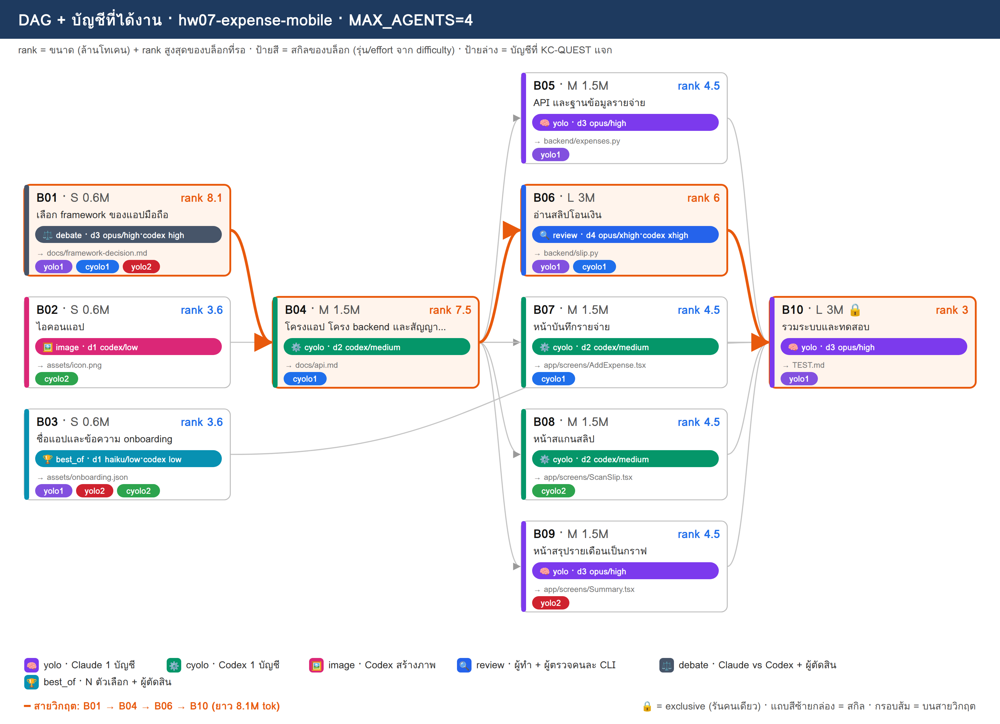
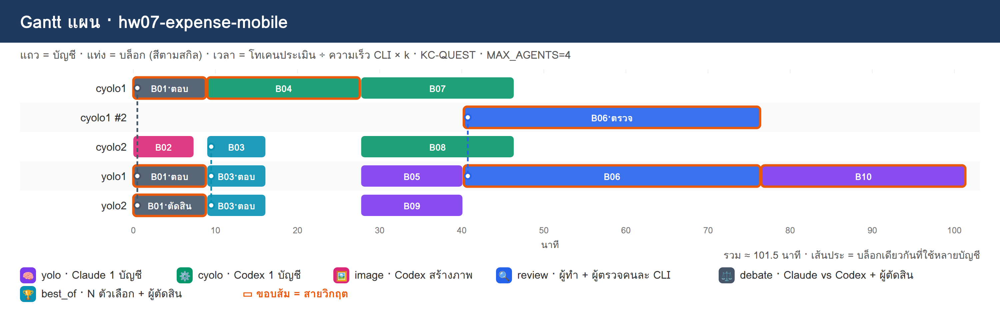

# PLAN · hw07-expense-mobile

**โจทย์:** แอปมือถือบันทึกรายจ่าย สแกนสลิปโอนเงินแล้วกรอกให้อัตโนมัติ มี backend เก็บข้อมูล และสรุปรายจ่ายรายเดือนเป็นกราฟ

วางแผนเมื่อ 10/11/2026 10:51 · MAX_AGENTS 4 · บัญชี cyolo1, cyolo2, yolo1, yolo2 · ตัวปรับเวลา k (ยังไม่มี calib.json → k=1)

> แผนนี้ยังไม่ได้รันจริง — KC-QUEST เลือกบัญชีจากโควตา แล้วจำลองเวลาตาม dependency

## 1) โควตาของแต่ละบัญชี

| บัญชี | แพลน | ใช้ไป 5 ชม. | ใช้ไปสัปดาห์ | headroom | รีเซ็ต/หมดอายุ (ชม.) | U | slot | ที่มา |
|---|---|---|---|---|---|---|---|---|
| cyolo1 | default | 10% | 0% | **90%** | 168.0 | 0.125 | 3 | สมมติ (--accounts) |
| cyolo2 | default | 30% | 0% | **70%** | 168.0 | 0.125 | 3 | สมมติ (--accounts) |
| yolo1 | default | 20% | 0% | **80%** | 168.0 | 0.125 | 3 | สมมติ (--accounts) |
| yolo2 | default | 40% | 0% | **60%** | 168.0 | 0.125 | 3 | สมมติ (--accounts) |

- ⚠ ทุกบัญชีเป็นค่าสมมติ (--accounts มี % ครบ) → ไม่ได้เรียก team.py check/quota

## 2) DAG + สกิล + บัญชี

**สายวิกฤต:** B01 → B04 → B06 → B10 · ยาว 8.1M tok

## 3) ตารางแจกงาน (เหตุผล KC-QUEST ทุกบล็อก)

| บล็อก | สกิล | ชื่อ | ขนาด · c | รอ | rank | บัญชี (บทบาท) | เริ่ม–จบ (นาที) | เหตุผล KC-QUEST |
|---|---|---|---|---|---|---|---|---|
| **B01** | ⚖️ debate | เลือก framework ของแอปมือถือ | S · 0.6 | – | 8.1 | yolo1 (ตอบ), cyolo1 (ตอบ), yolo2 (ตัดสิน) | 0.0–9.0 | ตอบ: yolo1 31.8 (U=0.125 F=0.002 S=0.784 S=1.0 L=0.0) · 0.60M ≈ 5ชม. 1.56% / สัปดาห์ 0.2% · อันดับ 2 yolo2 28.8   ตอบ: cyolo1 28.8 (U=0.125 F=0.002 S=0.884 S=0.7 L=0.0) · 0.60M ≈ 5ชม. 1.56% / สัปดาห์ 0.2% · อันดับ 2 cyolo2 25.8   ตัดสิน: yolo2 28.9 (U=0.125 F=0.001 S=0.595 S=1.0 L=0.0) · 0.18M ≈ 5ชม. 0.47% / สัปดาห์ 0.06% · อันดับ 2 cyolo2 25.9 |
| B02 | 🖼️ image | ไอคอนแอป | S · 0.6 | – | 3.6 | cyolo2 (ทำ) | 0.0–7.5 | ทำ: cyolo2 20.0 (U=0.125 F=0.002 S=0.684 S=0.311 L=0.0) · 0.60M ≈ 5ชม. 1.56% / สัปดาห์ 0.2% · อันดับ 2 cyolo1 19.4 |
| **B04** | ⚙️ cyolo | โครงแอป โครง backend และสัญญา API | M · 1.5 | B01 | 7.5 | cyolo1 (ทำ) | 9.0–27.8 | ทำ: cyolo1 27.5 (U=0.125 F=0.005 S=0.845 S=0.648 L=0.0) · 1.50M ≈ 5ชม. 3.9% / สัปดาห์ 0.49% · อันดับ 2 cyolo2 24.5 |
| B03 | 🏆 best_of | ชื่อแอปและข้อความ onboarding | S · 0.6 | – | 3.6 | yolo1 (ตอบ), yolo2 (ตอบ), cyolo2 (ตัดสิน) | 9.0–16.2 | ตอบ: yolo1 23.2 (U=0.125 F=0.002 S=0.769 S=0.444 L=0.0) · 0.60M ≈ 5ชม. 1.56% / สัปดาห์ 0.2% · อันดับ 2 yolo2 20.4   ตอบ: yolo2 20.4 (U=0.125 F=0.002 S=0.58 S=0.444 L=0.0) · 0.60M ≈ 5ชม. 1.56% / สัปดาห์ 0.2% · อันดับ 2 cyolo2 19.7   ตัดสิน: cyolo2 19.9 (U=0.125 F=0.001 S=0.68 S=0.311 L=0.0) · 0.18M ≈ 5ชม. 0.47% / สัปดาห์ 0.06% · อันดับ 2 cyolo1 19.0 |
| B05 | 🧠 yolo | API และฐานข้อมูลรายจ่าย | M · 1.5 | B04 | 4.5 | yolo1 (ทำ) | 27.8–40.2 | ทำ: yolo1 24.4 (U=0.125 F=0.005 S=0.73 S=0.556 L=0.0) · 1.50M ≈ 5ชม. 3.9% / สัปดาห์ 0.49% · อันดับ 2 yolo2 21.6 |
| B07 | ⚙️ cyolo | หน้าบันทึกรายจ่าย | M · 1.5 | B04 | 4.5 | cyolo1 (ทำ) | 27.8–46.5 | ทำ: cyolo1 23.0 (U=0.125 F=0.005 S=0.806 S=0.389 L=0.0) · 1.50M ≈ 5ชม. 3.9% / สัปดาห์ 0.49% · อันดับ 2 cyolo2 20.5 |
| B08 | ⚙️ cyolo | หน้าสแกนสลิป | M · 1.5 | B04 | 4.5 | cyolo2 (ทำ) | 27.8–46.5 | ทำ: cyolo2 20.5 (U=0.125 F=0.005 S=0.641 S=0.389 L=0.0) · 1.50M ≈ 5ชม. 3.9% / สัปดาห์ 0.49% · อันดับ 2 cyolo1 19.1 |
| B09 | 🧠 yolo | หน้าสรุปรายเดือนเป็นกราฟ | M · 1.5 | B04 | 4.5 | yolo2 (ทำ) | 27.8–40.2 | ทำ: yolo2 21.6 (U=0.125 F=0.005 S=0.541 S=0.556 L=0.0) · 1.50M ≈ 5ชม. 3.9% / สัปดาห์ 0.49% · อันดับ 2 yolo1 20.5 |
| **B06** | 🔍 review | อ่านสลิปโอนเงิน | L · 3 | B04 | 6 | yolo1 (ทำ), cyolo1 (ตรวจ) | 40.2–76.5 | ทำ: yolo1 26.1 (U=0.125 F=0.01 S=0.652 S=0.741 L=0.0) · 3.00M ≈ 5ชม. 7.8% / สัปดาห์ 0.98% · อันดับ 2 yolo2 23.3   ตรวจ: cyolo1 21.3 (U=0.125 F=0.003 S=0.783 S=0.519 L=0.333) · 0.90M ≈ 5ชม. 2.34% / สัปดาห์ 0.29% · อันดับ 2 cyolo2 18.8 |
| **B10** | 🧠 yolo | รวมระบบและทดสอบ | L · 3 | B02, B03, B05, B06, B07, B08, B09 | 3 | yolo1 (ทำ) | 76.5–101.5 | ทำ: yolo1 19.4 (U=0.125 F=0.01 S=0.574 S=0.37 L=0.0) · 3.00M ≈ 5ชม. 7.8% / สัปดาห์ 0.98% · อันดับ 2 yolo2 17.7 |

## 4) Gantt แผน

## 5) รอบแจกงาน

| นาทีที่ | บล็อกที่เริ่ม |
|---|---|
| 0 | B01→yolo1+cyolo1+yolo2, B02→cyolo2 |
| 9 | B04→cyolo1, B03→yolo1+yolo2+cyolo2 |
| 27.8 | B05→yolo1, B07→cyolo1, B08→cyolo2, B09→yolo2 |
| 40.2 | B06→yolo1+cyolo1 |
| 76.5 | B10→yolo1 |

## 6) สรุป

- บล็อก 10 · แจกได้ 10 · agent พร้อมกันสูงสุด 4/4
- เวลาประมาณ 101.5 นาที (แท่ง Gantt) · ไฟล์ผลของทีม: `/workspace/plans/hw07-expense-mobile/app/`

ต่อไป: `dagplan.py export hw07-expense-mobile` → `dagplan.py run hw07-expense-mobile` → `dagplan.py report hw07-expense-mobile`
