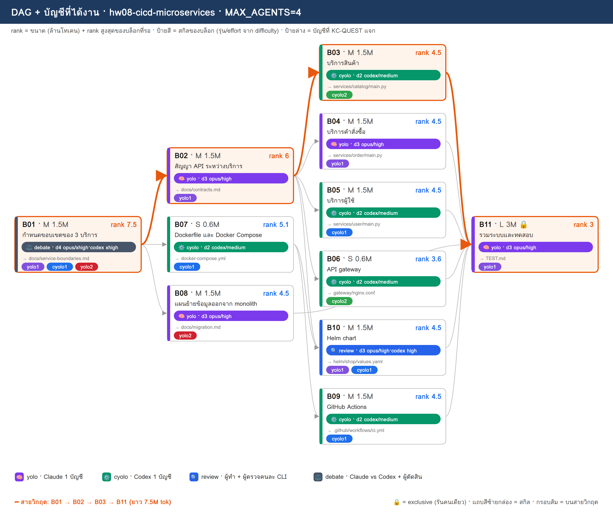
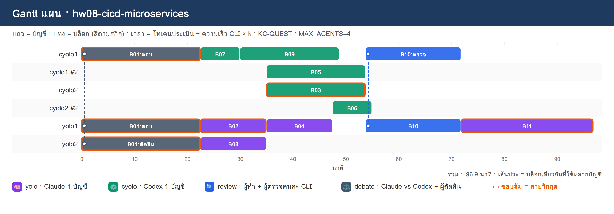

# PLAN · hw08-cicd-microservices

**โจทย์:** แยกระบบร้านค้าเดิม (monolith) เป็น 3 microservices มี API gateway CI/CD ด้วย GitHub Actions และ deploy ขึ้น Kubernetes ด้วย Helm

วางแผนเมื่อ 10/11/2026 10:51 · MAX_AGENTS 4 · บัญชี cyolo1, cyolo2, yolo1, yolo2 · ตัวปรับเวลา k (ยังไม่มี calib.json → k=1)

> แผนนี้ยังไม่ได้รันจริง — KC-QUEST เลือกบัญชีจากโควตา แล้วจำลองเวลาตาม dependency

## 1) โควตาของแต่ละบัญชี

| บัญชี | แพลน | ใช้ไป 5 ชม. | ใช้ไปสัปดาห์ | headroom | รีเซ็ต/หมดอายุ (ชม.) | U | slot | ที่มา |
|---|---|---|---|---|---|---|---|---|
| cyolo1 | default | 10% | 0% | **90%** | 168.0 | 0.125 | 3 | สมมติ (--accounts) |
| cyolo2 | default | 30% | 0% | **70%** | 168.0 | 0.125 | 3 | สมมติ (--accounts) |
| yolo1 | default | 20% | 0% | **80%** | 168.0 | 0.125 | 3 | สมมติ (--accounts) |
| yolo2 | default | 40% | 0% | **60%** | 168.0 | 0.125 | 3 | สมมติ (--accounts) |

- ⚠ ทุกบัญชีเป็นค่าสมมติ (--accounts มี % ครบ) → ไม่ได้เรียก team.py check/quota

## 2) DAG + สกิล + บัญชี

**สายวิกฤต:** B01 → B02 → B03 → B11 · ยาว 7.5M tok

## 3) ตารางแจกงาน (เหตุผล KC-QUEST ทุกบล็อก)

| บล็อก | สกิล | ชื่อ | ขนาด · c | รอ | rank | บัญชี (บทบาท) | เริ่ม–จบ (นาที) | เหตุผล KC-QUEST |
|---|---|---|---|---|---|---|---|---|
| **B01** | ⚖️ debate | กำหนดขอบเขตของ 3 บริการ | M · 1.5 | – | 7.5 | yolo1 (ตอบ), cyolo1 (ตอบ), yolo2 (ตัดสิน) | 0.0–22.5 | ตอบ: yolo1 31.5 (U=0.125 F=0.005 S=0.761 S=1.0 L=0.0) · 1.50M ≈ 5ชม. 3.9% / สัปดาห์ 0.49% · อันดับ 2 yolo2 28.5   ตอบ: cyolo1 28.5 (U=0.125 F=0.005 S=0.861 S=0.7 L=0.0) · 1.50M ≈ 5ชม. 3.9% / สัปดาห์ 0.49% · อันดับ 2 cyolo2 25.5   ตัดสิน: yolo2 28.8 (U=0.125 F=0.001 S=0.588 S=1.0 L=0.0) · 0.45M ≈ 5ชม. 1.17% / สัปดาห์ 0.15% · อันดับ 2 cyolo2 25.8 |
| **B02** | 🧠 yolo | สัญญา API ระหว่างบริการ | M · 1.5 | B01 | 6 | yolo1 (ทำ) | 22.5–35.0 | ทำ: yolo1 27.9 (U=0.125 F=0.005 S=0.722 S=0.8 L=0.0) · 1.50M ≈ 5ชม. 3.9% / สัปดาห์ 0.49% · อันดับ 2 yolo2 25.3 |
| B07 | ⚙️ cyolo | Dockerfile และ Docker Compose | S · 0.6 | B01 | 5.1 | cyolo1 (ทำ) | 22.5–30.0 | ทำ: cyolo1 24.9 (U=0.125 F=0.002 S=0.845 S=0.476 L=0.0) · 0.60M ≈ 5ชม. 1.56% / สัปดาห์ 0.2% · อันดับ 2 cyolo2 22.4 |
| B08 | 🧠 yolo | แผนย้ายข้อมูลออกจาก monolith | M · 1.5 | B01 | 4.5 | yolo2 (ทำ) | 22.5–35.0 | ทำ: yolo2 22.3 (U=0.125 F=0.005 S=0.549 S=0.6 L=0.0) · 1.50M ≈ 5ชม. 3.9% / สัปดาห์ 0.49% · อันดับ 2 yolo1 21.0 |
| B09 | ⚙️ cyolo | GitHub Actions | M · 1.5 | B07 | 4.5 | cyolo1 (ทำ) | 30.0–48.8 | ทำ: cyolo1 23.5 (U=0.125 F=0.005 S=0.806 S=0.42 L=0.0) · 1.50M ≈ 5ชม. 3.9% / สัปดาห์ 0.49% · อันดับ 2 cyolo2 21.3 |
| **B03** | ⚙️ cyolo | บริการสินค้า | M · 1.5 | B02 | 4.5 | cyolo2 (ทำ) | 35.0–53.7 | ทำ: cyolo2 21.3 (U=0.125 F=0.005 S=0.661 S=0.42 L=0.0) · 1.50M ≈ 5ชม. 3.9% / สัปดาห์ 0.49% · อันดับ 2 cyolo1 19.6 |
| B04 | 🧠 yolo | บริการคำสั่งซื้อ | M · 1.5 | B02 | 4.5 | yolo1 (ทำ) | 35.0–47.5 | ทำ: yolo1 24.3 (U=0.125 F=0.005 S=0.683 S=0.6 L=0.0) · 1.50M ≈ 5ชม. 3.9% / สัปดาห์ 0.49% · อันดับ 2 yolo2 21.8 |
| B05 | ⚙️ cyolo | บริการผู้ใช้ | M · 1.5 | B02 | 4.5 | cyolo1 (ทำ) | 35.0–53.7 | ทำ: cyolo1 19.6 (U=0.125 F=0.005 S=0.767 S=0.42 L=0.333) · 1.50M ≈ 5ชม. 3.9% / สัปดาห์ 0.49% · อันดับ 2 cyolo2 17.4 |
| B06 | ⚙️ cyolo | API gateway | S · 0.6 | B02 | 3.6 | cyolo2 (ทำ) | 47.5–55.0 | ทำ: cyolo2 16.4 (U=0.125 F=0.002 S=0.645 S=0.336 L=0.333) · 0.60M ≈ 5ชม. 1.56% / สัปดาห์ 0.2% · อันดับ 2 cyolo1 14.7 |
| B10 | 🔍 review | Helm chart | M · 1.5 | B02, B07 | 4.5 | yolo1 (ทำ), cyolo1 (ตรวจ) | 53.7–71.9 | ทำ: yolo1 23.8 (U=0.125 F=0.005 S=0.644 S=0.6 L=0.0) · 1.50M ≈ 5ชม. 3.9% / สัปดาห์ 0.49% · อันดับ 2 cyolo1 22.3   ตรวจ: cyolo1 22.7 (U=0.125 F=0.001 S=0.756 S=0.42 L=0.0) · 0.45M ≈ 5ชม. 1.17% / สัปดาห์ 0.15% · อันดับ 2 cyolo2 17.5 |
| **B11** | 🧠 yolo | รวมระบบและทดสอบ | L · 3 | B03, B04, B05, B06, B08, B09, B10 | 3 | yolo1 (ทำ) | 71.9–96.9 | ทำ: yolo1 19.7 (U=0.125 F=0.01 S=0.566 S=0.4 L=0.0) · 3.00M ≈ 5ชม. 7.8% / สัปดาห์ 0.98% · อันดับ 2 yolo2 18.3 |

## 4) Gantt แผน

## 5) รอบแจกงาน

| นาทีที่ | บล็อกที่เริ่ม |
|---|---|
| 0 | B01→yolo1+cyolo1+yolo2 |
| 22.5 | B02→yolo1, B07→cyolo1, B08→yolo2 |
| 30 | B09→cyolo1 |
| 35 | B03→cyolo2, B04→yolo1, B05→cyolo1 |
| 47.5 | B06→cyolo2 |
| 53.7 | B10→yolo1+cyolo1 |
| 71.9 | B11→yolo1 |

## 6) สรุป

- บล็อก 11 · แจกได้ 11 · agent พร้อมกันสูงสุด 4/4
- เวลาประมาณ 96.9 นาที (แท่ง Gantt) · ไฟล์ผลของทีม: `/workspace/plans/hw08-cicd-microservices/app/`

ต่อไป: `dagplan.py export hw08-cicd-microservices` → `dagplan.py run hw08-cicd-microservices` → `dagplan.py report hw08-cicd-microservices`
