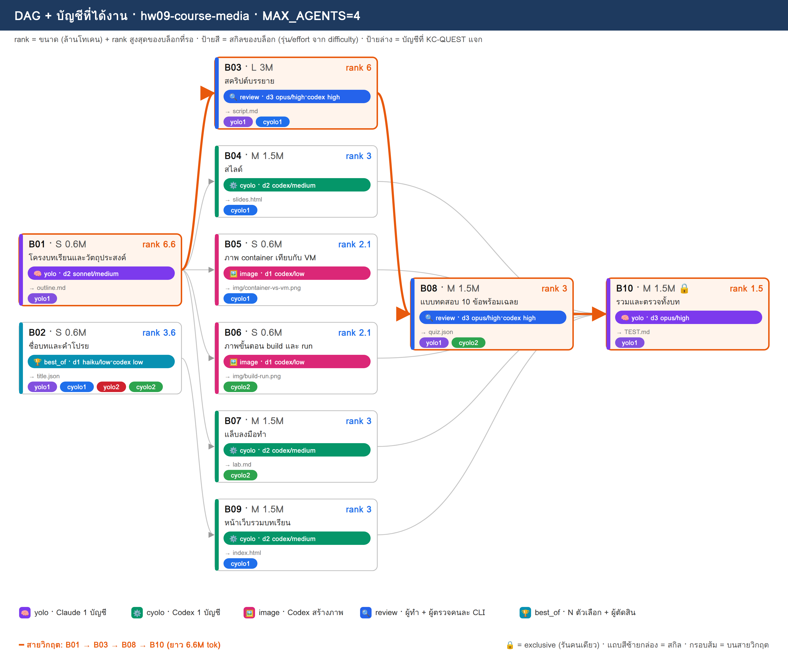
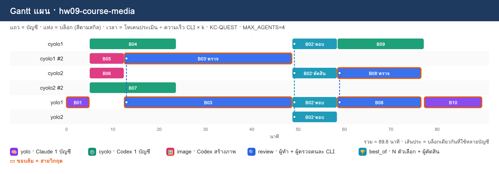

# PLAN · hw09-course-media

**โจทย์:** สื่อการสอนออนไลน์ 1 บทเรื่อง "Docker เบื้องต้น" มีสไลด์ ภาพประกอบ สคริปต์บรรยาย แบบทดสอบ 10 ข้อ และหน้าเว็บรวมทุกอย่าง

วางแผนเมื่อ 10/11/2026 10:51 · MAX_AGENTS 4 · บัญชี cyolo1, cyolo2, yolo1, yolo2 · ตัวปรับเวลา k (ยังไม่มี calib.json → k=1)

> แผนนี้ยังไม่ได้รันจริง — KC-QUEST เลือกบัญชีจากโควตา แล้วจำลองเวลาตาม dependency

## 1) โควตาของแต่ละบัญชี

| บัญชี | แพลน | ใช้ไป 5 ชม. | ใช้ไปสัปดาห์ | headroom | รีเซ็ต/หมดอายุ (ชม.) | U | slot | ที่มา |
|---|---|---|---|---|---|---|---|---|
| cyolo1 | default | 10% | 0% | **90%** | 168.0 | 0.125 | 3 | สมมติ (--accounts) |
| cyolo2 | default | 30% | 0% | **70%** | 168.0 | 0.125 | 3 | สมมติ (--accounts) |
| yolo1 | default | 20% | 0% | **80%** | 168.0 | 0.125 | 3 | สมมติ (--accounts) |
| yolo2 | default | 40% | 0% | **60%** | 168.0 | 0.125 | 3 | สมมติ (--accounts) |

- ⚠ ทุกบัญชีเป็นค่าสมมติ (--accounts มี % ครบ) → ไม่ได้เรียก team.py check/quota

## 2) DAG + สกิล + บัญชี

**สายวิกฤต:** B01 → B03 → B08 → B10 · ยาว 6.6M tok

## 3) ตารางแจกงาน (เหตุผล KC-QUEST ทุกบล็อก)

| บล็อก | สกิล | ชื่อ | ขนาด · c | รอ | rank | บัญชี (บทบาท) | เริ่ม–จบ (นาที) | เหตุผล KC-QUEST |
|---|---|---|---|---|---|---|---|---|
| **B01** | 🧠 yolo | โครงบทเรียนและวัตถุประสงค์ | S · 0.6 | – | 6.6 | yolo1 (ทำ) | 0.0–5.0 | ทำ: yolo1 31.8 (U=0.125 F=0.002 S=0.784 S=1.0 L=0.0) · 0.60M ≈ 5ชม. 1.56% / สัปดาห์ 0.2% · อันดับ 2 yolo2 28.8 |
| B04 | ⚙️ cyolo | สไลด์ | M · 1.5 | B01 | 3 | cyolo1 (ทำ) | 5.0–23.8 | ทำ: cyolo1 22.8 (U=0.125 F=0.005 S=0.861 S=0.319 L=0.0) · 1.50M ≈ 5ชม. 3.9% / สัปดาห์ 0.49% · อันดับ 2 cyolo2 19.8 |
| B07 | ⚙️ cyolo | แล็บลงมือทำ | M · 1.5 | B01 | 3 | cyolo2 (ทำ) | 5.0–23.8 | ทำ: cyolo2 19.8 (U=0.125 F=0.005 S=0.661 S=0.319 L=0.0) · 1.50M ≈ 5ชม. 3.9% / สัปดาห์ 0.49% · อันดับ 2 cyolo1 18.9 |
| B05 | 🖼️ image | ภาพ container เทียบกับ VM | S · 0.6 | B01 | 2.1 | cyolo1 (ทำ) | 5.0–12.5 | ทำ: cyolo1 17.7 (U=0.125 F=0.002 S=0.845 S=0.223 L=0.333) · 0.60M ≈ 5ชม. 1.56% / สัปดาห์ 0.2% · อันดับ 2 cyolo2 14.7 |
| B06 | 🖼️ image | ภาพขั้นตอน build และ run | S · 0.6 | B01 | 2.1 | cyolo2 (ทำ) | 5.0–12.5 | ทำ: cyolo2 14.7 (U=0.125 F=0.002 S=0.645 S=0.223 L=0.333) · 0.60M ≈ 5ชม. 1.56% / สัปดาห์ 0.2% · อันดับ 2 cyolo1 14.2 |
| **B03** | 🔍 review | สคริปต์บรรยาย | L · 3 | B01 | 6 | yolo1 (ทำ), cyolo1 (ตรวจ) | 12.5–48.8 | ทำ: yolo1 29.4 (U=0.125 F=0.01 S=0.706 S=0.909 L=0.0) · 3.00M ≈ 5ชม. 7.8% / สัปดาห์ 0.98% · อันดับ 2 yolo2 26.7   ตรวจ: cyolo1 23.6 (U=0.125 F=0.003 S=0.822 S=0.636 L=0.333) · 0.90M ≈ 5ชม. 2.34% / สัปดาห์ 0.29% · อันดับ 2 cyolo2 20.6 |
| B02 | 🏆 best_of | ชื่อบทและคำโปรย | S · 0.6 | – | 3.6 | yolo1 (ตอบ), cyolo1 (ตอบ), yolo2 (ตอบ), cyolo2 (ตัดสิน) | 48.8–58.5 | ตอบ: yolo1 23.6 (U=0.125 F=0.002 S=0.691 S=0.545 L=0.0) · 0.60M ≈ 5ชม. 1.56% / สัปดาห์ 0.2% · อันดับ 2 cyolo1 22.9   ตอบ: cyolo1 22.9 (U=0.125 F=0.002 S=0.806 S=0.382 L=0.0) · 0.60M ≈ 5ชม. 1.56% / สัปดาห์ 0.2% · อันดับ 2 yolo2 22.0   ตอบ: yolo2 22.0 (U=0.125 F=0.002 S=0.584 S=0.545 L=0.0) · 0.60M ≈ 5ชม. 1.56% / สัปดาห์ 0.2% · อันดับ 2 cyolo2 20.2   ตัดสิน: cyolo2 20.4 (U=0.125 F=0.001 S=0.641 S=0.382 L=0.0) · 0.18M ≈ 5ชม. 0.47% / สัปดาห์ 0.06% |
| **B08** | 🔍 review | แบบทดสอบ 10 ข้อพร้อมเฉลย | M · 1.5 | B03 | 3 | yolo1 (ทำ), cyolo2 (ตรวจ) | 58.5–76.6 | ทำ: yolo1 21.7 (U=0.125 F=0.005 S=0.652 S=0.455 L=0.0) · 1.50M ≈ 5ชม. 3.9% / สัปดาห์ 0.49% · อันดับ 2 yolo2 20.1   ตรวจ: cyolo2 19.2 (U=0.125 F=0.001 S=0.629 S=0.319 L=0.0) · 0.45M ≈ 5ชม. 1.17% / สัปดาห์ 0.15% · อันดับ 2 cyolo1 17.8 |
| B09 | ⚙️ cyolo | หน้าเว็บรวมบทเรียน | M · 1.5 | B02 | 3 | cyolo1 (ทำ) | 58.5–77.2 | ทำ: cyolo1 21.4 (U=0.125 F=0.005 S=0.767 S=0.319 L=0.0) · 1.50M ≈ 5ชม. 3.9% / สัปดาห์ 0.49% · อันดับ 2 cyolo2 18.9 |
| **B10** | 🧠 yolo | รวมและตรวจทั้งบท | M · 1.5 | B04, B05, B06, B07, B08, B09 | 1.5 | yolo1 (ทำ) | 77.2–89.8 | ทำ: yolo1 17.7 (U=0.125 F=0.005 S=0.613 S=0.227 L=0.0) · 1.50M ≈ 5ชม. 3.9% / สัปดาห์ 0.49% · อันดับ 2 yolo2 16.7 |

## 4) Gantt แผน

## 5) รอบแจกงาน

| นาทีที่ | บล็อกที่เริ่ม |
|---|---|
| 0 | B01→yolo1 |
| 5 | B04→cyolo1, B07→cyolo2, B05→cyolo1, B06→cyolo2 |
| 12.5 | B03→yolo1+cyolo1 |
| 48.8 | B02→yolo1+cyolo1+yolo2+cyolo2 |
| 58.5 | B09→cyolo1, B08→yolo1+cyolo2 |
| 77.2 | B10→yolo1 |

## 6) สรุป

- บล็อก 10 · แจกได้ 10 · agent พร้อมกันสูงสุด 4/4
- เวลาประมาณ 89.8 นาที (แท่ง Gantt) · ไฟล์ผลของทีม: `/workspace/plans/hw09-course-media/app/`

ต่อไป: `dagplan.py export hw09-course-media` → `dagplan.py run hw09-course-media` → `dagplan.py report hw09-course-media`
