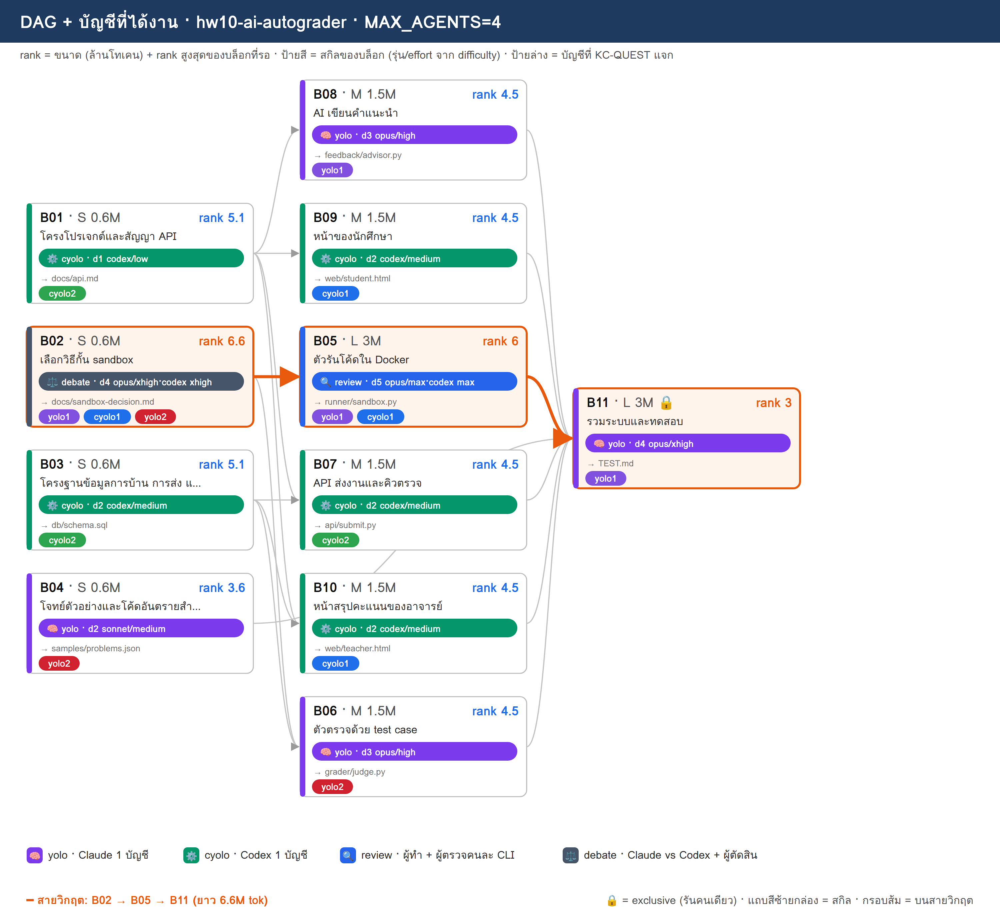
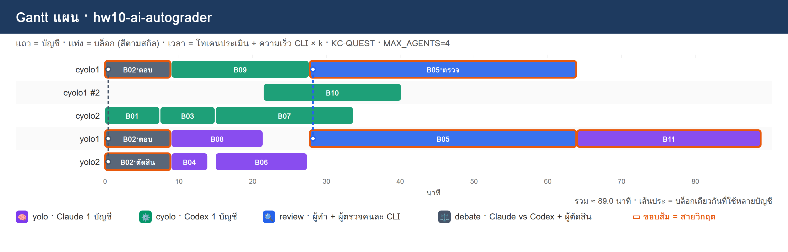

# PLAN · hw10-ai-autograder

**โจทย์:** ระบบส่งการบ้านเขียนโปรแกรม รันโค้ดนักศึกษาใน sandbox (Docker) ตรวจด้วย test case ให้ AI เขียนคำแนะนำ และสรุปคะแนนให้อาจารย์

วางแผนเมื่อ 10/11/2026 10:51 · MAX_AGENTS 4 · บัญชี cyolo1, cyolo2, yolo1, yolo2 · ตัวปรับเวลา k (ยังไม่มี calib.json → k=1)

> แผนนี้ยังไม่ได้รันจริง — KC-QUEST เลือกบัญชีจากโควตา แล้วจำลองเวลาตาม dependency

## 1) โควตาของแต่ละบัญชี

| บัญชี | แพลน | ใช้ไป 5 ชม. | ใช้ไปสัปดาห์ | headroom | รีเซ็ต/หมดอายุ (ชม.) | U | slot | ที่มา |
|---|---|---|---|---|---|---|---|---|
| cyolo1 | default | 10% | 0% | **90%** | 168.0 | 0.125 | 3 | สมมติ (--accounts) |
| cyolo2 | default | 30% | 0% | **70%** | 168.0 | 0.125 | 3 | สมมติ (--accounts) |
| yolo1 | default | 20% | 0% | **80%** | 168.0 | 0.125 | 3 | สมมติ (--accounts) |
| yolo2 | default | 40% | 0% | **60%** | 168.0 | 0.125 | 3 | สมมติ (--accounts) |

- ⚠ ทุกบัญชีเป็นค่าสมมติ (--accounts มี % ครบ) → ไม่ได้เรียก team.py check/quota

## 2) DAG + สกิล + บัญชี

**สายวิกฤต:** B02 → B05 → B11 · ยาว 6.6M tok

## 3) ตารางแจกงาน (เหตุผล KC-QUEST ทุกบล็อก)

| บล็อก | สกิล | ชื่อ | ขนาด · c | รอ | rank | บัญชี (บทบาท) | เริ่ม–จบ (นาที) | เหตุผล KC-QUEST |
|---|---|---|---|---|---|---|---|---|
| **B02** | ⚖️ debate | เลือกวิธีกั้น sandbox | S · 0.6 | – | 6.6 | yolo1 (ตอบ), cyolo1 (ตอบ), yolo2 (ตัดสิน) | 0.0–9.0 | ตอบ: yolo1 31.8 (U=0.125 F=0.002 S=0.784 S=1.0 L=0.0) · 0.60M ≈ 5ชม. 1.56% / สัปดาห์ 0.2% · อันดับ 2 yolo2 28.8   ตอบ: cyolo1 28.8 (U=0.125 F=0.002 S=0.884 S=0.7 L=0.0) · 0.60M ≈ 5ชม. 1.56% / สัปดาห์ 0.2% · อันดับ 2 cyolo2 25.8   ตัดสิน: yolo2 28.9 (U=0.125 F=0.001 S=0.595 S=1.0 L=0.0) · 0.18M ≈ 5ชม. 0.47% / สัปดาห์ 0.06% · อันดับ 2 cyolo2 25.9 |
| B01 | ⚙️ cyolo | โครงโปรเจกต์และสัญญา API | S · 0.6 | – | 5.1 | cyolo2 (ทำ) | 0.0–7.5 | ทำ: cyolo2 23.4 (U=0.125 F=0.002 S=0.684 S=0.541 L=0.0) · 0.60M ≈ 5ชม. 1.56% / สัปดาห์ 0.2% · อันดับ 2 cyolo1 22.9 |
| B03 | ⚙️ cyolo | โครงฐานข้อมูลการบ้าน การส่ง และคะแนน | S · 0.6 | – | 5.1 | cyolo2 (ทำ) | 7.5–15.0 | ทำ: cyolo2 23.2 (U=0.125 F=0.002 S=0.669 S=0.541 L=0.0) · 0.60M ≈ 5ชม. 1.56% / สัปดาห์ 0.2% · อันดับ 2 cyolo1 22.9 |
| B08 | 🧠 yolo | AI เขียนคำแนะนำ | M · 1.5 | B01 | 4.5 | yolo1 (ทำ) | 9.0–21.5 | ทำ: yolo1 26.5 (U=0.125 F=0.005 S=0.745 S=0.682 L=0.0) · 1.50M ≈ 5ชม. 3.9% / สัปดาห์ 0.49% · อันดับ 2 yolo2 23.7 |
| B09 | ⚙️ cyolo | หน้าของนักศึกษา | M · 1.5 | B01 | 4.5 | cyolo1 (ทำ) | 9.0–27.8 | ทำ: cyolo1 24.9 (U=0.125 F=0.005 S=0.845 S=0.477 L=0.0) · 1.50M ≈ 5ชม. 3.9% / สัปดาห์ 0.49% · อันดับ 2 cyolo2 18.4 |
| B04 | 🧠 yolo | โจทย์ตัวอย่างและโค้ดอันตรายสำหรับทดสอบ | S · 0.6 | – | 3.6 | yolo2 (ทำ) | 9.0–14.0 | ทำ: yolo2 21.9 (U=0.125 F=0.002 S=0.58 S=0.545 L=0.0) · 0.60M ≈ 5ชม. 1.56% / สัปดาห์ 0.2% · อันดับ 2 yolo1 20.8 |
| B06 | 🧠 yolo | ตัวตรวจด้วย test case | M · 1.5 | B02, B03 | 4.5 | yolo2 (ทำ) | 15.0–27.5 | ทำ: yolo2 23.4 (U=0.125 F=0.005 S=0.541 S=0.682 L=0.0) · 1.50M ≈ 5ชม. 3.9% / สัปดาห์ 0.49% · อันดับ 2 yolo1 22.6 |
| B07 | ⚙️ cyolo | API ส่งงานและคิวตรวจ | M · 1.5 | B01, B03 | 4.5 | cyolo2 (ทำ) | 15.0–33.8 | ทำ: cyolo2 21.7 (U=0.125 F=0.005 S=0.63 S=0.477 L=0.0) · 1.50M ≈ 5ชม. 3.9% / สัปดาห์ 0.49% · อันดับ 2 cyolo1 21.0 |
| B10 | ⚙️ cyolo | หน้าสรุปคะแนนของอาจารย์ | M · 1.5 | B01, B03 | 4.5 | cyolo1 (ทำ) | 21.5–40.2 | ทำ: cyolo1 21.0 (U=0.125 F=0.005 S=0.806 S=0.477 L=0.333) · 1.50M ≈ 5ชม. 3.9% / สัปดาห์ 0.49% · อันดับ 2 cyolo2 17.8 |
| **B05** | 🔍 review | ตัวรันโค้ดใน Docker | L · 3 | B02 | 6 | yolo1 (ทำ), cyolo1 (ตรวจ) | 27.8–64.0 | ทำ: yolo1 28.8 (U=0.125 F=0.01 S=0.667 S=0.909 L=0.0) · 3.00M ≈ 5ชม. 7.8% / สัปดาห์ 0.98% · อันดับ 2 yolo2 25.8   ตรวจ: cyolo1 23.0 (U=0.125 F=0.003 S=0.783 S=0.636 L=0.333) · 0.90M ≈ 5ชม. 2.34% / สัปดาห์ 0.29% · อันดับ 2 cyolo2 20.4 |
| **B11** | 🧠 yolo | รวมระบบและทดสอบ | L · 3 | B04, B05, B06, B07, B08, B09, B10 | 3 | yolo1 (ทำ) | 64.0–89.0 | ทำ: yolo1 20.9 (U=0.125 F=0.01 S=0.589 S=0.455 L=0.0) · 3.00M ≈ 5ชม. 7.8% / สัปดาห์ 0.98% · อันดับ 2 yolo2 19.0 |

## 4) Gantt แผน

## 5) รอบแจกงาน

| นาทีที่ | บล็อกที่เริ่ม |
|---|---|
| 0 | B02→yolo1+cyolo1+yolo2, B01→cyolo2 |
| 7.5 | B03→cyolo2 |
| 9 | B08→yolo1, B09→cyolo1, B04→yolo2 |
| 15 | B06→yolo2, B07→cyolo2 |
| 21.5 | B10→cyolo1 |
| 27.8 | B05→yolo1+cyolo1 |
| 64 | B11→yolo1 |

## 6) สรุป

- บล็อก 11 · แจกได้ 11 · agent พร้อมกันสูงสุด 4/4
- เวลาประมาณ 89.0 นาที (แท่ง Gantt) · ไฟล์ผลของทีม: `/workspace/plans/hw10-ai-autograder/app/`

ต่อไป: `dagplan.py export hw10-ai-autograder` → `dagplan.py run hw10-ai-autograder` → `dagplan.py report hw10-ai-autograder`
