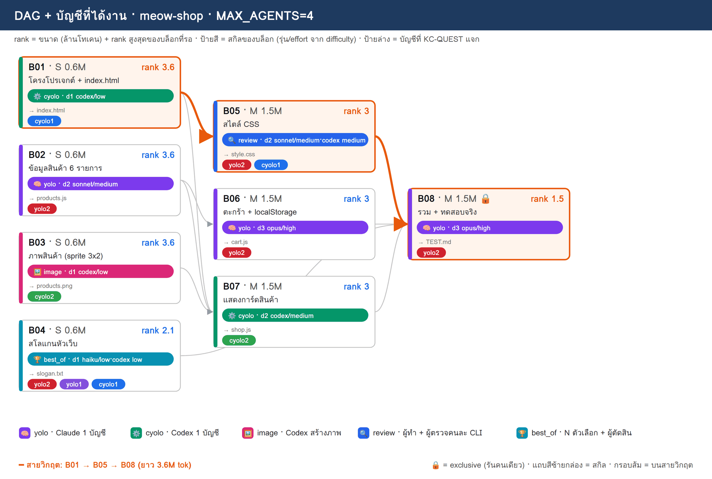
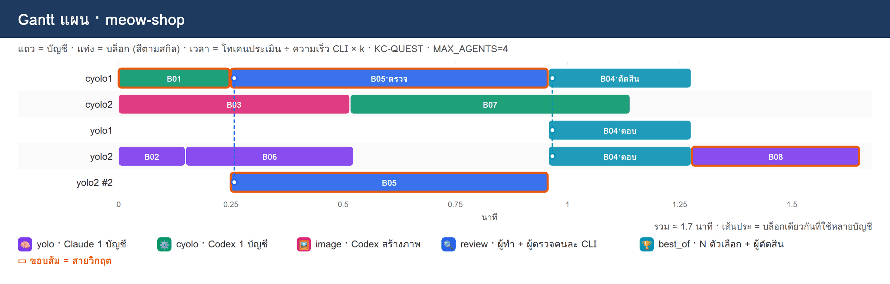

# PLAN · meow-shop

**โจทย์:** เว็บร้านอาหารแมว 'เหมียวช็อป' หน้าเดียว (HTML+CSS+JS ไม่มี server) มีสินค้า 6 รายการพร้อมรูป ตะกร้าสินค้าที่จำได้หลังรีเฟรช (localStorage) และสโลแกนหัวเว็บ พร้อมทดสอบว่าใช้งานได้จริง

วางแผนเมื่อ 08/11/2026 10:22 · MAX_AGENTS 4 · บัญชี cyolo1, cyolo2, yolo1, yolo2 · ตัวปรับเวลา k {"cyolo": 0.0333, "image": 0.0689, "review": 0.0391, "yolo": 0.03, "*": 0.044}

> แผนนี้ยังไม่ได้รันจริง — KC-QUEST เลือกบัญชีจากโควตา แล้วจำลองเวลาตาม dependency

## 1) โควตาของแต่ละบัญชี

| บัญชี | แพลน | ใช้ไป 5 ชม. | ใช้ไปสัปดาห์ | headroom | รีเซ็ต/หมดอายุ (ชม.) | U | slot | ที่มา |
|---|---|---|---|---|---|---|---|---|
| cyolo1 | prolite | 0% | 2% | **98%** | 146.0 | 0.141 | 3 | team.py quota |
| cyolo2 | prolite | 0% | 2% | **98%** | 146.0 | 0.141 | 3 | team.py quota |
| yolo1 | max | 0% | 22% | **78%** | 91.6 | 0.208 | 3 | team.py quota |
| yolo2 | team | 2% | 2% | **98%** | 26.6 | 0.474 | 3 | team.py quota |

## 2) DAG + สกิล + บัญชี

**สายวิกฤต:** B01 → B05 → B08 · ยาว 3.6M tok

## 3) ตารางแจกงาน (เหตุผล KC-QUEST ทุกบล็อก)

| บล็อก | สกิล | ชื่อ | ขนาด · c | รอ | rank | บัญชี (บทบาท) | เริ่ม–จบ (นาที) | เหตุผล KC-QUEST |
|---|---|---|---|---|---|---|---|---|
| **B01** | ⚙️ cyolo | โครงโปรเจกต์ + index.html | S · 0.6 | – | 3.6 | cyolo1 (ทำ) | 0.0–0.2 | ทำ: cyolo1 30.9 (U=0.141 F=0.002 S=0.984 S=0.7 L=0.0) · 0.60M ≈ 5ชม. 1.56% / สัปดาห์ 0.2% · อันดับ 2 cyolo2 30.9 |
| B02 | 🧠 yolo | ข้อมูลสินค้า 6 รายการ | S · 0.6 | – | 3.6 | yolo2 (ทำ) | 0.0–0.1 | ทำ: yolo2 48.5 (U=0.474 F=0.002 S=0.964 S=1.0 L=0.0) · 0.60M ≈ 5ชม. 1.56% / สัปดาห์ 0.2% · อันดับ 2 yolo1 38.2 |
| B03 | 🖼️ image | ภาพสินค้า (sprite 3x2) | S · 0.6 | – | 3.6 | cyolo2 (ทำ) | 0.0–0.5 | ทำ: cyolo2 30.9 (U=0.141 F=0.002 S=0.984 S=0.7 L=0.0) · 0.60M ≈ 5ชม. 1.56% / สัปดาห์ 0.2% · อันดับ 2 cyolo1 27.4 |
| B06 | 🧠 yolo | ตะกร้า + localStorage | M · 1.5 | B02 | 3 | yolo2 (ทำ) | 0.1–0.5 | ทำ: yolo2 45.4 (U=0.474 F=0.005 S=0.925 S=0.833 L=0.0) · 1.50M ≈ 5ชม. 3.9% / สัปดาห์ 0.49% · อันดับ 2 yolo1 35.6 |
| **B05** | 🔍 review | สไตล์ CSS | M · 1.5 | B01 | 3 | yolo2 (ทำ), cyolo1 (ตรวจ) | 0.2–1.0 | ทำ: yolo2 41.5 (U=0.474 F=0.005 S=0.886 S=0.833 L=0.333) · 1.50M ≈ 5ชม. 3.9% / สัปดาห์ 0.49% · อันดับ 2 yolo1 35.6   ตรวจ: cyolo1 29.0 (U=0.141 F=0.001 S=0.973 S=0.583 L=0.0) · 0.45M ≈ 5ชม. 1.17% / สัปดาห์ 0.15% · อันดับ 2 cyolo2 25.7 |
| B07 | ⚙️ cyolo | แสดงการ์ดสินค้า | M · 1.5 | B01, B02, B03 | 3 | cyolo2 (ทำ) | 0.5–1.1 | ทำ: cyolo2 28.7 (U=0.141 F=0.005 S=0.945 S=0.583 L=0.0) · 1.50M ≈ 5ชม. 3.9% / สัปดาห์ 0.49% · อันดับ 2 cyolo1 25.2 |
| B04 | 🏆 best_of | สโลแกนหัวเว็บ | S · 0.6 | – | 2.1 | yolo2 (ตอบ), yolo1 (ตอบ), cyolo1 (ตัดสิน) | 1.0–1.3 | ตอบ: yolo2 40.8 (U=0.474 F=0.002 S=0.871 S=0.583 L=0.0) · 0.60M ≈ 5ชม. 1.56% / สัปดาห์ 0.2% · อันดับ 2 yolo1 32.0   ตอบ: yolo1 32.0 (U=0.208 F=0.001 S=0.992 S=0.583 L=0.0) · 0.60M ≈ 5ชม. 0.78% / สัปดาห์ 0.09% · อันดับ 2 cyolo1 26.2   ตัดสิน: cyolo1 26.3 (U=0.141 F=0.001 S=0.968 S=0.408 L=0.0) · 0.18M ≈ 5ชม. 0.47% / สัปดาห์ 0.06% · อันดับ 2 cyolo2 22.6 |
| **B08** | 🧠 yolo | รวม + ทดสอบจริง | M · 1.5 | B04, B05, B06, B07 | 1.5 | yolo2 (ทำ) | 1.3–1.7 | ทำ: yolo2 37.8 (U=0.474 F=0.005 S=0.832 S=0.417 L=0.0) · 1.50M ≈ 5ชม. 3.9% / สัปดาห์ 0.49% · อันดับ 2 yolo1 29.2 |

## 4) Gantt แผน

## 5) รอบแจกงาน

| นาทีที่ | บล็อกที่เริ่ม |
|---|---|
| 0 | B01→cyolo1, B02→yolo2, B03→cyolo2 |
| 0.1 | B06→yolo2 |
| 0.2 | B05→yolo2+cyolo1 |
| 0.5 | B07→cyolo2 |
| 1 | B04→yolo2+yolo1+cyolo1 |
| 1.3 | B08→yolo2 |

## 6) สรุป

- บล็อก 8 · แจกได้ 8 · agent พร้อมกันสูงสุด 4/4
- เวลาประมาณ 1.7 นาที (แท่ง Gantt) · ไฟล์ผลของทีม: `/workspace/plans/meow-shop/app/`

ต่อไป: `dagplan.py export meow-shop` → `dagplan.py run meow-shop` → `dagplan.py report meow-shop`
