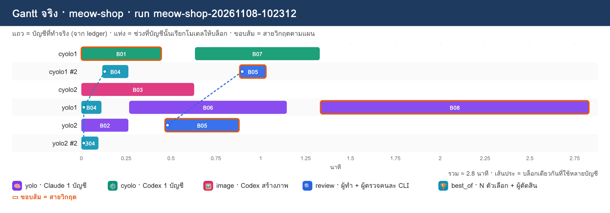
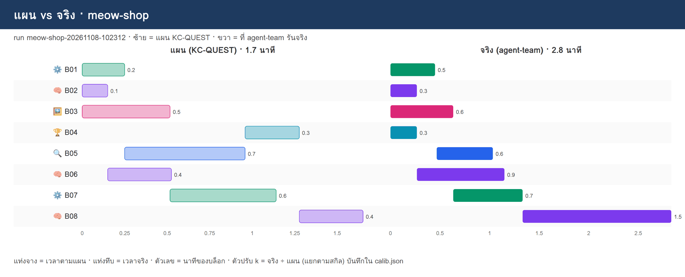

# REPORT · meow-shop

**run:** `meow-shop-20261108-102312` · `/workspace/.agent-team/meow-shop-20261108-102312` · โจทย์: เว็บร้านอาหารแมว 'เหมียวช็อป' หน้าเดียว (HTML+CSS+JS ไม่มี server) มีสินค้า 6 รายการพร้อมรูป ตะกร้าสินค้าที่จำได้หลังรีเฟรช (localStorage) และสโลแกนหัวเว็บ พร้อมทดสอบว่าใช้งานได้จริง

## ตารางบล็อก (แผน vs จริง)

| บล็อก | สกิล | บัญชีแผน | บัญชีจริง | นาทีแผน | นาทีจริง | tokens (in+out) | ครั้ง | สถานะ | ไฟล์ผล |
|---|---|---|---|---|---|---|---|---|---|
| **B01** | ⚙️ cyolo | cyolo1(ทำ) | cyolo1(ทำ) | 0.25 | 0.45 | 59,754 (58,764+990) | 1 | done | ✅ index.html |
| B02 | 🧠 yolo | yolo2(ทำ) | yolo2(ทำ) | 0.15 | 0.27 | 86,606 (85,179+1,427) | 1 | done | ✅ products.js |
| B03 | 🖼️ image | cyolo2(ทำ) | cyolo2(ทำ) | 0.52 | 0.63 | 170,862 (170,177+685) | 1 | done | ✅ products.png |
| B04 | 🏆 best_of | yolo2(ตอบ), yolo1(ตอบ), cyolo1(ตัดสิน) | yolo2(ตอบ), yolo1(ตอบ), cyolo1(ตัดสิน) | 0.32 | 0.27 | 98,997 (97,620+1,377) | 3 | done | ✅ slogan.txt |
| **B05** | 🔍 review | yolo2(ทำ), cyolo1(ตรวจ) | yolo2(ทำ), cyolo1(ตรวจ) | 0.71 | 0.57 | 166,422 (163,460+2,962) | 2 | done | ✅ style.css |
| B06 | 🧠 yolo | yolo2(ทำ) | yolo1(ทำ) | 0.37 | 0.88 | 171,320 (166,056+5,264) | 1 | done | ✅ cart.js |
| B07 | ⚙️ cyolo | cyolo2(ทำ) | cyolo1(ทำ) | 0.62 | 0.70 | 106,023 (104,463+1,560) | 1 | done | ✅ shop.js |
| **B08** | 🧠 yolo | yolo2(ทำ) | yolo1(ทำ) | 0.38 | 1.50 | 464,823 (456,265+8,558) | 1 | done | ✅ TEST.md |

- tokens รวมของบล็อก **1,324,807** = ผลรวมจาก ledger ของ run (11 การเรียก) **1,324,807** ✅ ตรงกัน
- การเรียกที่ไม่ใช่บล็อก (ตรวจความพร้อม ฯลฯ): 0 ครั้ง · 0 tokens (ไม่นับในตาราง)
- เวลารวม: แผน 1.7 นาที · จริง 2.8 นาที
- บล็อกเสร็จ 8/8

## ภาพ

## ความต่างระหว่างแผนกับของจริง

- B06: แผน yolo2(ทำ) → จริง yolo1(ทำ)
- B07: แผน cyolo2(ทำ) → จริง cyolo1(ทำ)
- B08: แผน yolo2(ทำ) → จริง yolo1(ทำ)
- (export ส่งเป็นฝั่ง yolo/cyolo ไม่ผูกบัญชี เพื่อให้ failover ของ agent-team ทำงาน → agent-team เลือกบัญชีในฝั่งเองตามโหลด/โควตา ดู references/run.md)

## ตัวปรับเวลา k (calib.json)

`/workspace/plans/calib.json`: {"cyolo": 0.0438, "yolo": 0.0884, "image": 0.0844, "best_of": 0.0368, "review": 0.0313}

k = นาทีจริง ÷ นาทีแผน (ก่อนคูณ k) แยกตามสกิล · `plan` ครั้งถัดไปคูณเวลาแต่ละบล็อกด้วย k ของสกิลนั้น
